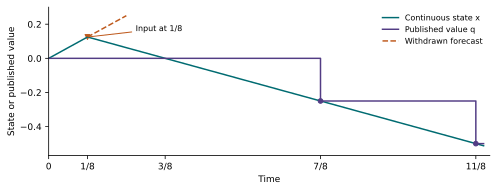

# From DEVS to QSS

**Why a continuous trajectory can be advanced by discrete events**

A ball follows a continuous trajectory between impacts. A tank can rise continuously for hours without a physical switch. Either can be simulated by a Quantized State System (QSS). The event that advances a quantizer is a change in the information a component sends to its neighbours. An impact or controller switch is an event of the physical model. The distinction starts with Bernard Zeigler's *Discrete Event System Specification* (DEVS) formalism. [Zeigler, *Theory of Modelling and Simulation*, 1976](https://books.google.com/books?vid=ISBN0471981524) · [Kofman and Junco, 2001](https://www.fceia.unr.edu.ar/~kofman/files/qss.pdf)

## How the numerical method developed

| Year | Contribution | Consequence for a solver |
|---|---|---|
| 1976 | Zeigler expressed an atomic discrete-event model through its state, inputs, outputs, transitions and time advance. Coupling routes one component's outputs to another's inputs. | A component can announce when it will next act and revise that prediction on receipt of an input. Physical time can take real values. [First edition](https://books.google.com/books?vid=ISBN0471981524) |
| 1998 | Zeigler and Lee investigated quantization as a basis for communicating continuous-system changes in a DEVS/HLA distributed simulation. | A state crossing a level can generate a message. The choice of levels and the treatment of reversals become numerical questions. [Zeigler and Lee](https://doi.org/10.1117/12.319354) |
| 2001 | Kofman and Junco formulated hysteretic QSS. For piecewise-constant inputs, the first-order continuous approximation is piecewise linear, and the quantized signal is piecewise constant. They gave an exact DEVS realization of the quantized model and convergence results under stated hypotheses. | The DEVS realization reproduces the chosen quantized trajectory. Its deviation from the original ODE depends on the quantum, the equations and the observation interval. [Original QSS paper](https://www.fceia.unr.edu.ar/~kofman/files/qss.pdf) |
| 2002–2004 | QSS2 introduced piecewise-linear quantized signals. Kofman then described continuous modes, guards and discrete changes within a common event simulation. | A slope message can represent a long ramp economically. A guard still needs its own crossing prediction and reset. [QSS2, 2002](https://doi.org/10.1177/0037549702078002206) · [Hybrid systems, 2004](https://doi.org/10.1137/S1064827502418379) |
| 2012–2014 | Backward and linearly implicit quantization addressed fast, stable feedback. Fernández and Kofman implemented a stand-alone QSS solver using the dependencies among state equations. | Stiff feedback and sparse scheduling address different costs. The numerical QSS construction can run directly on an ODE without a general-purpose DEVS simulator. [Backward QSS](https://doi.org/10.1177/0037549711403645) · [LIQSS](https://www.sce.carleton.ca/faculty/wainer/papers/1-s2.0-S1569190X13000403-main.pdf) · [Stand-alone solver, 2014](https://doi.org/10.1177/0037549714536255) |

In a classical atomic DEVS model, the time advance schedules the next internal transition. At that instant an output function produces the message from the pre-transition state. An earlier external input calls the external transition with the elapsed time, so the model can update its state and choose a new time advance. Coincident input and internal events require an explicit ordering or confluent transition rule in the chosen formalism. The repository's restricted NSA-DEVS scheduler orders callbacks by macro time, microstep, priority and insertion order. The continuous solvers also have a stand-alone entry point. [Scheduler](../nsa_devs/scheduler.py) · [Solver guide](../QSS_SOLVERS.md)

## A quantizer receives an external event

Start at $x=q=0$ with a QSS1 quantum of $1/4$ and a slope of $+1$. With this input the component predicts its first output at $t=1/4$. At $t=1/8$ another component supplies a new slope of $-1/2$. The continuous state has reached $1/8$. The published value $q$ is still zero, so the next lower boundary is $-1/4$. The state must travel $3/8$ at speed $1/2$. The new time advance is $3/4$ and the next output occurs at $7/8$. The following output occurs at $11/8$.



The dashed forecast in the figure is withdrawn at the input event. If the model also contains a downward guard at $x=0$, the physical crossing occurs at $t=3/8$, between quantizer outputs. A hybrid solver must locate that crossing and apply its reset. In the regression, an exact-rational callback schedule cancels the old output. An independent run of the public QSS1 integrator receives the slope change from a second quantized state. Both reproduce the two predicted output times and values. [Executable trace](../tests/test_qss_devs_trace.py)

**A numerical choice for continuous systems.** QSS predicts the next boundary for each component. Embedded Runge–Kutta (RK) advances the whole state over a trial time interval and adjusts the next step using an error estimate. Asynchronous updates can save work when long polynomial segments describe the motion or when few dependencies change. Dense coupling can make one update affect almost every derivative. Oscillatory phase drift can demand a very fine quantum even without a single physical switch. Compare cost at the same physical accuracy. The Python QSS backend evaluates a dense RHS, whereas the published stand-alone solver exploits sparse dependencies. [Architecture](https://www.fceia.unr.edu.ar/~kofman/files/qss_solver_v4.pdf) · [Five analytical comparisons](SOLVER_SELECTION.md#measured-results)

DEVS specifies event behaviour and coupling. A differential-algebraic equation (DAE) specifies differential and algebraic constraints. They can describe different aspects of one model. Kofman separately developed QSS approximations for regular index-one DAEs. The repository's direct residual DAE backend uses IDAS. [Index-one DAE study](https://doi.org/10.1177/0037549703038881) · [Implemented DAE interface](SOLVER_METHODS.md#idas-for-a-residual-form-dae)

## Two embedded RK pairs for comparison

An embedded pair uses two formulas with shared stages. Both implementations advance the third-order state and use the difference from the second-order state to choose the next step. Their stability properties differ.

| Runtime method | What happens during a trial | When to try it |
|---|---|---|
| `rk23` | Bogacki–Shampine uses four explicit stages. The accepted endpoint derivative becomes the first derivative of the next trial. On $y'=\lambda y$ its amplification is $1+z+z^2/2+z^3/6$, with $z=h\lambda$. | Smooth, nonstiff dynamics at modest accuracy. On a rapidly decaying mode, a large time step can amplify the numerical state. [Original pair, 1989](https://doi.org/10.1016/0893-9659(89)90079-7) |
| `esdirk32` | Kværnø's ESDIRK 3/2a has one explicit stage and three implicit stages with the same diagonal coefficient. Stages three and four both approximate the endpoint. Their difference estimates error. The advancing formula is L-stable, so its amplification tends to zero for a very fast negative real mode. | Stiff ODEs where fast transients decay while slow dynamics still matter. Each trial factors a dense stage matrix and reuses it for simplified Newton iterations. An analytic Jacobian is optional. [Kværnø, §3](https://www.math.ntnu.no/preprint/numerics/2004/N1-2004.pdf) |

For example, $y'=-1000(y-\cos t)-\sin t$ started at $y(0)=1$ has exact solution $\cos t$. A perturbation decays with rate 1000 even where the observed curve varies slowly. The implicit pair can take the exact state Jacobian for this equation.

```python
from math import cos, sin
from argesim_benchmarks import InitialValueProblem, esdirk32

p = InitialValueProblem(lambda t, y: (-1000*(y[0]-cos(t))-sin(t),), 0, (1,), 3)
r = esdirk32(p, jacobian=lambda t, y: ((-1000,),), rtol=1e-6, atol=1e-9)
```

The runtime also accepts `solve_ivp(p, "rk23")` and `solve_ivp(p, "esdirk32")`. Both take component absolute tolerances and support directed hybrid guards and resets. A rejected trial leaves the last accepted state intact. Tests check third-order convergence, the embedded error, the amplification functions, a coupled pivot, a failed implicit solve and a nonlinear forced trajectory. [Implementation](../argesim_benchmarks/solvers/embedded23.py) · [Independent numerical regressions](../tests/test_embedded23.py)

## Evidence at the same physical target

The follow-up uses the original five analytical probes, the stiff C05 two-state switch and the C12 contact chain. The analytical runs check four horizons. C05 requires all three switching times within 1 ms and both terminal states within 0.006. C12 checks the order and times of three contacts and the outgoing speeds. At each of three settings the adaptive RK pairs, Radau and BDF share relative and component absolute tolerances. QSS uses the published quantum grid and the same observable test. [Equations and thresholds](SOLVER_SELECTION.md#what-the-new-experiment-measures)

<!-- BEGIN RK23 RESULTS -->
Of 138 settings, 108 met the target, 18 finished outside tolerance, 2 returned the wrong event count, 6 reached the time limit and 4 stopped on a solver error or work budget. Cells count passes out of three. A dash means the method was outside this case’s grid.

| Case | rk23 | esdirk32 | rk45 | Radau | BDF | qss2 | eliqss2 |
|---|---|---|---|---|---|---|---|
| Decay | 2 | 3 | 3 | 3 | 3 | 2 | 2 |
| Oscillator | 2 | 3 | 2 | 3 | 2 | 0 | 0 |
| Diagonal | 3 | 3 | 3 | 3 | 3 | 2 | 2 |
| Rotated | 3 | 3 | 3 | 3 | 3 | 3 | 2 |
| Tracking | 3 | 3 | 3 | 3 | 3 | 2 | 3 |
| C05 | 0 | 2 | 0 | 3 | 2 | 0 | 0 |
| C12 | 3 | 3 | 3 | — | — | 3 | — |
<!-- END RK23 RESULTS -->

**C05 separates damping from switch-time accuracy.** Explicit RK23 exhausted 40,000 trial steps at all three tolerances. ESDIRK32 recovered the three switches, but the coarsest run exceeded the combined allowance by a factor of 6.26. At the middle setting its score fell to 0.0889 and at the finest to 0.000947. Radau passed all three, BDF two. L-stability permits larger steps across a decaying mode. The remaining event and terminal-state error still has to be measured.

**Continuous motion can favor either approach.** On the stiff tracking ODE, at the loosest setting RK23 used 72,295 RHS calls, ESDIRK32 used 889 and eLIQSS2 used 638. All passed the same four-horizon accuracy test. On the smooth oscillator both tested QSS variants missed at every quantum, while RK23 and RK45 passed at two tolerances each. On C12, where constant-velocity segments are exactly representable by QSS2, all four candidates passed. QSS2 used 36 RHS evaluations, explicit RK23 used 139, RK45 used 148 and ESDIRK32 used 414. These figures include native guard work and any numerical Jacobians. SciPy counts RHS work differently for numerical Jacobians. [Work and scores by setting](evidence/rk23-devs.csv)

Reproduce the 138-row experiment with `OPENBLAS_NUM_THREADS=1 OMP_NUM_THREADS=1 python benchmarks/benchmark_solver_selection.py --profile rk23 --output rk23.csv`. The archived run was pinned to one CPU and used one warm-up, three measured repetitions and a two-second wall-clock limit per repetition. Elapsed times support comparisons within this run. A native ESDIRK trial factors one matrix, so its LU count is the sum of accepted and rejected trials on completed runs. SciPy reports its own `nlu`. [Raw measurements](evidence/rk23-devs.csv) · [Environment and hashes](evidence/rk23-devs.json)
