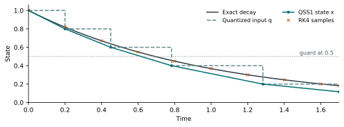

# How the solvers advance a model

A solver choice starts with the equation supplied by the model. A right-hand side returns derivatives for known states. A DAE residual returns equation defects for a proposed state, derivative and algebraic variable. A discrete-event scheduler advances to the next queued event. These are different computational problems. The original eight-case study measured 18 quantized names. The selection experiment adds BQSS1 and two logarithmic-quantum configurations, and includes implicit classical solvers. A separate circuit experiment exercises the residual DAE interface. [Measurements and selection guide](SOLVER_SELECTION.md)

## Quantization, error and physical events

For an autonomous ODE the quantized solver evolves a continuous approximation `x` using the derivative evaluated at a quantized approximation `q`. Each component predicts when its polynomial difference `x_i - q_i` will reach a quantization boundary. The earliest prediction advances the simulation clock. Components due together can update at the same time. A slowly changing state can retain its polynomial while a fast state generates many updates. In this Python implementation derivative and Jacobian work can still be dense.

Write the exact solution as $y$, the simulated continuous state as $x$, and the value supplied to the model as $q$. In ideal explicit QSS, $\dot{x}=f(q)$, whereas $\dot{y}=f(y)$. The discrepancy $q-x$ acts as an input disturbance. A system that damps disturbances can tolerate a larger quantum than an oscillator whose phase error accumulates over many periods. If $f$ is Lipschitz with constant $L$ in the chosen norm, the initial states agree, and $\lVert q-x\rVert\leq d$ throughout a smooth section, then $\lVert x(t)-y(t)\rVert\leq d(\exp(Lt)-1)$ over its elapsed time $t$. This conservative bound follows by integrating the differential error inequality. Finite-difference Taylor coefficients, implicit approximations and resets introduce additional errors. [Original QSS construction](https://www.fceia.unr.edu.ar/~kofman/files/qss.pdf)

For example, take $y'=-y$, $y(0)=1$ and a QSS1 quantum of 0.2. The first slope is −1. The state reaches 0.8 at time 0.2 and the new slope becomes −0.8. The next 0.2 units of decay take 0.25 time units. RK4 on a fixed 0.2 time grid instead evaluates the slope at four stage states per step. A model guard at $y=0.5$ is a third clock. The analytic crossing occurs at $\log 2$ and the QSS1 trajectory crosses it at approximately 0.617. A perfectly localized crossing of an inaccurate numerical trajectory still has a timing error.



The quantum has the units of its state. A factor of 0.001 means 0.001 times each component's supplied scale. Tightening it generally increases work. The quantum controls a local approximation, while coupling, phase drift and resets determine the error of the final observable. Where a guard is nearly tangent, even a small state error can move a crossing appreciably. The study therefore checks crossing times and counts separately from state errors.

A quantizer update changes the numerical representation. A model event, such as hitting the floor, changes the physical equations or state. For a coordinate threshold, the hybrid runtime splits each accepted cubic Hermite interpolant at its coordinate extrema, brackets directed crossings and selects the earliest event. It then restarts with the model's reset. BQSS1 instead localizes on its actual straight flight, including a component held stationary by the backward rule. The cubic search for the other backends covers leaving and returning to the same surface within one accepted step. Accuracy still depends on the interpolant. For opaque nonlinear guard functions, interior sampling has limited coverage. Supply a physically justified maximum segment span when several crossings can occur within one step. [Hybrid runtime and tests](../tests/test_hybrid_runtime.py)

## Explicit quantized methods

| Method | Construction | Suitable first trial | Limiting case |
|---|---|---|---|
| QSS1 | Hold $q_i$ constant. The next boundary of $x_i$ follows from a linear equation. | A nonstiff, slowly varying component with occasional switches. The inexpensive update is useful as a check on higher orders. | High activity requires roughly one update per quantum of monotone travel. Fast stable feedback can produce chatter. |
| QSS2 | Keep value and slope in $q_i$. A directional derivative of the RHS gives a quadratic $x_i$. | Nonstiff motion with long ramps or free flight. Constant velocity needs no further update of its slope. | Repeated changes in other components shorten the predicted section. Inspect phase error on an oscillator. |
| QSS3 | Use quadratic $q_i$ and cubic $x_i$. Compute local Taylor coefficients and isolate the first boundary root. | Smooth nonstiff motion with sustained curvature. The no-drag C21 flight permits long intervals. | A long numerical step can contain a physical event. A stiff decay can force short sections despite the higher order. |
| QSS4 | Use cubic $q_i$ and quartic $x_i$. One additional Taylor coefficient captures changing curvature. | Smooth nonstiff sections long enough to recover the extra derivative and root-finding cost. The repository supplies a reference extension. | Nonsmooth forcing, frequent restarts and noisy derivatives erode the benefit. Compare QSS3 and an adaptive RK baseline at the same target. |
| CQSS1 | Hold $q_i$ at the centre of its grid cell. Crossing either edge changes the value immediately. | Suitable Hamiltonian oscillators where the energy behaviour matters. Measure energy span **and** phase over the intended horizon. | The memoryless rule can switch back and forth at a boundary. The backend detects exact zero-time cycles. General stiff damping lies outside the geometric result. |

For an explicit quantizer of order $p$, the local continuous and quantized polynomials have degrees $p$ and $p-1$. If the leading difference coefficient is $c$ at a fresh smooth update, a local estimate is $h\approx(\Delta/|c|)^{1/p}$. Each new coefficient can buy a longer interval at the cost of extra RHS evaluations. Polynomial degree alone gives no universal global convergence rate in the quantum, especially across resets. [QSS2](https://doi.org/10.1177/0037549702078002206) · [QSS3](https://www.fceia.unr.edu.ar/~kofman/files/qss3laar.pdf) · [Centered QSS](https://usuarios.fceia.unr.edu.ar/~kofman/files/lsd0802.pdf)

## Backward quantization and scale-dependent quanta

**BQSS1** puts the quantized target ahead of the state. A constant derivative carries $x_i$ toward an upper or lower grid value. At a hit the solver chooses a new target in the direction of the derivative, then checks whether this changes the direction of coupled components. If the final derivative points away from its target, that component waits. A neighbour's next update can release it. The two grid bounds have hysteresis of 1% of the component quantum. This first-order backward scheme uses RHS evaluations without a Jacobian factorization. A moving stiff equilibrium is a useful trial. A coarse grid can hold a physically moving state inside its equilibrium band and bias a switch time. Inspect transient error and timing before accepting it. [Definition and Algorithm 1, §§3–4](https://www.fceia.unr.edu.ar/~kofman/files/bqss_cqss_simulation.pdf) · [Implementation](../argesim_benchmarks/solvers/backward_qss.py)

The reference backend uses a dense dependency graph, a grid anchored at each initial state and deterministic batches of simultaneous hits. At an initial direction tie it selects the upper target. An exact stationary initial vector is preserved. During a backward flight, reconstructing a cubic from the unquantized RHS could give a frozen component fictitious motion. Its hybrid guard therefore uses the affine numerical trajectory itself.

**QSS1 with logarithmic quantization** latches $\Delta_i=\max(a_i,r_i |x_i|)$ at initialization and at that component's own updates. The positive floor $a_i$ retains resolution near zero. For $x'=-k x$ above the floor, a monotone QSS1 update occurs after $r_i/k$ and the magnitude is multiplied by $1-r_i$ when $0<r_i<1$. Work then grows with the number of decades traversed. A large fraction can still move the trajectory outside a physical absolute tolerance.

**QSS2 with logarithmic quantization** applies the same rule to a linear $q_i$ and a quadratic $x_i$. For constant acceleration $a$ after a slope-matched update, the band is reached at $h=\sqrt{2\Delta_i/|a|}$. This configuration suits a smooth transient spanning widely different amplitudes. An unrelated quantizer event preserves the latched width. Both log configurations retain the stiffness limitations of their explicit integrators. In Python pass the absolute floor as `quantum` and the dimensionless fraction as `relative_quantum`. [Logarithmic quantization](https://www.fceia.unr.edu.ar/~kofman/files/log_quant_laar.pdf) · [Stand-alone implementation principle, §3.3](https://www.fceia.unr.edu.ar/~kofman/files/qss_solver_v4.pdf)

## Linearly implicit methods

A stiff stable mode can make an explicit quantizer repeatedly reverse direction near equilibrium. LIQSS approximates the contribution of the current component by its diagonal Jacobian entry, treating the remaining forcing as a local polynomial. This allows the new quantized path to anticipate its own feedback. An analytic Jacobian saves dense finite differences where one is available. Off-diagonal coupling, changes of mode and a poor linear approximation can still dominate work or error. [LIQSS derivation](https://people.inf.ethz.ch/fcellier/Pubs/Sim/simpat_13b.pdf)

The local equation is $\dot{x}_i=A_{ii}q_i+u_i(t)$. Treating self-feedback implicitly can avoid rapidly alternating updates when $A_{ii}$ is large and negative. A strong off-diagonal feedback loop calls for a pair or block treatment. Every local decision still uses the surrounding model's current forcing.

| Method | Construction | Where to try it and what to check |
|---|---|---|
| LIQSS1 | Choose a constant displaced value or an admissible local equilibrium. | First trial for fast diagonal relaxation toward a slowly moving target. Its bias inside one quantum can shift threshold events. |
| LIQSS2 | Choose a straight quantized path with feedback through the diagonal. | Smoothly drifting scalar equilibrium. Compare its gain in interval length with the derivative work and changes forced by neighbours. |
| LIQSS3 | Use a quadratic quantized path with a local forcing polynomial. | Curved stiff transients with reliable derivatives. Frequent resets leave little time to recover the coefficient cost. |
| eLIQSS1 | Use the full admissible first-order difference interval. | Diagonal stiff relaxation where standard LIQSS1 schedules too many self-updates. CheQSS1 gives the same mathematical construction. |
| eLIQSS2 | Use a quadratic difference over a straight quantized segment, with a planned end at the far boundary of the construction. | Smooth diagonal feedback when self-updates dominate. Frequent changes in other states can erase the saving. |
| eLIQSS3 | Use a cubic difference over a quadratic quantized segment. | A longer smooth stiff phase, such as the ideal C03 amplifier at the measured fine quantum. Check sensitivity to scales and stencil size. |
| CheQSS1 | Use the first-degree shifted Chebyshev difference. | The same use case and bounds as eLIQSS1. Treat the two names as one numerical choice in rankings. |
| CheQSS2 | Use a quadratic minimax difference with an interior extremum. A planned self-update occurs at the end of the interval. | Smooth diagonally stiff response where a different distribution of local error can reduce self-updates. Compare both cost and achieved error with eLIQSS2. |
| CheQSS3 | Use a cubic minimax difference with two interior extrema. The quantized path has curvature. | Long, smooth phases with diagonal self-feedback. Short phases and cross-coupling can dominate its nominal local advantage. |

In eLIQSS and CheQSS a scheduled self-event and a change in a neighbouring state have different meanings. The former completes a predicted approximation interval. The latter can change the local forcing before the prediction is due. [Generalized LIQSS construction](https://doi.org/10.1007/s40314-026-03858-3)

## Coupled and mixed methods

| Method | Equations advanced together | Cost and scope |
|---|---|---|
| mLIQSS1 | A mutually significant pair gets a bounded two-variable value update with a backward-Euler-type matching condition. | Can handle a stiff feedback loop that two independent diagonal updates represent poorly. Pair detection and a linear solve add work. |
| mLIQSS2 | Matches future values and slopes for two linear quantized paths. | Four coefficients are coupled. The additional conditions improve the local representation for smooth forcing. |
| mLIQSS3 | Extends the pair update to values, slopes and curvatures. | Six coefficients are coupled. This is the repository's higher-order generalization. The cited pair-method derivation covers orders one and two. |
| LIQSS-BDF | Advances the chosen stiff partition with backward Euler at startup and variable-step BDF2 thereafter. The complementary states retain LIQSS2 quantizers. | An interface polynomial and fixed-point iteration exchange information across partitions. Partition choice, rejected macro steps and coupling costs can dominate. |

A pair update is attractive when two states repeatedly drive one another's derivatives through large changes. mLIQSS1 is the low-order trial for that pattern. mLIQSS2 adds value and slope matching for smooth pair motion. Try the experimental mLIQSS3 only when curvature persists and a reference resolves it. None of the three jointly factors an arbitrary dense stiff subsystem. A large irreducible feedback block calls for an implicit system-level comparator. LIQSS-BDF is the distinct option when known tightly coupled states can share a BDF block while a quantized complement remains comparatively quiet. Try two physically defensible partitions and measure rejected steps as well as the observable.

The coupled methods use a relative threshold to identify significant reciprocal Jacobian entries. LIQSS-BDF instead asks the caller for the BDF state indices. With an empty partition the calculation reduces to the quantized side. With every state in the BDF partition it becomes time-stepped and supports explicit time dependence. The analytical selection study puts the whole scalar decay in BDF and uses both partitions on each two-state probe. [Coupled method](https://www.fceia.unr.edu.ar/~kofman/files/liqss_imp_v2.pdf) · [Mixed state/time method](https://fceia.unr.edu.ar/~kofman/files/mixed_mode_v5.pdf)

## Classical time stepping and numerical references

**Euler** advances every component by one fixed interval using the derivative at the start. Its first-order error and finite stability interval make a fixed step particularly consequential on C03 and C05. A step small enough for stability can exhaust the work budget.

**RK4** evaluates four stages across each fixed step and combines their slopes. On smooth ODEs it has fourth-order global accuracy under the usual regularity assumptions. It has no embedded error estimate. Changes in forcing are supplied as segment boundaries, and event crossings use the hybrid layer.

**RK45** uses the Dormand–Prince 5(4) pair. Two approximations from shared stages estimate local error and determine whether to accept the step. Absolute component tolerances define a floor near zero and the relative tolerance scales with the state. Endpoint derivative reuse saves evaluations. Local error control does not remove the stability constraint of an explicit method on a stiff model. [Classical implementations](../argesim_benchmarks/solvers/explicit.py)

**Radau IIA** is an implicit Runge–Kutta method. Its coupled stage equations require nonlinear iterations and linear solves but can step across strongly damped fast modes. **BDF** uses an implicit multistep formula and reuses the recent solution history. Restarts after switches discard that history. The selection study measures SciPy's Radau and BDF as candidates for explicit ODEs, including C05. The stand-alone DAE interface below addresses a separate residual problem. [SciPy integrators](https://docs.scipy.org/doc/scipy/reference/generated/scipy.integrate.solve_ivp.html)

The reference computations use different tools according to the observable. A matrix exponential propagates an affine linear phase, including its constant forcing via an augmented state. SciPy DOP853 supplies a high-accuracy explicit reference for smooth segments. SciPy Radau uses implicit collocation for a stiff reference. Both can quantify integration error with a shared right-hand side. A separately transcribed equation or an analytical event time also tests parts of the model formulation.

## IDAS for a residual-form DAE

The optional `solve_dae` API accepts equations of the form `F(t, x, xdot, z) = 0`. The caller supplies consistent initial values for the differential state, its derivative and the algebraic variables. The residual must be expressible with CasADi symbols. The implementation integrates `x` and solves for the augmented algebraic unknowns `(z, xdot)` using SUNDIALS IDAS through CasADi. The matrix of partial derivatives of the residual with respect to these unknowns must be nonsingular on the solution branch. The adapter checks it at the initial point.

IDAS uses a variable-order, variable-step BDF approach with nonlinear equation solves. Constraint accuracy depends on initialization, equation scaling and tolerances. The result includes the requested output times, differential states, algebraic states, derivatives and the largest absolute residual over those outputs. This sampled defect is sensitive to units. It is a different quantity from trajectory error against an independent solution. The adapter covers regular index-one systems. Higher-index mechanical constraints need index reduction or another formulation. The present interface provides output sampling. The diode comparison estimates its crossing times from bracketing outputs.

For example, take a decaying state constrained by `z = x²`. The initial derivative follows from the differential equation. The same entry point handles a multi-state implicit mass matrix or nonlinear derivatives when the regularity condition holds.

```python
from argesim_benchmarks import solve_dae

solution = solve_dae(
    lambda t, x, v, z: (v[0] + x[0], z[0] - x[0] ** 2),
    times=(0, 0.5, 1), x0=(1,), xdot0=(-1,), z0=(1,),
)
```

Install with `python -m pip install '.[dae]'`. For an explicit ODE, pass an `InitialValueProblem` to the public method directly or to `solve_ivp` with its method name. Neither interface requires an ARGESIM model or a DEVS scheduler. [ODE examples and aliases](../QSS_SOLVERS.md) · [DAE implementation](../argesim_benchmarks/solvers/dae.py) · [SUNDIALS mathematics](https://sundials.readthedocs.io/en/latest/ida/Mathematics_link.html) · [CasADi integrator interface](https://web.casadi.org/docs/)
