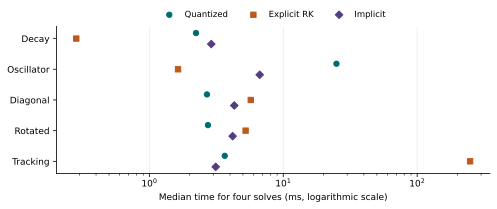

# When to use QSS or Runge–Kutta

**ARGESIM solver selection study · 21 November 2026**

Choose a solver by the observable you must reproduce. A contact time, an oscillation's phase and the concentration left after a transient can require very different settings on the same equations. The [method foundations](SOLVER_METHODS.md) explain every quantizer. The [earlier eight-case study](SOLVER_COMPARISON.md) gives the original 456 configurations. This follow-up adds backward QSS, logarithmic QSS1/QSS2 and implicit classical competitors. [Printable edition](ARGESIM_SOLVER_STUDY.pdf)

Two cases illustrate the choice. In C12, QSS2 predicted all three sphere contacts during constant-velocity flights with 36 right-hand-side (RHS) evaluations. RK45 used 148. In C05, the requirement was to reproduce three switches and both terminal states of a stiff two-state model. Radau met it at all three tolerances. Four BQSS1 runs finished outside tolerance, and the two finest trials exhausted the event budget.

## Where to start

| What you know about the model | First comparison | Measurement that decides |
|---|---|---|
| Smooth, nonstiff dynamics with many states moving together | Start with adaptive RK45. Try RK4 if inputs arrive on a fixed clock and two successively smaller steps give adequate accuracy. | Check phase, peak and terminal error over the full horizon. Charge all RHS evaluations. |
| Long periods of free flight, localized changes or unequal component activity | Try QSS2 against RK45. For sufficiently smooth curved sections, add QSS3 or QSS4. | Require correct event order, crossing times and post-reset state. Count quantizer updates, RHS calls and wall time including restarts. |
| Fast decay toward a slowly moving equilibrium; stiffness mainly on the diagonal | Compare LIQSS1/2, BQSS1 and implicit Radau. Try eLIQSS or CheQSS if quantizer self-updates dominate. | Resolve the fast transient and the slow variable. Inspect the equilibrium band and the observable's sensitivity to the quantum. |
| Repeated strong feedback between a pair of states | Try mLIQSS2 alongside a diagonal LIQSS solver and Radau. For a larger identifiable stiff block, test an explicit LIQSS-BDF partition. | Compare at the same tolerances after changing quantum and partition. Pair solves and coupling iterations can outweigh the saved updates. |
| Strongly coupled stiff ODE, widely differing time scales or repeated explicit stability failures | Start with Radau IIA or BDF. Radau is itself an implicit RK method. | Check accuracy across fast layers, switch times, RHS work and matrix factorizations. Use a Jacobian or its sparsity pattern when available. |
| State amplitude spans decades | Compare fixed and logarithmic QSS2 with adaptive RK45. Use an absolute quantum floor in physical units. | Check both peak and tail against an absolute-plus-relative target. Count what is saved at the same achieved accuracy. |
| Algebraic constraints remain in the formulation | Use consistent initialization and residual IDAS for regular index-one DAEs. A justified index reduction permits an ODE comparison. | Verify both residual defects and an independently computed trajectory. The C21 diode study checks both explicit reductions. |

### Two diagnostic questions

**Is explicit time stepping limited by stability or by accuracy?** For a linearized mode $y'=\lambda y$, classical RK4 multiplies it by $1+z+z^2/2+z^3/6+z^4/24$ with $z=h\lambda$. On the negative real axis this has magnitude at most one down to approximately −2.785. A mode with rate −1000 therefore limits an explicit RK4 step to about 0.0028 even after the fast transient has nearly vanished. Off-axis eigenvalues have a different stability boundary. Compare refined trajectories and work before diagnosing stiffness. The analytic diagonal and rotated probes below have the same eigenvalues. [Explicit and implicit methods in SciPy](https://docs.scipy.org/doc/scipy/reference/generated/scipy.integrate.solve_ivp.html)

**How local are the changes?** When a component changes, a sparse QSS implementation can recompute only the equations that depend on it. The Python reference backend evaluates a dense RHS and may build a dense finite-difference Jacobian. Gains here can arise from long accurate event-free flights. A speed claim for a large sparse plant still requires a sparse backend, a declared dependency graph and scaling measurements. A large count of physical switches alone gives neither scheme an advantage. [Stand-alone QSS architecture](https://www.fceia.unr.edu.ar/~kofman/files/qss_solver_v4.pdf) · [Survey](https://doi.org/10.1177/00375497241230985)

## What the new experiment measures

Five analytical ODEs separate amplitude, oscillation and stiffness. Each run integrates afresh from the original initial condition to **four** prescribed horizons. Scoring uses the worst component and horizon. This gives all solvers the same observations without restarting an otherwise smooth trajectory at each reporting time. The timed workload is the sum of the four independent solves. It is a diagnostic experiment, not the cost of obtaining four dense-output samples in one production run.

| Probe | Equations and initial data | Horizons | Independent reference |
|---|---|---|---|
| Decay | $x'=-x$, $x(0)=100$ | 0.1, 2, 5, 8 | $100\exp(-t)$, down to about 0.0335 |
| Oscillator | $x'=v$, $v'=-x$, initially (1, 0) | 0.3, 3.1, 12.7, 25 | Cosine and negative sine; both position and velocity matter |
| Diagonal | $u'=-u$, $v'=-1000v$, initially (1, 1) | 0.001, 0.01, 0.1, 1 | Two independent exponentials with decay rates 1 and 1000 |
| Rotated | Same modal equations, observed as $x=(u+v)/2$, $y=(u-v)/2$, initially (1, 0) | Same as diagonal | Both fast and slow modes contribute to each coordinate. The Jacobian has diagonal −500.5 and off-diagonal +499.5. |
| Tracking | $x'=0.01y$, $y'=-100x-100y+2020$, initially (0, 20) | 0.01, 5, 100, 500 | Eliminate $y$ to give $x''+100x'+x=20.2$. The two exponential modes give both states. [Published BQSS example](https://www.fceia.unr.edu.ar/~kofman/files/bqss_cqss_simulation.pdf) |

The component allowance is $0.001s_i+0.005|y_i^{ref}|$, with $s_i=20$ for both tracking states and one elsewhere. A score at most one passes. This componentwise physical error metric changes under a change of coordinates. Diagonal and rotated cases test sensitivity to representation, without claiming an invariant error norm.

For each analytical case all 19 quantized runtime names, two additional log configurations, RK4, RK45, Radau and BDF get three settings. Quantizer floors are 0.005, 0.001 and 0.0002 times $s_i$. The log configurations use the same numbers as relative fractions. The RK4 base step is 0.5 for decay and oscillation, 0.005 for diagonal and rotated, and 0.05 for tracking. Its multipliers are 1, 0.4 and 0.1. The three adaptive classical tolerances are $10^{-3},10^{-5},10^{-7}$ with component absolute tolerance $0.01s_i$ times the relative tolerance. A one-state LIQSS-BDF run uses a full BDF partition; the two-state probes put the last state in BDF. This choice is declared in advance and need not be optimal.

The eight ARGESIM repeats keep the original observables and budgets. They run BQSS1, fixed and logarithmic QSS1/QSS2 at three quanta, plus the original RK4 and RK45 settings. C05 also runs Radau and BDF at all three adaptive tolerances using directed terminal guards and fresh integrations after a mode switch. Three additional BQSS1 refinements on C05 follow up its initial timing miss. [Executable protocol](../benchmarks/benchmark_solver_selection.py) · [Original case definitions](../benchmarks/benchmark_solver_extension.py)

## Measured results

<!-- BEGIN SELECTION RESULTS -->
Across 520 configurations, 292 passed, 164 missed the accuracy target, 0 had an event-count mismatch, 15 reached the time limit and 49 returned a solver error or reached a work limit. The raw CSV retains failed configurations.

### Cost at the analytical target

Each entry gives the fastest passing configuration within its group, its median elapsed time for four solves and its worst error divided by the target. A score of 0.1 uses one tenth of the error allowance. The quantized group has 21 choices at each level, explicit RK has two, and the implicit group has two. This is the observed best of each tested grid.

| Analytical case | Quantized | Explicit RK | Implicit |
|---|---|---|---|
| Decay | qss2-log · 2.23 ms · 0.311 | rk4 · 0.285 ms · 0.612 | Radau · 2.9 ms · 0.0024 |
| Oscillator | qss4 · 25 ms · 0.764 | rk4 · 1.64 ms · 0.192 | Radau · 6.67 ms · 0.032 |
| Diagonal | cheqss2 · 2.69 ms · 0.472 | rk45 · 5.72 ms · 0.0684 | Radau · 4.31 ms · 0.00325 |
| Rotated | qss1 · 2.74 ms · 0.801 | rk45 · 5.23 ms · 0.0474 | Radau · 4.19 ms · 0.000463 |
| Tracking | eliqss2 · 3.66 ms · 0.652 | rk4 · 249 ms · 0.0119 | Radau · 3.13 ms · 0.000442 |



### Passing settings by method

Every cell gives the number of settings passing out of three. A zero may reflect accuracy, execution or budget. In the decay probe the one-state LIQSS-BDF entry uses time stepping for the whole state. In the other four probes it uses a mixed partition.

| Configuration | Decay | Oscillator | Diagonal | Rotated | Tracking |
|---|---|---|---|---|---|
| qss1 | 0 | 0 | 3 | 3 | 2 |
| qss2 | 2 | 0 | 2 | 3 | 2 |
| qss3 | 3 | 1 | 3 | 0 | 0 |
| qss4 | 3 | 1 | 3 | 3 | 0 |
| cqss1 | 1 | 1 | 0 | 1 | 0 |
| liqss1 | 0 | 0 | 1 | 3 | 2 |
| liqss2 | 2 | 0 | 2 | 2 | 0 |
| liqss3 | 1 | 0 | 2 | 0 | 1 |
| mliqss1 | 0 | 0 | 1 | 3 | 2 |
| mliqss2 | 2 | 0 | 2 | 3 | 0 |
| mliqss3 | 1 | 0 | 2 | 0 | 1 |
| eliqss1 | 1 | 1 | 3 | 2 | 2 |
| eliqss2 | 2 | 0 | 2 | 2 | 3 |
| eliqss3 | 3 | 1 | 2 | 2 | 2 |
| cheqss1 | 1 | 1 | 3 | 2 | 2 |
| cheqss2 | 2 | 0 | 3 | 3 | 1 |
| cheqss3 | 3 | 2 | 2 | 3 | 2 |
| liqss-bdf | 3 | 1 | 3 | 0 | 3 |
| bqss1 | 0 | 0 | 2 | 3 | 1 |
| qss1-log | 2 | 0 | 3 | 3 | 2 |
| qss2-log | 2 | 0 | 2 | 3 | 3 |
| rk4 | 3 | 2 | 1 | 1 | 1 |
| rk45 | 3 | 2 | 3 | 3 | 3 |
| Radau | 3 | 3 | 3 | 3 | 3 |
| BDF | 3 | 2 | 3 | 3 | 3 |

### The eight ARGESIM repeats

BQSS1 and each fixed/logarithmic QSS column have three primary settings. RK4 and RK45 have one each. The C05 adaptive implicit and BQSS1 refinement results are discussed below. The other quantized methods retain the earlier eight-case matrix in the [original study](SOLVER_COMPARISON.md#all-methods-and-cases).

| Case | bqss1 | qss1-log | qss2-log | qss1 | qss2 | rk4 | rk45 |
|---|---|---|---|---|---|---|---|
| C03 | 0 | 0 | 0 | 0 | 0 | 1 | 1 |
| C05 | 0 | 0 | 0 | 0 | 0 | 0 | 0 |
| C07 | 1 | 1 | 1 | 1 | 1 | 1 | 1 |
| C09 | 3 | 3 | 3 | 3 | 3 | 1 | 1 |
| C11 | 2 | 3 | 3 | 3 | 3 | 1 | 1 |
| C12 | 3 | 3 | 3 | 3 | 3 | 1 | 1 |
| C13 | 0 | 0 | 0 | 0 | 0 | 1 | 1 |
| C21 | 1 | 1 | 3 | 1 | 3 | 1 | 1 |
<!-- END SELECTION RESULTS -->

## Interpreting a solver choice

**Smooth decay and oscillation favor classical RK here.** At the middle decay setting, logarithmic QSS2 reduced quantizer updates from 1,156 to 297 and median time from 8.65 to 2.23 ms. Its normalized error rose slightly, from 0.294 to 0.311. Both pass. RK45 also passed at its loosest setting in 0.360 ms. A proportional quantum helps when an absolute quantum spends too much work on large amplitudes. On the oscillator, fixed and logarithmic QSS2 missed the target at all three settings. RK4 passed at two settings, with 1.64 ms for its faster pass. Long-horizon phase accuracy matters even on a smooth nonstiff system.

**The same eigenvalues can reward different update rules.** On the rotated stiff pair, coarse mLIQSS2 used 98 pair/component updates and passed (score 0.882). Diagonal LIQSS2 used 2,223 updates and missed (1.74). On the diagonal representation both methods performed 3,583 updates at the coarse setting and missed. This comparison helps identify when coupling a pair is worthwhile. On the rotated system, ordinary QSS1 also passed at all three quanta, and its coarsest pass took 2.74 ms. The coordinatewise physical error test and the tested grid matter when transferring these observations.

**Stiffness alone does not select BQSS1, LIQSS or Radau.** On the moving-equilibrium tracking probe eLIQSS2 passed at all three settings. Its fastest pass took 3.66 ms with score 0.652. Radau took 3.13 ms with score 0.000442 at its loosest tolerance. The much larger accuracy margin matters more than this small timing difference. On C05, Radau passed 3/3 and BDF 2/3. BQSS1's best completed run still used 1.98 times the error allowance; two smaller quanta exhausted the event budget. Its ability to reproduce the first two published BQSS1 update times is an algorithm regression, while C05 tests different physical quantities. Use an implicit classical baseline when switch timing is critical on a stiff model.

**Piecewise-simple motion gives QSS2 a measurable advantage.** C12 has elastic, instantaneous contacts at 1, 2 and 3 s. Fixed QSS2 got their order, times and outgoing speeds right at all three quanta. The constant-velocity flights needed zero internal quantizer updates, but localization and restarts still consumed 36 RHS calls. RK45 passed with 148 calls and RK4 with 4,010. On the C07 pendulum the result changed. Of its three QSS2 settings only the finest passed, in 8.48 ms, while RK45 passed in 4.91 ms. Both models have physical events; the motion *between* them explains the different outcome.

**Apply the result to a new model.** Choose the observable and its units first. For a guard $g(t,x)=0$, timing sensitivity is approximately $|\delta g|/|g_t+\nabla g\cdot f|$ at a transverse crossing. A nearly grazing event can move appreciably even when the state error is small. Check for missed or extra events, phase, conservation or drift as applicable. Select the least expensive candidate that passes on at least two refinements or independently explain an isolated pass. Retain raw times and error margins if several candidates qualify. This experiment supplies candidates for that comparison. Local timing ratios on tiny models do not transfer directly to compiled sparse code, different units, different observation windows or real-time deadlines.

## Reproduction and scope

From the repository root, use a separate output path for a fresh run. The archived job used CPython 3.12.14, NumPy 2.3.5 and SciPy 1.17.0 on Linux x86-64. It used one CPU affinity slot and one BLAS thread. A seeded shuffle interleaves configurations. Each successful row reports three individual solve times after one warm-up; observables and work counters must repeat exactly within that run. Reference construction and scoring are outside the timer.

```sh
python -m pip install numpy==2.3.5 scipy==1.17.0
OPENBLAS_NUM_THREADS=1 OMP_NUM_THREADS=1 python benchmarks/benchmark_solver_selection.py --output selection.csv
python -m unittest discover -s tests -p 'test_backward_and_log_qss.py'
python -m unittest discover -s tests -p 'test_solver_selection.py'
```

Each repetition has a two-second wall-clock budget, including all four solves for an analytical case. Python integrators also enforce their 40,000-step or event budget per call. The SciPy runs check accepted steps after each solve. A timeout measures cost on the recording host. RHS counts use each backend's own accounting; SciPy's `nfev` excludes finite-difference Jacobian construction, and `nlu` counts LU decompositions. Its rejected-step count is unavailable and is blank in the CSV. A QSS update count and a classical accepted time step describe different operations. Three repetitions support coarse local comparisons. Close timings, especially sub-millisecond results, do not establish a reliable ordering.

The eight-case archive, its 399-configuration historical predecessor and this targeted follow-up use different grids. Their pass fractions have different denominators. The source digest in the new manifest covers the two benchmark scripts and the Python packages that implement the solvers and models. [Raw selection CSV](evidence/qss-selection.csv) · [Environment and hashes](evidence/qss-selection.json) · [Algorithm regressions](../tests/test_backward_and_log_qss.py) · [Reference checks](../tests/test_solver_selection.py)

To rebuild the tables and figures from the checked-in measurements, run `python scripts/render_solver_selection.py` with Matplotlib and NumPy installed. To typeset all three chapters, install Pandoc, lxml, Matplotlib and WeasyPrint 68.1. Run `python scripts/build_solver_study.py --revision SOURCE_SHA --output study.pdf`, replacing `SOURCE_SHA` with the full commit containing the Markdown and evidence. The PDF embeds that revision in its links.
