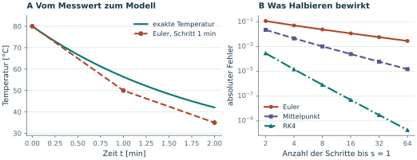

# Vom Messwert zum Anfangswertproblem

Ein Temperaturfühler zeigt 80 °C. Er liegt in einem Raum mit konstant 20 °C. Wann unterschreitet seine Anzeige 40 °C? Für die Antwort braucht man ein physikalisches Modell, eine Rechnung und eine Definition des gesuchten Ereignisses. An diesem Beispiel lassen sich alle drei einzeln überprüfen.

Wir nehmen an, dass der Fühler im Inneren überall gleich warm ist und die Wärmeabgabe proportional zur Temperaturdifferenz ist. Mit einer Zeitkonstanten von zwei Minuten lautet die Energiebilanz

$$\frac{dT}{dt}=-\frac{T-20}{2},\qquad T(0)=80.$$

Dabei wird $t$ in Minuten, $T$ in °C gemessen. Eine Differenz von 1 °C entspricht 1 K. Die rechte Seite ist eine Abkühlrate in K/min. Setzen wir $u=(T-20)/60$ und $s=t/2$, entsteht die dimensionslose Gleichung $u'=-u$, $u(0)=1$. Der Strich bedeutet hier Ableitung nach $s$. Trennung der Variablen ergibt $u(s)=e^{-s}$. Die Schwelle 40 °C entspricht $u=1/3$. Daher ist die gesuchte Zeit $t=2\ln 3=2{,}19722$ min.

**Die erste Näherung.** Zu Beginn beträgt die Steigung −30 K/min. Schreiben wir sie eine Minute lang fort, erhalten wir 50 °C. Die exakte Lösung ergibt 56,392 °C. Während der Minute kühlt der Fühler ab und verliert dadurch langsamer Wärme. Schon das Vorzeichen des Fehlers folgt also aus dem Modell. Diese einfache Rechnung ist der explizite Euler-Schritt. [HNW](literatur.md#hnw) · [FNC](literatur.md#fnc)

## Wie man einen Fehler misst

Ein Anfangswertproblem hat die Form $y'=f(t,y)$ mit $y(t_0)=y_0$. Aus einer numerischen Vorschrift entsteht eine Folge $y_0,y_1,\ldots$. Die Schrittweite $h$ ist der Abstand zweier aufeinanderfolgender Rechenzeiten. Euler benutzt $y_{n+1}=y_n+h f(t_n,y_n)$. Bei glatter Lösung zeigt die Taylorentwicklung am **exakten** Schrittanfang einen lokalen Einschrittfehler von Größenordnung $h^2$. Auf einem festen Zeitintervall entstehen rund $1/h$ Schritte. Unter einer Lipschitz-Bedingung an $f$ wächst der globale Fehler für genügend kleine $h$ mit Größenordnung $h$. Dieses Zusammenspiel von lokalem Defekt, Fehlerfortpflanzung und Zahl der Schritte erklärt die Ordnung eins.

Die folgende Rechnung endet stets bei $s=1$. Nach $N$ Schritten ist $h=1/N$. Jede Zelle enthält den Betrag der Differenz zu $e^{-1}$. Die nächsten Seiten leiten die beiden genaueren Verfahren her.

| $N$ | Euler | Expliziter Mittelpunkt | Klassisches RK4 |
|---:|---:|---:|---:|
| 2 | 0,117879 | 0,022746 | 0,00029140 |
| 4 | 0,051473 | 0,004650 | 0,00001476 |
| 8 | 0,024271 | 0,001054 | 0,000000831 |
| 16 | 0,011805 | 0,000251 | 0,0000000493 |

Wenn $E(h)\approx C h^p$, dann ist $p_{\mathrm{beob}}=\log_2(E(h)/E(h/2))$. Die letzten zwei Euler-Zeilen liefern etwa 1,04. Ist keine exakte Lösung bekannt, liefern drei geschachtelte Gitter bei gleichem Endpunkt den Quotienten $|y_h-y_{h/2}|/|y_{h/2}-y_{h/4}|$. Er nähert sich $2^p$, solange ein führender Fehlerterm dominiert. Wechselnde Ereignisfolgen, unaufgelöste Sprünge oder Rundungsfehler können diesen Schluss vereiteln.

**Welche Genauigkeit verlangt die Aufgabe?** Für einen Fühler mögen 0,1 K genügen. Für eine Schaltung kann der Zeitpunkt des Schwellendurchgangs entscheidend sein. Linearisiert gilt bei einem einfachen Nulldurchgang $\delta t\approx-\delta g/\dot g$. Beim Passieren von 40 °C beträgt die Steigung −10 K/min. Ein Fehler von +0,1 K verschiebt den berechneten Durchgang lokal um etwa +0,01 min, also 0,6 s. Eine fast tangentiale Berührung ist wesentlich empfindlicher.

> **Aufgabe 1.** Berechnen Sie bei einem Euler-Schritt von 0,5 min die Temperatur nach einer Minute mit zwei Schritten. Schätzen Sie anschließend, wie sich ein Zeitkonstantenfehler von +5 % auf die exakte Durchgangszeit auswirkt. Die zwei Fehler haben verschiedene Ursachen. [Lösung](10-loesungen.md#a1)
