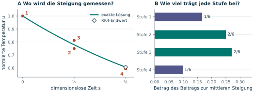
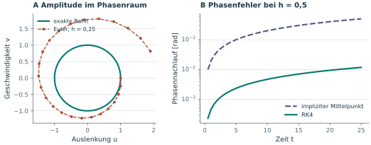

# Wie Runge–Kutta einen Schritt konstruiert

Integrieren wir die ODE über einen Schritt, erhalten wir $y(t+h)=y(t)+\int_t^{t+h}f(\tau,y(\tau))\,d\tau$. Die Änderung ist die Zeitspanne mal der mittleren Steigung. Die Schwierigkeit ist, dass auch der Zustand im Integranden erst berechnet werden muss. Runge–Kutta-Verfahren wählen deshalb **Stufenzustände**, werten dort das Modell aus und kombinieren die Steigungen.

Das explizite Mittelpunktverfahren macht zunächst einen halben Euler-Schritt. Es bestimmt dort die Steigung und benutzt diese für den ganzen Schritt:

$$k_1=f(t,y),\quad k_2=f(t+h/2,y+hk_1/2),\quad y_{\mathrm{neu}}=y+hk_2.$$

Für den Fühler $u'=-u$ und $h=1/2$ ergibt das $k_1=-1$, den Zwischenzustand $3/4$, $k_2=-3/4$ und $u_1=5/8=0{,}625$. Die exakte Lösung ist $0{,}606531$, Euler liefert $0{,}5$. Eine zusätzliche Steigung erfasst, dass die Abkühlung innerhalb des Schrittes nachlässt.

### Vier Steigungen für RK4

| Stufe | Zeitpunkt | eingesetzter Zustand | Steigung $k_i$ | Gewicht $b_i$ |
|---|---:|---:|---:|---:|
| 1 | 0 | 1 | −1 | 1/6 |
| 2 | 1/4 | 0,75 | −0,75 | 2/6 |
| 3 | 1/4 | 0,8125 | −0,8125 | 2/6 |
| 4 | 1/2 | 0,59375 | −0,59375 | 1/6 |

Die Summe liefert $u_1=0{,}60677083$. Erst dieser gewichtete Endwert geht in den nächsten Schritt. Für die Temperatur bedeutet das 56,406 °C nach einer Minute, rund 0,0144 K über der exakten Lösung. [HNW](literatur.md#hnw)

## Ein Tableau lesen und die Schrittweite wählen

Ein Butcher-Tableau sammelt Stufenzeiten $c_i$, Stufenkoeffizienten $a_{ij}$ und Endgewichte $b_i$. In Zeile $i$ steht $k_i=f(t+c_i h,\,y+h\sum_j a_{ij}k_j)$. Die Endformel lautet $y_{n+1}=y_n+h\sum_i b_i k_i$. Ein explizites Tableau enthält nur Koeffizienten links der Diagonalen. Aus der folgenden Tabelle kann man die Rechnung der vorherigen Seite vollständig rekonstruieren.

| RK4 | $a_{i1}$ | $a_{i2}$ | $a_{i3}$ | $a_{i4}$ |
|---|---:|---:|---:|---:|
| $c_1=0$ | 0 | 0 | 0 | 0 |
| $c_2=1/2$ | 1/2 | 0 | 0 | 0 |
| $c_3=1/2$ | 0 | 1/2 | 0 | 0 |
| $c_4=1$ | 0 | 0 | 1 | 0 |
| $b$ | 1/6 | 1/3 | 1/3 | 1/6 |

**Zwei Antworten aus denselben Stufen.** Das Bogacki–Shampine-Paar RK23 bildet einen Endwert dritter Ordnung und einen zweiten Endwert zweiter Ordnung. Ihre Differenz $d_i$ schätzt den lokalen Fehler der niedrigeren Formel. Für mehrere Komponenten teilt man durch einen Maßstab, etwa $w_i=\mathrm{atol}_i+\mathrm{rtol}\max(|y_{n,i}|,|y_{n+1,i}|)$. Der gewichtete quadratische Mittelwert der $d_i/w_i$ ergibt eine dimensionslose Zahl $r$. Im hier verwendeten Solver wird ein Versuch mit $r\leq1$ akzeptiert. Beim Verwerfen beginnt der neue Versuch am letzten akzeptierten Zustand.

Weil der führende lokale Unterschied bei RK23 proportional zu $h^3$ ist, ist $0{,}9h\,r^{-1/3}$ eine plausible neue Schrittweite. Der Sicherheitsfaktor lässt Reserve, Schranken begrenzen die Änderung. Bei $r=8$ folgt $h_{\mathrm{neu}}=0{,}45h$. Die höherwertige Lösung wird fortgeschrieben. Das Paar Dormand–Prince RK45 arbeitet entsprechend mit Ordnungen fünf und vier. Bei beiden kann eine passende Endstufe die erste Ableitung des nächsten regulären Schritts liefern. Ein physikalischer Reset verlangt die Ableitung des neuen Zustands und Modus. [BS](literatur.md#bs) · [DP](literatur.md#dp)

> **Aufgabe 2.** Ein Zustandsvektor enthält Spannung und Strom. Der Spannungsfehler beträgt 0,5 mV bei 5 V, der Stromfehler 5 µA bei 0 A. Berechnen Sie für `rtol=0.001`, absolute Toleranzen 1 mV und 1 µA sowie die genannten Skalierungsbeträge den gewichteten RMS-Fehler. Entscheidet ein Test nur auf die Spannung anders? [Lösung](10-loesungen.md#a2)

## Amplitude und Phase eines nichtsteifen Oszillators

Eine reibungsfreie Feder mit normierter Masse und Federsteifigkeit erfüllt $u'=v$, $v'=-u$. Für den Start $(1,0)$ erhält man $u(t)=\cos t$, $v(t)=-\sin t$. Im Phasenraum beschreibt der Zustand den Einheitskreis, denn die Energie $E=(u^2+v^2)/2$ bleibt konstant. Es gibt eine Schwingungsfrequenz und keinen rasch abklingenden Modus. Trotzdem kann eine ungeeignete Diskretisierung die Energie systematisch verändern.

Vorwärts Euler setzt $u_{n+1}=u_n+h v_n$ und $v_{n+1}=v_n-hu_n$. Quadriert man beide Gleichungen und addiert sie, heben sich die Kreuzterme auf. Es folgt $E_{n+1}=(1+h^2)E_n$. Schon das Vorzeichen verrät, dass jeder noch so kleine positive Schritt Energie zuführt. Auf einem festen Endintervall gehen diese Fehler bei Verfeinerung gegen null. Bei festem Schritt über viele Perioden öffnet sich die Spirale.

Den Winkel kann man ohne Ablesen berechnen. Mit $w=u-i v$ gilt $w'=i w$. In einem Schritt wächst der Winkel um das Argument von $R(ih)$. Nach $n$ Schritten ist der kumulierte Phasennachlauf $n(h-\arg R(ih))$. Für das implizite Mittelpunktverfahren ist $R(z)=(1+z/2)/(1-z/2)$. Bei rein imaginärem $z$ ist der Betrag eins. Die Phase pro Schritt beträgt jedoch $2\arctan(h/2)$.

Bei $t=25$ und $h=0{,}5$ liegt der implizite Mittelpunkt trotz erhaltener Energie um 0,5021 rad zurück. RK4 liegt bei 0,01188 rad Nachlauf, seine Amplitude bei 0,99476. Für einen periodisch auslösenden Regler kann der Zeitfehler entscheidender sein als der kleine Amplitudenverlust. Die analytische Oszillatoraufgabe im Vergleich misst deshalb Position **und** Geschwindigkeit zu mehreren Zeiten. [HNW](literatur.md#hnw) · [Messprotokoll](../SOLVER_SELECTION.md#what-the-new-experiment-measures)
