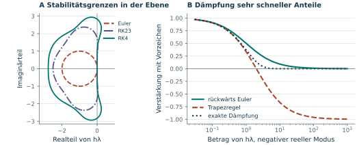

# Wenn die Stabilität den Schritt bestimmt

Ein Antrieb soll eine langsame Sollkurve verfolgen. Kleine Abweichungen regelt er in Millisekunden aus. Eine einfache Gleichung dafür ist $y'=-1000(y-\cos t)-\sin t$. Die exakte Lösung zum Startwert $y(0)=1+\delta$ ist $y(t)=\cos t+\delta e^{-1000t}$. Nach 10 ms ist eine Störung auf rund 0,00454 % ihres Anfangsbetrags gefallen. Danach sieht man fast nur noch die langsame Kosinuskurve. Dennoch muss ein explizites Verfahren auch seine eigenen kleinen Störungen beherrschen.

Am Testproblem $v'=\lambda v$ ergibt sich nach einem Schritt $v_{n+1}=R(h\lambda)v_n$. Bei Euler ist $R(z)=1+z$. Für reelles $\lambda<0$ bleiben die Beträge bei $-2\leq h\lambda\leq0$ beschränkt. Am linken Rand wechselt das Vorzeichen ohne Dämpfung. Setzen wir $\lambda=-1000$ und $h=0{,}01$ s, folgt $R=-9$. Aus einer anfänglich kaum sichtbaren Störung wird nach vier Schritten das 6561-Fache. Die exakte Störung schrumpft im selben Zeitraum um den Faktor $e^{-40}$.

**Steifheit erkennen.** Ein Problem verhält sich auf einem Intervall steif, wenn die Stabilität explizite Schritte wesentlich stärker beschränkt als die verlangte Genauigkeit der interessierenden Lösung. Ein großes Verhältnis von Zeitskalen ist ein Hinweis. Ob es für eine Rechnung entscheidend ist, hängt von Beobachtungszeit, Anregung und Toleranz ab. Vergleichen Sie auf derselben Aufgabe Schrittfolgen, Verwerfungen, Fehler der langsamen Größe und den Aufwand eines impliziten Solvers. [HW](literatur.md#hw)

## Wie implizite Stufen schnelle Anteile dämpfen

Rückwärts Euler wertet die Steigung am noch unbekannten Ende aus. Für $v'=\lambda v$ folgt $v_{n+1}=v_n/(1-h\lambda)$. Bei $h\lambda=-10$ ist die Verstärkung $1/11$. Die Trapezregel liefert $(1+z/2)/(1-z/2)=-2/3$. Beide Verfahren sind **A-stabil**, weil die gesamte linke komplexe Halbebene zu ihrem Stabilitätsgebiet gehört. Bei rückwärts Euler geht $R(z)$ für sehr große negative $z$ gegen null. Dieses zusätzliche Dämpfungsverhalten kennzeichnet zusammen mit A-Stabilität eine **L-stabile** Methode. Für die Abbildung ist das Vorzeichen der Verstärkung ebenso wichtig wie ihr Betrag.

### Was kostet ein impliziter Schritt?

Bei einem nichtlinearen Modell lautet die Gleichung für rückwärts Euler $G(Y)=Y-y_n-h f(t_{n+1},Y)=0$. Newton löst nacheinander lineare Gleichungssysteme mit der Matrix $I-hJ$, wobei $J=\partial f/\partial y$ die Jacobi-Matrix ist. Bei vielen gekoppelten Zuständen kann ihre Faktorisierung den Aufwand dominieren. Ein dünn besetztes Modell erlaubt spezialisierte lineare Löser. Bei einem kleinen System kann der Aufwand für viele explizite Schritte stärker ins Gewicht fallen.

Kværnøs **ESDIRK 3/2a** hat eine explizite und drei diagonal implizite Stufen. Der gemeinsame Diagonaleintrag $\gamma\approx0{,}43586652$ erlaubt dem hier implementierten vereinfachten Newton-Verfahren, dieselbe Matrix $I-h\gamma J$ innerhalb eines Versuchs mehrfach zu verwenden. Die fortgeschriebene Lösung ist dritter Ordnung und L-stabil. Die Differenz zur eingebetteten Lösung steuert den lokalen Schritt. Radau IIA verwendet implizite Kollokationsstufen. BDF-Verfahren kombinieren mehrere Zeitebenen und lösen jeweils eine implizite Gleichung. Nach einem Moduswechsel muss die gültige Vorgeschichte neu aufgebaut werden. [KV](literatur.md#kv) · [HW](literatur.md#hw)

**Praxisregel.** Zeichnen Sie nach dem schnellen Einschwingen die akzeptierten Schrittweiten. Bleiben sie beim expliziten Verfahren trotz gelockerter Toleranz klein, während ein implizites Verfahren die langsame Bewegung mit derselben Messgenauigkeit in größeren Schritten trifft, spricht die Messung für eine Stabilitätsbegrenzung. Eine lange Laufzeit allein verrät ihren Grund nicht.

> **Aufgabe 3.** Ein entkoppeltes System hat Eigenwerte −1 und −10 000 pro Sekunde. Bestimmen Sie die Stabilitätsgrenze von explizitem Euler und die Verstärkungen von vorwärts Euler, rückwärts Euler und Trapezregel für den schnellen Modus bei einem Schritt von 1 ms. [Lösung](10-loesungen.md#a3)
