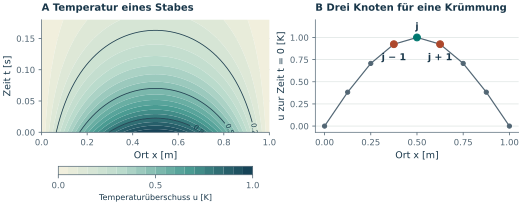

# Vom Temperaturfeld zum ODE-System

Am Fühler genügte eine Temperatur. Bei einem dünnen Stab hängt sie auch vom Ort ab. Der Temperaturüberschuss $u(x,t)$ erfülle die Wärmeleitungsgleichung $\partial_t u=\alpha\,\partial_{xx}u$. Die linke Seite beschreibt die zeitliche Änderung. Die zweite Ortsableitung misst die Krümmung des Profils. Ein lokaler Temperaturberg mit negativer Krümmung flacht ab. Die Temperaturleitfähigkeit $\alpha$ hat die Einheit m²/s.

Für einen Stab der Länge $L$ halten wir beide Enden bei $u=0$ und wählen als Anfangsprofil $u(x,0)=U\sin(\pi x/L)$. Einsetzen zeigt direkt, dass

$$u(x,t)=U\sin(\pi x/L)\exp(-\alpha\pi^2 t/L^2)$$

beide Randwerte, das Anfangsprofil und die PDE erfüllt. Diese Lösung eignet sich als unabhängige Referenz. In der Abbildung sind $L=1$ m, $U=1$ K und $\alpha=1$ m²/s gewählt.

**Linienmethode.** Wir zerlegen den Ort in $N$ Intervalle mit $\Delta x=L/N$. An jedem inneren Knoten steht jetzt eine gewöhnliche Differentialgleichung:

$$\dot u_j=\alpha\,\frac{u_{j-1}-2u_j+u_{j+1}}{\Delta x^2},\qquad j=1,\ldots,N-1.$$

Die Randwerte sind vorgegeben. Die diskreten Temperaturen bilden einen Vektor mit $N-1$ Komponenten, die jeweils höchstens zwei Nachbarn haben. Erst für dieses System wählen wir den Zeitintegrator. Halbiert man $\Delta x$, wächst die Zahl der Zustände und eine andere Zeitskala wird wirksam. [FNC](literatur.md#fnc)

## Weshalb eine feinere räumliche Auflösung steifer wird

Benutzen wir Euler in der Zeit, beträgt der neue Wert $(1-2r)u_j+r u_{j-1}+r u_{j+1}$ mit $r=\alpha h/\Delta x^2$. Für $0\leq r\leq1/2$ entsteht ein gewichtetes Mittel. Auf diesem gleichmäßigen eindimensionalen Gitter genügt das für Stabilität und ein diskretes Maximumprinzip. Halbiert man $\Delta x$, muss sich ein expliziter Euler-Schritt für diese Schranke vierteln. Bei $L=1$ m, $\alpha=1$ m²/s und 20 Intervallen ist $h\leq0{,}00125$ s hinreichend. Bei 40 Intervallen bleiben $0{,}0003125$ s.

Auch die Eigenwerte erklären die Einschränkung. Eine räumliche Sinusmode $k$ besitzt den diskreten Eigenwert $-4\alpha\sin^2(k\pi/(2N))/\Delta x^2$. Hochfrequente Gitterstörungen klingen im physikalischen Diffusionsmodell schnell ab. Ein instabiler Zeitschritt kann sie vergrößern. Die glatte Anfangssinuswelle allein kann deshalb bei kurzen Tests über eine instabile Schrittwahl hinwegtäuschen. Ein implizites Verfahren kann die lineare Stabilitätsschranke überwinden. Für richtige Temperaturen und Flüsse muss es zeitliche Änderungen weiterhin auflösen. [FNC](literatur.md#fnc) · [HW](literatur.md#hw)

### Transport verlangt eine andere Rechnung

Für reine Advektion mit konstanter Geschwindigkeit $a>0$ gilt $\partial_t c+a\partial_x c=0$. Das Profil wandert nach rechts. Eine Aufwind-Differenz verwendet den Wert links vom betrachteten Knoten. Mit explizitem Euler entsteht $c_j^{n+1}=(1-\nu)c_j^n+\nu c_{j-1}^n$ mit $\nu=ah/\Delta x$. Ein Schritt mischt Nachbarn mit nichtnegativen Gewichten, wenn $0\leq\nu\leq1$. Bei $\nu=1$ wandert das diskrete Profil genau eine Zelle pro Schritt. Bei kleineren Werten kann eine scharfe Front numerisch verbreitern. Diffusions- und Transportschranken sind also unterschiedlich zu berechnen. [LV](literatur.md#lv)

> **Aufgabe 4.** Wählen Sie für ein Gitter von 2 cm und $\alpha=10^{-4}$ m²/s einen nach der Diffusionsbedingung zulässigen Euler-Schritt. Welche obere Schranke ergibt sich für reinen Transport mit $a=0{,}1$ m/s auf demselben Gitter? Was ändert sich bei 1 cm? [Lösung](10-loesungen.md#a4)

## Raum- und Zeitfehler im Grundwassermodell C19R

C19R beschreibt den Transport eines Schadstoffs im Grundwasser. Ein Konzentrationswert an einer Messstelle hängt von Advektion, Dispersion, Quelle, Randbehandlung und gegebenenfalls Aufbereitung ab. Die Referenzimplementierung bilanziert Zellflüsse und verwendet für die Advektion einen Flussbegrenzer. Für die homogene Aufgabe ohne Aufbereitung kann eine unabhängige Integration der Punktquellenlösung in der unendlichen Ebene als Vergleich dienen. Die endliche Gitterrechnung und diese Vergleichslösung haben unterschiedliche Randmodelle. [ARG](literatur.md#arg) · [C19R-Auswertung](../PUBLISHED_REFERENCE_CHECKS.md#c19r-spatial-and-time-accuracy)

Untersucht wird die Messstelle $(5,0)$ m am zehnten Tag. Die Gitterzentren erstrecken sich in allen drei Läufen über dieselben Koordinatenbereiche. Der Zeitschritt von RK4 beträgt 7200 s. Die Konzentrationen in der Tabelle sind in mg/m³ angegeben.

| Gitterweite | berechneter Wert | Betrag der Differenz zu 45 021,62 |
|---|---:|---:|
| 1,00 m | 48 677,18 | 3 655,56 |
| 0,50 m | 48 251,10 | 3 229,48 |
| 0,25 m | 45 440,70 | 419,08 |

Auf dem 0,50-m-Gitter ändert eine Halbierung **allein des Zeitschritts** das Ergebnis um 0,00233 mg/m³. Der Abstand zur Referenz beträgt dort rund 3230 mg/m³. Für diesen Messpunkt ist eine weitere zeitliche Verfeinerung bei festem Gitter daher ein schwacher Hebel. Aus den drei sehr ungleich fallenden Abweichungen lässt sich noch keine belastbare räumliche Konvergenzordnung ablesen.

**Würde QSS helfen?** Die Nachbarschaft eines Flussoperators ist lokal. Eine wandernde, räumlich begrenzte Front kann darum ein Kandidat für zustandsweise Updates sein. Bei einer breit verteilten Diffusionsmode werden viele Zellen gleichzeitig aktiv. Außerdem muss die Implementierung die lokalen Abhängigkeiten tatsächlich ausnutzen. Die vorstehenden Zahlen vergleichen räumliche Auflösungen bei RK4. Ein QSS-Geschwindigkeitsvorteil für C19R ist damit offen.

**Versuchsaufbau im Praktikum.** Fixieren Sie zuerst Randmodell, Gitter, Quelle und Beobachtungspunkte. Variieren Sie dann den Zeitintegrator bei gleichem räumlichem Operator und mit derselben zulässigen Konzentrationsabweichung. Wiederholen Sie den Vergleich auf dem nächstfeineren Gitter. Prüfen Sie zusätzlich die Massenbilanz über Zu- und Abflüsse. Das Skript reproduziert den Gittervergleich mit `python scripts/c19_profiles.py --mesh-study`. [Ausführbares Experiment](../../scripts/c19_profiles.py)
