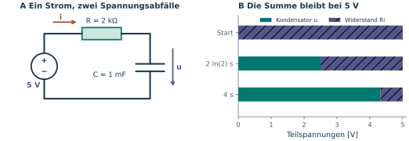
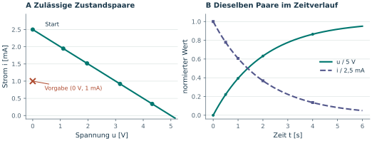

# Differential-algebraische Gleichungen

Ein Netzteil mit 5 V lädt einen Kondensator von 1 mF über einen Widerstand von 2 kΩ. Die Kondensatorspannung $u$ speichert Energie und verändert sich stetig. Der Strom $i$ muss zu jedem Zeitpunkt die Maschengleichung erfüllen. Eine Beschreibung mit beiden Größen lautet

$$C\dot u=i,\qquad 0=U-u-Ri.$$

Das ist eine semi-explizite differential-algebraische Gleichung (DAE). Ein Teil beschreibt eine zeitliche Entwicklung, ein anderer Teil schränkt die zulässigen Zustände unmittelbar ein. Aus $u(0)=0$ folgen $i(0)=2{,}5$ mA und $\dot u(0)=2{,}5$ V/s. Wer stattdessen 1 mA vorgibt, startet mit einem Maschenfehler von 3 V. Eine kleine Integratortoleranz repariert diesen Widerspruch nicht.

### Was ist gegeben, was wird berechnet?

Die Vorgabe $u(0)=0$ ist physikalisch die Aussage „der Kondensator ist ungeladen“. Der anfangs hohe Strom folgt aus dem Widerstand und der verfügbaren Spannung. Eine Messung des Stroms kann den Startwert prüfen. Will man dagegen einen gemessenen Strom unabhängig vorschreiben, muss das Modell erläutern, welche andere Größe frei ist. Aus einem Startwertproblem wird sonst ein überbestimmtes Gleichungssystem.

Für eine erste Handkontrolle genügen drei Zeitpunkte. Zu Beginn fällt die gesamte Spannung am Widerstand ab. Bei halber Kondensatorspannung liegen an beiden Bauelementen 2,5 V, der Strom ist auf die Hälfte gefallen. Nach langer Zeit nähert sich der Strom null und die Kondensatorspannung 5 V. Diese drei Aussagen sind von jeder später gewählten Integrationsmethode unabhängig.

## Von der zulässigen Geraden zur Zeitentwicklung

Tragen wir den Strom über der Kondensatorspannung auf, bildet die Maschengleichung eine Gerade mit negativer Steigung. Die Strom-Spannungs-Paare dürfen nur auf dieser Geraden liegen. Die Kondensatorgleichung legt fest, **wie schnell** sich das Paar auf ihr bewegt. Die beiden Aussagen lassen sich separat visualisieren.

Da $R$ von null verschieden ist, können wir hier $i=(U-u)/R$ einsetzen. Es bleibt $\dot u=(U-u)/(RC)$ mit $RC=2$ s. Die Lösung $u(t)=5(1-e^{-t/2})$ liefert eine Referenz für den zeitlichen Verlauf. Die zweite Prüfung misst die Größe von $U-u-Ri$. Ein Paar aus konstant 0 V und 2,5 mA erfüllt die Maschengleichung sogar exakt, verletzt aber die Kondensatorgleichung. Ein kleines algebraisches Residuum allein liefert deshalb keinen Trajektoriennachweis. [HW](literatur.md#hw) · [IDA](literatur.md#ida)

**Warum nicht immer eliminieren?** Hier ist die Umstellung nach $i$ eine Division durch eine Konstante. In einem Netzwerk mit einer nichtlinearen Diodenkennlinie kann nach derselben Umformung in jedem Schritt eine nichtlineare Nullstelle zu suchen sein. Eine gemeinsame Residualform lässt sich unmittelbar aus den Knotengleichungen aufbauen und trägt die Kopplungen offen in der Jacobi-Matrix. Eine unabhängige Reduktion liefert dann gerade deshalb einen wertvollen Test. C21 führt diese Gegenrechnung auf der nächsten Seite vor.

## Konsistenz, Index und ein nichtlinearer Schaltkreis

Allgemein schreiben wir $\dot x=f(t,x,z)$ und $0=g(t,x,z)$. Ist $\partial g/\partial z$ am betreffenden Punkt invertierbar, lässt sich $z$ lokal in Abhängigkeit von $t,x$ bestimmen. Eine zeitliche Ableitung der Nebenbedingung liefert dann eine Gleichung für $\dot z$. Dies ist die hier behandelte reguläre Index-1-Situation. Bei einem Pendel in kartesischen Koordinaten erzwingt etwa $x^2+y^2=\ell^2$ eine geometrische Bindung. Auch Geschwindigkeit und Beschleunigung müssen verträglich sein, ehe man die unbekannte Zwangskraft bestimmen kann. Solche höherindizierten Modelle erfordern eine passende Formulierung oder Indexreduktion.

Beim Residualverfahren fasst man alle Gleichungen zu $F(t,y,\dot y)=0$ zusammen. Der hier verwendete IDAS-Adapter integriert die Differentialzustände und löst die algebraischen Unbekannten gemeinsam mit den Ableitungen. Er verlangt konsistente Startwerte. Innerhalb eines BDF-Schritts koppelt die Näherung für $\dot y$ den neuen Zustand an die bekannten Vorgänger. Newton löst das so entstehende nichtlineare Gleichungssystem. In der Praxis brauchen Spannung, Strom und Residuen zu ihren Einheiten passende Skalen. [IDA](literatur.md#ida) · [Schnittstelle und Voraussetzungen](../SOLVER_METHODS.md#idas-for-a-residual-form-dae)

### ARGESIM C21 · Diode

Die Schaltung hat zwei Differentialzustände, den Spulenstrom und die Kondensatorspannung. Die Diodenspannung ist eine algebraische Unbekannte. Bei positiver Diodenspannung setzt das Modell einen exponentiellen Strom an, sonst null. Eine Referenzrechnung löst die Kirchhoff-Gleichungen in Residualform. Zwei weitere Implementierungen eliminieren jeweils eine andere algebraische Größe. Das prüft, ob verschiedene Formulierungen dieselbe Schaltfolge und Trajektorie ergeben.

| Prüfung im Fenster von 0 bis 500 µs | Befund |
|---|---:|
| Verschiedene Auswertezeiten und registrierte Vorzeichenwechsel | 75 960 / 149 |
| Größte Abweichung des Spulenstroms | $9{,}76\cdot10^{-11}$ A |
| Größte Abweichung der Diodenspannung | $2{,}09\cdot10^{-9}$ V |
| Größte Abweichung zu den interpolierten Schaltzeiten | $9{,}83\cdot10^{-14}$ s |

Die Zeitpunkte der Vergleichslöser sind im dichten Referenzgitter enthalten. Das erleichtert die Lokalisierung und begrenzt die Aussage zur unabhängigen Zeitauflösung. Gemessen wurde Übereinstimmung der berechneten Modelle. Die Genauigkeit einer realen Diode wäre mit Messdaten zu prüfen. [Messdaten](../evidence/c21-idas.json) · [Gleichungen des Experiments](../../scripts/c21_dae_reference.py)

> **Aufgabe 5.** Bestimmen Sie $u,i,\dot u$ des RC-Kreises bei $t=2\ln 2$ s. Beschreiben Sie zwei voneinander verschiedene Fehler, die ein Test nur auf die Maschengleichung übersehen würde. [Lösung](10-loesungen.md#a5)
