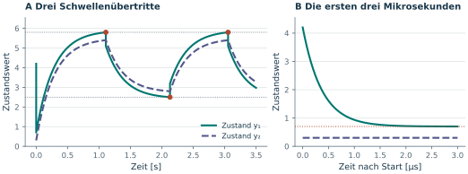
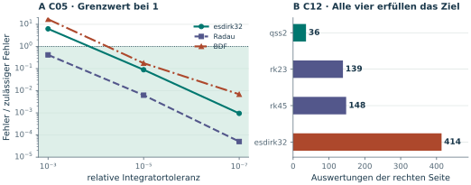
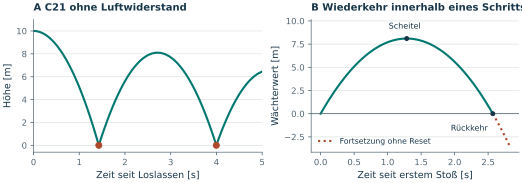

# Drei Kontakte in der Kugelreihe C12

In der reduzierten Variante von C12-A2 stehen vier gleich schwere Kugeln in einer Reihe. Zwischen benachbarten Oberflächen ist jeweils 1 m frei. Anfangs bewegt sich nur die erste Kugel mit 1 m/s nach rechts. Zwischen Kontakten wirken keine Kräfte. Beim zentralen, vollkommen elastischen Stoß zweier gleicher Massen tauschen die Partner ihre Geschwindigkeiten. Damit ergibt sich eine Referenz ohne numerischen Solver. Die Kontakte liegen bei 1, 2 und 3 s. Danach bewegt sich nur Kugel 4.

Als Zustände verwenden wir die Spalte $d_1,d_2,d_3$ und die vier Geschwindigkeiten. In der Flugphase gilt $\dot d_j=v_{j+1}-v_j$ und $\dot v_j=0$. Ein **Wächter** ist eine skalare Funktion, deren Nulldurchgang das Modell überwacht. Hier ist $g_j=d_j$, gesucht wird die Annäherung an null mit negativer Richtung. Der Reset setzt den Spalt auf null und vertauscht die Geschwindigkeiten. Nach dem Stoß trennen sich die Körper oder bleiben zunächst in Berührung. Ein Wächter darf am identischen Anfangspunkt keinen zweiten Stoß auslösen.

QSS2 kann die lineare Spaltentwicklung exakt darstellen, solange die Geschwindigkeit konstant bleibt. Im untersuchten Lauf waren innerhalb der Flugabschnitte keine zusätzlichen Quantisierungsupdates nötig. Initialisierung, Wächter und Neustarts verbrauchten zusammen 36 Auswertungen der rechten Seite. Die Aussage gilt für diese **momentane Stoßregel**. Eine Kontaktfeder mit endlicher Stoßdauer hätte eine andere Gleichung und eine zusätzliche schnelle Zeitskala. [Offizielle Aufgabe](https://www.argesim.org/benchmarks/c12) · [Versuchsdefinition](../../benchmarks/benchmark_solver_extension.py)

## Der schnelle Modus im Schaltmodell C05

Im Zweizustandsmodell gilt innerhalb eines Modus $\dot y_1=c_1(y_2+c_2-y_1)$ und $\dot y_2=c_3(c_4-y_2)$. Die Raten sind $c_1=2{,}7\cdot10^6$ und $c_3=3{,}5651205$ pro Sekunde. Im ersten Modus sind $c_2=0{,}4$ und $c_4=5{,}5$. Beim Anstieg von $y_1$ auf 5,8 folgt Modus 2 mit $c_2=-0{,}3$ und $c_4=2{,}73$. Beim Abstieg auf 2,5 wird wieder Modus 1 aktiv. Die Zustände sind am Schaltpunkt stetig.

Jede Phase lässt sich analytisch fortsetzen. Mit dem Startwert $y_{2,0}$ gilt nach der Zeit $\tau$ zunächst $y_2=c_4+(y_{2,0}-c_4)e^{-c_3\tau}$. Einsetzen in die erste Gleichung ergibt dort einen konstanten Anteil und zwei Exponentialterme. Die Referenz lokalisiert den gerichteten Schwellenübertritt durch Bisektion auf dieser Phasenlösung. Bei Start $(4{,}2;\,0{,}3)$ liegen im Fenster bis 3,5 s drei Schaltungen bei 1,108306 s, 2,129685 s und 3,054153 s.

Der Versuch verlangt die richtige Ereignisfolge, **höchstens 1 ms Fehler je Schaltzeit** und **höchstens 0,006 je Endzustand**. RK23 erschöpfte bei allen drei Toleranzen das Budget von 40 000 Versuchen pro Integratoraufruf. ESDIRK32 fand die drei Schaltungen, erfüllte das kombinierte Ziel aber erst ab der mittleren Toleranz. Radau bestand alle drei Stufen. Bei BDF waren es zwei. Stabilität ermöglicht die Rechnung über die schnellen Moden hinweg. Ob die gesuchte Schaltung rechtzeitig kommt, beantwortet erst der Fehlervergleich. [Offizielle Aufgabe](https://www.argesim.org/benchmarks/c05) · [Analytische Phasenlösung](../../argesim_benchmarks/models/c05_two_state.py)

## Den Vergleich bei gleicher physikalischer Genauigkeit lesen

Der Score $S=\max_j |m_j-m_j^{\mathrm{ref}}|/L_j$ setzt jeden Messfehler ins Verhältnis zu seiner zulässigen Abweichung $L_j$. Voraussetzung ist die geforderte Ereignisfolge. Dann bedeutet $S\leq1$, dass alle überprüften Größen innerhalb der Toleranz liegen. $S=0{,}1$ bedeutet, dass selbst die am schlechtesten getroffene Größe nur ein Zehntel ihrer Fehlerschranke ausschöpft. Der Score ist ein Maß für diese Beobachtungen, kein Maximum der Fehler über alle Zwischenzeiten.

| Befund | Quantitatives Ergebnis und Lesart |
|---|---|
| C05, ESDIRK32 | $S=6{,}26$, $0{,}0889$, $0{,}000947$ bei relativen Toleranzen $10^{-3},10^{-5},10^{-7}$. Die grobe Rechnung endet regulär und verfehlt das Ziel. |
| C12, vier Verfahren | Bei allen drei Einstellungen bestehen QSS2, RK23, RK45 und ESDIRK32. Dafür brauchen sie 36, 139, 148 und 414 Auswertungen. Ein zusätzlicher impliziter Stufenlöser bringt hier keinen Genauigkeitsgewinn, den die Aufgabe verlangt. |
| Steifes Tracking ohne Schalter | Auf der groben Stufe bestehen eLIQSS2 mit 638, ESDIRK32 mit 889 und RK23 mit 72 295 Auswertungen. Die vier Beobachtungshorizonte enthalten langsame und schnelle Dynamik. |
| Nichtsteifer Oszillator | Bei drei Verfeinerungen bestehen RK23 und RK45 je zweimal. QSS2 und eLIQSS2 verfehlen jedes Mal das vorgegebene Ziel für Position und Geschwindigkeit. |

Insgesamt umfasst diese Versuchsreihe **138 Konfigurationen**. 108 bestehen, 18 enden mit zu großem Fehler, zwei mit falscher Ereigniszahl, sechs am Zeitlimit und vier mit Solverfehler oder ausgeschöpftem Arbeitsbudget. Absolute Komponententoleranzen und Zustandsquanten haben verschiedene Bedeutungen. Fair ist der Vergleich am gemeinsamen physikalischen Ziel. RHS-Aufrufe der nativen Solver schließen Arbeit für numerische Jacobi-Matrizen und die verwendete Ereignisbehandlung ein. Bei SciPy und bei unterschiedlichen Gleichungssystemen ist ein direkter Kostenvergleich allein über diese Zahl unvollständig. [Rohdaten aller Läufe](../evidence/rk23-devs.csv) · [Messumgebung](../evidence/rk23-devs.json)

## Verfehlte Ereignisse und Zustandsfehler bei C21 und C13

**Der springende Ball.** Ein Ball fällt ohne Luftwiderstand aus 10 m Höhe. Bei Erdbeschleunigung $g=9{,}81$ m/s² ergibt $z(t)=10-gt^2/2$ die erste Auftreffzeit $t_1=\sqrt{20/g}=1{,}42784$ s. Der Stoß ändert das Vorzeichen der Geschwindigkeit und multipliziert ihren Betrag mit 0,9. Die nächste Flugzeit ist daher $2\cdot0{,}9\,t_1$. Der zweite Stoß muss bei 3,99796 s eintreten. Die Höhe allein am ersten Stoß erfasst den zweiten Flug nicht. Selbst eine Simulation, die anschließend den Boden durchdringt, kann den ersten Stoß korrekt treffen.

Beginnt ein großer Schritt auf der Rücksetzfläche, kann der Ball innerhalb desselben Schritts aufsteigen, umkehren und zum Boden zurückkehren. Ein Test nur an den Schrittenden kann den zweiten Stoß verlieren. Die Implementierung unterteilt bei Koordinatenwächtern den kubischen Hermite-Interpolanten an seinen inneren Extremstellen und sucht gerichtete Nulldurchgänge in den Teilintervallen. Bei QSS3 und QSS4 wurde der zweite Stoß so auf allen drei untersuchten Quantenstufen wiedergefunden. Für beliebige nichtlineare Wächter gilt diese Vollständigkeit nicht. [C21-Fallstudien](https://www.argesim.org/benchmarks/c21) · [Regression und Referenzen](../SOLVER_COMPARISON.md)

**Der Kran.** Beim linearen C13-Lastpuls werden fünf Zustandskomponenten zu 4, 7 und 15 s geprüft. Für jeden Abschnitt gibt es eine unabhängig transkribierte affine Matrixlösung. RK4 und RK45 erfüllten das Ziel der Acht-Fälle-Studie. Von den 18 QSS-Namen gelang das bei keinem der drei dort untersuchten Quanten. Der beste QSS-Lauf (QSS3) lag noch bei rund 2,20 zulässigen Fehlern. Ein genauer Endwert in einem anderen 2000-s-Versuch entscheidet diese 15 Einzelprüfungen nicht. [C13-Referenz](../C13_REFERENCE_ANALYSIS.md)

Die Acht-Fälle-Studie umfasst außerdem C03 (Schaltverstärker), C07 (Pendel mit Anschlag), C09 (zwei geregelte Tanks) und C11 (SCARA-Roboter). Die Tabelle im englischen Anhang zeigt alle 456 getesteten Konfigurationen zusammengefasst nach Verfahren und Fall. Bei C11 sind nur die ersten 0,1 ms vor der Strombegrenzung erfasst. [Vollständige Matrix und Zeitfenster](../SOLVER_COMPARISON.md#all-methods-and-cases)

> **Aufgabe 8.** Ein C05-Lauf trifft alle drei Schaltungen in der richtigen Reihenfolge. Sein größter Zeitfehler ist 0,4 ms, die beiden Endfehler sind 0,0024 und 0,0072. Bestimmen Sie den Score. Wie behandeln Sie einen zweiten Lauf mit vier Schaltungen und exaktem Endzustand? [Lösung](10-loesungen.md#a8)
