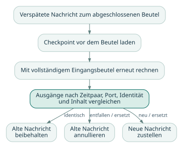

# Wann lässt sich ein QSS-Ereignis parallel verarbeiten?

**Methodische Forschungsstudie zu Christian Stenzels „Numerische Simulation dynamischer Systeme“, Gesamtausgabe v9.19, 26. November 2026.** Buch- und Messstand ist [Merge `b065fe61`](https://github.com/5H3LL3H5/argesim-hyperposition-benchmarks/commit/b065fe61f10faef9c9781473a89315abdd467c75). Die Implementierung zu dieser Studie ist eine ausführbare serielle Referenz für den Kalender und für garantierte Zeitintervalle. Abschnitt 4 enthält gerechnete serielle Referenzen für beide Modelle und den Versuchsplan für 4 und 8 physische Prozesse. [Buchstand und Prüfsummen](../ARGESIM_Buchstand.json) · [Kapitel 6](gesamtausgabe/kapitel/06.md) · [Python-Referenz](../../argesim_benchmarks/qss_pdes_calendar.py) · [Regressionstests](../../tests/test_qss_pdes_calendar.py)

**Messnachtrag zur Buchfassung v9.20.** Die Mehrprozessversuche für C19R, CP1/C und CP2/2 sind nun ausgeführt. Die [Gegenprobe mit zwei Referenzfeldern](gesamtausgabe/kapitel/16.md#cp2-voll-direktvergleich) und die [Versuchsdaten einschließlich Reichweite und Feldfehler](gesamtausgabe/rechenlabor/pdes_partitionierung/README.md) ergänzen den ursprünglichen Versuchsplan.

Die Wahl des nächsten Ereignisses, die Zulässigkeit eines Schrittes auf einem anderen Prozessor und die Genauigkeit des physikalischen Ergebnisses lassen sich an einem Beispiel auseinanderhalten. Ein Speicher hat seinen nächsten Schwellendurchtritt für morgen gemeldet. Ein neuer Zufluss kann den Durchtritt auf heute vorziehen. Ein schnellerer Kalender hilft beim Umplanen. Ein anderer Prozessor darf bis morgen nur vorausrechnen, wenn er auch die Wirkung sämtlicher noch möglicher Zuflüsse berücksichtigt hat. Ob die danach gemeldete Konzentration am Brunnen stimmt, entscheidet eine unabhängige Referenz.

## 1. Welcher Teil eines Ereignisses kostet Zeit?

### Vom einzelnen Quantisierer zur Partition

In Kapitel 6.2 beträgt der zuerst gemeldete Termin eines entladenden Speichers $1/2\,\mathrm s$. Eine Meldung zur Zeit $1/4\,\mathrm s$ halbiert den Betrag der Steigung. Der Speicher erreicht die Schwelle nun bei $3/4\,\mathrm s$. Der Kalender erhöht die Versionsnummer der Prognose, lässt den alten Termin im Heap und erkennt ihn beim Auslesen als ungültig. Wird die neue Steigung null, muss er die alte Version auch dann entwerten, wenn er gar keinen Ersatztermin einträgt. Die Momentaufnahme vor der ersten Zustandsänderung liefert sämtliche Ausgaben desselben Zeitpunkts. Die Eingangsbeutel umfassen anschließend alle bei einem Empfänger eintreffenden Ausgaben. [§ 6.2 mit Zahlenbeispiel und Pseudocode](gesamtausgabe/kapitel/06.md#kap06-schrittfolge)

Für $d$ Zustände kennzeichnet eine Kante $i\to j$ eine mögliche Abhängigkeit von $f_j$ vom gemeldeten $q_i$. Den Graphen erhält man aus der **strukturellen** Jacobi-Matrix. Eine Ableitung kann im heutigen Zustand null sein und morgen eine Kante aktivieren. Bei einem Moduswechsel muss der neue Graph rechtzeitig verfügbar sein. Für $b$ gleichzeitig fällige Knoten seien $a$ die berührten Kanten, $u$ die Zahl unterschiedlicher neu zu planender Knoten einschließlich der Fälligen, $z$ die entsorgten alten Einträge und $M$ die gespeicherten Termine einschließlich veralteter Versionen. Mit einem binären Min-Heap kostet ein Ereignisbeutel

$$
O\!\left((b+u+z)\log(2+M)+a\right)
+ W_{\mathrm{lokale\ Gleichungen}} + W_{\mathrm{Wurzeln}} .
$$

Hier ist eine schon bekannte gültige Heapspitze in $O(1)$ lesbar. Das Suchen der nächsten gültigen Spitze kann mehrere Entnahmen erfordern. Jede alte Version lässt sich höchstens einmal entfernen. Ein Neuaufbau per Heapify kostet linear in der Zahl der gespeicherten Einträge und kann bei einer festen Überschreitungsquote über die auslösenden Änderungen amortisiert werden. Bei dauerndem Umplanen ohne Bereinigung kann $M$ weit über $d$ steigen. Ein räumlich lokaler Einfluss hält $u$ oft klein. Weder $d=1000$ noch ein größerer Einzelwert für $d$ bewirkt einen Wechsel der asymptotischen Klasse.

**Bezug zum gemessenen Solver.** Das Zwei-Phasen-Modell in § 6.2 erklärt die Kalendersemantik. Die Python-Referenzen für QSS1/2 und die höheren Ordnungen bilden in wichtigen Pfaden einen Kandidatenvektor und suchen sein Minimum. Das kostet bei $d$ Komponenten bereits $\Theta(d)$ je vollständiger Suche. Auch eine voll ausgewertete rechte Seite bleibt ein eigener Aufwand. Die Zeitmessungen des Buchs dürfen daher keinem einzelnen Heap zugeschrieben werden. Der bestehende `OrderedExecutor` verteilt unabhängige Aufträge. Für die Partitionierung einer einzigen Trajektorie braucht man lokale rechte Seiten, lokale Taylor-Koeffizienten und Zeitstempel an jeder Schnittstelle. [QSS-Kandidatenvektor](../../argesim_benchmarks/solvers/qss.py#L185-L200) · [höhere Ordnungen](../../argesim_benchmarks/solvers/advanced_qss.py#L188-L216) · [bestehende Auftragsverteilung](../../argesim_benchmarks/parallel.py)

**Gegenprobe am aktuellen Vollgitterlauf.** In der CP2-Kavität mit $257\times257$ Knoten hängt das rekonstruierte Geschwindigkeitsfeld über die Poisson-Gleichung von allen 65 025 inneren Wirbelstärken ab. Keiner der 19 nativen Einzelkalender erreicht bei der vereinbarten Abbruchregel das erste Vergleichsfeld $t^*=0{,}1$. QSS3 kommt mit 141 akzeptierten Segmenten bis $0{,}000895183$, QSS4 mit 114 bis $0{,}001850894$. Unabhängige Integrationen der 564 bzw. 456 Kontrollfelder ergeben bis zum Abbruch maximale relative Feldfehler von 0,01775 % bzw. 0,01323 %. [Segmentprotokolle und Referenzfehler](gesamtausgabe/rechenlabor/qss_pruefung/messung/kontakt_v919) Beide korrigierten Verfahren laufen also an. Selbst ein Kalender mit konstanten Zugriffskosten würde die globale Rückkopplung der Wirbelrechnung behalten. C19R und CP1/C bieten im Gegensatz dazu kurze räumliche Stencils, bei denen eine lokale Neuplanung tatsächlich Arbeit einsparen kann. Die Literaturübersicht von Castro und Kollegen ordnet die verschiedenen QSS-Familien ein. Für LIQSS, eLIQSS oder Block-QSS muss ein Lookahead-Beweis die tatsächliche Ausgabe- und Resetregel der jeweiligen Variante verwenden. [Vollgitterprotokoll im Buch](gesamtausgabe/kapitel/16.md#qss-feldpruefung) · [Castro et al., 2024](https://doi.org/10.1177/00375497241230985)

### Kalender und Übergangssemantik im Vergleich

| Architektur | Arbeit am Kalender | Wo sie im QSS-Versuch auffällt |
|---|---|---|
| Binärer Heap mit Version | Einfügen und Entnehmen jeweils $O(\log M)$, Bereinigung wie oben | Robuste Referenz bei vielen neu geplanten oder zeitgleichen Terminen. Mit $z$, Heapmaximum und Wurzelauswertungen messen. |
| Calendar Queue nach Brown | Zyklische Zeitfächer, nahe der passenden Belegung konstante mittlere Zugriffsarbeit. Neue Fachbreite und Umverteilung können $O(M)$ kosten. | Ein Wechsel von fast gleichmäßigen Fristen zu einem Puls kann lange Suchgänge oder überfüllte Fächer erzeugen. [Brown, 1988](https://doi.org/10.1145/63039.63045) |
| Dynamic Calendar Queue | Oh und Ahn passen die Größenwahl und die Stichprobe für die Zeitverteilung an. Die Anpassung verbessert die untersuchten schiefen Verteilungen. | Verlauf vor und nach einem Quellsprung getrennt auswerten. Für adversarielle Belegung oder einen Beutel mit $b$ Meldungen folgt daraus keine konstante Gesamtlaufzeit. [Oh und Ahn, 1999](https://pure.dongguk.edu/en/publications/dynamic-calendar-queue/) |
| Ladder Queue | Grobe obere Fächer, bei Bedarf feinere Stufen, geordneter unterer Bereich. Tang, Goh und Thng leiten amortisiertes $O(1)$ bei endlichem, positivem mittlerem Prioritätszuwachs im Modell der Arbeit her. | Zeitgleiche Serien, sehr kurze Abstände und Wechsel des Aktivitätsgebiets samt Verteilung der Prioritätszuwächse ausweisen. Jeder tatsächlich zugestellte Ausgang kostet Arbeit. [Tang, Goh und Thng, 2005](https://doi.org/10.1145/1103323.1103324) |
| Hierarchie aus LP-Heaps | Lokal $O(\log(2+M_p))$, Verzeichnis $O(\log(2+P))$ je geändertem Partitionsminimum für $P$ Partitionen | Lohnend, wenn viele lokale Änderungen dieselbe LP-Spitze behalten. Bei vielen gleichzeitig aktiven LPs können Verzeichnis, Beutelsortierung und Synchronisation dominieren. |
| DEVS-Koordinator in drei Arbeitsschritten | Zeitpunkt und Fällige bestimmen, Ausgaben bilden und zustellen, dann Zustände fortschalten. Jede der obigen Datenstrukturen kann die Terminsuche übernehmen. | Klassisches DEVS kann Gleichzeitigkeit über `select` serialisieren. Parallel DEVS spezifiziert Beutel und eine konfluente Transition. Die allgemeine A/B/C-Dreiphasenstrategie der diskreten Simulation ist nochmals ein anderes Konzept. [Chow und Zeigler, 1994](https://informs-sim.org/wsc94papers/1994_0104.pdf) |

Sei $I$ die Menge der Fälligen. Zuerst wird $\lambda_i(s_i^-)$ für jedes $i\in I$ ausgewertet. Nach dem Routing erhält jeder betroffene Knoten **einen** Übergang. Ein allein fälliger Knoten nimmt $\delta_{\rm int}$, ein allein empfangender Knoten $\delta_{\rm ext}(s,e,X)$ mit der seit seinem letzten Übergang verstrichenen Zeit $e$ und dem Eingangsbeutel $X$. Treffen beide Fälle zusammen, gilt die vom Modell definierte $\delta_{\rm confl}(s,X)$. Die Transition schreibt nur den eigenen Zustand. Auf diese Weise kann eine Änderung der Reihenfolge der LP-Nummern keinen zweiten Quantisierungssprung einschmuggeln.

### Ein Kalender mit zwei Ebenen zum Nachrechnen

Jeder Knoten gehört genau einer Partition. Ein lokaler Eintrag enthält das Paar aus physikalischer Zeit und Mikroschritt, die Knoten-ID und die Version. Das obere Verzeichnis enthält pro aktiver Partition ein logisch gültiges Minimum und einen Versionszähler. Bleibt das lokale Minimum beim Umplanen gleich, entfällt der Eintrag oben. Nach der Entnahme werden **alle** Partitionsspitzen mit demselben Zeitpaar geleert. Echte Unterschiede von nur einer darstellbaren Gleitkommazahl bleiben erhalten. Meldungen mit verschwindender physikalischer Verzögerung können einen späteren Mikroschritt verwenden. Unbeschränkt wachsende Mikroschritte erfordern eine Modellprüfung auf Zeno-Verhalten.

Für $k$ geänderte Partitionsminima kostet die Verzeichnisarbeit amortisiert $O(k\log(2+P))$ zuzüglich des Lesens der betroffenen Spitzen, des Sammelns der gleichzeitigen Partitionen und der Bereinigung. Die lokalen Heapkosten summieren sich über deren Einträge. Die Referenz sortiert für ein reproduzierbares Protokoll fällige und betroffene IDs, im ungünstigen Fall mit $O((b+u)\log(2+b+u))$ zusätzlicher Arbeit. Sie verdichtet beide Heapebenen. Je Ebene prüft sie ab mehr als doppelt so vielen gespeicherten wie gültigen Einträgen zuzüglich acht Reserveplätzen. Ein Speedup erfordert gleichzeitig ausführbare Arbeit auf mehreren Kernen. [Ausführbarer Python-Pseudocode mit `schedule`, `pop_bag` und `step`](../../argesim_benchmarks/qss_pdes_calendar.py)

~~~python
from argesim_benchmarks.qss_pdes_calendar import PartitionedCalendar

calendar = PartitionedCalendar([0, 1, 0], partitions=2)
calendar.schedule([(0, (0.5, 0)), (1, (0.25, 0))])
assert calendar.pop_bag() == ((0.25, 0), (1,))
calendar.schedule([(0, (0.75, 0)), (2, (0.75, 0))])
assert calendar.pop_bag() == ((0.75, 0), (0, 2))
assert calendar.peek() is None
~~~

Im größeren Versuch ersetzt `step(output, transition)` die beiden manuellen Entnahmen. Ein Rand- oder Quellsprung kann als eigener Quellknoten eingetragen werden. Die Tests vergleichen 1, 4 und 8 Kalenderpartitionen gegen eine unabhängige Suche über alle gültigen Termine. Weitere Fälle prüfen gemeinsame Ausgaben vor dem ersten Zustandsupdate, wiederholtes Umplanen, Stornierung und verschiedene Mikroschritte. Diese Prüfungen liefern eine Ereignisreferenz für einen späteren MPI- oder Mehrprozesslauf. [Testprogramm](../../tests/test_qss_pdes_calendar.py)

## 2. Was darf ein LP seinem Nachbarn über die Zukunft versprechen?

### Ereignisprognose und garantiertes Zeitintervall

Betrachte einen Ausgang von LP $i$ nach LP $j$ unmittelbar nach allen bekannten Übergängen zum Zeitpunkt $t$. Ein striktes konservatives Versprechen mit Länge $L_{ij}$ schließt **jede** ausgehende Nachricht an $j$ in $[t,t+L_{ij})$ aus, auch wenn in diesem Intervall zulässige, heute unbekannte Eingaben ankommen. Bereits gesendete und unterwegs befindliche Nachrichten muss der Empfänger zusätzlich berücksichtigen. Bei Gleichheit am rechten Ende können mehrere Nachrichten denselben Zeitstempel tragen.

Setze $d_i=x_i-q_i$ und $r_i=\Delta_i-|d_i(t^+)|$. Bei konstantem QSS1-Meldewert, stetigem Zustand und einer für alle zulässigen Eingänge gültigen Schranke $|x_i'|\le M_i$ gilt $|d_i(t+h)|\le |d_i(t^+)|+M_i h$. Daher ist $r_i/M_i$ eine untere Schranke für die Zeit bis zum nächsten Bandtreffer. Unmittelbar nach einer zentrierten Meldung ergibt sich $\Delta_i/M_i$. Vor einer Meldung kann die Reserve fast null sein. Bei $M_i=0$ bleibt nur die nächste mögliche andere Ausgabeursache als Grenze. Ein externer Reset des Zustands oder eine sofortige Portmeldung braucht eine eigene Schranke.

Auf einem unveränderten Taylor-Segment der Ordnung $p$ hat das Fehlerpolynom die Form $d_i(s)=d_0+\sum_{k=1}^{p}c_ks^k$ mit $s\ge0$. Die lokale Prognose ist die kleinste zulässige positive reelle Lösung **beider** Gleichungen $d_i(s)=+\Delta_i$ und $d_i(s)=-\Delta_i$. QSS1 liefert eine Gerade, QSS2 eine Parabel und QSS3 ein kubisches Polynom. Frühere positive Treffer und Mehrfachwurzeln müssen unter der im Solver definierten Schwellenregel erhalten bleiben. Ohne Treffer im aktuellen Segment darf seine Fortsetzung nur bis zum nächsten Eingriff verwendet werden. [Korrigierte Wurzeltests und Methodenbilder](gesamtausgabe/rechenlabor/qss_pruefung/README.md)

**Ein Gegenbeispiel für alle drei Ordnungen.** Normiere $\Delta=1$ und setze vor einer bislang unbekannten Nachricht $d(s)=s^p$. Der Kalender meldet $s=1$. Bei $s=1/8$ ändere eine Nachricht die Fortsetzung auf

$$
d_{\rm neu}(s)=s^p+512\max(0,s-1/8)^p,\qquad p=1,2,3.
$$

Bei $s=1/8$ liegt der Fehler noch im Band. Bei $s=1/4$ ist er für jedes der drei $p$ größer als eins. Für $p=3$ ergibt sich bereits $1/64+1=65/64$. Die ersten $p-1$ Ableitungen passen am Übergang zusammen. Die früheste neue Meldung liegt vor $1/4$. Ein Nachbar, dem zuvor kommentarlos die Zeit 1 als sichere Untergrenze versprochen wurde, kann über ein gültiges Ereignis hinweg laufen.

### Eine beweisbare Schranke für QSS2 und QSS3

Sei $H$ ein abgesicherter Gültigkeitshorizont. Nehmen wir an, $d_i$ habe auf $[t,t+H]$ für alle zugelassenen Verläufe absolut stetige Ableitungen bis zur Ordnung $p-1$ (für $p=1$ den Zustand), und es gelte fast überall $|d_i^{(p)}|\le B_p$. Taylor mit Integralrest liefert dann für $0\le h\le H$

$$
|d_i(t+h)-d_i(t)|\le
E_p(h)=\sum_{k=1}^{p-1}\frac{|d_i^{(k)}(t^+)|}{k!}h^k+
\frac{B_p}{p!}h^p .
$$

Gesucht ist der größte durch $H$ begrenzte Wert $h$ mit $E_p(h)\le r_i$. Vor diesem Zeitpunkt bleibt der Fehler für positive Reserve und nichtkonstante Hüllkurve im offenen Band. Bei exakt abgeglichenen Ableitungen vereinfacht sich die Rechnung wie folgt.

| Ordnung | Hülle bei abgeglichenem Start | Garantierter Abstand bei $B_p>0$, zusätzlich auf $H$ begrenzen |
|---|---|---|
| QSS1 | $B_1h$ | $r_i/B_1$ |
| QSS2 | $B_2h^2/2$ | $\sqrt{2r_i/B_2}$ |
| QSS3 | $B_3h^3/6$ | $\sqrt[3]{6r_i/B_3}$ |

Bei QSS2 mit verbleibender Steigungsdifferenz $a$ steht $|a|h+B_2h^2/2$ auf der linken Seite. Bei QSS3 kommt bei verbleibender Krümmungsdifferenz $b$ zusätzlich $|b|h^2/2$ zum linearen und kubischen Term. Alle Koeffizienten der Hülle sind nichtnegativ. Das ermöglicht Bisektion mit einem kontrollierten unteren Endpunkt. Bei $r=1/8$ und $B_2=1$ ergibt sich nach abgeglichener Steigung $h=1/2$. Ein Rest $|a|=1$ verkürzt diese Schranke auf $\sqrt{5/4}-1\approx0{,}118$. In der Referenzfunktion stammen die Eingaben aus exakten rationalen oberen Schranken, einschließlich Fakultäten. Bei aus Fließkommadaten hergeleiteten Schranken muss bereits deren Gewinnung nach außen abgesichert sein. [Referenzfunktion und Tests](../../argesim_benchmarks/qss_pdes_calendar.py)

Welche Hülle ist **für den Kanal** zulässig? Ein Wechsel der Steigung von $q_i$ kann bei höheren Ordnungen selbst eine sofort versandte Nachricht sein. Ein Nachbar kann $x_i'$ sprunghaft ändern und damit die Regularität der quadratischen oder kubischen Hülle zerstören. Dann wird das Fenster vor diesem Eingang beendet, ein auch über solche Eingänge gültiger Lipschitz-Betrag erster Ordnung verwendet oder gemeinsam zum nächsten Ereignis synchronisiert. Bei einem Sprung von $d_i$ selbst braucht man eine gesonderte Sprungschranke oder schließt das Fenster. Über die relevanten Randknoten nimmt man das Minimum aller garantierten Abstände, bekannten erzwungenen Ausgaben und abgesicherten Eingangsfenster. Eine echte physikalische Mindestverzögerung des Kanals kann hinzukommen. Nachbarzellen eines semidiskreten Stencils sind sofort gekoppelt. Die Laufzeit eines physikalischen Wellenpakets zwischen zwei Messstellen ist dort keine solche Kanalverzögerung.

Für den gerichteten Kanal sei $D_{ij}$ die Menge der dort tatsächlich sichtbaren Ausgänge. Für Ausgang $a$ gelte die Einhüllung bis $H_a$, und $h_a$ sei die mit $H_a$ begrenzte Lösung der Reservegleichung. Sei $F_{ij}$ die Untergrenze für andere Sendepfade, etwa die sofortige Weitergabe eines neuen Steigungskoeffizienten. Dann darf der Sender nach vollständig verarbeitetem Zeitbeutel die Schranke

$$
L_{ij}=\min\!\left(F_{ij},\min_{a\in D_{ij}}h_a\right)
$$

für seine nächste **Sendung** verwenden. Ein leerer Satz von Ursachen trägt $+\infty$ zum Minimum bei. Für den Empfang kommt nur eine vom Kanal garantierte Mindesttransportzeit in *Simulationszeit* hinzu. Bei $r>0$, endlichen Koeffizienten und $H>0$ besitzt auch die Berechnung ein positives rationales Zertifikat. Für $E(H)>r$ gilt wegen nichtnegativer Koeffizienten $E(\theta H)\le\theta E(H)$ bei $0\le\theta\le1$. Damit ist $h_0=Hr/E(H)>0$ stets zulässig. Die Referenz gibt den besseren Wert aus dieser Schranke und dem unteren Bisektionsende aus. Selbst bei $r=2^{-500}$ liefert sie so einen positiven Wert. Die Übertragung in ein binäres Zeitformat verlangt gerichtetes Abrunden. Fällt das zugesagte Ende dabei auf den bisherigen Stempel, ist auf diesem Zeitraster kein physikalischer Fortschritt zertifiziert.

Bei C19R liefert ein Intervallkasten $|q_j|\le R_j$ zum Beispiel für eine lineare FV-Zeile $x_i'=\sum_j A_{ij}q_j+s_i(t)$ die QSS1-Ratenschranke $M_i=\sum_j|A_{ij}|R_j+\sup|s_i|$. Die $R_j$ müssen auf dem ganzen Fenster gelten, etwa aus einer geprüften Einhüllung einschließlich Schnittstellenbändern und der bekannten Quellrate. Bei der Saite liefert $|\dot v_i|\le c^2(R_{i-1}+2R_i+R_{i+1})/\Delta x^2$ eine analoge, oft sehr grobe Schranke aus Auslenkungsgrenzen. Für $\dot u_i$ ist eine Geschwindigkeitsgrenze erforderlich. Ein gestern gemessenes Maximum allein trägt kein striktes Versprechen.

### Was aus positiven Einzelabständen für CMB folgt

Der Sender einer Nullnachricht garantiert auf einem entsprechend geordneten Kanal eine untere Zeitgrenze für nachfolgende Nachrichten. Der Empfänger darf Ereignisse **vor** dem kleinsten sicheren Eingangsstempel ausführen. Für Ereignisse genau auf dieser Grenze braucht er den vollständigen Beutel, etwa eine explizite Abschlussmarke. In-Flight-Nachrichten, Quellen und Mikroschritte gehören zum Protokoll. Bei gleichen physikalischen Zeiten können Abschlüsse auch eine gemeinsam bearbeitete Fixpunkt- oder Mikroschrittrunde verlangen. [Chandy und Misra, 1979](https://www.cs.utexas.edu/~misra/scannedPdf.dir/DistrSimulation.pdf)

Positive Einzelabstände garantieren keinen nennenswerten Fortschritt. Schon die Folge $2^{-n}\,\mathrm s$ für $n=1,2,\ldots$ verbraucht unendlich viele Fortschreibungen bis zur Zeit $1\,\mathrm s$. Sie kann aus schrumpfenden Restbändern entstehen. Ein Zyklus sofort wirksamer Ausgänge kann sogar Lookahead null haben. Für gleichmäßig positive Fortschritte braucht man zusätzliche Annahmen wie eine untere Restbandgrenze, einheitliche Ableitungsgrenzen und gesicherte Eingangsfenster auf jedem blockierenden Zyklus. Geordnete zuverlässige Zustellung, faire Bedienung und endlich viele physikalische Ereignisse pro endlichem Zeitfenster bleiben notwendig. Bei fehlender Schranke kann man die stark gekoppelte Gruppe als einen LP führen oder den global frühesten Beutel über eine Barriere abschließen. Nullnachrichten lassen sich bündeln und ihre Häufigkeit messen. Die QSS-Ordnung allein beseitigt das Kriechen nicht.

Fernández, Kofman und Bergero untersuchen einen anderen, für den Vergleich besonders interessanten Weg. Ihre parallele QSS-Implementierung erlaubt kontrollierten Zeitversatz zwischen LPs und leitet unter Voraussetzungen einen zusätzlichen numerischen Fehler her. Die dort gemessenen Beschleunigungen gehören zu den dortigen Modellen und zur nichtstrikten Synchronisation. Für C19R und CP1/C muss ein solcher Modus ein eigenes Fehlerbudget bekommen. [Fernández, Kofman und Bergero, Primärarbeit](https://www.fceia.unr.edu.ar/~kofman/files/parallel_qss.pdf)

## 3. Wann bleibt ein Rollback lokal?

### Exakte Nachrichten und kleine Zustandsfehler

Ein optimistischer LP hat bis zur lokalen virtuellen Zeit $t_v$ gerechnet. Eine verspätete Nachricht erreicht ihn mit Zeitstempel $\tau<t_v$. Auch eine verspätete Nachricht **zum selben** bereits abgeschlossenen Beutel kann dessen konfluente Transition ändern. Time Warp stellt den letzten Checkpoint vor dem betroffenen Beutel wieder her, fügt die Nachricht in die Eingangsfolge ein und wiederholt die betroffenen Übergänge. Zum Checkpoint gehören physikalische Zustände, Quantisierungswerte, Steigungen und höhere Koeffizienten, letzte Aktualisierungszeiten, Modus, Prognoseversionen und Kalender bzw. die Daten für seine deterministische Rekonstruktion. Eingangs- und Ausgangshistorie sowie verwendete Zufallszustände müssen reproduzierbar sein. Fossil Collection darf Zustände erst vor der sicheren globalen virtuellen Zeit (GVT) freigeben, unter Berücksichtigung der Nachrichten im Transit. [Jefferson, *Virtual Time*](https://doi.org/10.1145/3916.3988)

Bei sofortiger Annullierung versendet der LP Gegennachrichten zu verworfenen Ausgaben. Bei verzögerter Annullierung vergleicht er die beim Replay erzeugten Ausgänge mit den alten. Stimmen Ziel, Port, Zeit **einschließlich Mikroschritt**, Nachrichtenidentität bzw. deren eindeutige Zuordnung, Multiplizität und Inhalt überein, kann die alte Nachricht bestehen bleiben. Für QSS2/3 umfasst der Inhalt auch die gemeldeten Polynomkoeffizienten und deren Bezugszeit. Entfernte oder geänderte Ausgänge brauchen die passende Annullierung, neue Ausgänge die reguläre Zustellung. Die lokale Zustandskorrektur bleibt erforderlich, auch wenn keine Gegennachricht das Teilgebiet verlässt. [Lin und Lazowska, 1991](https://doi.org/10.1145/102810.102813)

Wie kann man vorab erkennen, dass ein Randknoten im fraglichen Intervall sicher schweigt? Für ein lineares Segment definiere $x_Q' = A q + b(t)$, $x'=Ax+b(t)$, $\delta=q-x_Q$ und $e=x_Q-x$. Dann folgt durch Subtraktion $e'=Ae+A\delta$. Für den Unterschied $z$ zweier Rekonstruktionen gilt dieselbe Variationsformel mit der Differenz der Quantisierungsstörungen. Ist stattdessen ein eingehendes Randpolynom als exogenes Signal implementiert, verwendet man dessen Eingangsmatrix $B$ und die Abweichung $w$ des Signals. In beiden Fällen hat die Rechnung auf dem ununterbrochenen Segment die Gestalt

$$
z(t)=e^{A(t-\tau)}z(\tau)+\int_\tau^t e^{A(t-s)}B w(s)\,ds .
$$

Für eine einzelne Kante genügt die betreffende Spalte $B_{\cdot j}$. Bei begrenzter Störung und $\|e^{As}\|\le K e^{-\gamma s}$ ergibt sich für $h=t-\tau$

$$
\|z(t)\|\le K e^{-\gamma h}\|z(\tau)\|+
K\|B\|\frac{1-e^{-\gamma h}}{\gamma}\sup_s\|w(s)\|.
$$

Die zweite Hälfte der Prüfung betrifft die **Ereignisflächen**. Sei $g_\ell$ eine ausgabewirksame Schwellen- oder Modusfunktion und $m_\ell(s)=|g_\ell(y_{\rm alt}(s))|$ ihr Abstand zu null. $y$ umfasst auch Quantisierer und Modusdaten, soweit der Guard von ihnen abhängt. Gilt über das gesamte betrachtete glatte Intervall $\operatorname{Lip}(g_\ell)\eta_y(s)<m_\ell(s)$ mit einer bewiesenen Schranke $\|\Delta y(s)\|\le\eta_y(s)$, bleibt das Vorzeichen erhalten. Für alle ausgabewirksamen Guards, beide Bandseiten und etwaige direkten Ausgabepfade geprüft, zertifiziert das ein zuvor ausgabefreies Intervall. Die Randrekonstruktion und der interne Folgekalender müssen trotzdem korrigiert werden. Bei einem vorhandenen transversalen Durchtritt lässt sich die Zeitverschiebung grob durch Guardabweichung geteilt durch die garantierte minimale Durchtrittsgeschwindigkeit abschätzen. Schon die kleinste Verschiebung kann einen anderen exakten Zeitstempel erzeugen. Dort entscheidet erneut der Nachrichtenvergleich.

**Gegenprobe mit einer Zahl.** Der Abstand zur oberen Schwelle sei $0{,}01\Delta_i$. Eine nachträglich bekannte Änderung der Steigung von $0{,}2\Delta_i/\mathrm s$ wirkt $0{,}1\,\mathrm s$ lang. Die Zustandsänderung beträgt nur $0{,}02\Delta_i$ und löst dennoch einen zuvor fehlenden Durchtritt aus. Ein pauschales Verwerfen jeder Meldung unterhalb eines Quantums wäre damit physikalisch und kausal falsch. Ein näherungsweiser Modus mit definierten Zeit- und Amplitudentoleranzen wäre ein eigenständiges Protokoll mit eigener Abnahme.

### Wie viel Bandbreite darf eine Schnittstelle verbrauchen?

Verwende für verschiedene Einheiten zuerst die Zustandsskalierung aus dem Grundlagenteil. Jeder tatsächliche lokale oder exportierte Rekonstruktionsfehler braucht eine garantierte Grenze. Wird für einen Nachbarn neben dem lokalen $q_i$ ein gröberes Ausgangssignal $\bar q_i$ geführt, müssen Quantisierungsfehler im LP, Kommunikationsabweichung und eventuelle Veralterung der gehaltenen Steigung zusammen erfasst werden. Bei $|\bar q_i-q_i|\le d_i$ und $|q_i-x_i|\le\Delta_i^{\rm loc}$ ist $|\bar q_i-x_i|\le d_i+\Delta_i^{\rm loc}$. Für jede eingehende Schnittstellenkante ist die von ihrer rechten Seite tatsächlich benutzte Rekonstruktion maßgeblich. Mehrere Empfänger dürfen verschiedene Rekonstruktionen haben.

Für $e(0)=0$, $\|\delta\|\le\Delta$ in derselben induzierten Norm und $\|e^{At}\|\le M e^{-\gamma t}$ mit $\gamma>0$ gilt

$$
\|e(t)\|\le M\|A\|\Delta\,\frac{1-e^{-\gamma t}}{\gamma}
\le \frac{M\|A\|\Delta}{\gamma}.
$$

In der Maximumsnorm ist bei ungleichen Quanten $\Delta=\max_i\Delta_i$ die einfache Wahl. Ein größeres Schnittstellenband erhöht diese Schranke. Bei Schnittstellensignalen als separaten Eingängen treten zusätzliche Terme mit ihrer jeweiligen Spalte von $B$ auf. Für ein lineares Messziel $Q_k=C_kx$ erhält man die schärfere endliche Reserve

$$
B_{kj}(T)=\sup_{0\le t\le T}\int_0^t |C_k e^{A(t-s)}B_{\cdot j}|\,ds,\qquad
|\Delta Q_k|\le \sum_j B_{kj}(T)d_j+E_{k,\rm übrige}.
$$

Die Formel steht hier für skalare Messungen. Für Feldnormen ersetzt man den Betrag durch die passende Operatornorm. Bei Anfangsabweichungen kommt der homogene Term hinzu. $E_{k,\rm übrige}$ umfasst Raum-, Referenz-, Quantisierungs- und Auswertefehler, soweit sie nicht schon in der Summe enthalten sind. Betrachten wir skalierte Einheiten. Bei freier Zielreserve $0{,}01$, $B_{k1}=0{,}02$ und $B_{k2}=0{,}8$ verbrauchen $d_1=0{,}10$ und $d_2=0{,}005$ zusammen $0{,}006$. Die beiden Bänder zu vertauschen würde rund $0{,}0801$ verbrauchen. Eine Schnittstelle darf gröber melden, wenn ihre **nachgewiesene** Wirkung beim Empfänger dafür Spielraum lässt.

Für QSS1 führt eine monotone Änderung des gesendeten Signals mit Gesamtvariation $V_j$ und zentriertem konstantem Band ungefähr zu $V_j/d_j$ Meldungen. Umkehrpunkte, Hysterese, exogene Meldungen und höhere Polynome ändern diese Schätzung. Man kann deshalb zunächst $\sum_j V_j/d_j$ unter den Zielrestriktionen $\sum_j B_{kj}d_j\le b_k-E_{k,\rm übrige}$ minimieren und danach die wirklich gesendeten Bytes und den Score messen. Ist die freie Reserve bereits negativ, braucht die betreffende physikalische Zielgröße eine bessere Raum- oder Modellnäherung.

Bei einer einzigen bindenden Zielbedingung mit freiem Budget $b>0$, positiven Gewichten $w_j=B_{kj}$ und Variationen $V_j>0$ liefert der Lagrange-Multiplikator eine konkrete Startwahl. Aus $-V_j/d_j^2+\lambda w_j=0$ und $\sum_j w_jd_j=b$ folgt

$$
d_j=\frac{b\sqrt{V_j/w_j}}{\sum_k\sqrt{V_kw_k}}.
$$

Das setzt nachgewiesene Übertragungsgewichte sowie die angenommene Meldestatistik voraus. Bei mehreren simultanen Feld-, Brunnen- oder Sensorbudgets muss der Kandidat jede einzelne Ungleichung erfüllen. Das Handbeispiel begründet eine Wahl der Bandbreiten, die gezählten Nutzmeldungen prüfen danach die Einsparung.

Für die ungedämpfte Saite gibt es in der Energienorm ohne Dämpfung kein $\gamma>0$. Ein FV-Modell kann ebenfalls eine erhaltene Massenmode besitzen. Dann ist der endliche Integralausdruck bis $T$ zulässig. Aus $\sup_{0\le s\le T}\|e^{As}\|\le K_T$ folgt zum Beispiel $K_T T\|B\|\sup\|w\|$ für den inhomogenen Anteil. Bei Moduswechseln, Limitern oder Resets müssen deren Übergänge bzw. lokale Lipschitz- und Fortpflanzungsgrenzen zusätzlich eingehen. Eine stationäre Schranke mit einem angenommenen positiven $\gamma$ wäre für diese Fälle unbegründet.

## 4. Versuchsplan für C19R und CP1/C

### Modelle, Partitionen und Referenzen festlegen

| Merkmal | C19R, unregulierter Grundwassertransport | CP1/C, einseitig angeregte Saite |
|---|---|---|
| Offizielle Aufgabe | Homogener Grundwasserkörper mit Schadstoffquelle. Ausbreitung, stationärer Zustand und Sanierung durch Einrichtungen bzw. Pumpen bilden eigene Aufgaben. Hier wird die Ausbreitung untersucht. [ARGESIM C19(R)](https://www.argesim.org/benchmarks/c19) | Mindestens 800 gleich lange Raumintervalle, Zeitfenster 0–30 s, fünf Beobachtungslinien und Vergleich serieller mit paralleler Wandzeit. Die PDF-Definition gibt den rechten Randantrieb an. [ARGESIM CP1, S. 21–22](https://www.sne-journal.org/fileadmin/user_upload_sne/benchmarks/CP/CP1-definition.pdf) |
| Modell im Versuch | $65\times33=2145$ quadratische FV-Zellen, Kante $0{,}25\,\mathrm m$. Aufbereitung aus. Quelle im Ursprung mit acht konstanten Abschnitten zu 1,25 Tagen. Porenwasser $\eta b=2{,}5\,\mathrm m$, $v_x=10^{-5}\,\mathrm{m/s}$, $D=5\cdot10^{-7}\,\mathrm{m^2/s}$. Acht fixierte Prüfprofile, darunter die konstante Quelle und der Doppelpuls. Gitterlage, Quellverteilung, Upwind-/Dispersionsfluss und Randbehandlung aus C.1/C.2 übernehmen. [Kapitel 15](gesamtausgabe/kapitel/15.md) · [Anhang C.1–C.2](gesamtausgabe/kapitel/C.md#fno-c19r-modell) | $L=10\,\mathrm m$, $u_{xx}=2u_{tt}$ in den Modelleinheiten, Anfangsruhe, linker Rand null, rechts nominell $e^{-0{,}2t}\sin t$. Das ergibt 800 Intervalle, 801 Positionen, 799 innere Knoten. Pro innerem Knoten werden Auslenkung und Geschwindigkeit geführt, insgesamt 1598 ODE-Zustände. Acht Prüfprofile einschließlich Nennfall, dazu $\omega=2{,}6\,\mathrm{rad/s}$ als separater Frequenzfall. [Buch D.7–D.8](gesamtausgabe/kapitel/D.md#fno-transfer-saite) · [MOL-Gleichungen](../../argesim_benchmarks/models/cp1_parallel.py#L158-L204) |
| 4 und 8 LP | $x$-Streifen mit 17/16/16/16 bzw. 9/8/8/8/8/8/8/8 Spalten. Pro Schnitt 33 gemeinsame Zellflächen, insgesamt 99 bzw. 231. Gerichtete Nachrichten und tatsächliche Mehrfachbelegung separat zählen. | Zusammenhängende Innenknoten mit 200/200/200/199 bzw. siebenmal 100 und einmal 99. Auslenkung und Geschwindigkeit einer Position liegen auf demselben LP. Drei bzw. sieben Stencilschnitte. Die vorhandene globale Speicherreihenfolge führt zuerst alle Auslenkungen, dann alle Geschwindigkeiten. Der Partitionsplan muss beide über den Ortsindex zuordnen. |
| Referenz für die **Zeitintegration** | Hochgenaue Integration **derselben** FV-Gleichungen mit identischen Quellknoten und Außenflüssen. Für den linearen, stückweise konstant angeregten Fall sind augmentierte Matrixexponentialwirkung je Quellabschnitt und eine unabhängig verfeinerte RK4-Rechnung geeignet. | Semidiskrete modale Lösung mit diskreten Eigenfrequenzen und tatsächlichem rechten Rand. RK4-Halbierung als unabhängige Kontrolle. Alle $0{,}25\,\mathrm s$ Innenfeld und fünf Sensoren abgreifen. |
| Physikalische bzw. vom Buch festgelegte Ziele | Nach zehn Tagen Zellmittel gegen fein integrierte Green-Zellmittel, Brunnen $(5,0)\,\mathrm m$ gegen separat integrierten **Punktwert**, Innenmasse gegen Green-Innenmasse. Zusätzlich Innenmasse plus Austrag gegen kumulierten Eintrag prüfen. | Verteiltes Feld gegen die modale Buchreferenz, größte gleichzeitige Abweichung an $x/L=0{,}1,\ 0{,}25,\ 0{,}5,\ 0{,}75,\ 0{,}9$. Für die Kontinuumsaussage eine räumlich verfeinerte oder kontinuierliche Referenz zusätzlich halten. Ein Energiecheck muss die Arbeit am bewegten Rand enthalten. |

Für die ausdrücklich gewünschten **800 Gitterknoten einschließlich der Ränder** wird ein zweiter Versuchsarm geführt. Er hat 799 Intervalle, 798 innere Knoten und 1 596 ODE-Zustände. Vier LP besitzen 200/200/199/199 innere Knoten, acht LP sechsmal 100 und zweimal 99. Der offizielle Vergleich mit 800 Intervallen bleibt separat. In beiden Armen erhalten die LP zusammenhängende Ortsbereiche. Bei C19R entspricht der Index im abgeflachten Bucharray $i=i_y n_x+i_x$. Ein Streifenbesitzer hängt von $i_x$ ab. Die Geometrieprüfung zählt in Nordrichtung null und in Ostrichtung 99 bzw. 231 geschnittene Zellflächen. Bei C19R sichern ein einziger Besitzer pro Schnittflächenfluss oder ein deterministisches, auf beiden Seiten identisch integriertes Flussprotokoll die paarweise Massenbilanz. Der Vorzeichenwechsel über die gemeinsame Fläche muss für dasselbe Zeitsegment gelten. Ein Halo mit neuem $q$ auf nur einer Seite ist kein Beleg für Erhaltung. An der Saite kennt der letzte LP den Randantrieb als Funktion der Zeit. Die Prüfung darf einen analytischen Antrieb nicht durch die abgetasteten Sensorwerte ersetzen.

**Ein bereits gemessenes Hindernis.** Auf den acht C19R-Verläufen gibt das Buch für FV mit RK4 maximal 33,85 % relativen Feldfehler und 104,903 % Brunnenfehler an. Bei einem Budget von je 1 % besteht das Verfahren 0/8 Verläufe. Eine Halbierung des Zeitschritts verändert dort die Felder um höchstens $2{,}55\cdot10^{-6}$ der Referenznorm. Die volle Green-Antwort erreicht im selben Vertrag ein maximales $S=0{,}729$. Eine schnelle QSS-Parallelisierung desselben FV-Stencils kann die semidiskrete Gleichung korrekt lösen und den physikalischen Vertrag verfehlen. Erst eine getrennt untersuchte Änderung von Gitter, Fluss oder Auswertung kann dafür einen belastbaren Konvergenznachweis liefern. [Tabelle C.1 und Zeitschrittprobe](gesamtausgabe/kapitel/C.md#fno-c19r-messung)

### Gemessene Referenzen vor dem ersten Mehrprozesslauf

**C19R.** Die neue Rechnung setzt aus den eindimensionalen Flussmatrizen einen dünn besetzten FV-Operator zusammen. Die Ostrandzeile integriert den kumulierten Austrag mit. Eine zusätzliche Konstante hält die aktuelle Quellrate. Für jeden der acht Quellabschnitte wird die Wirkung der Matrixexponentialfunktion unabhängig vom RK4-Zeitgitter ausgewertet. Der Aufruf des Buch-Flussoperators an einem räumlich variierenden Testfeld prüft Indexierung, Quellenort und Randvorzeichen. Nach zehn Tagen beträgt der größte relative Unterschied zur zeitlich halbierten RK4-Rechnung $1{,}70\cdot10^{-7}$, der größte relative Bilanzrest aus Innenmasse plus Austrag minus Eintrag $4{,}21\cdot10^{-15}$. Dennoch verfehlen alle acht Profile den physikalischen Vertrag. Der Doppelpuls erreicht $S=104{,}90235$, verursacht durch den Brunnenwert. Diese Trennung ist für den späteren Speedup entscheidend. [Messwerte je Profil](QSS_PDES_Referenzen.json)

**CP1/C.** Für den nominellen Antrieb werden Auslenkung und skalierte Geschwindigkeit durch zwei Hilfszustände $h=e^{-0{,}2t}\sin t$ und $z=e^{-0{,}2t}\cos t$ ergänzt. Es gelten $h'=-0{,}2h+z$ und $z'=-h-0{,}2z$ mit $(h(0),z(0))=(0,1)$. Die Exponentialwirkung dieses dünn besetzten Systems wird mit der geschlossenen modalen Lösung des Buchs verglichen. 121 Zeitpunkte von 0 bis 30 s erfassen das gesamte Innenfeld und alle fünf festgelegten Sensororte. Die autonome Erweiterung ist auch ein konkreter Ansatz für QSS-Verfahren mit autonomer Modell-Schnittstelle. Werden die beiden Hilfszustände selbst quantisiert, ist ihr zusätzlicher Randfehler gesondert zu budgetieren. Die gespeicherten ODE-Zustandszahlen zählen nur die physische Saite.

| Serielle Kontrolle | 800 Gitterknoten | 800 Intervalle (ARGESIM) |
|---|---:|---:|
| Physische ODE-Zustände | 1 596 | 1 598 |
| Relativer Unterschied der beiden Innenfeld-Zeitarrays | $8{,}67\cdot10^{-15}$ | $1{,}21\cdot10^{-14}$ |
| Größte Sensorabweichung der beiden Zeitreferenzen | $1{,}09\cdot10^{-14}$ m | $1{,}34\cdot10^{-14}$ m |
| Größte Differenz zwischen nächstem Gitterpunkt und linear interpoliertem Sensor | 10,0434 mm | 0 mm |

Die letzte Zeile vergleicht zwei **Auswerteoperatoren auf derselben Lösung**. Für den 800-Knoten-Arm liegen einzelne Sensoren zwischen zwei Knoten. Der nächstgelegene Knoten verschiebt den Beobachtungsort um bis zu eine halbe Zelle und verändert das Messergebnis hier um das Zehnfache des 1-mm-Budgets. Alle Methoden werden deshalb an identischen physischen Positionen mit demselben Interpolationsoperator abgenommen. Zur Prüfung eines Kontinuumsfehlers braucht es weiterhin ein räumlich feineres oder analytisches Referenzfeld. [Rechnung](../../scripts/qss_pdes_reference.py) · [Rohwerte](QSS_PDES_Referenzen.json)

### Das Experiment in vier Stufen

1. **Determinismus des Kalenders.** Unabhängige lineare Minimumsuche, flacher Binärheap, zweistufiger Heap, Dynamic Calendar Queue und Ladder Queue bekommen dieselbe Folge von Einfügen, Ersetzen und Löschen. Zuerst glatte, gebündelte, stark schiefe und ausschließlich zeitgleiche Terminsätze, anschließend die Spuren beider serieller QSS-Rechnungen. Gleiche IDs, Zeitpaare und Beutel sind Vorbedingung für die Zeitmessung. Im mitgelieferten Test werden zusätzlich das FV-Gitter und beide Saitengitter mit künstlich vorgegebenen Terminen durchlaufen. Die lokalen Heapfunktionen und die skalare Intervallschranke liegen als ausführbarer Code vor. DCQ, Ladder Queue und der Transport zwischen Prozessen sind Varianten des Versuchsplans.
2. **Serielle Gleichungs- und Quantenprüfung.** QSS1, QSS2 und QSS3 gegen beide unabhängigen Referenzebenen rechnen. Den Rand- und Quellterm an bekannten Eingriffszeiten teilen. Ereignisse vor Ende des ersten Segmentes, nahe doppelte Wurzeln, Zustände nahe Bandgrenzen und Anfangsruhe einbeziehen. Der serielle deterministische Ereignislauf mit gleichem Quantum dient als Kausalitätsreferenz für **jede** spätere Parallelkonfiguration. Bereits hier Score und Messgröße je Profil festhalten.
3. **Physische Mehrprozessläufe.** Prozesse an 1, 4 oder 8 verschiedene Kerne binden, jeweils ein LP pro Prozess, gemeinsame monotone Wandzeitmessung um den vollständigen Lauf einschließlich Synchronisation, GVT, Schlussdrain und Ausgabe. Alle Varianten verwenden dasselbe ausführbare Modell, dieselbe Nachrichtenkodierung und dasselbe Ausgabegitter. Zum Vergleich drei Protokolle ausführen. Der Vergleich umfasst konservatives CMB mit bewiesener Schranke und kollektivem Rückfall bei fehlendem Fortschritt, exakt optimistisches Time Warp mit sofortiger Annullierung, exakt optimistisches Time Warp mit verzögerter Annullierung. Vorzeitiges Überschreiten einer noch offenen Grenze als Fehler registrieren. Reine Python-Threads für die Zählung physischer Rechenkernbeschleunigung durch Prozesse oder einen nativen Kern ersetzen.
4. **Gezielte Störungen.** Für beide Modelle die Lieferung einer vorbestimmten Randnachricht in realer Zeit bis nach einem bzw. vier weiteren lokal bearbeiteten Beuteln verzögern. Die Simulationszeit der Nachricht bleibt unverändert. Für CMB einen echten Null-Lookahead-Zyklus testen, für Time Warp je einen unveränderten und einen veränderten Ausgang beim Replay. GVT darf den zurückgehaltenen Eingang nicht überholen. Nullnachrichten, Wartezeit, Rücksetzdistanz, Antinachrichten und bestätigtes Endergebnis getrennt protokollieren. Enge Schwellen und Kreuzungen bei identischer Zeit bilden eigene Fehlertests.

**Vorab festgelegte Faktoren.** Je Modell und Ordnung drei normierte lokale Quanten $10^{-2},10^{-3},10^{-4}$ der komponentenweisen Skalen. Für die Saite beispielsweise $1\,\mathrm m$ und $1\,\mathrm{m/s}$ fest vorgeben. Bei C19R als Konzentrationsskala den maximalen Green-Zellmittelwert des *einmal vorab* festgelegten Nennfalls verwenden und mit Einheit archivieren. Exportierte Schnittstellenbänder betragen das 1-, 2- oder 4-Fache des lokalen Bandes. Für den Faktor 1 wird die unveränderte lokale Meldung gesendet, für die größeren Faktoren wird eine separate Bandregel mit wohldefiniertem Koeffizientenupdate verwendet. Jede serielle Kontrolle bildet genau diesen Exportfilter nach. C19R und der offizielle CP1/C-Arm ergeben $2\cdot3\cdot3\cdot2\cdot3\cdot3=324$ Einstellungen. Der zweite Saitenarm mit 800 Knoten ergänzt 162. Zusammen sind es 486 Einstellungen vor Aufteilung nach Eingangsprofilen, Wiederholungen und separaten Einprozesskontrollen. Zuerst die Nennfälle als Funktionstest, danach die acht bzw. neun fixierten Profile. Vergleichswerte bisheriger Buchläufe dürfen als physikalische Referenz dienen. Laufzeitspeedups erfordern neue Läufe auf derselben Hardware.

### Was als Ergebnis veröffentlicht wird

| Messgröße | Definition und Berichtspflicht |
|---|---|
| Physikalischer Score | $S=\max_j \lvert Q_j-Q_j^*\rvert/b_j$ mit $b_j>0$. C19R normiert Feld-$L^2$ mit 1 % der Green-Feldnorm, Brunnenwert mit 1 % des Referenzpunktwerts und den absoluten Innenmassenfehler mit 0,1 % der eingebrachten Masse. Nichtnegativität bis zur vereinbarten Rundungsschranke ist ein zusätzlicher Pflichtcheck. Saite verwendet 1 % relativ zum Referenzfeld und 1 mm absolutes Maximum über alle fünf Sensoren und Ausgabezeiten. Für den Versuchsdatensatz den Feldfehler als euklidischen Fehler des gesamten Innenfeld-Zeitarrays normieren und zusätzlich den größten Zeitpunktfehler ausgeben. Für Nullreferenzen vor dem Lauf ein dimensionsrichtiges positives Absolutbudget festlegen. Beim Ruhezustand die Identität zum Nullfeld separat testen. |
| Numerische und kausale Gleichheit | Pro Profil $S_{\rm phys}$ und getrennt Fehler gegen die semidiskrete Referenz. Bei exakter PDES zusätzlich Vergleich mit seriellem QSS bei denselben Quanten. Verglichen wird der **committete** Strom je Empfangsport nach Zeitpaar, dauerhaft zuordenbarer Sender-ID, Multiplizität und Payload. Unabhängige Ereignisse verschiedener LPs dürfen real in verschiedener Reihenfolge laufen. Die kanonische Zusammenführung für den Hash sortiert sie stabil. Ersten Unterschied mit Zustand und Nachrichten rekonstruieren. Ein nach physikalischen Budgets kleiner Fehler ersetzt den Ereignisvergleich nicht. |
| Speedup | Strong Scaling $S_P^{\rm Zeit}=T_1/T_P$, Effizienz $S_P^{\rm Zeit}/P$. Beide Zeiten end-to-end, selbe Trajektorie, gleicher Exportvertrag und gleiche Genauigkeit. Zweiten Quotienten mit dem schnellsten **bestehenden** seriellen Vergleichsverfahren ausweisen, sofern es den identischen Modell- und Eingabeumfang bearbeitet. Wenn kein Verfahren den physikalischen Vertrag erfüllt, nur Laufzeiten und Speedup der ausgewiesenen semidiskreten Aufgabe berichten. |
| Kommunikation und Last | Daten-, Null- und Antinachrichten, Bytes samt Header je Schnitt, maximale Beutelgröße. Pro LP aktive Rechenzeit, Sende-/Packzeit, Wartezeit, GVT-Zeit, $\max_p W_p/(\sum_p W_p/P)$ für committete rechte Seiten. Kernzeitanteile auf $P T_P$ beziehen und Überlappung kennzeichnen. $P T_P-T_1$ enthält auch Lastungleichgewicht und Wiederholung. Reine Kommunikationszeit muss instrumentiert werden. |
| Lookahead und Optimismus | Verteilung der sicher zugesagten Horizonte, Anteil null, Nullnachrichten je Nutzmeldung, längste gesperrte Folge. Rollbacks je 1000 committete Beutel, Stragglerquote, Rücksetzdistanz in Simulationszeit und Beuteln, replayte/committete Ereignisse, vermiedene und gesendete Antinachrichten, Maximum an Checkpoint-Speicher, Abstand LVT–GVT. |
| Kalender | Push/Pop, verworfene Versionen, Zahl verschiedener neu geplanter Knoten, partielle und volle RHS-Aufrufe, Wurzelauswertungen, Verzeichniswechsel, Heap-/Fachbelegung einschließlich Maximum, Speicher und Anteil an der Gesamtlaufzeit. Kalenderzeit getrennt vom Erzeugen der Spur erfassen. |

Je Messpunkt einen Aufwärmlauf und 15 gepaarte, in zufälliger Reihenfolge ausgeführte Wiederholungen einplanen. Prozessor, physische Kerne, NUMA-Zuordnung, Betriebssystem, Prozessstart, Compiler/Interpreter, Threadvariablen, Quellenhash, exakte Profile und Seeds mitliefern. Median, Quartile und ein gepaartes Bootstrap-Intervall für das Verhältnis der Wandzeiten berichten. Bei kurzen Läufen Timerauflösung prüfen und identische Läufe in einem Messblock wiederholen. Vorab dasselbe Zeitlimit pro Modell festschreiben. Abbruch, Timeout und unerreichte Messzeit bekommen einen eigenen Status. Ein unvollständiger Verlauf erhält keinen vollständigen Score und kein Speedup-Ranking. Ein Dolan–Moré-Profil darf nur die je Problem **bestandenen** vollständigen Laufzeiten relativ zur schnellsten bestandenen Zeit verwenden. Je gemeinsam ausgewertetem Problem erhält ein fehlgeschlagener Kandidat den Faktor unendlich. Der Nenner bleibt für alle Verfahrenskurven gleich. Fälle ohne irgendeinen bestandenen Löser separat mit Anzahl nennen.

### Lesereihenfolge für die Messfahne

Für jedes Profil zuerst Ereignisgleichheit und erreichte Endzeit eintragen, dann die einzelnen Fehler mit Einheiten und den größten Budgetanteil, zuletzt die gepaarten Wandzeiten. So lassen sich drei praktisch verschiedene Befunde lesen. Gleiche Ereignisse mit zu hohem physikalischem Fehler verweisen auf Modell, Raum- oder Zeitapproximation. Ein zusätzlicher Schnittstellenfehler im Parallelpfad weist auf das Kommunikations- oder Übergangsprotokoll. Erst bei bestandenem Vertrag entscheiden Anzahl lokaler Updates, Wartezeit und Replay darüber, welcher Kalender oder welches PDES-Verfahren die Rechnung tatsächlich beschleunigt.

Zum Nachrechnen der mitgelieferten Kalender- und Schrankenprüfungen genügt das folgende Kommando im Repository-Stamm.

~~~sh
python -m unittest discover -s tests -p test_qss_pdes_calendar.py -v
~~~

Die beiden seriellen Feldkontrollen lassen sich mit NumPy und SciPy aus dem Quellenpaket des Buches neu berechnen. Das Programm gibt die Einzelwerte als JSON aus und prüft Massenschluss sowie Übereinstimmung der unabhängigen Zeitreferenzen.

~~~sh
OPENBLAS_NUM_THREADS=1 python scripts/qss_pdes_reference.py
~~~
