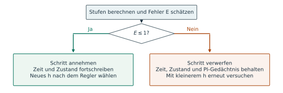

# Kapitel 2 · Explizite Einschrittverfahren und Schrittweitensteuerung

## Einleitung · Wie viel kann ein Schritt über seinen eigenen Fehler sagen?

Ein abkühlender Fühler fällt anfangs schnell. Später ändert sich seine Anzeige während einer ganzen Sekunde kaum noch. Ein gutes Verfahren soll die frühe Krümmung erfassen und später mit weniger Schritten auskommen. Ein Rechner besitzt aber während eines Versuchs die exakte Kurve im Allgemeinen nicht. Wie kann er dann entscheiden, ob ein vorgeschlagener Schritt zu groß ist?

Wir beginnen mit der Fläche unter der Steigungskurve. An demselben Abkühlmodell lassen sich ein Euler-Schritt, die Mittelpunktregel und ein klassischer RK4-Schritt von Hand vergleichen. Die Stufen sind berechnete Zwischenzustände. Wenn mehrere davon gemeinsam zwei Endwerte liefern, gibt ihre Differenz einen Hinweis auf den lokalen Fehler. Aus diesem Hinweis wählt der Regler das nächste $h$.

Am Ende können wir das Budget eines einzelnen Schritts, den Fehler der gesamten Bahn und die Genauigkeit zwischen den Schrittgrenzen auseinanderhalten. Ein besonderer Abkühlversuch zeigt, wie zwei Näherungen denselben falschen Wert liefern können. Diese Gegenprobe erklärt, weshalb der Solver zusätzlich an einer unabhängigen Beobachtung gemessen wird.

[Zum Schluss dieses Kapitels](#kap02-schluss)

<!-- Buchseite -->

## 2.1 Wie viel Bewegung steckt in einer Steigung?

[Grundlagen · Ableitungen, Integrale und Taylorentwicklung](../lehrbuch_numerische_simulation.md#g-analysis) · [Zum Heizstabversuch](../lehrbuch_numerische_simulation.md#fb-heizstab-hand)

Ein Temperaturfühler kühlt nach einem Wärmepuls ab. In der ersten Sekunde ändert sich seine Anzeige stark, später können mehrere Sekunden zwischen zwei Messungen liegen. Ein Integrator steht vor derselben Entscheidung. Mit der Anfangssteigung kann er den nächsten Wert sofort vorhersagen. Ob die Steigung bis zum Schrittende passt, lässt sich erst beurteilen, wenn man den Verlauf dazwischen betrachtet.

Sei $y'=f(t,y)$ mit Anfangswert $y_n$ zur Zeit $t_n$. Das Integral der Steigung ist die Zustandsänderung. Für den exakten Startwert gilt

$$
 y(t_n+h)=y(t_n)+\int_{t_n}^{t_n+h} f(s,y(s))\,ds.
$$

Vorwärts-Euler ersetzt die Integrandenfunktion durch ihren linken Randwert. Die explizite Mittelpunktregel geht einen halben Euler-Schritt voraus, ermittelt dort eine zweite Steigung und benutzt sie für das ganze Intervall. Auf einen normierten Speicher mit $y'=-y/(1\,\mathrm s)$, Startwert eins und $h=0{,}5\,\mathrm s$ angewandt, liefert Euler $0{,}5$. Die halbe Vorhersage ist $0{,}75$, der Mittelpunktwert am Ende somit $1-0{,}5\cdot0{,}75=0{,}625$. Der exakte Wert $e^{-0{,}5}\approx0{,}60653$ liegt dazwischen.

Diese Arbeitsweise lässt sich für viele Stufen einheitlich schreiben. $k_i$ ist eine Ableitung und hat die Einheit Zustand pro Zeit. Die Gewichte $a_{ij}$, $b_i$ und $c_i$ sind dimensionslos.

$$
 k_i=f\!\left(t_n+c_i h,\ y_n+h\sum_{j<i}a_{ij}k_j\right),\qquad
 y_{n+1}=y_n+h\sum_i b_i k_i .
$$

In einem Butcher-Tableau stehen die $c_i$ links, die Zeilen von $A=(a_{ij})$ rechts und das Ausgabegewicht $b^\top$ unten. Die strenge untere Dreiecksform macht die Stufen nacheinander auswertbar. Für übliche konsistente Tableaus ist $c_i=\sum_j a_{ij}$. Die Bedingung $\sum b_i=1$ lässt eine konstante Steigung exakt passieren. Entwickelt man das Feld um den Anfangspunkt, muss in zweiter Ordnung zusätzlich $\sum b_i c_i=1/2$ gelten. Die Mittelpunktregel erfüllt beides. [Projektkapitel zur Zeitintegration][t1proj2]

<!-- Buchseite -->

### Vier Steigungen für denselben Abkühlversuch

Am Speicher aus Abschnitt 2.1 bleiben $y_0=1$ und $h=0{,}5\,\mathrm s$ gleich. Das klassische **RK4** bestimmt eine Steigung am Start, zwei an der Halbzeit und eine am Ende. In den beiden Halbzeitstufen wird dieselbe Uhrzeit mit verschiedenen vorhergesagten Zuständen ausgewertet.

$$
\begin{aligned}
k_1 &= f(t_0,y_0)=-1\,\mathrm{s^{-1}},\\
k_2 &= f(t_0+h/2,y_0+hk_1/2)=-0{,}75\,\mathrm{s^{-1}},\\
k_3 &= f(t_0+h/2,y_0+hk_2/2)=-0{,}8125\,\mathrm{s^{-1}},\\
k_4 &= f(t_0+h,y_0+hk_3)=-0{,}59375\,\mathrm{s^{-1}},\\
y_1 &= y_0+\tfrac h6(k_1+2k_2+2k_3+k_4)=0{,}6067708333\ldots .
\end{aligned}
$$

Vorwärts-Euler liefert $0{,}5$, die Mittelpunktregel $0{,}625$. Die exakte Referenz ist $e^{-1/2}\approx0{,}606530660$. Der RK4-Endwert liegt um etwa $2{,}402\cdot10^{-4}$ darüber. Hier ist die letzte Stufe die Steigung bei $0{,}59375$. Der eigentliche Schritt endet bei $0{,}6067708333\ldots$. Für die dichte Ausgabe in [Kapitel 5](../lehrbuch_numerische_simulation.md#k5-detektion) wird die Steigung deshalb am berechneten Endwert eigens ausgewertet.

**Selbst prüfen.** Welchen Fehler liefert RK4 mit zwei Schritten zu je $0{,}25\,\mathrm s$? Die Rechnung ergibt nach insgesamt $0{,}5\,\mathrm s$ etwa $1{,}217\cdot10^{-5}$. Im Grenzfall kleinerer Schritte sinkt der globale Fehler bei Halbierung von $h$ ungefähr um den Faktor $2^4=16$. Der nächste Abschnitt leitet her, wie aus lokalen Abweichungen ein globaler Fehler wird.

<!-- Buchseite -->

## 2.2 Lokaler Fehler, globaler Fehler und Stabilität

Der lokale Schrittfehler ist hier die Differenz zwischen einem einzelnen numerischen Schritt **ab exaktem Startwert** und der exakten Lösung am Ende. Für ein Verfahren der Ordnung $p$ beträgt er bei genügend glatter Bahn $O(h^{p+1})$. Manche Darstellungen dividieren den lokalen Defekt durch $h$. Die Einheit und der Exponent müssen dann entsprechend angepasst werden.

Die folgende Rekursion setzt eine Schranke $Ch^{p+1}$ für die **tatsächliche** Abweichung eines Schritts bei exaktem Start voraus. Sie stammt zum Beispiel aus einem Taylorrest mit beschränkten Ableitungen. Im eingebetteten Verfahren sieht der Regler dagegen die Differenz zweier Näherungen. Testen Sie Euler und Heun für $y'=t(1-t)$, $y(0)=0$, mit einem Schritt bis $t=1$. Beide benutzen nur Steigungen von null und liefern null. Das Integral ist $1/2-1/3=1/6$. Bei derselben Schätzung null kann der wahre Fehler also endlich sein.

Was passiert mit dem Fehler des vorhergehenden Schrittes? Wenn die Schrittabbildung $\Psi_h$ in der betrachteten Umgebung einen Verstärkungsfaktor von höchstens $1+Lh$ besitzt und der neue Schrittfehler höchstens $Ch^{p+1}$ beträgt, folgt
$$
 \|e_{n+1}\|\leq(1+Lh)\|e_n\|+Ch^{p+1}.
$$
Für festen Horizont $T=nh$ und exakten Start ergibt die geometrische Summe $\|e_n\|\leq C h^p(e^{LT}-1)/L$. Bei $L=0$ lautet der Grenzwert $CTh^p$. Das erklärt, warum die globale Ordnung um eins kleiner ist als der Exponent des einzelnen Schrittfehlers.

Der Schritt kann dennoch zu groß sein. An $y'=\lambda y$ multipliziert eine RK-Methode den alten Wert mit ihrem Stabilitätspolynom $R(h\lambda)$. Beispielsweise gilt für Euler $R(z)=1+z$. Ein negativ reelles $\lambda$ führt bei $h|\lambda|>2$ zur wachsenden numerischen Schwingung. Die Lösung kann längst nahe null liegen, während der Faktor noch Störungen verstärkt. Am C05-Zweizonenmodell und an den Diffusionsmoden in Kapitel 7 werden wir dieselbe Grenze wiederfinden.

<!-- Buchseite -->

### Wie weit reicht das Stabilitätsintervall?

Frieren wir eine abklingende Mode $y'=-ay$ mit $a>0$ für einen Schritt der Länge $h>0$ ein. Schreiben wir $x=ah$, dann wird eine Störung nach $n$ gleich langen Schritten mit $R(-x)^n$ multipliziert. Sie bleibt genau für $|R(-x)|\le1$ beschränkt. Wirkliche Dämpfung verlangt $|R(-x)|<1$. Vorwärts-Euler liefert $R(-x)=1-x$, also $0\le x\le2$. Für die schwingende Mode $\lambda=-a+i\omega$ folgt aus $(1-ah)^2+(h\omega)^2\le1$ die Grenze $h\le2a/(a^2+\omega^2)$.

**Vier Stufen.** Setzen wir $f(y)=\lambda y$ in die vier Stufen aus 2.1 ein, erhalten wir $R_4(z)=1+z+z^2/2+z^3/6+z^4/24$. Für $x>0$ ist $R_4(-x)>e^{-x}>0$ nach der Taylorformel mit Restglied. Es genügt deshalb, den Schnitt mit $+1$ zu suchen:
$$
R_4(-x)-1=\frac{x}{24}(x^3-4x^2+12x-24).
$$
Die Ableitung des Klammerausdrucks ist $3x^2-8x+12>0$, sein Wert bei 0 negativ und bei 3 positiv. Seine einzige positive Nullstelle $x_4=2{,}785293563\ldots$ gibt das exakte Intervall $0\le ah\le x_4$ an. Auf der imaginären Achse ergibt das Betragsquadrat $|R_4(i\eta)|^2-1=\eta^6(\eta^2-8)/576$. Für eine ungedämpfte Mode ist RK4 also genau bei $|\omega h|\le2\sqrt2$ betragsstabil.

**Drei Stufen und eine eingebettete Schätzung.** Für den fortgeschriebenen Wert des Bogacki–Shampine-Paares aus 2.3 entfällt der Term $z^4/24$. Das kubische $R_3(-x)$ fällt streng, denn seine Ableitung nach $x$ ist $-[(x-1)^2+1]/2$. Es trifft $-1$, wenn $x^3-3x^2+6x-12=0$, also bei $x=2{,}512745327\ldots$. Bei eingebetteten Verfahren muss man wissen, welcher Wert den nächsten Schritt startet. [Die Rechnung für Dormand–Prince in C05](../lehrbuch_numerische_simulation.md#druck-dp-grenze) verwendet den Wert fünfter Ordnung. [Driscoll und Braun, Absolute Stability](https://fncbook.com/julia/absstab-diffusion/)

Eine Ordnungsprobe braucht einen festen physikalischen Messzeitpunkt. Für ein glattes Problem im asymptotischen Bereich sollte eine Halbierung von $h$ den führenden globalen Fehler um etwa $2^p$ verringern. Bei einer Messung zwischen Schrittenden kommt der Fehler des Interpolanten hinzu. Bei einem Schaltvorgang endet die glatte Strecke am Ereignis. Ein über die Unstetigkeit gelegtes Fehlerpolynom kann eine scheinbar gute Schätzung liefern und die Schaltung trotzdem zeitlich verfehlen. [Ereignisbehandlung](../lehrbuch_numerische_simulation.md#k5-detektion)

<!-- Buchseite -->

### Eine Schaltschwelle ohne geschlossene Geschwindigkeitsformel prüfen

Ein Prüfwagen der Masse $1\,\mathrm{kg}$ fährt aus der Ruhe an. Seine Zugkraft steigt mit $1\,\mathrm{N/s}$, der Widerstand beträgt $cv|v|$ mit $c=1\,\mathrm{kg/m}$. Nach einer Sekunde soll eine Freigabe erfolgen, wenn $v>0{,}48\,\mathrm{m/s}$. Ohne Widerstand ergäbe die Dreiecksfläche unter der Beschleunigung $0{,}5\,\mathrm{m/s}$. Die vereinfachte Rechnung würde den Schalter betätigen.

Für die Zahlenwerte in SI und die nichtnegative Fahrt gilt $v'=t-v^2,\ v(0)=0$. Eine unabhängige Referenz gewinnt man mit $v=w'/w$. Denn $v'=w''/w-v^2$ führt auf $w''=t w$, $w(0)=1,\ w'(0)=0$. Für $w(t)=\sum_{k\ge0}a_k t^{3k}$ ergeben sich $a_0=1$ und $a_k=a_{k-1}/[(3k)(3k-1)]$. Schon die ersten beiden Nichtkonstanten $t^3/6$ und $t^6/180$ zeigen die rasche Abnahme. Alle Terme und ihre Ableitungen bei $t=1$ sind positiv.

Seien $W$ und $D$ die bis $k=6$ summierten Werte für $w(1)$ und $w'(1)$. Der erste weggelassene Beitrag ist $a_7$ bzw. $21a_7$. Alle anschließenden Quotienten sind kleiner als $1/2$. Deshalb liegt die wahre Geschwindigkeit im rational berechenbaren Intervall
$$ \frac{D}{W+2a_7}\ \le v(1)\le\ \frac{D+42a_7}{W}.$$
Das Labor prüft seine Breite und beide Enden gegen den berechneten DP5(4)-Wert $0{,}455544526\,\mathrm{m/s}$. Der Schalter bleibt gesperrt. Die Freigabefrage lässt sich hier schon mit einer gröberen Fehlerschranke entscheiden als die Frage nach der neunten Nachkommastelle. Das Projekt benutzt den Prüfwagen auch für einen adaptiven DOP853-Vergleich. [Projektfall Prüfwagen][t1proj2]

<!-- Buchseite -->

### Was aus zehn kleinen Abweichungen wird

Wir trennen die beiden Ursachen des Endfehlers an einem einfachen Lehrschritt. Eine bereits vorhandene Abweichung schrumpfe pro Schritt auf das $0{,}9$-Fache. Jeder neue Schritt füge höchstens $10^{-4}$ zur Abweichung hinzu. Dazu denken wir an eine abklingende skalare Mode mit einem konstanten Stabilitätsfaktor. Nach einem Schritt aus einem exakten Startwert kann der Fehler $10^{-4}$ betragen. Nach dem zweiten Schritt wirken $0{,}9\cdot10^{-4}$ aus dem alten Fehler und bis zu $10^{-4}$ aus dem neuen.

Die größte Abweichung nach zehn Schritten entsteht, wenn alle Beiträge dasselbe Vorzeichen haben. Die geometrische Summe ergibt dann
$$
|e_{10}|\le 10^{-4}\sum_{j=0}^{9}0{,}9^j
      = 10^{-4}\frac{1-0{,}9^{10}}{1-0{,}9}
      \approx 6{,}51\cdot10^{-4}.
$$
Die gleiche lokale Grenze ergäbe bei Verstärkungsfaktor eins bereits $10^{-3}$. Bei wechselnden Vorzeichen können sich Beiträge teilweise aufheben. Welche Situation vorliegt, hängt von der Bewegung und der Rechenregel ab. Die eingestellte Toleranz wirkt auf den Fehlerschätzer. Für die vorgerechnete Summe benötigen wir zusätzlich die hier angenommene lokale Schranke.

<!-- Buchseite -->

## 2.3 Zwei Antworten aus denselben Stufen

Ein eingebettetes Paar berechnet aus den gleichen $k_i$ zwei Endwerte. Beim Paar nach Bogacki und Shampine haben sie Ordnung drei und zwei. Für autonome wie nichtautonome Probleme lautet sein Tableau

$$
\begin{array}{c|rrrr}
0&0&0&0&0\\ 1/2&1/2&0&0&0\\ 3/4&0&3/4&0&0\\
1&2/9&1/3&4/9&0\\ \hline
b^{[3]}&2/9&1/3&4/9&0\\ b^{[2]}&7/24&1/4&1/3&1/8
\end{array}.
$$

Die vierte Stufe liegt bereits am höherwertigen Endzustand. Solange Modell und Zustand stetig weitergeführt werden, kann ihr Feldwert die erste Ableitung des nächsten Schritts liefern (*first same as last*, FSAL). Nach einem Reset braucht man die Ableitung des neuen Zustands. Im Labor wird sie der Einfachheit halber bei jedem Vorschlag neu ausgewertet.

Ist der Endwert dritter Ordnung hinreichend genauer, dann schätzt $\delta=y^{[3]}-y^{[2]}$ den führenden Fehler des niedrigeren Verfahrens bis aufs Vorzeichen. Die Paardifferenz ist unter den lokalen Glattheitsannahmen typischerweise proportional zu $h^3$. Beim Dormand–Prince-Paar 5(4) benutzt die gleiche Idee sieben Stufen und einen Defekt der Größenordnung $h^5$. Beide vollständigen Koeffizientensätze stehen im Labor. DOP853 verwendet ein eigenes zwölfstufiges Grundverfahren achter Ordnung mit Schätzformeln fünfter und dritter Ordnung sowie eigener dichter Ausgabe. Das erklärt, warum das bloße Austauschen der Schrittweitenpotenz im RK45-Code kein DOP853 ergibt. [Verfahrensbeschreibungen][scipy]

Der Abkühlversuch liefert einen lehrreichen Sonderfall. In der Zeit $s=t/(1\,\mathrm s)$ und mit $z=-h/(1\,\mathrm s)$ folgt aus dem Tableau $R_3(z)=1+z+z^2/2+z^3/6$. Für die Paardifferenz gilt $R_2(z)-R_3(z)=z^3(1+z)/48$. Bei $z=-1$ verschwinden somit die Unterschiede zwischen den *beiden numerischen Ausgaben*. Beide liefern $1/3$, obwohl die exakte Lösung $e^{-1}\approx0{,}367879$ beträgt. Eine bestandene Toleranzprüfung ist eine Entscheidung anhand eines Schätzers. Eine analytische Referenz kann ihr in einem Einzelversuch widersprechen.

<!-- Buchseite -->

## 2.4 Aus einem Fehlermaß wird eine Schrittweite

Ein Temperaturfehler von einem Millikelvin und ein Wegfehler von einem Millimeter lassen sich erst vergleichen, nachdem jede Komponente ihre eigene Skala erhalten hat. Bei positivem $\mathrm{atol}_i$ und relativem Faktor $\mathrm{rtol}$ setzen wir
$$
 s_i=\mathrm{atol}_i+\mathrm{rtol}\max(|y_{n,i}|,|y_{n+1,i}|),\qquad
 E_n=\sqrt{\frac1d\sum_{i=1}^d(\delta_i/s_i)^2}.
$$
$E_n\leq1$ akzeptiert den Schritt im gewichteten quadratischen Mittel. Soll ausnahmslos jede Komponente ihr eigenes Budget einhalten, ist eine Maximumsnorm die entsprechende Modellentscheidung. Der Absolutanteil hält den Nenner bei Nulldurchgängen positiv.

Lokal sei $E\approx Ch^q$. Um $E\approx1$ zu erreichen, liefert Auflösen nach $h$ den I-Vorschlag $h_{\rm neu}=\eta h E_n^{-1/q}$ mit einem Sicherheitsfaktor $\eta<1$. Ein PI-Regler berücksichtigt zusätzlich den letzten akzeptierten Fehler, damit die Vorschläge weniger stark schwanken. Unsere offen gelegte Reglerwahl lautet
$$
 h_{\rm neu}=h\,\mathrm{clip}\!\left(0{,}2,\ 5,\ 
       0{,}9 E_n^{-0{,}7/q} E_{\rm alt}^{0{,}4/q}\right).
$$
Hier bezeichnet $\mathrm{clip}(a,b,x)$ das Begrenzen von $x$ auf $[a,b]$. Bei einem Fehlversuch bleiben Uhr, Zustand und PI-Gedächtnis am alten Wert. Nur $h$ wird verkleinert. Bei verschwindendem Defekt ist das Wachstum auf den Faktor fünf begrenzt. Andere Solver können andere Reglervarianten verwenden.

<!-- Buchseite -->

### Eine Ablehnung ist Teil desselben Schritts

Zur ersten Anfrage des Labors gehören die Uhr $t=0$, $y=1$ und ein Vorschlag von $0{,}8\,\mathrm s$. Die Stufen sind zunächst ein Versuch, den Zustand zu einem künftigen Zeitpunkt vorherzusagen. Sobald der Defekt das Budget überschreitet, stehen aus diesem Versuch zwar Stufen und ein Endwert zur Verfügung. Ein abhängiger Regler oder Datenlogger darf diese Werte aber noch nicht als akzeptierten Zustand behandeln. Derselbe Start muss mit kürzerem $h$ erneut zur Verfügung stehen.

Der Ausschnitt zeigt die Rollen von Speicher, Zeit und Gedächtnis. In der mitgelieferten Funktion prüft die Schleife zusätzlich auf nichtendliche Fehler und stellt sicher, dass der nächste darstellbare Zeitpunkt wirklich größer als $t$ ist.

~~~python
if err <= 1:
    record.append((t, h, y, a, f0, f1))
    factor = 5 if err == 0 else .9*err**(-.7/power)*previous**(.4/power)
    t, y = t+h, a
    previous = max(err, 1e-14)
    h *= min(5, max(.2, factor))
else:
    rejected += 1
    h *= max(.2, min(.9, .9*err**(-1/power)))
~~~

**Dichte Ausgabe am Ereignis beenden.** Eine bekannte Lastflanke begrenzt den Zeitschritt auf $t_e$. Einen unbekannten Durchgang lokalisieren wir im bisherigen glatten Modus. Bis $t_e$ bewahren wir $y^-$ und die linksseitige Endsteigung $f^-$. Am Ereignis führen wir den vorgesehenen Reset aus. Für den nächsten Abschnitt berechnen wir $f^+$ aus $y^+$ und dem neuen Modus. Ein Messwert genau bei $t_e$ erhält die angeforderte Seite. Wer ein einziges Hermite-Polynom über die Flanke legt, glättet einen Knick oder einen Zustandssprung. Der FSAL-Speicher muss dann mit der neuen Steigung beginnen. Ein deutlicher Regimewechsel kann zusätzlich eine neue PI-Vorgeschichte rechtfertigen. [Dichte Ausgabe im Labor](#rk-dicht-v916) · [Lastflanken des Krans](../lehrbuch_numerische_simulation.md#fb-neu14).

<!-- Buchseite -->

### Welche Daten überleben die Schrittprüfung?

Bei Dormand–Prince 5(4) fällt die letzte der sieben Steigungen mit der ersten Steigung am nächsten angenommenen Start zusammen. Aus dieser **FSAL**-Eigenschaft folgt für $N$ ununterbrochene Schritte ohne Fehlversuch eine Zahl von $1+6N$ anstelle von $7N$ Auswertungen der rechten Seite. Für lange Folgen nähert sich die Ersparnis $1/7\approx14{,}3\,\%$. Startkosten, Fehlversuche, Ereignisse und gegebenenfalls zusätzliche Interpolationsstufen gehören in eine konkrete Aufwandsmessung. Bei einem erneuten Versuch am selben Start kann die alte Startsteigung gültig bleiben. Ausgewertet wird dabei weiterhin mit dem neuen $h$ und mit neuen inneren Stufen.

Eine Lastflanke kann die Steigung am selben Zeitwert ändern. Dann berechnet der erste Schritt des neuen Modus seine Startsteigung aus dem neuen Vektorfeld. Das mitgelieferte PI-Labor wertet die erste Stufe bei jedem Versuch erneut aus. Die Funktionszahlen eines FSAL-fähigen Solvers folgen erst aus der tatsächlich verwendeten Wiederverwendung.

<!-- Buchseite -->

## 2.5 Dichte Ausgabe und Rechenlabor

Wie liest ein Messgerät die Temperatur bei $t_n+h/2$, wenn der Integrator gerade einen ganzen Schritt akzeptiert hat? Aus den beiden Endwerten und ihren Ableitungen konstruiert das Labor das kubische Hermite-Polynom. Mit $\theta=(t-t_n)/h$ gelten die Gewichte $H_{00}=(1+2\theta)(1-\theta)^2$, $H_{01}=\theta^2(3-2\theta)$, $H_{10}=\theta(1-\theta)^2$ und $H_{11}=\theta^2(\theta-1)$. Dabei multiplizieren die Steigungsgewichte $h f_n$ und $h f_{n+1}$. Mit exakten Randdaten ist der maximale Rest bei vier stetigen Ableitungen höchstens $h^4\max|y^{(4)}|/384$. Für das DP-Paar verwendet das Labor denselben Hermite-Versuch als Vergleich. Die verbreitete adaptive RK45-Implementierung verwendet ihren eigenen Interpolanten vierter Potenz. [Dichte Ausgabe und Nullstellensuche](../lehrbuch_numerische_simulation.md#k5-detektion)

Der Aufruf in Python verwendet Sekunden und einen dimensionslosen Speicherwert. Ein Eintrag enthält Startzeit, Schrittweite, beide Zustände und beide Endableitungen.

~~~python
from rk_adaptiv import BS32, solve
schritte, verworfen = solve(lambda t, y: (-y[0],), (1.,), 1.,
                            .8, BS32, (1e-9,), 1e-6)
endwert = schritte[-1][3][0]
~~~

Bei gleichem Startvorschlag $0{,}8\,\mathrm s$ verwendet BS3(2) 38 akzeptierte und zwei verworfene Schritte, DP5(4) fünf und einen. Ihre Endfehler betragen $3{,}167\cdot10^{-7}$ und $5{,}890\cdot10^{-8}$. Ein eigenständiger Test summiert die lokalen Taylor-Reste. Für BS3(2) genügt $\sum h_n^4/24$ in normierten Zeiteinheiten, weil $|R_3(-h)|\leq1$ auf $0\leq h\leq1$. Für DP ist $R(-h)=T_5(-h)+h^6/600$, wobei $T_5$ das Exponentialpolynom bezeichnet. Taylor und derselbe Verstärkungsvergleich liefern $\sum h_n^6/600$. Die Gleichungen erklären, weshalb der Test eine globale Aussage für diesen Versuch erlaubt.

**Aufgaben.** (1) Bestimmen Sie den Mittelpunkt-Schritt für $h=1/4\,\mathrm s$. (2) Der normalisierte Schätzer von BS3(2) sei acht. Welchen Faktor liefert der I-Vorschlag mit $\eta=0{,}9$? (3) Ein Paar zeigt bei $h=1\,\mathrm s$ Gleichheit beider Antworten. Welche weitere Messung würde Ihren Verdacht prüfen?

**Musterlösungen.** (1) Die Halbzeitprognose ist $0{,}875$, der Endwert $0{,}78125$. (2) $0{,}9\cdot8^{-1/3}=0{,}45$. (3) Zwei Halbschritte und eine analytische Vergleichslösung liefern unabhängige Information. Der Fehler von $1/3$ gegenüber $e^{-1}$ beträgt rund $0{,}03455$.

<!-- Buchseite -->

### Wann eine dichte Ausgabe zwischen den Stützstellen täuscht

Ein dichtes Polynom kann zwischen steigenden Stützstellen lokal fallen. Nehmen wir ein normiertes Intervall $0\le\theta\le1$ mit den Endwerten null und eins sowie den Steigungen vier und vier. Der kubische Hermite-Ansatz ergibt
$$
p(\theta)=4\theta-9\theta^2+6\theta^3 .
$$
Es gilt $p'(\tfrac12)=-\tfrac12$. Mit den Randsteigungen acht und null erhält man sogar $p(\tfrac12)=1{,}5$, obwohl beide Randwerte höchstens eins betragen. Wer Monotonie oder eine physikalische Bandgrenze benötigt, prüft sie für den Interpolanten selbst. Das klassische Runge-Phänomen beschreibt wachsende Randoszillationen bei globaler Interpolation an vielen äquidistanten Stützstellen. Hier reicht bereits ein lokales kubisches Polynom für einen Monotonieverlust.

Ein Solver konstruiert seine dichte Ausgabe aus Daten desselben angenommenen Schritts. SciPy verwendet bei RK45 ein Polynom vierten Grads und bei DOP853 einen Interpolanten, der mit Ordnung sieben genau ist. Diese kontinuierlichen Erweiterungen sind auf das jeweilige RK-Verfahren abgestimmt. Für einen bekannten Sprung beendet man den alten Schritt an der Flanke und beginnt dort mit neuem Feld. Für unbekannte Ereigniszeiten setzt [Abschnitt 5.2](../lehrbuch_numerische_simulation.md#k5-detektion) den Interpolationsfehler mit der Steilheit der Schaltfunktion in Beziehung. [SciPy, Zeitverfahren und dichte Ausgabe](https://docs.scipy.org/doc/scipy/reference/generated/scipy.integrate.solve_ivp.html)

<!-- Buchseite -->

### Gegenprobe · Was schätzt die Differenz eines eingebetteten Paares?

Ein Messgerät beobachtet den normierten Abklingvorgang $y'=-y$, $y(0)=1$. Für denselben Schritt liefert Euler $y_E=1-h$. Beim expliziten Mittelpunktverfahren beträgt die Steigung zur Halbzeit $-(1-h/2)$. Einsetzen ergibt $y_M=1-h+h^2/2$. Die Differenz $y_M-y_E=h^2/2$ vervierfacht sich, wenn man die Schrittweite verdoppelt. Im Vergleich mit $e^{-h}=1-h+h^2/2-h^3/6+\cdots$ erkennt man, welchen Anteil das Paar misst. Der führende Fehler des Eulerwerts hat Ordnung zwei pro Schritt, der des Mittelpunktwerts Ordnung drei. Für die Steuerung mit genau dieser Paardifferenz folgt deshalb der Exponent $1/2$.

**Kontrollfrage.** Wie groß ist die Differenz bei $h=1/4$ und $h=1/8$ in normierter Zeit? Aus $1/32$ und $1/128$ lässt sich der Faktor vier ohne Gleitkommarundung ablesen. Die Funktion `midpoint()` in `beispiele/gegenproben.py` berechnet beide Stufen unabhängig von der Reihenentwicklung.

<!-- Buchseite -->

## Schluss · Von der Stufe zum geprüften Schritt

Beim Fühler lohnt sich ein kürzerer Schritt, solange sich die Steigung rasch ändert. Runge–Kutta-Verfahren lesen das Feld an mehreren vorberechneten Zwischenzuständen. Das Tableau erklärt, wie diese Stufen entstehen und was ihr gewichteter Mittelwert zum Endzustand beiträgt. Ein eingebettetes Paar nutzt die vorhandenen Stufen für zwei Ergebnisse. Das skalierte Fehlermaß vergleicht ihre Differenz mit der Toleranz, die für die einzelnen Zustandskomponenten gewählt wurde.

Erst ein angenommener Schritt verschiebt die Uhr und den gültigen Zustand. Bei einem verworfenen Schritt rechnet der Solver vom selben Start mit einem neuen $h$. Auch dichte Ausgabe gehört zu einem angenommenen Schritt. Sie liefert Werte zwischen dessen Grenzen, an denen ein Messgerät abfragt oder ein Ereignis gesucht wird.

Im Abkühlversuch stimmt die Differenz bei einer bestimmten Schrittweite exakt mit null überein, obwohl beide Ergebnisse vom analytischen Wert abweichen. Für die Güte einer Bahn bleibt daher die Gegenprobe an einem festen Messzeitpunkt entscheidend. Bei ausgeprägter Steifigkeit reicht oft auch ein gut arbeitender Fehlerschätzer nicht für wirtschaftliche explizite Schritte. [Implizite Integratoren](../lehrbuch_numerische_simulation.md#kap03-einstieg)

### Aktueller Stand der Forschung

Schrittweitenregler und Fehlerschätzer bilden gemeinsam einen Rückkopplungskreis. Ranocha und Giesselmann analysieren dessen Stabilität für explizite Runge–Kutta-Verfahren mit nachträglichen, an Lösungsrekonstruktionen gebundenen Fehlerschätzern. In den untersuchten Kombinationen kann ein einfacher I-Regler zu ungünstigen Schrittfolgen führen. Damit gehört der Regler selbst zum Vergleich zweier Integratoren. Für einen ARGESIM-Versuch wären Endfehler, Zahl der Fehlversuche und die Lage dieser Fehlversuche vor einer Schaltung aussagekräftige gemeinsame Messgrößen. [Stability of step size control based on a posteriori error estimates (2024)](https://openscience.ub.uni-mainz.de/items/56f47020-1d9b-4374-bc65-0f42f1a25c70)

[Zur Einleitung dieses Kapitels](#kap02-einstieg)

[scipy]: https://docs.scipy.org/doc/scipy/reference/generated/scipy.integrate.solve_ivp.html
[t1proj2]: https://github.com/5H3LL3H5/argesim-hyperposition-benchmarks/blob/16f0f2528fcf77f16898ecd74ad952be2c09eac2/docs/lehrbuch/studienbuch/kapitel/02.tex
