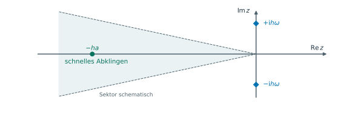

# Kapitel 3 · Implizite Integratoren, Radau IIA und BDF

<a id="kap03-einstieg"></a>

## Einleitung · Wann lohnt es sich, den neuen Zustand aus einer Gleichung zu bestimmen?

Ein schneller Fühler erreicht seinen Sollwert fast schlagartig, während der angeschlossene Regler über Sekunden arbeitet. Wir können die ersten Millisekunden fein vermessen oder uns für die anschließende Bewegung interessieren. Eine Rechenregel, die den schnellen Vorgang bei einem größeren Schritt künstlich wieder verstärkt, erschwert beide Vorhaben. Was gewinnt man, wenn die noch unbekannte Steigung am Schrittende in der Gleichung stehen bleibt?

Am skalaren Fühler vergleichen wir, wie viel von einer Störung nach einem großen Schritt erhalten bleibt. Dann schauen wir in den impliziten Schritt hinein. Die gesuchte Größe wird aus einem Residuum bestimmt. Newton verwendet dessen Steigung, und bei mehreren Unbekannten wird daraus ein lineares Gleichungssystem. Radau IIA behandelt die Stufen eines Schritts gemeinsam. BDF nutzt mehrere bekannte Zustände aus der bisherigen Zeitfolge.

Für die Wahl im Rechenlabor zählen am Ende mehr als geringe Residuen. Auch die Bahn zwischen angenommenen Schritten und die Zeit eines Moduswechsels gehören zum Auftrag. Wir werden prüfen, wann der Gewinn an Stabilität die zusätzliche Arbeit für Stufen, Jacobi-Matrizen und lineare Lösungen rechtfertigt.

[Zum Schluss dieses Kapitels](#kap03-schluss)

<!-- Buchseite -->

<a id="k3-stabilitaet"></a>

## 3.1 Wie viel von einer schnellen Störung bleibt übrig?

Der Fühler eines Temperaturreglers reagiert innerhalb einer Millisekunde. Seine Solltemperatur bewegt sich dagegen auf einer Zeitskala von Sekunden. Wer nach zehn Millisekunden auf den Fühler schaut, erwartet, dass eine anfängliche Abweichung fast verschwunden ist. Wer den Ausgleich selbst vermessen will, muss früher hinschauen. Diese beiden Beobachtungsaufgaben stellen unterschiedliche Anforderungen an denselben Integrationsschritt.

Für eine erste Rechnung halten wir den Sollwert fest. Der auf seinen Anfangswert normierte Temperaturüberschuss $d$ erfüllt $d'=-a d$ mit $a=1000\,\mathrm{s}^{-1}$. Während $h=10\,\mathrm{ms}$ vergehen zehn Zeitkonstanten. Deshalb bleibt exakt der Anteil $e^{-10}\approx0{,}0000454$ übrig. Vorwärts-Euler nimmt die Steigung vom Schrittanfang für die gesamte Dauer an. Sein Endwert ist $d_{n+1}=d_n-ha d_n=-9d_n$. Ein Algorithmus, der hier einen Vorzeichenwechsel mit wachsendem Betrag erzeugt, erschwert schon die Beobachtung des langsamen Vorgangs.

**Die Steigung am neuen Zustand.** Rückwärts-Euler setzt $d_{n+1}=d_n-ha d_{n+1}$. Weil die gesuchte Abweichung auch auf der rechten Seite steht, lautet die auszuführende Rechnung $(1+ha)d_{n+1}=d_n$. Die Trapezregel mittelt alte und neue Steigung. Sie liefert $(1+ha/2)d_{n+1}=(1-ha/2)d_n$. In beiden Fällen müssen wir den Endwert aus einer Gleichung bestimmen. Bei der Trapezregel kann ein Rest mit umgekehrtem Vorzeichen zurückbleiben.

Für das Testproblem $d'=\lambda d$ bezeichnet $z=h\lambda$ die dimensionslose Schrittweite und $R(z)=d_{n+1}/d_n$ den Verstärkungsfaktor bei $d_n\ne0$. Die drei Regeln haben die Faktoren

$$
R_{\mathrm V}(z)=1+z,\qquad R_{\mathrm R}(z)=\frac1{1-z},\qquad
R_{\mathrm T}(z)=\frac{1+z/2}{1-z/2}.
$$

Für $\lambda=-a+i\omega$ dämpft $a$ die Schwingung, während $\omega$ ihre Phase dreht. Eine Störung nimmt in einem numerischen Schritt im Betrag ab, wenn $|R(z)|<1$. Bei $|R(z)|=1$ bleibt ihr Betrag erhalten. Mit diesen beiden Aussagen lässt sich Abbildung 3.1 lesen. [Stabilitätsgebiete][k3fnc]

<!-- Buchseite -->

### A-Stabilität, L-Stabilität und ein Vorzeichenwechsel

Die Bedingung $|1+z|\leq1$ beschreibt das Innere einschließlich Rand des Kreises um $-1$. Für Rückwärts-Euler ergibt sich $|1-z|\geq1$, also der Bereich außerhalb des offenen Kreises um $+1$. Er enthält die ganze linke Halbebene. Ein Einschrittverfahren heißt **A-stabil**, wenn seine Stabilitätsfunktion dort einschließlich der imaginären Achse definiert ist und $|R(z)|\leq1$ gilt. Für die Trapezregel folgt dies direkt aus $|1-z/2|^2-|1+z/2|^2=-2\operatorname{Re}z\geq0$.


Was bei sehr schneller Dämpfung geschieht, beantwortet eine zweite Frage. Ein A-stabiles Einschrittverfahren heißt **L-stabil**, wenn zusätzlich $R(z)\to0$ für $|z|\to\infty$ in der linken Halbebene. Rückwärts-Euler erfüllt diese Bedingung. Die Trapezregel strebt dagegen auf der negativen reellen Achse gegen $-1$. Bei $z=-100$ bleiben nach zwei Schritten $(49/51)^2\approx0{,}9231$ der anfänglichen Abweichung, bei Rückwärts-Euler $(1/101)^2\approx0{,}0000980$. Für ein Messziel von einem Prozent Restabweichung nach einem Schritt genügen hier die $1/101$ von Rückwärts-Euler. In der Anfangsschicht kann selbst dieser gedämpfte Schritt zu ungenau sein.

<!-- Buchseite -->

### Die Stabilitätsfaktoren nachrechnen

`stabilitaet.py` prüft die dimensionslosen Verstärkungsfaktoren gegen Brüche, die sich von Hand berechnen lassen. Der Radau-Faktor wird in Abschnitt 3.3 aus den gekoppelten Stufen hergeleitet. Die halbe letzte Stelle bezieht sich auf die Ausgabe mit neun Nachkommastellen. Das Einprozentziel bezieht sich dagegen auf die physikalische Restabweichung.

```python
"""Stabilitätsfaktoren für eine normierte Abweichung."""
from cmath import exp as cexp
from math import exp


def radau_faktor(z):
    zaehler = 1 + z * (2/5 + z/20)
    nenner = 1 + z * (-3/5 + z * (3/20 - z/60))
    return zaehler / nenner


def rueckwaerts(z):
    return 1 / (1 - z)


def trapez(z):
    return (1 + z/2) / (1 - z/2)


if __name__ == "__main__":
    aufloesung = 0.5e-9  # halbe letzte Stelle der Faktorentabelle
    for z in (-10.0, -100.0):
        print(f"{z:5.0f} {exp(z):.9f} {rueckwaerts(z):.9f} "
              f"{trapez(z):.9f} {radau_faktor(z):.9f}")
    assert abs(radau_faktor(-10) - 3/58) <= aufloesung
    assert abs(trapez(-100) + 49/51) <= aufloesung
    # Physikalisches Ziel: Rest nach einem groben Schritt unter 1 %.
    assert exp(-100) < 0.01
    assert abs(rueckwaerts(-100)) < 0.01 < abs(trapez(-100))
    z = -1 + 2j
    assert abs(cexp(z)) < 1 < abs(1 + z)
    assert max(abs(rueckwaerts(z)), abs(trapez(z)),
               abs(radau_faktor(z))) < 1
```

**Wenn mehrere Zustände zusammenwirken.** Für $y'=My$ lautet die Fortschrittsmatrix $R(hM)$. Ihre Eigenwerte beschreiben das langfristige Abklingen, wenn ihr Spektralradius strikt kleiner als eins ist. Trotzdem kann ein Fehler vorübergehend wachsen. Die Matrix $B=\bigl(\begin{smallmatrix}1/2&4\\0&1/2\end{smallmatrix}\bigr)$ bildet $(0,1)$ auf $(4,1/2)$ ab, obwohl beide Eigenwerte $1/2$ sind. Im Nebendiagonaleintrag von $B^n$ steht $4n(1/2)^{n-1}$, der erst mit wachsendem $n$ verschwindet. Bei so gekoppelten, nichtnormalen Systemen lohnt neben der Eigenwertanalyse ein Blick auf den tatsächlichen Fehlerverlauf.

<!-- Buchseite -->

<a id="k3-newton"></a>

## 3.2 Welche Gleichung löst Newton in einem Zeitschritt?

[Grundlagen · Lineare Gleichungen und Residuen](../lehrbuch_numerische_simulation.md#g-lineare-algebra)

Nach dem Abschalten einer Quelle nehme die normierte Konzentration $y$ mit einer Rate proportional zu $y^2$ ab. Wir messen Zeit in Einheiten der charakteristischen Reaktionszeit. Das dimensionslose Anfangswertproblem lautet $y'=-y^2$, $y(0)=1$. Durch Trennung der Variablen erhält man $1/y=1+t$. Für diese Modellgleichung lässt sich deshalb unabhängig prüfen, wie viel Fehler beim Zeitschritt und wie viel beim Lösen seiner Gleichung entsteht.

Bei $h=0{,}1$ verlangt Rückwärts-Euler $Y=1-hY^2$. Wir suchen die physikalische, positive Nullstelle des **Residuums** $G(Y)=Y+hY^2-1$. Eine Näherung $Y_k$ lässt im Allgemeinen einen Rest $G(Y_k)$ stehen. Ersetzen wir die gekrümmte Funktion in ihrer Umgebung durch die Tangente, so soll deren Nullstelle die nächste Näherung liefern. Daher gelten

$$
G(Y_k)+G'(Y_k)\,\delta_k=0,\qquad Y_{k+1}=Y_k+\delta_k.
$$

Beim Start $Y_0=1$ erhält man $G(Y_0)=0{,}1$, $G'(Y_0)=1{,}2$ und damit $Y_1=1-0{,}1/1{,}2=0{,}9166667$. Der neue Defekt beträgt noch rund $6{,}94\cdot10^{-4}$. Wie viel sagt das über die gesuchte Konzentration aus? Zwischen nichtnegativem Iterierten und positiver Nullstelle $Y_*$ gilt $G'(Y)=1+2hY\geq1$. Nach dem Mittelwertsatz folgt daher $|Y-Y_*|\leq|G(Y)|$. Nur für diesen Bereich und diese Skalierung begrenzt der absolute Defekt den algebraischen Zustandsfehler auf so einfache Weise.

Die auf Auslöschung unempfindliche Wurzelformel liefert $Y_*=2/(1+\sqrt{1+4h})\approx0{,}9160797831$. Der exakte **ODE-Wert** bei $t=0{,}1$ ist $1/1{,}1\approx0{,}9090909091$. Damit verbleiben rund $0{,}006988874$ zeitlicher Diskretisierungsfehler, selbst wenn das innere Lösen die Wurzel beliebig genau trifft. Das Labor setzt für das algebraische Problem ein Budget von $10^{-10}$ und prüft getrennt, ob ein Ziel von $10^{-3}$ für die Zeitlösung erreicht wird.

<!-- Buchseite -->

<a id="kap03-schrittfolge"></a>

### Warum ein genauer Newton-Schritt noch einen Zeitfehler zulässt

Das Abklingen $y'=-y^2$ beginnt bei $y(0)=1$. Ein Rückwärts-Euler-Schritt der Länge eins verlangt $G(Y)=Y+Y^2-1=0$. Setzen wir den Näherungswert $\widehat Y=0{,}62$ ein, so ist $G(\widehat Y)=0{,}0044$. Auf der nichtnegativen Achse gilt $G'(Y)=1+2Y\ge1$. Nach dem Mittelwertsatz kann der Zustandsfehler innerhalb dieses algebraischen Schritts daher höchstens $0{,}0044$ betragen. Das exakte Ergebnis des Schritts ist $(\sqrt5-1)/2\approx0{,}618034$.

Die kontinuierliche Gleichung besitzt dagegen die Lösung $y(t)=1/(1+t)$. Man kontrolliert sie durch Ableitung und Startwert. Am selben Endzeitpunkt $t=1$ beträgt der Referenzwert $0{,}5$. Würden wir das Residuum bis zur Gleitkommagrenze verkleinern, bliebe die Abweichung der Rückwärts-Euler-Regel von dieser Referenz bei etwa $0{,}118$. Die beiden Kontrollen antworten auf verschiedene Fragen. Die Newton-Rechnung prüft die Lösung der Schrittgleichung. Das Zeitfehlerbudget prüft, ob diese Gleichung den Verlauf des Modells für die Messaufgabe ausreichend annähert.

<!-- Buchseite -->

### Wann lohnt sich eine neue Jacobi-Matrix?

Für ein System $y'=f(t,y)$ lautet das Residuum von Rückwärts-Euler $G(Y)=Y-y_n-hf(t_{n+1},Y)$. Mit der Jacobi-Matrix $J=\partial f/\partial y$ ist die Newton-Matrix $M=I-hJ$. Ein volles Newton-Verfahren bildet $M$ bei den aktuellen Iterierten. Beim **modifizierten Newton-Verfahren** frieren wir $J$ beispielsweise am Prädiktor ein. So kann eine Faktorisierung für mehrere Korrekturen reichen. Ob die eingesparte Arbeit die zusätzliche Iteration aufwiegt, hängt von der Größe und Struktur des Systems ab.

Bei einer LU-Zerlegung mit Zeilenvertauschungen gilt $PM=LU$. Für jede neue rechte Seite $b=-G(Y_k)$ lösen wir erst $Lw=Pb$ durch Vorwärtseinsetzen, dann $U\delta=w$ durch Rückwärtseinsetzen. Nur eine identische Matrix erlaubt die Wiederverwendung als **exakte** lineare Lösung. Eine Änderung von $h$, der BDF-Koeffizienten oder von $J$ kann die Matrix verändern. Eine ältere Matrix kann weiterhin eine Näherung für eine modifizierte Newton-Iteration sein. Dann muss der Solver deren Konvergenz überwachen.

Wie erkennt man eine falsche Ableitung? Für eine prüfbare Richtung $v$ lässt sich $Jv$ mit $[f(t,Y+\varepsilon v)-f(t,Y-\varepsilon v)]/(2\varepsilon)$ vergleichen. Bei glattem Feld fällt der Taylorfehler quadratisch mit $\varepsilon$, während die Auslöschung im Zähler mit kleiner werdendem $\varepsilon$ an Gewicht gewinnt. Ein Vergleich bei mehreren Störungen in skalierten Zustandskoordinaten trennt beide Effekte. Bei schlecht konditioniertem $M$ kann ein kleiner Defekt mit einem großen Zustandsfehler zusammengehen. Die Verstärkung hängt lokal von $\|M^{-1}\|$ ab.

**Welche Iteration hat versagt?** In einem adaptiven Integrator werden Korrektur und Defekt in passenden Skalen beurteilt. Stagniert das innere Lösen, kann der Solver $J$ erneuern oder denselben Zeitschritt mit kleinerem $h$ erneut versuchen. Erst nach bestandener algebraischer Prüfung und äußerer Fehlerkontrolle darf er Zeitpunkt und Historie fortschreiben. Im kleinen Labor erzwingt ein eigener Versuch eine erschöpfte Iterationsgrenze. So bleibt ein Fehlschlag vom berechneten Schrittwert unterscheidbar.

<!-- Buchseite -->

### Welche Kosten beim Aufbau der Jacobi-Matrix entstehen

Stellen wir uns einen Wärmeleiter mit $d$ Gitterwerten vor. Ein dichter Vorwärtsdifferenzen-Ansatz bildet die Spalte $j$ als
$$
J_{:j}\approx\frac{f(t,y+\delta_j e_j)-f(t,y)}{\delta_j}.
$$
Die Basis $f(t,y)$ wird einmal berechnet oder aus dem laufenden Newton-Schritt übernommen. Für $d$ Spalten folgen $d$ zusätzliche Funktionsaufrufe. Liefert ein Aufruf alle $d$ Komponenten in $O(d)$ Arbeit, kostet der dichte Aufbau insgesamt $O(d^2)$ skalare Arbeit und Speicherplätze. Das Faktorisieren einer dichten Newton-Matrix ist ein eigener Aufwand.

Beim eindimensionalen Wärmegitter hängt jede Rate nur vom Knoten selbst und von seinen nächsten Nachbarn ab. Bei einer **analytischen Jacobi-Matrix** lassen sich die drei Diagonalen unmittelbar anschreiben. Mit bekanntem Besetzungsmuster lassen sich Differenzenstörungen gruppieren. In diesem Beispiel überlappen die Zeilen von Spalten im Abstand drei nicht. Je ein Aufruf pro Gruppe der Indizes modulo drei liefert damit die Spalten aus drei zusätzlichen Auswertungen. Eine Band- oder Sparse-Faktorisierung verwendet die Struktur auch beim Lösen.

**Automatische Differentiation** führt die Ableitungsrechnung durch dieselben Programmoperationen wie $f$. Eine Dualzahl trägt neben dem Wert eine Richtungsableitung. Mit geeigneten Startvektoren entstehen Spalten oder gezielt Produkte $Jv$. Auch hier bestimmt die Zahl der Richtungen den Aufwand. An einer diskreten Verzweigung gilt die Rechnung für den gerade aktiven glatten Modellzweig. Ein korrekter Musterwechsel und ein passend skalierter Differenzenschritt bleiben Gegenstand eigener Tests. [SciPy BDF und Jacobi-Struktur](https://docs.scipy.org/doc/scipy/reference/generated/scipy.integrate.BDF.html)

<!-- Buchseite -->

### Die Rechnung mit frischer und eingefrorener Steigung

Das Programm `newton.py` zählt berechnete Korrekturen und neu gebildete skalare Matrizen. Die Formel für $G'$ und das gemeinsame Budget bleiben in beiden Läufen gleich.

```python
"""Rückwärts-Euler für y'=-y², alle Größen normiert."""
from math import sqrt


def loese(h, y, budget, eingefroren=False):
    if min(h, y, budget) <= 0:
        raise ValueError("Positive Versuchsdaten erforderlich")
    wert = y
    matrix = None
    matrizen = korrekturen = 0
    while True:
        defekt = wert + h * wert**2 - y
        if wert >= 0 and abs(defekt) <= budget:
            return wert, defekt, korrekturen, matrizen
        if korrekturen == 40:
            raise ArithmeticError("Newton-Ziel verfehlt")
        if matrix is None or not eingefroren:
            matrix = 1 + 2*h*wert
            matrizen += 1
        wert -= defekt / matrix
        korrekturen += 1


if __name__ == "__main__":
    h, y, budget = 0.1, 1.0, 1e-10
    wurzel = 2*y / (1 + sqrt(1 + 4*h*y))
    ode = y / (1 + h*y)
    for fest in (False, True):
        wert, defekt, n, m = loese(h, y, budget, fest)
        assert abs(wert - wurzel) <= budget
        assert abs(wert - ode) > 1e-3
        assert (n, m) == ((5, 1) if fest else (3, 3))
        print(f"Fest={fest!s:5s}  Y={wert:.12f}  |G|={abs(defekt):.2e}  "
              f"Korrekturen={n}  Matrizen={m}")
    try:
        loese(10.0, 1.0, 1e-14, True)
    except ArithmeticError:
        print("Erschöpftes Iterationsbudget für h=10 erkannt.")
    else:
        raise AssertionError("Fehlschlag der festen Iteration erwartet")
```

Bei $h=0{,}1$ benötigt volles Newton drei Korrekturen und drei Matrizen. Mit der festen Steigung $1{,}2$ genügen fünf Korrekturen und eine Matrix. Beide Ergebnisse liegen innerhalb des hergeleiteten algebraischen Budgets. Der äußere Fehler übersteigt in beiden Fällen $10^{-3}$. Ein noch engerer Newton-Abbruch würde hier zusätzliche Arbeit in dieselbe Zeitformel stecken.

<!-- Buchseite -->

<a id="k3-radau"></a>

## 3.3 Wie drei gekoppelte Stufen eine Radau-Kurve bestimmen

Eine Messung nur am rechten Ende eines langen Schritts lässt den Verlauf im Inneren offen. Wir suchen deshalb ein Polynom $p(\theta)$ vom Grad höchstens drei, mit der normierten Schrittkoordinate $\theta=(t-t_n)/h$ von null bis eins und $p(0)=y_n$. Seine physikalische Steigung soll an drei ausgewählten Punkten die Modellgleichung erfüllen. Schreiben wir $Y_i=p(c_i)$ und $K_i=f(t_n+c_i h,Y_i)$, dann ist $p'(c_i)=hK_i$, denn nach $\theta$ zu differenzieren bringt den Faktor $h$ mit.

<a id="revision-k03-01"></a>

### Aus zwei Steigungen ein Stufenpolynom gewinnen

An den normierten Zeiten $s=0$ und $s=1$ kennen wir $K_1$ und $K_2$. Die Gerade $(1-s)K_1+sK_2$ trifft beide Werte. Ihr Integral von null bis $\theta$ ist $(\theta-\theta^2/2)K_1+(\theta^2/2)K_2$. Bei $\theta=1$ erhalten beide Steigungen das Gewicht $1/2$. Aus drei Knoten wird eine Parabel. Ihr Integral bis zum jeweiligen Stufenknoten liefert genau eine Zeile des Radau-Tableaus.

Die Ableitung von $p$ ist höchstens quadratisch. Ihre drei Stützwerte bestimmen sie vollständig. Sei $\ell_j(s)=\prod_{k\ne j}(s-c_k)/(c_j-c_k)$ das Polynom, das am $j$-ten Knoten eins und an den anderen null ist. Integration der interpolierten Steigung vom linken Rand liefert für jeden Zwischenzeitpunkt

$$
p(\theta)=y_n+h\sum_{j=1}^3 K_j\int_0^\theta\ell_j(s)\,\mathrm ds.
$$

**Woher kommen die Knoten?** Wir verwenden die [Quadraturregel aus G.3](../lehrbuch_numerische_simulation.md#auflage-gl-04). Der rechte Rand soll dazugehören, also $c_3=1$. Die drei Punkte sollen außerdem eine Quadratur bis Grad vier ermöglichen. Wir schreiben das Knotenpolynom als $w(s)=(s-1)(s^2+u s+v)$. Weil es an allen Stützstellen verschwindet, müssen für exakte Integration von $w$ und $sw$ die Integrale $\int_0^1w(s)\,\mathrm ds$ und $\int_0^1 s w(s)\,\mathrm ds$ verschwinden. Ausmultiplizieren und Integrieren ergeben die beiden linearen Gleichungen $2u+6v=-1$ und $5u+10v=-3$. Ihre Lösung ist $u=-4/5$, $v=1/10$. Die inneren Knoten sind somit

$$
c_1=(4-\sqrt6)/10,\qquad c_2=(4+\sqrt6)/10.
$$

Jedes Polynom vom Grad höchstens vier lässt sich durch $w$ teilen. Der Quotient hat höchstens Grad eins. Sein Produkt mit $w$ hat nach der Konstruktion Integral null. Der Rest ist höchstens quadratisch und wird durch die Lagrange-Interpolation exakt erfasst. So erreicht die Drei-Punkt-Quadratur Grad vier. Für **Kollokationsverfahren** liefert der zugehörige Ordnungssatz an diesen Knoten die klassische globale Ordnung fünf bei hinreichend glatten ODEs. Das ist eine Aussage zum Schrittendwert bei Verfeinerung einer festen glatten Aufgabe. Bei steifen Grenzübergängen kann Ordnungsreduktion auftreten. [Kollokation und Ordnung][k3koll]

Die Stufenordnung ist drei. Für die Genauigkeit einer Messung zwischen den Schrittenden zählt die verwendete Kurve. Der [Halbschrittversuch mit $y'=t^3$](#auflage-k03-01) rechnet den Unterschied aus.


<!-- Buchseite -->

### Das Tableau und der Nachweis der L-Stabilität

Setzt man $\theta=c_i$ in die Integralform ein, erhält man $a_{ij}=\int_0^{c_i}\ell_j(s)\,\mathrm ds$. Bei $\theta=1$ erhält man $b_j=\int_0^1\ell_j(s)\,\mathrm ds$. Die drei Stufengleichungen lauten $Y_i=y_n+h\sum_j a_{ij}K_j$. Ihre rechten Seiten hängen von allen drei Stufen ab. Mit $r=\sqrt6$ ergeben die Integrale das Tableau

$$
\begin{array}{c|ccc}
(4-r)/10&(88-7r)/360&(296-169r)/1800&(-2+3r)/225\\
(4+r)/10&(296+169r)/1800&(88+7r)/360&(-2-3r)/225\\
1&(16-r)/36&(16+r)/36&1/9\\ \hline
 &(16-r)/36&(16+r)/36&1/9
\end{array}
$$

Die letzte Zeile von $A$ stimmt mit $b^\mathsf T$ überein. Daher ist $y_{n+1}=Y_3$. Diese Eigenschaft heißt **stiff accuracy**. Eine an der Endstufe bis zur Lösertoleranz erfüllte algebraische Bindung geht bei einer geeigneten DAE-Formulierung unmittelbar in den Endwert ein. Die Wahl eines Knotens am rechten Rand allein würde für ein beliebiges RK-Tableau noch keine Gleichheit der Gewichte erzwingen. SciPys `Radau` erwartet eine explizite ODE-Rechte-Seite. Ein allgemeines Residuum $F(t,y,\dot y)=0$ benötigt eine passende DAE-Schnittstelle und konsistente Startdaten. [Radau-Schnittstelle][k3scir] · [Residualsolver IDA][ida]

Für $y'=\lambda y$ folgt $(I-zA)Y=\mathbf1 y_n$ und damit $R(z)=1+zb^\mathsf T(I-zA)^{-1}\mathbf1=N(z)/D(z)$ mit

$$
 N=1+2z/5+z^2/20,\qquad D=1-3z/5+3z^2/20-z^3/60.
$$

Für $x=-\operatorname{Re}z\geq0$ und $w=|z|^2$ ergibt Ausmultiplizieren

$$
3600(|D|^2-|N|^2)
=w^3+18xw^2+144x(x+3)w+480x(x^2+3x+15).
$$

Außer bei $z=0$ ist die rechte Seite positiv, am Ursprung gilt $D=N=1$. Somit hat $R$ links keinen Pol und dort Betrag höchstens eins. Der um eins höhere Nennergrad liefert zusätzlich $R(z)\to0$ für $|z|\to\infty$. Beides zusammen beweist L-Stabilität. Für $z=-10$ ergibt sich trotzdem $R=3/58\approx0{,}05172$, während die tatsächliche Abweichung nur $e^{-10}$ beträgt.

<!-- Buchseite -->

### Wo die Ersatzkurve die Differentialgleichung trifft

Für den einzelnen Schritt aus dem Temperaturversuch zeigt Abbildung 3.2 die ganze Ersatzkurve. Um ihre Steigung zu prüfen, stellen wir die normierte Differentialgleichung als $p'(\theta)+10p(\theta)=0$ dar. Die exakte Kurve erfüllt sie überall. Beim kubischen Polynom verlangen wir die Gleichheit an den drei Radau-Knoten.


Die zweite Stufe liegt bei $6{,}4495\,\mathrm{ms}$ und liefert $Y_2\approx-0{,}06074$. Die exakte Temperaturabweichung ist zu jedem Zeitpunkt positiv. Am rechten Rand bleibt mit $3/58$ wieder ein positiver Wert zurück. Hier sieht man getrennt, was die Endstufe, die Stufensteigungen und die Genauigkeitsforderung über die Anfangsschicht aussagen.

Für $y'=\lambda y+g(t)$ genügt eine lineare Lösung mit drei Unbekannten. Die rechte Seite der $i$-ten Stufengleichung ist $y_n+h\sum_j a_{ij}g(t_n+c_jh)$ nach Übertragen der unbekannten Anteile in die Matrix $I-h\lambda A$. Bei einem nichtlinearen System mit $d$ Komponenten umfasst die blockweise Newton-Matrix dagegen $3d$ Zeilen. Ihr Block $(i,j)$ lautet $\delta_{ij}I-h a_{ij}J_j$ mit $J_j=\partial f/\partial y(t_n+c_jh,Y_j)$. Das folgende Labor implementiert den skalaren affinen Fall vollständig, einschließlich der drei gekoppelten Stufen.

<!-- Buchseite -->

### Radau im Code · Faktorisierung und Dreieckslösung

Die drei aufeinanderfolgenden Listings ergeben zusammen `radau_iia.py`. Die Matrix enthält nach der Elimination die Einträge von $U$ auf und über der Diagonale und die Multiplikatoren von $L$ darunter. Die Diagonale von $L$ besteht implizit aus Einsen. Bei einer Zeilenvertauschung wandern die bereits gespeicherten Multiplikatoren mit.

```python
"""Dreistufiger Radau-Schritt für y'=lam*y+g(t), skalare affine ODE."""
from math import exp, sqrt


r = sqrt(6.0)
C = ((4-r)/10, (4+r)/10, 1.0)
B = ((16-r)/36, (16+r)/36, 1/9)
A = (((88-7*r)/360, (296-169*r)/1800, (-2+3*r)/225),
     ((296+169*r)/1800, (88+7*r)/360, (-2-3*r)/225),
     B)


def faktorisiere(matrix):
    lu = [list(zeile) for zeile in matrix]
    n = len(lu)
    reihenfolge = list(range(n))
    for k in range(n):
        p = max(range(k, n), key=lambda i: abs(lu[i][k]))
        if lu[p][k] == 0:
            raise ArithmeticError("Singuläre Stufenmatrix")
        lu[k], lu[p] = lu[p], lu[k]
        reihenfolge[k], reihenfolge[p] = reihenfolge[p], reihenfolge[k]
        for i in range(k+1, n):
            lu[i][k] /= lu[k][k]
            for j in range(k+1, n):
                lu[i][j] -= lu[i][k] * lu[k][j]
    return lu, reihenfolge


def einsetzloesen(faktoren, rechte_seite):
    lu, reihenfolge = faktoren
    x = [rechte_seite[i] for i in reihenfolge]
    for i in range(len(x)):
        x[i] -= sum(lu[i][j]*x[j] for j in range(i))
    for i in reversed(range(len(x))):
        rest = sum(lu[i][j]*x[j] for j in range(i+1, len(x)))
        x[i] = (x[i] - rest) / lu[i][i]
    return x
```

<!-- Buchseite -->

### Radau im Code · Stufen bilden und Integrale prüfen

Bei fester Methode hängt die Matrix in diesem Labor ausschließlich vom Produkt $z=h\lambda$ ab. Nur wenn dieses Produkt gleich bleibt, löst die gespeicherte Faktorisierung die neue Gleichung. Die Anregung $g(t)$ und der Startwert erscheinen auf der rechten Seite. Die drei Stufen werden bei jedem Schritt neu bestimmt.

```python
class RadauLinear:
    def __init__(self):
        self.produkt = None
        self.faktoren = None
        self.zerlegungen = 0

    def stufen(self, t, y, h, lam, quelle):
        z = h * lam
        if z != self.produkt:
            matrix = [[float(i == j) - z*A[i][j] for j in range(3)]
                      for i in range(3)]
            self.faktoren = faktorisiere(matrix)
            self.produkt = z
            self.zerlegungen += 1
        g = [quelle(t + c*h) for c in C]
        rhs = [y + h*sum(a*g_j for a, g_j in zip(zeile, g))
               for zeile in A]
        return einsetzloesen(self.faktoren, rhs)


if __name__ == "__main__":
    tol = 0.5e-12  # halbe Stelle bei zwölf Nachkommastellen
    for m in range(5):
        assert abs(sum(b*c**m for b, c in zip(B, C))-1/(m+1)) <= tol
    for zeile, c_i in zip(A, C):
        for m in range(3):
            moment = sum(a*c**m for a, c in zip(zeile, C))
            assert abs(moment - c_i**(m+1)/(m+1)) <= tol
```

Die Momententests prüfen zwei verschiedene Integrale. Die Gewichte $b_j$ integrieren Monome bis Grad vier auf $[0,1]$. Jede Zeile von $A$ integriert Monome bis Grad zwei auf $[0,c_i]$, weil die interpolierte Steigung quadratisch ist. Die Ableseauflösung im Test ist eine halbe Einheit der zwölften Nachkommastelle.

<a id="revision-k03-02"></a>

<a id="auflage-k03-01"></a>

**Wo gilt welche Ordnung?** Das dreistufige Radau IIA hat Stufenordnung drei. Bei exaktem Start beträgt der Fehler einer inneren Stufe im Allgemeinen $O(h^4)$. Für eine feste hinreichend glatte, reguläre ODE hat der Schrittendwert lokalen Fehler $O(h^6)$ und über ein festes Zeitintervall globalen Fehler $O(h^5)$. Für die hier verwendete kubische Kollokationskurve kann im Schrittinneren bereits ein Term der Größe $h^4$ bleiben.

Das zeigt $y'=t^3$, $y(0)=0$ am halben ersten Schritt. Die Differenz zwischen kubischer Steigung und ihrer quadratischen Interpolation ist auf der Einheitsskala das Knotenpolynom $w(s)=(s-1)(s^2-4s/5+1/10)$. Der exakte Wert übersteigt die Kollokationskurve bei $\theta=1/2$ um $h^4\int_0^{1/2}w(s)\,\mathrm ds=h^4/320$. Am rechten Ende ist $\int_0^1w(s)\,\mathrm ds=0$. Eine Halbierung von $h$ teilt den Innenfehler dieses Versuchs durch 16. Bei steifen oder algebraischen Aufgaben sind die Regularität und die verwendete dichte Ausgabe gesondert zu prüfen.


<!-- Buchseite -->

### Radau im Code · Endstufe und beobachtete Ordnung

```python
    # Ein unabhängiger Test erzwingt eine Zeilenvertauschung.
    faktoren = faktorisiere([[0.0, 2.0], [1.0, 1.0]])
    assert einsetzloesen(faktoren, [4.0, 3.0]) == [1.0, 2.0]
    solver = RadauLinear()
    for h in (0.01, 0.01, 0.005):
        stufen = solver.stufen(0.0, 1.0, h, -1000.0, lambda t: 0.0)
        ende = 1 - 1000*h*sum(b*y for b, y in zip(B, stufen))
        assert abs(stufen[-1] - ende) <= tol
        if h == 0.01:
            assert abs(ende - 3/58) <= tol
    assert solver.zerlegungen == 2

    fehler = []
    for n in (4, 8, 16):
        y = 1.0
        for j in range(n):
            y = solver.stufen(j/n, y, 1/n, -2.0, lambda t: 0.0)[-1]
        fehler.append(abs(y - exp(-2)))
    print("Endfehler für n=4,8,16:", *(f"{e:.3e}" for e in fehler))
    print("Fehlerquotienten:", *(f"{a/b:.3f}"
                                for a, b in zip(fehler, fehler[1:])))
    # Für die gewählten drei Gitter: der aus R exakt bestimmbare Fehler.
    for n, gemessen in zip((4, 8, 16), fehler):
        z = -2/n
        p = 1 + 2*z/5 + z*z/20
        q = 1 - 3*z/5 + 3*z*z/20 - z**3/60
        assert abs(gemessen - abs((p/q)**n-exp(-2))) <= tol
```

Das Labor erzwingt zunächst eine Zeilenvertauschung und prüft den Endwert gegen die gewichtete Summe aller Steigungen. Bei der Schrittfolge $0{,}01$, $0{,}01$, $0{,}005\,\mathrm s$ mit unveränderter Rate entstehen zwei Faktorisierungen. Zur Ordnungsprüfung wechseln wir auf die glatte Aufgabe $y'=-2y$, $y(0)=1$ in normierten Einheiten und rechnen bis $t=1$. Bei 4, 8 und 16 Schritten beträgt der Endfehler $1{,}091\cdot10^{-6}$, $3{,}527\cdot10^{-8}$ und $1{,}124\cdot10^{-9}$. Die Fehlerquotienten $30{,}923$ und $31{,}389$ nähern sich dem erwarteten Wert $2^5=32$. Die unabhängige Sollrechnung nutzt $R(-2/n)^n$ und $e^{-2}$. Drei Verfeinerungen illustrieren den Ordnungssatz an dieser Aufgabe.

<!-- Buchseite -->

<a id="k3-bdf"></a>

## 3.4 Was frühere Zustände über die heutige Steigung aussagen

Ein Datenlogger liefert drei Konzentrationen zu gleich weit auseinanderliegenden Zeiten. Wie würden wir die Steigung am jüngsten Zeitpunkt schätzen? Legen wir eine Parabel durch die drei Messwerte und differenzieren sie dort. Im Integrator ist der jüngste Wert noch unbekannt. Wir verlangen, dass die so berechnete Steigung am neuen Zeitpunkt die Modellgleichung erfüllt. Das ist der Ausgangspunkt der **Backward Differentiation Formulas**.

Sei $s=(t-t_{n+1})/h$. Die drei Stützstellen des Polynoms sind $0,-1,-2$. Die zugehörigen Lagrange-Polynome lauten $(s+1)(s+2)/2$, $-s(s+2)$ und $s(s+1)/2$. Bei $s=0$ ergeben ihre Ableitungen $3/2,-2,1/2$. Wegen $\mathrm ds/\mathrm dt=1/h$ folgt

$$
\frac{3y_{n+1}-4y_n+y_{n-1}}{2h}=f(t_{n+1},y_{n+1}).
$$

Für Ordnung $k$ interpolieren wir $k+1$ Werte und schreiben $\sum_{j=0}^k\alpha_j y_{n+1-j}=h f_{n+1}$. Die erste Zahl jeder Tabellenzeile multipliziert den **gesuchten** Zustand. Der Teiler gilt für sämtliche Einträge derselben Zeile. Die Tabelle setzt konstante Schrittweite voraus. [BDF-Koeffizienten][k3mit]

<a id="tab-k03-01"></a>

| Ordnung | Zähler der Gewichte vom neuen zum ältesten Zustand | Teiler |
|---:|---|---:|
| 1 | 1, −1 | 1 |
| 2 | 3, −4, 1 | 2 |
| 3 | 11, −18, 9, −2 | 6 |
| 4 | 25, −48, 36, −16, 3 | 12 |
| 5 | 137, −300, 300, −200, 75, −12 | 60 |
| 6 | 147, −360, 450, −400, 225, −72, 10 | 60 |

Für eine Konstante ergibt jede Zeilensumme null. Eine Gerade mit Steigung eins liefert nach Division durch $h$ genau eins. Für die skalare affine Gleichung $y'=\lambda y+g(t)$ entsteht bei BDF2 eine einzige lineare Gleichung für $y_{n+1}$. Der Preis für dieses kleinere Gleichungssystem ist die benötigte Vorgeschichte.

<!-- Buchseite -->

### Stabilität, wechselnde Schritte und die Wahl der Ordnung

Bei $y'=\lambda y$ genügt für BDF2 ein Faktor $R(z)$ allein nicht. Zwei Startwerte wirken durch die Rekursion $(3-2z)y_{n+1}-4y_n+y_{n-1}=0$. Setzen wir $y_n=\xi^n$, erhalten wir $(3-2z)\xi^2-4\xi+1=0$. Für $z=0$ sind die Wurzeln $1$ und $1/3$. Die konstante Lösung bleibt erhalten, die zweite, rein numerische Komponente klingt ab. **Nullstabilität** verlangt bei $z=0$ Wurzeln vom Betrag höchstens eins und Einfachheit aller Wurzeln auf dem Einheitskreis.

Wann kann für ein anderes $z$ eine Wurzel den Einheitskreis überqueren? Einsetzen von $\xi=e^{i\varphi}$ gibt $z=(3-4e^{-i\varphi}+e^{-2i\varphi})/2$ und $\operatorname{Re}z=(1-\cos\varphi)^2\geq0$. Für sehr negatives reelles $z$ haben beide Wurzeln kleinen Betrag. Da sie in der offenen linken Halbebene keinen Einheitskreisübergang haben und $3-2z$ dort nie null wird, ist die ganze Halbebene stabil. Der Rand folgt durch Stetigkeit und die Wurzelprüfung bei $z=0$. BDF1 und BDF2 sind A-stabil. BDF3 bis BDF6 besitzen engere Stabilitätssektoren um die negative reelle Achse. Bei $A(\alpha)$-Stabilität umfasst das Stabilitätsgebiet den Sektor $|\arg(-z)|\leq\alpha$ mit $0<\alpha\leq\pi/2$ und den Ursprung. Die klassischen Verfahren ab BDF7 scheitern auf äquidistanten Gittern an der Nullstabilität. Die zweite Dahlquist-Barriere begrenzt die Ordnung A-stabiler konvergenter linearer Mehrschrittverfahren auf zwei. [Mehrschrittstabilität][k3rwth] · [Dahlquist und steife Verfahren][k3hw]

Ändert sich die Schrittweite, liegen die früheren Werte nicht mehr bei $-1,-2$. Mit $r=h/h_{\rm alt}$ stehen die normierten Knoten bei $0,-1,-1-1/r$. Erneutes Differenzieren der Lagrange-Polynome ergibt

$$
\alpha_0=\frac{1+2r}{1+r},\quad \alpha_1=-(1+r),\quad
\alpha_2=\frac{r^2}{1+r}.
$$

Bei $r=1$ erhält man die konstante Formel zurück. Für eine glatte Strecke kann ein adaptiver Solver Fehler und Aufwand für benachbarte zulässige Ordnungen schätzen. Größere Ordnung braucht passende Startwerte und genügend glatte Historie. Eine geänderte Schrittweite ändert die Gewichte und meist auch die Newton-Matrix $\alpha_0I-hJ$. Die Stabilitätsaussage für konstante Schritte überträgt sich nicht ohne weitere Bedingungen auf beliebige Schrittfolgen. SciPys BDF verwendet Ordnungen eins bis fünf, eine quasi-konstante Schrittstrategie und modifizierte Differenzenformeln (NDF). [SciPy BDF][k3scib]

<!-- Buchseite -->

### Warum Abklingen und Schwingen unterschiedliche Prüfungen brauchen

Eine schnelle Reaktion besitzt im skalaren Test $\lambda=-a<0$. Eine ungedämpfte lineare Schwingung führt auf $\lambda=\pm\mathrm i\omega$. In beiden Fällen ist $z=h\lambda$ die dimensionslose Prüfgröße der Methode.



Für BDF1 an einer ungedämpften Mode gilt $|R(\mathrm i\omega h)|=1/\sqrt{1+(\omega h)^2}$. Bei $\omega h=1$ sinkt die Amplitude pro Schritt auf $1/\sqrt2$ ihres vorherigen Werts. Die exakte Mode behält den Betrag eins. Auch bei A-Stabilität sind daher die Amplitude und die Phase gesondert zu messen. Für BDF höherer Ordnung ist zusätzlich zu prüfen, ob alle Rekursionswurzeln für die gewählten Eigenwerte im jeweiligen Stabilitätsgebiet liegen. Für lange konservative Rechnungen bietet sich als Vergleich ein strukturerhaltendes Verfahren wie [Störmer–Verlet an der Saite](../lehrbuch_numerische_simulation.md#fb-cpverlet) an. [BDF-Stabilität][k3rwth]

<!-- Buchseite -->

### Wie ein adaptiver Schritt angenommen wird

Für eine Komponente wählen wir die Skala $s_i=\mathrm{atol}_i+\mathrm{rtol}\max(|y_{n,i}|,|y_{n+1,i}|)$ mit positiver absoluter Toleranz. Ein mögliches Akzeptanzmaß für den geschätzten lokalen Zustandsfehler $e_i$ ist $E=\max_i|e_i|/s_i$. Ist $E>1$, verwirft der Solver den Versuch und verwendet beim kleineren Schritt wieder die zuletzt angenommene Historie. Für $E>0$ liefert das lokale Modell $|e_i|\propto h^{k+1}$ bei Ordnung $k$ den Vorschlag $h_{\rm neu}=\eta h E^{-1/(k+1)}$ mit Sicherheitsfaktor $0<\eta<1$. Praktische Regler begrenzen die Änderung und verwenden bei $E=0$ eine begrenzte Vergrößerung. Ein Ordnungswechsel benötigt genügend gültige alte Werte und ein neues Fehlermodell. Dies beschreibt eine mögliche Steuerung. Die dokumentierten Produktionssolver besitzen eigene Normen und Regler. [SciPy BDF][k3scib]

### Nach einem Stoß gehört der alte Geschwindigkeitswert zu einer anderen Bahn

Beim C21-Ball springt die Geschwindigkeit nach $v^+=-e v^-$, während der Ort stetig bleibt. Nach dem ersten Kontakt werde der Ball mit konstanter Schwerkraft $g$ weitergerechnet. Ein Schritt der Länge $h$ auf der neuen Flugbahn müsste $v(h)=v^+-gh$ liefern. Wenn der Solver seine Historie über den Stoß hinweg behält, bricht eine Voraussetzung der Interpolation zusammen. Wie groß ist der Fehler?

Einen Schritt **vor** dem Stoß war die Geschwindigkeit $v_{-h}=v^-+gh$. Verwendet BDF2 diesen Wert zusammen mit $v^+$, folgt $3v_1=4v^+-v_{-h}-2gh$. Einsetzen und Vergleich mit dem korrekten Wert ergeben

$$
v_1-(v^+-gh)=\frac{v^+-v^-}{3}.
$$

Bei $v^-=-2\,\mathrm{m/s}$ und $e=0{,}75$ hat der Sprung die Größe $3{,}5\,\mathrm{m/s}$. Der erste falsche Wert liegt somit um $1{,}1666667\,\mathrm{m/s}$ zu hoch. Das Verkleinern von $h$ beseitigt diesen Fehler nicht. Ein Neustart setzt dagegen $v^+$ als einzigen gültigen Startwert. Ein Schritt mit BDF1 liefert bei konstanter Beschleunigung genau $v^+-gh$. Anschließend stehen zwei Werte derselben Flugbahn für BDF2 bereit. Dasselbe gilt bei einem Sprung in der rechten Seite mit stetigem Zustand. Beim beschriebenen Neustart steht anfangs ein gültiger Startwert zur Verfügung. BDF beginnt dann mit Ordnung eins. Eine reine Abfrage der dichten Ausgabe erhält dagegen die bisherige Historie. Den Vertrag am Übergang beschreibt Kapitel 5. Bei glatter allgemeiner ODE liefert ein einzelner Rückwärts-Euler-Start aus exaktem Anfangswert einen Startfehler von Ordnung $h^2$, passend zur globalen Ordnung von BDF2.

Beim elastischen zentralen Stoß zweier gleich schwerer C12-Kugeln wird entsprechend die Geschwindigkeit jeder betroffenen Kugel beim Kontakt neu zugeordnet. Neben der Impulsbilanz zählen der gemeinsame Kontaktzeitpunkt und die nach dem Stoß aktiven Bewegungsabschnitte. Der Versuch zum C21-Ball isoliert einen einzelnen Reset mit Lehrparametern. Die Ereignisfolgen der Benchmarks werden in Kapitel 12 behandelt. [C12 und C21 im Projekt][kontakte]

<!-- Buchseite -->

### Die Historie im Python-Test

`bdf.py` vergleicht die variable BDF2-Formel mit einer quadratischen Testbahn auf ungleich langen Schritten. Danach berechnet es den ersten Schritt nach dem Stoß zweimal. Die Referenzen sind die analytische Fluggeschwindigkeit und der hergeleitete Sprungfehler. Für deren Ausgabe wird intern auf eine halbe Einheit der zwölften Nachkommastelle geprüft, in den jeweiligen Einheiten der Testaufgabe.

```python
"""BDF1 und variable BDF2 für skalare affine Gleichungen."""


def euler_rueck(y, h, lam, g_ende):
    return (y + h*g_ende) / (1.0 - h*lam)


def bdf2(y, y_alt, h, h_alt, lam, g_ende):
    if min(h, h_alt) <= 0:
        raise ValueError("Beide Schrittweiten müssen positiv sein")
    r = h / h_alt
    a0 = (1 + 2*r) / (1 + r)
    a2 = r*r / (1 + r)
    return ((1+r)*y - a2*y_alt + h*g_ende) / (a0 - h*lam)


if __name__ == "__main__":
    tol = 0.5e-12  # halbe Stelle der auf zwölf Stellen geprüften Größe
    for h in (0.0625, 0.25, 0.5):
        t, h_alt = 1.0, 0.25
        # y(t)=t², y'=2t. Der quadratische Interpolant trifft die Bahn.
        ende = bdf2(t*t, (t-h_alt)**2, h, h_alt, 0, 2*(t+h))
        assert abs(ende - (t+h)**2) <= tol

    g, v_minus, e = 9.81, -2.0, 0.75  # m/s², m/s, dimensionslos
    v_plus = -e * v_minus
    for h in (0.1, 0.05, 0.025):
        alt = v_minus + g*h
        exakt = v_plus - g*h
        falsch = bdf2(v_plus, alt, h, h, 0.0, -g)
        neu = euler_rueck(v_plus, h, 0.0, -g)
        sollfehler = (v_plus - v_minus) / 3
        assert abs((falsch-exakt)-sollfehler) <= tol
        assert abs(neu-exakt) <= tol
        v2 = bdf2(neu, v_plus, h, h, 0.0, -g)
        assert abs(v2 - (v_plus-2*g*h)) <= tol
        print(f"h={h:.3f} s  mit alter Historie {falsch-exakt:.9f} m/s"
              f"  nach Neustart {abs(neu-exakt):.9f} m/s")
```

<!-- Buchseite -->

<a id="k3-labor"></a>

## 3.5 Ein Folgeregler mit einem gemeinsamen Messgitter

Die Sollgröße des Reglers wandert jetzt als $r(t)=\cos(\omega t)$, $\omega=1\,\mathrm{s}^{-1}$. Der normierte Ausgang wird durch Vorsteuerung und Rückkopplung geführt. Es gilt $y'=r'(t)+a(r(t)-y)$ mit $a=1000\,\mathrm{s}^{-1}$ und $y(0)=0$. Der Folgefehler $y-r$ erfüllt $(y-r)'=-a(y-r)$ mit Startwert $-1$. Damit steht $y(t)=\cos(\omega t)-e^{-at}$ als Referenz fest. Der Test fragt nach der Anfangsschicht bis $T=20\,\mathrm{ms}$.

Der Prüfstand misst auf 2001 äquidistanten Zeiten von 0 bis 20 ms, unabhängig von der Solver-Schrittweite. Als Budget dient $10^{-4}$ der normierten Ausgangsgröße. Bei Radau verwenden wir im Schritt die integrierte Lagrange-Kurve. Bei BDF2 interpolieren wir quadratisch durch die drei zugehörigen Schrittwerte, beim BDF1-Start linear. An Schrittenden lesen wir die Zustände direkt ab. Jede Tabellenzelle ist das Maximum des absoluten Fehlers in der genannten Menge von Zeitpunkten.

<a id="tab-k03-02"></a>

| Schrittweite [ms] | Radau, Schrittenden | Radau, Messgitter | BDF, Messgitter |
|---:|---:|---:|---:|
| 10 | $5{,}168\cdot10^{-2}$ | $1{,}517\cdot10^{-1}$ | $6{,}911\cdot10^{-1}$ |
| 1 | $4{,}509\cdot10^{-5}$ | $5{,}791\cdot10^{-4}$ | $1{,}534\cdot10^{-1}$ |
| 0,1 | $5{,}025\cdot10^{-10}$ | $9{,}889\cdot10^{-8}$ | $5{,}184\cdot10^{-3}$ |
| 0,01 | $1{,}10\cdot10^{-14}$ | $1{,}10\cdot10^{-14}$ | $7{,}032\cdot10^{-5}$ |

Bei $h=1\,\mathrm{ms}$ erfüllt jeder Radau-Endwert das Budget. Die interpolierte Lösung überschreitet es auf dem Messgitter um fast das Sechsfache. Erst bei $0{,}1\,\mathrm{ms}$ besteht der Radau-Lauf auch diese Prüfung. Bei $0{,}01\,\mathrm{ms}$ trifft jeder Schritt genau einen Messabstand. Der dort ausgewiesene Radau-Fehler liegt nahe der Gleitkommaauflösung dieser Rechnung. Ein gemessenes Maximum auf 2001 Zeiten ist eine Stichprobe. Eine Garantie für das gesamte kontinuierliche Intervall würde eine weitere Abschätzung benötigen.

<!-- Buchseite -->

### Zwischen Schrittenden auswerten

Die folgenden beiden Listings ergeben `folgeregler.py`. Das Skript lädt `bdf.py` und `radau_iia.py` aus demselben Ordner. Alle drei Dateien verwenden nur Python und seine Standardbibliothek.

```python
"""Steifer Folgeregler. Beide Zeitlösungen auf denselben 2001 Messzeiten."""
from math import cos, exp, sin
from bdf import bdf2, euler_rueck
from radau_iia import C, RadauLinear


RATE, T, INTERVALLE = 1000.0, 0.02, 2000  # 1/s, s, Anzahl


def quelle(t):
    return RATE*cos(t) - sin(t)


def integriert(theta):
    gewichte = []
    for j, c in enumerate(C):
        p, q = [v for k, v in enumerate(C) if k != j]
        integral = theta * (theta**2/3 - (p+q)*theta/2 + p*q)
        gewichte.append(integral / ((c-p)*(c-q)))
    return gewichte


def vergleich(n):
    if n <= 0 or INTERVALLE % n:
        raise ValueError("Schrittzahl muss das gemeinsame Messgitter teilen")
    h, teilung = T/n, INTERVALLE//n
    radau = RadauLinear()
    y_r = y_b = alt = 0.0
    knoten_r = fehler_r = fehler_b = 0.0
    for j in range(n):
        t = j*h
        stufen = radau.stufen(t, y_r, h, -RATE, quelle)
        r_neu = stufen[-1]
        k = [-RATE*y + quelle(t+c*h) for c, y in zip(C, stufen)]
        if j == 0:
            b_neu = euler_rueck(y_b, h, -RATE, quelle(t+h))
        else:
            b_neu = bdf2(y_b, alt, h, h, -RATE, quelle(t+h))
```

Zu jedem Radau-Knoten $c_j$ heißen die beiden anderen Knoten $p,q$. Das Integral der Basisfunktion bis $\theta$ ist $[\theta^3/3-(p+q)\theta^2/2+pq\theta]/[(c_j-p)(c_j-q)]$. Für die quadratische BDF-Interpolation mit $\theta=(t-t_n)/h$ addieren wir zur Verbindungsgeraden die Korrektur $\theta(\theta-1)(y_{n-1}-2y_n+y_{n+1})/2$. Sie verschwindet an beiden aktuellen Schrittenden und stellt den älteren Wert bei $\theta=-1$ wieder her.

<!-- Buchseite -->

### Das Fehlerbudget an identischen Messzeiten prüfen

```python
        for m in range(1, teilung+1):
            theta = m/teilung
            zeit = T * (j*teilung+m) / INTERVALLE
            exakt = cos(zeit) - exp(-RATE*zeit)
            if m == teilung:
                pr, pb = r_neu, b_neu
                knoten_r = max(knoten_r, abs(pr-exakt))
            else:
                pr = y_r + h*sum(w*f for w, f in zip(integriert(theta), k))
                pb = y_b + theta*(b_neu-y_b)
                if j > 0:
                    pb += theta*(theta-1)*(alt-2*y_b+b_neu)/2
            fehler_r = max(fehler_r, abs(pr-exakt))
            fehler_b = max(fehler_b, abs(pb-exakt))
        y_r, alt, y_b = r_neu, y_b, b_neu
    return knoten_r, fehler_r, fehler_b, radau.zerlegungen


if __name__ == "__main__":
    budget = 1e-4
    for n in (2, 20, 200, 2000):
        ek, er, eb, lu = vergleich(n)
        assert lu == 1 and ek <= er
        assert (ek <= budget) == (n >= 20)
        assert (er <= budget) == (n >= 200)
        assert (eb <= budget) == (n >= 2000)
        print(f"{n:4d}  {20000/n:6.0f} µs  {ek:.6e}  {er:.6e}  {eb:.6e}")
```

Für jede feste Schrittweite benötigt das affine Radau-Labor eine Faktorisierung, unabhängig von der Zahl der Schritte. Der Zeitfehler misst etwas anderes als diese Einsparung. Die Aussage über das Budget gilt für die hier verwendeten Parameter, den Starter und die angegebene dichte Ausgabe.

<!-- Buchseite -->

### Was die archivierten Solverläufe messen

Die Projektquelle untersucht denselben Folgeregler über **zwei Sekunden** mit adaptiven Solvern. Sie verwendet 501 logarithmische Zeiten von $10^{-7}$ bis $0{,}03\,\mathrm s$, 2001 äquidistante Zeiten bis $2\,\mathrm s$ und den Startzeitpunkt in der Vereinigungsmenge. In jedem Lauf gilt $\mathrm{atol}=\mathrm{rtol}/100$. Radau und BDF erhalten die analytische Jacobi-Matrix $[-1000]$. Die folgenden Zahlen sind die archivierten Ergebnisse aus dem angegebenen Projektstand mit SciPy 1.17.0 und NumPy 2.3.5. [Projektversuch und Zählweise][k3projekt]

<a id="tab-k03-03"></a>

| Verfahren | rtol | Schritte | Auswertungen von $f$ | LU | Messfehler |
|---|---:|---:|---:|---:|---:|
| RK45 | $10^{-3}$ | 610 | 4226 | 0 | $1{,}19\cdot10^{-3}$ |
| RK45 | $10^{-6}$ | 731 | 4394 | 0 | $7{,}31\cdot10^{-7}$ |
| Radau | $10^{-3}$ | 14 | 100 | 28 | $2{,}02\cdot10^{-3}$ |
| Radau | $10^{-6}$ | 56 | 410 | 50 | $2{,}12\cdot10^{-5}$ |
| BDF | $10^{-3}$ | 56 | 144 | 19 | $5{,}40\cdot10^{-4}$ |
| BDF | $10^{-6}$ | 125 | 256 | 28 | $1{,}07\cdot10^{-6}$ |

Beim Ziel von $10^{-4}$ bestehen die drei Läufe mit der feineren Toleranz auf dem gemeinsamen Messraster, nicht mit einer nachgewiesenen Schranke zwischen dessen Punkten. Die festen Schritte oben unterscheiden ihrerseits Schrittenden vom Messraster; keine dieser Stichproben liefert ein Kontinuumsmaximum. Radau kommt dort mit 56 angenommenen Schritten aus, BDF benötigt 125. Zugleich hat BDF mit 256 Auswertungen von $f$ und 28 Zerlegungen in diesen beiden Kostenmaßen die kleineren Zahlen. Wie viel Zeit eine Zerlegung tatsächlich kostet, hängt von Matrixgröße, Besetzungsmuster und Implementierung ab. Die vier festen Schrittweiten des neuen Labors wurden auf dem kürzeren Zeitfenster neu gerechnet. Seine Tabelle beantwortet die Frage nach der Genauigkeit innerhalb der Anfangsschicht.

**Zwei weitere Bauformen.** Bei ESDIRK ist die erste Stufe explizit, die weiteren impliziten Stufen einer Stufe nach der anderen lösbar. Ihr gemeinsamer Diagonalkoeffizient $\gamma$ erlaubt bei festgehaltenem $J$ dieselbe Matrix $I-h\gamma J$. Ein Rosenbrock–Euler-Schritt für ein autonomes System löst $(I-hJ_n)k=f(y_n)$ und setzt $y_{n+1}=y_n+hk$. Er entspricht einer einzigen Linearisierung des impliziten Euler-Schritts am alten Zustand. Für affine autonome Gleichungen trifft er dessen diskreten Wert. [Verfahrensvergleich im Projekt][k3projekt]

<!-- Buchseite -->

<a id="k3-c05"></a>

## 3.6 Welche Zeit muss der Solver beim Umschalten treffen?

Im kurzen C05-Projektversuch ändern sich die Modellparameter an zwei gerichteten Schwellen. Innerhalb eines Modus gelten $y_1'=a(y_2+c_2-y_1)$ und $y_2'=b(c_4-y_2)$ mit $a=2{,}7\cdot10^6\,\mathrm{s}^{-1}$, $b=3{,}5651205\,\mathrm{s}^{-1}$ und dem Start $(4{,}2,0{,}3)$. Im ersten Modus sind $(c_2,c_4)=(0{,}4,5{,}5)$. Beim Anstieg von $y_1$ auf $5{,}8$ wechselt das Paar auf $(-0{,}3,2{,}73)$. Beim Absinken auf $2{,}5$ kehrt das System zurück. Beide Zustände bleiben beim Schalten stetig. Die künftig gültigen Steigungen gehören zur neuen Phase. [C05 im Projekt][c05]


Für die lokale Zeit $s$ ab Phasenbeginn ist $y_2=c_4+D e^{-bs}$ mit $D=y_{2,0}-c_4$. Einsetzen in die erste Gleichung legt den Ansatz $y_1=c_2+c_4+K e^{-bs}+H e^{-as}$ nahe. Koeffizientenvergleich liefert $(a-b)K=aD$ und $H=y_{1,0}-c_2-c_4-K$. Vor jeder Umschaltung lassen sich diese Kurven bis zur Nullstelle der aktiven Schaltfunktion auswerten. Am Schaltpunkt übernehmen wir den gesamten Zustand und starten mit dem neuen Parameterpaar.

<!-- Buchseite -->

### Die Referenzschaltungen lokalisieren

`c05.py` verwendet in jeder Phase die soeben hergeleitete Lösung. Die Ableitung von $y_1$ ist eine Summe aus zwei Exponentialtermen mit verschiedenen reellen Raten. Sie hat hier höchstens eine Nullstelle. Zu Phasenbeginn liegt $y_1$ auf der noch nicht überschrittenen Seite der aktiven Schwelle, sein langfristiger Grenzwert auf der anderen. Für diese Modellparameter ist nur ein Durchgang in der gesuchten Richtung möglich. Deshalb genügt die Prüfung am Ende des verbleibenden Zeitfensters, um eine solche Nullstelle in der Phase einzuklammern.

```python
"""Kurzes C05-Fenster: Referenz aus exakten Phasen und Bisektion."""
from math import exp


A, B = 2.7e6, 3.5651205  # Raten in 1/s
MODEN = ((0.4, 5.5, 5.8, 1), (-0.3, 2.73, 2.5, -1))


def phase(dt, start, c2, c4):
    y1, y2 = start
    d = y2 - c4
    k = A*d / (A-B)
    langsam = exp(-B*dt)
    schnell = exp(-A*dt)
    return (c2+c4 + k*langsam + (y1-c2-c4-k)*schnell,
            c4 + d*langsam)


def schaltfolge(ende=3.5):
    t, zustand, modus = 0.0, (4.2, 0.3), 0
    ereignisse = []
    while t < ende:
        c2, c4, schwelle, richtung = MODEN[modus]
        rest = ende - t
        ziel = phase(rest, zustand, c2, c4)
        if richtung*(ziel[0]-schwelle) < 0:
            return ereignisse, ziel
```

<!-- Buchseite -->

### Was die drei Ereignisse belegen

```python
        links, rechts = 0.0, rest
        while rechts-links > 2e-10:
            mitte = (links+rechts)/2
            y1, _ = phase(mitte, zustand, c2, c4)
            if richtung*(y1-schwelle) >= 0:
                rechts = mitte
            else:
                links = mitte
        dt = (links+rechts)/2
        zustand = phase(dt, zustand, c2, c4)
        t += dt
        ereignisse.append((t, richtung))
        modus = 1-modus
    return ereignisse, zustand


if __name__ == "__main__":
    folge, ende = schaltfolge()
    soll = (1.108306, 2.129685, 3.054153)  # Projektwerte in s
    assert [r for _, r in folge] == [1, -1, 1]
    for (t, richtung), t_ref in zip(folge, soll):
        assert abs(t-t_ref) <= 0.5e-6 + 1e-9 < 1e-3
        print(f"{richtung:+d} bei {t:.9f} s")
    assert max(abs(ende[0]-2.97475519), abs(ende[1]-3.27475448)) < 1e-5
    print(f"Endzustand ({ende[0]:.8f}, {ende[1]:.8f})")
```

Die Neurechnung liefert $1{,}108306168\,\mathrm s$ aufwärts, $2{,}129685355\,\mathrm s$ abwärts und $3{,}054152907\,\mathrm s$ aufwärts. Bei $3{,}5\,\mathrm s$ beträgt der Zustand $(2{,}97475519,3{,}27475448)$. Die Bisektion endet bei einer Breite von höchstens $2\cdot10^{-10}\,\mathrm s$ je lokaler Klammer. Die Archivzeiten wurden auf sechs Nachkommastellen ausgegeben. Im Code stammen $0{,}5\,\mu\mathrm s$ aus deren Rundungsauflösung. Für die numerische Lokalisierung und die Weitergabe des Startwertes ist zusätzlich $1\,\mathrm{ns}$ als Vergleichsreserve vorgesehen. Die gesonderte Budgetprüfung des Projektversuchs erlaubt $1\,\mathrm{ms}$ je richtig zugeordnetem Ereignis. Im engeren Vergleich nutzen wir für die Endkomponenten das Lehrbudget $10^{-5}$. [C05-Referenzfenster][c05]

Ein expliziter Euler-Schritt auf der schnellen linearen Mode müsste für echtes Abklingen $h<2/a\approx0{,}741\,\mu\mathrm s$ einhalten. Ein L-stabiles Verfahren kann lange ruhige Phasen mit größeren Schritten überbrücken. Ob es die Schaltzeit sicher trifft, hängt zusätzlich von seiner Bahnannäherung und dem Ereignissucher ab. Eine BDF-Historie mit alten Steigungen kann nach dem Moduswechsel unbrauchbar werden. Bei einem C21-Geschwindigkeitssprung ließ sich der daraus entstehende Fehler sogar unabhängig von der Schrittweite angeben.

<!-- Buchseite -->

<a id="k3-aufgaben"></a>

## 3.7 Aufgaben zum Selbstversuch

1. **Rückstand nach dem Abschalten.** Eine normierte Anfangsabweichung soll nach einem Schritt auf höchstens ein Prozent sinken. Berechnen Sie für $z=-100$ die Beträge von Rückwärts-Euler, Trapezregel und Radau IIA. Welche Verfahren erfüllen dieses konkrete Ziel? Was sagt das über ihre L-Stabilität aus?
2. **Zwei Newton-Verfahren.** Für $h=y_n=1$ lautet die Gleichung $G(Y)=Y^2+Y-1=0$. Beginnen Sie mit $Y_0=1$. Berechnen Sie zwei Korrekturen, einmal mit aktueller und einmal mit eingefrorener Ableitung. Prüfen Sie beide zweiten Näherungen gegen die positive Wurzel.
3. **Die letzte Stufe.** Begründen Sie $Y_3=y_{n+1}$ aus dem Tableau. Ein Kollege behauptet, dann müsse auch das ganze Polynom zwischen Schrittanfang und -ende die Differentialgleichung erfüllen. Widerlegen Sie dies an Abbildung 3.2 mit einem Zeitpunkt außerhalb der drei Knoten.
4. **Ein ungleichmäßiges Gitter.** Der letzte Schritt war $0{,}25\,\mathrm s$ lang, der nächste soll $0{,}5\,\mathrm s$ dauern. Bestimmen Sie alle drei BDF2-Gewichte. Prüfen Sie die Formel mit $y(t)=t^2$ als Zahlenwert in normierten Koordinaten an den Zeiten $0{,}75$, $1$ und $1{,}5$.
5. **Ein Bilanzfehler nach dem Stoß.** Der Ball trifft mit $-2\,\mathrm{m/s}$ auf und springt mit $e=0{,}75$ zurück. Würde eine Halbierung von $h$ den Fehler einer unbereinigten BDF2-Geschwindigkeit unter $0{,}1\,\mathrm{m/s}$ senken? Geben Sie den ersten korrekten Schritt für $h=0{,}05\,\mathrm s$ an.
6. **Ein bestandener Endwert.** Die Spezifikation des Folgereglers verlangt $10^{-4}$ an den 2001 Messzeiten. Eine Implementierung meldet bei $h=1\,\mathrm{ms}$ „bestanden“ und zeigt den maximalen Radau-Endwertfehler aus der Tabelle. Benennen Sie die fehlende Messung. Übertragen Sie die Frage auf das kurze C05-Fenster.

<!-- Buchseite -->

### Musterlösungen und Gegenproben

**1 · Dämpfung.** Rückwärts-Euler hat Betrag $1/101\approx0{,}009901$, die Trapezregel $49/51\approx0{,}960784$ und Radau IIA etwa $0{,}025291$. Bei diesem endlichen $z$ erfüllt allein Rückwärts-Euler das Einprozentziel. Sowohl Rückwärts-Euler als auch Radau sind L-stabil. Der Grenzwert für $|z|\to\infty$ schreibt bei $z=-100$ keinen gemeinsamen Dämpfungsfaktor vor.

**2 · Iteration.** Zunächst ergibt $G(1)=1$, $G'(1)=3$ den Wert $Y_1=2/3$ und $G(Y_1)=1/9$. Das volle Newton-Verfahren verwendet dann $G'(2/3)=7/3$ und erhält $2/3-1/21=13/21\approx0{,}619048$. Das modifizierte Verfahren verwendet erneut 3 und erhält $2/3-1/27=17/27\approx0{,}629630$. Die positive Nullstelle ist $(\sqrt5-1)/2\approx0{,}618034$. Mit der frischen Ableitung ist nach der zweiten Korrektur die kleinere Abweichung erreicht.

**3 · Stufe und Kurve.** Es gilt $a_{3j}=b_j$ für jedes $j$. Die Formel für $Y_3$ und diejenige für $y_{n+1}$ enthalten daher dieselben Summanden. Bei $t=5\,\mathrm{ms}$, also $\theta=1/2$, beträgt der kubische Wert im Temperaturversuch etwa $-0{,}120690$, die exakte Lösung dagegen $e^{-5}\approx0{,}006738$. Direktes Einsetzen in den Defekt ergibt dort ebenfalls einen von null verschiedenen Wert.

**4 · Gewichte.** Mit $r=2$ werden die Gewichte $5/3,-3,4/3$. Für die drei Werte $2{,}25$, $1$ und $0{,}5625$ in rückwärts laufender Reihenfolge ist ihre gewichtete Summe $1{,}5$. Nach Division durch $0{,}5$ erhalten wir die exakte Steigung $2\cdot1{,}5=3$.

**5 · Neustart.** Die unbereinigte Historie erzeugt unabhängig von $h$ den Fehler $(1{,}5+2)/3=1{,}166667\,\mathrm{m/s}$. Nach dem Neustart liefert BDF1 für $h=0{,}05\,\mathrm s$ den korrekten Wert $1{,}5-9{,}81\cdot0{,}05=1{,}0095\,\mathrm{m/s}$.

**6 · Messaufgabe.** Auf dem festgelegten Messgitter beträgt der Radau-Fehler rund $5{,}791\cdot10^{-4}$. Gefehlt hatte die Auswertung der kubischen Kurve zwischen den Schrittenden. Bei C05 müssen die drei Ereignisse mit Richtung und Zeitpunkt zur Referenz passen, zusätzlich zu den beiden Endwerten. Beim Übergang zu Kapitel 4 stellt sich eine verwandte Frage am selben Zeitpunkt. Erfüllen Zustand und Ableitung gemeinsam auch die algebraischen Bindungen?

<!-- Buchseite -->

<a id="kap03-schluss"></a>

## Schluss · Vom stabilen Schritt zur genauen Messung

Das Fühlerbeispiel zeigt, warum ein steifes Abklingen ein eigenes Kriterium braucht. Ein expliziter Schritt kann die schnelle Komponente verstärken, obwohl das Modell sie dämpft. Rückwärts-Euler und Radau IIA sind L-stabil. Bei einer stark abklingenden Mode geht ihr Verstärkungsfaktor gegen null. Das gibt dem langsamen Verlauf Raum. Für die Messung der schnellen Übergangsphase brauchen wir weiterhin eine passende Schrittweite und eine Referenz.

Im Rechenkern bezahlen wir die Stabilität mit Gleichungslösungen. Newton korrigiert das Residuum, Radau bestimmt gekoppelte Stufen, BDF verwendet eine Vorgeschichte. Eine dichte Ausgabe stellt die Bahn auf einem davon unabhängigen Messgitter bereit. Der Wechsel im C05-Versuch zeigt, weshalb BDF bei einem neuen Bewegungsgesetz eine neue gültige Historie braucht. Schaltzeit und Endwerte entscheiden darüber, ob ein konkreter Lauf für den vereinbarten Auftrag ausreicht.

Die nächste Frage betrifft Zustände, die nur zusammen mit einer algebraischen Bindung zulässig sind. Ein Solver muss in diesem Fall auch die Randlage und die Ableitung auf Konsistenz prüfen. [Differential-algebraische Gleichungen](../lehrbuch_numerische_simulation.md#kap04-einstieg)

<a id="kap03-forschung"></a>

### Aktueller Stand der Forschung

Für große räumlich diskrete Modelle steckt ein erheblicher Teil der Arbeit in der linearen Lösung der Stufengleichungen. Henríquez, Lee und Rhebergen untersuchen in einem Vorabdruck vom November 2026 unterschiedlich gewichtete Radau-IIA-Stufen für zeitabhängige Stokes-Gleichungen. Ihr Ergebnis betrifft die Eigenschaften des vorkonditionierten Linearsystems. Zweidimensionale und dreidimensionale Beispiele prüfen den Ansatz. Im C05-Labor ist der Zustand nur zweidimensional und die Verteilung der Arbeit eine andere. Für eine Erweiterung auf gekoppelte Gittermodelle wäre offen, wie sich Stufenkosten, Newton-Korrekturen und die Genauigkeit am nächsten Ereignis gemeinsam verändern. [Henríquez, Lee und Rhebergen, Vorabdruck (2026)](https://arxiv.org/abs/2611.08429)

Die theoretische Aussage betrifft insbesondere die Äquivalenz der Wertebereiche der vorkonditionierten Systeme. Aus diesen Abschätzungen folgt noch keine Aussage über die C05-Schaltzeit.


[Zur Einleitung dieses Kapitels](#kap03-einstieg)

[kontakte]: https://github.com/5H3LL3H5/argesim-hyperposition-benchmarks/blob/16f0f2528fcf77f16898ecd74ad952be2c09eac2/docs/lehrbuch/studienbuch/kapitel/12.tex
[c05]: https://github.com/5H3LL3H5/argesim-hyperposition-benchmarks/blob/16f0f2528fcf77f16898ecd74ad952be2c09eac2/docs/lehrbuch/studienbuch/kapitel/11.tex
[ida]: https://sundials.readthedocs.io/en/latest/ida/Mathematics_link.html
[k3projekt]: https://github.com/5H3LL3H5/argesim-hyperposition-benchmarks/blob/16f0f2528fcf77f16898ecd74ad952be2c09eac2/docs/lehrbuch/studienbuch/kapitel/03.tex
[k3hw]: https://doi.org/10.1007/978-3-642-05221-7
[k3koll]: https://acm.uni-wuppertal.de/fileadmin/mathe/www-num/teaching/ode_1415/script_ode.pdf
[k3mit]: https://ocw.mit.edu/courses/18-335j-introduction-to-numerical-methods-spring-2019/469d460f74800c8a1135946a64dee01f_MIT18_335JS19_lec6.pdf
[k3rwth]: https://www.igpm.rwth-aachen.de/Download/DahmenReusken/Folien/Kapitel11.pdf
[k3fnc]: https://fncbook.com/python/absstab-diffusion/
[k3scir]: https://docs.scipy.org/doc/scipy/reference/generated/scipy.integrate.Radau.html
[k3scib]: https://docs.scipy.org/doc/scipy/reference/generated/scipy.integrate.BDF.html
