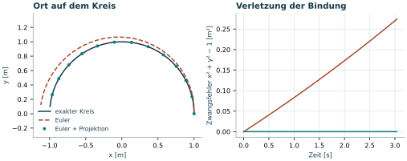

# Kapitel 4 · Differential-algebraische Gleichungen und Zwangsbedingungen

## Einleitung · Welche Startwerte sind überhaupt möglich?

Ein Pendel hängt an einem starren Faden. Wir können der Masse eine Anfangsgeschwindigkeit geben, aber nur tangential zum Kreis, wenn der Faden im Modell gespannt bleiben soll. Ein Programm kann leicht einen Ortsvektor und eine Geschwindigkeit einlesen, die einzeln vernünftig aussehen und sich gegenseitig widersprechen. Welche Bedingungen muss es prüfen, bevor es den ersten Schritt berechnet?

Im RC-Kreis sehen wir zunächst eine Bindung, die sich direkt nach dem Strom auflösen lässt. Beim Pendel bestimmt der Ort allein die noch zulässigen Geschwindigkeiten. Erst wenn wir die Längenbedingung differenzieren, wird der Zusammenhang mit der Beschleunigung und der Zwangskraft sichtbar. Wir folgen dieser Kette bis zur Form, die ein Residualsolver oder ein Projektionsverfahren tatsächlich bearbeitet.

Die praktische Probe wird sowohl den Abstand zum Drehpunkt als auch die Geschwindigkeit in radialer Richtung kontrollieren. Damit können wir beurteilen, was eine Projektion am Ort repariert und welche Teile der Bewegung eine weitere Gleichung verlangen.

[Zum Schluss dieses Kapitels](#kap04-schluss)

<!-- Buchseite -->

## 4.1 Welche Anfangswerte dürfen wir einstellen?

[Grundlagen · Partielle Ableitungen und Kettenregel](../lehrbuch_numerische_simulation.md#g-mehrere-eingaben)

An einem RC-Prüfstand liegen eine Quelle mit $6\,\mathrm V$, ein Widerstand mit $3\,\mathrm{k}\Omega$ und ein Kondensator mit $2\,\mathrm{mF}$ in Reihe. Der Kondensator ist auf $3\,\mathrm V$ geladen. Eine zweite Person möchte den Strom auf $2\,\mathrm{mA}$ einstellen. Dafür müsste bereits am Widerstand die volle Quellenspannung abfallen. Das Problem entsteht vor dem ersten Rechenschritt.

Bei positiver Stromrichtung von der Quelle zum Kondensator lauten die beiden Gleichungen
$$ C\dot u-i=0,\qquad u+Ri-U_s=0.$$
Die erste speichert Ladung, die zweite muss in jedem Augenblick gelten. Aus der frei vorgegebenen Anfangsspannung folgen $i_0=(6-3)/3000=1\,\mathrm{mA}$ und $\dot u_0=i_0/C=0{,}5\,\mathrm{V/s}$. Das Modell ist in der Form $\dot x=f(t,x,z),\ 0=g(t,x,z)$ **semi-explizit**. Ist die partielle Jacobi-Matrix $g_z$ invertierbar, so bestimmt die Bindung nach dem Satz über implizite Funktionen lokal $z$ aus $t,x$. Eine einmalige Differentiation liefert $\dot z=-g_z^{-1}(g_t+g_x f)$. Unter diesen Bedingungen hat diese Form Differentiationsindex eins.

Der Satz über implizite Funktionen beginnt an einem **konsistenten** Punkt $(t_0,x_0,z_0)$ mit $g(t_0,x_0,z_0)=0$. Ist $g$ in seiner Umgebung stetig differenzierbar und $g_z$ dort am Basispunkt invertierbar, dann bestimmt die Gleichung in einer Umgebung genau einen differenzierbaren Ast $z=\varphi(t,x)$. Im RC-Kreis ist $g_i=R\ne0$. Bei $z^2-x=0$ liegen über $x=1$ zwei zulässige Punkte. In der Nähe von $(1,1)$ ist $g_z=2$ und die Vorgeschichte wählt den positiven Ast. Am Ursprung ist $g_z=0$ und dieser Schluss entfällt.

Für größere Netze muss $z$ nicht symbolisch eliminiert werden. Man kann die Speicher- und Kopplungsgleichungen in einem Residuum $F(t,y,\dot y)$ sammeln und pro Zeitschritt gemeinsam lösen. Ein Prüfer misst seine Komponenten in verschiedenen Einheiten. $C\dot u-i$ trägt Ampere, $u+Ri-U_s$ Volt. Jede Komponente benötigt daher eine eigene Skala. Ein Anfangspaar $(y,\dot y)$ heißt konsistent, wenn das Residuum und die für das Modell geltenden versteckten Bedingungen erfüllt sind. [RC-Schaltung](../lehrbuch_numerische_simulation.md#loesbarkeit) · [Projektkapitel zu DAEs][t1proj4]

<!-- Buchseite -->

## 4.2 Welche Gleichung löst ein impliziter Integrator?

Für Rückwärts-Euler ersetzen wir $\dot y$ am Schrittende durch $(Y-y_n)/h$. Damit entsteht das gewöhnliche Nullstellenproblem $G(Y)=F(t_n+h,Y,(Y-y_n)/h)=0$. In einer Newton-Iteration gilt die Kettenregel
$$ G_Y=F_y+\frac1h F_{\dot y},\qquad G_Y\,\Delta Y=-G(Y).$$
Bei einer BDF-Formel steht anstelle von $1/h$ der zur aktuellen Mehrschrittformel gehörende Koeffizient. Das Vorzeichen ergibt sich aus der Definition von $F$. Wer nur $F_y$ an die lineare Lösung übergibt, lässt die Speicherwirkung aus der Newton-Korrektur heraus.

Für einen zweiten RC-Versuch wählen wir $U_s=5\,\mathrm V$, $R=2000\,\Omega$, $C=1\,\mathrm{mF}$ und $u_n=0$. Bei $h=0{,}1\,\mathrm s$ lauten die beiden Gleichungen $C(U-u_n)/h=I$ und $U+RI=U_s$. Setzen wir $U=u_n+hI/C$ in die Maschengleichung ein, folgt
$$ I=\frac{U_s-u_n}{R+h/C},\qquad U=u_n+hI/C .$$
Die Zahlenwerte $I=2{,}380952381\,\mathrm{mA}$ und $U=0{,}238095238\,\mathrm V$ kann man an beiden Residuen prüfen. Der alternative Weg eliminiert zuerst $I$ aus dem kontinuierlichen Modell und integriert die resultierende ODE implizit. In diesem linearen Beispiel entsteht algebraisch derselbe Endwert.

IDA arbeitet mit der Residualform und BDF-Schritten. Konsistente Startwerte und skalierte Newton- und Fehlertests gehören zum Verfahren. Radau-Kollokation kann geeignete DAE-Formulierungen ebenfalls behandeln, wenn die Implementation die entsprechende Massenmatrix oder ein Residuum unterstützt. Die gewöhnliche ODE-Schnittstelle eines Radau-Solvers nimmt nicht automatisch ein beliebiges $F(t,y,\dot y)$ entgegen. Ein höherindiziertes Modell verlangt zusätzliche Struktur, Indexreduktion oder einen hierzu passenden DAE-Solver. [IDA-Mathematik][ida] · [Radau und BDF](../lehrbuch_numerische_simulation.md#k3-bdf)

<!-- Buchseite -->

### Ein nichtlinearer Bindungsast mit zwei Kandidaten

Im nächsten Lehrmodell sind die Größen dimensionslos. Es gilt $y'=z$ und $0=z^2+y-1$. Anfangs sei $y=0,\ z=1$. Die algebraische Gleichung allein ließe zu diesem Zeitpunkt auch $z=-1$ zu. Der konsistente Start und die Fortsetzung des bisherigen Asts legen fest, welche Nullstelle physikalisch gemeint ist. Auf dem positiven Ast erhält man durch Differenzieren $2z\dot z+\dot y=0$, also $\dot z=-1/2$, solange $z>0$. Damit sind $z(t)=1-t/2$ und $y(t)=1-z(t)^2$ bis zur Faltstelle explizit bekannt.

Im impliziten Euler-Schritt gelten $Y=y_n+hZ$ und $Z^2+Y-1=0$. Einsetzen liefert $H(Z)=Z^2+hZ+y_n-1=0$. Newton korrigiert $Z$ um $-H(Z)/(2Z+h)$. Das Labor startet am bisherigen positiven $z$ und prüft das Ergebnis sowohl am ursprünglichen Residuum als auch an der unabhängig rationalisierten Wurzel
$$ Z=\frac{2(1-y_n)}{h+\sqrt{h^2+4(1-y_n)}}.$$
Für $h=0{,}5$ entstehen $Y=0{,}390388203$ und $Z=0{,}780776406$. Rundungsgenau erfüllte algebraische Bedingungen sind mit einem endlichen Zeitfehler vereinbar. Die exakte Bahn hat zur selben Zeit $z=0{,}75$ und $y=0{,}4375$.

Wenn $z$ gegen null geht, wird $g_z=2z$ singulär. Die lokale Eliminierung von $z$ als glatte Funktion von $y$ ist dann nicht mehr gerechtfertigt. Für ein technisch bestimmtes Bauteil an einer Kennlinienfalte braucht man zusätzlich eine Astwahl oder ein physikalisches Umschaltgesetz. Eine kleinere absolute Newton-Toleranz entscheidet an sich nicht, welcher Betriebszustand gemeint ist. Diese Unterscheidung ist für Schaltkreise im C21-Vergleich ebenso wichtig wie ein kleines Residuum. [Stiftpendel und Diodenkennlinie][t1proj13]

<!-- Buchseite -->

### Den richtigen Bindungsast am Start berechnen

Im vorigen Modell gilt beim Start mit festem $y_0=0$ die algebraische Bedingung $g(z)=z^2-1=0$. Die Vorgabe sei der positive Ast. Starten wir den Newton-Versuch bei $z=0{,}25$, so beträgt das Residuum $-0{,}9375$. Der volle Korrekturschritt führt nach $z=2{,}125$ mit Residuum $3{,}515625$. Eine Halbierung der Korrektur führt stattdessen nach $z=1{,}1875$ mit Residuum $0{,}41015625$. Die Dämpfung wählt einen Schritt, der den skalierten Defekt senkt. Am erreichten positiven Ast gilt $z=1$ und die Differentialgleichung liefert $y'_0=1$.

`IDACalcIC` kann für unterstützte Index-1-Probleme die algebraischen Startwerte und die Differentialableitungen bei vorgegebenen Differentialzuständen berechnen. Die IDA-Initialisierung verwendet dafür ein Newton-Verfahren mit Line Search. Die Wahl des Modellasts beginnt mit den vorgegebenen Variablen und einem geeigneten Startwert. Prüfen Sie anschließend das Residuum des Startpaars und die beabsichtigte Astbedingung. [SUNDIALS, konsistente Initialisierung][ida]

### Was ein Besetzungsmuster über den Index verrät

Betrachten wir $\dot x=z_1$ mit den algebraischen Zeilen $x+z_1+z_2=0$ und $z_1+z_2=0$. Ein reines Besetzungsmuster lässt beide algebraischen Variablen in beiden Zeilen zu. Die tatsächliche Jacobi-Matrix dieser Zeilen nach $(z_1,z_2)$ hat Rang eins. Durch Subtraktion erhält man $x=0$, durch Differenzieren $z_1=\dot x=0$. Erst damit folgt auch $z_2=0$. Eine strukturelle Analyse nach Pantelides liefert Kandidaten für die Indexreduktion. Für die berechneten Gleichungen muss man den tatsächlichen Rang im vorgesehenen Arbeitsbereich prüfen.

<!-- Buchseite -->

### Wenn eine schnelle Gleichung zur Bindung wird

Ein Sensor relaxiere in der normierten Zeit $s=t/(1\,\mathrm s)$ nach $\epsilon z'=1-z$ gegen den Sollwert eins. Seine Anzeige treibe eine zweite Größe $u'=-u+z$ an. Anfangs seien beide null. Für jedes $\epsilon>0$ sind zwei Anfangswerte zulässig. Setzen wir $\epsilon=0$, ergibt sich die algebraische Bedingung $z=1$. Der Startwert $z=0$ des schnellen Modells ist in der Grenzbeschreibung inkonsistent.

Das Beispiel erlaubt eine saubere Vergleichsrechnung. Aus der ersten Gleichung folgt $z_\epsilon(s)=1-e^{-s/\epsilon}$. Wir setzen dies in die zweite Gleichung ein und multiplizieren sie mit $e^s$. Integration von $0$ bis $s$ liefert für $0<\epsilon<1$
$$
 u_\epsilon(s)=1-e^{-s}
       -\frac{e^{-s}-e^{-s/\epsilon}}{1/\epsilon-1},\qquad
 u_*(s)=1-e^{-s}.
$$
Die DAE-Grenzlösung $u_*$ folgt aus $z=1$. Der Unterschied in der langsameren Anzeige ist für alle $s\ge0$ höchstens $\epsilon/(1-\epsilon)$. Die schnelle Größe hat unmittelbar bei $s=0$ dagegen den vollen Unterschied eins. Eine algebraische Gleichung entfernt die Anfangsschicht aus dem Modell. Ob dieser Informationsverlust tragbar ist, hängt davon ab, ob wir $u$ nach einer Sekunde oder den ersten Anstieg von $z$ beobachten wollen.

Eine reguläre, sehr steife Massenmatrix und eine singuläre Matrix können einander numerisch ähnlich aussehen. Die Konsequenzen für die zulässigen Anfangsdaten sind verschieden. Beim Aufbau eines Residualsolvers ist es deshalb sinnvoll, zunächst die algebraischen Modellgleichungen, dann die konsistenten Anfangswerte und erst danach die Toleranzen für das Zeitverfahren festzulegen. Das Labor misst beide Anzeigen bei zwei getrennten kleinen $\epsilon$ auch anhand der integrierten Defektgleichung.

<!-- Buchseite -->

## 4.3 Warum das kartesische Pendel Index drei besitzt

Ein starrer masseloser Stab hält eine Masse $m$ im Abstand $\ell$ vom Aufhängepunkt. In kartesischen Koordinaten kann sich ein gewöhnliches Integrationsverfahren zunächst in jede Richtung bewegen. Die unbekannte Stabkraft nimmt genau die radiale Bewegung weg. Mit Ortsvektor $q$, Geschwindigkeit $v$, Schwerebeschleunigung $a$ und Multiplikator $\lambda$ schreiben wir
$$
 \dot q=v,\qquad m\dot v=ma-\lambda q,\qquad
 0=\tfrac12(q^\top q-\ell^2).
$$
Mit dieser Wahl hat $\lambda$ die Einheit $\mathrm{N/m}$. Die radiale Kraft hat Betrag $|\lambda|\ell$. Eine Winkelkoordinate könnte die Bindung von Anfang an einbauen. Die kartesische Beschreibung ist besonders aufschlussreich, wenn sich die Bindung wie beim Stiftpendel ändert.

Einmal differenzieren liefert $q^\top v=0$. Die Anfangsgeschwindigkeit muss also tangential sein. Beim zweiten Differenzieren erhalten wir $v^\top v+q^\top a-(\lambda/m)\ell^2=0$ und damit den zulässigen Multiplikator. Eine dritte Differentiation liefert $\dot\lambda$, sofern die Anregung differenzierbar ist. In dieser üblichen Form erster Ordnung mit Ortsbindung spricht man vom Differentiationsindex drei. „Zweimal bis zur Kraft“ und „dreimal bis zu einer ODE für alle Unbekannten“ beantworten verschiedene Fragen.

Integriert man nur die differenzierte Beschleunigungsbedingung, werden Verstöße gegen $q^\top q=\ell^2$ und $q^\top v=0$ nicht von selbst zurückgeführt. Bei der Baumgarte-Stabilisierung ersetzt man $\ddot g=0$ durch $\ddot g+2\alpha\dot g+\beta^2g=0$. Für positive Parameter mit Einheit $\mathrm{s^{-1}}$ klingt der lineare Bindungsfehler ab. Große Parameter führen zugleich kurze numerische Zeitskalen ein. Eine Projektion korrigiert einen berechneten Ort auf den Kreis und entfernt die radiale Geschwindigkeitskomponente. Liegt der Ort bereits auf dem Kreis, kann sich die Geschwindigkeit dennoch radial bewegen. Das Laborskript prüft beide Bedingungen getrennt.

**Eine Abklingzeit wählen.** Soll sich ein Bindungsfehler innerhalb einer vorgegebenen Zeit $T_B$ abbauen, setzen wir $\beta=1/T_B$ und $\alpha=\zeta/T_B$. Für $T_B=0{,}1\,\mathrm s$ und $\zeta=1$ besitzt der Fehleroszillator die doppelte Nullstelle $-10\,\mathrm{s^{-1}}$. Mit $g'(0)=0$ gilt $g(t)=g(0)(1+t/T_B)e^{-t/T_B}$, bei $t=T_B$ bleibt $2/e$ des Anfangsfehlers. Halbieren Sie nun den Integrationsschritt bei **gleicher Rückführung** und vergleichen Sie $g(T_B)$. Erst danach lässt sich beurteilen, ob die Zeitregel die gewählte Dämpfung auflöst.

**Wie schnell darf die Rückführung sein?** Die Fehlergleichung besitzt die Eigenwerte $\lambda_\pm=-\alpha\pm\sqrt{\alpha^2-\beta^2}$. Bei kritischer Dämpfung ist $\alpha=\beta=1/T_B$ mit einer physikalisch gewählten Zeit $T_B$. Dann hat allein die Fehlerdynamik den doppelten Eigenwert $-1/T_B$. Ein kleineres $T_B$ beschleunigt die Rückführung und kann dem Gesamtsystem eine kurze Zeitskala hinzufügen. Bei $x=h/T_B$ dämpft Vorwärts-Euler den Fehlerblock für $0<x<2$, klassisches RK4 für $0<x<x_4$ mit $x_4=2{,}785293563\ldots$ aus [Abschnitt 2.2](../lehrbuch_numerische_simulation.md#druck-rk-grenzen).

Warum steht hier eine strikte Grenze? In den Koordinaten $(g,T_B\dot g)$ lautet die dimensionslose Fehlermatrix $B=-I+N$ mit $N=\left(\begin{smallmatrix}1&1\\-1&-1\end{smallmatrix}\right)$ und $N^2=0$. Für jedes RK-Polynom gilt $R(xB)=R(-x)I+xR'(-x)N$. Am rechten Rand bleibt bei beiden Verfahren ein Jordan-Anteil, der unter Wiederholung linear wächst. Im Inneren klingt auch dieser Anteil ab. Bei $h=T_B$ ist der RK4-Eigenfaktor $R_4(-1)=3/8$. Für $\dot g(0)=0$ bleibt nach einem RK4-Schritt tatsächlich $17g(0)/24$, analytisch $2g(0)/e$. Damit lassen sich Stabilität und Zeitfehler getrennt prüfen.

<!-- Buchseite -->

### Warum ein Punkt auf dem Kreis weiter nach außen laufen kann

Am Zeitpunkt null liege die Masse bei $q=(1,0)\,\mathrm m$ auf einem Kreis mit Radius eins. Sie bewege sich mit $v=(0,2)\,\mathrm{m/s}$ entlang der Tangente. Beide Anfangswerte erfüllen die Orts- und Geschwindigkeitsbindung. Halten wir die Geschwindigkeit für einen Schritt von $0{,}1\,\mathrm s$ fest, erhalten wir jedoch den Punkt $(1,0{,}2)\,\mathrm m$. Sein Abstand vom Ursprung ist $\sqrt{1{,}04}\,\mathrm m\approx1{,}0198\,\mathrm m$. Der freie Tangentenschritt schneidet die gekrümmte Bahn nicht am richtigen Ort.

Wir können den benötigten radialen Anteil der Beschleunigung schon am Start ausrechnen. Aus $q^\mathsf Tq=1\,\mathrm{m^2}$ folgt zuerst $q^\mathsf Tv=0$. Die Ableitung der letzten Gleichung liefert
$$
v^\mathsf Tv+q^\mathsf T\dot v=0.
$$
Damit ist $\dot v_x=-4\,\mathrm{m/s^2}$ erforderlich. Die Zwangskraft wirkt in diesem Augenblick nach innen. Die Geschwindigkeit bleibt tangential, weil sich die Richtung der Tangente mit dem Ort dreht. Für einen Rechenschritt erklärt das, warum man die Position auf die neue Kreisstelle bringen und die Geschwindigkeit an deren neuer Tangente prüfen muss.

Wählen Sie erst die gewünschte Erholungszeit und halbieren Sie dann $h$ bei gleichem $T_B$. Wer $T_B=h$ nach jedem adaptiven Schritt neu setzt, ändert zugleich die Rückführung. Benötigt das Pendel am Ausgabezeitpunkt Ort und Geschwindigkeit auf der Bindung, prüft [RATTLE in 4.4](#rattle-kreis-druck) diese beiden Bedingungen direkt. [Baumgarte, 1972](https://doi.org/10.1016/0045-7825(72)90018-7)

<!-- Buchseite -->

## 4.4 RATTLE am Kreis mit zwei geometrischen Korrekturen

Wir beginnen mit einem zulässigen $(q_n,v_n)$. Ein halber Kraftschritt und ein freier Ortsschritt ergeben den Kandidaten $a_*=q_n+h v_n+h^2 a/2$. Der Multiplikator des ersten Teilschritts kann diesen Ort nur entlang der alten Normalen $q_n$ verschieben. Es genügt daher, die Gerade durch $a_*$ in dieser Richtung mit dem Kreis zu schneiden.

Mit $n=q_n/\ell$ und $b=a_*-(n^\top a_*)n$ bleibt der quer zur alten Normalen gelegene Anteil $b$ erhalten. Die lokale, stetig am alten Ort anschließende Lösung ist
$$ q_{n+1}=b+n\sqrt{\ell^2-b^\top b}.$$
Die negative Wurzel liegt auf der anderen Kreisseite. Ein nichtpositiver Radikand zeigt, dass der gewählte lokale Schritt verkleinert werden muss. Nun folgt die Zwischen­geschwindigkeit $(q_{n+1}-q_n)/h$. Nach dem zweiten halben Kraftschritt sei der Kandidat $w$. Die zweite Zwangskraft steht auf dem neuen Kreis senkrecht und liefert
$$ v_{n+1}=w-q_{n+1}\frac{q_{n+1}^\top w}{q_{n+1}^\top q_{n+1}}.$$

Damit sind Ort und Geschwindigkeit gemeinsam an die Bindung angepasst. Der erste halbe Kraftschritt gehört zur Ortskorrektur auf den Kreis. Nach dem zweiten halben Kraftschritt muss die Geschwindigkeit im Tangentialraum des neuen Orts liegen. Die beiden Bedingungen erklären die getrennten Korrekturen. Dies ist die Kreis-Spezialisierung von RATTLE. In Systemen mit mehreren Bindungen entstehen gekoppelte Multiplikatorgleichungen. [Andersen, RATTLE][t1rattle]

<!-- Buchseite -->

## 4.5 Rechenlabor, Bindungswechsel und Aufgaben

Im kraftfreien Kontrollversuch beträgt die Länge einen Meter und der Geschwindigkeitsbetrag einen Meter pro Sekunde. Während jedes RATTLE-Schritts ist die tangentiale Strecke im alten Tangentenraum $h|v|$. Geometrisch gilt $\ell\sin(\Delta\varphi)=h|v|$. Die zweite Projektion erhält bei diesem gleichförmigen Rotor den Tangentialbetrag. Nach $n$ Schritten lautet die Phase deshalb $n\arcsin(h|v|/\ell)$, die exakte Phase ist $nh|v|/\ell$. Auf dem Kreis zu bleiben beweist also noch keine richtige Phase.

~~~python
from dae_pendel import rattle
q, v = (1., 0.), (0., 1.)
for schritt in range(10):
    q, v = rattle(q, v, .1, acc=(0., 0.))
~~~

Das Labor prüft an jedem Schritt Länge und Tangentialität. Bei $h=0{,}1\,\mathrm s$ liegt die Phase nach einer Sekunde um $0{,}00167421\,\mathrm{rad}$ voraus, bei $0{,}05\,\mathrm s$ um $0{,}00041714\,\mathrm{rad}$. Für $z=h|v|/\ell<1$ begrenzt Integration von $1/\sqrt{1-z^2}-1$ den Unterschied $\arcsin z-z$ durch $z^3/[6(1-z^2)^{3/2}]$. Diese Schranke, multipliziert mit $n$, bestimmt den Fehlertest. Für den gravitationsbelasteten Schritt gibt es zusätzlich eine Vorwärts-Rückwärts-Probe.

Beim ARGESIM-Stiftpendel C07 kann ein Kontakt den Drehpunkt ändern. Zur Ereigniszeit müssen der Ort kontinuierlich anschließen und die neue zulässige Geschwindigkeit sowie eine etwaige Impulsänderung aus dem jeweiligen Kontaktgesetz folgen. Erst danach passen die neuen algebraischen Anfangswerte und die Neustartableitung. Eine bloße Änderung von $\ell$ in einem laufenden Mehrschrittsolver enthält diese Übergangsrechnung nicht. [Ereignissteuerung](../lehrbuch_numerische_simulation.md#k5-saltation) · [Projektkapitel C07/C21][t1proj13]

**Aufgaben.** (1) Welche Spannung erlaubt im ersten Prüfstand einen Anfangsstrom von $2\,\mathrm{mA}$? (2) Am Punkt $q=(1,0)\,\mathrm m$ beträgt eine vorgeschlagene Geschwindigkeit $(0{,}02,1)\,\mathrm{m/s}$. Projizieren Sie sie. (3) Welche Schrittweite erreicht beim kraftfreien Rotor mit $\ell=|v|=1$ die Grenze des lokalen Wurzelasts?

**Musterlösungen.** (1) Aus der Masche folgt $u_0=6-3000\cdot0{,}002=0\,\mathrm V$. (2) Die radiale Komponente beträgt $0{,}02\,\mathrm{m/s}$, die Projektion ergibt $(0,1)\,\mathrm{m/s}$. (3) Bei $h=1\,\mathrm s$ wird der Radikand null. Die zwei Schnittpunkte fallen zusammen. Für die lokal eindeutige Fortsetzung wählt man $h<1\,\mathrm s$.

<!-- Buchseite -->

### Gegenprobe · Was die Bindung über die Beschleunigung verrät

Beim Durchgang durch den tiefsten Punkt eines Pendels messen wir $q=(0,-\ell)$ und $v=(w,0)$. Die Geschwindigkeit ist tangential. Ob die Bindung im nächsten Augenblick hält, entscheidet sich an der Beschleunigung $a$. Zweimaliges Differenzieren von $q\cdot q=\ell^2$ ergibt zunächst $q\cdot v=0$ und anschließend $v\cdot v+q\cdot a=0$. Am Tiefpunkt folgt daraus $a_y=w^2/\ell$. Bei $\ell=1\,\mathrm m$ und $w=0{,}6\,\mathrm{m/s}$ sind nach oben $0{,}36\,\mathrm{m/s^2}$ erforderlich. Die dazu nötige Fadenspannung muss zugleich die Gewichtskraft tragen.

**Kontrollfrage.** Was meldet der Beschleunigungsdefekt, wenn der Solver nur die Schwerkraft $a_y=-9{,}81\,\mathrm{m/s^2}$ einsetzt? Er beträgt $0{,}36+9{,}81=10{,}17\,\mathrm{m^2/s^2}$, obwohl Lage und Geschwindigkeit zum Start beide Bindungen erfüllen. `pendulum()` in `beispiele/gegenproben.py` prüft beide Beschleunigungen. Dasselbe Diagnoseprinzip wird in Kapitel 13 nach dem Wechsel des Drehpunkts gebraucht.

<!-- Buchseite -->

## 4.6 · Was die Rückprojektion einer Kreisbahn erhält

Eine Markierung rotiert auf einem Kreis mit Radius 1 m und Winkelgeschwindigkeit 1 pro Sekunde. Nach dem ersten Euler-Schritt steht sie ein kleines Stück außerhalb des Kreises. Wird sie auf den Kreis zurückgezogen, stimmt der Radius wieder. Erreicht sie auch zum richtigen Zeitpunkt den höchsten Punkt? Legen Sie vor der Rechnung fest, ob Ihr Messgerät die Länge oder den Winkel prüfen soll.

Für $z=x+iy$ und $\dot z=iz$ multipliziert Euler bei Schrittweite $h$ die Koordinate mit $1+ih$. Ihr Betrag wächst in jedem Schritt um den Faktor $\sqrt{1+h^2}$. Die radiale Projektion dividiert genau durch diesen Faktor. Der Winkelschritt bleibt $\arctan h$, während die Bewegungsgleichung den Winkel $h$ vorschreibt. Bei $h=0{,}08$ s ist der Unterschied in einem einzelnen Schritt im Bild kaum zu sehen. Nach vielen Umdrehungen lässt er sich messen.

Für das kartesische Pendel folgt daraus eine praktische Prüfung. Neben der Bindungslänge protokollieren wir den Winkel oder die Durchgangszeit. RATTLE verwendet außerdem den Tangentialzwang der Geschwindigkeit. Die gezeigte radiale Korrektur isoliert den Ortsteil dieses Problems.

<!-- Buchseite -->

## Schluss · Zulässigkeit gilt für Ort, Geschwindigkeit und Beschleunigung

Der RC-Kreis zeigt, wie sich eine gespeicherte Größe und eine augenblickliche Bindung ergänzen. Ist die Kondensatorspannung gewählt, bestimmt die Maschengleichung den Strom und damit die Spannungsableitung. Gibt es lokal keine reguläre Auflösung der algebraischen Gleichung, braucht der Modellierer zusätzliche Struktur oder eine begründete Astwahl.

Beim kartesischen Pendel ist die Prüfung mehrstufig. Der Abstand zum Drehpunkt legt den Kreis fest. Die Ableitung der Längenbedingung verlangt eine tangentiale Geschwindigkeit. Bei der nächsten Ableitung tritt die Zwangskraft auf. RATTLE setzt den Ort auf die zulässige Bahn und richtet die Geschwindigkeit an ihrer neuen Tangente aus. Eine kleine Abweichung bei der Länge kann gleichzeitig mit einer merklichen Abweichung der Phase auftreten. Für die Abnahme kontrollieren wir deshalb die Bindungen und den Verlauf.

Am Stiftpendel ändert sich die wirksame Bindung während der Rechnung. Welcher Zeitpunkt zu welchem Modell gehört, führt weiter zu den Ereignissen. [Hybride Systeme](../lehrbuch_numerische_simulation.md#kap05-einstieg)

### Aktueller Stand der Forschung

Automatische Indexreduktion verwendet unter anderem das Besetzungsmuster eines Gleichungssystems. Ein Muster allein kann algebraische Abhängigkeiten übersehen. Oki und Song schlagen eine symbolische Matrixdarstellung vor, die Beziehungen zwischen Einträgen besser erfasst als die von ihnen verglichene Näherung. Die Arbeit untersucht die Regularisierung von Systemen mit singulärer Jacobi-Matrix. Die daraus gewonnene Formulierung muss in einem hybriden Modell nach jedem Strukturwechsel erneut zur vorgesehenen Phase passen. Ein anspruchsvoller Test wäre der Vergleich der abgeleiteten Bindungen vor und nach einem Stiftkontakt bei leicht variierten Anfangswerten. [Oki und Song, Vorabdruck zur strukturellen Vorverarbeitung (2024)](https://arxiv.org/abs/2403.10260)

[Zur Einleitung dieses Kapitels](#kap04-einstieg)

[ida]: https://sundials.readthedocs.io/en/latest/ida/Mathematics_link.html
[t1proj4]: https://github.com/5H3LL3H5/argesim-hyperposition-benchmarks/blob/16f0f2528fcf77f16898ecd74ad952be2c09eac2/docs/lehrbuch/studienbuch/kapitel/04.tex
[t1proj13]: https://github.com/5H3LL3H5/argesim-hyperposition-benchmarks/blob/16f0f2528fcf77f16898ecd74ad952be2c09eac2/docs/lehrbuch/studienbuch/kapitel/13.tex
[t1rattle]: https://doi.org/10.1016/0021-9991(83)90014-1
