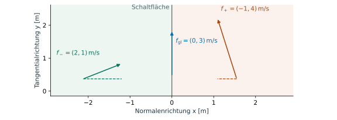
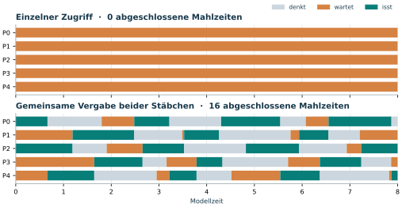

# Kapitel 5 · Hybride Systeme, Diskontinuitäten und Ereignissteuerung

<a id="kap05-einstieg"></a>

## Einleitung · Wie findet man den Augenblick, an dem ein anderes Gesetz gilt?

Eine Kamera nimmt einen Ball beim Fallen auf. Auf einem Bild ist er noch über dem Boden. Auf dem nächsten befindet er sich auf dem Rückweg. Der entscheidende Augenblick liegt dazwischen. Wer nur die Höhe am Bildrand betrachtet, kann den Stoß übersehen. Für die anschließende Bewegung muss das Programm dennoch wissen, wann der Ball auftraf und mit welcher Geschwindigkeit er wieder abfliegt.

Eine ähnliche Frage stellt sich bei einem Schalter. Links und rechts des Ereignisses kann eine andere rechte Seite gelten. Wir beginnen mit dem Wächter, der das Ereignis beschreibt, und mit der Richtung, aus der er null werden darf. Dann nutzen wir eine Zwischenwertkurve, um den Zeitpunkt zu lokalisieren. Vor Ort setzt das Übergangsgesetz den neuen Zustand. Erst danach rechnet man mit der neuen Phase weiter.

Am Ende verfolgen wir auch zwei beinahe gleiche Bewegungen, die ihren Stoß zu verschiedenen Zeiten erleben. So wird sichtbar, wann ein kleiner Zustandsfehler zu einer großen Zeitabweichung führen kann und weshalb ein Protokoll mehr als eine Zahl für den Endzustand braucht.

[Zum Schluss dieses Kapitels](#kap05-schluss)

<!-- Buchseite -->

<a id="k5-ereignisse"></a>

## 5.1 Wann ändert sich das Bewegungsgesetz?

Ein Ball fällt aus zwei Metern Höhe auf einen starren Boden. Filmen wir den Stoß, so liegt die letzte Aufnahme vor dem Kontakt etwas über dem Boden. Die nächste zeigt den Ball vielleicht schon auf dem Rückweg. Aus zwei positiven Höhen allein könnten wir folgern, der Ball habe den Boden überhaupt nicht berührt. Für die Bewegung macht dieser unsichtbare Augenblick einen Unterschied von mehr als elf Metern pro Sekunde. So groß ist der Geschwindigkeitssprung bei der Rückprallzahl $e=0{,}85$ in unserem Versuch.

Um den Stoß auszurechnen, brauchen wir zwei Gesetze. Im Flug bestimmt die Schwerkraft, wie sich die Geschwindigkeit ändert. Am Boden bestimmt ein Stoßgesetz, welche Geschwindigkeit der nächste Flug erbt. Beide Beschreibungen treffen sich bei derselben Höhe und zur selben Zeit. Die links- und rechtsseitigen Geschwindigkeiten dürfen dort verschieden sein.

Eine vergleichbare Frage stellt sich bei einem Thermostat. Zeigt das Thermometer $20\,^\circ\mathrm C$, kann die Heizung laufen oder ruhen. Wer den Raum von $19\,^\circ\mathrm C$ aus erwärmt, hat eine andere Vorgeschichte als jemand, der ihn von $21\,^\circ\mathrm C$ aus abkühlen lässt. Die Temperatur allein bestimmt die nächste Ableitung deshalb nicht. Der **Zustand des Schalters** gehört zum Modell. In der Sprache eines hybriden Systems heißt er *Modus*.

Wir schreiben den kontinuierlichen Zustand als $x$ und seinen Modus als $\sigma$. Im Inneren eines Modus gilt $\dot x=f_\sigma(t,x)$. Für lokale Existenz und Eindeutigkeit genügen unter den üblichen Voraussetzungen Stetigkeit in der Zeit und lokale Lipschitz-Stetigkeit im Zustand. Ein stetig differenzierbares Feld erfüllt die benötigte lokale Bedingung im Zustand. Beim Übergang ergänzen wir die ODE um einen **Wächter** $g(t,x)$, seine zulässige Durchtrittsrichtung, den Zielmodus und die **Resetabbildung** $R(t,x)$. Der Zustandsraum kann zusätzlich einen zulässigen Bereich haben, beim Ball etwa $q\geq0$. [Projektkapitel zu hybriden Systemen][k5projekt]

<!-- Buchseite -->

### Was weiß der Integrator vor dem Schritt?

Ein **Zeitereignis** steht im Kalender des Modells. In der C13-Projektstudie wechselt die Last am Kran bei $4\,\mathrm s$ von null auf $-800\,\mathrm N$ und bei $7\,\mathrm s$ wieder auf null. Wagenposition und Geschwindigkeit bleiben beim Lastwechsel stetig. Die folgende Bewegung muss jedoch mit der neuen Kraft beginnen. Bei vorgeschlagenem Endpunkt $t_n+h$ und nächster Pulsflanke $\tau$ integriert der Solver bis $\min(t_n+h,\tau)$. Er verwendet im ganzen Teilstück das bisherige Feld, auch für die linksseitige Endableitung. Erst dann schaltet er die Last um. Ein periodischer Regler kann seine Termine als $t_0+kT$ aus dem ganzzahligen Taktindex erzeugen. Der Index bleibt auch dann eindeutig, wenn die absolute Uhr zwei Termine gleich rundet. [C13-Projektversuch][k5kran]

<a id="revision-k05-01"></a>

Bei $t_0=2^{30}\,\mathrm s$ beträgt der Abstand zur nächsten größeren binary64-Zahl $2^{-22}\,\mathrm s$. Wählen wir $T=2^{-24}\,\mathrm s$, runden sogar $k=0,1,2$ auf denselben absoluten Wert. Beim dritten dieser Termine entscheidet die Rundung zur geraden Mantisse. Ein Vergleich gleicher Gleitkommawerte würde drei verschiedene Takte zusammenwerfen. Der Kalender behält deshalb den ganzzahligen Index; innerhalb der Phase übergibt er dem Integrator die relative Zeit $kT$. Im Beispiel verarbeitet er drei Termine einzeln und integriert zweimal über $T$. Ereignisse am tatsächlich gleichen Takt sammelt er, verarbeitet ihre festgelegte Reihenfolge einmal und integriert zwischen ihnen über kein Zeitintervall. Die [Gegenprobe im Rechenlabor](../lehrbuch_numerische_simulation.md#revision-q-01) prüft beide Situationen.


Eine Kontrolle gelingt ohne Kranmodell. Das Integral der Eingangskraft steigt im Betrag um $800\,\mathrm N\cdot3\,\mathrm s=2400\,\mathrm{N\,s}$. Ein Programm, das $-2400\,\mathrm{N\,s}$ bei $7\,\mathrm s$ erreicht und bei $15\,\mathrm s$ denselben Wert hat, verarbeitet Dauer und Vorzeichen des Pulses richtig. Ob die Last am Seil richtig schwingt, prüft anschließend das vollständige C13-Modell. Im Rechenlabor beträgt ein Schrittvorschlag sogar zehn Sekunden. Beide Flanken bleiben sichtbar.

Bei einem **Zustandsereignis** liefert der Kalender keinen Termin. Am Boden lautet der Wächter $g=q$. Für einen Aufprall muss die Höhe null sein und die Vertikalgeschwindigkeit nach unten zeigen. Bei einer idealisierten Schwellwertdiode kann ein Spannungswächter das Einschalten auslösen. Beim Abschalten kann je nach Diodenmodell ein Stromwächter maßgeblich sein. Bei einem Pendelanschlag entscheidet neben dem Winkel die Richtung der Annäherung. In jedem Beispiel bestimmt der aktive Modus, welche Bedingung gerade geprüft wird.

**Gegenprobe am Thermostat.** Die Heizung schalte bei fallenden $19\,^\circ\mathrm C$ ein und bei steigenden $21\,^\circ\mathrm C$ aus. Mit $+1\,\mathrm{K/min}$ im Heizmodus und $-0{,}5\,\mathrm{K/min}$ im Kühlmodus dauern die Wege durch dasselbe Band zwei und vier Minuten. Nach sechs Minuten wiederholen sich Temperatur *und* Modus. Ein einzelner Test auf „Temperatur gleich 20“ kann diese Schaltfolge nicht rekonstruieren. Das Zweizonenmodell C05 erweitert dieselbe Überlegung auf gekoppelte Zustände und unterschiedliche Zeitskalen. [C05 im Lehrbuch](../lehrbuch_numerische_simulation.md#k3-c05)

<!-- Buchseite -->

<a id="k5-detektion"></a>

## 5.2 Einen Übergang innerhalb des Schritts finden

[Grundlagen · Nullstellen und Intervallhalbierung](../lehrbuch_numerische_simulation.md#g-fixpunkte)

Was sagt ein Integrationsschritt über die Zeit zwischen seinen Endpunkten aus? Für die Fortsetzung im bisherigen Modus betrachten wir die skalare Funktion $\phi(t)=g(t,x(t))$. Sind beide Endwerte ungleich null und haben verschiedene Vorzeichen, liefert der Zwischenwertsatz bei stetiger $\phi$ mindestens eine innere Nullstelle. Die Behauptung „genau eine“ braucht eine weitere Begründung. Ein Treffer genau am rechten Rand gehört zum aktuellen Schritt. Der linke Rand gehört nach einem bereits verarbeiteten Ereignis zum vorangegangenen Abschnitt.

Setzen wir $s=t/(1\,\mathrm s)$ und $g=(s-0{,}25)(s-0{,}75)$. Bei $t=0$ und $t=1\,\mathrm s$ lesen wir jeweils $3/16$, in der Mitte $-1/16$. Wer nur am Ende prüft, übersieht Eintritt und Austritt. Beim Wächter $(s-0{,}5)^2$ verschwindet der Wert ebenfalls in der Mitte. Dort berührt die Kurve die Schwelle, ohne die Seite zu wechseln. Eine Berührung kann physikalisch bedeutend sein. Dafür braucht das Modell eine eigene Regel.


Die Zeitpunkte zur Unterteilung liefert hier die Algebra. Bei einem beliebigen glatten Wächter können zwischen endlich vielen Proben weitere Nullstellen liegen. Ein kleineres $h_{\max}$ garantiert die Erkennung erst zusammen mit Modellwissen, etwa einem Mindestabstand der Durchgänge oder nachgewiesenen Monotonieintervallen. [Ereignisdetektion in kontinuierlichen Solvern][k5events]

<!-- Buchseite -->

### Aus einem Schritt wird eine auswertbare Bahn

In Kapitel 3 lieferte ein Kollokationspolynom Zwischenwerte. Für den klassischen RK4-Schritt bauen wir hier eine dichte Ausgabe selbst. Sie soll an beiden Enden den berechneten Zustand *und* die zum aktiven Modus passende Steigung treffen. Es gibt vier Bedingungen, also genügen vier Koeffizienten. Mit $s=(t-t_n)/h$, $y_0=x_n$, $y_1=x_{n+1}$ und $f_i=f_\sigma(t_{n+i},y_i)$ lautet der kubische Hermite-Ansatz

$$
\begin{aligned}
p(t)={}&(1+2s)(1-s)^2y_0+s(1-s)^2h f_0\\
       &+s^2(3-2s)y_1+s^2(s-1)h f_1 .
\end{aligned}
$$

Setzen Sie $s=0$ und $s=1$ ein. Dann bleiben abwechselnd $y_0$ und $y_1$ übrig. Beim Ableiten nach $t$ entsteht der Faktor $1/h$. Er hebt das $h$ vor den Steigungen auf. Für eine Höhenkomponente in Metern besitzen deshalb alle vier Summanden die Einheit Meter.

Der klassische RK4-Schritt wertet seine letzte Stufe bei $y_0+hk_3$ aus. Sein tatsächlicher Endzustand ist eine gewichtete Summe aller vier Stufen. Deshalb berechnet unser Labor $f_1$ am tatsächlichen Endzustand eigens. Danach lässt sich $\phi_h(t)=g(t,p(t))$ beliebig oft ohne zusätzliche Auswertung des Vektorfeldes abfragen. Eine provisorische Fortsetzung des alten Modus über einen Stoß hinweg dient dem Einklammern. Der für die Suche benutzte rechte Endzustand wird beim Treffer verworfen. Das setzt voraus, dass sich das alte Feld für den Suchschritt sinnvoll fortsetzen lässt. Endet sein Definitionsbereich am Wächter, muss der Integrator den Schritt schon vorher begrenzen.

Für exakte Randwerte und eine viermal stetig differenzierbare skalare Bahn folgt aus der Hermite-Restgliedformel

$$
|x(t)-p(t)|\leq\frac{\max|x^{(4)}|}{4!}
       (t-t_n)^2(t-t_{n+1})^2
 \leq\frac{\max|x^{(4)}|}{384}\,h^4 .
$$

Der zweite Schritt nutzt $s(1-s)\leq1/4$. Bei berechneten Randwerten kommen deren Zustands- und Steigungsfehler hinzu. Im freien Fall ist die Höhe quadratisch und die Geschwindigkeit linear. RK4 und die kubische Hermite-Ausgabe reproduzieren beide in exakter Arithmetik. Gerade deshalb eignet sich der Ball, um Fehler der **Ereignislogik** getrennt zu beobachten.

<!-- Buchseite -->

<a id="v91-ereignisisolation"></a>

### Zwei Durchgänge innerhalb eines angenommenen Schritts isolieren

Der Test in `beispiele/detektion.py` arbeitet mit dem dimensionslosen Lehrpolynom $g_h(t)=(t-\tfrac14)(t-\tfrac34)=t^2-t+\tfrac{3}{16}$ auf $[0,1]$. Beide Randwerte sind positiv. Aus den Koeffizienten berechnet der Test die einzige innere stationäre Stelle $t_m=1/2$. Dort ist der Wert $-1/16$. Der Detektor erhält dadurch zwei monotone Teilintervalle, je eines für den fallenden und den steigenden Durchgang.

```python
from detektion import quadratic_turning_times
from ereignis import first_crossing

g = lambda t: t*t - t + 3/16
breaks = quadratic_turning_times(1, -1, 0, 1)
fallend = first_crossing(g, 0, 1, -1, 1e-12, breaks)
steigend = first_crossing(g, 0, 1, +1, 1e-12, breaks)
```

Für einen allgemeinen glatten Wächter kann man Teilintervalle mit einer Schranke $|g'_h|\le L$ prüfen. Sei $m$ die Mitte von $[a,b]$. Aus $|g_h(m)|>L(b-a)/2$ folgt, dass $g_h$ dort sein Vorzeichen behält. Scheitert der Test, kann man weiter unterteilen oder eine Monotonieschranke für den Rest suchen. Ein verbleibendes unsicheres Intervall gehört ins Diagnoseprotokoll. Eine Berührung am Extremum hat auf beiden Seiten dasselbe Vorzeichen und braucht einen eigenen Kontaktwächter. B.3 behandelt zusätzlich, wie ein Fehler der dichten Ausgabe in die Prüfung eingeht.

<!-- Buchseite -->

### Was bedeutet eine Zeittoleranz von einer Pikosekunde?

Sei $t_h$ die isolierte Nullstelle von $\phi_h$ und $t_*$ die zugehörige Nullstelle der exakten Funktion $\phi$. Für eine transversale, monotone Passage gelte in einer gemeinsamen Umgebung $|\phi'(t)|\geq m>0$. Die vollständige Ableitung entlang der einlaufenden Bahn ist

$$
\phi'(t)=g_t(t,x(t))+\nabla_x g(t,x(t))^\top f^-(t,x(t)).
$$

Am interpolierten Treffer ist $\phi_h(t_h)=0$. Weicht die ausgewertete Wächterfunktion höchstens um $\eta$ von $\phi$ ab, gilt daher $|\phi(t_h)|\leq\eta$. Nach dem Mittelwertsatz braucht eine Kurve mit Steigung von mindestens $m$ für diese Wertänderung höchstens $\eta/m$ Zeit. Liefert Brent einen Zeitpunkt $\hat t$ höchstens $\varepsilon_B$ neben $t_h$, ergibt die Dreiecksungleichung

$$
|\hat t-t_*|\leq \varepsilon_B+\frac{\eta}{m},\qquad
\eta\leq L_g\|p-x\|_\infty+\varepsilon_g .
$$

$L_g$ begrenzt die Zustandsabhängigkeit des Wächters, $\varepsilon_g$ seinen Auswertungsfehler. Beim Höhenwächter besitzt $\eta$ die Einheit Meter und $m$ die Einheit Meter pro Sekunde. Ein Höhenversatz von $0{,}1\,\mathrm{mm}$ verschiebt einen geradlinigen Durchgang mit $2\,\mathrm{m/s}$ um $50\,\text{µs}$. Bei $0{,}02\,\mathrm{m/s}$ sind es bereits $5\,\mathrm{ms}$. Beide Rechnungen erlauben dieselbe beliebig enge Nullstellenklammer.

Bei einer tangentialen Berührung verschwindet die Durchtrittsrate. Zum Quadrat $g=(s-s_*)^2$ addieren wir eine kleine Konstante. Mit $+\eta$ entfällt der Treffer, mit $-\eta$ entstehen zwei Treffer bei $s_*\pm\sqrt{\eta}$. Eine Anforderung an die Zahl der Dezimalstellen der Ereigniszeit verliert hier ihren Sinn, solange offen ist, ob es überhaupt einen Übergang gibt.

**Rechenversuch zu Abbildung 5.1 B.** In der dimensionslosen Zeit $s=t/(1\,\mathrm s)$ wachse $y$ nach $dy/ds=y$, $y(0)=1$. Die Schwelle $y=2$ fällt auf $t_*=\ln(2)\,\mathrm s$. Bei Schritten von $0{,}5\,\mathrm s$ beträgt der Zeitfehler $393{,}4\,\text{µs}$. Bei $0{,}0625\,\mathrm s$ sinkt er auf $0{,}0876\,\text{µs}$. In beiden Fällen ist $\varepsilon_B=2\cdot10^{-14}\,\mathrm s$. Das Labor leitet für jede Schrittweite eine eigene Schranke her. [Rechenlabor](#k5-labor)

<!-- Buchseite -->

### Wie Brent die Klammer schließt

Wir kennen zwei Zeiten $a$ und $b$, an denen die Wächterwerte verschiedene Vorzeichen haben. Die einfachste Frage lautet: Auf welcher Seite der Mitte liegt der Treffer? Sie kostet eine Auswertung und halbiert die Klammer. Bei einer Anfangsbreite $w$ liegt die Mitte nach $k$ Halbierungen höchstens $w/2^{k+1}$ von einer eingeschlossenen Nullstelle entfernt. Die Steigung des Wächters muss der Algorithmus dafür nicht kennen.

Eine Sekante durch zwei Funktionswerte liefert häufig einen besseren Vorschlag. Mit drei verschiedenen Werten lässt sich die *inverse* Beziehung interpolieren. Wir behandeln die Zeit als Funktion des Wächterwerts, legen eine Parabel durch drei Paare $(\phi_i,t_i)$ und werten sie bei $\phi=0$ aus. Gerät ein Vorschlag zu nahe an das ungünstige Ende oder verkürzt er die bisherigen Suchschritte zu wenig, kehrt Brent zur Bisektion zurück. Nach jeder Auswertung ersetzen wir den Rand mit demselben Vorzeichen. So bleibt die Nullstelle eingeschlossen. [Brents Originalarbeit][k5brent]

Im Programm enthält die Klammer stets die Nullstelle des **ausgewerteten** Wächters. Ein rechnerischer Funktionswert null beendet die Suche unmittelbar. Andernfalls beendet sie eine Breite von höchstens $2\varepsilon_B$ und liefert die Mitte. Beim Vergleich zweier Vorzeichen verwendet der Code getrennte Vergleiche, denn das Produkt zweier kleiner Werte könnte bereits zu null unterlaufen. Kann die Maschinenarithmetik das Intervall vor Erreichen der gewünschten Auflösung nicht weiter teilen, meldet das Labor diesen Fall.

Die Suche beantwortet erst die zweite von zwei Fragen. Zuerst muss der Solver das passende Intervall **isolieren**. Für den Flug ab Boden mit Aufwärtsgeschwindigkeit $u$ liegt der Scheitel $u/g_0$ Sekunden nach dem Start. Vorher steigt die Höhe, nachher fällt sie. Teilen wir einen langen Vorschlag am Scheitel, besitzt die fallende Hälfte ein positives linkes Ende, selbst wenn die Höhe am eigentlichen Start exakt null war. Eine einzige Vorzeichenprüfung über den ganzen Vorschlag würde genau diesen Rückflug übersehen.

Das Labor verwendet die Konvention $(t_n,t_{n+1}]$. Ein gerichteter Abstieg erfüllt auf einem isolierenden Teilintervall $g_\ell>0,\ g_r\leq0$. Am Treffer prüfen wir zusätzlich die negative Geschwindigkeit. Ein Anfangszustand unmittelbar am Boden wird einmal nach der Anfangsregel behandelt. Bei $v<0$ stößt der Ball sofort, bei $v>0$ hebt er ab und bei $v=0$ ruht er unter der betrachteten Gewichtslast. Ein künstlicher Sprung um eine kleine Zeit nach vorne könnte den nächsten kurzen Flug bereits vollständig übergehen.

<!-- Buchseite -->

<a id="k5-saltation"></a>

## 5.3 Was springt am Stoß?

Am starren Boden bleibt die Position stetig. Für die Geschwindigkeit liefert der Rückprallkoeffizient $0\leq e\leq1$ die Regel $v^+=-e v^-$. Die hochgestellten Zeichen bezeichnen die beiden Grenzwerte zur **selben** Zeit. Ein Ereignisprotokoll speichert daher sinnvollerweise Zeit, einlaufenden Zustand, auslaufenden Zustand und Zielmodus. Aus einem Ausgabepunkt pro Zeitstempel allein lässt sich der Geschwindigkeitssprung später kaum rekonstruieren.

Nun lassen wir einen zweiten Ball aus einer geringfügig größeren Höhe fallen. Wenn der erste auftrifft, fliegt der zweite noch abwärts. Beide erfahren dieselbe Resetvorschrift, aber zu verschiedenen Zeiten. Wer untersuchen will, wie sich ein Höhenfehler auf eine spätere Messung auswirkt, muss diesen Zeitversatz mitrechnen. Dafür dient die **Saltationsmatrix** $S$.

Sei $\delta x^-$ die kleine Störung der fortgesetzten einlaufenden Bahn zur nominellen Trefferzeit $t_*$. Der gestörte Treffer liege bei $t_*+\delta\tau$. Wir entwickeln die Wächtergleichung bis zur ersten Ordnung. Mit $n=\nabla_x g(t_*,x^-)$ und $d=g_t+n^\top f^-$ ergibt sich

$$
0=n^\top\delta x^-+d\,\delta\tau,\qquad
\delta\tau=-\frac{n^\top\delta x^-}{d}.
$$

Bis zum verschobenen Treffer bewegt sich die Störung auf der alten Bahn um $f^-\delta\tau$ weiter. Der Reset überträgt diese Zustandsänderung mit $D_xR$ und seine eigene Zeitabhängigkeit mit $R_t$. Für den Vergleich bei gemeinsamer Uhrzeit transportieren wir anschließend auf der neuen Bahn um $-f^+\delta\tau$ zurück. Zusammengenommen folgt

$$
\begin{aligned}
\delta x^+&=D_xR\,\delta x^-+
       (D_xR\,f^-+R_t-f^+)\delta\tau ,\\
S&=D_xR+
  \frac{(f^+-D_xR\,f^- - R_t)n^\top}{g_t+n^\top f^-}.
\end{aligned}
$$

Alle Größen gelten am nominellen Ereignis. $f^-$ wird in $x^-$, $f^+$ im zurückgesetzten $x^+=R(t_*,x^-)$ ausgewertet. Die Formel setzt differenzierbare einseitige Felder, Wächter und Reset, einen isolierten transversalen Durchgang ($d\ne0$) und lokal dieselbe Ereignisfolge voraus. Für den unveränderten Zustand $R(t,x)=x$ ergibt sich der Spezialfall $S=I+(f^+-f^-)n^\top/d$. [Kong und Mitautoren][k5salt]

<!-- Buchseite -->

<a id="kap05-schrittfolge"></a>

### Wie ein Zeitvorsprung am Wechsel den Fehler verändert

Betrachten wir eine Bewegung in einer Raumrichtung. Vor dem Durchgang bei $x=0$ sei die Geschwindigkeit konstant $v^-=2\,\mathrm{m/s}$, danach $v^+=1\,\mathrm{m/s}$. Die Position selbst springt am Durchgang nicht. Geben wir der zweiten Bahn links der Schwelle einen Vorsprung von $2\,\mathrm{mm}$, so erreicht sie dieselbe Schwelle $1\,\mathrm{ms}$ früher.

Vergleichen wir beide Bahnen erst zu einer Zeit, zu der beide den Wechsel bereits hinter sich haben, so stammen ihre unterschiedlichen Wege aus dieser Millisekunde. In der neuen Phase legt die frühere Bahn in derselben Zeit nur $1\,\mathrm{mm}$ zurück. Die Abweichung bei gleicher Uhrzeit ist daher halb so groß wie vor dem Wechsel. Allgemein ergibt sich in diesem Lehrmodell der Faktor $v^+/v^-$.

Das Übergangsgesetz für die Position ist hier die Identität. Der Verstärkungsfaktor entsteht trotzdem, weil wir zwei Bahnen mit verschiedenen Ereigniszeiten zu derselben Beobachtungszeit vergleichen. Die Saltationsmatrix verallgemeinert genau diesen Zeitanteil zusammen mit der Ableitung eines Resets.

<!-- Buchseite -->

### Zwei Bälle vor derselben Uhr

Beim Ball schreiben wir $x=(q,v)^\top$ und $g=q$. Eine glatte Fortsetzung des Resets in die Umgebung der Kontaktfläche lautet $R(q,v)=(q,-ev)^\top$. Auf dem Boden ist die erste Komponente damit null. Die Normale ist $n=(1,0)^\top$, die Durchtrittsrate $v^-<0$. Die Beschleunigung $-g_0$ gilt für beide freien Flüge. Daraus folgen

$$
D_xR=\begin{pmatrix}1&0\\0&-e\end{pmatrix},\quad
f^-=\binom{v^-}{-g_0},\quad f^+=\binom{-e v^-}{-g_0},
\qquad
S=\begin{pmatrix}
-e&0\\ -(1+e)g_0/v^-&-e
\end{pmatrix}.
$$

Das Vorzeichen oben links lässt sich aus der Zeichnung verstehen. Ein etwas höherer Ball trifft später auf. Nach beiden Stößen war der früher aufgetroffene Ball bereits länger auf dem Weg nach oben. Die Ableitung unten links hat die Einheit $\mathrm{s}^{-1}$. Ein Höhenfehler verändert also auch die nach dem Stoß gemessene Geschwindigkeit. Für sehr kleine Anfluggeschwindigkeit wächst dieser Eintrag betragsmäßig.


Die gezeichnete Höhendifferenz von $0{,}25\,\mathrm m$ macht den zeitlichen Versatz sichtbar. Für die Ableitungsprüfung verwendet das Labor eine viel kleinere, symmetrische Höhenänderung. Die glatte Fortsetzung von $R$ dient nur zum Ableiten. Wählt man für seine erste Komponente überall null, ändert sich $D_xR$, der Zeitkorrekturterm ändert sich passend mit, und dieselbe Matrix $S$ entsteht.

<!-- Buchseite -->

### Den Reset am Messgerät prüfen

Ein Sensor vergleiche beide Bahnen bei $T=0{,}8\,\mathrm s$. Der erste freie Flug endet bei $\tau=\sqrt{2H/g_0}$. Eine kleine Störung der Starthöhe gelangt mit der linearen Flussabbildung zuerst bis zur nominellen Stoßzeit, mit $S$ über den Stoß und mit dem Fluss des nächsten Abschnitts bis $T$. Da die Beschleunigung konstant ist, lautet der Fluss für Störungen über eine Dauer $a$

$$
F(a)=\begin{pmatrix}1&a\\0&1\end{pmatrix},\qquad
\binom{\partial_H q(T)}{\partial_H v(T)}
=F(T-\tau)\, S\, F(\tau)\binom{1}{0}.
$$

Bei $H=2\,\mathrm m$ und $e=0{,}85$ folgen rund $-0{,}382252$ und $2{,}897185\,\mathrm{s^{-1}}$. Eine unabhängige Rechnung lässt zwei freie Fallbahnen bei $H+\delta$ und $H-\delta$ starten, stößt jede zu ihrer *eigenen* Zeit und dividiert die Differenz bei $T$ durch $2\delta$. Das Labor vergleicht beide Komponenten. Liegt das Messfenster noch vor dem späteren Stoß, vergleicht man verschiedene Modi und die hier verwendete Ableitung gilt für dieses Fenster nicht.

Auch die beiden Zeitglieder der allgemeinen Formel lassen sich separat prüfen. Ein Schlitten mit $x'=3\,\mathrm{m/s}$ erreicht die bewegte Schwelle $x=b+ut$, $b=1\,\mathrm m$, $u=1\,\mathrm{m/s}$. Beim Treffer setzt die gedachte Messschaltung $x^+=x^-/2+\beta t$ mit $\beta=1\,\mathrm{m/s}$. Danach gilt $x'=-1\,\mathrm{m/s}$. Der nominelle Start $x_0=0$ trifft bei $0{,}5\,\mathrm s$. In SI-Zahlenwerten ist die Sensitivität

$$
S=\tfrac12+\frac{-1-\tfrac12\,3-1}{3-1}=-1{,}25 .
$$

Hier sind $g_t=-u$ und $R_t=\beta$ beide wirksam. Das Programm löst die beiden linearen Flüge und den Reset direkt. Die Endposition bei $0{,}75\,\mathrm s$ hängt affin vom Anfangswert ab. Ein zentraler Differenzenquotient mit binär exakt darstellbaren Daten muss deshalb genau $-1{,}25$ ergeben.

Bei einer periodischen Folge multipliziert man solche Übergangsmatrizen in zeitlicher Reihenfolge mit den glatten Flussableitungen. Für eine Poincaré-Abbildung kommt die Rückkehrbedingung auf den gewählten Schnitt hinzu. Beim streifenden Kontakt oder einer Änderung der Reihenfolge mehrerer Stöße kann bereits die dafür vorausgesetzte Differenzierbarkeit verloren gehen. [Herleitung und Voraussetzungen][k5salt]

<!-- Buchseite -->

<a id="k5-zeno"></a>

## 5.4 Chattering, Gleiten und die Häufung von Stößen

Ein Regler schaltet an einer Grenze immer wieder hin und her. Bevor wir seine Schrittweite begrenzen, untersuchen wir die beiden Felder an der Grenze. Auf der Seite $g<0$ gelte $f_-$, auf der Seite $g>0$ gelte $f_+$. Die Größen $a_\pm=g_t+n^\top f_\pm$ geben die einseitigen Änderungsraten des Wächters an. Bei $a_->0$ und $a_+<0$ treiben beide Felder zur Fläche. Ein Programm, das beim kleinsten Überschreiten sofort das Feld tauscht, kann eine immer feinere Folge rascher Schaltungen erzeugen. Dieses **Chattering** ist eine Beobachtung am Schaltsignal. Ob ein Gleitmodell, ein reales Hystereseband oder ein anderes Kontaktgesetz angemessen ist, entscheidet die Physik.

Für eine glatte einzelne Fläche und strikt einwärts gerichtete Felder beschreibt der Filippov-Ansatz eine attraktive **Gleitbewegung**. Wir wählen ein Gewicht $\alpha$ so, dass die Bewegung den Wächterwert beibehält. Aus $0=(1-\alpha)a_-+\alpha a_+$ folgen

$$
\alpha=\frac{a_-}{a_--a_+},\qquad
f_{\rm gl}=(1-\alpha) f_-+\alpha f_+ .
$$

<a id="auflage-k05-01"></a>

Nehmen wir zwei Koordinaten in Metern und die Fläche $x=0$. Links davon sei das Geschwindigkeitsfeld $(2,1)\,\mathrm{m/s}$, rechts $(-1,4)\,\mathrm{m/s}$. Mit $\alpha=2/3$ ergibt sich $f_{\rm gl}=(0,3)\,\mathrm{m/s}$. In Normalenrichtung steht das System, während es sich in drei Sekunden um neun Meter entlang der Fläche bewegt. [Gleiten nach Filippov][k5fil]

Für die Implementierung können wir die Gewichte auch nach ihren Seiten benennen. Hier sind $w_-=1-\alpha=1/3$ und $w_+=\alpha=2/3$. Die Probe $w_-a_-+w_+a_+=0$ kontrolliert Betrag und Vorzeichen. Bei verschwindendem Nenner oder verlorenem Einwärtszeichen muss der Solver die Wächterlage neu klassifizieren.


Wie nah kommt ein realer Schalter mit Hysterese an diese Rechnung? Er behalte sein aktuelles Feld bis zur gegenüberliegenden Schwelle bei $\pm\delta$ bei. Die zwei Wege haben je $2\delta$ Länge, die Geschwindigkeitsbeträge normal zur Fläche sind $2$ und $1\,\mathrm{m/s}$. Für $\delta=1/16\,\mathrm m$ dauert eine vollständige Periode $3/16\,\mathrm s$. Starten wir bei $-\delta$ in Richtung $+\delta$ und zählen die Übergänge auf $(0,3\,\mathrm s]$, so ergeben sich 32 Schaltungen. Beim halbierten Band sind es 64. Die tangentiale Verschiebung über drei Sekunden bleibt neun Meter. Ein kleineres Band vervielfacht hier die Arbeit, obwohl die gesuchte mittlere Bewegung bereits feststeht.

<!-- Buchseite -->

### Wie die Felder eine Bewegung entlang der Fläche bestimmen



Für das Beispiel des vorigen Abschnitts sind die Normalanteile $2$ und $-1$ in $\mathrm{m/s}$. Im Gemisch mit Anteil $\alpha$ des rechten Felds gilt $2(1-\alpha)-\alpha=0$, also $\alpha=2/3$. Der Tangentialanteil beträgt $(1-\alpha)\cdot1+\alpha\cdot4=3\,\mathrm{m/s}$. Eine wechselnde Folge seitlicher Mini-Schritte kann diese Bewegung nur approximieren. Das Gleitmodell legt sie direkt auf der Fläche fest. Ist eines der Felder tangential oder weisen die Felder von der Fläche fort, ändert sich die Auswahlregel. Das Vorzeichen der beiden Normalanteile gehört somit zur Modellprüfung.

**Neustart am Übergang.** Sobald ein Reset den Zustand ändert oder die rechte Seite am Übergang springt, beginnt ein neuer glatter Abschnitt. Ein Mehrschrittverfahren baut seine Historie aus der neuen Phase auf. Bleibt bei einer reinen Messabfrage die Gleichung unverändert, kann es die bisherige Historie weiterverwenden. [Der Sprungfehler von BDF2](../lehrbuch_numerische_simulation.md#k3-bdf) lässt sich am Ball mit einem einzigen Schritt ausrechnen.

<!-- Buchseite -->

### Wie viel Bewegung bleibt nach dem letzten berechneten Stoß?

Ein Ball verlasse den Boden mit der Aufwärtsgeschwindigkeit $u>0$. Die Höhe nach der Flugzeit $s$ ist $q(s)=us-g_0s^2/2$. Neben der bekannten Startnull bei $s=0$ besitzt sie die positive Nullstelle $2u/g_0$. Die Geschwindigkeit unmittelbar vor dem nächsten Stoß ist $-u$, die neue Aufwärtsgeschwindigkeit $eu$. Bei $0<e<1$ bilden die anschließenden Flugdauern eine geometrische Reihe. Vom aktuellen Abflug aus summieren sie sich zu

$$
T_{\rm rest}(u)=\frac{2u}{g_0}\,(1+e+e^2+\dots)
               =\frac{2u}{g_0(1-e)} .
$$

Für einen Start **aus der Ruhe in der Höhe $H$** müssen wir zuerst fallen. Der erste Treffer liegt bei $\tau_1=\sqrt{2H/g_0}$ und liefert $u_1=e g_0\tau_1$. Damit gilt ab dem ursprünglichen Versuchsbeginn

$$
T_\infty=\tau_1+T_{\rm rest}(u_1)
        =\tau_1\,\frac{1+e}{1-e}.
$$

Diese endliche Häufungszeit unendlich vieler Übergänge heißt **Zeno-Zeit**. Ein Ereigniszähler kann sie für $0<e<1$ durch einzelnes Weiterzählen nie erreichen. Bei $e=1$ bleiben die Flüge gleich lang. Bei $e=0$ gibt es einen einzigen vollständig plastischen Stoß. Für einen ruhenden starren Boden ohne abhebende äußere Last ergänzen wir einen Kontaktmodus $q=v=0$. Die Normalkraft gleicht dann die Gewichtskraft aus. Eine bewegte Unterlage oder zeitabhängige äußere Last verlangt eine eigene Kontakt- und Ablöseregel. [C21 und seine Kontaktmodelle][k5c21]

Im Labor erlauben wir einen vorgezogenen Wechsel in diesen Ruhemodus. Drei beobachtbare Größen begrenzen den Fehler. Nach dem Abflug ist die größte ausgelassene Höhe $u^2/(2g_0)$, der größte Geschwindigkeitsbetrag $u$ und die verbleibende Flugzeit $T_{\rm rest}(u)$. Bei zulässigen Fehlern $\varepsilon_q$, $\varepsilon_v$, $\varepsilon_t$ folgt die Schaltschwelle

$$
u\leq \min\!\left(\sqrt{2g_0\varepsilon_q},\
           \varepsilon_v,\ \frac{g_0(1-e)\varepsilon_t}{2}\right).
$$

Alle drei Einträge haben die Einheit $\mathrm{m/s}$. Der Zeitpunkt der frühen Ruheschaltung und die analytische Häufungszeit sind zwei verschiedene Messgrößen. Das Protokoll speichert die zwischen ihnen verbleibende Zeit.

<!-- Buchseite -->

### Vom Fallversuch zum Benchmark C21

Unser Ball startet bei $H=2\,\mathrm m$, $e=0{,}85$ und $g_0=9{,}81\,\mathrm{m/s^2}$. In den ersten drei Sekunden finden drei getrennte Stöße statt. Für den Langlauf wählen wir $\varepsilon_q=1\,\text{µm}$, $\varepsilon_v=0{,}01\,\mathrm{m/s}$ und $\varepsilon_t=1\,\mathrm{ms}$. Die strengste Bedingung kommt aus der Restzeit und lautet $u\leq0{,}00073575\,\mathrm{m/s}$.


Die 56. Reflexion löst bei $7{,}874510851\,\mathrm s$ den vorgezogenen Ruhemodus aus. Der nächste freie Flug hätte höchstens $2{,}489\cdot10^{-8}\,\mathrm m$ Höhe erreicht. Für *alle* ausgelassenen Flüge zusammen bleiben rund $0{,}949717\,\mathrm{ms}$. Addiert man diese Zeit zur Ruheschaltung, erhält man die analytische Häufungszeit $7{,}875460567\,\mathrm s$ innerhalb des Prüfbudgets. Bei Ausgabe auf neun Nachkommastellen können gerundete Summanden um eine letzte Stelle von der gerundeten Summe abweichen.

Im **C21-Projektfall** betragen die Starthöhe $10\,\mathrm m$ und die Rückprallzahl $0{,}9$. Die ersten Treffer liegen bei $1{,}427843123\,\mathrm s$ und $3{,}997960744\,\mathrm s$. Für den ruhenden Boden ergibt sich $T_\infty=19\tau_1\approx27{,}13\,\mathrm s$. Das Labor prüft diese zwei Kontakte mit eigenem Parametersatz. Der vollständige Benchmark behandelt weitere Aufgaben. Die Ereigniszeiten des kürzeren Lehrversuchs stehen getrennt im Rechenprotokoll. [Projektkapitel C12/C21][k5kontakte]

<!-- Buchseite -->

<a id="k5-labor"></a>

## 5.5 Rechenlabor · Einen Stoß verarbeiten

Was muss im Integrator in welcher Reihenfolge geschehen? Der Ball liefert einen besonders strengen Versuch. Der Modellzustand liegt nach **jedem** Aufprall genau auf dem Wächter. Beginnt der nächste Vorschlag dort und endet unter dem Boden, ist das Produkt der Wächterwerte null. Ein Test auf ein strikt negatives Produkt übersieht den gesamten Rückflug. Ein ungerichteter Test auf ein Produkt kleiner oder gleich null kann hingegen den gerade verarbeiteten Stoß immer wieder auslösen.

Der folgende Ausschnitt zeigt die entscheidenden Zeilen aus `ball.py`. Die dichte Ausgabe gehört zum aktuellen glatten Flug. Der Scheitel teilt diesen Flug in höchstens zwei monotone Stücke. Die lokale Variable `hit` enthält entweder die Zeit des ersten fallenden Durchgangs oder `None`.

```python
stop = min(end, t + step)
y1, dense = rk4_dense(rhs, t, (q, v), stop)
cuts = (t + v/g,) if v > 0 else ()
hit = first_crossing(lambda s: dense(s)[0], t, stop, -1, xtol,
                     cuts, rate=lambda s: dense(s)[1])
```

Liegt ein Treffer vor, wertet das Programm $v^-$ auf derselben dichten Bahn aus. Es protokolliert $t_*$, $v^-$ und $u=-e v^-$, setzt die Höhe auf null und startet in Flug oder Ruhe. Der Zeitpunkt steigt bei jedem weiteren Flug streng an. Eine erzwungene positive Mindesthöhe würde künstliche Energie einführen. Beim rechtsseitigen Neustart sind die alte Interpolation und frühere Ableitungen verbraucht. Ein Mehrschrittverfahren wie BDF baut seine Historie für den neuen Modus wieder auf. Bei einer DAE muss der zurückgesetzte Zustand auch die neuen algebraischen Bedingungen erfüllen. [BDF und Neustart](../lehrbuch_numerische_simulation.md#k3-bdf)

Das Labor besteht aus fünf Python-Dateien. `ereignis.py` enthält RK4, Hermite, gerichtete Suche und Brent–Dekker. `detektion.py`, `saltation.py`, `ball.py` und `schalten.py` sind ausführbare Versuche. Entpacken Sie das Quellenpaket und wechseln Sie in den Ordner `beispiele`. Dort laufen zum Beispiel die folgenden drei Befehle mit Python ab Version 3.10. Das vierte Experiment startet mit `python3 schalten.py`. Die Prüfungen verwenden reguläre Python-Aufrufe mit aktivierten Assertions.

```sh
python3 detektion.py
python3 saltation.py
python3 ball.py
```

<!-- Buchseite -->

### Einen Flug aus dem Rechenkern zusammensetzen

Die folgenden Zeilen können direkt aus dem Ordner `beispiele` als Python-Programm ausgeführt werden. Wir lassen den Ball schon am Boden mit $1\,\mathrm{m/s}$ starten und geben dem Solver $1{,}25\,\mathrm s$ für seinen ersten Vorschlag. Der Endpunkt der *ungestörten Fortsetzung* liegt unter dem Boden. Wo beginnt der nächste physikalische Flug?

```python
from ereignis import first_crossing, rk4_dense
from math import ulp

g0, e = 2.0, 0.5
def flug(t, x):
    return (x[1], -g0)

x1, p = rk4_dense(flug, 0.0, (0.0, 1.0), 1.25)
assert x1 == (-0.3125, -1.5)
treffer = first_crossing(lambda t: p(t)[0], 0.0, 1.25, -1,
                         2e-14, cuts=(0.5,), rate=lambda t: p(t)[1])
assert abs(treffer - 1.0) <= 2e-14
v_minus = p(treffer)[1]
v_plus = -e * v_minus
assert abs(v_plus - 0.5) <= e*g0*2e-14 + 4*ulp(0.5)
```

Beachten Sie, welcher Wert in den Reset eingeht. Am vorgeschlagenen Schrittende trägt `x1` die Geschwindigkeit $-1{,}5\,\mathrm{m/s}$. Wer diese Geschwindigkeit spiegelt, startet mit $0{,}75\,\mathrm{m/s}$. Am tatsächlichen Stoß bewegt sich der Ball jedoch mit $-1\,\mathrm{m/s}$, und sein nächster Flug beginnt mit $0{,}5\,\mathrm{m/s}$. Der falsche Reset würde seine Gipfelhöhe um den Faktor $(0{,}75/0{,}5)^2=2{,}25$ vergrößern. Die Toleranz im letzten Test setzt die Zeitunsicherheit über $e g_0$ in eine Geschwindigkeitsunsicherheit um und reserviert vier Einheiten der letzten Binärstelle bei der Referenzgeschwindigkeit $0{,}5\,\mathrm{m/s}$ für die Auswertung des Interpolanten.

Die Funktion `simulate` übernimmt genau diese Arbeit für jeden weiteren Flug. Ihr Rückgabewert enthält den Endzustand, alle Stoßzeiten mit den beiden Geschwindigkeiten und gegebenenfalls das Ruheprotokoll. Ein Messgerät, das nur am Ende des Versuches abliest, und ein Messgerät, das den Geschwindigkeitssprung benötigt, können so dieselbe Integration verwenden.

<!-- Buchseite -->

### Ein Protokoll, an dem sich der Solver widerlegen lässt

Für die Referenzrechnung zählen wir den ersten Stoß als $k=1$. Vor dem $k$-ten Kontakt ist der Geschwindigkeitsbetrag $g_0\tau_1 e^{k-1}$, und bis dorthin sind $k-1$ Rückflüge vergangen. Das ergibt Referenzen, die ohne RK-Stufen, Interpolation oder Nullstellensuche auskommen.

$$
t_k=\tau_1\left(1+2\sum_{j=1}^{k-1}e^j\right),\qquad
v_k^-=-g_0\tau_1e^{k-1},\qquad v_k^+=-ev_k^- .
$$

<a id="tab-k05-01"></a>

| Kontakt $k$ | Zeit [s] | $v^-$ [m/s] | $v^+$ [m/s] |
|---:|---:|---:|---:|
| 1 | 0,638550857 | −6,264183905 | 5,324556320 |
| 2 | 1,724087313 | −5,324556320 | 4,525872872 |
| 3 | 2,646793301 | −4,525872872 | 3,846991941 |

Die Zeitwerte im Kurzlauf müssen auf $1\,\mathrm{ns}$ mit der geschlossenen Lösung übereinstimmen. Ein Fehler $\delta t$ verändert im freien Fall die Geschwindigkeit um $g_0\delta t$. Für ein Flugintervall können beide Endpunkte um je $1\,\mathrm{ns}$ verschoben sein. Das Labor verwendet beim $k$-ten Treffer konservativ $2k g_0\cdot1\,\mathrm{ns}$ als Geschwindigkeitsbudget. Der Resetfaktor $e\leq1$ verstärkt die einlaufende Geschwindigkeitsabweichung nicht. Im langen Versuch rechnen wir bis zehn Sekunden mit einem einzigen nominellen Schrittvorschlag von zehn Sekunden. Jeder gefundene Stoß unterbricht ihn. Nach 56 Stößen erreicht das Modell den vereinbarten Ruhemodus und liefert am Ende $(q,v)=(0,0)$.

Zwei Randfälle sind binär exakt prüfbar. Mit $g_0=2\,\mathrm{m/s^2}$, $H=1\,\mathrm m$, $e=1$ und Schritten von einer Sekunde fallen die Treffer genau auf $1$ und $3\,\mathrm s$. Beginnt der Ball bei $q=0$ und $v=1\,\mathrm{m/s}$, ist nach einer Sekunde ein ganzer Flug abgeschlossen. Der Detektor muss den rechten Rand zählen und den Abflug am linken Rand auslassen. Für einen plastischen Stoß im Anfangszustand prüft das Labor eigens den Zeitpunkt null.

<!-- Buchseite -->

### Woher die Grenzen der numerischen Prüfungen kommen

Im Wachstumsversuch aus 5.2 hat RK4 den Schrittfaktor $P_4(h)=\sum_{j=0}^4 h^j/j!$. In dieser Herleitung ist $h$ die Schrittweite in der dimensionslosen Zeit $s$. Das Taylor-Restglied liefert $0\leq\exp(h)-P_4(h)\leq\exp(h)h^5/120$. Schreiben wir die Differenz der $n$-ten Potenzen als Summe von $n$ Produkten, sind diese wegen $0<P_4(h)\leq\exp(h)$ durch $n\exp(nh)h^5/120$ begrenzt. Für $nh\leq1$ folgt der Gitterfehler $E_{\rm grid}\leq\exp(1)h^4/120$.

Weil die Ableitung gleich dem Zustand ist, besitzen hier auch die Randsteigungen dieses Fehlerbudget. Die beiden Hermite-Gewichte der Zustände sind positiv oder null und summieren sich zu eins. Die Beträge der Steigungsgewichte summieren sich zu $hs(1-s)\leq h/4$, wobei $s$ in diesem Ausdruck die lokale Koordinate zwischen den Schrittenden bezeichnet. Zusammen mit dem Interpolationsrest aus 5.2 ergibt sich

$$
E_{\rm dicht}\leq(1+h/4)E_{\rm grid}+\exp(1)h^4/384.
$$

Wegen $dy/ds\geq1$ ist dieselbe Zahl eine obere Schranke für den Fehler des normierten Trefferzeitpunkts. Umgerechnet in Sekunden kommen die Brent-Toleranz und eine Reserve für endlich genaue Arithmetik hinzu. Für die kleinen Rechnungen auf $[0,1]$ reserviert das Labor $128(n+1)$ Einheiten der letzten Binärstelle auf der konservativen Werteskala vier. Der dominierende Anteil des Budgets kommt bei allen vier gezeigten Schrittweiten aus der Herleitung.

Auch der Ableitungstest in 5.3 hat eine eigene Fehlerrechnung. Setzen wir $w(H)=\sqrt{2g_0H}$, so gilt im ersten Rückflug $v(T)=(1+e)w(H)-g_0T$ und $q(T)=(1+e)Tw(H)-g_0T^2/2-(1+2e)H$. Bei einem zentralen Differenzenquotienten ist der Abschneidefehler höchstens $\delta^2\max|F'''|/6$. Für $w$ gilt $w'''=3g_0^3/(2g_0H)^{5/2}$. Das Maximum über $[H-\delta,H+\delta]$ liegt links. Das Labor setzt den passenden Faktor $1+e$ oder $(1+e)T$ davor und ergänzt für die Subtraktion zweier Gleitkommawerte eine Rundungsreserve proportional zu $1/\delta$. Ein beliebig kleines $\delta$ macht die Messung deshalb nicht beliebig genau.

Ein mathematisches Fehlerbudget braucht immer eine Bezugsgröße. Hier sind das je nach Versuch die Ereigniszeit in Sekunden, die Geschwindigkeit in $\mathrm{m/s}$ oder die Ableitung einer gemessenen Größe nach der Starthöhe. Eine gemeinsame absolute Toleranz für alle drei hätte keine einheitliche physikalische Bedeutung.

<!-- Buchseite -->

<a id="k5-benchmarks"></a>

## 5.6 Vom Einzelereignis zur Stoßkette

Bei C12 genügt es nicht, ein einzelnes Ereignis genau zu lokalisieren. Mehrere Kugelpaare kommen als Nächstes für einen Stoß infrage. Im kräftefreien eindimensionalen Modell ist der lichte Abstand benachbarter Kugeln ein geeigneter Wächter. Für Kugelmitten $x_i,x_j$ und Radien $r_i,r_j$ lautet er $g_{ij}=x_j-x_i-r_i-r_j$. Er nimmt mit $v_j-v_i$ zu oder ab. Nur bei sich schließendem Spalt und zulässiger Kontaktlage steht ein künftiger Stoß bevor. [Benchmark C12][k5c12]

Im Lehrfall beträgt der freie Abstand $0{,}60\,\mathrm m$. Die linke Kugel läuft mit $0{,}80\,\mathrm{m/s}$, die rechte mit $0{,}20\,\mathrm{m/s}$. Nach genau einer Sekunde ist der Abstand aufgebraucht. Bei einem zentralen elastischen Einzelkontakt gleicher Massen tauschen die Kugeln die Geschwindigkeiten. Für je $1\,\mathrm{kg}$ bleiben Impuls $1\,\mathrm{kg\,m/s}$ und Energie $0{,}34\,\mathrm J$ erhalten. Dieselben zwei Bilanzen würden auch einen wirkungslosen Reset durchlassen. Deshalb prüft `schalten.py` zusätzlich die Geschwindigkeiten beider Kugeln und das positive Vorzeichen des neuen Abstandsanstiegs.

Ein Solver für die Kette bestimmt in der glatten Phase für **alle aktiven Paare** den jeweils ersten isolierten Kandidaten. Der früheste Kandidat oder eine frühere feste Kalendergrenze beendet die Phase. Nach dem Reset verwerfen wir alle späteren Kandidaten des alten Flusses und prüfen die nun aktiven Wächter neu. Unterscheiden sich zwei Treffer um weniger als die mit ihren Fehlerbudgets belegbare Zeitauflösung, ist ihre Reihenfolge numerisch unentschieden. Für unabhängige Ereignisse kann das Modell eine Reihenfolge vereinbaren. Bei gekoppelten Mehrfachkontakten muss es angeben, welche gemeinsame Impuls- oder Kontaktregel gilt. Nacheinander ausgeführte Paarstöße können unterschiedliche Ergebnisse liefern.

Dasselbe Problem stellt sich, wenn ein Regler genau beim Kontakt abtastet. Misst er $v^-$ oder $v^+$? Hier braucht der Modellvertrag eine Ereignisreihenfolge bei derselben physikalischen Zeit. Bei einer endlichen Folge sofortiger Änderungen sind zusätzliche diskrete Teilschritte möglich, ohne die Simulationsuhr vorzurücken. Können diese Teilschritte unbegrenzt weitere auslösen, ist eine Fortschrittsdiagnose nötig. Das Balllabor hat einen einzelnen Bodenwächter, der Pulsversuch einen festen Kalender und der C12-Einzelversuch ein Paar. Ihre kleinen Protokolle machen die Verträge sichtbar, die in Kapitel 12 gemeinsam benötigt werden. [Projektuntersuchung C12/C21][k5kontakte]

### Warum auch eine QSS-Prognose nach dem Schalten verfällt

Ein quantisierter Solver aus Kapitel 6 plant den nächsten internen Übergang aus seiner aktuellen Steigung. Nehmen wir eine dimensionslose Zustandskomponente $x=0{,}25$ bei einer unteren Quantisierungsmarke null und einer oberen Marke eins. Bei $\dot x=1\,\mathrm{s}^{-1}$ bleiben $0{,}75\,\mathrm s$ bis zur Marke. Ein äußeres Schaltsignal verdoppelt in diesem Augenblick die Steigung. Der Zustand ist stetig, die alte Terminvorhersage ist bereits falsch. Für denselben Restweg bleiben nur $0{,}375\,\mathrm s$. Diese beiden binär darstellbaren Zeiten vergleicht das Labor exakt. Beim Übergang von einem glatten Fluss zum nächsten müssen auch vorgemerkte interne Ereignisse aus der neuen Dynamik berechnet werden. [Projektkapitel zu hybriden Systemen][k5projekt]

<!-- Buchseite -->

<a id="k5-aufgaben"></a>

## 5.7 Übungen und Musterlösungen

**1 · Einen verlorenen Flug finden.** Ein Ball startet am Boden mit $u=1\,\mathrm{m/s}$ unter $g_0=2\,\mathrm{m/s^2}$. Ein Solver schlägt einen Schritt von $1{,}25\,\mathrm s$ vor. Welche Werte sieht ein Produktwächter an den Enden? Welche Teilklammer findet den Stoß? Welche Geschwindigkeit protokollieren Sie vor dem Reset?

**2 · Ein Zeitbudget in ein Höhenbudget übersetzen.** Ein Ventil durchläuft eine feste Schwelle mit mindestens $0{,}5\,\mathrm{m/s}$. Die gesuchte Schaltzeit darf um höchstens $10\,\text{µs}$ abweichen. Für die Nullstellensuche sind $2\,\text{µs}$ vorgesehen. Welcher maximale Fehler steht für die gesamte Wächterauswertung in Metern zur Verfügung?

**3 · Den Zeitversatz am Reset erkennen.** Für den Schlitten aus 5.3 werde der Anfangswert um $0{,}01\,\mathrm m$ erhöht. Wann trifft er die bewegte Schwelle? Um wie viele Meter ändert sich die Position beim gleichen Beobachtungszeitpunkt $T=0{,}75\,\mathrm s$?

**4 · Eine Zeno-Regel beurteilen.** Ein Programm geht bei $u=0{,}01\,\mathrm{m/s}$ in den Ruhemodus. Verwenden Sie $g_0=9{,}81\,\mathrm{m/s^2}$, $e=0{,}85$. Kann es $1\,\text{µm}$ Höhe und $1\,\mathrm{ms}$ Restzeit versprechen?

### Musterlösungen

**Zu 1.** In SI-Zahlenwerten ist $q(t)=t-t^2$. Es gilt $q(0)=0$ und $q(1{,}25)=-0{,}3125\,\mathrm m$. Das Produkt ist null. Am Scheitel bei $0{,}5\,\mathrm s$ beträgt die Höhe $0{,}25\,\mathrm m$. Auf $[0{,}5,1{,}25]\,\mathrm s$ liegt genau der fallende Treffer bei $1\,\mathrm s$. Seine Geschwindigkeit ist $-1\,\mathrm{m/s}$.

**Zu 2.** Für den Bahn- und Auswertungsfehler stehen $8\,\text{µs}$ zur Verfügung. Multipliziert mit $0{,}5\,\mathrm{m/s}$ ergibt das $4\,\text{µm}$. Diese Schranke setzt die angegebene Mindestgeschwindigkeit während der gesamten lokalen Passage voraus.

**Zu 3.** Die Relativgeschwindigkeit beträgt $2\,\mathrm{m/s}$. Der Vorsprung von einem Zentimeter zieht den Treffer um $0{,}005\,\mathrm s$ auf $0{,}495\,\mathrm s$ vor. Mit der hier exakt affinen Abbildung gilt $\Delta x(T)=-1{,}25\cdot0{,}01\,\mathrm m=-0{,}0125\,\mathrm m$.

**Zu 4.** Die erste mögliche Gipfelhöhe beträgt $u^2/(2g_0)\approx5{,}10\,\text{µm}$. Die gesamte Restzeit ist $2u/[g_0(1-e)]\approx13{,}59\,\mathrm{ms}$. Beide Budgets werden überschritten. Für diese Anforderung setzt 5.4 die aus der Restzeit folgende strengere Geschwindigkeitsschwelle an.

<!-- Buchseite -->

<a id="atlas-essverlauf"></a>

## 5.8 · Fünf gleichzeitige Anforderungen im Ereigniskalender

Fünf Personen werden gleichzeitig hungrig. Zwischen je zwei Nachbarn liegt ein Stäbchen. Stellen Sie sich zunächst vor, jede Person dürfe eines davon aufheben und behalten, bis das zweite frei wird. Welche abgeschlossene Mahlzeit würden Sie im Protokoll zuerst erwarten?



Im oberen Lauf nehmen alle ihr linkes Stäbchen. Beim zweiten Zugriff wartet jede Person auf ihren Nachbarn. Der Kalender enthält anschließend kein Ereignis mehr, das ein Stäbchen freigeben könnte. Die orange Fläche bezeichnet diesen fortbestehenden Wartezustand. Im unteren Lauf vergibt der Scheduler die beiden benötigten Stäbchen gemeinsam. Grün kennzeichnet das Essen. Nach dem Ende einer Mahlzeit bekommen wartende Nachbarn erneut Gelegenheit zum Zugriff. In acht Modellzeiteinheiten enden so 16 Mahlzeiten. Vier entfallen auf Platz P0 und je drei auf P1 bis P4.

Beide Spuren beginnen mit fünf gleichzeitig hungrigen Personen und verwenden Startwert 21 für den Zufallsgenerator. Die [Belegungs- und Wartepfeile](../lehrbuch_numerische_simulation.md#atlas-kreis) erklären den Stillstand. C10 ergänzt eine eigene [Prioritätsregel für gleichzeitige Anforderungen](../lehrbuch_numerische_simulation.md#atlas-konflikt). Für eine Aussage über langfristige Fairness wären mehrere unabhängige Läufe und längere Beobachtungszeiten nötig.

<!-- Buchseite -->

<a id="kap05-schluss"></a>

## Schluss · Ereigniszeit, Übergang und Neubeginn gehören zusammen

Am Ball beantworten wir die Frage der Einleitung mit einer Höhe und der passenden Durchtrittsrichtung. Eine Nullstelle auf der dichten Ausgabe markiert den Zeitpunkt. Zur Prüfung gehören die Güte dieser Ausgabe und die Steigung des Wächters am Durchgang. Zwei positive Randwerte können mehrere innere Durchgänge oder eine Berührung verdecken. Die Suche muss daher zu der Geometrie des Wächters passen.

Nach dem Treffer rechnet der Solver den Reset aus. Die neue Phase beginnt am Ereignis mit dem dort geltenden Feld. Ein Mehrschrittverfahren übernimmt nur Werte aus einer passenden Historie. Im Stoßprotokoll wird erkennbar, ob ein Fehler am Zeitpunkt, an der Aufprallgeschwindigkeit oder an der Rückprallregel entstand. Auch die Differenz zweier naher Bahnen enthält den Zeitversatz. Bei Zeno-Häufung muss der Modellierer schließlich festlegen, wie die Bewegung über die Grenzzeit hinaus beschrieben wird.

Die nächste Methode benutzt Ereignisse zusätzlich für den Rechenplan. Eine Zustandsmeldung wird dann ausgelöst, sobald eine Komponente ihr Band erreicht. [Zustandsquantisierte Simulation](../lehrbuch_numerische_simulation.md#kap06-einstieg)

<a id="kap05-forschung"></a>

### Aktueller Stand der Forschung

Kong und Mitautoren erläutern Saltationsmatrizen für die lineare Störungsfortpflanzung an hybriden Übergängen. Der zusätzliche Term berücksichtigt, dass gestörte Bahnen den Übergang zu anderen Zeiten erreichen. Das Verfahren setzt für den betrachteten Typ des Übergangs eine transversale Passage voraus. Bei einer streifenden Berührung oder bei einer geänderten Reihenfolge mehrerer Kontakte kann schon die Folge der Phasen wechseln. Ein geeigneter Test für das Ball- oder Kontaktmodell variiert daher die Anfangsdaten und kontrolliert zuerst, ob derselbe Ereignistyp und dieselbe Reihenfolge vorliegen. [Kong u. a., Saltation Matrices (2024)](https://doi.org/10.1109/JPROC.2024.3440211)

[Zur Einleitung dieses Kapitels](#kap05-einstieg)

[k5projekt]: https://github.com/5H3LL3H5/argesim-hyperposition-benchmarks/blob/16f0f2528fcf77f16898ecd74ad952be2c09eac2/docs/lehrbuch/studienbuch/kapitel/05.tex
[k5kontakte]: https://github.com/5H3LL3H5/argesim-hyperposition-benchmarks/blob/16f0f2528fcf77f16898ecd74ad952be2c09eac2/docs/lehrbuch/studienbuch/kapitel/12.tex
[k5kran]: https://github.com/5H3LL3H5/argesim-hyperposition-benchmarks/blob/16f0f2528fcf77f16898ecd74ad952be2c09eac2/docs/lehrbuch/studienbuch/kapitel/14.tex
[k5c12]: https://www.sne-journal.org/benchmarks/c12
[k5c21]: https://www.sne-journal.org/benchmarks/c21
[k5brent]: https://maths-people.anu.edu.au/brent/pub/pub005.html
[k5events]: https://docs.scipy.org/doc/scipy/reference/generated/scipy.integrate.solve_ivp.html
[k5salt]: https://doi.org/10.1109/JPROC.2024.3440211
[k5fil]: https://doi.org/10.1137/080724599
