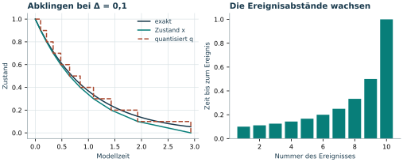
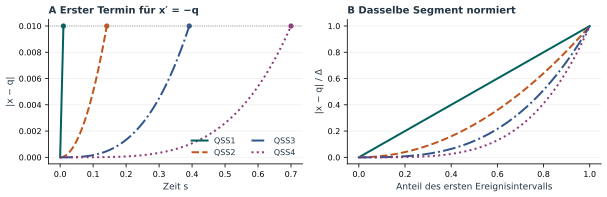
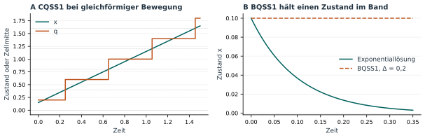
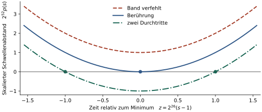
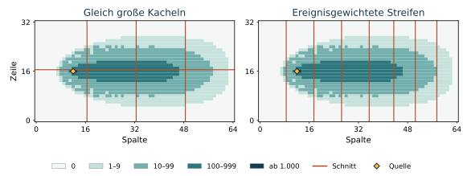

# Kapitel 6 · Zustandsquantisierte Simulation und DEVS

## Einleitung · Wann muss sich eine Zustandsgröße wieder melden?

In einem Heiznetz steigt die Temperatur nahe der Quelle rasch, in einem entfernten Speicher ändert sie sich zunächst kaum. Ein gemeinsamer Zeitschritt lässt beide Komponenten gleich oft rechnen. Denkbar wäre auch, jede Komponente erst dann eine neue Zahl melden zu lassen, wenn sich ihr Zustand ausreichend geändert hat. Doch wer bestimmt den nächsten Meldetermin, wenn in der Zwischenzeit ein Nachbar seinen Wert ändert?

Wir verfolgen einen einzelnen Speicher von Hand. Der interne Zustand bewegt sich kontinuierlich, die nach außen gemeldete Näherung bleibt zunächst konstant. Aus dem Abstand beider Größen ergibt sich ein Termin. Bei höheren Verfahren wird eine Gerade oder ein Polynom gemeldet. Dann muss das Programm die erste zulässige Nullstelle eines Polynoms bestimmen und den Kalender nach Eingang einer fremden Meldung ändern.

Zum Schluss prüfen wir, wofür das Quantum als Toleranz taugt, wie aus einer lokalen Schwelle ein Bahnfehler entstehen kann und warum ein steifer Rückkopplungskreis auch bei nur wenigen Zuständen viel Ereignisarbeit erzeugen kann.

[Zum Schluss dieses Kapitels](#kap06-schluss)

<!-- Buchseite -->

## 6.1 Ein Speicher meldet sich selbst

In einem Heiznetz reagiert ein kleiner Fühler auf die geringste Änderung, während sich in einem großen Speicher über Sekunden kaum etwas tut. Bei einer gemeinsamen Zeitschrittweite werden beide Zustände immer wieder zusammen ausgewertet. Könnte sich stattdessen jeder Speicher selbst melden, sobald seine Änderung groß genug wird? Dann braucht das Modell außer dem fortlaufenden Zustand ein Signal, das seine Nachbarn zuletzt empfangen haben.

Quantized-State-System-Verfahren führen eine kontinuierliche Näherung $x$ und eine quantisierte Meldung $q$. Für eine autonome ODE wird $x'=f(q)$ integriert. Bei QSS1 bleibt jede Komponente $q_i$ bis zur nächsten Meldung derselben Komponente konstant. Erreicht $|x_i-q_i|$ ihr Quantum $\Delta_i$, wird der gemeldete Wert aktualisiert. Ein externer Eingriff kann die Steigung bereits vorher ändern. Die Trajektorie läuft zwischen den Ereignissen in kontinuierlicher Zeit weiter.

Ein normierter Speicher entlade sich mit $y'=-y/(1\,\mathrm s)$, $x(0)=q(0)=1$ und $\Delta=1/4$. Zuerst fällt $x$ mit einer Einheit pro Sekunde. Bei $t=1/4\,\mathrm s$ meldet er $q=3/4$. Für das nächste Viertel des Zustands benötigt er nun $1/3\,\mathrm s$. Der zweite Zeitpunkt ist $7/12\,\mathrm s$. Wir haben zwei ungleiche Zeitabstände aus derselben räumlichen Genauigkeitsvorgabe berechnet. Bei unveränderter Steigung null liegt kein interner Termin an.

Bei mehreren Größen trägt $\Delta_i$ die Einheit der Komponente, etwa Kelvin für einen Speicher und Ampere für einen Zweigstrom. Eine mögliche Regel lautet $\Delta_i=\max(\Delta_{\min,i},r_i|q_i|)$. Der relative Anteil steuert große Werte, der positive Boden hält das Band nahe null offen. Ein solches veränderliches Band muss bei jeder Prognose ausdrücklich berücksichtigt werden. Die folgenden Beweise verwenden ein festes oberes Fehlerband. [Kofman, QSS2][qss2] · [Projektkapitel QSS][t1proj6]

<!-- Buchseite -->

## 6.2 Was der Ereigniskalender wissen muss

Im DEVS-Formalismus besitzt ein atomarer Baustein einen Zustand $s$, Eingangs- und Ausgangsports, eine Zeitfortschrittsfunktion $ta(s)$, eine Ausgabefunktion $\lambda(s)$ sowie interne und externe Übergänge. Ein Quantisierer kann dem Koordinator seine nächste Fälligkeit melden. Erreicht die Uhr diesen Zeitpunkt, werden zunächst die fälligen Ausgaben bestimmt. Erst nach ihrer gemeinsamen Zustellung aktualisieren die betroffenen Bausteine ihre internen Zustände. Für zeitgleiche interne und externe Ereignisse braucht das gekoppelte Modell eine definierte konfluente Übergangsregel.

Bei konstanter Steigung $v_i\ne0$ im aktuellen QSS1-Abschnitt lautet die Prognose
$$
 t_i=t+\frac{q_i+\operatorname{sgn}(v_i)\Delta_i-x_i(t)}{v_i}.
$$
Sie verliert ihre Gültigkeit, wenn eine Nachbarmeldung $v_i$ ändert. Im Labor trägt jeder Kalendereintrag neben Zeit und Komponentennummer die Version seiner Prognose. Eine neue Prognose erhöht die Version. Ein alter Eintrag darf im Heap bleiben, wird beim Herausnehmen aber verworfen. Betroffen sind außer den fälligen Quantisierern genau die Gleichungen $j$, deren rechte Seite eine geänderte Meldung verwendet.

Zwei identische entladende Speicher mit demselben Quantum erreichen ihre Grenze hier zu exakt derselben darstellbaren Zeit. Das Labor sammelt beide Ausgaben, bevor es die neuen Steigungen ausrechnet. Eine Umkehr der Prioritäten bei identischer Zeit muss das gleiche Protokoll liefern. Physikalisch verschiedene, nur numerisch nahe Zeiten künstlich zusammenzulegen, wäre eine zusätzliche Modellentscheidung. Ein Stoß in C12 kann selbst dann ein externes Ereignis auslösen, wenn gerade kein Quantisierer seine Grenze erreicht. Alte Kalendertermine sind nach einem solchen Reset ebenso ungültig wie der dichte Interpolant des ODE-Solvers aus Kapitel 5. [Ereignisfolge und Neuplanung](../lehrbuch_numerische_simulation.md#k5-benchmarks)

Die tatsächliche Arbeit setzt sich aus Wurzelsuche, Aktualisierung abhängiger Komponenten und Kalenderverwaltung zusammen. Bei einem Heap kostet Einfügen oder Entfernen typischerweise $O(\log M)$ bei $M$ gespeicherten Einträgen. In einem dicht gekoppelten System kann eine einzelne Meldung trotzdem den größten Teil des Modells betreffen. Die Kosten hängen deshalb vom Abhängigkeitsgraphen und vom gewählten Quantum ab.

<!-- Buchseite -->

### Wie ein Nachbar eine bereits geplante Meldung verschiebt

Ein Speicher beginne bei $x=q=1$ und nehme zunächst mit einer Einheit pro Sekunde ab. Er meldet, wenn sein Zustand um $\Delta=1/2$ vom letzten gesendeten Wert abweicht. Der Kalender enthält darum zunächst den Termin $t=1/2\,\mathrm s$. Bei $t=1/4\,\mathrm s$ trifft eine Nachbarmeldung ein. Sie halbiert den Betrag der Steigung.

Für die neue Prognose rechnen wir zuerst bis zur Ankunft mit der alten Rate. Der Zustand beträgt dann $3/4$. Bis zur Schwelle $1/2$ fehlt noch ein Viertel. Mit der neuen Rate $-1/2\,\mathrm{s^{-1}}$ vergeht dafür eine weitere halbe Sekunde. Der richtige Termin lautet somit $t=3/4\,\mathrm s$.

Würde der Kalender den alten Eintrag bei $1/2\,\mathrm s$ ausführen, stünde der Zustand dort noch bei $5/8$. Die Meldung käme zu früh. Eine neue Versionsnummer für die Prognose macht den Unterschied im Programm sichtbar. Der alte Eintrag darf im Heap stehen bleiben. Beim Auslesen erkennt ihn der Solver an der veralteten Version und löst keinen Übergang aus. So bleibt die chronologische Verarbeitung korrekt, obwohl noch ein ungültiger Termin gespeichert ist.

**Kalenderregel für interne QSS-Termine.** Ein Heap-Eintrag speichert Zeit, Knoten und Version der Prognose. Der Versionszähler steigt auch dann, wenn die neue Prognose unendlich ist. Damit lässt sich ein alter Termin ohne Suche im Heap streichen.

~~~python
def kalender(d, t0, schnitt, fortschreiben, ausgabe, uebernehmen, deps):
    heap, version = [], [0] * d
    def plane(i, t):
        version[i] += 1
        s = schnitt(i, t)
        if s < inf:
            heappush(heap, (s, i, version[i]))

    for i in range(d):
        plane(i, t0)
    while heap:
        t = heap[0][0]
        faellig = set()
        while heap and heap[0][0] == t:
            _, i, v = heappop(heap)
            if v == version[i]:
                faellig.add(i)
        if faellig:
            betroffen = faellig.union(*(deps(i) for i in faellig))
            fortschreiben(t, betroffen)
            post = {i: ausgabe(i) for i in sorted(faellig)}
            uebernehmen(t, post, betroffen)
            for j in sorted(betroffen):
                plane(j, t)
~~~

`heappush` und `heappop` stammen aus `heapq`, `inf` aus `math`. Zuerst laufen die betroffenen Zustände bis $t$ mit den bisherigen Raten. `ausgabe` liest die Quantisierermeldung jedes fälligen Knotens aus diesem gemeinsamen Vorzustand. Bei QSS1 ist das der erreichte neue Schwellenwert. Erst `uebernehmen` stellt alle Meldungen zusammen zu und aktualisiert die Raten. Auch der auslösende Knoten braucht einen neuen Termin. Im Beispiel verfällt $(1/2,i,1)$, gültig bleibt $(3/4,i,2)$. Für eine gleichzeitige externe Meldung legt das Modell zusätzlich den gemeinsamen internen und externen Übergang fest.

<!-- Buchseite -->

### Zwei Meldungen zur selben Zeit, ein gemeinsamer Empfänger

Zwei Geber steigen in normierter Zeit mit konstanter Steigung eins. Ein dritter Speicher integriert die Differenz ihrer Meldungen. Es gelten $\dot x_1=\dot x_2=1$, $\dot x_3=q_1-q_2$ und zu Beginn $x=q=0$. Geben wir beiden Gebern dasselbe Quantum $1/4$, so sind sie bei einer Viertelsekunde gleichzeitig fällig. Vor dem Übergang ist der Eingang des dritten Speichers null. Nach dem Übergang ist er wiederum null.

Nehmen wir versuchsweise an, ein Programm übermittle die erste Meldung und rücke daraufhin den dritten Speicher bereits in der Zeit vor, bevor es die zweite Meldung verarbeitet. Für dieses künstliche Teilintervall würde der Empfänger eine Steigung von $1/4$ sehen. Eine vertauschte Reihenfolge ergäbe $-1/4$. Die Abweichung hätte keinen Ursprung im physikalischen Modell. Der Koordinator berechnet deshalb beide Ausgaben bei derselben Modellzeit, aktualisiert beide Meldungen und plant den Empfänger einmal neu. Zwischen den beiden Meldungen vergeht keine kontinuierliche Zeit.

Die unmittelbare Gegenprobe lautet $x(1)=(1,1,0)$. Sie ist in binärer Arithmetik exakt, weil die vier Termine bei $1/4$, $1/2$, $3/4$ und eins liegen. Das Prüfprogramm läuft zusätzlich mit umgekehrter Tie-Break-Priorität. Der Zustand und die protokollierten Fälligkeitsmengen müssen identisch sein. In einem Modell mit nichtkommutierenden diskreten Resets braucht die konfluente Übergangsfunktion hingegen ausdrücklich eine physikalisch begründete Reihenfolge.

Bei QSS2 muss nach einer externen Meldung auch das Zeitpolynom an die neue lokale Zeit verschoben werden. Für $q(s)=q_0+q_1s$ zum Beispiel wird am neuen Ursprung $s_0$ der konstante Term $q_0+q_1s_0$. Die Steigung bleibt $q_1$, bis eine neue Meldung sie ändert. Beim quadratischen Polynom ändert sich zusätzlich der lineare Koeffizient. Ein vergessener Ursprungswechsel kann den nächsten Quantisierungszeitpunkt verschieben, obwohl alle gespeicherten Werte im alten Koordinatensystem richtig waren. [DEVS- und QSS-Rechenbeispiele][t1proj6]

<!-- Buchseite -->

## 6.3 Höhere Ordnung und die nächste positive Wurzel

QSS2 gibt eine Gerade als Meldung aus, QSS3 eine Parabel und QSS4 ein kubisches Polynom. Der integrierte Zustand hat auf dem entsprechenden lokalen Taylor-Abschnitt einen Grad mehr. Für die nächste Meldung untersucht man $x_i(s)-q_i(s)-\Delta_i$ und $x_i(s)-q_i(s)+\Delta_i$, wobei $s$ die seit der letzten Aktualisierung vergangene Zeit ist. Gesucht ist die früheste zulässige positive Grenze. Rein komplexe Wurzeln, die bereits verarbeitete Startnull und Wurzeln außerhalb eines durch äußere Ereignisse begrenzten Abschnitts sind eigene Fälle. Eine fast verschwindende Restgröße am Extremum erfordert eine Wurzelzählung. [Berührung und Fasttreffer](#qss-kontakt-nachweis).

Am skalaren linearen Speicher $x'=-a q$ lässt sich die Konstruktion bis Ordnung vier ausrechnen. Bei einem eigenen Ereignis werde $q=x_k$ neu aufgebaut. Das Taylorpolynom $T_{p-1}(z)=\sum_{j=0}^{p-1}z^j/j!$ liefert die Meldung $q(s)=x_k T_{p-1}(-as)$. Integration gibt $x(s)=x_kT_p(-as)$. Ihre Differenz enthält nur den letzten Term. Daraus folgt der nächste Zeitabstand
$$
 s_*=\frac1a\left(\frac{p!\Delta}{|x_k|}\right)^{1/p}.
$$
Bei $p=2$ entsteht die Quadratwurzel, weil die Steigungen von Meldung und Zustand am Anfang übereinstimmen. Im nichtlinearen Mehrkomponentenfall müssen die benötigten lokalen Koeffizienten aus dem Modell bestimmt und nach äußeren Meldungen neu berechnet werden.

Für $a=1\,\mathrm{s^{-1}}$, Startwert eins, eine Sekunde Simulationszeit und $\Delta=0{,}002$ benötigt der skalare Laborversuch 316, 12, 3 und 2 interne Meldungen für $p=1,2,3,4$. Die Endfehler betragen $6{,}312\cdot10^{-4}$, $4{,}060\cdot10^{-4}$, $2{,}992\cdot10^{-4}$ und $2{,}941\cdot10^{-4}$. Ein höherer Grad macht Ereignisse in diesem glatten Sonderfall seltener. Er erhöht zugleich die Arbeit einer Prognose, besonders bei wechselnden Eingängen. [Überblick über QSS-Methoden][t1qreview]

<!-- Buchseite -->

### Den ersten QSS2-Termin von Hand bestimmen

[Grundlagen · Gleitkommaarithmetik und Auslöschung](../lehrbuch_numerische_simulation.md#g-fehler)

Wir nehmen den Speicher aus Abschnitt 6.1 mit $x(0)=q(0)=1$, $\Delta=1/4$ und schreiben die seit dem Start verstrichene Zeit als Sekundenwert $s$. QSS2 meldet hier $q(s)=1-s$. Die Bewegung rechnet mit $x'=-q$ und liefert $x(s)=1-s+s^2/2$. Deshalb gilt
$$
x(s)-q(s)=s^2/2,\qquad s_*=\sqrt{1/2}=0{,}70710678\ldots .
$$
Bis dahin bleibt der Abstand im Band. Zum Meldetermin ist $q\approx0{,}292893$ und $x\approx0{,}542893$. Die Differenz beträgt genau ein Viertel. Der nächste Abschnitt beginnt mit einem neuen Meldepolynom. Eine vorher eintreffende Nachbarmeldung würde schon vorher eine neue Prognose erfordern.

In einem gekoppelten QSS2-Abschnitt können die Koeffizienten von $x-q\mp\Delta$ zu $As^2+Bs+C=0$ führen. Auch $B$ ist eine **Differenz** von Steigungen. Wenn $\sqrt{B^2-4AC}$ im Betrag nahe an $|B|$ liegt, kann die Subtraktion in der üblichen Wurzelformel die kleine Nullstelle auslöschen. Für zwei verschiedene reelle Wurzeln und $A\ne0$ bildet man
$$
w=-\tfrac12\bigl(B+\operatorname{copysign}(\sqrt{B^2-4AC},B)\bigr),
\qquad s_1=w/A,\qquad s_2=C/w .
$$
Hier wird die kleine Nullstelle über das Wurzelprodukt berechnet. Lineare und doppelte Fälle behandelt `rechenlabor/auditproben.py` gesondert. Der Testfall $10^{-12}s^2+s-10^{-12}=0$ liefert mit der direkten Subtraktion null, mit dem Wurzelprodukt dagegen einen positiven Termin nahe $10^{-12}$. Bei der Auswahl zählen Endlichkeit, die früheste zulässige positive Wurzel, das Ende des gültigen Prognoseabschnitts und die Zeitauflösung.

<!-- Buchseite -->

## 6.4 Vom Quantenband zum Fehler der gesamten Bahn

Die Meldung darf um höchstens $\Delta$ vom fortlaufenden Zustand abweichen. Weshalb darf man daraus beim stabilen Speicher etwas über den Fehler gegenüber der *exakten* Lösung folgern? Schreiben wir $e=x-y$ und $\delta=q-x$. Für $y'=-ay$ gilt $e'=-ae-a\delta$. Multiplikation mit $e^{at}$, Integration und anschließende Betragsbildung liefern
$$
 |e(t)|\leq e^{-at}|e(0)|+\Delta(1-e^{-at}).
$$
Die Dämpfung begrenzt den Beitrag auch lange zurückliegender Meldungen. Für gekoppelte lineare Systeme mit Matrix $A$ gilt $e'=Ae+A\delta$. Falls in derselben Norm $\|\exp(At)\|\leq M e^{-\gamma t}$ mit $\gamma>0$, folgt durch Variation der Konstanten
$$
 \|e(t)\|\leq M e^{-\gamma t}\|e(0)\|+
   \frac{M\|A\|\Delta}{\gamma}(1-e^{-\gamma t}).
$$
Vorausgesetzt sind ein durchgehend eingehaltenes Band und die hier betrachtete glatte Dynamik. Ein Reset benötigt eine eigene Abschätzung. Ohne exponentielle Dämpfung trägt der Beweis die zeitunabhängige Schranke nicht.

<!-- Buchseite -->

## 6.5 Steife Rückkopplung, LIQSS und Blockkopplung

Nehmen wir eine Komponente mit $\dot x=-a(q-q_*)$, $a>0$. Liegt das Gleichgewicht $q_*$ zwischen den zur Wahl stehenden Meldungen, können die beiden resultierenden Steigungen in entgegengesetzte Richtungen zeigen. Bei großem $a$ durchläuft die numerische Bahn das Band sehr schnell und meldet immer wieder, obwohl die physikalische Bewegung schon fast zur Ruhe gekommen ist. Mehr Ereignisse können hier gerade das Symptom eines ungeeigneten expliziten Quantisierers sein.

Linearly Implicit QSS (LIQSS) nutzt lokale Information über die Selbstkopplung. Für $x'_i\simeq a_{ii}q_i+b_i$ ist $q_*=-b_i/a_{ii}$ bei $a_{ii}<0$ das attraktive lokale Gleichgewicht. Fällt es in das zulässige Band, kann eine geeignete Meldung die Steigung bis auf null verringern. Liegt es außerhalb, bestimmen Band und Richtung den nächsten Kandidaten. Änderungen der Nachbarn verschieben $b_i$; auch eine zuvor ruhige Komponente muss dann neu prognostizieren. Eine sichere Diagonalnäherung bei zwei stark gekoppelten Komponenten lässt sich aus der Betrachtung eines einzelnen Eigenwerts nicht ableiten.

Erweiterte Varianten wie eLIQSS nutzen die Lage des Startpolynoms im zulässigen Band, um die vorhergesagte Zeit bis zur nächsten Meldung zu vergrößern. In der Projektvariante LIQSS–BDF behandelt ein quantisierter Teil die schwach gekoppelten Komponenten, während ein steifer Block implizit mit BDF fortschreitet. An der Blockgrenze müssen Zeitstempel, Austauschwerte und Ereignisse zusammenpassen. Ein fehlgeschlagener gemeinsamer Schritt verwirft die provisorischen Zustände beider Seiten. Beim C05-Vergleich zählt deshalb neben den internen Meldungen auch die Arbeit zur Erkennung der Schalter. [Methoden und Projektvarianten][t1proj6] · [C05 und die Umschaltzeit](../lehrbuch_numerische_simulation.md#k3-c05)

<!-- Buchseite -->

### Quanten am Messauftrag ausrichten

Eine gebräuchliche Wahl für ein neues Prognoseintervall ist
$$
\Delta_i=\max\bigl(\Delta_{\min,i},r_i |x_i(t_k)|\bigr).
$$
$\Delta_{\min,i}$ trägt die Einheit des Zustands, $r_i$ ist dimensionslos. Der Wert wird bei der Aktualisierung aus dem momentanen Zustand bestimmt und für die folgende Prognose festgehalten. Bei $r_i=10^{-3}$ und einem Mindestquantum von $0{,}02\,\mathrm K$ entstehen für Temperaturüberschüsse $40\,\mathrm K$ und $5\,\mathrm K$ die Quanten $0{,}04\,\mathrm K$ und $0{,}02\,\mathrm K$. Die absolute Untergrenze hält das Band auch nahe null offen.

Ein Quantenband begrenzt zunächst den Abstand zwischen Zustand und Meldung. Das Fehlerbudget am Sensor wird mit einer Referenz oder mit der Schranke aus Abschnitt 6.4 geprüft. Verkleinern Sie die Quanten und protokollieren Sie gemeinsam Bahnfehler, physikalische Schaltungen und interne Meldungen. Damit wird sichtbar, welche Komponente den Rechenaufwand und welche die geforderte Messgenauigkeit bestimmt.

In einem dünn gekoppelten Netz mit 10 000 Komponenten können bei einem Ereignis etwa fünf Raten zu aktualisieren sein. Der Quotient $10\,000/5=2000$ vergleicht die Zahl dieser Aktualisierungen mit einem vollständigen synchronen Durchlauf. Für Laufzeit und Gesamtarbeit zählen zusätzlich die Häufigkeit der Meldungen, die Nachbarschaftsgröße, die Kalenderarbeit und die Effizienz des Vergleichssolvers. [Originalarbeit zu QSS2](https://doi.org/10.1177/0037549702078002206)

<!-- Buchseite -->

### Eine steife Komponente am Gleichgewicht prüfen

Stellen wir uns eine schnelle Rückführung mit $x'=1000(0{,}03-q)\,\mathrm{s^{-1}}$ für einen dimensionslosen Speicher vor. Starten $x=q=0$ bei $\Delta=0{,}1$, so beträgt die erste Steigung $30\,\mathrm{s^{-1}}$. Nach $0{,}1/30\,\mathrm s$ erreicht die Bahn die obere Meldung $q=0{,}1$. Nun beträgt die Steigung $-70\,\mathrm{s^{-1}}$. Bereits $0{,}1/70\,\mathrm s$ später ist derselbe Zustand wie zu Beginn erreicht. Der analoge Speicher ist in dieser Zeit ohne Überschwingen in Richtung $0{,}03$ gelaufen.

Die lokal implizite Gleichgewichtsidee kann in dieser speziellen Lage den zulässigen Wert $q=0{,}03$ wählen. Dann gilt $x'=0$, während der Abstand zwischen Meldung und Zustand nur $0{,}03<\Delta$ beträgt. Die exakte physikalische Bahn $0{,}03(1-e^{-1000t})$ hat weiterhin eine Übergangsschicht. Sie wird bei dieser Wahl des Quantums absichtlich nur innerhalb des Fehlerbands aufgelöst. Wer den schnellen Anstieg selbst untersuchen will, muss das Quantum verkleinern. Die Rechnung isoliert die Rolle der lokalen Gleichgewichtswahl. Ein allgemeiner LIQSS-Quantisierer muss auch Bandgrenzen, Prognosepolynome und externe Nachrichten behandeln.

Für die Auswertung eines QSS-Laufs sind daher außer dem Endwert mehrere Zahlen wichtig. Wie viele physikalische Ereignisse wurden in der richtigen Reihenfolge erkannt? Wie viele interne Meldungen hat die schnelle lokale Rückführung erzeugt? Wieviel Arbeit verursachten verworfene Prognosen und gekoppelte Korrekturen? In C05 sind eine richtige Grenzzyklusperiode und ein wirtschaftlicher Umgang mit schnellen Moden getrennte Messfragen. [C05 im Projekt][c05]

**Rechenlabor und Aufgaben.** Der Aufruf unten verwendet zwei gekoppelte Speicher. Ihre Referenz ist $(e^{-t},e^{-t}-e^{-2t})$ in normierter Zeit. (1) Bestimmen Sie $\|A\|_\infty$. (2) Wann meldet ein einzelner Speicher für $\Delta=1/4$ zum zweiten Mal? (3) Was passiert, wenn die externe Änderung einer Steigung vor einem schon eingeplanten Termin liegt?

~~~python
from qss_devs import qss1
A = ((-1., 0.), (1., -2.))
ende, meldungen, veraltet = qss1(A, (1., 0.), 1/16, 2.)
~~~

**Musterlösungen.** (1) Die größte absolute Zeilensumme ist drei. Die Zeilensummen der nichtnegativen Matrix $\exp(At)$ sind beide $e^{-t}$. Somit gelten $M=\gamma=1$ in normierter Zeit und das Labor prüft $3\Delta(1-e^{-t})$. (2) Nach $1/4+1/3=7/12\,\mathrm s$. (3) Die Prognose erhält eine neue Version. Im gekoppelten Versuch mit $\Delta=1/16$ werden bei 19 aktiven Zeitpunkten zehn veraltete Einträge erkannt.

Warum der Vorfaktor hier eins ist, sieht man an $A(1,1)^\mathsf T=-(1,1)^\mathsf T$. Für $t\ge0$ hat $e^{At}$ die beiden Zeilen $(e^{-t},0)$ und $(e^{-t}-e^{-2t},e^{-2t})$. Alle Einträge sind nichtnegativ. Beide absoluten Zeilensummen sind deshalb $e^{-t}$. Genau diese Zahl ist die induzierte Maximumsnorm. Ein negatives Eigenwertmaximum allein liefert bei einer beliebigen Kopplungsmatrix diesen Vorfaktor noch nicht.

<!-- Buchseite -->

### Gegenprobe · Warum der zweite QSS-Termin später kommt

Ein normierter Speicher startet bei $x=q=1$ und entlädt sich nach $x'=-q$. Zwischen zwei Meldungen bleibt der ausgegebene Wert $q$ konstant. Beim Quantum $\Delta=1/4$ erreicht die Bahn $x=3/4$ daher nach $1/4$ Zeiteinheiten. Mit der neuen Meldung $q=3/4$ fällt die Steigung im Betrag. Für das nächste Viertel braucht die Bahn $(1/4)/(3/4)=1/3$. Der zweite Termin liegt bei $7/12$. Wer beide Meldungen im Voraus im festen Abstand $1/4$ plant, verlegt den zweiten Termin um $1/12$ nach vorn.

**Kontrollfrage.** Welchen Eintrag muss ein Ereigniskalender erneuern, wenn ein Nachbar den Wert der Steigung schon vor dem geplanten Termin ändert? Zunächst wird der kontinuierliche Zustand mit der bisher gültigen Steigung bis zum Änderungszeitpunkt fortgeschrieben. Dann werden Restabstand und nächste Zeit mit der neuen Steigung bestimmt. Die alte Vorhersage verliert ihre Gültigkeit. `qss()` in `beispiele/gegenproben.py` liefert die beiden exakten Termine. Das gekoppelte Labor in Abschnitt 6.2 prüft die Behandlung überholter Kalendereinträge.

<!-- Buchseite -->

## 6.6 · Die Abstände zweier Quantisierungsereignisse vorhersagen

Ein Speicher beginnt bei $x(0)=1$ und entlädt sich nach $\dot x=-x$. Die Zeitkonstante ist eine Einheit. Bei QSS1 geht der letzte gemeldete Wert $q$ in die rechte Seite ein. Bis zur nächsten Meldung ist die Steigung also konstant. Die Linie fällt um genau ein Quantum $\Delta=0{,}1$. Wie lange braucht sie dafür, wenn gerade $q=1$ gemeldet wurde? Und wie lange bei $q=0{,}2$?

Aus $q\,\Delta t=\Delta$ folgen die Abstände $0{,}1$ und $0{,}5$. Die Balken rechts zeigen die tatsächlich konstruierten Intervalle. Auf der letzten Strecke gilt $q=0{,}1$, der Abstand beträgt eine ganze Zeiteinheit. Mit der Meldung $q=0$ endet die Bewegung des quantisierten Modells. Die Exponentiallösung klingt weiter ab. Wer eine sehr kleine Restladung bestimmen will, muss deshalb vor der Rechnung ein dazu passendes absolutes Quantum festlegen.

<!-- Buchseite -->

## Wie eine verlorene Nullstelle die Methodenwahl verändert

Ein Ereignis ist ein Zeitpunkt, an dem der Abstand zwischen dem fortgeschriebenen Zustand $x$ und seiner Meldung $q$ eine der beiden Grenzen $\pm\Delta$ erreicht. Für $x'=-q$, $x(0)=q(0)=1$ und ein am Start abgestimmtes Polynom der Ordnung $p$ gilt auf dem ersten Segment $|x(s)-q(s)|=s^p/p!$. Der erste Termin ist somit $s_*=(p!\Delta)^{1/p}$. Bei $\Delta=0{,}01$ ergibt das für QSS1 bis QSS4 nacheinander $0{,}01$, $0{,}1414$, $0{,}3915$ und $0{,}6999$. Der größere erste Schritt entsteht aus der zusätzlichen Übereinstimmung von Ableitungen. Im gekoppelten System kann ein Nachbar seinen Termin vorziehen.

**Eine Gegenprobe aus der Kavität.** Für die früheste betroffene Zelle folgt beim Start von QSS4 näherungsweise $331313052{,}57\,s^4=0{,}001$. Die positive vierte Wurzel beträgt $0{,}00131808$. Ein Termin bei $0{,}0337085$ würde in dieser Zelle bereits rund 428 000 Quanten zulassen. Beide Seiten der Gleichung müssen am Kandidaten in physikalischer Zeit ausgewertet werden. Bei winzigen Koeffizienten schützt ein gemeinsamer Zweierfaktor die Auswertung vor Unterlauf. Für $2^{-1074}(s-1)(s-2)$ liegen die Nullstellen bei eins und zwei. Eine Auswertung ohne Skalierung meldete das Extremum $s=1{,}5$ als ersten Termin. Bleiben nach der Skalierung subnormale Koeffizienten übrig, prüft der Solver die Vorzeichen in exakter Bruchrechnung. QSS3 trifft am selben Anfangszustand seine erste Grenze schon bei $0{,}00065912$. Das Labor prüft die Wurzeln, die akzeptierten Segmentpolynome und das Geschwindigkeitsfeld gegen eine unabhängige Integration. [Kofman, Darstellung des QSS-Verfahrens dritter Ordnung](https://usuarios.fceia.unr.edu.ar/~kofman/files/lsd0502.pdf).

<!-- Buchseite -->

## Wo liegt der an die Nachbarn gemeldete Wert?

Bei CQSS1 zerlegen wir die Zustandsachse in Zellen der Breite $\Delta$. Für $x$ in der Zelle $[k\Delta,(k+1)\Delta)$ melden wir ihren Mittelpunkt $(k+1/2)\Delta$. Abbildung 6.4A lässt den Zustand gleichförmig durch die Zellen laufen. Der Zustand ist am Zellenrand stetig, während die Meldung springt. Für einen Start genau auf einem Rand wird die Auswahl der Seite wichtig. Zeigen die beiden Felder wiederholt auf denselben Rand zurück, kann die Implementierung einen Wechsel ohne Zeitfortschritt diagnostizieren.

Bei BQSS1 beurteilt der Solver die Bewegung mit einem vorausgewählten Gitterwert. Ein Beispiel ist $x'=-10x$ mit $x(0)=0{,}1$ und $\Delta=0{,}2$. Das Gitter ist am Startwert verankert. Der untere Kandidat bei $-0{,}1$ erzeugt eine positive Rate. Sie weist vom ausgewählten unteren Ziel weg. Die Implementierung hält die Komponente, bis eine neue Kopplung die Entscheidung ändert. Der analytische Zustand klingt inzwischen ab. Ein solches Halten kann den Fehler am Ausgang also sichtbar machen.

**Zwei fast gleichzeitige Termine prüfen.** Für $x'_1=10^{12}$, $x'_2=0{,}5\cdot10^{12}$ und $\Delta=1$ liegen die ersten Grenzen bei $10^{-12}$ und $2\cdot10^{-12}$. Zur Zwischenzeit $1{,}5\cdot10^{-12}$ lautet der Zustand $(1{,}5;0{,}75)$. Beim Zusammenlegen nahe beieinanderliegender Termine muss auch der räumliche Abstand zur eigenen Zellgrenze mit Rundung verträglich sein. Sonst kann eine zweite Komponente vorzeitig an die Grenze springen. [Migoni, Kofman und Cellier, BQSS und CQSS](https://doi.org/10.1177/0037549711403645).

<!-- Buchseite -->

## Selbstkopplung, Paarupdate und steifer Teilvektor

Bei LIQSS schreiben wir die lokale Gleichung einer Komponente als $x'_i=a_{ii}q_i+b_i$. Für konstantes $b_i$ ergibt sich die Ruhelage aus $a_{ii}q_i+b_i=0$. Bei höherer Ordnung tragen auch die Änderungen des Eingangs zum lokalen Modell bei. LIQSS1, LIQSS2 und LIQSS3 melden konstante, lineare und quadratische Polynome. Wenn zwei Komponenten ihre Ableitungen gegenseitig stark verändern, kann mLIQSS sie gemeinsam behandeln. Ein Paar hat bei Ordnung $p$ insgesamt $2p$ unbekannte Meldekoeffizienten. Das erklärt die Dimensionen zwei, vier und sechs der lokalen Gleichungssysteme. Die Paarbehandlung wird durch die Kopplungsprüfung ausgelöst. Deshalb können LIQSS und mLIQSS in einem Versuch deckungsgleiche Kurven liefern.

Für die Rechnung gilt $x'_1=-x_1-x_2+0{,}2$, $x'_2=x_1-x_2+1{,}2$, $x(0)=(-4,4)$ und $\Delta=0{,}05$. Mit Matrix $A$ und konstanter rechter Seite $b$ berechnet man die Vergleichsbahn als $x_*+\exp(tA)(x(0)-x_*)$, $x_*=-A^{-1}b$. LIQSS–BDF übergibt hier die zweite Komponente an den BDF-Teil. Beide Teilmodelle tauschen über das Makrointervall lineare Verläufe aus. Größe und Wahl der Partition gehören daher zur Verfahrensangabe. Die veröffentlichte mLIQSS-Arbeit entwickelt erste und zweite Ordnung. Die dritte Ordnung ist die im Labor geprüfte Erweiterung des Paarupdates. [Primärarbeit zum modifizierten LIQSS](https://doi.org/10.1177/0037549718766689).

<!-- Buchseite -->

## Wie eLIQSS und CheQSS das Fehlerband nutzen

Sei $s=(t-t_k)/H$ der bereits durchlaufene Anteil eines Segments. Wir betrachten eine zulässige Form mit positiver Orientierung. eLIQSS beschreibt den normierten Defekt durch $(2s-1)^p$. Bei CheQSS übernimmt das Tschebyscheff-Polynom $T_p(2s-1)$ diese Aufgabe. Bei Ordnung eins fallen beide Formen zusammen. Bei Ordnung zwei durchläuft die Tschebyscheff-Form die entgegengesetzte Bandgrenze bereits in der Mitte. Ein Umkehrpunkt im Band gehört hier zur entworfenen Form. Bei äußerer Änderung eines Nachbarn muss der Solver das Segment neu aufbauen.

Der Versuch beantwortet eine eng umgrenzte Frage. Die Kurven zeigen, wie zwei verschiedene Meldepolynome ein vorgegebenes lokales Band ausschöpfen. Die tatsächliche Dauer $H$ hängt von der lokalen Dynamik und der Selbstkopplung ab. Für den Fehler der vollständigen Bahn brauchen wir zusätzlich eine Aussage über die Fortpflanzung lokaler Störungen. Im Labor bezeichnet `eqss1–3` jeweils denselben Einstieg wie `eliqss1–3`. Ein Alias liefert keine zusätzliche unabhängige Messung. [Bergonzi, Fernandez und Kofman, online 2026](https://doi.org/10.1007/s40314-026-03858-3).

<!-- Buchseite -->

## Relative Quanten und ein gemeinsamer Kalendertermin

Ein Zustand sinkt von acht auf eins. Ein festes Quantum von eins entspricht anfänglich einem Achtel des Betrags, am Ende dem gesamten Betrag. Für QSS1 und QSS2 kann das Labor bei jedem Neuansatz die Schwelle $\Delta_i=\max(\Delta_{i,\min},r_i|x_i(t_k)|)$ wählen, wobei der Bezugswert im Solver beim Neuansatz am entsprechenden Zustandswert verankert wird. Mit $r=0{,}25$ und Untergrenze eins beginnt der Versuch bei zwei. Sobald der Bezugsbetrag vier unterschreitet, bleibt das Quantum eins. Dies erklärt die Änderung der Ereignisabstände bei kleiner Amplitude.

Die Gruppenkavität verwendet eine zweite, davon unabhängige Wahl. Sie führt alle Zellen auf denselben neuen Zeitpunkt, sobald eine Komponente ihre Schranke erreicht. Ein schneller und ein achtmal langsamerer linearer Defekt ergeben am ersten Gruppentermin die Werte $\Delta$ und $\Delta/8$. Eine quadratische lokale Entwicklung ändert die Berührungszeit, während das Minimum über die Zellen als Entscheidung bestehen bleibt. Die Gruppenimplementierung besitzt eine eigene Ereignissuche. Vier kleine Gittergegenproben prüfen sie mit DOP853 und zwei Quanten je Ordnung.

<!-- Buchseite -->

## Berührt die Bahn den Rand des Quantenbands?

Zwei fast gleiche Verläufe können verschiedene Meldungen auslösen. Schreiben wir den Abstand zu einer Bandkante als $p(s)=(s-1)^2+\eta$. Für $\eta=2^{-52}$ bleibt selbst das Minimum positiv. Bei $\eta=0$ berührt die Bahn den Rand bei $s=1$. Für $\eta=-2^{-52}$ liegen die Durchtritte bei $1\pm2^{-26}$. Ein fester Restfehlertest am Minimum kann diese drei Fälle verwechseln.

QSS2 verwendet den schnellen Vorzeichentest nur, wenn alle skalierungsbedingt von null verschiedenen Koeffizienten und ihre nichttrivialen Diskriminantenterme im normalen Binär64-Bereich bleiben. Wird ein solcher Wert subnormal oder zu null gerundet, bestimmt der exakte Pfad das Vorzeichen aus den ursprünglichen gespeicherten Binärkoeffizienten. Der gemeinsame Isolator für höhere Ordnungen zählt in mehrdeutigen Fällen die verschiedenen reellen Wurzeln mit einer exakten Sturm-Folge des quadratfreien Polynoms. Die Zahl im Intervall $(a,b]$ ist die Differenz der Vorzeichenwechsel an beiden Enden. Durch Halbieren isolieren wir den ersten positiven Termin. Die Zeittoleranz begrenzt die Intervallbreite.

Welche Gleichung wurde dem Kalender übergeben? Das exakte Polynom $1000s^3-1100s^2+320s-28$ berührt bei $s=1/5$ und kreuzt bei $7/10$. Rundet man seine durch 1000 geteilten Koeffizienten einzeln auf Binär64, verschwindet die Doppelwurzel. Der früheste Termin dieser Eingabe liegt dann nahe $0{,}7$. Das Zertifikat bezieht sich auf das gespeicherte Segment. Für eine Aussage über die ursprüngliche Differentialgleichung kommt der Fehler der Taylor-Koeffizienten hinzu.

<!-- Buchseite -->

## Eine ganze Wirbelverteilung als QSS-Gruppe

Beim Öffnen des Deckels ändern sich zuerst die wandnahen Zellen. Im Wirbelmodell benötigt aber jede neue Geschwindigkeit die Lösung eines Poisson-Problems über das gesamte Quadrat. Eine einzelne Zustandsmeldung kann deshalb viele neue Vorhersagen auslösen. Für diesen Fall vergleichen wir zwei Kalender. Der erste vergibt je Gitterzelle einen Termin. Der zweite setzt einen gemeinsamen Termin auf den ersten Schwellenübertritt irgendeiner Zelle.

Schreiben wir die Wirbelgleichung als $z'=F(z)$ und setzen wir am Gruppenereignis $q=z_k$. Bei QSS1 bleibt $q$ bis zur nächsten Meldung konstant. Daher gilt $z(t_k+s)=z_k+sF(z_k)$. Zum Ereignis kommt es nach $s=\Delta/\|F(z_k)\|_\infty$. Verschwindet das ganze Vektorfeld, kann die Gruppe bis zum nächsten äußeren Ereignis warten. Bei QSS2 meldet sie die Gerade $q(t_k+s)=z_k+sF(z_k)$. Weil unser Raumoperator höchstens quadratisch ist, lässt sich $F(q)$ auf diesem Abschnitt genau integrieren. Der Kalender wählt die erste positive Zeit, zu der eine Komponente den Abstand $\Delta$ erreicht.

**Selbst prüfen.** Für $\Delta=0{,}001$ betragen die größten Änderungsraten zweier Zellen $0{,}25$ und $2$ pro konvektiver Zeiteinheit. Wann wird die Gruppe neu gemeldet? Nach $0{,}0005$ Zeiteinheiten hat die zweite Zelle das Quantum erreicht. Die erste hat sich erst um $0{,}000125$ geändert und wird trotzdem neu gemeldet. Diese Mehrarbeit spart bei globaler Kopplung Einzeltermine. Ob sie sich lohnt, entscheiden Laufzeit und Bahnfehler in der [Vollgitterstudie](../lehrbuch_numerische_simulation.md#cp2-voll-vertrag).

<!-- Buchseite -->

## 6.7 Vom seriellen Ereignis zur parallelen Simulation

Im Grundwassermodell steigt nahe dem Brunnen die Konzentration. Eine weit entfernte Zelle hat seit Stunden keinen neuen Wert gemeldet. Ein serieller QSS-Solver kann trotzdem nur einen Übergang nach dem anderen bearbeiten. Könnten zwei Rechenkerne verschiedene Teile des Aquifers gleichzeitig fortschreiben? Das geht, solange die Rechnung rechts keine Meldung von links verpasst, die dort den nächsten Übergang ändern würde. Diese Abhängigkeit ist die Leitfrage der **parallelen diskreten Ereignissimulation** (PDES).

Ein **logischer Prozess** (*logical process*, LP) besitzt einen Teil des Modellzustands, lokale Ereignistermine und eine lokale Simulationsuhr. Eine **Partitionierung** ordnet jede Modellkomponente genau einem LP zu. Benötigt ein anderer LP den neuen quantisierten Wert, erhält er eine Nachricht mit dem Zeitstempel des Übergangs. Im Grundwasserbeispiel sind das Zellen an der Grenze zweier Teilgebiete. Ein Linux-Prozess kann mehrere LPs ausführen. In den folgenden MPI-Versuchen übernimmt jeder MPI-Rang genau einen LP. Beim OpenMP-Vergleich teilen sich mehrere Threads den Adressraum eines Linux-Prozesses.

Die **Granularität** lässt sich am Rechner beobachten. Wie viel lokale Arbeit erledigt ein LP zwischen zwei Abstimmungen? Bearbeitet er fünf Ereignisse in zehn Mikrosekunden und kostet die Abstimmung ebenfalls zehn Mikrosekunden, entfällt bereits die Hälfte der Zeit auf die Abstimmung. Bearbeitet er in derselben Zeitspanne der Modelluhr fünfzig derartige Ereignisse, verteilt sich derselbe Aufwand auf mehr Arbeit. Eine feinere räumliche Aufteilung kann zugleich die Zahl der Grenzmeldungen erhöhen. Die beiden Partitionskarten dieses Kapitels zeigen, weshalb die Aktivität der Grenzzellen stärker ins Gewicht fallen kann als ihre Anzahl.

Ein **konservatives Verfahren** bestätigt einen Übergang erst, wenn keine frühere Eingangsnachricht mehr eintreffen kann. Ein **optimistisches Verfahren** berechnet ihn vorläufig. Kommt eine frühere Nachricht, stellt der LP seinen gesicherten Zustand wieder her und spielt die betroffenen Ereignisse erneut ab. In Time Warp können bereits versandte Wirkungen durch Antinachrichten zurückgenommen werden. Unser C19R-Versuch sichert begrenzte Zeitfenster und ersetzt überholte Nachrichtenfolgen. Die folgenden Beispiele machen den Preis beider Entscheidungen messbar. [Fujimoto, Einführung in PDES](https://doi.org/10.1145/76738.76741) · [Jefferson, Virtual Time](https://doi.org/10.1145/3916.3988)

<!-- Buchseite -->

### Zwei Uhren und Amdahls Gesetz

Eine Modelluhr kann in einer Sekunde Wandzeit zehn simulierte Tage durchlaufen. Der **Speedup** fragt nach einer anderen Größe. Für dieselbe Aufgabe, dieselbe Endzeit und dieselben Ausgaben seien $T_1$ und $T_p$ die gemessenen Wandzeiten mit einem und mit $p$ Arbeitern. Dann sind $S_p=T_1/T_p$ der Speedup, $E_p=S_p/p$ die parallele Effizienz und $T_1-T_p$ die eingesparte Wandzeit. Einen Quotienten aus der AB2-Zeit und der QSS-Zeit bezeichnen wir als Verfahrensvergleich. Für den parallelen Speedup eines Solvers brauchen wir seine eigene serielle Basis.

Denken wir uns die serielle Arbeit in zwei Anteile zerlegt. Der Anteil $f$ benötigt weiterhin $fT_1$ Sekunden. Der übrige Anteil verteilt sich im Idealfall gleichmäßig und beansprucht $(1-f)T_1/p$. Daraus folgt Amdahls Gesetz für eine feste Problemgröße,

$$S_p^{\mathrm{ideal}}=\frac{1}{f+(1-f)/p}.$$

Bei $f=0{,}1$ ergeben acht Arbeiter höchstens Faktor $4{,}71$. Selbst mit beliebig vielen Arbeitern nähert sich der Faktor zehn. In einer Messung kommen Nachrichten, Speicherzugriffe, ungleiche Last und Wartezeiten hinzu. Rechnet man aus einem gemessenen $S_p$ einen effektiven seriellen Anteil zurück, gehen auch diese Kosten ein. [Amdahl, Originalarbeit](https://www-inst.eecs.berkeley.edu/~n252/paper/Amdahl.pdf)

**Zeitversatz (Lag).** Liegen zwei lokale virtuelle Uhren bei 80 und 120 simulierten Sekunden, ist ihr momentaner Abstand 40 simulierte Sekunden. Für mehrere LPs ist die Spannweite $\max_i t_i-\min_i t_i$. Dieser Abstand sagt für sich allein nichts über die Wartezeit an einer Rechnerbarriere aus. Auch der Zeitpunkt des letzten lokalen Ereignisses kann weit zurückliegen, obwohl die Uhr eines inaktiven LP bereits bis zur gemeinsamen Freigabe vorgerückt ist.

**Rechenprobe mit der Kavität.** Ein MPI-Prozess benötigt für den kompletten D2Q9-Lauf 49,39 s, acht Prozesse benötigen 19,35 s. Daraus ergeben sich $S_8=2{,}55$, $E_8=31{,}9\,\%$ und eine Zeitersparnis von 30,04 s. Umgekehrt wäre die Beschleunigung einer Kalenderoperation, die 0,04 % der seriellen CPU-Zeit ausmacht, selbst bei verschwindenden Kosten auf $1/(1-0{,}0004)\approx1{,}0004$ begrenzt. Dieser letzte Grenzwert betrifft ausschließlich das gemessene Anlaufprofil.

<!-- Buchseite -->

### Wie weit darf ein Nachbar schon rechnen?

Zwei Prozesse berechnen zwei Hälften eines Grundwassergebiets. Im linken Teilgebiet erreicht eine Zelle ihre nächste Konzentrationsschwelle nach 80 simulierten Sekunden. Im rechten Teilgebiet wäre das nächste lokale Ereignis erst nach 120 Sekunden fällig. Darf der rechte Prozess 120 Sekunden vorlaufen? Dafür müssen wir wissen, ob er vor diesem Termin einen neuen Zufluss von links erhält.

Der **Scheduler** entscheidet, welcher Übergang ausgeführt wird. Im **Ereigniskalender** (*future event list*) stehen die derzeit vorhergesagten Termine. Der **Lookahead** beschreibt, wie weit ein Prozess die nächste mögliche Ausgabe an einen Nachbarn sicher ausschließen kann. Ein Kalendereintrag kann sich durch eine noch ausstehende Eingabe verschieben.

Für den konservativen C19R-Versuch starten alle Prozesse zum bestätigten Zeitpunkt $t$ mit zugestellten Grenzmeldungen. Jeder berechnet probeweise mit unveränderten Nachbardaten, wann er zuerst einen Wert über seine Grenze senden würde. Heiße dieser Zeitpunkt $e_p$. Das gemeinsame Minimum $e=\min_p e_p$ ist sicher. Eine frühere eingehende Meldung müsste von einem Prozess stammen, der bereits vor $e$ etwas ausgibt. Bis zur ersten solchen Ausgabe haben jedoch alle dieselben Eingaben wie im Probelauf. Am rechten Ende werden alle gleichzeitigen Meldungen zusammengeführt. Ein vorgesehener Ausgabe- oder Quelltermin kann den Schritt zusätzlich begrenzen.

Nehmen wir an, die erste **grenzüberschreitende** Meldung liegt links bei 80 und rechts bei 120 Sekunden. Konservativ verarbeiten beide bis 80. Ein optimistischer Prozess kann bis 120 vorausrechnen, seinen Ausgangszustand sichern und nach Eintreffen der früheren Nachricht ab der Sicherung neu rechnen. Dieses Zurücksetzen heißt **Rollback**. Der Aufwand hängt davon ab, wie viele lokale Ereignisse dabei erneut ausgeführt werden.

**Rechenprobe.** In C19R wurden bei acht Prozessen 65 292 Ereignisse mit 11 556 konservativen Freigaben bestätigt. Pro Freigabe fallen zusammen $65\,292/11\,556=5{,}65$ Ereignisse an. Die gemessene Wandzeit stieg von 31,7 ms mit einem auf 353,9 ms mit acht Prozessen. Hier kostet die gemeinsame Freigabe mehr, als die Aufteilung der Arbeit einspart. Der konservative Lauf hat dabei null Rollbacks.

<!-- Buchseite -->

### Wo zieht man die Partitionsgrenze?

Bei einem regelmäßigen Gitter kann man zunächst die geschnittenen Nachbarschaftskanten zählen. Im linken Bild schneiden die acht Kacheln 164 Kanten, im rechten schneiden die Streifen sogar 231. Trotzdem sinkt die Zahl der bestätigten Grenzmeldungen **von 31 848 auf 14 609**. Ein Schnitt durch eine häufig quantisierende Zelle erzeugt bei jeder neuen Meldung Arbeit. Ein Schnitt durch eine ruhende Zelle trägt während dieser Ruhephase nichts zum Datenverkehr bei.

Für einen vertikalen Schnitt zwischen Spalten $c-1$ und $c$ summieren wir die gemessenen Ereigniszahlen beider Spalten. Horizontale Schnitte behandeln wir ebenso. Für vier oder acht Prozesse wurden alle durchgehenden rechtwinkligen Schnitte betrachtet, deren Bandbreite je Achse zwischen den nach außen gerundeten Grenzen von 90 und 110 Prozent der gleichmäßigen Breite liegt. Unter den 2 832 zulässigen Achterkarten minimierten im Nennfall dieselben Streifen die Zahl der Exporte und maximierten den mittleren sicheren Fortschritt. Dieser wuchs von 32,03 auf 74,77 simulierte Sekunden. Bei einer spekulativen Fensterweite von 6 750 s sank die Zahl zurückgesetzter lokaler Fenster von 5 803 auf 2 988.

**Übung mit Lösung.** Beim Doppelpuls und vier Prozessen erhält Karte A 16 350 bestätigte Exporte und 52,82 s mittleren sicheren Fortschritt. Karte B liefert 16 516 Exporte und 67,79 s. Welche Karte wählen Sie für möglichst wenige übertragene Zustände? A. Für möglichst große konservative Schritte? B. Im optimistischen Betrieb wurden für A 1 774 und für B 2 681 Fenster zurückgesetzt. Das Quellprofil, das Protokoll und die Zielgröße bestimmen gemeinsam, was „optimal“ bedeutet. Beide Rechnungen reproduzieren das serielle Ergebnis. Das physikalische Feldbudget der unabhängigen Green-Referenz verfehlen bei diesem Quantum beide Quellprofile.

Die [Kavität in Kapitel 16](16.md#pdes-kavitaet) hat eine andere Kopplung. Dort verändert eine einzelne Wirbelstärke über die Poisson-Gleichung die rekonstruierte Strömung im ganzen Gebiet.

<!-- Buchseite -->

### Was acht logische Prozesse im Grundwasser tatsächlich leisten

In zehn simulierten Tagen bestätigt das nominale C19R-Modell 65 292 QSS1-Ereignisse. Wir teilen die Domäne in ereignisgewichtete Streifen und führen jeden LP in einem eigenen MPI-Prozess aus. Pro Konfiguration liegen fünf Läufe vor. Die Reihenfolge innerhalb jeder Wiederholung wurde ausgelost. Die Tabelle verwendet die mediane Kernel-Wandzeit in Millisekunden. Beide Protokolle reproduzieren die acht Feldausgaben, die Ereigniszähler und die Ereignisprüfsummen jeder Zelle.

| LPs | konservativ (ms) | $S_p$ | optimistisch (ms) | $S_p$ | Rollbacks¹ |
| --- | ---: | ---: | ---: | ---: | ---: |
| 1 | 37,6 | 1,00 | 26,2 | 1,00 | 0 |
| 2 | 64,2 | 0,59 | 131,1 | 0,20 | 700 |
| 4 | 100,0 | 0,38 | 221,0 | 0,12 | 1479 |
| 8 | 383,7 | 0,10 | 501,3 | 0,05 | 2284 |

¹ Zurückgesetzte lokale Fenster des optimistischen Laufs. Konservativ gab es bei jeder Prozesszahl null Rollbacks.

Im konservativen Versuch sinkt der mittlere sichere Fortschritt von 340,83 simulierten Sekunden bei zwei LPs auf 74,77 bei acht LPs. Jeder zusätzliche Schnitt kann die Zeit bis zur ersten möglichen Grenzmeldung verkürzen. Der Vergleich in der Partitionskarte stellt eine andere Frage. Dort bleibt die Zahl der LPs bei acht, während die Schnittlinien verlegt werden. So können Gewichtung und zusätzliche Partitionen entgegengesetzte Wirkungen haben.

Der optimistische Versuch lässt unabhängig von der LP-Zahl dieselbe Spekulationsweite von 13 500 simulierten Sekunden zu. Mit acht LPs werden 2 284 lokale Fenster zurückgesetzt. Die Zahl hängt von der Fenstergröße ab. Die zuvor untersuchte Karte mit 2 988 Rücksetzungen verwendete ein Fenster von 6 750 Sekunden. Die verworfene Arbeit pro Fenster und die Zahl der Übertragungen entscheiden mit über die Laufzeit.

Am letzten gemeinsamen Ausgabepunkt stehen die bestätigten LP-Uhren bei 864 000 s. Der Zeitversatz dieser Uhren beträgt null. Liest man dagegen nur den Zeitstempel der letzten eigenen Zellmeldung jedes LP aus der seriellen Ereignisspur, liegen der früheste und der späteste bei acht Streifen 22 218,91 simulierte Sekunden auseinander. Eine ruhende Zelle kann also einen alten Meldestempel tragen und trotzdem bis zur aktuellen Ausgabe korrekt berechnet sein.

**Übung mit Lösung.** Warum unterscheiden sich die beiden seriellen Zeiten, obwohl die acht Felder identisch sind? Beim konservativen und beim optimistischen Programm unterscheiden sich Fenstergrenzen und Verwaltungsoperationen schon mit einem LP. Für den Speedup wird die Zeit des jeweiligen Ein-LP-Programms durch die Zeit desselben Programms mit mehreren LPs geteilt. Im Anwendungsbetrieb kommt der Programmstart hinzu. Für acht LPs betrugen die medianen Gesamtzeiten 0,651 s und 0,773 s.

<!-- Buchseite -->

## Schluss · Zustandsschwelle, Kalender und Bahnfehler

Der Speicher meldet erneut, sobald seine laufende Näherung das eigene Quantenband verlässt. Eine Nachbarmeldung kann vorher die Steigung ändern. Dann rechnet der Solver den Zustand zunächst mit der alten Rate bis zu dieser Uhrzeit fort und bestimmt erst danach den neuen Termin. Die Version des Kalendereintrags schützt vor einer Berechnung mit überholter Rate. Für gleichzeitige Eingänge braucht die Kopplung außerdem eine festgelegte Übergangsregel.

QSS höherer Ordnung verändert das zwischen zwei Meldungen verwendete Polynom. Bei einer steifen Rückkopplung bleibt die Frage, wie oft das Band erreicht wird. LIQSS und die hier besprochenen Erweiterungen suchen dazu lokale implizite oder partitionierte Schritte. Einen Lauf vergleichen wir am globalen Bahnfehler oder am Schaltzeitpunkt. Das gewählte Quantum beschreibt zunächst den Abstand zwischen Zustand und Meldung. Wie weit dieser Abstand den gemessenen Fehler beeinflusst, hängt auch vom Modell ab.

**Eine andere Laufzeit, eine andere Grenze.** In den ersten vier simulierten Sekunden der Saite senkte eine an die Ereignisdichte angepasste Aufteilung auf vier Prozesse die Zahl der Grenzmeldungen von 8 381 auf 1 773 (79 %). Über die vollen 30 Sekunden verteilt sich die Welle weiter. In der seriellen Ereignisspur ergeben gleich breite Abschnitte 5 531 225 Grenzübertritte, die für diese Spur günstigsten zulässigen Schnitte 5 379 607. Übrig bleiben 2,74 % Einsparung. Diese zweite Messung zählt Übertritte aus der vollständigen Spur. Eine parallele Gesamtlaufzeit wurde dafür nicht erhoben.

In einem räumlich diskreten Modell bestimmt die Nachbarschaft des Gitters, welche Komponenten voneinander abhängen. Wir werden an der Wärmeleitung sehen, wie feinere Nachbarschaften zugleich die Zeitskalen verändern. [Räumliche Diskretisierung](../lehrbuch_numerische_simulation.md#kap07-einstieg)

### Aktueller Stand der Forschung

Das 2025 vorgestellte Julia-Paket QuantizedSystemSolver implementiert zustandsquantisierte Verfahren für Systeme von ODEs mit Unstetigkeiten. Damit lassen sich jüngere Implementierungen und die im Buch benutzten Prototypen mit denselben Beobachtungstests vergleichen. Die offene Frage für unser Heiznetz betrifft den Aufwand bei vergleichbarer Qualität. Bei einem dünn gekoppelten größeren Modell könnte man dazu die Zahl geänderter Nachbarn, interne Meldungen und Laufzeit gemeinsam erfassen. Für das steife Schaltmodell C05 muss zusätzlich die richtige Folge der physikalischen Schaltungen feststehen. Erst diese Paarung macht einen Geschwindigkeitsvergleich aussagekräftig. [Elbellili u. a., QuantizedSystemSolver (2025)](https://joss.theoj.org/papers/10.21105/joss.07434)

[Zur Einleitung dieses Kapitels](#kap06-einstieg)

[c05]: https://github.com/5H3LL3H5/argesim-hyperposition-benchmarks/blob/16f0f2528fcf77f16898ecd74ad952be2c09eac2/docs/lehrbuch/studienbuch/kapitel/11.tex
[qss2]: https://doi.org/10.1177/0037549702078002206
[t1proj6]: https://github.com/5H3LL3H5/argesim-hyperposition-benchmarks/blob/16f0f2528fcf77f16898ecd74ad952be2c09eac2/docs/lehrbuch/studienbuch/kapitel/06.tex
[t1qreview]: https://doi.org/10.1177/00375497241230985
