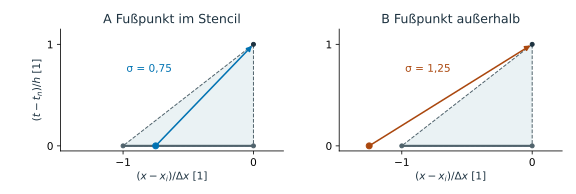

# Kapitel 7 · Räumliche Diskretisierung und Linienmethode

## Einleitung · Warum ändert ein feinmaschiges Gitter auch die Zeitrechnung?

Ein heißes Ende und ein kaltes Ende erzeugen in einem Metallstab eine Temperaturverteilung. Drei Thermometer verraten mehr darüber als eines. Setzen wir die Messstellen enger, gewinnen wir räumliche Auflösung. Aber wir nehmen auch Temperaturunterschiede zwischen näheren Nachbarn wahr. Warum kann genau diese Verbesserung den zulässigen Zeitschritt eines expliziten Simulators verkleinern?

Wir beginnen mit einer Bilanz über ein Stück des Stabs. Danach verfolgen wir drei Arten, aus dem Feld endlich viele Unbekannte zu machen. Finite Differenzen nähern die Ableitungen an Stützstellen an. Finite Volumen rechnen mit Flüssen über Zellflächen. Finite Elemente nutzen eine integrierte Gleichung und Funktionen, die das Feld zwischen Knoten darstellen. Die Zeitrechnung beginnt jeweils erst, wenn das räumliche System und der Rand bekannt sind.

Zum Schluss lässt sich eine Verfeinerung so planen, dass eine beobachtete Änderung entweder der Raum- oder der Zeitrechnung zugeschrieben werden kann. Eine wandernde Front zeigt, warum dabei auch die Masse oder die Höhe eines Profils zu prüfen ist.

[Zum Schluss dieses Kapitels](#kap07-schluss)

<!-- Buchseite -->

## 7.1 Wie aus einem Feld ein Anfangswertproblem wird

Ein Ende eines Metallstabs liegt an einem kühlen Körper. In der Mitte erwärmt eine Heizfolie den Stab. Ein einzelnes Thermometer genügt zur Beschreibung erst dann, wenn die räumlichen Unterschiede für die Messaufgabe vernachlässigbar sind. Andernfalls hängt die Temperatur sowohl vom Ort als auch von der Zeit ab. Stellen wir mehrere Thermometer entlang des Stabs auf, entsteht die Idee der Linienmethode. Jeder Ort erhält eine eigene Unbekannte, deren Ableitung aus einer räumlichen Bilanz folgt.

Ein Segment der Länge $\Delta x$ besitzt bei Querschnitt $A$ die Wärmekapazität $\rho c_p A\Delta x$. Wärme strömt mit dem Leitungsfluss $-kA T_x$ durch seine Randflächen. Aus Speicherrate gleich Zufluss minus Abfluss folgt für konstante Materialwerte ohne innere Quelle
$$ \rho c_p A\,T_t=(kA T_x)_x,\qquad T_t=\alpha T_{xx},\qquad \alpha=k/(\rho c_p).$$
Die Wärmeleitfähigkeit $k$ trägt $\mathrm{W/(m\,K)}$, die Temperaturleitfähigkeit $\alpha$ die Einheit $\mathrm{m^2/s}$. Eine fest vorgegebene Temperatur ist eine Dirichlet-Bedingung, ein gegebener Fluss eine Neumann-Bedingung. Beim Wärmeübergang an eine Umgebung verknüpft eine Robin-Bedingung Temperatur und Fluss. Welche Messgröße wir am Rand kennen, ändert die letzte Zeile des diskreten Modells.

Die Linienmethode legt zuerst die Ortsdiskretisierung fest. Auf dem gleichmäßigen Gitter $x_j=j\Delta x$ erhält der Innenpunkt die Gleichung
$$ \dot T_j=\alpha\frac{T_{j-1}-2T_j+T_{j+1}}{\Delta x^2}.$$
Es ist noch keine Zeitschrittweite gewählt. Bei vorgegebenen Randtemperaturen sind nur die inneren Werte dynamische Unbekannte. Bei masselosen Knoten oder unmittelbar angeschlossenen algebraischen Netzen kann statt einer ODE eine DAE entstehen. Ein Zeitintegrator aus Kapitel 2 oder 3 darf erst gewählt werden, nachdem diese Struktur bekannt ist. [Projektkapitel zur Linienmethode][t1proj7]

<!-- Buchseite -->

### Welchen Rand braucht welche Gleichung?

Die Wärmeleitung ist parabolisch. Ein Temperaturunterschied an einem Ort beeinflusst mathematisch sofort das gesamte verbundene Gebiet, hohe räumliche Frequenzen werden besonders schnell geglättet. Die Advektionsgleichung $u_t+a u_x=0$ ist dagegen hyperbolisch. Bei $a>0$ treffen Informationen am linken Rand ein und verlassen das Gebiet rechts. Zwei unabhängig vorgeschriebene Werte an Ein- und Ausstrom können ein solches Problem überbestimmen. Eine Wellengleichung benötigt wegen der zweiten Zeitableitung sowohl eine Anfangsauslenkung als auch eine Anfangsgeschwindigkeit. Bei einer stationären elliptischen Aufgabe wie $-\Delta T=s$ gibt es keine Anfangsdaten in der Zeit. Das gesamte Randwertproblem bestimmt das Feld.

Auch ein einziger falsch behandelter Randknoten ändert den Modelltyp. Betrachten wir die letzte thermische Speicherzelle mit Temperatur $T_N$. Von ihr führt ein Leitweg der Länge $d$ und des Querschnitts $A$ zu einer masselosen Oberfläche mit Temperatur $T_b$. Die Oberfläche gibt Wärme durch den Leitwert $G$ an eine Umgebung $T_a$ ab. Da sie keine Energie speichert, gilt zu jedem Zeitpunkt
$$ K(T_N-T_b)=G(T_b-T_a),\qquad K=kA/d.$$
Für $K,G>0$ liefert dies $T_b=(K T_N+G T_a)/(K+G)$ und den Wärmestrom $Q=(T_N-T_a)/(1/K+1/G)$. Man kann diesen Ausdruck in die letzte Zellgleichung einsetzen oder $T_b$ mit der algebraischen Gleichung im Modell behalten. Eine frei erfundene kleine Wärmekapazität macht aus dieser Bedingung eine zusätzliche, eventuell sehr schnelle Dynamik.

Als Zahlenversuch seien $K=2\,\mathrm{W/K}$, $G=1\,\mathrm{W/K}$, $T_N=19\,^\circ\mathrm C$ und $T_a=10\,^\circ\mathrm C$. Die Oberflächentemperatur ist $16\,^\circ\mathrm C$. Beide Randgesetze liefern $6\,\mathrm W$, die die letzte Zelle verlassen. Das Vorzeichen dieses Flusses taucht mit umgekehrtem Vorzeichen in der Umgebungsbilanz auf. [Randmodell und Linienmethode][t1proj7]

<!-- Buchseite -->

## 7.2 Warum das feinere Gitter kleinere explizite Schritte verlangt

Die festen Randwerte lassen $w_j=\sin(j\theta)$ mit $\theta=m\pi/N$ zu. Die Additionstheoreme ergeben $w_{j-1}+w_{j+1}=2\cos(\theta)w_j$. Zieht man $2w_j$ ab, bleibt $-4\sin^2(\theta/2)w_j$. Der Stencil verändert somit nur die Amplitude dieser Mode.

In der Finite-Differenzen-Formel heben sich bei Taylor-Entwicklung die ungeraden Ableitungen auf. Für glattes $T$ bleiben $T_{xx}$ und als führender Fehler $\Delta x^2 T^{(4)}/12$. Doch der Gewinn an Ortsgenauigkeit verändert das Spektrum der diskreten Gleichung. Auf einem Intervall der Länge $L$ mit homogenen Dirichlet-Rändern besitzen die diskreten Sinusmoden $\sin(jm\pi/N)$ für $N=L/\Delta x$ die Eigenwerte
$$ \lambda_m=-\frac{4\alpha}{\Delta x^2}\sin^2\!\frac{m\pi}{2N},\qquad 1\le m<N.$$
Die langsamste Mode nähert sich $-\alpha\pi^2/L^2$. Der Betrag der schnellsten wächst wie $4\alpha/\Delta x^2$. Eine glatte Anfangstemperatur kann fast nur die erste Mode enthalten. Rundungsreste oder Randänderungen können die schnellen Moden dennoch anregen.

Mit Vorwärts-Euler wird die neue Temperatur zu $rT_{j-1}+(1-2r)T_j+rT_{j+1}$, $r=\alpha h/\Delta x^2$. Für $0\le r\le1/2$ sind die Gewichte nichtnegativ und summieren sich zu eins. Ein anfängliches Minimum kann bei passenden Randwerten deshalb nicht unterschritten werden. Dieselbe Schranke ergibt sich auf dem periodischen Gitter aus der höchsten Fourier-Mode. Auf endlichen Dirichlet-Gittern ist $r\le1/2$ eine einfache einheitliche hinreichende Stabilitätsgrenze.

Die diskrete Sinusbasis ist orthogonal. Die diskrete $L^2$-Norm aller Störungen wächst daher in einem Euler-Schritt genau dann nicht, wenn **jeder** Faktor $|1-4r\sin^2(m\pi/(2N))|\le1$ bleibt. Auf dem endlichen Dirichlet-Gitter ist $m=N-1$ maßgeblich. Wegen $\sin((N-1)\pi/(2N))=\cos(\pi/(2N))$ ergibt sich $0\le r\le[2\cos^2(\pi/(2N))]^{-1}$. Bei $N=4$ ist die Grenze $2/(2+\sqrt2)\approx0{,}586$. Schon für $r>1/2$ wird das zentrale Euler-Gewicht negativ. Die modale Norm kann also noch sinken, während ein Zellwert das bisherige Minimum unterschreitet. Auf dem periodischen Gitter mit gerader Knotenzahl erreicht die alternierende Mode die Grenze $r=1/2$ genau.

Bei halbiertem $\Delta x$ verlangt diese explizite Regel für denselben Zeitraum viermal so viele Schritte. In $d$ Raumdimensionen wächst außerdem die Knotenzahl ungefähr um $2^d$. Der Gesamtaufwand eines expliziten lokalen Stencils steigt bei isotroper Verfeinerung daher näherungsweise um $4\cdot2^d$. Implizite Methoden vermeiden die explizite Diffusionsgrenze, bezahlen dafür pro Schritt eine gekoppelte lineare oder nichtlineare Lösung. Zeitgenauigkeit und Auflösung der Anfangsschicht bleiben eigenständige Anforderungen. [Diffusionsstabilität][t1diff]

<!-- Buchseite -->

### Was mit einem gezackten Temperaturprofil im nächsten Schritt passiert

Für eine isolierte Probe betrachten wir eine gerade Zahl von Gitterpunkten auf einem periodischen Stab. Der kleine Temperaturausschlag wechselt von einem Gitterpunkt zum nächsten zwischen $+1$ und $-1$. Einen Punkt mit $+1$ umgeben also zwei Werte $-1$. Die rechte Seite der zentralen Differenz ist dort proportional zu $-1-2\cdot1-1=-4$. Am nächsten Punkt entsteht genau der entgegengesetzte Beitrag.

Mit Vorwärts-Euler wird das gesamte Muster pro Zeitschritt daher mit $1-4r$ multipliziert, wobei $r=\alpha h/\Delta x^2$ ist. Bei $r=0{,}4$ lautet der Faktor $-0{,}6$. Die Zacken werden kleiner, wechseln aber von Punkt zu Punkt das Vorzeichen gegenüber dem vorherigen Schritt. Bei $r=0{,}6$ ist der Faktor $-1{,}4$ und das Muster wächst. Die zeitkontinuierliche Gleichung auf demselben Gitter dämpft diese Mode mit $e^{-4r}$ pro Schrittzeit. Die Verstärkung ist also ein Fehler der Zeitintegration.

Halbieren wir $\Delta x$ bei festem $h$, vervierfacht sich $r$. Ein Gitterwechsel kann dadurch eine bis dahin stabile Rechnung in eine instabile verwandeln. Für die nächste Untersuchung gibt es zwei Regler. Wir ändern jeweils nur die Zahl der Gitterpunkte oder die Zeitschrittweite und lesen das Ergebnis am selben Ort und zur selben Zeit aus.

<!-- Buchseite -->

## 7.3 Raum- und Zeitfehler getrennt messen

Eine durchgerechnete Kontrollaufgabe trennt die beiden Fehlerquellen. Wir wählen $L=1\,\mathrm m$, $\alpha=1\,\mathrm{m^2/s}$ und eine normierte Temperaturabweichung $T(x,0)=\sin(\pi x/L)$ mit Nullwerten an beiden Enden. Die exakte Amplitude bei $t$ ist $e^{-\alpha(\pi/L)^2 t}$. Auf dem Gitter ist dieselbe Sinusform Eigenvektor. Bei exakter Zeitintegration wäre ihre Amplitude $e^{\lambda_1 t}$, mit Euler ist sie $(1+h\lambda_1)^n$.

Damit stehen drei voneinander unterscheidbare Antworten am selben Ort und Zeitpunkt fest. Die Differenz zwischen Kontinuum und zeitexakter Gitterlösung misst den Raumfehler. Der Vergleich zwischen zeitexakter Gitterlösung und Euler isoliert den Zeitfehler. Eine einzige Differenz gegenüber dem Kontinuum kann sogar klein sein, weil sich beide Beiträge teilweise aufheben.

Bei $t=1/32\,\mathrm s$ und $r=1/4$ ergeben acht Intervalle einen Raumfehler von $2{,}90245\cdot10^{-3}$ und einen Zeitfehler von $4{,}37196\cdot10^{-3}$. Bei 32 Intervallen sind es $1{,}81943\cdot10^{-4}$ und $2{,}72985\cdot10^{-4}$. Die Zahl der Schritte steigt dabei von acht auf 128. Aus $\sin^2z\ge z^2-z^4/3$ folgt im Versuch die obere Schranke $t\pi^4/(12N^2)$ für den Raumfehler. Der Zeitfehler ist höchstens $n(h\lambda_1)^2/2$, weil sich die stabilen Schrittfaktoren im Betrag höchstens eins verhalten.

<!-- Buchseite -->

## 7.4 Warum bei einer wandernden Front der Grenzfluss zählt

Ein gelöster Stoff ströme mit konstanter positiver Geschwindigkeit $a$. Ohne Quellen und Diffusion gilt $u_t+(au)_x=0$. Die Lösung ist die verschobene Anfangsverteilung $u(x,t)=u_0(x-at)$. Ein Teilchen behält seinen Wert auf der Charakteristik $x=x_0+at$. Bei Konzentrationssprüngen ist es zweckmäßig, unmittelbar die Stoffmenge jeder Zelle zu bilanzieren. Für die Zellmittel gilt
$$ U_j^{n+1}=U_j^n-\frac{h}{\Delta x}\bigl(F_{j+1/2}-F_{j-1/2}\bigr).$$
Benutzen Nachbarzellen denselben Grenzfluss, heben sich alle internen Flüsse in der Gesamtbilanz auf. Bei periodischen Rändern bleibt so die Gesamtmasse erhalten. Bei offenen Rändern entspricht ihre Änderung der Summe der äußeren Zu- und Abflüsse.

Der einfache Upwind-Fluss $F_{j+1/2}=aU_j$ greift für $a>0$ auf die stromaufwärts liegende Zelle zu. Bei $C=ah/\Delta x\in[0,1]$ ist der neue Wert eine konvexe Kombination. Das unterdrückt neue Extrema, verbreitert aber die Front. Für höhere Genauigkeit rekonstruieren wir in jeder Zelle eine Steigung. Der Minmod-Limiter liefert bei entgegengesetzten Vorzeichen der benachbarten Differenzen null und ansonsten die kleinere Differenz im Betrag mit gemeinsamem Vorzeichen. Für diese lineare Advektion lautet die zur halben Zeit vorausgesagte rechte Spur $U_j+\tfrac12(1-C)\sigma_j$ mit der limitierten Zelldifferenz $\sigma_j$.

Das Labor verwendet diese Spur im gemeinsamen Fluss und prüft nach jedem Schritt Masse, Minimum, Maximum und $TV(U)=\sum_j|U_j-U_{j-1}|$. TVD (*total variation diminishing*) ist eine Eigenschaft des vollständigen Zeitschritts unter seinen Voraussetzungen. Aus Massenerhaltung allein folgt sie nicht. Bei $C=1$ verschiebt das Verfahren die Zellmittel exakt um eine Zelle. Für den C19R-Grundwassertransport kommen räumlich variierende Flüsse, Randdaten und Dispersion hinzu. Eine räumlich verbreiterte Front kann auch dann auftreten, wenn der Zeitschrittintegrator im semidiskreten Problem sehr genau rechnet. [Advektion und Charakteristiken][t1adv] · [Projektfall C19R][t1proj15]

<!-- Buchseite -->

### Deckt das Gitter den Ursprung einer Information ab?

Für die lineare Advektion $u_t+a u_x=0$ mit konstantem $a>0$ ist der Wert bei $(x_i,t_n+h)$ gleich dem Wert bei $(x_i-ah,t_n)$. Die Charakteristik führt also zu einem Fußpunkt links vom neuen Gitterwert. Ein expliziter Upwind-Schritt mit den beiden Knoten $x_{i-1},x_i$ bildet
$$
u_i^{n+1}=(1-\sigma)u_i^n+\sigma u_{i-1}^n,\qquad
\sigma=ah/\Delta x .
$$
Für $0\le\sigma\le1$ sind die Gewichte nichtnegativ. Der physikalische Fußpunkt liegt im vom numerischen Schritt verwendeten Intervall. Bei $\sigma>1$ liegt er weiter links. Ein Gitterwert, den die Transportgleichung dort braucht, kann durch den gegebenen Stencil innerhalb eines Schritts nicht wirken. Für $a<0$ spiegelt man das Argument und verwendet $|a|h/\Delta x$.

Dieselbe Grenze lässt sich als Verstärkungsfaktor lesen. Für die periodische Mode $u_j=e^{\mathrm i j\theta}$ ist $G=1-\sigma+\sigma e^{-\mathrm i\theta}$. Damit gilt $|G|^2=1-4\sigma(1-\sigma)\sin^2(\theta/2)$. Für $0\le\sigma\le1$ wächst keine Mode. Für $\sigma>1$ wächst jede Mode mit $\sin(\theta/2)\ne0$. Die alternierende Mode hat bei $\sigma=1{,}25$ den Faktor $-1{,}5$. Dieses Argument bezieht sich auf den gezeigten expliziten Upwind-Schritt. [Clawpack, Advektion und Charakteristiken][t1adv]

<!-- Buchseite -->

### Transport und Diffusion in derselben Zelle

Ein Stoff kann zugleich mit dem Wasser fließen und sich durch Dispersion verteilen. Für konstantes $a>0$ und $\kappa>0$ lautet das einfache Modell $u_t+a u_x=\kappa u_{xx}$. Eine explizite Kombination aus Upwind-Fluss und zentraler Diffusion liefert
$$ U_j^{n+1}=(C+r)U_{j-1}^n+(1-C-2r)U_j^n+rU_{j+1}^n,\qquad
 C=ah/\Delta x,\quad r=\kappa h/\Delta x^2.$$
Beide Beiträge sind konservativ. Damit der neue Zellwert eine konvexe Kombination bleibt, müssen sie sich jedoch das gleiche Schrittbudget teilen. Es gilt $C+2r\le1$. Getrennte Prüfungen von $C\le1$ und $r\le1/2$ reichen hier nicht aus.

Setzen wir $a=0{,}2\,\mathrm{m/s}$, $\kappa=0{,}002\,\mathrm{m^2/s}$, $\Delta x=0{,}1\,\mathrm m$ und $h=0{,}2\,\mathrm s$. Dann ist $C=0{,}4,\ r=0{,}04$, und das Gewicht der mittleren Zelle beträgt $0{,}52$. Bei halbiertem Gitterabstand und gleicher Zeitstufe steigt $C+2r$ auf $1{,}12$. Eine einzelne positive Konzentrationsspitze zwischen zwei Nullzellen bekommt nun ein negatives Zentralgewicht. Die Gesamtmasse kann dabei weiterhin genau stimmen.

Die Zell-Péclet-Zahl $a\Delta x/\kappa$ beträgt im ersten Versuch zehn. Bei einer groben, rein zentrierten stationären Raumapproximation können für Werte über zwei Nachbarkoeffizienten ihr Vorzeichen wechseln. Upwind reagiert robuster, bringt aber numerische Verbreiterung ein. Eine IMEX-Variante behandelt die Diffusion implizit und die Advektion explizit. Sie löst in jedem Schritt ein gekoppeltes Diffusionssystem, während die explizite Transportgrenze wirksam bleibt. Für C19R sind daher Durchbruchszeit, Referenz-Konzentration und räumliche Frontbreite aussagekräftiger als die Schrittzahl allein. [Projektstudie C19R][t1proj15]

<!-- Buchseite -->

## 7.5 Finite Elemente und die schwache Wärmebilanz

[Grundlagen · Schwache Ableitung und partielle Integration](../lehrbuch_numerische_simulation.md#g-schwach)

Ein unregelmäßiger Körper lässt sich häufig einfacher aus Elementen als aus einem regelmäßigen Differenzenstern zusammensetzen. Wir prüfen die Wärmebilanz des Stabs gegen eine Testfunktion $v(x)$. Sei $\theta=T-T_a$ die Temperaturdifferenz zur Umgebung, $G$ ein Wärmeleitwert am rechten Ende, das linke Ende isoliert und $s$ eine verteilte Leistung pro Länge. Multiplizieren der Wärmegleichung mit $v$ und partielle Integration ergeben
$$
 \int_0^L \rho c_p A\,v\dot\theta\,dx+
 \int_0^L kA\,v'\theta'\,dx+
 G v(L)\theta(L)=\int_0^L v s\,dx .
$$
Der Randterm trägt das Vorzeichen der Wärmeabgabe. Die Formulierung benötigt nur erste Raumableitungen der Ansatz- und Testfunktionen. Wählen wir $\theta_h=\sum_j U_j\phi_j$ mit stückweise linearen Hutfunktionen und testen nacheinander mit jedem $\phi_i$, entsteht $M\dot U+KU=b$.

In der Zellkoordinate $s=x/\ell$ lauten die linke und rechte Hutfunktion $1-s$ und $s$. Der erste Kopplungseintrag enthält $\ell\int_0^1(1-s)s\,ds=\ell(1/2-1/3)=\ell/6$. Rechnen Sie die linke Diagonale selbst nach. Das Quadrat der linken Hutfunktion integriert sich zu $\ell/3$. Multiplikation mit $\rho c_p A$ ergibt in beiden Fällen eine Wärmekapazität in $\mathrm{J/K}$.

Für eine Zelle der Länge $\ell$ lauten die beiden lokalen Matrizen
$$
 M_e=\frac{\rho c_p A\ell}{6}\begin{pmatrix}2&1\\1&2\end{pmatrix},\qquad
 K_e=\frac{kA}{\ell}\begin{pmatrix}1&-1\\-1&1\end{pmatrix}.
$$
Die Zahlen zwei und eins in $M_e$ stammen aus den Integralen der Produkte der beiden linearen Basisfunktionen. Benachbarte Elemente addieren ihre Beiträge an gemeinsamen Knoten. Der Leitwert $G$ ergänzt auf dem rechten Rand die Diagonale von $K$. Für eine konstante Temperatur ergeben die Zeilensummen der reinen Leitmatrix null. Die Summe aller Einträge von $M_e$ ist die Wärmekapazität des Elements. Beide Identitäten eignen sich als Implementierungstest. [Schwache Form der Wärmegleichung][t1fem]

Finite Differenzen sind besonders direkt auf einem regelmäßigen glatten Gitter. Finite Volumen bieten eine explizite Flussbilanz für Zellmittel. Finite Elemente verbinden Geometrie, Material und Randterme über lokale Integrale. Bei periodischen glatten Problemen kann eine Fourier-Basis viele räumliche Genauigkeitsordnungen gewinnen. Ein Knick verteilt dagegen Energie über viele Moden. In Kapitel 9 werden wir genau diesen Effekt beim Lernen eines Feldoperators messen.

<!-- Buchseite -->

### Warum auch ein expliziter FEM-Schritt eine lineare Lösung brauchen kann

Sei $M\dot T=b-KT$ die räumlich diskrete Wärmebilanz. Vorwärts-Euler kennt $T_n$ bereits. Für seine Steigung löst er $Md_n=b_n-KT_n$ und setzt $T_{n+1}=T_n+h d_n$. Das Zeitverfahren ist explizit. Die konsistente Massenmatrix koppelt dennoch die gesuchten Änderungsraten. Eine feste Faktorisierung lässt sich für viele Schritte wiederverwenden.

Bei **Mass-Lumping** durch Zeilensummen ersetzt man $M$ durch $M_L=\operatorname{diag}(M\mathbf1)$. Sind die Diagonaleinträge positiv, genügt pro Rate eine Division. Ein lineares Zweiknotenelement mit normiertem Speicherinhalt besitzt $M_e=\tfrac16\left(\begin{smallmatrix}2&1\\1&2\end{smallmatrix}\right)$. Für die rechte Seite $(1,0)^\mathsf T$ liefert die konsistente Massenmatrix $(4,-2)^\mathsf T$ und die Zeilensummenmatrix $(2,0)^\mathsf T$. Für einen konstanten Ratenvektor gilt $M_L\mathbf1=M\mathbf1$. Die örtliche Reaktion ändert sich. Deshalb sind Raumordnung, Stabilitätsgrenze und die Behandlung von Randknoten nach der Umstellung zu prüfen.

| Raumverfahren | Typische Stärke | Eigene Prüfaufgabe |
|---|---|---|
| Finite Differenzen | Kurze Stencils auf regelmäßigen Gittern | Randstencils und räumliche Ordnung prüfen. |
| Finite Volumen | Die gemeinsame Flussbilanz koppelt Nachbarzellen. | Flusswahl, Randbilanz und Begrenztheit prüfen. |
| Finite Elemente | Die schwache Form passt zu flexiblen Netzen und natürlichen Flussrändern. | Raumdiskretisierung, Massenmatrix und Randterme prüfen. |

[Mass-Lumping für finite Elemente, FEniCS-Rechenbeispiel](https://comet-fenics.readthedocs.io/en/latest/demo/tips_and_tricks/mass_lumping.html)

<!-- Buchseite -->

## 7.6 Rechenlabor und Aufgaben

Im Skript gibt die Funktion für den Wärmeversuch sowohl die exakte Kontinuumsantwort als auch die zeitexakte Lösung des gewählten Ortsgitters aus. Der folgende kurze Versuch isoliert die beiden Fehler auf 16 Intervallen. Der andere Programmzweig transportiert eine Konzentrationsfront zunächst 80 Schritte weit und vergleicht sie nach genau einem Umlauf auf dem periodischen Gitter.

~~~python
from linienmethode import heat
wert, gitterexakt, kontinuum, eigenwert, h, n = heat(16)
raum = abs(gitterexakt - kontinuum)
zeit = abs(wert - gitterexakt)
~~~

Mit Minmod, 40 Zellen und $C=0{,}5$ ergibt der Transportversuch nach einem Umlauf die Summe der Zellmittel 12 und die Gesamtvariation $1{,}944260$. Das anfängliche Rechteck hat Höhe eins und Gesamtvariation zwei. Eine schmalere Front und dieselbe Gesamtmasse sind unterschiedliche Prüfgrößen. Im Wärmeversuch ist die Halbierung der Schrittweite bei festem Ortsgitter eine zeitliche Verfeinerung. Die Verfeinerung des Ortsgitters bei unverändertem $r$ ändert dagegen beide Diskretisierungen zugleich.

**Aufgaben.** (1) Drei benachbarte Stabtemperaturen seien $10,16,14\,^\circ\mathrm C$. Berechnen Sie die neue mittlere Temperatur für $r=0{,}2$. (2) Halbieren Sie $\Delta x$ bei unverändertem $h$. Was geschieht mit dem einmaligen Profil $0,10,0$? (3) Ein Entwickler kopiert vor einem Zeitschritt jede Konzentration in den Nachbarn. Für welche Geschwindigkeit, Orientierung und Courant-Zahl ist das eine exakte periodische Advektionsrechnung? (4) Prüfen Sie für vier Intervalle, $\Delta x=1$ und $\alpha=1$ in normierten Einheiten die Sinusmode $m=2$ direkt am Dreipunktstencil.

**Musterlösungen.** (1) $16+0{,}2(10-32+14)=14{,}4\,^\circ\mathrm C$. (2) $r$ steigt auf $0{,}8$, also ergibt die mittlere Zelle $10-16=-6$. Das diskrete Minimum ist verletzt. Ein Viertel der alten Schrittweite stellt den ursprünglichen Faktor wieder her. (3) Für $a>0$, Kopie von $j$ nach $j+1$ und $C=1$. Bei negativem $a$ kehrt sich die Richtung um. Beim 2D-Gittergas des folgenden Kapitels geht jede Population genau einen solchen Gitterweg in ihrer eigenen Richtung. (4) Mit den Nullrändern lautet die Folge $(0,1,0,-1,0)$. Die drei inneren zweiten Differenzen sind $(-2,0,2)$. Der Eigenwert ist $-2$, wie $-4\sin^2(2\pi/8)$ verlangt.

<!-- Buchseite -->

### Gegenprobe · Wie eine Zellgrenze in der Gesamtbilanz verschwindet

Eine Stoffmenge verlässt links ihre Zelle und gelangt durch dieselbe Fläche in die rechte Zelle. Schreibt man $M_j$ für die Zellmasse und $F_{j+1/2}$ für den nach rechts positiven Massenstrom, dann gilt ohne Quelle $\dot M_j=F_{j-1/2}-F_{j+1/2}$. Beim Summieren taucht jeder innere Fluss einmal mit jedem Vorzeichen auf. Es bleibt $\sum_j\dot M_j=F_{1/2}-F_{N+1/2}$. Diese Rechnung erklärt, weshalb die Implementierung für jede innere Fläche einen gemeinsamen Fluss benötigt.

**Kontrollfrage.** Vier Zellen sind außen geschlossen. Die drei inneren Flüsse betragen $0{,}75$, $0{,}25$ und $0{,}50\,\mathrm{kg/s}$. Die vier Änderungsraten lauten $-0{,}75$, $0{,}50$, $-0{,}25$ und $0{,}50\,\mathrm{kg/s}$. Erhält allein die zweite Zelle $0{,}01\,\mathrm{kg/s}$ zusätzlich, zeigt das Gesamtinventar genau diesen Defekt. Die Funktion `finite_volumes()` in `beispiele/gegenproben.py` prüft beide Bilanzen. In Kapitel 15 kommt zur Randbilanz der tatsächlich eingebrachte Quellstrom hinzu.

<!-- Buchseite -->

## Wo sich beim Wirbeltransport die Gitterzellen koppeln

Für einen Strömungsvergleich brauchen beide Zeitintegratoren dieselben räumlichen Gleichungen. Wir wählen $h=1/256$, die skalierte Wirbelstärke $z=h\omega$ und die Stromfunktion $-\Delta_h\psi=z/h$. Aus $u=D_y\psi$ und $v=-D_x\psi$ folgen auf den inneren Knoten
$$z' = \mathrm{Re}^{-1}\Delta_h z-uD_xz-vD_yz.$$
Die Differenzen sind zentriert. Die Werte von $\psi$ auf dem Rand sind null. An der Deckelwand liefert die einseitige Taylorentwicklung mit vorgeschriebener Tangentialgeschwindigkeit die Thom-Bedingung $z_{\rm Wand}=-2\psi_{\rm innen}/h-2$ für $U=1$. An den ruhenden Wänden entfällt der letzte Term. Die beiden Geschwindigkeitskomponenten sind damit über eine elliptische Gleichung gekoppelt.

Ein Sinustransform löst das diskrete Poisson-Problem an jedem nötigen Zeitpunkt. Der klassische Kontrolllauf benutzt Adams–Bashforth zweiter Ordnung und einen Euler-Start. Seine Schrittweite entspricht zwei D2Q9-Takten. Ein zweiter Lauf verwendet vier Takte. Ihr Abstand schätzt die Empfindlichkeit gegenüber der Zeitschrittweite. Der Vergleich mit D2Q9 umfasst zusätzlich die kinetische Modellierung und die Wandbehandlung. Das Beispiel in [Kapitel 16](../lehrbuch_numerische_simulation.md#cp2-voll-vertrag) weist beide Abstände aus.

<!-- Buchseite -->

## Schluss · Vom lokalen Fluss zum gekoppelten Zeitproblem

Die Wärmestabfrage führt von einem räumlichen Fluss zu gekoppelten Gleichungen für die inneren Knoten. Die Randbedingung setzt dabei fest, welche Größen vorgegeben sind und welche aus dem Modell folgen. Feinere Gitter erfassen kürzere räumliche Wellen. Bei der Wärmeleitung werden diese Moden besonders schnell gedämpft. Ein expliziter Integrator kann nur mit genügend kleinem Schritt dieselbe Richtung der Änderung zuverlässig wiedergeben.

Bei endlichen Volumen macht die Addition benachbarter Bilanzen sichtbar, welche Ströme sich im Inneren aufheben. Bei finiten Elementen führt die schwache Form zur Massen- und Steifigkeitsmatrix. Eine diagonale Massenmatrix verändert die Arbeit im expliziten Schritt. Sie ändert zugleich das räumliche Problem, dessen Genauigkeit wir prüfen. Der faire Vergleich der Rechnungen hält Rand, Geometrie und Beobachtung fest und variiert Raum und Zeit getrennt.

Das folgende Kapitel betrachtet eine andere räumliche Beschreibung. Es transportiert diskrete Geschwindigkeitsanteile und gewinnt die makroskopischen Größen aus ihren Summen. [Lattice-Boltzmann-Methode](../lehrbuch_numerische_simulation.md#kap08-einstieg)

### Aktueller Stand der Forschung

Bei Strömungs- und Transportproblemen ist hohe Ordnung allein als Abnahmekriterium zu schwach. Eine räumliche Näherung soll auch unzulässige Werte wie negative Dichten vermeiden. Gassner diskutiert 2026 für hochordentliche Discontinuous-Galerkin-Verfahren Ansätze, die auf Teilzellen mit einer robusten Finite-Volumen-Rechnung gekoppelt werden. Die Erweiterung auf adaptive Gitter muss auch beim Übertragen zwischen feinen und groben Bereichen zulässige Werte erhalten. Für das Vorgehen im Buch ist das ein Beispiel dafür, Randfluss, Gittertransfer und den verwendeten Zeitschritt gemeinsam zu prüfen. Beim Brunnenversuch bleiben Gesamtmasse und Konzentration an der Messstelle getrennte Kontrollen. [Gassner, Tagungsbeitrag HYP 2026 zur Begrenzung auf Teilzellen](https://www.hyp2026.uni-stuttgart.de/wp-content/uploads/2026/05/HYP2026_Gassner.pdf)

[Zur Einleitung dieses Kapitels](#kap07-einstieg)

[t1proj7]: https://github.com/5H3LL3H5/argesim-hyperposition-benchmarks/blob/16f0f2528fcf77f16898ecd74ad952be2c09eac2/docs/lehrbuch/studienbuch/kapitel/07.tex
[t1proj15]: https://github.com/5H3LL3H5/argesim-hyperposition-benchmarks/blob/16f0f2528fcf77f16898ecd74ad952be2c09eac2/docs/lehrbuch/studienbuch/kapitel/15.tex
[t1diff]: https://fncbook.com/python/absstab-diffusion/
[t1adv]: https://www.clawpack.org/riemann_book/html/Advection.html
[t1fem]: https://jsdokken.com/dolfinx-tutorial/main/chapter2/heat_equation.html
