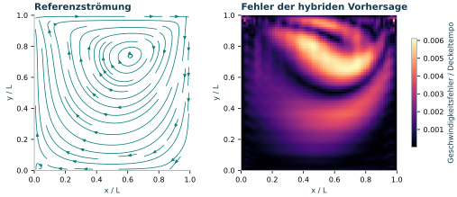

# Kapitel 8 · Mesoskopische Strömungssimulation mit der Lattice-Boltzmann-Methode

## Einleitung · Wie entsteht aus neun Richtungen ein Strömungsfeld?

Wenn der Deckel einer flachen Wanne nach rechts läuft, bewegt er zunächst die Flüssigkeit in seiner Nähe. Die seitliche Wand lässt das Wasser dort nicht weiterfließen. Nach einiger Zeit schließt sich eine Rückströmung. Zur Prüfung hilft es, die Bewegung an mehreren Stellen im Inneren zu sehen. Wie kommt ein Gitterverfahren zu einem solchen Feld, wenn es an jedem Knoten zunächst nur neun Zahlen speichert?

Jede der Zahlen beschreibt Masse, die an diesem Knoten einer diskreten Geschwindigkeit zugeordnet ist. Wir gewinnen Dichte und Impuls aus den Summen dieser Anteile. Ein lokaler Kollisionsschritt ordnet die Populationen um. Danach wandert jede von ihnen zu ihrem Nachbarknoten. Mit diesem Ablauf können wir Schritt für Schritt verfolgen, an welcher Stelle eine Wand in die Rechnung eingreift und warum ein Fehler an der Wand das ganze Profil beeinflusst.

Für den Vergleich rechnen wir die Maße des Versuchs auf Gittereinheiten um. An Kanal und Kavität kontrollieren wir getrennt, ob die Randgeschwindigkeit stimmt, ob die Masse erhalten bleibt und ob die Bewegung im Innenraum zur Referenz passt.

[Zum Schluss dieses Kapitels](#kap08-schluss)

<!-- Buchseite -->

## 8.1 Was bewegt sich unter einem gleitenden Deckel?

Eine quadratische Wanne ist mit ruhender Flüssigkeit gefüllt. Ihr Deckel gleitet nach rechts. Zuerst folgt ihm eine dünne Schicht. Weiter unten setzt sich die Flüssigkeit verzögert in Bewegung. Da sie an der rechten Wand nicht weiterfließen kann, entsteht eine Rückströmung. Mit einem einzelnen Geschwindigkeitswert am Deckel lässt sich dieser Vorgang kaum prüfen. Wir werden die Wandgeschwindigkeit, das Profil im Inneren und die Massenbilanz unabhängig messen.

Drei Beschreibungen sind denkbar. In der Molekulardynamik trägt jedes Molekül seinen Ort und Impuls. Schon ein Kubikmillimeter Wasser enthält bei rund $1\,\mathrm{g/cm^3}$ etwa $3{,}3\cdot10^{19}$ Moleküle. Die Kontinuumsmechanik beschreibt stattdessen Felder wie Dichte und Geschwindigkeit. In einer inkompressiblen Projektionsmethode stellt eine globale Druckkorrektur die diskrete Divergenzfreiheit her. Dazwischen liegt die kinetische Beschreibung. Am selben Ort darf Masse gleichzeitig in verschiedene Richtungen unterwegs sein. Die **Verteilung** dieser Masse über Geschwindigkeiten ist die Unbekannte.

Sei $f(x,\xi,t)$ die Massendichte im Phasenraum. Dann sind $\rho=\int f\,d\xi$ und $\rho u=\int \xi f\,d\xi$. Diese Normierung bestimmt die Einheit von $f$. Teilt man lokal durch $\rho$, erhält man eine Wahrscheinlichkeitsdichte der Geschwindigkeit. Für eine äußere Beschleunigung $a$ lautet die kinetische Gleichung
$$ \partial_t f+\xi\cdot\nabla_x f+a\cdot\nabla_\xi f=\Omega(f).$$
Die linke Seite transportiert Masse im Orts- und Geschwindigkeitsraum. Rechts verteilen Stöße Masse zwischen Geschwindigkeiten um. Integriert man über $\xi$, ergibt sich unter geeigneter Abnahme im Unendlichen und bei massenerhaltenden Stößen die Kontinuitätsgleichung $\partial_t\rho+\nabla\cdot(\rho u)=0$. Die erste Geschwindigkeitsgewichtung führt zur Impulsbilanz. So entstehen makroskopische Gesetze als Momente der kinetischen Beschreibung.

Bei Bhatnagar, Gross und Krook wird der Stoßterm durch $\Omega=-(f-f^{\rm eq})/\tau_{\rm kin}$ modelliert. In einer räumlich homogenen Zelle bei festem Gleichgewicht klingt die Störung exponentiell ab. Das kontinuierliche Gleichgewicht in $D$ Dimensionen lautet $\rho(2\pi RT)^{-D/2}\exp[-|\xi-u|^2/(2RT)]$ mit spezifischer Gaskonstante $R$. Dichte und Geschwindigkeit im Gleichgewicht stammen aus dem aktuellen $f$. Der gesamte BGK-Operator ist dadurch im Allgemeinen nichtlinear. Im Folgenden verwenden wir ein kraftfreies isothermes Gittermodell, in dem kein eigenständiges Temperaturfeld fortgeschrieben wird. [BGK-Originalarbeit][t1bgk] · [LBM-Grundlagen][t1lbm]

<!-- Buchseite -->

## 8.2 Neun Zahlen pro Zelle

In zwei Raumdimensionen benutzt D2Q9 neun Geschwindigkeiten. Wir zählen gegen den Uhrzeigersinn. Kanal null ruht, 1 bis 4 bezeichnen Ost, Nord, West und Süd, 5 bis 8 Nordost, Nordwest, Südwest und Südost. Ein Gitterpfeil $e_i$ hat ganzzahlige Komponenten. Die zugehörige physikalische Geschwindigkeit ist $c_i=(\Delta x/\Delta t)e_i$. Ein diagonaler Kanal ist um den Faktor $\sqrt{2}$ schneller als ein achsenparalleler und erreicht so in derselben Zeit den diagonalen Nachbarn.

Die Gewichte sind $w_0=4/9$, $w_{1,\ldots,4}=1/9$ und $w_{5,\ldots,8}=1/36$. Ihre Summe ist eins. Gegensinnige Richtungen heben sich für das erste Moment auf. Für die quadratische $x$-Komponente liefern zwei Achsrichtungen und vier Diagonalen zusammen $2/9+4/36=1/3$. Für die Mischkomponente $xy$ heben sich die entgegengesetzten Vorzeichen auf. Daraus folgen $\sum_i w_i c_{i\alpha}c_{i\beta}=c_s^2\delta_{\alpha\beta}$ und $c_s^2=(\Delta x/\Delta t)^2/3$. Der Wert ist die Schallgeschwindigkeit **dieses Gittermodells** im Quadrat.

Symmetrie lässt alle ungeraden gewichteten Momente bis zur hier benötigten Ordnung verschwinden. In Gittereinheiten gilt außerdem $\sum w_i e_{ix}^4=1/3$ und $\sum w_i e_{ix}^2e_{iy}^2=1/9$. Das Verhältnis drei zu eins ist die vierte isotrope Momentenbedingung. Sie wird gebraucht, um den korrekten Impulsfluss aus dem diskreten Gleichgewicht zu erhalten. Ein nur optisch symmetrischer Geschwindigkeitsstern würde dafür noch nicht genügen. [Qian, d’Humières und Lallemand][t1d2q9]

<!-- Buchseite -->

### Zwei Zahlen mit derselben Summe können verschiedene Strömungen erzeugen

Wir verwenden Gittereinheiten mit einer Geschwindigkeitseinheit pro Schritt und Gitterabstand. In einem Knoten seien die nach Osten und Westen gerichteten Anteile $f_1=0{,}12$ und $f_3=0{,}08$. Die übrigen Populationen haben zusammen die Dichte $0{,}8$ und liefern in der Horizontalen gleich viel Impuls nach links und rechts. Damit ist $\rho=1$. Der horizontale Impuls des Knotens beträgt
$$
\rho u_x = 1\cdot0{,}12-1\cdot0{,}08=0{,}04.
$$
Bei je $0{,}10$ in den beiden Richtungen wäre dieselbe Gesamtmasse gespeichert. Der horizontale Impuls wäre dann null. Ein Dichtemesswert allein reicht also zur Beschreibung des Fluidzustands nicht aus.

Beim Kollisionsschritt werden mehrere Populationen auf einmal verändert. Das diskrete Gleichgewicht wird gerade so aufgebaut, dass die Summe und das erste Geschwindigkeitsmoment zur alten Dichte und Geschwindigkeit passen. Am selben Knoten bleibt deshalb auch die Differenz der gesamten horizontalen Impulsanteile erhalten. Beim anschließenden Transport treffen dagegen Populationen aus verschiedenen Nachbarorten am Knoten ein. Die lokale Dichte und der lokale Impuls können sich ändern. Diese beiden Schritte erklären, wie aus lokalen Regeln ein räumliches Feld entsteht.

<!-- Buchseite -->

### Vom Gleichgewicht zum messbaren Impuls

Wir entwickeln die verschobene Maxwell-Verteilung bis zur zweiten Ordnung in $|u|/c_s$ und benutzen für die Geschwindigkeitsintegrale die D2Q9-Gewichte. Die Population $f_i$ trägt die Teilmassendichte der Richtung $i$. Ihr lokaler Gleichgewichtswert lautet
$$ f_i^{\rm eq}=w_i\rho\left[1+\frac{c_i\cdot u}{c_s^2}
 +\frac{(c_i\cdot u)^2}{2c_s^4}-\frac{u\cdot u}{2c_s^2}\right].$$
Die makroskopischen Größen folgen im kraftfreien Modell aus $\rho=\sum_i f_i$, $\rho u=\sum_i c_i f_i$. Zur Kontrolle summieren wir die vier Terme des Gleichgewichts. Der lineare Term verschwindet paarweise. Der quadratische Beitrag beträgt $\rho|u|^2/(2c_s^2)$ und hebt den letzten Term auf. Beim ersten Moment bleibt gerade $\rho u$ stehen. Für den Gleichgewichts-Impulsfluss liefern die Momente vierter Ordnung
$$
 \sum_i c_{i\alpha}c_{i\beta} f_i^{\rm eq}
    =\rho c_s^2\delta_{\alpha\beta}+\rho u_\alpha u_\beta .
$$
Der isotrope Teil gibt $p=c_s^2\rho$. Oft ist nur die Schwankung $p'=c_s^2(\rho-\rho_0)$ interessant. In einer klassischen inkompressiblen Rechnung wirkt der Druck als Lagrange-Multiplikator einer Zwangsbedingung. Die isotherme LBM lässt dagegen kleine Dichteschwankungen zu.

**Eine Zelle von Hand.** Für $\rho=1$, $u=(0{,}1,0)$ und $c_s^2=1/3$ in Gittereinheiten ergeben sich $f_E^{\rm eq}=1{,}33/9$ und $f_W^{\rm eq}=0{,}73/9$. Das Achsenpaar liefert also nur $0{,}60/9$ zum geforderten Impuls $0{,}1$. Die restlichen $0{,}03333\ldots$ kommen von den Diagonalen. Wer beim Berechnen von $u_x$ nur die Ost- und Westkanäle berücksichtigt, unterschätzt schon diese gleichförmige Strömung um ein Drittel.

Druckstörungen können sich hier als Schallwellen ausbreiten. Für die Annäherung an inkompressible Strömung soll die Gitter-Mach-Zahl $\mathrm{Ma}=U/c_s$ klein sein. $\mathrm{Ma}<0{,}1$ ist ein gebräuchlicher Startwert für die Parameterwahl. Beim CP2-Deckel mit $U=0{,}1$ und $c_s=1/\sqrt3$ erhält man bereits $\mathrm{Ma}=0{,}173$ in Gittereinheiten. Bei gleicher Reynolds-Zahl lässt sich $U/c_s$ durch geeignete Gitter- und Zeitskalierung ändern. Eine einzige Mach-Grenze garantiert weder die Genauigkeit noch die Stabilität sämtlicher Randmodelle. Für eine typische schwach kompressible, glatte Niedrig-Mach-Strömung ist $\delta\rho/\rho_0$ von der Größenordnung $\mathrm{Ma}^2$. Ausmaß und örtliche Verteilung muss der Lauf selbst zeigen.

<!-- Buchseite -->

## 8.3 Kollision und Streaming haben verschiedene Bilanzen

An einem Knoten lesen wir die neun Populationen, bilden ihre Momente und relaxieren sie gegen das zugehörige Gleichgewicht. Wir schreiben $\tau_L$ für den dimensionslosen Relaxationsparameter des diskreten Schritts und $\omega=1/\tau_L$. Dann gilt
$$ f_i^*(x)=f_i(x)-\omega\bigl(f_i(x)-f_i^{\rm eq}(x)\bigr),\qquad
 f_i(x+c_i\Delta t,t+\Delta t)=f_i^*(x,t).$$
Die erste Gleichung benötigt Daten eines einzigen Knotens. Da die Gleichgewichtswerte dieselben ersten beiden Momente besitzen, sind $\sum_i(f_i^*-f_i)$ und $\sum_i c_i(f_i^*-f_i)$ dort exakt null, bis auf Rundung. Nichtgleichgewichtsanteile können dabei stark abnehmen. Bei $1<\omega<2$ wechseln sie während der Kollision sogar das Vorzeichen.

Die zweite Gleichung verschiebt gerichtete Werte. Ein Überschuss im Ostkanal erreicht nach einem Schritt die rechte Nachbarzelle. Die Masse der Ausgangszelle kann sinken, während ihre Nachbarzelle gewinnt. Auf einem periodischen Gitter ist die Verschiebung für jede Richtung eine Permutation, also bleiben Gesamtmasse und Gesamtimpuls erhalten. An einer Wand ändert der Impulsaustausch diese Bilanz. Um die reine Verschiebung zu prüfen, benutzt das Labor einen periodischen Block mit einer einzelnen gestörten Zelle.

Im Programm liest die Kollision aus dem alten Feld. Die Übergabetabelle nennt für jeden auslaufenden Kanal Zielzelle und Zielrichtung. Erst nach Fertigstellung aller Eingänge ersetzt das neue Feld den alten Puffer. Ein bloßes Tauschen zweier Zeiger führt die räumlichen Verschiebungen nicht aus. Spezialisierte Speicherlayouts können sie effizient darstellen. Wer das alte Feld ungeschützt während der Schleife überschreibt, transportiert manche Populationen noch im selben Schritt ein zweites Mal.

Für die diskreten Gittergeschwindigkeiten trifft die Transportcharakteristik den Nachbarknoten exakt. Eine zusätzliche räumliche Interpolation ist dadurch entbehrlich. Das gekoppelte BGK-Verfahren besitzt weiterhin Diskretisierungsfehler, akustische Moden, Stabilitäts- und Auflösungsgrenzen. Auf mehreren Prozessoren benötigen die Randknoten fremder Teilgebiete Nachbardaten. Günstig ist das feste Kommunikationsmuster. Ob eine konkrete Implementierung schneller ist, hängt unter anderem vom Speicherverkehr pro Knoten ab. [Projektkapitel LBM][t1proj8]

<!-- Buchseite -->

### Eine Population im Speicher verfolgen

Liegt die aktuelle Zelle in der letzten Spalte, darf ihr Ostkanal in der geschlossenen Kavität nicht an der linken Wand auftauchen. Wir berechnen deshalb für jeden gerichteten Link nur einmal, wohin er führt. Im Inneren lautet sein Eintrag „Nachbar, gleiche Richtung, Korrektur null“. Auf einem reflektierenden Link lautet er „eigene Zelle, Gegenrichtung, Wandkorrektur“. Ein fehlender Eintrag kennzeichnet eine am horizontalen Zou–He-Rand anschließend zu rekonstruierende Population.

Der vollständige Fortschritt eines Schritts steht unten als Methode der Laborklasse. Die Reihenfolge erklärt, weshalb die zurückgegebenen Geschwindigkeiten tatsächlich zur angeforderten Iteration gehören. Die Methode zur Feldausgabe berechnet die Momente aus dem aktuellen Puffer. Die Ausgabe setzt keinen Deckelwert nachträglich in ein bereits berechnetes Geschwindigkeitsfeld ein.

~~~python
def step(self):
    new = [[0.]*9 for _ in self.f]
    for f, links in zip(self.f, self.links):
        for val, link in zip(collide(f, self.omega), links):
            if link is not None:
                j, k, correction = link
                new[j][k] = val + correction
    if self.boundary == "zouhe":
        for f in new[:self.nx]:
            horizontal_wall(f, False, 0.)
        for f in new[-self.nx:]:
            horizontal_wall(f, True, self.lid)
    self.f = new
~~~

Eine globale Massenprobe auf dem Torus kann versehentlich richtig ausfallen, wenn ein geschlossen gedachter Behälter durch zyklische Array-Verschiebung periodisch geworden ist. Deshalb erhält die Wand einen eigenen Linktest. Der Ostkanal des letzten Knotens muss im Westkanal desselben Knotens ankommen. Der periodische Kontrollfall muss ihn dagegen im Ostkanal der ersten Spalte **derselben** Gitterzeile abliefern. Dieser einzelne Versuch trennt die beiden geometrischen Verträge, bevor die Strömung ausgewertet wird.

<!-- Buchseite -->

### Warum die Viskosität eine halbe Zeiteinheit enthält

Folgen wir einer Population auf ihrer geraden Teilchenspur. Mit $F(s)=f_i(t+s,x+s c_i)$ ist $F'(0)=(\partial_t+c_i\cdot\nabla)f_i=D_i f_i$. Noch einmal entlang derselben Spur ableiten ergibt bei konstantem $c_i$ und glattem Feld
$$F''(0)=\partial_{tt} f_i+2(c_i\cdot\nabla)\partial_t f_i+(c_i\cdot\nabla)^2 f_i.$$
Die gewöhnliche Taylorformel aus G.3 liefert $F(\Delta t)-F(0)=\Delta t D_i f_i+\tfrac12\Delta t^2D_i^2 f_i+O(\Delta t^3)$. Genau dieser zweite Term tritt im folgenden Abgleich mit der Relaxation wieder auf.

Die Beziehung zwischen Modellparameter und Stoffwert folgt aus einer Taylor-Entwicklung des **diskreten** Transports. In Gittereinheiten sei $D_i=\partial_t+c_i\cdot\nabla$. Wir entwickeln den linken Unterschied der Transportgleichung als $D_i f_i+\tfrac12D_i^2 f_i+\cdots$. Um in der Chapman–Enskog-Rechnung Ordnungen zu sammeln, verwenden wir einen dimensionslosen Skalenparameter $\epsilon$, $f_i=f_i^{(0)}+\epsilon f_i^{(1)}+\cdots$, $\partial_t=\epsilon\partial_{t_1}+\epsilon^2\partial_{t_2}$ und $\nabla=\epsilon\nabla_1$. $\epsilon$ misst die Trennung von kinetischer und makroskopischer Skala. Eine Zeiteinheit in Sekunden kann diese Rolle allein nicht spielen.

In nullter Ordnung ist $f_i^{(0)}=f_i^{\rm eq}$. In erster Ordnung gilt $f_i^{(1)}=-\tau_LD_{1i}f_i^{(0)}$, $D_{1i}=\partial_{t_1}+c_i\cdot\nabla_1$. Summation und Impulsgewichtung liefern die Kontinuitäts- und Euler-Bilanz aus den Gleichgewichtsmomenten. Die nächste Ordnung enthält
$$
 \partial_{t_2} f_i^{(0)}+D_{1i} f_i^{(1)}
 +\tfrac12D_{1i}^2 f_i^{(0)}=-f_i^{(2)}/\tau_L .
$$
Einsetzen der ersten Ordnung fasst die beiden letzten Terme links zu $(1-1/(2\tau_L))D_{1i}f_i^{(1)}$ zusammen. Im Impulsmoment ergibt sich mit der Isotropie des Gitters in der Scherkomponente ein Fluss proportional zum symmetrischen Geschwindigkeitsgradienten. Aus $\tau_L(1-1/(2\tau_L))$ stammt der Faktor $\tau_L-1/2$. Mit den Längs- und Zeitmaßen folgt die kinematische Viskosität
$$
 \nu_L=\tfrac13(\tau_L-\tfrac12),\qquad
 \nu=\frac{\Delta x^2}{3\Delta t}(\tau_L-\tfrac12)
     =c_s^2(\tau_L\Delta t-\Delta t/2).
$$
Die dimensionale Relaxationsgröße im diskreten Schema ist $\tau_L\Delta t$. Die effektive makroskopische Viskosität enthält die Taylor-Korrektur durch den diskreten Transport.

Bei kleiner Mach-Zahl, aufgelöster Skalentrennung, geeignet vorbereiteter Dichte und glatten Feldern ergeben sich in führender inkompressibler Ordnung $\nabla\cdot u=0$ und $\partial_tu+(u\cdot\nabla)u=-\nabla p'/\rho_0+\nu\Delta u$. Das ist eine Grenzaussage. $\tau_L>1/2$ sichert eine positive Viskosität. Stabilität eines beliebigen Gitters, einer starken Störung oder eines konkreten Randes folgt daraus nicht. [Herleitung und Anwendungsgrenzen][t1lbm]

<!-- Buchseite -->

### Die Viskosität mit einer Scherwelle messen

Ein lineares stationäres Couette-Profil kontrolliert Haftung und Richtung des Wandimpulses. Seine Form $u_x/U=y/H$ ist jedoch für jede positive konstante Viskosität dieselbe. Um die Abbildung von $\tau_L$ auf $\nu_L$ zu prüfen, brauchen wir eine zweite Messung, die von der Viskosität abhängt.

Auf einem periodischen Streifen beginnen wir mit $u_x(y,0)=A\sin(ky)$ und $u_y=0$, $k=2\pi/N$ in Gittereinheiten. Die nichtlineare Advektion verschwindet für dieses Profil. Die Kontinuumsgleichung reduziert sich auf Diffusion, also gilt $A(t)=A(0)e^{-\nu_L k^2t}$. Aus zwei späten Fourieramplituden erhalten wir den Messwert
$$ \nu_{\rm mess}=-\frac{\log[A(t_2)/A(t_1)]}{k^2(t_2-t_1)}.$$
Ein früher kinetischer Einschwingvorgang wird durch die Wahl von $t_1=N^2/8$ und $t_2=N^2/4$ weitgehend ausgeblendet. Beide Beobachtungszeiten entsprechen bei Gitterverfeinerung denselben normierten Diffusionszeiten.

Die Prüfung kommt zusätzlich an das **diskrete** Modell heran. Man fasse die horizontalen Impulse nach vertikaler Bewegung in drei Gruppen zusammen. In Gittereinheiten bilden $f_1-f_3$, $f_5-f_6$ und $f_8-f_7$ die ruhende, nord- und südwärts laufende Gruppe. Im Gleichgewicht tragen sie die Anteile $(2/3,1/6,1/6)$ des Gesamtimpulses. Für eine einzelne Fouriermode führt Streaming lediglich zu den Phasen $1,e^{-ik},e^{ik}$. Das Labor aktualisiert diese drei komplexen Zahlen unabhängig vom Ortsgitter und prüft die gemessene Amplitude gegen ihre Summe.

Bei $\tau_L=0{,}8$ beträgt die Sollviskosität $0{,}1$. Auf 16 Punkten messen wir $0{,}10083287$, auf 32 Punkten $0{,}10020626$. Der relative Unterschied fällt von $0{,}833\,\%$ auf $0{,}206\,\%$. So lassen sich ein Fehler des Transportcodes und die endliche hydrodynamische Gitterapproximation anhand zweier verschiedener Referenzen unterscheiden.

<!-- Buchseite -->

### Wasser im Labor auf das D2Q9-Gitter bringen

[Grundlagen · Skalierung und Rückrechnung](../lehrbuch_numerische_simulation.md#g-skalen)

Ein Wasserbeispiel verwendet als gerundeten Lehrwert $\nu=10^{-6}\,\mathrm{m^2/s}$. Die Kavität sei $H=10\,\mathrm{mm}$ hoch. Gesucht ist eine Skalierung für $\mathrm{Re}=100$.

1. **Länge und Geschwindigkeit festlegen.** Aus $\mathrm{Re}=UH/\nu$ folgt $U=0{,}01\,\mathrm{m/s}$. Bei 100 Intervallen über $H$ ist $\Delta x=10^{-4}\,\mathrm m$. Die effektive Zahl der Intervalle hängt von der Lage der Wand im verwendeten Randmodell ab.
2. **Gittertempo wählen.** Wir setzen $U_L=0{,}05$ Gitterabstände pro Schritt. Mit $U_L=U\Delta t/\Delta x$ erhält man $\Delta t=5\cdot10^{-4}\,\mathrm s$. Die Schallgeschwindigkeit des D2Q9-Gleichgewichts beträgt $c_{s,L}=1/\sqrt3$. Das mit der Deckelgeschwindigkeit gebildete Verhältnis ist $\mathrm{Ma}=U_L/c_{s,L}\approx0{,}0866$.
3. **Viskosität und Relaxation umrechnen.** $\nu_L=\nu\Delta t/\Delta x^2=0{,}05$ ergibt $\tau_L=\tfrac12+3\nu_L=0{,}65$ in Zeitschritten. Gegenprobe in Gittereinheiten ist $U_L\cdot100/\nu_L=100$.

Die D2Q9-BGK-Rechnung ist für diesen Einsatz schwach kompressibel. In der Niedrig-Mach-Skalierung gut vorbereiteter Strömung liegen relative Dichteänderungen durch den dynamischen Druck in der Größenordnung $\mathrm{Ma}^2$. Ein Zielwert nahe oder unter $0{,}1$ für die größte relevante lokale Geschwindigkeit ist eine praktische Orientierung. Randmodell, Relaxation, Auflösung und die zulässige Dichteänderung entscheiden über den konkreten Lauf.

Für die Rückrechnung erhält man $u=u_L\,\Delta x/\Delta t$. Mit dimensionsloser Referenzdichte eins und physikalischer Dichte $\rho_\mathrm{ref}$ folgt für einen Druckunterschied
$$
p-p_\mathrm{ref}=\rho_\mathrm{ref}(\Delta x/\Delta t)^2
 c_{s,L}^{\,2}(\rho_L-1).
$$
Die Labordiagnose misst die größte Geschwindigkeit und die Dichteabweichung im Feld. [LBM-Skalierung und schwache Kompressibilität](https://publications.rwth-aachen.de/record/688936/files/688936.pdf)

<!-- Buchseite -->

## 8.4 Was der Wandknoten nach dem Streaming wissen kann

Eine Haftwand schreibt die makroskopische Geschwindigkeit vor. Gespeichert sind aber Populationen. Zwei gebräuchliche Ränder liegen sogar an verschiedenen geometrischen Stellen. Bei **Halfway-Bounce-Back** liegt die Wand in der Mitte eines Gitterlinks. Für einen zur Wand auslaufenden Kanal $i$ wird dessen postkollisioneller Wert zur entgegengesetzten Richtung am selben Fluidknoten zurückgeschrieben. In Gittereinheiten mit Referenzdichte $\rho_0$ lautet die hier verwendete bewegte Variante
$$
 f_{\bar i}(x,t+1)=f_i^*(x,t)-\frac{2w_i\rho_0}{c_s^2}e_i\cdot u_w .
$$
Für eine ruhende Wand ist die Korrektur null. Bei einer nach rechts laufenden oberen Wand wird der nach links zurückkehrende Anteil eines Nordost-Links kleiner. Sein Partner liefert netto positiven Tangentialimpuls. Bei dieser Variante wird die Haftgeschwindigkeit auf dem halben Link vorgeschrieben; der letzte Fluidknoten kann sich von ihr unterscheiden.

Bei **Zou–He** liegt der obere Geschwindigkeitsrand auf einer Knotenreihe. Nach dem Streaming fehlen die Eingänge $f_4,f_7,f_8$. Für $u_y=0$, $u_x=U$ muss ihre Summe $f_2+f_5+f_6$ betragen. Daraus folgt die Dichte, bevor eine der drei Zahlen geraten werden müsste. Die zusätzliche Schließung des normalen Nichtgleichgewichtsanteils liefert $f_4=f_2$. Die restliche Summe und die geforderte $x$-Impulsdichte liefern in Gittereinheiten
$$
\begin{aligned}
 \rho&=f_0+f_1+f_3+2(f_2+f_5+f_6),\\
 f_7&=f_5+(f_1-f_3)/2-\rho U/2,\qquad
 f_8=f_6+(f_3-f_1)/2+\rho U/2 .
\end{aligned}
$$
Durch Einsetzen lässt sich nachprüfen, dass $\sum_i e_{iy}f_i=0$ und $\sum_i e_{ix}f_i=\rho U$ gelten. Diese Rekonstruktion liest die **bereits eingeströmten bekannten** Werte am neuen Zeitpunkt. Ein Austauschen dreier Kanäle vor einem anschließenden zyklischen Array-Shift setzt andere Daten an andere Orte. [Zou und He][t1zou]

Im Quadrat des Labors liegen die Seitenwände auf halben Links. Sind Boden und Deckel ebenfalls Halfway-Ränder, genügen $N$ Reihen für die lichte Höhe $N$. Für zwei horizontale Zou–He-Ränder braucht dieselbe Höhe $N+1$ Reihen. Das Programm behandelt einen über die horizontale Grenze laufenden Ecklink zuerst nach der horizontalen Regel. Eine einzelne mathematische Ecke, an der bewegter Deckel und ruhende Seite zusammentreffen, hat keinen einheitlichen Tangentialwert. Die vereinbarte Eckbehandlung gehört deshalb zur Reproduzierbarkeit eines Profils.

<!-- Buchseite -->

## 8.5 Rechenlabor · Eine Wand prüfen, dann den Wirbel

Im Prüfkanal läuft nur die obere Platte. Die Seitenrichtung ist periodisch, am Boden haftet das Fluid. Für die stationäre Couette-Strömung gilt aus $\nu u_{yy}=0$ und den beiden Wandgeschwindigkeiten das lineare Profil $u_x/U=y/H$. Der Versuch verwendet acht Gitterintervalle, $U=0{,}04$ und $\nu_L=0{,}1$. Nach 704 Schritten aus der Ruhe ist das maximale Profilresiduum $1{,}12\cdot10^{-5}$ in Einheiten des Deckeltempos. Für das eingeschaltete Kontinuumsproblem tragen die verbliebenen Sinusmoden zusammen höchstens $2e^{-a}/[\pi(1-e^{-3a})]$ mit $a=\pi^2\nu_L t/H^2$ bei. Im Test addiert sich diese Restschwingung zum vorgegebenen räumlichen Fehlerbudget von $10^{-3}$.

Für die geschlossene Kavität wählen wir $N=48$, $U=0{,}05$ und $\mathrm{Re}=UL/\nu=100$. Es folgen $\nu_L=0{,}024$, $\tau_L=0{,}572$ und $\mathrm{Ma}\approx0{,}087$. Der Prüflauf protokolliert den vollen Zustand **nach** dem 500. Schritt. Der Wert im geometrischen Zentrum ist das symmetrische Mittel der benachbarten Knoten, falls das Zentrum zwischen ihnen liegt.

~~~python
from lbm_d2q9 import cavity, center
box, felder = cavity(n=48, steps=500, U=.05, Re=100.,
                     boundary="zouhe")
u_mitte = center(box, felder[500])
~~~

<!-- Buchseite -->

## 8.6 Methodenvergleich, CP2 und Aufgaben

| Frage | Inkompressible Projektionsmethode | Isothermes D2Q9-BGK |
|---|---|---|
| Wie entsteht der Druck? | Eine globale elliptische Gleichung stellt die diskrete Divergenzbedingung her. Gut geeignete Mehrgitterlöser können annähernd lineare Arbeit erreichen. | Der Druck folgt lokal aus der Dichte. Akustische Störungen breiten sich mit endlicher Gittergeschwindigkeit aus. |
| Was kostet ein Schritt? | Flüsse, Drucklösung, Randbehandlung und Kommunikation hängen vom Raumverfahren ab. | Lokale Kollision, Nachbartransport, Wandrekonstruktion und Speicherverkehr bestimmen die Kosten. |
| Wo liegen die Grenzen? | Transportdiskretisierung, Lösertoleranz, Geometriemodell und Netz bestimmen den Fehler. | Mach-Zahl, Relaxation, Auflösung und Lage gekrümmter oder bewegter Wände sind gemeinsam zu prüfen. |

Im eigenen Lauf liegt $u_x/U$ im Zentrum für Halfway bei $-0{,}06694$, für Zou–He bei $-0{,}06809$. Gegenüber Schritt 475 verändert sich das gesamte Geschwindigkeitsfeld relativ in der diskreten $L^2$-Norm noch um $5{,}93\,\%$ bzw. $5{,}03\,\%$. Ein stabiler stationärer Wirbel ist damit nach 500 Schritten nicht belegt. Die relative Änderung der Gesamtmasse beträgt beim geschlossenen Halfway-Gitter $4{,}62\cdot10^{-14}$ und bei der knotengestützten Rekonstruktion $9{,}97\cdot10^{-6}$. Das Labor prüft bei letzterer insbesondere die tatsächlich rekonstruierten Randmomente. Für eine stationäre Referenz wären zusätzlich ein zeitliches Konvergenzkriterium und ein Gittervergleich erforderlich.

Der archivierte CP2-Lauf verwendet Vollweg-Reflexion an ruhenden Wänden und schreibt am Deckel Gleichgewichtspopulationen vor. Der kurze Projekt-Lehrversuch mit $17\times17$ und 16 Iterationen misst einen Anlauf. Die CP2-Originalvorgabe von $257\times257$ und 350 000 Iterationen ist ein anderer Vergleich. Randverfahren, Geometrie, Reynolds-Zahl und Beobachtungszeit gehören zu den Daten, die ein neuronaler Operator in Kapitel 9 für einen aussagekräftigen Vergleich ebenfalls benötigt. [Projektstand CP2][t1proj16]

**Aufgaben.** (1) Welche Geschwindigkeit hat Kanal 5 bei $\Delta x=1\,\mathrm{mm}$, $\Delta t=1\,\mathrm{ms}$? (2) Am oberen Rand seien vor der Rekonstruktion alle bekannten Werte die Ruhegewichte bei Dichte eins. Berechnen Sie $f_7,f_8$ für $U=0{,}02$. (3) Halbieren Sie bei fester physikalischer Viskosität und festem $\tau_L$ die Gitterweite. Wie ändert sich $\Delta t$?

**Musterlösungen.** (1) Die Komponenten sind beide $1\,\mathrm{m/s}$, der Betrag $\sqrt2\,\mathrm{m/s}$. (2) $\rho=1$, $f_7=1/36-0{,}01$, $f_8=1/36+0{,}01$. Ihre Differenz liefert den angeforderten Tangentialimpuls. (3) Wegen $\nu\propto\Delta x^2/\Delta t$ wird die Zeitstufe geviertelt. Der exakte Gittertransport hebt diese Skalierungsbeziehung nicht auf.

<!-- Buchseite -->

## 8.7 · Wo im Wirbel eine gelernte Korrektur fehlt

Eine Deckelbewegung schleppt Flüssigkeit mit. Auch dort, wo die Geschwindigkeit klein ist, verrät die Richtung der Stromlinien die Umwälzung. Zeichnen Sie vor dem Blick auf das Fehlerfeld ein, wo ein Surrogat Schwierigkeiten haben könnte. Liegt der größte Fehler in der Wirbelmitte oder an einer Wand?

Links ist das Geschwindigkeitsfeld der D2Q9-Rechnung dargestellt. Rechts steht für dieselben Knoten der Betrag der Differenz zwischen Referenz und affinem Grundfeld mit Fourier-Korrektur und Projektion. Beide Geschwindigkeiten sind durch das nominelle Deckeltempo geteilt. Im dargestellten Prüfbeispiel beträgt der relative Fehler über das ganze Feld rund 0,93 Prozent. Die Farbkarte macht sichtbar, in welchen Regionen ein lokaler Sensor das Modell strenger prüfen würde. Der Vergleich mit den Profilen von Ghia und der Test mit geändertem Deckelantrieb folgen in Kapitel 16.

<!-- Buchseite -->

## Vom Gittertakt zur physikalischen Vergleichszeit

Der Deckel fährt im ARGESIM-Fall pro Gittertakt ein Zehntel Gitterweite. Für die Seitenlänge braucht er auf 257 Knoten daher 2560 Takte. Ein Messwert nach 256 Takten beschreibt $tU/L=0{,}1$. Der verlangte Endzustand nach 350 000 Takten gehört zu $tU/L=136{,}71875$. Diese Umrechnung legt auch fest, bis wann ein QSS-Kalender laufen und wann ein trainierter Operator sein Feld ausgeben muss.

Lässt sich dieselbe Rechenvorschrift kontinuierlich lesen? Bezeichne $G(f)$ die D2Q9-Abbildung aus Kollision und Transport aller Populationen. Für die Hilfsgleichung $\dot f=(G(f)-f)/\Delta t$ ergibt ein Euler-Schritt der Länge $\Delta t$ genau $G(f)$. Die kontinuierliche Lösung dieser Hilfsgleichung hat im Allgemeinen andere Zwischen- und Endwerte. Das Rechenlabor führt diese Gegenprobe auf allen 594 441 Populationen für einen, zwei und vier Gittertakte aus. Wer dieselbe makroskopische Strömung mit Wirbelvariablen berechnet, vergleicht deshalb zwei Diskretisierungen anhand von Geschwindigkeit und Mittellinien.

Die [Vollgitterrechnung](../lehrbuch_numerische_simulation.md#cp2-voll-vertrag) zeigt den Betrag $|u|/U$ im Endzustand, den Vergleich des seriellen mit dem parallelen Lauf und die regionale Verteilung der Abweichung zur Wirbelrechnung. Im Populationsversuch stimmen vier Euler-Takte bis auf $2{,}6\cdot 10^{-15}U$ mit der direkten Gitterabbildung überein. Die eng integrierte Hilfsgleichung weicht schon nach einem Takt im inneren Feld um 13,12 % ab.

<!-- Buchseite -->

## Schluss · Warum Wandwerte und Innenfeld getrennte Belege sind

Die neun Populationen enthalten unterschiedliche Geschwindigkeiten am selben Ort. Ihre Summe liefert die Dichte. Das erste Moment liefert den Impuls. Die kraftfreie BGK-Kollision erhält diese beiden Größen lokal. Beim Streaming bewegen sich die Populationen auf dem Gitter. Die Wandregel füllt die fehlenden Eingänge. Am bewegten Deckel überträgt sie dadurch auch Impuls an die Flüssigkeit. Ein vorgegebener Wert an der Wand kann deshalb korrekt sein, ohne dass das darunter entstehende Profil stimmt.

Das Kanalbeispiel liefert eine Vergleichsgröße für die Wandbehandlung. Die Kavität ergänzt sie um ein räumliches Innenfeld. Für beide legen wir Geschwindigkeit, Viskosität und Relaxationszeit über eine konsistente Skalierung fest. Bei der Interpretation der Ergebnisse müssen Reynolds-Zahl, Mach-Zahl, Gitter und Randregel zusammen genannt werden.

Die Frage, ob man ein Feld schneller vorhersagen kann, führt nun zu lernenden Operatoren. Für deren Prüfung gilt weiterhin, dass das Modell an unabhängigen Messgrößen im Inneren beurteilt wird. [Scientific Machine Learning](../lehrbuch_numerische_simulation.md#kap09-einstieg)

### Aktueller Stand der Forschung

Eine systematische Übersicht von 2026 ordnet kompressible Lattice-Boltzmann-Verfahren nach den untersuchten Strömungsbereichen und Modellentscheidungen. Sie betrachtet unter anderem Kollisionsmodelle und die angegebenen Mach- und Reynolds-Zahlen. Für die isotherme D2Q9-Kavität im Buch bleibt die kleine Mach-Zahl eine Voraussetzung der hier verwendeten Näherung. Eine sinnvolle Anschlussstudie würde zwei Randbehandlungen bei abgestimmter Reynolds-Zahl und festen Beobachtungszeiten untersuchen. Erst eine Gitter- und Mach-Zahl-Variation kann zeigen, welcher Teil einer Profilabweichung vom Rand und welcher von der schwach kompressiblen Modellierung stammt. [A systematic review of Lattice Boltzmann techniques for compressible flow modelling (2026)](https://doi.org/10.1080/19942060.2026.2647567)

Die zitierte Arbeit bündelt publizierte Ergebnisse aus kompressiblen Strömungen. Die Referenzen für den isothermen Anlauf im vorliegenden Kapitel sind die ausgewiesenen D2Q9-Gitterläufe und die separat herangezogenen Profilwerte.

[Zur Einleitung dieses Kapitels](#kap08-einstieg)

[t1proj8]: https://github.com/5H3LL3H5/argesim-hyperposition-benchmarks/blob/16f0f2528fcf77f16898ecd74ad952be2c09eac2/docs/lehrbuch/studienbuch/kapitel/08.tex
[t1proj16]: https://github.com/5H3LL3H5/argesim-hyperposition-benchmarks/blob/16f0f2528fcf77f16898ecd74ad952be2c09eac2/docs/lehrbuch/studienbuch/kapitel/16.tex
[t1bgk]: https://doi.org/10.1103/PhysRev.94.511
[t1lbm]: https://doi.org/10.1007/978-3-319-44649-3
[t1d2q9]: https://doi.org/10.1209/0295-5075/17/6/001
[t1zou]: https://arxiv.org/abs/comp-gas/9611001
