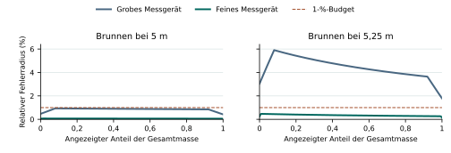
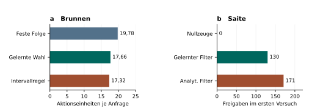
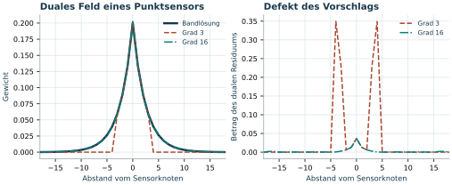
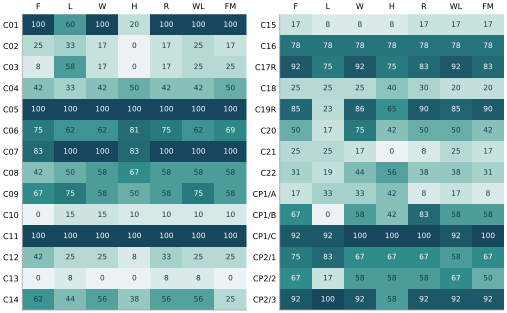

# Kapitel 9 · Scientific Machine Learning und Operator Learning

## Einleitung · Was muss ein lernender Feldoperator von einer Saite wissen?

Eine Saite wird zuerst in der Mitte gezupft. Das anschließende Profil lässt sich berechnen oder aus vielen früheren Beobachtungen lernen. Dann verschiebt sich der Zupfpunkt. Die Anfangsform ist anders, die Wellengleichung gilt weiterhin. Welche Information braucht ein trainiertes Modell, damit es die verschobene Welle am richtigen Ort und zur richtigen Zeit vorhersagt?

Wir unterscheiden das Lernen einer einzelnen Lösung von der Aufgabe, den ganzen Zusammenhang zwischen Anfangsfeld und Ausgabefeld zu erfassen. An einer einzelnen Sinusmode sehen wir zunächst, was die Diskretisierung einer Welle mit Randbedingungen bedeutet. Dann verfolgen wir, wie Fourier-Gewichte mehrere Moden verbinden und was bei einer anderen Gitterweite überprüft werden muss.

Der Saitenversuch stellt am Ende drei Fragen an das Netz. Welche Information liefern die Trainingsdaten? Welche liefert ein bekannter Wellenschritt? Und an welcher Abweichung erkennt man, dass eine gelernte Korrektur wirklich etwas über die Physik hinaus beiträgt?

Diese Fragen begleiten uns von der [Wahl des Physik-Layers](#cp2-operator-lernregel) zu [zehn ARGESIM-Teilaufgaben](#no-auswertung). Dort lesen wir jeweils den Eingang, die Referenz und das beobachtete Ergebnis zusammen. Der [projizierte Physik-Residual-Operator](#pr-verfahren) führt vom Abnahmetest ohne bekannte Referenz zum [trainierten Aktionsoperator und zum prüfbaren Fehlernachweis](#op-entscheidung).

[Zum Schluss dieses Kapitels](#kap09-schluss) · [Sieben Kerne auf allen 28 Messaufgaben](#atlas-sieben) · [Fünf Räuber-Beute-Paare](#cp1b-bahn)

<!-- Buchseite -->

## 9.1 Eine Saite, viele mögliche Anfangsformen

[Grundlagen · Fourier-Moden und Projektion](../lehrbuch_numerische_simulation.md#g-fourier)

Wir zupfen eine fest eingespannte Saite einmal in der Mitte und einmal ein Stück weiter links. Länge, Material und Beobachtungszeit stimmen überein. Die zwei Messbilder unterscheiden sich, obwohl dieselbe Differentialgleichung gilt. Wer nur das erste Bild approximieren will, lernt eine Funktion von Ort und Zeit. Wer auch das zweite Bild aus dessen Anfangsprofil vorhersagen will, braucht als Eingabe eine ganze Funktion.

Für $u_{tt}=c^2u_{xx}$ auf $[0,L]$, feste Enden $u(0,t)=u(L,t)=0$ und Anfangsdaten $u(x,0)=a(x)$, $u_t(x,0)=b(x)$ ordnet der Lösungsoperator $\mathcal G_T$ dem Paar $(a,b)$ das Feld $u(\cdot,T)$ zu. Ein einzelner Punktsensor bei $L/2$ unterscheidet $a_0(x)$ nicht von $a_0(x)+A\sin(2\pi x/L)$, solange beide mit derselben Anfangsgeschwindigkeit starten: Die zweite Mode bleibt in der Mitte null. Bei $L/4$ beträgt der Unterschied zum Start dagegen $A$. Eine geeignete Energieklasse ist $a\in H_0^1(0,L)$ und $b\in L^2(0,L)$. Die [Spur aus G.7](../lehrbuch_numerische_simulation.md#auflage-k09-03) verlangt $\gamma_0 a=(0,0)$ für die Anfangsform. Die Anfangsgeschwindigkeit $b$ geht im Energieraum über ihr Quadratintegral ein. Eine fest gewählte Zeit $T$ gehört hier zur Aufgabenstellung. Für unser Labor gilt $b=0$. Zwei Saiten mit derselben Form und verschiedenen Anfangsgeschwindigkeiten hätten sonst denselben Netzeingang und verschiedene richtige Antworten. Dasselbe Problem stellt sich bei der Kavität, wenn Deckeltempo, Viskosität oder vergangene Anregung für die Ausgabefelder relevant sind und am Eingang fehlen.

Ein klassischer PINN (*physics-informed neural network*) stellt für eine konkrete Aufgabe $u_\theta(x,t)$ dar. Neben Anfangs- und Randwerten bestraft die Verlustfunktion beispielsweise das Residuum $u_{\theta,tt}-c^2u_{\theta,xx}$ an Kollokationspunkten. Ein kleines mittleres Residuum an diesen Punkten allein garantiert keinen kleinen Feldfehler überall. Die Gewichtung der Terme, die Abdeckung des Gebiets und die Stabilität des zugrundeliegenden Problems spielen mit. Parametrisierte PINNs können mehrere Problemfälle gemeinsam lernen. Ob ein neuer Fall ein erneutes Training braucht, hängt von Eingaben und Trainingsbereich ab. [Raissi, Perdikaris und Karniadakis][t1pinn]

Ein neuronaler Operator wird typischerweise auf Paaren von Eingabefunktionen und zugehörigen Lösungsfeldern trainiert. Bei DeepONet verarbeitet ein Zweig die beobachteten Werte der Eingangsfunktion, ein zweiter die Ausgabekoordinate. Ein FNO koppelt räumliche Werte unter anderem über Fourier-Moden. In beiden Fällen bestimmt die Verteilung der Trainingsfunktionen, welche Verallgemeinerung plausibel ist. Eine Behauptung über alle denkbaren Anfangsfelder wäre stärker als jeder endliche Testsatz. [DeepONet: Lu et al. (2021)](https://doi.org/10.1038/s42256-021-00302-5) · [Theorie neuronaler Operatoren][t1neural] · [Projektkapitel zu lernenden Verfahren][t1proj9]

<!-- Buchseite -->

### Eine einzelne Saitenmode und ihr Rand

Für feste Enden wählen wir die Anfangsform $a(x)=\sin(\pi x/L)$ und lassen die Saite aus der Ruhe los. Die drei Abtastwerte bei $0,L/2,L$ lauten $0,1,0$. Wir spiegeln das Profil ungerade am Rand und wiederholen es mit Periode $2L$. Die vier Werte einer Periode ohne doppelten Endpunkt sind $(0,1,0,-1)$. Die diskrete Fourier-Transformation mit Vorzeichen $-2\pi\mathrm i kj/N$ liefert $(0,-2\mathrm i,0,2\mathrm i)$. Das Paar repräsentiert dieselbe Sinusmode in entgegengesetzten Frequenzen.

Mit $u(x,t)=q(t)\sin(\pi x/L)$ liefert die Wellengleichung $q''+(\pi c/L)^2q=0$. Bei Anfangsruhe ergibt sich der Faktor $\cos(\pi c t/L)$. Mit $c=1\,\mathrm{m/s}$ und $L=1\,\mathrm m$ hat die Saite nach $0{,}25\,\mathrm s$ in der Mitte den Wert $\cos(\pi/4)\approx0{,}7071$. Die Enden bleiben null. Ein spektraler Operator, der nur diese Mode behält, muss hier einen einzigen reellen Faktor bestimmen. Die folgende Schicht verallgemeinert diese Idee auf mehrere Moden und Kanäle.

Eine FFT kann jede endliche Folge verarbeiten. Die mit der Standard-FFT gebildete **zirkuläre Faltung** behandelt Randnachbarn als periodisch. Bei einer periodischen Fortsetzung mit Sprung können abgeschnittene Fourier-Reihen am Rand Gibbs-Oszillationen zeigen. Bei festen Nullrändern ist die Sinusbasis beziehungsweise die ungerade Fortsetzung natürlich. Bei inhomogenen Dirichlet-Werten kann man zuerst eine Funktion mit den vorgegebenen Randwerten abziehen und sie am Ende wieder addieren. Padding schafft Abstand zum künstlichen Periodenrand. Die Erfüllung der physikalischen Randwerte prüft man gesondert oder erzwingt sie durch eine geeignete Basis. [Fourier Neural Operators und höhere Frequenzen](https://neuraloperator.github.io/dev/theory_guide/fno.html)

<!-- Buchseite -->

## 9.2 Wie eine Fourier-Schicht Informationen durch den Raum trägt

Auf einem periodischen Gebiet definieren wir eine Faltung $(\mathcal K v)(x)=\int\kappa(x-y)v(y)\,dy$. Liegt beispielsweise ein warmer Streifen an einer anderen Stelle, verschiebt sich die Antwort derselben translationsinvarianten Faltung entsprechend mit. Im Frequenzraum wird diese räumliche Kopplung zu einer Multiplikation. Für mehrere Kanäle ist das Gewicht je Wellenzahl $k$ eine komplexe Matrix $R_k$ mit Ausgangskanal als Zeile und Eingangskanal als Spalte.

Ein FNO hebt zunächst die Eingabekanäle punktweise mit $P$ in einen internen Zustandsraum. Eine Folge von Schichten aktualisiert diese Features. Zum Schluss bildet $Q$ die Features punktweise auf die gesuchten Feldgrößen ab. Eine verbreitete Form ist
$$
 v_0(x)=P(a(x)),\qquad
 v_{\ell+1}(x)=\sigma\!\left(b_\ell+W_\ell v_\ell(x)+
          \mathcal F^{-1}(R_{\ell,k}\widehat v_{\ell,k})(x)\right),\qquad
 u_\theta(x)=Q(v_m(x)).
$$
Die Summe über die Eingangskanäle geschieht für jedes $k$ getrennt. Die Rücktransformation koppelt dagegen jeden Ausgabepunkt mit dem ganzen periodischen Gebiet. $W_\ell$ ist eine eigene lokale Kanalabbildung. Sie erlaubt auch dann noch Ortsinformation, wenn der Spektralzweig nur wenige Moden hält. Ein Bias ist der additive Term $b_\ell$.

Für ein periodisches Gitter $x_j=jL/N$ ohne doppelt gespeicherten Endpunkt verwendet das Labor
$$
 \widehat v_k=\sum_{j=0}^{N-1}v_j e^{-2\pi i k j/N},
 \qquad v_j=N^{-1}\sum_{k=0}^{N-1}\widehat v_k e^{2\pi i k j/N}.
$$
Bei reellen Feldern ist $\widehat v_{N-k}=\overline{\widehat v_k}$. Der Nullmodus ist reell, bei geradem $N$ auch der Nyquist-Modus. Das Labor benutzt gepaarte Moden bis $K\leq\lfloor(N-1)/2\rfloor$ und behandelt den Nullmodus gesondert. Ein Bibliothekscode mit reeller FFT muss beim Rückweg die tatsächlich gewünschte Länge mitführen, insbesondere bei ungeradem $N$. Unterauflösung darf nicht unbemerkt die Tensorachsen oder die physikalisch gehaltenen Wellenzahlen verändern. [Li und Mitautoren, FNO][t1fourier]

<!-- Buchseite -->

### Was beim Abschneiden von Moden erhalten bleibt

Auf einer Länge $L$ bezeichnet der ganzzahlige Index $k$ die physikalische Wellenzahl $2\pi k/L$. Wird nur $N$ verändert, kann derselbe gelernte Matrixeintrag bei gleichem $L$, derselben Normierung und derselben Randkonvention wiederverwendet werden. Ändert sich $L$, beschreibt der Index eine andere Wellenlänge. Ein Training auf periodischen Feldern stellt außerdem noch keine Dirichlet-Bedingung an einer Wand her.

Sei $P_K$ die orthogonale Projektion auf die behaltenen Moden. In einer orthonormalen Fourierbasis gibt Parseval eine direkte Fehlerrechnung:
$$
 \|v-P_Kv\|_{L^2}^2=\sum_{|k|>K}|\widehat v_k|^2.
$$
Für ein glattes Feld kann der Rest klein sein. Ein scharfer Knick verteilt messbare Energie jenseits einer kleinen Modenzahl. Eine beschränkte Spektralschicht filtert nur ihren eigenen Pfad. Der lokale Anteil $Wv$ kann hohe Frequenzen weitergeben, und eine punktweise Nichtlinearität kann neue erzeugen. Schon $\cos^2(5x)=[1+\cos(10x)]/2$ verdoppelt die Wellenzahl. Auf einem zu groben Gitter erscheint eine solche Frequenz unter einem falschen Index (*Aliasing*). Weder Glattheit der gesamten Ausgabe noch physikalisch sinnvolle Entrauschung folgen allgemein aus der Trunkierung.

Auch eine periodische DFT und die festen Enden einer Saite lassen sich zusammenbringen. Wir setzen ein Profil auf $[0,L]$ ungerade fort und erhalten eine $2L$-periodische Funktion. Spiegelung und Vorzeichen erzwingen die Nullen an beiden Enden. Jeder Sinus $\sin(k\pi x/L)$ ist so eine passende Eigenfunktion. Auf $N$ Intervallen mit $N+1$ Stützstellen besitzt die diskrete ungerade Fortsetzung genau $2N$ Werte, weil die beiden Randpunkte nur einmal eingehen. Für die gewählte unnormierte Vorwärtstransformation ist der diskrete Sinuskoeffizient $a_k=-\operatorname{Im}(\widehat a_k)/N$.

Für eine Kavität sind Richtung und Lage jeder Wand physikalisch relevant. Eine unbedachte periodische Fortsetzung würde gegenüberliegende Wände zu Nachbarn machen. Mögliche Modellierungen verwenden Koordinaten, Randmasken, eine zur Geometrie passende Basis oder eine explizite Randprojektion. Eine nachträglich korrekt gesetzte Deckelzeile darf im Test einen Fehler des inneren Strömungsfelds nicht verdecken. [Kavitätsvergleich im Projekt][t1proj16]

<!-- Buchseite -->

## 9.3 Was ein feineres Gitter tatsächlich nachweist

Ein Netz kann auf 33 Knoten trainiert und auf 257 Knoten ausgewertet werden. Ob diese *Zero-Shot*-Auswertung einen Gewinn bringt, hängt zunächst von der Eingabe ab. Liegt die neue Anfangsfunktion als fein aufgelöste Messung oder analytische Funktion vor? Oder stehen lediglich die alten 33 Zahlen zur Verfügung? Interpolation dieser Zahlen kann eine am groben Gitter unsichtbare Welle nicht rekonstruieren.

Ein Gegenbeispiel ist $a(x)=\sin(32\pi x/L)$. An allen Punkten $x_j=jL/32$ ist es null. Zwischen den Punkten erreicht der Betrag eins. Jedes deterministische Modell mit nur den groben Messwerten erhält für $a$ und die Nullfunktion dieselbe Eingabe. Für einen Beobachtungszeitpunkt mit $\cos(32\pi cT/L)\ne0$ sind ihre richtigen Saitenfelder verschieden. Selbst bei einer *wirklich* fein gemessenen Eingabe kann ein Modell, das nur die ersten acht Sinusmoden benutzt, diese Schwingung über seinen Spektralpfad nicht ausgeben.

Ein aussagekräftiger Test hält die physikalische Funktion, Länge, Randbedingungen, Normierung, Beobachtungszeit und Gewichte fest. Er wertet jede kontinuierlich gegebene Testfunktion auf jedem Gitter neu aus und vergleicht sie dort mit einer unabhängigen Referenz. Bei verschwindendem Referenzfeld verwenden wir den absoluten RMS-Fehler. Andernfalls berichten wir auch
$$ E_{\rm rel}=
 \frac{\bigl(\sum_j w_j|u_j-u_j^{\rm ref}|^2\bigr)^{1/2}}
      {\bigl(\sum_j w_j|u_j^{\rm ref}|^2\bigr)^{1/2}} .$$
Die Gewichte repräsentieren die Quadratur. Im gleichmäßigen Laborgitter sind die hier berücksichtigten Endwerte null. Der gemeinsame konstante Gewichtsfaktor kürzt sich. Bei nichtuniformem Gitter oder einer Flächenmaske würde eine ungewichtete Mittelung andere Gebiete anders gewichten.

Vollständig faltende CNNs können ebenfalls unterschiedlich große Tensoren verarbeiten. Ein fester Kernel mit drei Gitterpunkten deckt bei physikalischer Verfeinerung jedoch ein anderes Intervall ab. Bei einem neutralen Vergleich interessieren die physikalische Reichweite, die Gitterdarstellung der Eingänge sowie der gemessene Fehler. Dass eine Software einen Tensor der richtigen Form zurückgibt, prüft lediglich die Schnittstelle. [FNO-Originalarbeit][t1fourier] · [Auflösungsversuche im Projekt][t1proj16]

<!-- Buchseite -->

## 9.4 Rechenlabor · Einen Operator lernen und widerlegen

Zuerst untersuchen wir die Saite mit $L=1\,\mathrm m$, $c=1\,\mathrm{m/s}$, $T=0{,}19\,\mathrm s$ und verschwindender Anfangsgeschwindigkeit. Aus der Wellengleichung folgt für die Amplitude jeder Sinusmode $b_k(T)=a_k\cos(k\pi cT/L)$. Das liefert sowohl Trainingspaare als auch eine Referenz für einen Versuch, in dem dem Lernalgorithmus die Faktoren zunächst unbekannt sind. Wir behalten $K=8$ Moden und lernen pro Mode eine reelle Zahl $r_k$. Differenziert man die quadratische Verlustfunktion $\sum_s(r_k a_{s,k}-b_{s,k})^2$, erhält man
$$ r_k=\frac{\sum_s a_{s,k}b_{s,k}}{\sum_s a_{s,k}^2}.$$
Der Nenner muss positiv sein. Eine in allen Trainingsfeldern fehlende Mode hat kein identifizierbares Gewicht. Das ist hier eine lineare Spezialisierung eines spektralen Operators. Eine nichtlineare gelernte Schicht prüfen wir anschließend in einem eigenen Versuch.

Zwölf Trainingsprofile mit unabhängig gezogenen Amplituden auf 32 Intervallen regen die acht Moden an. Dieselben Gewichte verarbeiten anschließend ein neues glattes Feld und ein dreieckiges Zupfprofil mit Spitze bei $0{,}37L$. Das Dreieck stammt aus einer anderen Profilfamilie. Seine exakte Referenz ist mit ungerader periodischer Fortsetzung $\widetilde a$ die d’Alembert-Lösung $[\widetilde a(x-cT)+\widetilde a(x+cT)]/2$.

Auf dem glatten Testfeld liegen die relativen Abweichungen bei ungefähr $6\cdot10^{-16}$. Am Dreieck betragen sie $1{,}7057\,\%$, $1{,}6578\,\%$ und $1{,}6541\,\%$. Das feinere Gitter verbessert die Diskretisierung der acht Eingangskoeffizienten. Die fehlenden höheren Koeffizienten bleiben als Modellfehler bestehen.

<!-- Buchseite -->

### Ein nichtlinearer Fourier-Operator mit echtem Training

Kann dieselbe Implementierung auch komplexe Gewichte, lokale Kopplung und eine nichtlineare Ausgabe **lernen**? Wir stellen dafür einen Operator her, dessen richtige Antwort unabhängig im Ortsraum berechnet werden kann. Auf dem periodischen Einheitsintervall sei
$$
 G(a)(x)=\tanh\!\left(0{,}1+0{,}35a(x)
       +\int_0^1\kappa(x-y)a(y)\,dy\right),
$$
mit $\kappa(s)=0{,}8\cos(2\pi s)+0{,}3\sin(2\pi s)-0{,}4\cos(4\pi s)$. Der Sinusanteil verändert die Phase. Er deckt deshalb ein falsches Vorzeichen in der imaginären Fourier-Gewichtung auf. Trainingsziel und Testreferenz werden durch direkte periodische Summation im Ortsraum erzeugt. Die Vorhersage verwendet stattdessen die Spektralschicht.

Mit einem Eingangskanal, einem Ausgangskanal und identischem Lifting und Auslesen bleiben sieben lernbare reelle Parameter. Sie beschreiben Bias, lokalen Faktor, Nullmodus und je zwei Zahlen für $R_1,R_2$. Für die komplexe Mode repräsentieren die beiden reellen Merkmale die Beiträge von Real- und Imaginärteil nach der inversen Transformation. Aus den Merkmalen $z$ und Parametern $\theta$ folgt $\hat y=\tanh(\theta^\top z)$. Der Gradient der halben quadratischen Einzelabweichung ist $(\hat y-y)(1-\hat y^2)z$. Das Labor startet bei null und führt 650 deterministische Gradientenupdates an zehn Feldern auf 24 Punkten aus.

Die unabhängige analytische Koeffizientenfolge lautet $(0{,}1,0{,}35,0,0{,}4,-0{,}15,-0{,}2,0)$. Wegen $|\tanh'|\leq1$ ist der RMS-Ausgabefehler höchstens $\|\theta-\theta_*\|_2$ mal der quadratisch gemittelten Merkmalsnorm, ergänzt um die Rundungsreserve. Auf einem unbenutzten Profil misst das Labor auf 24 und 96 Punkten jeweils etwa $1{,}84\cdot10^{-10}$ RMS bei einem Parameterbudget von $1{,}98\cdot10^{-9}$ oder weniger. Dieses Ergebnis gehört zum hergestellten Operator. Die lineare Saitenrechnung besitzt ihre eigenen Daten und Fehler.

~~~python
from fourier_operator import string_run, train_nonlinear
gewichte, analytisch, tests = string_run()
parameter = train_nonlinear()
~~~

Die mitgelieferte allgemeine Schicht verarbeitet mehrere Ein- und Ausgangskanäle und lässt sich mit einer punktweisen Aktivierung stapeln. Der Versuch trainiert bewusst den kleinsten nichtlinearen Fall, in dem sich alle Gewichte und ihre Wirkung nachrechnen lassen. Bildet man einen Mehrschritt-Rollout, kommt die Fehlerfortpflanzung von Aufruf zu Aufruf hinzu. Eine direkte Vorhersage zu einem festen $T$ misst eine andere Aufgabe.

<!-- Buchseite -->

### Eine Spektralschicht mit einem prüfbaren Vorzeichen

Die Achsen des Gewichts $R[k][o][i]$ stehen für Mode, Ausgangskanal und Eingangskanal. Für jeden Wert $k$ wird über die Eingangskanäle summiert. Erst danach wird das konjugierte Gegenstück an die Position $N-k$ gesetzt. Es entsteht eine reelle Ausgabe, obwohl die trainierbaren Gewichte komplex sind. Der folgende Kern zeigt die Operation für einen beliebigen Ausgangskanal $o$.

~~~python
bins = [0j] * n
for k, weights in enumerate(R):
    z = sum(w * xs[k] for w, xs in zip(weights[o], spectra,
                                        strict=True))
    bins[k] = z.real if k == 0 else z
    if k:
        bins[-k] = z.conjugate()
nonlocal_part = fft(bins, inverse=True)
~~~

Mit einem Eingang $a(x)=\cos(2\pi x/L)$ und einem rein imaginären Gewicht $R_1=i$ entsteht unter unserer Vorwärtskonvention im Ortsraum $-\sin(2\pi x/L)$. Ein Test nur mit reellen Gewichten oder konstanten Feldern könnte ein vertauschtes Vorzeichen beim konjugierten Partner übersehen. Ein eigener Test mit zwei konstanten Eingangskanälen kontrolliert dagegen die Kanalachsen und das Zusammenspiel von lokalem Pfad, Nullmode und Bias. Im Saitenversuch prüft das Labor zusätzlich den geraden und ungeraden Gitterfall beim Hin- und Rücktransformieren.

Die Lehrimplementation verwendet eine radixbasierte FFT für geeignete Längen und eine direkte DFT für ungerade Teilprobleme. Für große Produktionsrechnungen sind optimierte gebündelte FFTs und ein automatisches Differenzieren naheliegende Implementierungen. Im Lehrversuch können wir Vorzeichen, Normierung und die tatsächlich gelernten Parameter ohne solche Bibliotheken prüfen. Eine Vorhersage entsteht erst aus Gewichten, die zum Problem und zu den Randbedingungen gehören.

<!-- Buchseite -->

### Woher ein Feldfehler kommen kann

Der direkte Vergleich zweier Feldkurven erklärt einen Fehler noch nicht. Für die lineare Saite lässt er sich nach Ursachen aufteilen. Sei $P_K$ die Projektion auf die ersten $K$ Sinusmoden, $P_{N,K}$ ihre Schätzung aus $N+1$ Abtastwerten, $G$ der exakte Propagator und $G_\theta$ die gelernte Matrix auf dem modalen Unterraum. Dann gilt durch Addieren und Subtrahieren zweier Zwischenwerte
$$
\begin{aligned}
G a-G_\theta P_{N,K}a={}& G(I-P_K)a\\
 &+(G-G_\theta)P_K a\\
 &+G_\theta(P_K-P_{N,K})a .
\end{aligned}
$$
Der erste Term misst die abgeschnittenen Inhalte der Eingangsfunktion. Der zweite misst fehlerhafte Gewichte auf vorhandenen Moden. Der dritte bezeichnet den Fehler bei der Bestimmung dieser Koeffizienten aus endlich vielen Punkten. Die Dreiecksungleichung macht daraus ein Fehlerbudget. Bei der Saite ohne Anfangsgeschwindigkeit hat $G$ in der hier verwendeten $L^2$-Modennorm höchstens Norm eins, da jeder exakte Faktor ein Kosinus ist. Bei einem allgemeinen nichtlinearen Operator muss dessen Stabilität gesondert untersucht werden.

Beim glatten Testprofil verschwindet der erste Term, und die trainierten Moden sind auf dem groben Gitter bereits auflösbar. Beim Dreieck wird der dritte Term beim Verfeinern kleiner. Sein bloßes Verschwinden könnte die abgeschnittenen Moden noch nicht ersetzen. Ein Vergleich mit **analytisch gesetzten** Gewichten derselben Bandbreite trennt den Nutzen des Trainings vom Nutzen der physikalisch passend gewählten Sinusbasis.

Im Projektvergleich auf 501 Punkten wächst die Aussagekraft durch eine zweite Beobachtungszeit. Für die mittig gezupfte Saite beträgt der relative Feldfehler des ursprünglichen FNO nach acht Sekunden $0{,}8816\,\%$, beim nachtrainierten FNO $0{,}6218\,\%$ und bei der modalen Schicht $0{,}01416\,\%$. Nach fünf Sekunden sind es $3{,}0009\,\%$, $2{,}1815\,\%$ und $0{,}04303\,\%$. Diese Zahlen beziehen sich auf dasselbe Zupfprofil des Projekts. Der kleine Standardbibliotheksversuch dieses Kapitels verwendet einen anderen Zeithorizont. Wie sich der Einfluss der Physik am selben Netz prüfen lässt, zeigt [der Saitenversuch in Abschnitt 9.6](#fno-physik-lernen). [Daten und Kontrollschicht im Projekt][t1proj16]

<!-- Buchseite -->

## 9.5 Wann sich Lernen gegenüber einer Referenzrechnung lohnt

| Kriterium | Klassische Diskretisierung | PINN oder gelernter Operator |
|---|---|---|
| Neue Eingaben | Anfangs- und Randdaten einsetzen und integrieren. | Fallbezogener PINN passt eine Lösungsfunktion an. Ein trainierter Operator wertet unterstützte Eingabefelder direkt aus. |
| Physikalische Prüfung | Konvergenz, Invarianten, Residuen und unabhängige Referenz. | Dieselben Feld- und Bilanztests sowie Prüfprofile außerhalb der Trainingsfamilie. |
| Rechenaufwand | Gitter, Schrittzahl, Solver und Hardware bestimmen die Laufzeit. | Datenerzeugung, Training und Inferenz getrennt messen. Batchgröße, Gitter, Genauigkeit und Hardware gehören zur Angabe. |

Für $m$ Anfragen seien $C_{\rm daten}+C_{\rm train}$ die einmaligen Kosten, $C_{\rm ref}$ und $C_{\rm inf}$ die Kosten pro Anfrage bei vergleichbarer Genauigkeit. Erst wenn $C_{\rm inf}<C_{\rm ref}$ und $m>(C_{\rm daten}+C_{\rm train})/(C_{\rm ref}-C_{\rm inf})$ ist, rechnet sich das Training rein zeitlich. Die Zahl „Millisekunden“ ist ohne Messumgebung, Datenübertragung und Feldgröße keine belastbare Eigenschaft der Methode. Ein klassischer Solver löst die gewählte Diskretisierung seinerseits mit endlichem Fehler.

**Anschluss an CP2.** Im archivierten Versuch für die mittig gezupfte Saite auf 501 Punkten bei $5\,\mathrm s$ liegt das ursprüngliche FNO bei $3{,}0009\,\%$ relativem Feldfehler. Die modale Variante erreicht $0{,}04303\,\%$. Eine analytisch besetzte Kontrollschicht erreicht denselben gerundeten Wert. Für die Kavität müssen Innenraum und erzwungene Deckelzeile getrennt ausgewertet werden. Diese Projektwerte stammen aus der veröffentlichten Untersuchung. Das hier nachrechenbare Labor benutzt andere Felder, Zeiten und Gewichte. [Projektuntersuchung CP2][t1proj16]

**Aufgaben.** (1) Ein Trainingssatz enthält nie Mode fünf. Was bestimmt dann deren Kleinste-Quadrate-Gewicht? (2) Geben Sie eine räumliche Information an, die zwischen zwei groben Abtastpunkten unsichtbar bleiben kann. (3) Ein Ziel ist zum Messzeitpunkt identisch null. Welchen Fehler berichten Sie? (4) Warum lernt ein FNO mit acht Moden am glatten Saitenfall wesentlich genauer als am Dreieck?

**Musterlösungen.** (1) Der Trainingsverlust ist unabhängig von diesem Gewicht; zusätzliche Anregung oder eine Modellannahme wird benötigt. (2) Auf $jL/32$ verschwindet die Sinusmode 32 an allen Abtastpunkten. (3) Den absoluten RMS, gegebenenfalls zusätzlich relativ zu einer vorab vereinbarten physikalischen Skala. (4) Das glatte Testfeld liegt vollständig im identifizierten Unterraum. Die fehlenden Dreiecksmoden tragen auch auf 257 Punkten noch zum Referenzfeld bei.

<!-- Buchseite -->

### Warum eine kleine Änderung der Geschwindigkeit die Nullstelle verschiebt

Wir wählen auf einer Saite mit festen Enden die reine Anfangsauslenkung $a\sin(\pi x/L)$ und lassen sie aus der Ruhe los. Die Form bleibt im Verlauf dieselbe. Ihre Amplitude wird mit $\cos(\pi c t/L)$ multipliziert. Bei der Phase $5\pi/2$ verschwindet die gesamte Auslenkung. Die Saite bewegt sich trotzdem, denn die zeitliche Ableitung des Kosinus ist dort von null verschieden.

Schätzt ein Modell die Wellengeschwindigkeit um ein Prozent zu hoch, dann berechnet es für denselben Zeitpunkt die Phase $5\pi/2+\pi/40$. Seine Auslenkung beträgt etwa $-0{,}07846$ der ursprünglichen Modenamplitude. Der relative Feldfehler gegen das gerade verschwindende Referenzfeld ist an diesem Zeitpunkt nicht definiert. Die absolute Feldnorm oder eine Normierung mit einer fest vorgegebenen Startamplitude macht den Fehler sichtbar. So lässt sich die Abweichung auch bei einer verschwindenden Referenz bestimmen.

Für einen Vergleich über längere Zeit kann man außerdem verfolgen, wann die erste Nullstelle oder das nächste Maximum erreicht wird. Diese Phasenprobe erklärt, warum das richtige Randprofil und ein einzelner guter Feldwert noch keine Aussage über die gelernte Wellengeschwindigkeit über viele Schwingungen liefern.

<!-- Buchseite -->

## 9.6 Wie ein FNO die Wellengeschwindigkeit lernt

Zupfen wir eine Saite erst in der Mitte und dann nahe am Steg, hören wir zwei verschiedene Klänge. Die zweite Zupfstelle regt die Obertöne anders an. Bei gleicher Saite und Spannung breiten sich kleine Auslenkungen im idealen Modell mit derselben Geschwindigkeit aus. Genau diese Gemeinsamkeit kann einem Fourier Neural Operator beim Lernen helfen. Sie bedeutet, dass eine gut gemessene tiefe Mode auch etwas über eine schwach gemessene hohe Mode verrät.

Wir untersuchen eine an beiden Enden befestigte Saite der Länge $L=1\,\mathrm m$. Für die kleinen Auslenkungen des Modells gilt $u_{tt}=s\,u_{xx}$ mit $s=c^2>0$. Bei konstanter Zugkraft $F$ und Linienmassendichte $\mu$ liefert die Kräftebilanz $s=F/\mu$. Aus der Wellenbewegung lässt sich ihr Verhältnis bestimmen. Um Zugkraft und Massendichte einzeln zu identifizieren, wäre eine weitere Messgröße nötig. Wir behandeln das Wellengesetz zunächst als Hypothese. Acht synthetische Kalibrierversuche entscheiden zwischen drei vorgegebenen Modengesetzen und liefern danach dessen Koeffizienten. Anschließend vergleichen wir zwei Arten, die Information zu nutzen. Im ersten Versuch koppelt sie die Gewichte eines linearen spektralen Operators. Im zweiten lenkt sie das Training eines nichtlinearen FNO durch einen zusätzlichen Fehlerterm. Beide Male entscheidet ein zurückgehaltenes Feld über die Genauigkeit.

Die feste Aufhängung legt die räumlichen Moden $\sin(\kappa_k x)$ mit $\kappa_k=k\pi/L$ nahe. Setzen wir $u(x,t)=b_k(t)\sin(\kappa_k x)$ in die Wellengleichung ein, liefert die zweite Ortsableitung den Faktor $-\kappa_k^2$. Damit gilt $\ddot b_k=-s\kappa_k^2b_k$. Bei anfänglicher Ruhe entwickelt sich eine gemessene Auslenkung $a_k$ zu
$$
 b_k(t)=a_k\cos(\kappa_k\sqrt{s}\,t).
$$
Die Eigenfrequenz steigt proportional zu $k$. Die zugrunde liegende Geschwindigkeit ist für alle Moden gleich. Bei einer Saite mit deutlicher Biegesteifigkeit wäre dieser letzte Schluss zu prüfen. [Stehende Wellen und Eigenmoden][p9welle]

<!-- Buchseite -->

### Welche Bewegungsgleichung stützen die Messwerte?

Angenommen, das Messgerät liefert nur Modennummer, Auslenkung und Beschleunigung. Können wir aus diesen Zahlen erkennen, ob das Wellengesetz zur Saite passt? Bei gleicher Amplitude würde eine Verdopplung der Modennummer die rückstellende Beschleunigung nach dem Wellengesetz vervierfachen. Zwei andere mögliche Zusammenhänge ließen sie unverändert oder um den Faktor 16 wachsen. Ein einziger sauberer Grundton könnte alle drei Fälle erklären. Erst mehrere Wellenlängen machen die Frage entscheidbar.

Wir vergleichen deshalb drei Kandidaten für die negative Beschleunigung $y=-\ddot b$ bei gemessener Auslenkung $a$. Alle besitzen genau einen freien Koeffizienten
$$
 y=\gamma_p(\kappa_k L)^p a,\qquad p\in\{0,2,4\}.
$$
Die Klammer ist dimensionslos. Damit hat $\gamma_p$ in jedem Kandidaten die Einheit $\mathrm{s}^{-2}$, und alle Vorhersagen lassen sich in $\mathrm{m/s^2}$ vergleichen. Beim Exponenten null erfahren alle Moden dieselbe Rückstellbeschleunigung pro Auslenkung. Beim Exponenten zwei ist $\omega_k^2$ proportional zum Quadrat der Wellenzahl. Beim Exponenten vier wächst die Rückstellwirkung bei kurzen Wellen noch stärker.

Für jeden Kandidaten verwenden wir die **ungeraden** Moden zum Anpassen der einzigen Steigung. Dazu setzen wir $d=(\kappa_k L)^p a$ und minimieren $\sum(y-\gamma_p d)^2$ über diese Messungen. Die Lösung ist $\hat\gamma_p=\sum dy/\sum d^2$. Dann frieren wir die drei Steigungen ein und vergleichen auf den **geraden** Moden den quadratisch gemittelten Beschleunigungsfehler. Kein Messwert einer geraden Mode war an der Anpassung ihrer Steigung beteiligt.

Im Median über fünf Rauschfolgen erhalten wir **1,62874**, **0,11403** und **1,72070 $\mathrm{m/s^2}$** für die Exponenten 0, 2 und 4. Der quadratische Ansatz gewinnt bei jeder Rauschfolge. Sein Fehler liegt nahe am RMS des simulierten gleichverteilten Sensorrauschens von $0{,}20/\sqrt{3}\approx0{,}1155\,\mathrm{m/s^2}$. Eine Gegenprobe erzeugt rauschfreie Messungen mit jedem der drei Exponenten. Das Auswahlverfahren findet jedes Mal den erzeugenden Kandidaten wieder.

Damit stützen die Daten innerhalb dieser drei Hypothesen die Beziehung $\omega_k^2=\hat\gamma_2(\kappa_kL)^2$. Daraus folgt $c=L\sqrt{\hat\gamma_2}$. Für die endgültige Kalibrierung stehen nun alle 16 Moden zur Verfügung. Das spätere Dreieck und die sechs Testfelder des FNO bleiben sowohl bei der Modellwahl als auch bei der Kalibrierung außen vor.

<!-- Buchseite -->

### Aus Krümmung und Beschleunigung einen Wellenparameter bestimmen

Zu Beginn des Versuchs $\ell$ messen wir die Auslenkungsamplitude $a_{\ell k}$ und die modale Beschleunigung $\ddot b_{\ell k}(0)$. Die beiden Zahlen $z_{\ell k}=\kappa_k^2a_{\ell k}$ und $y_{\ell k}=-\ddot b_{\ell k}(0)$ sollten auf einer Geraden $y=sz$ liegen. Dabei hat $z$ die Einheit $\mathrm{m}^{-1}$ und $y$ die Einheit $\mathrm{m/s^2}$. Die Steigung hat also tatsächlich die Einheit einer Geschwindigkeit zum Quadrat. Im Labor sind die Auslenkungen exakt bekannt. Nur die Beschleunigung trägt einen beschränkten Messfehler.

Eine erste Auswertung passt für jede der 16 Moden eine eigene Steigung $\hat s_k$ an. Eine zweite legt eine einzige Gerade durch alle Beobachtungen. Für beide minimieren wir quadrierte Beschleunigungsfehler. Ableiten nach der jeweiligen Steigung und Nullsetzen ergibt
$$
 \hat s_k=\frac{\sum_\ell z_{\ell k}y_{\ell k}}{\sum_\ell z_{\ell k}^2},
 \qquad
 \hat s=\frac{\sum_{\ell,k}z_{\ell k}y_{\ell k}}{\sum_{\ell,k}z_{\ell k}^2},
 \qquad \hat c=\sqrt{\hat s}.
$$
Der gemeinsame Wert ist das mit der Summe der quadrierten Krümmungsamplituden $\sum_\ell z_{\ell k}^2$ gewichtete Mittel der einzelnen Steigungen. Eine schwach angeregte Mode kann allein stark schwanken. Ihr kleines Gewicht begrenzt ihren Einfluss auf $\hat c$. Fehlt die Anregung einer Mode ganz, ist $\hat s_k$ unbestimmt. Das gemeinsame Modell darf sie dennoch vorhersagen, soweit man seine Dispersionsbeziehung akzeptiert.

Für die acht Profile fallen die zufällig vorzeichenbehafteten Amplituden wie $k^{-3}$. Jeder modale Beschleunigungsmesswert erhält einen gleichverteilten Fehler im Intervall $\pm0{,}20\,\mathrm{m/s^2}$. Bei exakt bekannten Eingängen und $|e_{\ell k}|\leq\epsilon_a$ liefert Einsetzen von $y=sz+e$ die deterministische Schranke
$$ |\hat s-s|\leq\epsilon_a\frac{\sum_{\ell,k}|z_{\ell k}|}{\sum_{\ell,k}z_{\ell k}^2} .$$
Sie beträgt hier $0{,}05734\,\mathrm{m^2/s^2}$. Bei fünf vorgegebenen Rauschfolgen liegen die geschätzten Geschwindigkeiten zwischen $1{,}24443$ und $1{,}25067\,\mathrm{m/s}$. Nur der Datengenerator und die spätere Gegenprobe kennen den Sollwert $1{,}25\,\mathrm{m/s}$. Wären auch die gemessenen Krümmungen unsicher, müsste man Fehler auf beiden Achsen berücksichtigen.

<!-- Buchseite -->

### Ein Knick verrät, was die gelernte Physik verbessert

Für den Blindversuch zupfen wir die Saite bei $0{,}37L$ auf eine dreieckige Anfangsform und lassen sie aus der Ruhe los. Kein solches Profil wurde zur Kalibrierung verwendet. Beide spektralen Schichten erhalten dieselben 16 Sinuskoeffizienten. Die erste setzt im Kosinus für jede Mode ihre eigene Geschwindigkeit ein. Die zweite benutzt überall $\hat c$. Eine dritte Rechnung verwendet den bekannten Sollwert $c$ bei derselben Bandbreite. Alle drei vergleichen wir mit der d’Alembert-Lösung im Ortsraum. Dafür verschieben wir die ungerade fortgesetzte Anfangsform um $ct$ nach links und rechts und mitteln beide Werte. [d’Alembert-Referenz für feste Enden][p9dalembert]

| Zeit in s | 16 freie Steigungen | Gemeinsame Steigung | 16 Moden mit bekanntem $c$ |
|---:|---:|---:|---:|
| $0{,}19$ | $0{,}8448\,\%$ | $0{,}7053\,\%$ | $0{,}7039\,\%$ |
| $0{,}83$ | $1{,}2507\,\%$ | $0{,}4763\,\%$ | $0{,}4733\,\%$ |

Die Einträge sind relative räumliche $L^2$-Fehler auf 257 Punkten, als Median über fünf Rauschfolgen. Die rechte Spalte verwendet bei jeder Wiederholung denselben Sollwert. Nach $0{,}83\,\mathrm s$ liegt das gemeinsame Modell bereits nahe an dieser Kontrolle. Selbst bei exakt bekannter Geschwindigkeit bleibt der Knick mit 16 Moden nur angenähert. Der Unterschied zur Acht-Moden-Rechnung in Abschnitt 9.4 umfasst auch eine andere Bandbreite, Geschwindigkeit und Trainingsaufgabe. Den Beitrag der Physik messen wir innerhalb einer Tabellenzeile.

Warum reagiert das Feld auf geringfügig falsche Geschwindigkeiten? Aus dem Mittelwertsatz folgt
$$
 |\cos(\kappa_k\hat c\,t)-\cos(\kappa_k c\,t)|
 \leq \kappa_k t\,|\hat c-c|.
$$
Mit Wellenzahl und Beobachtungszeit wächst der mögliche Phasenfehler. Das Programm gewichtet diese Schranke mit den gemessenen Modenamplituden und addiert den separat gemessenen Fehler der 16-Moden-Kontrolle. Damit besitzt auch die Feldprüfung ein aus der Physik abgeleitetes Budget.

<!-- Buchseite -->

### Dasselbe nichtlineare Netz mit einem zusätzlichen Physikterm trainieren

Die bisherige Rechnung schreibt die Zeitentwicklung im Aufbau der spektralen Schicht vor. Jetzt behalten wir beim Vergleich den gesamten Netzaufbau bei. Ein kleiner FNO soll für ein normiertes Anfangsfeld $a$ die Auslenkung $h=0{,}025\,\mathrm s$ nach dem Loslassen liefern. Als Auslenkungseinheit verwenden wir $1\,\mathrm m$. Das Netz übernimmt die Anfangsform und lernt eine Korrektur
$$
 G_\theta(a)(x)=a(x)+\tanh\!\left(w\,a(x)+
       \sum_{k=1}^{6}r_k a_k\sin(\kappa_k x)\right).
$$
Das ist eine einzelne nichtlineare Fourier-Schicht mit einem lokalen Gewicht $w$, sechs reellen Spektralgewichten $r_k$ und einer direkten Verbindung vom Eingang zum Ausgang. Alle sieben Gewichte werden trainiert. Die ungerade Fortsetzung erhält die festen Enden. Bei Gewichten null gibt das Netz zunächst die Anfangsform zurück.

Welche zusätzliche Information liefert eine Anfangsform, deren spätere Auslenkung niemand gemessen hat? Anfangsruhe bedeutet $u_t(x,0)=0$. Die Wellengleichung liefert $u_{tt}(x,0)=s\,a_{xx}(x)$. Für eine glatte Anfangsform ergibt die Zeitsymmetrie beim Loslassen
$$
 u(x,h)=a(x)+\tfrac12 h^2s\,a_{xx}(x)+O(h^4).
$$
Auf einem glatten Hügel ist $a_{xx}<0$. Der Hügel muss sich anfangs absenken. Für jedes zusätzliche glatte Startprofil $b$ berechnen wir daher seine Krümmung und den Prüfwert $P_{\hat s,h}(b)=b+\tfrac12h^2\hat s\,b_{xx}$. Seine Berechnung benötigt keine bekannte Lösung zum Zeitpunkt $h$.

Seien $D$ die gemessenen Profile mit späterem Feld $y$ und $C$ die zusätzlichen Startprofile. Die eckigen Mittelklammern mitteln jeweils über die Innenknoten und Profile der eigenen Gruppe. Mit normierten Auslenkungen erhalten wir zwei direkt vergleichbare Fehlerterme
$$
 J_\lambda(\theta)=\tfrac12\langle|G_\theta(a)-y|^2\rangle_D+
             \tfrac{\lambda}{2}\langle|G_\theta(b)-P_{\hat s,h}(b)|^2\rangle_C .
$$
Die zweite Differenz ist das mit $h^2/2$ skalierte Residuum der Wellengleichung bei zentrischer Zeitableitung und Anfangsruhe. So lässt sich das Prinzip physikinformierter neuronaler Operatoren am einzelnen Zeitschritt überprüfen. [Li und Mitautoren zu Daten- und Gleichungsresiduen][p9pino]

<!-- Buchseite -->

### Welche Fehler auf neuen Feldern übrig bleiben

Alle Trainingsläufe beginnen mit denselben Gewichten null und verwenden denselben gedämpften Gauß–Newton-Algorithmus. Vier glatte Startprofile liefern Auslenkungsdaten auf 33 Knoten mit Messrauschen von höchstens $0{,}015$ in der Auslenkungseinheit. Acht weitere glatte Profile sind auf 65 Knoten gegeben. Sie regen höhere Moden stärker an und liefern nur Anfangswerte für den Physikterm. In der ersten Variante gilt $\lambda=0$, in der zweiten $\lambda=1$. Ein dritter Lauf verwendet dieselben Zusatzprofile und $\lambda=1$, setzt aber absichtlich $2\hat c$ ein. Bei verdoppelter Geschwindigkeit vervierfacht sich die vorhergesagte Anfangsbeschleunigung.

Am Testzeitpunkt $h$ wird jedes neue Feld auf 129 Punkten mit der d’Alembert-Lösung verglichen. Wir mitteln die sechs relativen Feldfehler je Rauschfolge und berichten den Median dieser fünf Mittelwerte. Er beträgt **3,3120 %** beim reinen Datentraining, **0,2589 %** mit gelernter Geschwindigkeit im Physikterm und **11,1243 %** mit verdoppelter Geschwindigkeit. Mit der passenden Physik wird der Fehler in jeder der fünf gepaarten Wiederholungen kleiner. Ein separat geprüfter Dreieckszupf erreicht in derselben Reihenfolge **1,1528 %**, **0,9847 %** und **2,8395 %**. Der Vorteil fällt am Knick geringer aus. Zum Training des Krümmungsresiduums wurden ausschließlich glatte Eingaben verwendet.

<!-- Buchseite -->

### Fehlerbudget, Rechenprobe und Anschluss an CP2

An einer glatten Sinusmode ist der exakte Schrittfaktor $\cos z$ mit $z=h c\kappa_k$. Für jedes reelle $z$ gilt $|\cos z-(1-z^2/2)|\leq |z|^4/24$. Unser Physikziel enthält daher selbst einen Zeitfehler. Mit räumlicher $L^2$-Norm, einem hinreichend glatten Profil und aufgelösten Sinusmoden ergeben Einfügen des Prüfwerts und die Dreiecksungleichung
$$
\begin{aligned}
 \|G_\theta(a)-u(h)\| \leq {}&
 \|G_\theta(a)-P_{\hat s,h}(a)\|\\
 &+\tfrac12h^2|\hat s-s|\|a_{xx}\|
   +\tfrac1{24}(hc)^4\|a_{xxxx}\| .
\end{aligned}
$$
Der erste Summand ist ein verbleibender Netzfehler gegenüber dem Physikziel, der zweite misst die Unsicherheit der Kalibrierung, der dritte den Fehler der Taylor-Näherung. Bei einem idealen Dreieck hat die vierte Ableitung keine endliche $L^2$-Norm. Deshalb verwenden wir dort die unabhängige Feldreferenz. Das Programm prüft die Schranke an allen sechs glatten Testfeldern und vergleicht die eingesetzten FFT-Gewichte mit einer unabhängigen Auswertung im Ortsraum.

Die vollständige Gegenprobe läuft aus dem entpackten Quellenpaket mit `python3 beispiele/fno_physik.py`. Die Auswertung protokolliert jede der fünf Rauschfolgen. Zum Nachrechnen einer einzelnen Kalibrierung bei festem Messfehler genügen im Ordner der Beispiele diese Zeilen.

~~~python
from math import sqrt
from fno_physik import calibration, fit_acceleration
messung = calibration(seed=11, speed=1.25, noise=0.20)
fit = fit_acceleration(messung, noise_bound=0.20)
print(f"{sqrt(fit.shared):.7f} m/s")  # 1.2477721 m/s
~~~

**Einordnung in CP2.** Im archivierten CP2-Saitentest auf 501 Knoten bei $5\,\mathrm s$ erreicht das ursprüngliche FNO $3{,}0009\,\%$, dasselbe Netz nach zusätzlichem Training $2{,}1815\,\%$ und die lineare modale Variante $0{,}04303\,\%$ relativen Feldfehler. Die analytisch besetzte Schicht derselben Bandbreite erreicht denselben gerundeten Wert. Der neue Lehrversuch isoliert die Kalibrierung und das Hinzufügen eines Physikresiduums bei festem Netz. Seine Prozentwerte beziehen sich auf die hier definierte Saite und die angegebenen Messzeiten. [Archivierter Architekturvergleich][t1proj16]

**Aufgabe.** Warum hilft eine stärkere Gewichtung der Physik bei falsch kalibriertem $c$ wenig? **Lösung.** Sie bindet das Netz näher an eine falsche Anfangsbeschleunigung. Bei längeren Vorhersagen kann zusätzlich der Phasenfehler wachsen. Für einen Mehrschrittbetrieb müssten auch zeitliche Stabilität und Fehlerfortpflanzung geprüft werden. [Abschnitt 9.7](#fno-physiklayer) verfolgt dazu Ort und Geschwindigkeit durch mehrere Wellenschritte.

<!-- Buchseite -->

## 9.7 Was bringt ein Physik-Layer im FNO?

In Abschnitt 9.6 hat die Physik dem Netz beim Training gesagt, in welche Richtung sich die Saite bewegen sollte. Nehmen wir jetzt zwei benachbarte Auslenkungen am Anfang einer Welle. Nach kurzer Zeit ist die Welle weitergelaufen. Wenn wir schon wissen, wie weit sie sich bewegt, können wir diesen Teil der Vorhersage direkt berechnen. Der lernbaren Schicht bleibt die Frage, welche Abweichung die Messdaten über den berechneten Schritt hinaus rechtfertigen.

Ein **Physik-Layer** ist hier eine Rechenschicht, die bei jeder Auswertung ein Bewegungsgesetz anwendet. Für die Saite übernehmen wir die in Abschnitt 9.6 aus verrauschten Beschleunigungen geschätzte Geschwindigkeit $\hat c$. Bei festen Enden, konstanter Spannung, fehlender Dämpfung und anfänglicher Ruhe bewirkt der Schritt von $0$ nach $h$ für jede Sinusmode mit Wellenzahl $\kappa_k=k\pi/L$
$$
  a_k\longmapsto r_k a_k,\qquad r_k=\cos(\kappa_k\hat c\,h).
$$
Das Eingangsfeld besteht aus $N+1$ Stützstellen einschließlich der festen Enden. Die ungerade Fortsetzung liefert daraus $N-1$ unabhängige Sinuskoeffizienten. Multiplizieren wir sie mit ihren Faktoren und transformieren zurück, erhalten wir das Feld $P_{\hat c,h,N}a$. Die Zeitentwicklung jeder dargestellten Mode ist für das angesetzte Modell exakt. Die Unsicherheit von $\hat c$ und der Fehler der räumlichen Darstellung gehen weiterhin in die Vorhersage ein. [Eigenmoden der Saite][p9welle]

Im bisherigen FNO aus 9.6 ist der Basisterm einfach die Anfangsform $a$. Wir ersetzen ihn durch den Wellenschritt und erhalten den hybriden Operator
$$
 H_\theta(a)=P_{\hat c,h,N}a+\tanh\!\left(w a+
            \sum_{k=1}^6 \theta_k a_k\sin(\kappa_k x)\right).
$$
Der Korrekturzweig hat dasselbe lokale Gewicht und dieselben sechs lernbaren Fourier-Gewichte wie zuvor. Bei Gewichten null liefert das Netz bereits die physikalische Prognose. Dieser Nullfall lässt sich als eigenständige Kontrollrechnung ausführen. Der Vergleich nach dem Training zeigt, was die zusätzliche Korrektur auf unbekannten Feldern beiträgt. Solche Zerlegungen in bekannte Dynamik und gelernte Ergänzung werden auch bei Modellen mit unvollständig bekannter Physik untersucht. [Yin und Mitautoren][plyhybrid]

<!-- Buchseite -->

### Ein Vergleich mit denselben Trainings- und Testfeldern

Wir frieren Versuchsdauer, Kalibrierung und Datenteilung aus 9.6 ein. Die Vorhersagezeit beträgt $h=0{,}025\,\mathrm s$. Vier gemessene Start-Ziel-Paare liefern verrauschte Auslenkungen. Acht zusätzliche glatte Startfelder liefern das Krümmungsresiduum. Sowohl der bisherige FNO mit Physikterm als auch der hybride FNO verwenden dasselbe Trainingsziel mit $\lambda=1$, denselben Optimierer und sieben anfangs verschwindende lernbare Gewichte. Das Startfeld der Vorhersage ergibt sich jeweils aus dem gewählten Basisterm. Der reine Physik-Layer verwendet die kalibrierte Geschwindigkeit unmittelbar.

| Vorhersage nach 25 ms | Sechs glatte Felder | Dreieckszupf |
|:---|---:|---:|
| FNO mit reinem Datentraining | 3,3120 % | 1,1528 % |
| FNO mit Physikterm aus 9.6 | 0,2589 % | 0,9847 % |
| Physik-Layer mit sechs Fourier-Gewichten und einem lokalen Faktor | 0,00397 % | 0,9898 % |
| Physik-Layer für alle aufgelösten Moden | **0,00397 %** | **0,00153 %** |
| Derselbe vollständige Layer mit trainierter FNO-Korrektur | 0,2589 % | 0,1100 % |

Alle Werte sind relative räumliche $L^2$-Fehler auf 129 Punkten gegenüber der d’Alembert-Lösung. Für die glatten Felder mitteln wir zuerst sechs Testfehler. Jede Spalte zeigt anschließend den Median über dieselben fünf Rauschfolgen.

Die dritte Zeile kontrolliert die räumliche Bandbreite. Sie verwendet für die Moden eins bis sechs die physikalischen Faktoren $r_k$ und für alle höheren Moden den gemeinsamen Faktor $r_7$. Das entspricht der räumlichen Darstellung $r_7a+\sum_{k=1}^6(r_k-r_7)a_k\sin(\kappa_k x)$. Die glatten Testfelder enthalten höchstens Mode sieben. Am Knick gewinnt die dritte Zeile dagegen kaum etwas. Für das gute Dreiecksergebnis des vollständigen Layers müssen auch die höheren Moden mit ihrer jeweils eigenen Phase laufen.

Der hybride FNO verbessert das Dreieck gegenüber dem bisherigen FNO deutlich. Auf den glatten Feldern bleiben beide bei gerundet 0,2589 %. Der reine, vollständig aufgelöste Layer ist hier genauer als beide. Die Korrektur wurde mit verrauschten Zielwerten und einer Physikvorgabe endlicher Taylor-Ordnung trainiert. Das Experiment belegt auf diesen Daten keinen zusätzlichen Gewinn der Korrektur gegenüber der physikalischen Vorhersage allein.

<!-- Buchseite -->

### Warum das besonders gute Dreiecksergebnis eine Gitterprobe braucht

Bei wahrer Geschwindigkeit $c=1{,}25\,\mathrm{m/s}$ legt die Welle in 25 ms genau $0{,}03125\,\mathrm m$ zurück. Auf 128 Intervallen der Länge $L=1\,\mathrm m$ sind das genau vier Zellen. Die d’Alembert-Lösung mittelt die beiden ungerade fortgesetzten Anfangswerte, die vier Knoten links und rechts liegen. Diese Werte sind gespeichert. Bei bekanntem $c$ liefert der vollständige diskrete Layer hier selbst für ein geknicktes Profil die Referenz an den Knoten bis auf Rundung.

Bei 112 Intervallen liegt jeder Fußpunkt einer Charakteristik dagegen **zwischen** zwei Knoten. Der Layer verwendet dort die trigonometrische Interpolation des abgetasteten Dreiecks. Dessen Knick ist zwischen den Stützstellen nur näherungsweise dargestellt. Deshalb wiederholen wir den Test bei gleicher Zeit, gleichem kontinuierlichem Zupfprofil und eingefrorenen Gewichten.

Auf **113 Knoten** mit einem Weg von 3,5 Zellen beträgt der Fehler beim bisherigen FNO **0,9935 %**, beim vollständigen Physik-Layer **0,05947 %** und beim Layer mit Netzkorrektur **0,1205 %**. Auch zwischen den Knoten verbessert die eingebettete Physik das Ergebnis. Der kleine Wert von 0,00153 % auf 129 Punkten ist dennoch keine gitterunabhängige Genauigkeitsangabe. Auf 241 Knoten mit einem Weg von 7,5 Zellen erreicht der reine Layer 0,01220 %. Eine Kontrollrechnung mit bekanntem $c$ erreicht auf den beiden Gittern mit halbzelligem Weg 0,05946 % beziehungsweise 0,01220 %. Damit lässt sich die räumliche Darstellung hier als verbleibende Fehlerquelle erkennen.

<!-- Buchseite -->

### Bei mehreren Schritten gehört die Geschwindigkeit zum Zustand

Eine Verschiebung um vier Zellen lässt sich wiederholen. Schwieriger wird die Frage, welchen Zustand der zweite Aufruf erhält. Der bisherige Kosinusfaktor beschreibt einen Start **aus der Ruhe**. Nach dem ersten Schritt hat die schwingende Saite im Allgemeinen Geschwindigkeit. Pro Mode führen wir deshalb Auslenkung $q$ und Geschwindigkeit $v$ gemeinsam fort. Für $\omega=\kappa_k\hat c$, $C=\cos(\omega h)$ und $S=\sin(\omega h)$ gilt
$$
 \begin{pmatrix}q^+\\ v^+\end{pmatrix}
 =
 \begin{pmatrix} C&S/\omega\\-\omega S&C\end{pmatrix}
 \begin{pmatrix}q\\v\end{pmatrix}.
$$
In den Koordinaten $(q,v/\omega)$ ist das eine Drehung. Daher bleibt die modale Energie $(v^2+\omega^2q^2)/2$ für das angenommene Modell in exakter Arithmetik erhalten. Das Labor prüft diese Eigenschaft, die festen Enden und die Übereinstimmung zweier aufeinanderfolgender Schritte mit einem doppelt so langen Schritt. Ein Modell mit falsch geschätztem $\omega$ kann seine eigene Energie ebenfalls erhalten. Die richtige Phase verlangt weiterhin eine unabhängige Referenz.

**Eine falsche Fortsetzung liefert sogar das falsche Vorzeichen.** Wir lassen die dritte Mode mit $q_0=1$, $v_0=0$ und bekanntem $c$ los. Nach 32 Schritten zu je 25 ms beträgt die Phasendrehung $3\pi$. Der fortgeführte Zustand liefert $q=-1$. Wer jedes Mal nur die Auslenkung übergibt und die Geschwindigkeit auf null setzt, erhält $\cos(\omega h)^{32}=+0{,}24452$. Die beiden Bahnen sind in Abbildung 9.3 A zu sehen. Beim hybriden Netz der vorigen Tabelle wurde die Auslenkung nach einem Schritt geprüft. Für einen Einsatz über viele Schritte müsste sein Korrekturzweig auch eine konsistente Geschwindigkeit liefern.

Die Schnittstelle des vollständigen Gitterschritts lässt sich im entpackten Ordner der Beispiele direkt ausführen. Sie gibt beide Kanäle am neuen Zeitpunkt zurück.

~~~python
from fourier_operator import synthesis
from fno_physiklayer import physics_step
q = synthesis([0.0, 0.0, 1.0], 128)
v = [0.0] * len(q)
for _ in range(32):
    q, v = physics_step(q, v, speed=1.25, h=0.025)
print(f"{q[64]:.6f}")  # 1.000000 am Mittelpunkt
~~~

Am Mittelpunkt ist die dritte räumliche Sinusmode $-1$. Aus der Modenamplitude $-1$ wird dort folglich eine positive Auslenkung. Der Wert im Code und die Kurve in A prüfen dieselbe Bewegung an verschiedenen Stellen der Rechnung.

<!-- Buchseite -->

### Wann ein gelernter Prädiktor einem klassischen Solver helfen kann

Ein trainierter Prädiktor kann eine Startschätzung für die unbekannte Lösung eines impliziten Schritts liefern. Für eine räumlich diskrete Gleichung $M\dot y=f(t,y)$ mit festem $M$ ist das Rückwärts-Euler-Residuum
$$
G(Y)=M(Y-y_n)-h f(t_{n+1},Y).
$$
Das Netz schlägt $Y^{(0)}$ vor. Der klassische Solver berechnet eine Newton-Korrektur aus $G_Y(Y^{(j)})\,\delta=-G(Y^{(j)})$ und prüft nach jeder Korrektur den skalierten Defekt. Mit einem zweiten Startwert, etwa $Y^{(0)}=y_n$, lässt sich der Aufwand bei derselben Abnahmebedingung vergleichen. Liegt ein Kandidat außerhalb der Modellgrenzen oder verfehlt die Korrektur ihr Budget, braucht der Solver einen anderen Start oder Schritt.

Erhaltung hängt vom diskreten Verfahren und von den geprüften Bilanzgrößen ab. Bei einem konservativen Raumoperator kontrolliert eine Summenbilanz den globalen Stofffehler. Bei einer konservativen Welle gehören Energie und Phase zu getrennten Prüfungen. Ein kleines Newton-Residuum allein liefert keine Energieerhaltung für ein beliebiges Verfahren.

Beim Saitenversuch in Abschnitt 9.7 führt der Physik-Layer die aufgelösten Moden bereits mit dem Wellengesetz fort. Eine gelernte Zusatzkorrektur muss ihren Nutzen am reinen Layer zeigen. Für neue Wellengeschwindigkeiten, andere Randbedingungen oder einen unbekannten Verlustmechanismus braucht man eigene Testfälle. Der Aufwand einer Newton-Korrektur an einem impliziten Modell ist eine andere Messaufgabe als die Feldfehler-Messung der CP2-Saite.

<!-- Buchseite -->

### Wenn der Saite ein physikalischer Effekt fehlt

Eine reale Saite kann nachschwingen und dabei Energie verlieren. Dafür erstellen wir einen eigenen synthetischen Versuch mit linearer Dämpfung. Jede Mode gehorcht jetzt $\ddot q+2\beta\dot q+\omega^2q=0$. Die Wellengeschwindigkeit wird wie zuvor geschätzt. Die Dämpfung $\beta$ lässt sich aus der Beschleunigung beim Loslassen aus der Ruhe allein nicht identifizieren, denn in diesem Augenblick verschwindet $2\beta\dot q$. Wir brauchen Messungen an einer bewegten Saite.

Wir vergleichen daher je zwei modale Beschleunigungen $a_+$ und $a_-$ bei gleichem $q$ und bei entgegengesetzten Geschwindigkeiten $+v$ und $-v$. In der Differenz fällt die Federkraft heraus. Es bleibt $a_--a_+=4\beta v$. Für 20 synthetische Messpaare liefert die Ausgleichsrechnung
$$
 \hat\beta=\frac{\sum v(a_--a_+)}{4\sum v^2},\qquad
 |\hat\beta-\beta|\leq
       \frac{\epsilon_a\sum |v|}{2\sum v^2}.
$$
Die Schranke gilt, wenn jede einzelne Beschleunigung um höchstens $\epsilon_a$ gestört und die Geschwindigkeit bekannt ist. Bei $\epsilon_a=0{,}02\,\mathrm{m/s^2}$ beträgt sie $0{,}02152\,\mathrm{s}^{-1}$, aufgerundet. Die fünf Fits liegen zwischen $0{,}59563$ und $0{,}60192\,\mathrm{s}^{-1}$ bei einem Sollwert von $0{,}60\,\mathrm{s}^{-1}$.

Für $\beta<\omega$ setzt der Layer $\Omega=\sqrt{\omega^2-\beta^2}$. Bei Anfangsruhe wird aus dem früheren Kosinus der Faktor $e^{-\beta h}[\cos(\Omega h)+(\beta/\Omega)\sin(\Omega h)]$. Die zweite Größe im Zustand ist weiterhin die zeitliche Ableitung der Auslenkung. Im Programm sind auch der kritische und der überdämpfte Fall definiert. Die Testreferenz entsteht unabhängig durch Summation der Matrixexponentialreihe in kurzen Teilintervallen. [Gedämpfter Oszillator, MIT][plydamp]

Nach $0{,}8\,\mathrm s$ beträgt der mediane relative Feldfehler auf sechs glatten Testprofilen **62,1529 %** für den verlustfreien Layer und **0,1778 %** für den Layer mit geschätzter Dämpfung. Beide verwenden denselben Geschwindigkeitsschätzwert je Lauf. Der zweite erhält zusätzlich die 20 Dämpfungsmesspaare. Die Zahlen gehören zu diesem eigenen gedämpften Modell. Das frühere CP2-Archiv und der Vergleich nach 25 ms untersuchen eine ungedämpfte Saite.

**Rechenprobe.** Im entpackten Paket führt das Laborprogramm `python3 beispiele/fno_physiklayer.py` den Vergleich aller Varianten aus. **Aufgabe.** Was würde aus den Dämpfungsmessungen, wenn man ausschließlich Umkehrpunkte der Schwingung erfasst? **Lösung.** Dann wäre $v=0$. Die Beschleunigung bestimmt dort die Rückstellkraft, und der Nenner für den Dämpfungsfit verschwindet. Bereits Messpaare bei gleicher Auslenkung und zuverlässig messbarem $|v|>0$ liefern die fehlende Information.

Damit verfügt Teil I für jeden Ansatz über eine beobachtbare Zielgröße. In Teil II werden etwa Umschaltzeit, Zwangsfehler, Frontlage oder Feldnorm am jeweils definierten Benchmark gemessen.

<!-- Buchseite -->

## 9.8 · Welcher Kern passt zum Phänomen?

Stellen Sie sich zwei Signale vor. Eine Saite trägt eine wandernde Spitze. Ein angestoßener Speicher klingt ab und kehrt danach nicht zu seinem Anfang zurück. Die Fourier-Koeffizienten einer periodisch fortgesetzten Folge beschreiben beide Signale, doch die Fortsetzung legt das Ende unmittelbar neben den Anfang. Ein Verfahren, das eine abklingende Vorgeschichte auswertet, kann diese Verbindung von vornherein vermeiden. Eine Ortszerlegung in kurze Intervalle kann den Knick dort behandeln, wo er liegt.

Für den Vergleich setzen wir bei jedem Verfahren denselben physikalischen Ausdruck $v_{\mathrm{phys}}$ an und lernen eine vektorwertige Korrektur $v_{\mathrm{corr}}$ aus Daten.

$$
\widehat v=v_{\mathrm{phys}}+v_{\mathrm{corr}},\qquad
v_{\mathrm{corr}}=\sum_{j=1}^m W_j\,\Phi_j(a).
$$

$\Phi_j(a)$ ist ein aus dem Eingang berechnetes Feld. $W_j$ mischt seine Kanäle mit gelernten Gewichten. In dieser Lehrausführung teilen sich benachbarte Moden ein Gewicht je Band. Damit können wir die Wirkung der Transformationen bei gleicher Zahl von Korrekturkoeffizienten beobachten. Die Aufsätze verwenden je nach Architektur weitere Schichten und andere Parametrisierungen.

### Fourier und Laplace

Die Fourier-Variante analysiert den aktuellen Ortszustand mit einer FFT. Drei Bänder reichen im Labor bis zur Mode 32. In jedem Band multipliziert die Schicht die Fourier-Koeffizienten, bevor sie wieder in den Ortsraum wechselt. Eine scharfe Grenze im Frequenzraum kann im Ortsraum ein lang reichendes Überschwingen erzeugen.

Die Laplace-Variante liest dagegen eine kausale Folge aus. Zu einem Pol $p$ mit $\operatorname{Re}p<0$ gehört der Kern $e^{pt}$ für $t\geq0$. Ein konjugiertes Paar liefert zwei reelle Kanäle. Mit normierter Zeit $s\in[0,1]$ verwendet das Labor

$$
z_p=\int_0^1 e^{p(1-s)}h(s)\,ds,\qquad p=-2+5i .
$$

Die Trapezregel summiert nur die bis zum Ausgabezeitpunkt verfügbaren Werte. Die Mischung von Real- und Imaginärteil entspricht gelernten Residuen bei festem Polpaar. Das veröffentlichte LNO passt auch Pole an. Bei einem ungedämpften Oszillator liegen die Modellpole auf der imaginären Achse. Ein ausschließlich abklingender Kern kann diese Dynamik über lange Zeit nicht aus sich heraus tragen. Dafür bleibt in unserem Versuch der exakte freie Wellenschritt zuständig.

[Cao, Goswami und Karniadakis · LNO](https://arxiv.org/abs/2303.10528) · [LNO-Referenzcode](https://github.com/qianyingcao/Laplace-Neural-Operator)

<!-- Buchseite -->

## 9.9 · Lokale Details und der Einfluss der Ränder

### Wavelets und Wavelet–Laplace

Aus zwei benachbarten Zahlen $a,b$ erhält die Haar-Transformation einen Mittelwertkanal und einen Differenzkanal. In orthonormaler Skalierung lauten sie $(a+b)/\sqrt{2}$ und $(a-b)/\sqrt{2}$. Bei einem Knick fallen die großen Differenzen in denjenigen Blöcken an, die ihn tatsächlich schneiden. Auf dem Quadrat liefert die getrennte Transformation in zwei Richtungen Annäherung und drei Detailbänder. Behalten wir alle Haar-Details, lässt sich die diskrete Eingabe rekonstruieren. Unterdrücken wir Details, wird die Spitze verändert. Ob dabei Wellen oder Stufen entstehen, hängt von der Basis, der Randbehandlung und der gelernten Mischung ab.

Im WNO-Labor rekonstruieren drei Gruppen von Haar-Bändern Ortsfelder. Bei ungerader Knotenzahl wird bis zum nächsten vollständigen Block ergänzt und nach der Rekonstruktion abgeschnitten. Das publizierte WLNO ergänzt den Laplace-Kern durch einen parallelen Haar-Zweig mit gelernter Gewichtung. Hier verbinden wir die beiden Ideen, indem wir die Laplace-Auslese einer bekannten Zeithistorie in ausgewählte räumliche Haar-Bänder einspeisen. Der Mischschritt lernt daraufhin, wie viel Detail und wie viel zeitliche Vorgeschichte die Korrektur braucht.

[Tripura und Chakraborty · WNO](https://arxiv.org/abs/2205.02191) · [WNO-Referenzcode](https://github.com/TapasTripura/Wavelet-Neural-Operator-for-pdes) · [Abid, Sojitra und San · WLNO](https://arxiv.org/abs/2605.24658)

### Toeplitz- und Hankel-Kerne

An einem festen Ende wird eine ankommende Auslenkung mit umgekehrtem Vorzeichen gespiegelt. Nehmen wir einen geraden, translationsinvarianten Kern $k$ und wenden ihn auf eine ungerade Fortsetzung an. Das Integral über die positive Hälfte enthält dann zwei Beiträge,

$$
(\mathcal K f)(x)=\int_0^L \bigl[k(x-y)-k(x+y)\bigr]f(y)\,dy.
$$

Der erste Term hängt von der Differenz ab und ist vom Toeplitz-Typ. Der zweite hängt von der Summe ab und ist vom Hankel-Typ. Die Laborvariante nutzt drei diskrete Green-Filter mit ungerader Spiegelung. In einer Dimension lässt sich der reflektierte Anteil eines exponentiellen Kerns auf einem Intervall durch separierbare Exponentialterme darstellen. Die allgemeine HNO-Arbeit leitet die Randanteile für eine Klasse linearer Randwertprobleme her und enthält weitere Formen für dynamische Systeme. Ein anderer Randtyp benötigt seine eigene Fortsetzung oder passende Randkorrektur. [Barman und Ray · HNO, Preprint 2026](https://arxiv.org/abs/2611.13989) · [HNO-Referenzcode](https://github.com/BiswanathB/Hankel-Neural-Operator-)

<!-- Buchseite -->

## 9.10 · Richtung im Radon-Raum, Größe im Mellin-Raum

**Was der 1D-Radon-Kern im Saitenversuch liest.** Wählen wir den Mittelpunkt des Intervalls als Koordinatenursprung. Für die beiden Normalen $+1$ und $-1$ besteht die Menge der Orte mit $\theta x=s$ jeweils aus einem Punkt. Die orientierten Eingaben sind also $f(s)$ und $f(-s)$. Auf $[0,L]$ entspricht die Spiegelung $x\mapsto L-x$. Erst im Quadrat besteht eine solche Menge aus einer Geraden innerhalb des Gebiets. Die Acht-Winkel-Projektionen werden im Burgers- und im Kavitätsversuch geprüft.

Ein Wirbel, eine Scherschicht und eine schräge Sprungfront haben verschiedene Richtungen. Eine Radon-Projektion addiert die Werte entlang einer Geraden. Für den Normalenvektor $n_\theta=(\cos\theta,\sin\theta)$ ist der Abstand der Geraden vom Ursprung $s$. Das Signal $\mathcal Rf(\theta,s)$ heißt Sinogramm, wenn wir es für viele Winkel nebeneinander schreiben. Ein Filter im Abstand $s$ und die Rückprojektion bilden daraus wieder ein Feld. Im kontinuierlichen FBP-Verfahren ist der Rampenfaktor im Fourier-Raum proportional zu $|\sigma|$. Im Labor sind es acht Winkel mit drei gelernten Winkelgruppen. Die Interpolation, das endliche Winkelraster und die abgeschnittene Rampe beeinflussen die Ausgabe.

[Lu u. a. · RNO, NeurIPS 2025](https://proceedings.neurips.cc/paper_files/paper/2025/file/e66233a208ef32f56df6312263239fa0-Paper-Conference.pdf) · [RNO-Referenzcode](https://github.com/wenbin-lu/Radon-Neural-Operator)

Die Mellin-Transformation wechselt von der Entfernung $r>0$ zur logarithmischen Entfernung $\rho=\log r$. Durch $dr=r\,d\rho$ wird die Mellin-Transformation auf einer Vertikalen der komplexen Ebene zu einer Fourier-Transformation einer gewichteten Funktion von $\rho$. Skalieren wir $r$ um $a>0$, so verschiebt sich $\rho$ um $\log a$. In zwei Dimensionen legen wir das Feld auf ein Gitter aus $\rho$ und Winkel, filtern dort die Fourier-Moden und interpolieren zurück. Auf der Saite behandeln wir die beiden Seiten des Mittelpunkts getrennt. Die kleinste auflösbare Entfernung, die Interpolation und die Endränder begrenzen die Rechnung.

Ein einfacher Maßstabstest nimmt einen glatten Ring, vergrößert ihn um den Faktor $1{,}19$ und überprüft seine Rückrekonstruktion. Beim Wechsel der Reynolds-Zahl bleibt die Geometrie der Kavität zwar gleich, doch das Verhältnis von Trägheit und Viskosität ändert sich. Beim Wechsel des Gitters ändert sich die diskrete Darstellung. Beides erfordert eine eigene Prüfung, auch wenn die Transformation gut mit reiner Skalierung umgehen kann. [Alvez-Canepa, Furtlehner und Landes · Fourier–Mellin, 2026](https://arxiv.org/abs/2601.14810)

<!-- Buchseite -->

## 9.11 · Die Physik im Grundfeld und im Fehlermaß

Vor der Rechnung sagen wir voraus, wo das gelernte Feld überhaupt etwas beitragen kann. Bei der idealen Saite liefert die d’Alembert-Formel mit den richtigen Parametern jede Auslenkung. Die physikalisch richtige Korrektur ist null. Ergänzen wir eine kleine Biegesteifigkeit, laufen kurze Wellen schneller. Nun hat die Korrektur einen messbaren Auftrag. Bei der Kavität liefert die affine Antwort auf Deckelprofil und Reynolds-Zahl das Grundfeld. Das Netz passt anschließend nur die Differenz an den beiden Geschwindigkeitskomponenten an.

Wir messen die Größe der Differenz und zusätzlich den Defekt der Feldgleichung. Für Trainingsfall $i$ repräsentiert $\mathcal D_h$ die verwendete diskrete Gleichung.

$$
J_{\lambda}=\operatorname{MSE}(\widehat v,v_{\mathrm{ref}})
   +\lambda\,\operatorname{MSE}(\mathcal D_h\widehat v,0).
$$

Bei der Saite bewertet $\mathcal D_h$ die zentralen Differenzen auf glatten Trainingsformen. Wir skalieren den Defekt mit $(L/c)^2$ und wählen $\lambda=5\cdot10^{-7}$. Bei der Kavität bewertet der zweite Term mit $\lambda=0{,}006$ die dimensionslose Divergenz im Innenfeld. Ein kleines Volumen kann genau dann Masse anhäufen, wenn seine Flüsse aus dem Gleichgewicht geraten. Die Laborschicht ist linear in den Mischgewichten. Die Normalgleichungen entstehen aus der Summe der beiden quadratischen Fehler. Die zusätzlich gemessene Saite mit $\lambda=0$ prüft den Beitrag des Physikterms.

**Vorhersage vor dem Lauf.** Spiegeln Sie eine asymmetrische Anfangsauslenkung um die Saitenmitte. Welche Auslenkungen müssen zu jeder Zeit übereinstimmen? Unter identischen Endbedingungen vertauscht die Spiegelung lediglich die beiden laufenden Wellen. Eine Differenz kann daher auf die Abtastung oder auf die Korrekturschicht zurückgehen. Anschließend ersetzen Sie das exakte Grundfeld durch eine abgeschnittene Rekonstruktion und vergleichen die Nähe des Knicks.

[Kapitel 16 · Saiten- und Kavitätsversuche](../lehrbuch_numerische_simulation.md#cp2-operator-saite) · [Anhang C · Trainingsdaten, Zeiten und Kalibrierung](../lehrbuch_numerische_simulation.md#cp2-operator-code)

<!-- Buchseite -->

## 9.12 · Wie wir einen gelernten Operator prüfen

Bei der gezupften Saite ist die Eingabe ein Anfangsprofil. Bei einem Kran kann es eine Reihe bereits vergangener Kraftwerte sein. Bevor wir eine Transformation wählen, legen wir fest, welche Information an der Schnittstelle wirklich vorliegt und was zu welchem Zeitpunkt vorhergesagt werden soll. Diese Entscheidung bestimmt, ob ein korrekt geformtes Feld, ein richtiger Schaltzeitpunkt oder eine passende Zeitfolge den Versuch erfüllt.

### Welchen Anteil muss das Modell lernen?

Bezeichne $a$ die verfügbare Eingabe, $B(a)$ das Grundmodell und $Q^*(a)$ die unabhängige Referenz. Ein hybrider Operator approximiert die Differenz. Seine Ausgabe ist $\widehat Q(a)=B(a)+R_\theta(a)$. Aus den Trainingsfällen bestimmen wir die Gewichte $\theta$. Dann wenden wir dieselbe Rechnung auf zurückgehaltene Fälle an. Die Referenz für diese Fälle benötigen wir zur Bewertung. Sie gehört nicht zur Vorhersage. Wo ein Versuch zusätzliche Referenzfelder zur Kalibrierung einsetzt, werden diese Felder und die danach bewerteten Profile getrennt ausgewiesen.

### Woran erkennen wir einen bestandenen Fall?

Für jede Prüfgröße $j$ bezeichnen $e_j$ ihre gemessene Abweichung und $b_j>0$ das vorher festgelegte Budget in denselben Einheiten. Das Maximum $S=\max_j(e_j/b_j)$ zeigt die am stärksten beanspruchte Toleranz. Die numerischen Budgets gelten gemeinsam und sind bei $S\le1$ erfüllt. Eine vorgeschriebene Ereignisfolge oder eine Nichtnegativitätsbedingung prüft das Labor zusätzlich. Bei einer Messreihe ohne vereinbartes Budget, wie in C18, berichten wir stattdessen den gemessenen Fehler auf der Prüfkurve. [Kapitel 10 · Fehlerbudgets und Ereignisprüfung](../lehrbuch_numerische_simulation.md#fb-neu10)

Die Studie verwendet zehn ARGESIM-Teilaufgaben, für die im Buch bereits ein FNO-Lauf dokumentiert ist. Innerhalb einer Aufgabe vergleichen wir auf denselben Trainings- und Prüffällen die sieben Lehrimplementierungen FNO, LNO, WNO, HNO, RNO, WLNO und FMNO. So kommen 70 Kombinationen zusammen. Die Schritt- und Feldrechnungen, das Grundmodell ohne Korrektur und die gezielten Gegenproben zeigen, wo eine Differenz entsteht. Eine Quote wie acht von acht gilt für den geprüften Ausschnitt und seine Budgets. [Anhang D · Versuchsaufbau und Messmatrix](../lehrbuch_numerische_simulation.md#no-gesamtvergleich)

<!-- Buchseite -->

## 9.13 · Vorhersagen im Schalt- und Regelkreis

Ein kleiner Fehler im Zustand kann eine Schaltung vorziehen oder verzögern. Danach entwickelt sich die Bahn bereits unter einem anderen Gesetz. In den folgenden Versuchen vergleichen wir daher auch den Übergang selbst. Eine zweite Rechnung mit geändertem Grundschritt oder klassischer Fortsetzung hilft, den Beitrag der Korrektur zu beurteilen.

### C05 · Der Zeitpunkt einer Hystereseschaltung

Im langsamen Abschnitt haben die kurzen Beobachtungsfenster dieselbe exponentielle Form und unterscheiden sich durch einen Skalar. Die Trainingsmatrix hat Rang eins. Jede der sieben Transformationen identifiziert denselben Verzögerungskoeffizienten. Er liefert einen Vorschlag für die nächste Schaltzeit. Die analytische Prüfung akzeptiert einen gerichteten Durchgang oder übergibt die Suche an die klassische Rechnung. So bestehen alle sieben Varianten acht von acht Fällen. Das Ergebnis betrifft die Vorhersage mit Schaltprüfung. Die Trainingsdaten geben hier nur eine Richtung vor, in der sich die Transformationen vergleichen lassen. [Kapitel 11 · Hysterese und schnelle Relaxation](../lehrbuch_numerische_simulation.md#kap11-einstieg) · [Versuch und Referenz](../lehrbuch_numerische_simulation.md#fno-transfer-c05)

### C07 · Das Pendel am Stift

Für einen kurzen Schritt auf dem aktiven Kreisbogen sagt der Operator Winkel und Winkelgeschwindigkeit voraus. Die Kontaktprüfung und der vorgeschriebene Zustandswechsel am Stift bleiben Teile der klassischen Rechnung. Auf der Mittelpunktsbasis bestehen alle sieben Korrekturen zwölf von zwölf Bahnprüfungen. Mit Euler als Grundschritt sind es je nach Familie null bis drei. Beim Wechsel der Basis wird der Korrekturzweig jeweils neu angepasst. Die Gegenprobe zeigt, wie stark die Qualität der ganzen Bahn von der glatten Fortsetzung zwischen den Kontakten abhängt. [Kapitel 13 · Pendel und Bindung](../lehrbuch_numerische_simulation.md#kap13-einstieg) · [Versuch und Referenz](../lehrbuch_numerische_simulation.md#fno-transfer-c07)

### C09 · Zwei Tanks mit abgetastetem Regler

Während eines Takts erhält der Operator den aktuellen Tankzustand und die vorberechnete Bahn mit der anliegenden Pumpenspannung. Der neue Füllstand wirkt erst über die nächste Abtastung auf den Regler. Im Rollout zählen darum Pegel und Spannung an den Takten. Pro Variante werden 134 der insgesamt 160 Taktfortsetzungen mit der gelernten Korrektur ausgeführt. Für 26 Takte übernimmt der klassische Solver. Alle zehn geschlossenen Prüfläufe bestehen je Variante, einschließlich der Fälle mit der vorgegebenen Störung. [Kapitel 14 · Abtastung und Lastpulse](../lehrbuch_numerische_simulation.md#kap14-einstieg) · [Versuch und Referenz](../lehrbuch_numerische_simulation.md#fno-transfer-tanks)

<!-- Buchseite -->

## 9.14 · Wie viel Vorgeschichte lässt sich darstellen?

Die Antwort des linearen Krans in C13 und des linearen Kompartimentmodells in C15 hängt von vergangenen Eingaben ab. Denken Sie an einen einzelnen kurzen Puls. Die gesuchte Impulsantwort $k_j$ gibt an, welchen Anteil dieses Signal $j$ Abtastschritte später noch an einem Ausgabekanal hat. Für mehrere Eingaben addieren wir diese Beiträge. Schreibt man $y_{\mathrm{phys},n}$ für die bekannte Entwicklung aus dem Anfangszustand, ergibt sich

$$
\widehat y_n=y_{\mathrm{phys},n}+\sum_{j=0}^{n}k_j a_{n-j}.
$$

Die Summe reicht nur bis zur Gegenwart. Als Gegenprobe ändern wir den Eingang ab der Mitte der Folge. Die ausgegebenen Werte davor müssen gleich bleiben.

### C13 und C15 · Was die Bandmerkmale vom Puls behalten

Wir beschreiben pro Ausgabekanal den Vektor der zeitlichen Gewichte als $k=\Phi w$. Die Spalten von $\Phi$ sind die aus der gewählten Transformation abgelesenen Merkmale. Ist der Rang von $\Phi$ kleiner als die Anzahl der Zeitschritte, sind manche Impulsantworten mit diesen Merkmalen unerreichbar. Mehr Trainingsbeispiele ändern den Spaltenraum nicht. Welche fehlenden Anteile bei einem neuen Puls ins Gewicht fallen, zeigt erst der Fehler in der Zeitfolge.

Bei vollständiger Auslese der Bänder bestehen FNO, LNO, WNO, RNO und WLNO alle acht Lastverläufe des linearen C13-Kranmodells. Bei C15 bestehen LNO, WNO, RNO und WLNO alle sechs Fälle mit vorgegebenen Dosierverläufen und festen Modellkonstanten. Selbst bei vollständiger Auslese erhält die hier verwendete Fourier-Variante für C15 nur 65 Richtungen in einem Raum mit 480 Zeitgewichten. Der frühere Fourier-Lauf mit frei bestimmbaren Zeitgewichten besteht dort alle sechs Fälle. Der Unterschied lässt sich so am Faltungskern untersuchen. [Zeitreihenversuche](../lehrbuch_numerische_simulation.md#fno-transfer-zeit) · [Messmatrix](../lehrbuch_numerische_simulation.md#no-vergleichsmatrix)

### C18 · Kraft aus der beobachteten Verdickung

Jede Kraftschätzung erhält die letzten 64 Verdickungswerte einschließlich des aktuellen. Trainiert wird auf einer rekonstruierten Veröffentlichungskurve, geprüft auf einer zweiten. Im gemeinsamen Vergleich erreicht FMNO direkt einen RMSE von 0,04567. FNO erreicht als Korrektur zum linearen autoregressiven Modell mit Eingang (ARX) einen RMSE von 0,04266. Das neu angepasste ARX allein liegt bei 0,11732. Die Änderung der zweiten Eingangshälfte lässt die frühere Vorhersage unverändert. Diese Zahlen beschreiben eine einzelne Prüfkurve. [C18 · Herkunft der Daten und Referenzmodelle](../lehrbuch_numerische_simulation.md#fno-c18-modell)

<!-- Buchseite -->

## 9.15 · Was an einem Feld einzeln geprüft wird

Ein Feld besteht aus vielen Werten. Ein relativer Feldfehler und ein einzelner Beobachtungspunkt gewichten die Abweichungen verschieden. Ein Erhaltungssatz prüft wieder eine andere Größe. Deshalb halten wir in jedem Feldversuch fest, welche Werte für den Auftrag zählen.

**C19R · Quellverlauf und Brunnen.** Aus der Quellgeschichte sagen wir das Konzentrationsfeld auf $65\times33$ Zellen voraus. Jede Variante korrigiert eine Finite-Volumen-Rechnung. Eine Projektion beschränkt das Feld auf nichtnegative Werte und stellt die aus den Trainingsläufen bestimmte Restmasse ein. Die Budgets betragen je 1 % für Feld und Brunnen und 0,1 % für die auf die Eintragsmasse bezogene Massenabweichung. Alle sieben Korrekturen verfehlen in allen acht Versuchen mindestens ein Budget. Der frühere volle Fourier-Lauf und der vorberechnete Green-Operator bestehen alle acht. [Kapitel 15 · Transportmodell](../lehrbuch_numerische_simulation.md#kap15-einstieg) · [Anhang C · Referenzwerte](../lehrbuch_numerische_simulation.md#fno-c19r-messung)

Die sieben Korrekturen wurden mit 80 Trainingsquellen und acht neuen Verläufen geprüft. Das günstigste Gruppenmaximum ist $S=15{,}12$. Die acht gespeicherten Quellantworten haben bei jedem Kern Rang acht. Der Rang 65 von 480 in C15 gehört zu einem anderen Modell. [Voller Operator in C.2](../lehrbuch_numerische_simulation.md#fno-c19r-messung) · [Sieben Korrekturen in D.18](../lehrbuch_numerische_simulation.md#baender-abnahme).

Auf einem Gitter schreibt die volle Fourier-Faltung jede Antwort als Summe von Moden. Beschränken wir den Frequenzindex auf ein Band $B$, werden die Fourier-Koeffizienten außerhalb von $B$ auf null gesetzt. Parseval liefert bei orthonormaler Transformation für den verworfenen Anteil die quadrierte Feldnorm $\sum_{k\notin B}|\widehat u_k|^2$. Acht unterschiedliche Quellen können auch dann acht unabhängige Antwortfelder erzeugen, wenn jedes Feld am Brunnen zu breit ist. In der Fourier-Kontrollreihe besteht das volle Band alle acht Fälle mit maximalem $S=0{,}729$. Die Aussage über die anderen sechs Kerne bleibt an ihre gemessenen Felder gebunden. [Bandbreiten und Ränge in Anhang D](../lehrbuch_numerische_simulation.md#bandbreite-kontrolle).

**CP1/C · Eine Saite mit bewegtem Rand.** Das Grundmodell verwendet 200 Raumintervalle. Wir interpolieren sein Ergebnis auf das Referenzgitter mit 800 Intervallen und passen dort eine Korrektur an. Die Korrekturen verfehlen in jedem der acht Fälle das gemeinsame Ziel aus 1 % Feldfehler und 1 mm an den fünf Beobachtungspunkten. Bei einer zusätzlichen Frequenz von 2,6 rad/s beträgt der relative Projektionsfehler bereits im Eingang rund 97 %. Ein Test der Randdarstellung zeigt, wie viel vom neuen Signal der Operator erhält. [CP1/C · Randanregung und Beobachtungspunkte](../lehrbuch_numerische_simulation.md#fno-transfer-saite)

**CP2/2 · Die Deckel-Kavität.** Für zwei Deckelprofile rechnen wir bei $\mathrm{Re}=100$ je ein D2Q9-Referenzfeld auf einem $421\times421$-Gitter. Der Vergleich erfasst das ganze Geschwindigkeitsfeld, das Band unter dem Deckel und den diskreten Flussdefekt. Für das nominelle Profil kommen die Ghia-Mittellinien hinzu. Sechs Hybride und das affine Grundfeld bestehen beide Fälle direkt. Beim Radon-Hybrid genügt ein weiteres Referenzfeld mit anschließender Flussprojektion für zwei bestandene Fälle. [Kapitel 16 · Kavitätsvergleich](../lehrbuch_numerische_simulation.md#cp2-operator-kavitaet)

**CP2/3 · Die gezupfte Saite.** Mit dem exakten d’Alembert-Grundfeld erfüllen alle Varianten das 1-%-Budget auf 501 Knoten für fünf Profile bei 5 und 8 Sekunden. Eine Zusatzrechnung mit Biegesteifigkeit macht einen Beitrag der Korrektur messbar. Der maximale Feldfehler des idealen Grundmodells liegt dann bei rund 1,77 %. Je nach Korrektur liegt er zwischen 0,55 und 0,86 %. [Kapitel 16 · Saitenvergleich](../lehrbuch_numerische_simulation.md#cp2-operator-saite)

<!-- Buchseite -->

## 9.16 · Wie eine Gegenprobe zur Entscheidung führt

### Eine gerechnete Auswertung für den Doppelpuls

Nehmen Sie im Grundwasserversuch den Quellverlauf mit zwei Pulsen. Die Laplace-Korrektur hat nach der Projektion einen relativen Feldfehler von 15,12 % und einen relativen Brunnenfehler von 9,32 %. Die Massenabweichung beträgt, bezogen auf die insgesamt eingetragene Masse, rund $1{,}32\cdot10^{-15}$. Mit gerundeten Zählern ergibt sich

$$
 S=\max\!\left(
 \frac{0{,}15123}{0{,}01},\,
 \frac{0{,}09317}{0{,}01},\,
 \frac{1{,}32\cdot10^{-15}}{0{,}001}
 \right)\approx15{,}12.
$$

Die Restmasse stimmt bis auf numerische Rundung und die Konzentration bleibt nichtnegativ. Die Abweichung im Feld ergibt den größten Quotienten. Daran erkennen wir auch, was die Projektion tatsächlich verbessert. Sie richtet das Integral des Feldes aus. Dieselbe Gesamtmenge kann räumlich unterschiedlich verteilt sein. Schon zwei gleich große Zellen zeigen das. Die Feldpaare $(2,0)$ und $(1,1)$ haben dieselbe Summe. Ein Brunnen in der zweiten Zelle würde dennoch verschiedene Konzentrationen liefern. [Anhang D · Abnahmepunkte und Einzelfehler](../lehrbuch_numerische_simulation.md#no-gesamt-labor)

### Den geeigneten Vergleich wählen

Bei der idealen Saite wählen wir das exakte Grundmodell als Kontrolle, bei der dispersiven Saite messen wir die Verbesserung gegenüber diesem Grundmodell. Beim Pendel ändern wir den Grundschritt und kontrollieren dieselben Kontakte. Bei einer neuen Randanregung prüfen wir vorab, ob die Eingabedarstellung die neue Frequenz abbildet. Jede dieser Rechnungen ändert gezielt einen Teil der Vorhersage. So können wir ein Ergebnis auf einen beobachteten Fehler zurückführen.

Erst wenn zwei Varianten denselben Auftrag erfüllen, lohnt der Aufwandsvergleich. Für $N$ gleichartige Abfragen vergleichen wir Vorbereitung und Prognosen $T_A+N t_O$ mit $N t_S$ für die klassische Rechnung. Zum Aufwand des hybriden Verfahrens gehören dabei auch die benötigten Grundrechnungen, Schaltprüfungen und Kalibrierfelder. Die Wahl von $t_S$ hängt von der Aufgabe ab. Für die ideale Saite ist der analytische Wellenschritt eine andere Vergleichsbasis als ein Zeitintegrator. [Anhang C · Gemessene Aufwände und Kalibrierung](../lehrbuch_numerische_simulation.md#cp2-operator-amort) · [Anhang D · Alle Messergebnisse](../lehrbuch_numerische_simulation.md#no-vergleichsmatrix)

<!-- Buchseite -->

## 9.17 · Vom Feldvorschlag zur verantwortbaren Vorhersage

Stellen Sie sich einen Brunnen vor, an dem wir die Konzentration auf ein Prozent genau kennen müssen. Das vorhergesagte Feld ist überall positiv. Auch stimmt die Stoffmenge bis auf die letzte ausgegebene Stelle. Trotzdem kann die Konzentrationsfront gerade vor oder schon hinter dem Brunnen liegen. Welche Rechnung oder Beobachtung würde zwischen diesen Möglichkeiten entscheiden?

Wir nennen das Verfahren **konform projizierter Physik-Residual-Operator mit kausaler Zustandskontrolle und A-posteriori-Fehlerabnahme**. Konform heißt hier, dass die Ausgabe die festgelegten diskreten Nebenbedingungen erfüllt. Vier Arbeitsschritte führen zur Entscheidung des Solvers.

1. **Physikalisches Grundmodell auswerten.** Ein bekannter Wellenschritt, eine Impulsantwort oder eine lineare Sensitivität liefert den Anteil der Lösung, den wir unmittelbar berechnen können. Zu einem vorgeschriebenen bewegten Rand gehört dessen Zeitverlauf.
2. **Verbleibende Dynamik schätzen.** Der lernende Teil erhält die zulässigen Eingaben und liefert eine Korrektur. Bei einer Fortsetzung von $t_n$ nach $t_{n+1}$ darf er nur die bis zum Ausgabetermin bekannten Daten verwenden. Vorausschau auf eine vorgegebene Steuerung wäre eigens als Eingabe zu vereinbaren.
3. **Zulässigen Zustand herstellen.** Grundfeld und Korrektur ergeben einen Vorschlag. Die diskreten Gleichungen für Rand, Fluss oder Bindung bestimmen, wie er auf die Menge zulässiger Zustände zurückgeführt wird.
4. **Über die Ausgabe entscheiden.** Eine überprüfte Fehlerschranke muss die verlangte Zielgröße und gegebenenfalls das nächste Ereignis abdecken. Bei zu großer Unsicherheit über die Eingabe kommt eine Messung infrage. Bei zu großem Rechenfehler kommt eine klassische Fortsetzung infrage. Erst ein geprüfter Schritt verändert Zustand, Uhr und Historie.

Die additive Darstellung $\tilde u=P_h(a)+R_\theta(a)$ beschreibt zunächst einen Physikpfad und ein gelerntes Residuum. Von Operator-Splitting sprechen wir, wenn getrennte Teilflüsse mit einer festgelegten Zeitfolge komponiert werden. Im Folgenden legen wir zu jeder Verbesserung offen, welcher dieser Bausteine sie tatsächlich bewirkt. [Vergleich der zehn Buchaufgaben](#no-auswertung)

<!-- Buchseite -->

## 9.18 · Welcher Zustand und welcher Kern zur Physik passen

Eine gespannte Saite kann an derselben Stelle dieselbe Auslenkung haben und sich einmal nach oben, ein andermal nach unten bewegen. Für die Fortsetzung einer ungedämpften Mode gehört daher ihre Geschwindigkeit $p$ zum Zustand. Mit $c_0=\cos(\omega h)$ und $s_0=\sin(\omega h)$ gilt bei fester Frequenz und ohne äußere Anregung

$$
(q^+,p^+)=(c_0q+s_0p/\omega,\;-\omega s_0q+c_0p).
$$

Durch Einsetzen bleibt $(p^2+\omega^2 q^2)/2$ erhalten. Der oft verwendete Ausdruck $q^+=q\cos(\omega h)$ beschreibt den Start aus der Ruhe. Randarbeit, Dämpfung und eine hinzugefügte Korrektur verändern die Energiebilanz und gehören in die Prüfung. Eine Sinusbasis oder ungerade Fortsetzung setzt feste Enden auf natürliche Weise um. Auch ein Fourier-Verfahren kann diese Randdarstellung nutzen.

**Ein Rand trägt Information.** Bei ungerader Spiegelung erscheint im Integralkern neben einer direkten Ausbreitung etwa $k(x-y)-k(x+y)$, auf einem endlichen Intervall mit den jeweils nötigen weiteren Spiegelbildern. Barman und Ray leiten für eine Klasse linearer Randwertprobleme mit konstanten Koeffizienten eine Toeplitz-Struktur und einen Hankel-artigen Randanteil endlichen Rangs her. Vor dem Transfer auf eine andere Gleichung sind deren Voraussetzungen und Randbedingungen zu prüfen. [Hankel Neural Operator, Vorabdruck 2026](https://arxiv.org/abs/2611.13989)

**Eine Zeitreihe trägt Vorgeschichte.** Beim diskreten Zustandsmodell $x_{n+1}=Ax_n+Bu_n$ macht die zeitlich gerichtete Rekursion die Ausgabe kausal. $\rho(A)<1$ sichert bei festem $A$ asymptotisches Abklingen der homogenen Lösung. Überschwingen ist dabei möglich. Für Positivität bei beliebigen nichtnegativen Zuständen und Eingängen liefern eintragsweise nichtnegative Matrizen eine eigene Bedingung. [Laplace Neural Operator](https://arxiv.org/abs/2303.10528)

**Ein Knick trägt kurze Wellen.** Bei einer Dreiecksauslenkung fallen die Sinuskoeffizienten wie $O(k^{-2})$. Die Quadratwurzel des ausgelassenen Quadratsummenrests ist damit $O(K^{-3/2})$. Haar-Bänder lokalisieren Änderungen und können Feinheit am Knick konzentrieren. Ihre Genauigkeit hängt von Lage, Auflösung und Rekonstruktion ab. Für eine Sprungfront sind zusätzlich Schrankentreue und bei Erhaltungsgleichungen der diskrete Fluss zu prüfen. [Wavelet Neural Operator](https://arxiv.org/abs/2205.02191)

<!-- Buchseite -->

## 9.19 · Welche Änderung den gemessenen Gewinn erklärt

Die Begleitstudie zur Revision v9.8 verändert in vier Modellen jeweils die Darstellung der Eingabe oder der Dynamik. Ihr Rechenlabor ist im Quellenpaket dieser Ausgabe enthalten. Die Zahlen lassen sich nur dann auf ein neues Problem beziehen, wenn die zugehörige Zielgröße, Vergleichsrechnung und Auflösung mitgenannt werden.

| Studienversuch | Messung | Ursache und Geltungsbereich |
|---|---|---|
| CP1/C, bewegter Rand | 703,8 auf 0,495 mm maximaler Sensorfehler bei 2,6 rad/s | Direkte Randzeitreihe mit 0,03125 s Abtastabstand, fünf Sensoren, gleiches Raumgitter. |
| CP2/3, dispersive Saite | 1,77 auf 0,030 % maximaler Feldfehler | Vier synthetische Modalmesswerte bestimmen die Biegesteifigkeit. Fünf Zupfprofile, 501 Knoten, 5 und 8 s. |
| C19R, Endfeld und Brunnen | Maximalscore 15,12 beim besten kompakten Buchmodell, unter $10^{-8}$ beim positiven Antwortkern mit eigener Punktausgabe | Acht Buchfälle, 80 synthetische Trainingsverläufe. Volle Fourier-Faltung und Green-Rechnung bestanden zuvor mit 0,729. |
| C15, zwei Kompartimente | 6/6 Buchfälle und 16/16 neue Pulsfolgen bestanden | Sechs Koeffizienten aus zwölf Trainingsfolgen mit bekannten Zuständen, feste Modellraten. |

Bei CP1/C verliert die Projektion der neuen Anregung auf sechs Trainingsfrequenzen bereits 97,02 % im relativen Eingangsfehler. Der physikalische Schritt integriert die stückweise lineare Randzeitreihe modal. Bei doppelt so großem Abtastabstand steigt der neue Sensorfehler auf 2,123 mm. Bei CP2/3 stammt der Gewinn aus $\omega_k^2=c^2 k^2+\gamma k^4$ mit angepasstem $\gamma$. Die sieben früheren gelernten Korrekturen erreichten etwa 0,55 bis 0,86 %.

Im C19R-Endzeitmodell sind die Anteile in jeder Zelle nichtnegativ. Der verbleibende Anteil liegt außerhalb des Beobachtungsfensters. Eine zeitliche Transportrechnung kann stattdessen gegenläufige Flüsse zwischen Nachbarzellen paaren und die ausgehende Menge durch den verfügbaren Bestand beschränken. So bleiben Bilanz und Positivität bei passenden Randflüssen erhalten. [FluxNet, ICML 2026](https://proceedings.mlr.press/v306/lan26c.html)

Für die Kavität liefert das Buch eine ergänzende Gegenprobe auf $17\times17$ Zellen nach 16 Schritten. Über dieselben 24 Testfelder sinkt der mittlere relative Fehler des Geschwindigkeitsbetrags von 11,976 % beim früheren FNO auf 0,1299 % beim affinen Modell. Mit zusätzlicher FNO-Korrektur beträgt er beim dokumentierten Seed 0,05074 %. Die getrennten Werte machen den Beitrag beider Bausteine messbar. [Kavitätsversuch in Kapitel 16](../lehrbuch_numerische_simulation.md#fb-fnokav)

<!-- Buchseite -->

## 9.20 · Wand und Fluss gemeinsam erfüllen

In einer Deckel-Kavität treibt die obere Wand das Fluid an, durch die Wände soll keine Flüssigkeit austreten. Wir schreiben die diskrete Divergenz und die vorgeschriebenen Wandwerte als $A v=d$ mit $A=(D_h^\top,B_h^\top)^\top$ und $d=(0,g_h)^\top$. Eine positiv definite Matrix $M$ legt die Gewichtung des Abstands fest. Ist das System verträglich, erhält man den eindeutigen nächstgelegenen Zustand durch

$$
u^\star=\tilde u-M^{-1}A^\top(AM^{-1}A^\top)^\dagger(A\tilde u-d).
$$

Die Formel folgt, wenn man die Ableitung nach $u$ in den Lagrange-Gleichungen null setzt und den Multiplikator aus der Nebenbedingung bestimmt. Die Pseudoinverse berücksichtigt abhängige Zeilen. Ein zulässiges Feld wird auf sich selbst abgebildet. Bei bewegten Randdaten ist ein zum neuen Zeitpunkt passendes Grundfeld nötig. Die Arbeit von Zhou, Xian und Yang verbindet für inkompressible Strömungen eine tangentiale Korrektur mit der Rückführung auf die vom Solver vorgegebene zulässige Menge. [PCM-NO, Vorabdruck vom 15. November 2026](https://arxiv.org/abs/2611.19753)

### Eine Ecke kann die ganze Gleichung unlösbar machen

Unsere Gegenprobe verwendet Zellmittelpunkte auf $65\times65$ Zellen. Der normale Fluss an der Außenfläche ist vorgeschrieben. Innenflächen verwenden das Mittel beider angrenzenden Zellen. Für die Tangentialgeschwindigkeit an einer Wand liegt eine lineare Extrapolation $1{,}5u_1-0{,}5u_2$ nahe. Setzen wir sie auch direkt neben der oberen Ecke auf beiden angrenzenden Wänden durch, widersprechen sich Gleichungen dieser Diskretisierung. Das Labor gibt einen ganzzahligen Vektor $w$ an. Für den in Zellweiten skalierten Flussoperator gilt exakt $A^\top w=0$, aber $w^\top d=6$. Eine gemeinsame Lösung würde $0=6$ verlangen.

Im zweiten Versuch bekommt jede Wand an ihren beiden ecknächsten Flächen einen Außenwert $u_{\rm außen}=2g-u_{\rm innen}$. Der Mittelwert am Wandort ist dann genau $g$. Die übrigen Tangentialwerte werden weiterhin extrapoliert. So ist eindeutig festgelegt, wo welche Wandbedingung wirkt. Ihr Fehler lässt sich getrennt vom Geschwindigkeitsfehler im Innenfeld messen.

<!-- Buchseite -->

## 9.21 · Die Projektion am Kavitätsfeld prüfen

Wir vergleichen das affine Feld, alle sieben gespeicherten Operatorkorrekturen und zur Kontrolle das D2Q9-Feld selbst. Alle stammen vom gleichen nominalen Lauf mit $\mathrm{Re}=100$ auf $65^2$ Zellen. Der erste Versuch belässt das Feld wie geliefert. Der zweite projiziert den Fluss. Der dritte verwendet Fluss und Wand gemeinsam mit der Eckregel aus Abschnitt 9.20. Als Abstandsmaß dient die euklidische Norm auf dem gleichförmigen Gitter. Die Fourier-Basis koppelt weit entfernte Gitterpunkte. Die vorgeschriebenen Wandgeschwindigkeiten gehen erst durch einen passenden Ansatz oder eine Randgleichung in die Ausgabe ein.

**Wo tritt der Wandfehler auf?** Wir lesen die extrapolierte Tangentialgeschwindigkeit an den Wandflächen und teilen die Abweichung vom Sollwert durch das Deckeltempo $U$. Das Rohfeld aus affinem Modell und Fourier-Korrektur erreicht $0{,}22449$ an der rechten, ruhenden Wand bei $y/L=63{,}5/65$. Nach alleiniger Flussprojektion liegt das Maximum an derselben Stelle bei $0{,}37603$. Am Boden bleibt das Rohmaximum bei $0{,}00049444$. Erst die gemeinsame Projektion auf die hier gewählten Wand- und Flussgleichungen bringt das Wandmaximum auf rund $4{,}4\cdot10^{-16}$. Acht ecknahe Flächen erhalten den Sollwert durch die Geisterzellenregel aus 9.20. Ein Ansatz $v=v_0+Nz$ mit $B_hv_0=g_h$ und $B_hN=0$ erfüllt die Wandwerte bereits konstruktiv.

Für die Fourier-Variante steigt der relative Innenfeldfehler von 1,173 % über 2,024 % auf 2,151 %. Gleichzeitig sinkt der größte diskrete Divergenzbetrag bei gemeinsamer Projektion auf weniger als $5\cdot10^{-13}$ und der größte Defekt der extrapolierten Wandwerte auf weniger als $10^{-14}$ in den gewählten Einheiten. Im ursprünglichen Buchscore gehen der Innenfeldfehler, die RMS-Divergenz im Kern und die Ghia-Profile gemeinsam ein. Dieser Score sinkt von 0,737 auf 0,717. Eine Verbesserung des schlechtesten budgetbezogenen Teilwerts kann also mit einem größeren Fehler einer einzelnen Zielgröße einhergehen. Die $0{,}05074\,\%$ im [17²-Anlauf](../lehrbuch_numerische_simulation.md#fb-kavitaet-korrektur916) sind ein Mittel über die **Betragsfelder** von 24 Testfällen nach 16 Schritten. Abb. 9.4 links misst dagegen den **Vektorfehler im Kern** eines nominalen 65²-Feldes.

Auch das D2Q9-Referenzfeld verschiebt sich bei derselben gemeinsamen Projektion um 1,894 % im Kernbereich. Das schwach kompressible LBM-Feld und die hier gewählte diskrete Inkompressibilität stellen verschiedene physikalisch-numerische Aufträge. Die Wandregel ist eine Lehrdiskretisierung für das ausgegebene Geschwindigkeitsfeld. Populationsdichten und deren Positivität wären beim Weiterrechnen mit D2Q9 eigens zu kontrollieren. [Ghia-Vergleich in Kapitel 16](../lehrbuch_numerische_simulation.md#cp2-operator-kavitaet)

<!-- Buchseite -->

## 9.22 · Einen Fehler ohne Referenzlösung abschätzen

Im Benchmark kennen wir die Referenzausgabe $Q_j^\star$. Im laufenden Solver muss die Annahme bereits vor ihrer Berechnung entscheidbar sein. Dazu braucht jede geforderte Ausgabe einen berechenbaren oberen Fehlerwert $\eta_j$. Der Schritt darf angenommen werden, wenn $\max_j\eta_j/b_j\le1$ und die verlangten Ereignisse sowie Nebenbedingungen gesichert sind. Der spätere Vergleich mit $Q_j^\star$ prüft die Schranke unabhängig. Für Aussagen zur kontinuierlichen Physik müssen zusätzlich der Raum-, Zeit- und gegebenenfalls Modellfehler gegenüber dieser Zielgröße eingeschlossen werden.

Warum genügt ein kleines Residuum allein so selten? Nehmen wir $K=\operatorname{diag}(1,10^{-6})$, $f=0$ und den Vorschlag $(0,1)$. Sein Gleichungsdefekt hat Norm $10^{-6}$, der Fehler in der zweiten Komponente beträgt eins. Bei $K u=f$ und $Q(u)=\ell^\top u$ liefert die Lösung von $K^\top z=\ell$ die exakte Identität

$$
Q(u)-Q(\tilde u)=z^\top(f-K\tilde u).
$$

Hier bezeichnet $\sigma_{\min}(K)$ die kleinste Verstärkung der **Gleichungsmatrix**. Wir brauchen eine nach unten gesicherte Zahl $\beta\le\sigma_{\min}(K)$, um aus einem Residuum eine obere Fehlerschranke zu gewinnen. Rechnen Sie die Richtungen der Diagonalmatrix aus [G.2](../lehrbuch_numerische_simulation.md#revision-g-02) nach. Die späteren $s_j(D)$ gehören zur zentrierten **Trainingsdatenmatrix** der Bahnen und bestimmen, wie viel ihrer quadrierten Amplitude bei einer Projektion übrig bleibt.

Der [duale Operator des Rechenlabors](#op-nachweis) liefert neben dem Feld einen Näherungswert $\hat z$ für dieses duale Problem zu lernen. Mit $r=f-K\tilde u$ und einer gesicherten unteren Schranke $\beta>0$ für den kleinsten Singulärwert von $K$ gilt in der euklidischen Norm
$$
|Q(u)-Q(\tilde u)|\le |\hat z^\top r|+
 \|r\|_2\,\|\ell-K^\top\hat z\|_2/\beta.
$$
Denn $z-\hat z=K^{-\top}(\ell-K^\top\hat z)$. Damit kann der Solver den vorgeschlagenen Fehlernachweis selbst prüfen. Für nichtlineare Modelle treten zusätzliche Stabilitäts- und Restglieder auf. Qiu, Dahmen und Chen konstruieren Normen mit nachgewiesener Residuum-Fehler-Äquivalenz für stationäre Diffusion und lineare Elastizität. Hsiang, George und Anandkumar untersuchen im Vorabdruck garantierte Schranken über ganze Funktionen. [Qiu, Dahmen und Chen (2026)](https://doi.org/10.1016/j.cma.2026.119228) · [Hsiang, George und Anandkumar (2026)](https://arxiv.org/abs/2611.09038)

### Wenn das Ergebnis eine Ereigniszeit ist

Für eine bereits isolierte, eindeutige Nullstelle von $g(t,u(t))$ liefert eine Schranke $\eta_g$ für den Funktionsfehler bei der vorgeschlagenen Nullstelle eine Zeitschranke $\eta_g/\gamma$, sofern $|\mathrm d g/\mathrm dt|\ge\gamma>0$ auf der ganzen betreffenden Klammer gilt. Ereignisidentität, Richtung und die Abwesenheit eines früheren Durchgangs brauchen eigene Prüfungen. Bei Streifkontakt kann $\gamma$ verschwinden. Dann muss der Solver das Intervall weiter untersuchen. Beim Rückgriff auf eine klassische Fortsetzung beginnt er am letzten akzeptierten Zustand, beachtet Reset und Modus und prüft das Budget erneut. [Ereignisse und Neustart in Kapitel 5](../lehrbuch_numerische_simulation.md#kap05-einstieg)

<!-- Buchseite -->

## 9.23 · C15 mit kausaler Korrektur und Schrittprüfung

Wir führen im Zweikompartimentmodell die ausgeschiedene Menge als dritte Komponente mit. Dadurch ist die zugeführte Gesamtmenge im Zustand sichtbar. Für einen während des Schritts konstanten Eingang $u$ gilt $x'=Gx+e_1u$. Die Matrix $G$ hat nichtnegative Nebendiagonalen und Spaltensumme null. Somit ist $e^{tG}$ für $t\ge0$ nichtnegativ mit Spaltensumme eins. Ein Fehler in der 1-Norm wird durch den exakten homogenen Schritt höchstens unverändert weitergetragen.

Der Vorschlag beginnt mit einem Euler-Schritt bei den aktuellen Modellraten. Die im C15-Versuch identifizierte lineare Rekursion liefert die Restkorrektur zum nominalen Euler-Schritt. Dann projizieren wir auf nichtnegative Mengen mit der richtigen Summe. Für diese Prüfung gilt das strengere Budget $\|e\|_1\le2{,}5$ Mengeneinheiten. Es deckt zugleich das Buchbudget von 2,5 für jede der beiden einzeln beobachteten Mengen ab.

Für den aktuellen numerischen Startwert $x$ sei $T_m$ das Taylorpolynom der Ordnung $m$ der lokalen Lösung. Für den projizierten Vorschlag $v$ liefert die Taylorformel mit Integralrest eine berechenbare Schranke

$$
\eta_{\rm lokal}=\|v-T_m\|_1+
 \frac{h^{m+1}}{(m+1)!}\,\|G^m(Gx+e_1u)\|_1.
$$

Im Restintegral steht vor der letzten Ableitung der kontraktive Operator $e^{sG}$. Daher genügt die gezeigte Norm der Ableitung am Schrittanfang. Mit $E_0=0$ folgt $E_{n+1}=E_n+\eta_{\rm lokal}$ als globale obere Fehlergrenze. Das Restbudget wird auf die verbleibenden Schritte verteilt. Wir prüfen den gelernten Vorschlag mit $m=4$. Bei Überschreitung wird der Schritt mit $m=8$ klassisch gerechnet, auf dieselbe zulässige Menge projiziert und erneut geprüft. Das Labor berechnet die Schranke rational einschließlich des Abstands nach dem Runden und Projizieren. Die unabhängige Matrixexponentiallösung wird erst nach den Entscheidungen ausgewertet.

In sechs nominalen Läufen mit jeweils 480 Schritten werden alle 2 880 Vorschläge akzeptiert. Verschieben wir an einem Takt sieben Mengeneinheiten von der ersten in die zweite Komponente, bleiben Summe und Positivität erfüllt. In allen sechs Läufen erkennt die Fehlerprüfung diesen Schritt. Bei verdreifachter Austauschrate übernimmt die klassische Rechnung 2 872 von 2 880 Schritten. Der größte beobachtete 1-Norm-Fehler beträgt dann 2,335, die größte berechnete Schranke 2,458. Die ungeprüfte Variante erreicht 59,61 Fehler allein in einer Komponente.

<!-- Buchseite -->

## 9.24 · C19R mit unsicherer Messung und sicherer Ausgabe

Am Brunnen kommt eine weitere Fehlerursache hinzu. Wir kennen den zeitlichen Verlauf der Quelle nur über einen Massenzähler. Ein genauerer Transportalgorithmus kann eine fehlende Ablesung erst ersetzen, wenn sämtliche noch möglichen Verläufe nahezu dieselbe Konzentration liefern.

Wir verwenden das Grundwassermodell aus Kapitel 17 mit 21,6 g Gesamtmasse. Hier sind zwei Pulsformen zugelassen. Der Anteil $a\in[0,1]$ tritt in den ersten vier 90-Minuten-Intervallen ein, der Rest in den letzten vier. Dazwischen ruht die Quelle. Für den Brunnenwert gilt $Q(a)=aK_{\rm früh}+(1-a)K_{\rm spät}$. Beide Punktgewichte sind durch die gerichtete Green-Quadratur eingeschlossen. An Tag 4 darf ein grobes Gerät den bis dahin freigesetzten Anteil mit einer absoluten Abweichung von höchstens 0,08 messen. An Tag 4,5 ist eine zweite Messung mit Fehler höchstens 0,006 möglich. Die Angaben beziehen sich jeweils auf die gesamte Masse.

Aus einem Messwert $z$ mit Schranke $\epsilon$ folgt $a\in[z-\epsilon,z+\epsilon]\cap[0,1]$. Weitere Messungen beschränken dieselbe Menge durch Schnittbildung. Einsetzen der beiden Randwerte und der eingeschlossenen Gewichte liefert $0<L\le Q\le U$. Der kleinste garantierbare relative Fehlerradius **für dieses Intervall** beträgt $(U-L)/(U+L)$. Ein konkreter Vorschlag $p$ wird an beiden Enden mit seinem eigenen Worst-Case-Fehler geprüft.

Solange das Intervall zu breit ist, liest der Algorithmus das nächste erlaubte Gerät. Sobald es eng genug ist, prüft er eine günstige Rechteckquadratur. Reicht diese für ein Prozent, liefert er ihren Wert. Andernfalls berechnet er $2LU/(L+U)$ als robuste Punktausgabe. Sind die Geräte erschöpft und bleibt der Fehler offen, meldet er die fehlende Genauigkeit. Eine Referenz wird für keine dieser Entscheidungen gebraucht.

Eine zu breite äußere Schranke kann auch vom Schätzverfahren herrühren. Für einen Unmöglichkeitsnachweis konstruiert das Labor deshalb zusätzlich zwei tatsächlich zulässige Quellverläufe an den Enden des Parameterintervalls. Selbst unter den günstigsten zulässigen Quadraturwerten müssen ihre Konzentrationen zu weit auseinanderliegen. Damit lässt sich ein fehlender Messwert von einer zu groben Rechnung unterscheiden. [Allgemeiner C19R-Quellenraum in Kapitel 17](../lehrbuch_numerische_simulation.md#mp-c19)

<!-- Buchseite -->

## 9.25 · Welche Entscheidung der andere Brunnen verlangt

Verschieben wir den Brunnen um 25 cm, bleiben Quelle und Messgeräte identisch. Die beiden Pulse haben aber neue Transportgewichte. Das genaue Zeitmuster der Freisetzung kann am neuen Ort viel stärker auf die Konzentration wirken.

Für jeden der beiden Brunnen werten wir 33 Mischungen der Pulse und je drei Fehlerwerte pro Gerät aus. Das ergibt 297 mögliche Verläufe der Messung je Ort. Mehrere Verläufe haben bis zur ersten Entscheidung dieselbe Ablesung. Die Fehlerwerte sind feste Prüfpunkte am Mittelpunkt und an den Rändern der angegebenen Fehlerintervalle.

Bei **5 m** genügt die grobe Ablesung in allen 297 Verläufen. Drei Rechteckvorhersagen werden angenommen, in 294 Fällen wird der Brunnenwert aus den eingeschlossenen Green-Gewichten bestimmt. Bei **5,25 m** braucht der Algorithmus in 288 von 297 Verläufen zusätzlich das feinere Gerät. Für alle 288 belegt das zulässige Pulspaar, dass nach der ersten Ablesung das Ein-Prozent-Budget grundsätzlich unerreichbar war. Insgesamt werden dort 29 Rechteckvorhersagen angenommen und 268 Werte aus dem abgesicherten Intervall ausgegeben. Der größte beobachtete Fehler bleibt an beiden Orten unter 0,94 %. Die unabhängige Punktquadratur wurde allein für diese Nachprüfung verwendet.

Die garantierte Abnahme folgt für jede kompatible Pulsaufteilung und jeden innerhalb der angenommenen Gerätegrenzen liegenden Fehler aus dem Intervalltest. Die Häufigkeiten gelten für den beschriebenen Prüfsatz. Zusätzliche Quellformen, Modellfehler im Grundwasserleiter oder ein systematisch falsch kalibrierter Zähler erfordern eine entsprechend erweiterte Unsicherheitsmenge.

<!-- Buchseite -->

## 9.26 · Was sich amortisiert und welche Frage offenbleibt

Für die Wirtschaftlichkeit zählt die Zeit bis zu einer angenommenen Ausgabe. Seien $T_A$ die einmaligen Kosten zusätzlicher Daten, Kalibrierungen und Trainingsläufe, $t_H$ die mittleren Kosten der gesamten hybriden Anfrage und $t_S$ die des passenden klassischen Vergleichs. Zu $t_H$ gehören auch Projektion, Prüfung, ausgelöste Messungen und klassische Fortsetzungen. Bei $t_H<t_S$ entsteht ein Kostenvorteil für $N>T_A/(t_S-t_H)$. Für einen festen Technikaufwand und variable Messkosten müssen beide Seiten zuerst dieselbe Kosteneinheit erhalten.

Im nominalen C15-Lauf haben wir einen Auftrag mit 480 Schritten nach einem Warmlauf fünfmal auf der CPU gemessen. Der Median beträgt für den hybriden Lauf 74,49 ms und für die klassische Taylorrechnung mit demselben globalen Fehlervertrag 51,83 ms. Beide verwenden dieselbe rationale Fehlerprüfung und Projektion. Die vorberechnete Matrixexponentialabbildung in Gleitkommaarithmetik braucht 1,30 ms. Im direkten Vergleich der beiden abgesicherten Verfahren würde hier bereits die einzelne Anfrage beim Hybrid länger dauern. Die Zahl der Trainingsbeispiele allein erlaubt somit keine Amortisationsaussage.

### Eine prüfbare Forschungsidee

Was wäre, wenn ein Operator vor allem die nächste **Handlung** lernt? Seine Auswahl könnte lauten, einen Sensor abzufragen, einen weiteren physikalischen Modus auszuwerten oder im letzten sicheren Zustand zur klassischen Rechnung zurückzukehren. Die endgültige Freigabe behielte die unabhängig ausgewertete Fehlerschranke. Im Brunnenversuch hat ein zusätzlicher Messwert eine nachweisbare Wirkung. Im C15-Versuch trägt der Gleichungsdefekt die Entscheidung. Bei der Kavität benötigt schon die Auswahl der zulässigen Projektion eine Verträglichkeitsprüfung.

Für den Vergleich trainieren wir an bekannten Fällen und prüfen danach zurückgehaltene Pulse, Betriebspunkte und Gitter. Vergleichswerte liefern die feste Reihenfolge, der beste feste Messplan aus Kapitel 17 und eine durchgehend abgesicherte klassische Rechnung. Gezählt werden falsche Freigaben, offene Aufträge, Ablesungen und die vollständigen Kosten je erfülltem Auftrag. Ein Vorteil läge vor, wenn bei denselben garantierten Budgets die Gesamtkosten sinken. Zielgerichtete Versuchsplanung und zertifizierte Operatoren liefern Vorarbeiten. Die [folgenden Versuche](#op-entscheidung) setzen die Auswahlregel um und verfolgen jede Freigabe. [Zielgerichtete Versuchsplanung](https://arxiv.org/abs/1802.06517) · [Rechenlabor zur Messplanung](../lehrbuch_numerische_simulation.md#mp-labor)

<!-- Buchseite -->

## 9.27 · Ein Operator wählt die nächste Handlung

Ein Techniker liest am Brunnenzähler die Hälfte der eingespeisten Masse ab. Lohnt es sich, den Transport genauer zu berechnen, oder muss er auf die zweite Ablesung warten? Bei der Saite stellt sich eine verwandte Frage. Der grobe Rechenschritt hat eine Spitze schlecht getroffen. Liegt der Sensor weit genug entfernt, kann sein Wert trotzdem ausreichend genau sein. Beide Fragen lassen sich jetzt im Rechenlabor stellen, bevor die Referenzlösung bekannt ist.

Der erste Operator ordnet den **beobachtbaren Zustand** einer Auswahl von Handlungen zu. Beim Brunnen kennt er den Ort, das mit den bisherigen Messungen verträgliche Intervall, das Budget und die bereits ausgeführten Rechnungen. Er schätzt für jede verfügbare Handlung die noch zu erwartenden Kosten bis zur Freigabe. Die Schätzung entsteht aus räumlich lokalisierten Gaußfunktionen im Merkmalsraum und einem durch kleinste Quadrate angepassten Ausgang. Beim Training darf das Labor die möglichen Fortsetzungen einer Messreihe durchspielen. Beim Einsatz erhält es die spätere Ablesung erst, wenn es den Sensor abfragt.

Die Fehlerprüfung hat eine andere Eingabe als dieses Netz. Sie erhält den ausgegebenen Wert und die mathematisch gesicherte Spanne der Referenz. Ist die Spanne bereits eng, kann sie einen preiswerten Vorschlag freigeben. Werden noch zulässige Quellen unterschieden, die zu weit auseinanderliegende Werte erzeugen, hilft eine zusätzliche Ablesung. Lassen sich nach der letzten erlaubten Ablesung die geforderten Grenzen nicht zeigen, endet der Auftrag offen.

Der zweite Operator lernt, **welche Gleichungsfehler den Sensor erreichen**. Er schlägt hierfür ein Feld des adjungierten Problems vor. Die folgenden Seiten entwickeln dessen Prüfung an der Saite. Hier werden beide Verfahren zusammen verwendet. Das eine Modell schlägt den Fehlernachweis vor, das andere wählt nach einem erfolglosen ersten Versuch zwischen Verfeinerung und klassischer Rechnung. [Fehler ohne Referenz abschätzen](#pr-abnahme)

<!-- Buchseite -->

## 9.28 · Der Brunnen fordert eine zweite Messung an

Wie unterschiedlich derselbe Algorithmus entscheiden kann, zeigt der Ort bei 5,275 m. Das grobe Gerät meldet einen Anteil von 0,5. Der Rechenweg kennt die zweite Anzeige noch nicht und fordert sie an. Meldet auch das feinere Gerät 0,5, genügt anschließend die Mittelpunktsquadratur. Die ausgegebene Konzentration beträgt rund 1 989,56 mg/m³. Der relative Fehler ist nach oben durch 0,572 % beschränkt. Die Mischung der beiden Quellpulse bleibt dabei unbekannt.

Die Freigabe verwendet die positiven Grenzen $L$ und $U$ aus [Abschnitt 9.24](#pr-brunnen). Der kleinste für dieses Intervall garantierbare relative Radius ist $(U-L)/(U+L)$. Liegt er über dem Budget, können weder die billigere Quadratur noch der robuste Mittelpunkt diesen Intervalltest bestehen. Dann fragt der Planer das nächste Gerät ab. Liegt der Radius im Budget, stehen die billigere Mittelpunktsquadratur und die robuste Ausgabe $2LU/(L+U)$ zur Wahl. Bei den festgelegten Preisen kostet diese garantierte Ausgabe bereits weniger als die zusätzliche Messung. In diesem Fall wählt das Netz zwischen den beiden Rechnungen.

Das Training verwendet 1 008 Konstellationen an sieben Brunnenorten. Geprüft wurde an sechs zurückgehaltenen Orten mit jeweils neun anderen Pulsmischungen und je drei Fehlerwerten für jedes Gerät. Das ergibt 486 Aufträge. Alle Ausgaben der gelernten Regel bestehen den Ein-Prozent-Vertrag. In 399 Aufträgen wird die zweite Ablesung benötigt. Der größte nachträglich beobachtete relative Fehler beträgt weniger als ein Prozent.

Die Kosten erklären, wie viel das Lernen hier beiträgt. Die auf den Trainingsdaten ausgewählte feste Reihenfolge braucht durchschnittlich 19,78 Aktionseinheiten. Die gelernte Wahl mit Intervallprüfung erreicht 17,66 Einheiten, die direkte Intervallregel mit bevorzugter Verfeinerung 17,32. Ein Netz ohne Ausschluss aussichtsloser Handlungen braucht 23,02. Die unabhängige Fehlerprüfung gilt in allen vier Versuchen. Geändert wird die Reihenfolge, in der die Rechnung Geld oder Zeit kosten würde. [Vergleichsversuche und Kosten](#op-bilanz)

<!-- Buchseite -->

## 9.29 · An der Saite lernen, wo ein Fehler ankommt

Für einen Sensor an der Saite genügt eine einzelne Ablesung der Auslenkung. Das ganze Feld in derselben Genauigkeit zu verlangen, kann zu viel Rechenarbeit auslösen. Wir beginnen mit dem Newmark-Schritt mit mittlerer Beschleunigung und festen Enden. Auf den inneren Gitterknoten sei $L$ die Matrix mit Diagonale 2 und Nebendiagonalen $-1$. Aus $u^+=u+h\dot u+h^2(\ddot u+\ddot u^+)/4$ und der räumlich diskreten Wellengleichung folgt

$$
K u^+=f,\qquad K=I+\mu L,\qquad
f=(I-\mu L)u+h\dot u,\qquad \mu=\left(\frac{ch}{2\Delta x}\right)^2.
$$

Die gewünschte Ausgabe ist $Q=\ell^\top u^+$. Der Vektor $\ell$ kann einen einzelnen Knoten auswählen oder drei benachbarte Knoten mit den Gewichten $1/4,1/2,1/4$ mitteln. Unser dualer Operator bildet die **ganze Messfunktion** $\ell$ auf einen Vorschlag $\hat z$ für $K^\top z=\ell$ ab. Bei einer anderen Sensorposition wird eine andere rechte Seite eingesetzt. [Newmark-Verfahren](https://opensees.github.io/OpenSeesDocumentation/user/manual/analysis/integrator/Newmark.html)

Wie lässt sich dieses Feld auf anderen Gittern auswerten? Der Operator $S=I-L/2$ mittelt die beiden Nachbarwerte mit festen Nullrändern. Beginnend mit $b_0=\ell$ und $b_1=S\ell$ erzeugt $b_{j+1}=2Sb_j-b_{j-1}$ zunehmend weit reichende Filter. Ein linearer Fit bestimmt die Gewichte aus 56 exakt formulierten, numerisch nachgerechneten adjungierten Trainingsaufgaben. Sie verteilen sich auf sieben Werte von $\mu$, zwei Gitter mit 31 und 63 Innenknoten und vier Sensorlagen. Zwischen den Stützstellen interpolieren wir die Gewichte in $\log\mu$. Außerhalb bleibt der nächste Randwert stehen.

In der ersten Näherung stehen sechs Feldmoden und ein Filter dritten Grades zur Verfügung. Eine Verfeinerung verwendet 18 Feldmoden und Grad 16. Eine unabhängige Bandlösung kann übernehmen. Die ausgegebene Fehlergrenze gilt für die diskrete Sensorauslenkung nach diesem einen Schritt. Die Frage nach dem gesamten Feld der Saite nach fünf oder acht Sekunden wird im [CP2-Kapitel](../lehrbuch_numerische_simulation.md#cp2-operator-code) gesondert untersucht.

<!-- Buchseite -->

## 9.30 · Einen vorgeschlagenen Fehlernachweis überprüfen

Der Prüfer erhält das vorgeschlagene Feld $v$ und den dualen Vorschlag $\hat z$. Er berechnet den Felddefekt $r=f-Kv$ und den dualen Defekt $d=\ell-K^\top\hat z$. Nun korrigieren wir unmittelbar die **Sensorausgabe**. Der unbekannte Rest lässt sich ohne Referenz einschließen,

$$
q=\ell^\top v+\hat z^\top r,\qquad
Q-q=d^\top K^{-1}r,\qquad
|Q-q|\le \|d\|_1\,\|r\|_\infty.
$$

Für die letzte Ungleichung genügt das diskrete Maximumprinzip. Wählen Sie eine Komponente, an der $|w_i|=\|w\|_\infty$ ist. Der Betrag von $(Kw)_i$ ist mindestens $(1+2\mu)|w_i|-\mu(|w_{i-1}|+|w_{i+1}|)\ge |w_i|$. An einem Ende tritt für den fehlenden Nachbarn null ein. Damit gilt $\|K^{-1}r\|_\infty\le\|r\|_\infty$. Der Nachweis deckt jeden eingesetzten Vektor $\hat z$ ab.

**Eine Rechnung auf zwei Knoten.** Wählen wir $\mu=1$, $f=(1,0)$ und den zweiten Knoten als Sensor. Aus $3u_1-u_2=1$ und $-u_1+3u_2=0$ folgt $Q=1/8$. Der Vorschlag $v=(1/3,0)$ meldet am Sensor zunächst null. Mit $\hat z=(1/8,1/3)$ ergeben sich $r=(0,1/3)$ und $d=(-1/24,1/8)$. Die Korrektur meldet $q=1/9$ mit Radius $1/18$. Ein absolutes Budget von 0,06 ist damit vor der Vergleichsrechnung erfüllt. Zur Kontrolle beträgt der tatsächliche Fehler $1/72$.

Im Labor werden Feld und Zeuge nach ihrem Vorschlag auf ein Gitter mit Schritt $10^{-9}$ gerundet. Die feste rechte Seite wird aus den quantisierten Anfangsdaten exakt gebildet. Der Prüfer rechnet anschließend mit ganzen Zahlen beliebiger Länge und liefert Wert und Radius als Brüche. Eine zweite Implementierung in C++20 mit GMP ergibt für 481 Eingaben genau dieselben Brüche. Der Vergleich enthält alle 480 Saitenanfragen der regulären und verschärften Prüfung sowie einen Fall mit über 50 Dezimalstellen. [Rechenlabor und Einzelfall](#op-labor)

<!-- Buchseite -->

## 9.31 · Welcher Teil der Methode den Aufwand senkt

Im Saitentest bleiben die Gewichte nach dem Training fest. Die 432 Aufträge enthalten neue Zupf- und Sensorpositionen, sechs neue Werte von $\mu$ und Gitter mit 81, 161 und 501 Knoten einschließlich der Enden. Je nach Auftrag gelten 1 % oder 0,2 % der normierten Anfangsamplitude als absolutes Fehlerbudget. Die Prüfung umfasst ruhende und bewegte Anfangszustände. Die Referenz wird nach der Entscheidung durch vollständige Sinusdiagonalisierung ausgewertet.

Mit dem Nullvektor als Zeugen besteht keiner der ersten Feldvorschläge. Der gelernte Zeuge sichert die unveränderte Sensorausgabe bereits in 57 Fällen ab. Mit der dualen Ausgabekorrektur steigen die sofortigen Freigaben auf 130. Über den ganzen Lauf wird bei der festen Reihenfolge die Bandlösung mit gelerntem Zeugen noch 106-mal, mit Nullzeugen 420-mal benötigt. Alle 432 Aufträge enden innerhalb des Budgets.

Bei konstanter Wellengeschwindigkeit lässt sich eine starke Kontrolle angeben. Für $s=\sqrt{1+4\mu}$ und $\rho=2\mu/(1+2\mu+s)$ liefert die erzeugende Funktion der Chebyshev-Polynome die Gewichte $1/s$ und $2\rho^j/s$ für $j\ge1$. Bei identischen Filtergraden besteht dieser analytische Zeuge 171 erste Versuche. Er benötigt insgesamt nur 33 Bandlösungen. Die Gegenprobe trennt die Wirkung einer dualen Prüfung von der Frage, wie die Filtergewichte bestimmt wurden. [Erzeugende Funktion, NIST DLMF, Gl. 18.12.7](https://dlmf.nist.gov/18.12.E7)

<!-- Buchseite -->

## 9.32 · Laufzeit, offene Ausgaben und eigene Versuche

Das Kostenmodell bewertet den ersten Saitenversuch mit drei, eine Verfeinerung mit sechs und die Bandlösung mit zwölf Einheiten. Unter dieser Annahme braucht die gelernte Auswahl im regulären Test im Mittel 10,00 Einheiten, die beste beim Training gewählte feste Folge 10,14. Die CPU-Messung beantwortet eine andere Frage. Sie umfasst Auswertung des Netzes, Prüfung und sämtliche ausgeführten Ersatzrechnungen. Auf derselben Auswahl von 26 Saitenanfragen beträgt der Median je Anfrage **1,985 ms** für den Hybrid und **0,567 ms** für die abgesicherte direkte Bandlösung. Bei 29 Brunnenanfragen sind es **0,219 ms** und **0,083 ms**. Die simulierte Ablesung verursacht hier keine Wartezeit. Datenaufbereitung, Training beider Methoden und Auswahl der festen Vergleichsfolgen brauchten zusammen rund 4,05 s auf einer CPU. Für die gemessenen Latenzen ergibt sich gegenüber dem direkten klassischen Verfahren kein Amortisationspunkt.

Im verschärften Brunnenversuch erhöht sich die Unsicherheit des zweiten Geräts von 0,006 auf 0,04 der eingespeisten Masse. Zugleich liegen beide Orte außerhalb des Trainingsbereichs. Jetzt sind nur 41 der 162 Aufträge freigabefähig. Für jeden der **121 offenen Aufträge** findet der Prüfer zwei mit denselben Ablesungen verträgliche Pulsverläufe, deren Brunnenwerte zu weit auseinanderliegen. Auf der Saite erhalten alle 48 verschärften Aufträge mit $\mu=24$ oder 48 eine Freigabe über die klassische Bandlösung. Jeder Rückgriff ist im Einzelprotokoll sichtbar.

**Selbst nachrechnen.** Das Rechenlabor enthält die trainierten Gewichte, die getrennten Trainings- und Prüfprogramme und beide Prüfer. Im Ordner `entscheidung` lässt `labor.py brunnen` die beiden Ablesungen einzeln eingeben. Mit `labor.py saite` kann man Gitter, Zupfstelle, Sensorort und Budget ändern. Wer die Fälle aus Abschnitt 9.28 und den 501-Knoten-Versuch mit eigenen Parametern wiederholen möchte, findet die vollständigen Aufrufe in der zugehörigen README. Die Eigenschaftstests enthalten einen verfälschten Zeugen, einen widersprüchlichen Sensor und eine bewusst zu enge Fehlervorgabe. Eine offene Forschungsfrage ist, ob der gelernte Zeuge bei räumlich variablen Koeffizienten die Gesamtkosten gegenüber einem neu angepassten klassischen Filter senkt. [Zurück zum mathematischen Nachweis](#op-nachweis)

<!-- Buchseite -->

## 9.33 · Die Reichweite eines gelernten Fehlernachweises sehen

Stellen Sie an einem einzigen Punkt der Saite einen Wegaufnehmer auf. Verschiebt ein Fehler zwei Knoten weiter rechts auch dessen Anzeige? Für einen diskreten Newmark-Schritt beantwortet die Gleichung $K^Tz=\ell$ diese Frage. Der Vektor $\ell$ trägt nur am Sensor eine Eins. Die Bandlösung $z$ verteilt dieses Anliegen auf benachbarte Knoten.

Jede Stufe des gelernten Polynomfilters erreicht höchstens einen weiteren Nachbarn. Bei Grad drei endet der Vorschlag daher nach drei Knoten. Auf der rechten Seite erkennt man die Spur der abgeschnittenen Fortsetzung im dualen Defekt $\ell-K^T\hat z$. Der längere Filter kann diesen Defekt verringern. Für die Fehlergrenze zählen anschließend auch das primale Residuum und die Stabilität des Systems. Allein die Ähnlichkeit der beiden Kurven entscheidet noch keine Sensorfreigabe.

Bei einem Ereigniskalender suchen wir eine andere Art von Zeugen. Zwei Eingabefolgen mit denselben Sensorcodes und verschiedenen Konfliktgewinnern genügen bereits, um eine eindeutige Entscheidung zu widerlegen. [Kapitel 17](../lehrbuch_numerische_simulation.md#atlas-vertrag) leitet diese Prüfung für alle Messaufgaben her.

<!-- Buchseite -->

## 9.34 · Sieben Kerne auf demselben Messauftrag

Ein Speicher meldet Spannungen, eine Fabrik Stückzahlen und der Philosophen-Scheduler Besitzstände. Um sieben Transformationskerne an allen Fällen zu vergleichen, stellen wir ihnen eine gemeinsame, eng umrissene Aufgabe. Sie sehen die quantisierten Messkanäle in vorgegebener Reihenfolge und sagen ausgewählte Zielgrößen sowie gegebenenfalls ein Ereignislabel voraus. Ein solches Label kann etwa angeben, **wer** ein bestimmtes Stäbchen erhält.

**Drei Fragen an dieselbe Modellfamilie.** Im Messkatalog führt ein quantisierter Frühkanal zu einem skalaren Ziel, hier $z_2(10)$. Die offizielle CP1/B-Aufgabe betrachtet den nominellen Start, zehn Endwerte bei $t=100$ und einen Parallelvergleich. Unsere dynamische Lehrvariante erhält zwei Anfangspopulationen und gibt für 401 Zeiten **alle zehn Populationen** aus, insgesamt 4 010 Werte bis $t=100$ in Modellzeiteinheiten. DOP853 liefert die Referenz. Der Prüfer bildet das Maximum aus vier Fehlerquotienten. Die Budgets sind 1 % für die relative Bahnabweichung, 0,10 für die größte absolute Komponentenabweichung unterwegs, 0,02 für die zehn Endwerte und 0,06 für $z_2(10)$. Wer nur den Sensor benötigt, kann den Katalog wählen. Wer die ganze Bahn braucht und den Ersatz außerhalb des geprüften Bereichs antrifft, kann auf die klassische Integration zurückgreifen. Die Bestehenszahlen unten bewerten die **ungesicherten Kandidaten vor einem solchen Rückgriff**.

Die Kanalwerte werden ausschließlich mit den jeweiligen Trainingsdaten zentriert und skaliert. Jeder liegt auf einem eigenen von 33 Indexplätzen. Die übrigen Plätze sind null. Bei Ereignisprotokollen ist dieser Index eine Reihenfolge von Kanälen. Zwischen zwei solchen Indizes kann eine physikalische Zeit oder Entfernung fehlen. Eine vollständige CFD-Lösung oder ein automatisch entdecktes Ereignismodell lässt sich aus dieser Darstellung nicht ableiten.

Alle sieben Varianten nutzen das Transformationslabor aus Kapitel 9. Aus drei Bändern werden an acht vorgesehenen Positionen Koeffizienten ausgelesen. Ein Netz mit sechs verborgenen Einheiten lernt daraus die Zielwerte. Bei der eindimensionalen Radon-Variante sind die Richtungen durch die beiden Orientierungen der Achse repräsentiert. Die zweidimensionale Kavität hat dagegen echte Projektionswinkel. Zu den genauen Auslesepositionen, Polpaaren, Reflexions- und Waveletfiltern gehören die Definitionen in `fenster.py` und `hybrid_operator.py`.

In den beiden dynamischen Siebenervergleichen ist auch die Kavität ein **Zeitversuch**. Die Richtungsmerkmale mitteln das Signal in symmetrischen Fenstern der Breiten 1, 5 und 13. Ein Einzelimpuls wird beim ersten Fenster unverändert und bei den größeren Fenstern über Nachbarn verteilt. Im [räumlichen Feldversuch](../lehrbuch_numerische_simulation.md#raumkerne-vergleich) arbeiten wir dagegen mit Projektionen über acht Winkel und einer gefilterten Rückprojektion. Den Kleinstversuch mit dem Impuls und die gemessenen Ränge finden Sie [bei Abb. 16.12](../lehrbuch_numerische_simulation.md#revision-k16-03).

Für jede endliche Aufgabe halten wir in drei Durchgängen unterschiedliche Szenarien zurück. Jeder der 352 Fälle liefert genau eine Vorhersage je Familie. Bei C19R stehen 240 separat erzeugte Kalibrierquellen 5 101 Prüfraten gegenüber. Ein Vorschlag zählt als roher Treffer, wenn alle Zahlen und das Ereignislabel für den tatsächlich gerechneten Fall stimmen. Eine direkte Freigabe verlangt mehr: Das Budget muss für alle mit den Ablesungen verträglichen Lösungen gelten. [Die Abbildung](#atlas-kerne) macht den Unterschied zur Rückfallrechnung sichtbar.

<!-- Buchseite -->

## 9.35 · Wo ein Netzvorschlag eine direkte Freigabe erhält

**Leseprobe.** Jede Zahl ist der gerundete Prozentsatz direkt zertifizierter Vorschläge innerhalb einer Aufgabe. Eine Null besagt, dass der Prüfer jedes Mal auf die zulässigen Vergleichswerte zurückgriff. Die Schranke bezieht sich bei C19R auf kontinuierlich veränderliche Quellen. Bei den übrigen Aufgaben gelten die [Voraussetzungen des Referenzkatalogs](../lehrbuch_numerische_simulation.md#atlas-vertrag). Jede Zelle hat dieselbe Farbeinteilung von 0 bis 100 Prozent. Die Nenner unterscheiden sich: 9 bis 20 Fälle in den endlichen Reihen, 5 101 bei C19R.

F steht für Fourier, L für Laplace, W für Wavelet, H für Hankel, R für Radon, WL für Wavelet–Laplace und FM für Fourier–Mellin. Zu jedem Prozentwert gehören Zähler, Nenner, Rohfehler und Einzelläufe im Rechenlabor. So lässt sich etwa nachprüfen, ob eine einzelne andere Vorhersage die Rangfolge zweier Familien bereits vertauscht.

<!-- Buchseite -->

## 9.36 · Was vom Vorsprung eines Kerns übrig bleibt

Die beiden linken Spalten zählen einzelne Prüfaufträge aus den 27 endlichen Katalogen. Die beiden rechten Spalten zählen Quellen am Brunnen. Ein Gesamtmittel über alle Spalten würde überwiegend die Grundwasseraufgabe gewichten.

| Transformationskern | Roh (352) | Direkt (352) | Roh (5 101) | Direkt (5 101) |
| --- | ---: | ---: | ---: | ---: |
| Fourier | 187 | 186 | 4781 | 4314 |
| Laplace | 171 | 168 | 1838 | 1195 |
| Wavelet | 191 | 190 | 4822 | 4410 |
| Hankel | 164 | 162 | 4281 | 3296 |
| Radon | 189 | 189 | 4920 | 4603 |
| Wavelet–Laplace | 189 | 188 | 4811 | 4325 |
| Fourier–Mellin | 177 | 176 | 4893 | 4584 |

Im endlichen Teil liefert Wavelet 190 direkt freigegebene Vorschläge, Fourier 186 und die eindimensionale Radon-Variante 189. Diese Unterschiede betreffen wenige Fälle. Bei den 5 101 Quellen liegt die Radon-Variante mit 4 603 direkten Freigaben vor Fourier mit 4 314. Allein die Veränderung der Aufgabe verändert also die Reihenfolge. Nach der geprüften Ersatzrechnung halten alle sieben Varianten in jeder der 28 Aufgaben das jeweilige Budget ein.

Der Hauptvergleich begrenzt L-BFGS-B auf 200 Iterationen je Start und verwendet zwei Starts. Bei 375 der 574 ausgewählten Anpassungen endete die Optimierung am Iterationslimit. Eine Gegenprobe mit 800 Iterationen über alle sieben Kerne bei C04, C19R und CP2/3 zeigt, wie sich die Entscheidung verschiebt. Bei C19R steigt Fourier von 4 314 auf 4 388 direkte Freigaben, Wavelet sinkt von 4 410 auf 4 172. Längeres Training verbessert den zurückgehaltenen Fall also nicht zwangsläufig.

Die kleine Stichprobe je endlicher Aufgabe, die feste Auslese und die Kalibrierung am Messkanal begrenzen die Aussage. Ein Wechsel der Sensoranordnung, des Betriebspunkts oder der Verteilung zufälliger Abläufe verlangt eine neue Prüfung. Der [Vergleich am physikalischen Feld](../lehrbuch_numerische_simulation.md#atlas-strom) stellt eine andere Frage als die Schätzung eines Zielwertes aus einem Log. Die [Aufwandsbilanz des Aktionsnetzes](../lehrbuch_numerische_simulation.md#atlas-kosten) zählt außerdem, wie viele Ablesungen für die Entscheidung überhaupt nötig waren.

<!-- Buchseite -->

## 9.37 · Wie lernt man eine Räuber-Beute-Bahn?

Beginnen alle Populationen mit dem Wert eins, erreicht die erste Beutepopulation bald ein Maximum. Die Räuber folgen mit Verzögerung. In CP1/B beeinflussen vier weitere Paare diesen Verlauf. Eine Vorhersage für den letzten Räuber nach zehn Zeiteinheiten kann richtig sein, selbst wenn die erste Beutespitze falsch liegt. Wir erweitern deshalb die [Messaufgabe aus dem Katalog](#atlas-sieben) auf alle zehn Populationen und lesen ihre Verläufe bis $t=100$ an 401 Zeitpunkten ab. Die zehn veröffentlichten Endwerte erlauben eine unabhängige Kontrolle des nominellen Starts. [ARGESIM, CP1, Aufgabe B](https://www.sne-journal.org/fileadmin/user_upload_sne/benchmarks/CP/CP1-definition.pdf)

Zwei Zahlen beschreiben hier eine Familie von Anfangszuständen. Wir wählen die erste Beute $v_1(0)$ zwischen 0,8 und 1,25 und den letzten Räuber $z_2(0)$ zwischen 0,9 und 1,1. Die übrigen acht Startgrößen bleiben bei eins. Aus 64 Referenzbahnen mit DOP853 bilden wir für jede Art $i$ die logarithmische Änderung $r_i(t)=\log(X_i(t)/X_i(0))$. Eine Verdopplung und eine Halbierung erhalten damit denselben Betrag bei entgegengesetztem Vorzeichen.

Die Singulärwertzerlegung findet Zeitverläufe, die viele dieser Änderungen gemeinsam beschreiben. Diese datenabhängige Basis heißt *Proper Orthogonal Decomposition* (POD). Für den Startvektor $p$ liefert ein Netz aus gaußförmigen radialen Basisfunktionen die Gewichte $a_j(p)$. Die Rücktransformation lautet

In der Notation aus [G.2](../lehrbuch_numerische_simulation.md#revision-g-02) sind dies $s_j(D)$. Die abgeschnittene Summe $\sum_{j>r}s_j(D)^2$ ist die quadrierte Frobenius-Abweichung der optimalen Rang-$r$-Näherung der Trainingsdaten. Für eine unbekannte Bahn wird der Fehler eigens ausgewertet.

$$
\widehat X_i(t;p)=X_i(0;p)\exp\!\left(\bar r_i(t)+\sum_{j=1}^r a_j(p)\,\phi_{ji}(t)\right).
$$

Bei $t=0$ setzen wir den Exponenten auf null. So trifft die Ausgabe den Anfangszustand genau und beschreibt positive Populationsgrößen. Rang und Breite der Gaußfunktionen wählen wir an 16 gesonderten Validierungsbahnen. Die Wahl fällt auf 32 Moden. Eine affine Vergleichsrechnung nutzt genau diese Moden und passt ihre Gewichte linear mit konstantem Glied an. Auf welchem Teil der Bahn erwarten Sie den größten Unterschied?

<!-- Buchseite -->

## 9.38 · Was ein richtiger Endwert übersehen kann

Der späte Endwert liegt nach mehreren gedämpften Schwingungen. Ein kleiner Phasenfehler kann längst abgeklungen sein. Wir verlangen deshalb gleichzeitig höchstens 1 % relativen Fehler über die ganze abgetastete Bahn, 0,10 Einheiten an jeder einzelnen Probe, 0,02 an jedem Endwert und 0,06 beim bisherigen Sensor $z_2(10)$. Der Referenzlauf mit DOP853 und die unabhängige Integration mit Radau unterscheiden sich beim nominellen Start um höchstens $6{,}8\cdot10^{-10}$. Die größte Abweichung eines DOP853-Endwerts von der veröffentlichten Tabelle beträgt $9{,}7\cdot10^{-8}$.

**Lesen Sie die Spitze in Teilbild C ab.** Der zurückgehaltene Start $v_1(0)=0{,}807393$, $z_2(0)=1{,}075915$ besteht beim affinen Modell den Endwerttest mit maximal $0{,}006578$ und den Sensortest mit $0{,}002531$. Der relative Bahnfehler beträgt $0{,}55034\,\%$. Bei $t=15{,}5$ stehen für $v_2$ jedoch $6{,}35586$ aus DOP853 und $6{,}68025$ aus der affinen Näherung. Die Differenz $0{,}32439$ ergibt $S=3{,}244$ und verwirft dieselbe Bahn. Es handelt sich um gedämpfte Schwingungen. Aus dem Befund folgt kein Grenzzyklus.

Im Trainingsbereich bestehen 16 von 16 zurückgehaltenen Startpaaren mit dem RBF-POD-Operator. Der größte relative Bahnfehler beträgt rund 0,00051 %. Die affine Kontrolle besteht zwei Fälle. Auch der gesonderte nominelle Start besteht mit dem RBF-POD-Operator. Bei allen acht Startpaaren außerhalb des Bereichs verfehlen beide Modelle mindestens ein Budget. Die Abbildung zeigt den Grund an einem Beispiel. Einzelne Spitzen überschreiten das lokale Budget, obwohl der spätere Verlauf wieder nahe an der Referenz liegt.

Das direkte RBF-Modell sagt Koeffizienten von 32 POD-Formen voraus. Der gesonderte Vergleich der sieben Zeitkerne korrigiert eine affine POD-Prognose mit je 96 festen nichtlinearen Merkmalen und einer aus drei Ridge-Parametern gewählten Regression. Bei 64 Trainings-, 16 Validierungs- und 16 inneren Teststarts bestehen alle sieben die 16 Innenstarts und den zusätzlichen Nominalstart. Keiner besteht einen der acht Außenstarts. Die 56 einzelnen Außen-Scores liegen zwischen 3,84 und 45,48. Die sieben in Abb. 16.12 gezeichneten Gruppenmaxima liegen zwischen 21,17 und 45,48.

Eine vollständige Bahn mit 4 010 Werten kostete im CPU-Median 87,7 ms mit DOP853 und 0,110 ms mit dem trainierten RBF-POD-Operator. Erzeugung der Trainings- und Validierungsdaten und Anpassung kosteten zusammen 7,33 s. Unter diesen Messbedingungen ist der Aufwand ab 84 vergleichbaren Anfragen gedeckt. Für neue Startbereiche bleibt die klassische Rechnung die geprüfte Referenz.

<!-- Buchseite -->

## Kann ein Zeitkern den langen Kavitätsversuch vorhersagen?

Die Fragestellung verändert sich, wenn der Deckel während einer ganzen Überfahrt und darüber hinaus mit konstanter Geschwindigkeit fährt. Wir geben dem Modell die Reynolds-Zahl, die Ausgabezeit und die bis dahin gefahrene Deckelgeschichte in 64 Zeitfenstern. Seine Zielgröße ist das Feld beider Geschwindigkeitskomponenten auf $257^2$ Knoten. Acht andere Reynolds-Zahlen liefern die Trainingsfelder, zwei weitere die Validierungsfelder. Der offizielle Wert 1000 bleibt bis zur Prüfung zurückgestellt. Zusätzlich fehlen drei der sieben Prüfzeiten bei sämtlichen Trainingsläufen.

Jeder der sieben Zeitkerne erzeugt 24 feste Merkmale. Das trainierte Modell kombiniert die Merkmale mit der Reynolds-Zahl, 96 festen nichtlinearen Neuronen und einer durch regularisierte Regression bestimmten Ausgabeschicht. Das Ergebnis sind die Koeffizienten von 24 räumlichen POD-Moden. Bei der direkten Vorhersage beschreiben sie das Geschwindigkeitsfeld. In der zweiten Variante beschreiben sie die Differenz zwischen dem feinen Feld und einer bilinear übertragenen Rechnung auf $65^2$ Knoten. Deren Zeit gehört zur Anfrage. Die räumlichen Moden und alle Lernparameter sind vor dem offiziellen Test festgelegt.

Eine lineare und eine quadratische Interpolation in der Reynolds-Zahl erhalten dieselben Arten von gespeicherten Feldern. Bei unbekannter Ausgabezeit interpolieren sie auch in der Zeit. Ihre Fehler und die Hintergrundkosten stehen [neben denen der sieben Kerne](../lehrbuch_numerische_simulation.md#cp2-voll-netze). Ein neuer, zeitlich wechselnder Deckelantrieb wäre eine andere Testaufgabe. Für diese Eingänge gelten die gesonderten Profilversuche dieses Kapitels.

Im Zeittransfertest verfehlen alle sieben direkten Modelle und alle sieben Korrekturen mindestens ein Budget. Die Hankel-Korrektur erreicht am einzelnen Endzeitpunkt 0,125 %, über die ganze Prüfung 3,63 %. Zusätzlich rechnen wir auf demselben Gitter eine echte räumliche Fourier-Schicht. Neun nichtlineare Eingangskanäle werden zweidimensional transformiert. Pro Wellenzahl mischt eine gelernte komplexe Matrix die Kanäle. Die Rücktransformation liefert beide Geschwindigkeitskomponenten. Bei je 16 Wellenzahlen oberhalb der Nullmode erreichen direkte und grobgitterkorrigierte Variante maximal 77,61 % und 24,85 % Feldfehler. Damit lässt sich die räumliche Fourier-Faltung mit der zeitlichen Merkmalsauslese getrennt beurteilen.

<!-- Buchseite -->

## Schluss · Was sich aus Daten, Physik und Gegenproben ableiten lässt

Ein lernender Saitenoperator benötigt den Zustand, der die spätere Bewegung bestimmt. Beginnen alle Lehrversuche aus der Ruhe, reicht dafür die Anfangsform. Für eine allgemeine Fortsetzung gehört auch die Geschwindigkeit zum Zustand. Der Physik-Layer führt beide Größen mit dem Wellengesetz weiter. Das Saitenbeispiel zeigt, wie eine so eingebaute Rechnung den Fehler verringern kann und wie man den Zusatzbeitrag eines trainierten Netzes gegen den Physik-Layer allein misst.

Eine Auswertung auf mehr Knoten beweist zunächst, dass sich das Verfahren auf diesem Gitter ausführen lässt. Für eine Genauigkeitsaussage braucht man dort eine unabhängige Referenz. Besonders aufschlussreich sind verschobene oder geknickte Anfangsformen, weil ihre räumliche Information anders verteilt ist als die der glatten Trainingsdaten. Bei schwacher Referenzauslenkung helfen ein absolutes Budget und die Phase der Welle.

Die zehn Aufgaben konkretisieren die Anfangsfrage. Bei Schaltmodellen prüfen wir den Übergang und seine Fortsetzung. Bei Zeitreihen prüfen wir, welche Vorgeschichte der Operator darstellen kann. Bei einem Feld prüfen wir die räumliche Verteilung, den Abnahmepunkt und die Bilanz getrennt. Der dispersive Saitenversuch zeigt eine messbare Verbesserung gegenüber dem idealen Grundfeld. Die Kavität zeigt, weshalb ein Vergleich mit dem Grundfeld allein zur Bewertung dazugehört. [Auswertung der zehn Aufgaben](#no-auswertung) · [Messmatrix](../lehrbuch_numerische_simulation.md#no-vergleichsmatrix)

Wand und Bilanz können auch bei einem ungenauen Feld stimmen. Die [Schrittprüfung](#pr-c15) und der [Brunnenwert](#pr-brunnen) prüfen das Budget. Beim [Saitensensor](#op-bilanz) begrenzt ein duales Feld den Fehler. Bei [CP1/B](#cp1b-gegenprobe) zählt auch die frühe Spitze. Kapitel 10 führt diese Prüfaufträge zusammen. [ARGESIM-Benchmark-Framework](../lehrbuch_numerische_simulation.md#fb-neu10)

### Aktueller Stand der Forschung

Berner und Mitautoren beschreiben 2026, wie sich Komponenten neuronaler Netze so formulieren lassen, dass sie zunächst auf Funktionenräumen definiert sind und erst anschließend diskret ausgewertet werden. Diese Sicht trennt Eigenschaften des Operators von Entscheidungen über Auswertungsgitter und numerische Darstellung. Die Begleitstudie prüft die angepasste Phase an verschobenen Knicken und auf weiteren Gittern. Der [gemessene Vergleich](#op-labor) zeigt die Kosten der gelernten Wahl. Offen bleibt, wie sie sich bei räumlich variablen Koeffizienten entwickeln. Der analytische Wellenschritt auf demselben Gitter liefert dabei eine Kontrolle. So lässt sich unterscheiden, ob ein Gewinn von mehr Feldinformation oder von der Modellstruktur stammt. [Berner u. a., Principled approaches for extending neural architectures to function spaces for operator learning (2026)](https://www.nature.com/articles/s42256-026-01267-z)

Ein aktueller Ansatz leitet für bestimmte Variationsprobleme eine berechenbare Fehlerabschätzung aus einer geeigneten Residualnorm ab. Welche Stabilitätskonstante und welcher Lösungsraum die Aussage tragen, hängt von der Gleichung ab. Eine andere Forschungsrichtung kalibriert räumliche Vorhersagebänder probabilistisch. Die [Messkataloge](../lehrbuch_numerische_simulation.md#atlas-vertrag) verwenden einen endlichen, vollständig bekannten Bezugsbereich. [Variationsbasierter Fehlernachweis](https://arxiv.org/abs/2512.21319) · [Statistische Vorhersagebänder](https://arxiv.org/abs/2608.28515).

[Zur Einleitung dieses Kapitels](#kap09-einstieg)

[t1proj9]: https://github.com/5H3LL3H5/argesim-hyperposition-benchmarks/blob/16f0f2528fcf77f16898ecd74ad952be2c09eac2/docs/lehrbuch/studienbuch/kapitel/09.tex
[t1proj16]: https://github.com/5H3LL3H5/argesim-hyperposition-benchmarks/blob/16f0f2528fcf77f16898ecd74ad952be2c09eac2/docs/lehrbuch/studienbuch/kapitel/16.tex
[t1pinn]: https://doi.org/10.1016/j.jcp.2018.10.045
[t1fourier]: https://arxiv.org/abs/2010.08895
[t1neural]: https://www.jmlr.org/papers/v24/21-1524.html
[p9welle]: https://ocw.mit.edu/courses/8-03sc-physics-iii-vibrations-and-waves-fall-2016/e4278fad9bdd90bc05f163fd7f670f65_MIT8_03SCF16_Lec9.pdf
[p9dalembert]: https://math.libretexts.org/Courses/Lake_Tahoe_Community_College/MAT-204%3A_Differential_Equations_for_Science_%28Lebl_and_Trench%29/06%3A_Fourier_series_and_PDEs/6.08%3A_DAlembert_Solution_of_The_Wave_Equation
[p9pino]: https://arxiv.org/abs/2111.03794
[plyhybrid]: https://arxiv.org/abs/2010.04456
[plydamp]: https://live.ocw.mit.edu/courses/res-8-009-introduction-to-oscillations-and-waves-summer-2017/mitres_8_009su17_lec4.pdf
