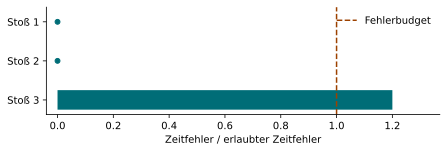
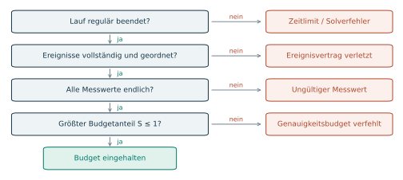

<a id="fb-neu10"></a>

# Kapitel 10 · Das ARGESIM-Benchmark-Framework und seine Methodik

<a id="kap10-einstieg"></a>

## Einleitung · Wann haben zwei Solver dieselbe Aufgabe gelöst?

Zwei Programme simulieren dieselbe Kugelreihe. Am Ende bewegt sich die letzte Kugel mit derselben Geschwindigkeit. Wer wissen will, wann ein Sensor auf den ersten Kontakt reagieren musste, braucht eine weitere Information. Eines der Programme kann den Kontakt zu spät ausgelöst haben und trotzdem am Ende dieselbe Geschwindigkeit melden. Welcher Lauf hat also den Auftrag erfüllt?

Damit sich das entscheiden lässt, halten wir für beide Programme Anfangslage, freie Bewegung und Stoßgesetz fest. Ein Beobachter liest dieselben Größen aus. Im elastischen Lehrfenster sind das drei Kontaktzeiten und vier Endgeschwindigkeiten. Die Kontakte brauchen eine Identität, weil der Vergleich sonst eine richtige Uhrzeit dem falschen Kugelpaar zuordnen könnte. Jede Messgröße erhält eine Referenz und ein Budget in ihrer eigenen Einheit. Für getrennte Zweierkontakte liefert die analytische Flugbahn eine Referenz für diese Uhrzeiten.

Die vollständige ARGESIM-Aufgabe umfasst darüber hinaus auch unelastische und stochastische Versuche. Wenn wir mit einem kleineren Fenster beginnen, ist sein Umfang Teil des Ergebnisses. Das Kapitel zeigt, wie aus solchen Festlegungen eine reproduzierbare Abnahme entsteht und welche Diagnose bei einer fehlenden Schaltung, einem verspäteten Kontakt oder einer zu großen Endabweichung jeweils hilft.

[Zum Schluss dieses Kapitels](#kap10-schluss)

<!-- Buchseite -->

<a id="fb-abs10-1"></a>

## 10.1 · Phänomen und Prüfaufgabe

### 10.1.1  Aus der Leitfrage wird eine beobachtbare Größe

Ein Prüfstand braucht dieselbe Aufgabe für jede Kandidatin. Die offizielle ARGESIM-Definition bestimmt Modell, Parameter und Aufgaben. Die Projektstudie kann ein kleineres Problemfenster wählen, etwa vier gleiche Kugeln statt einer vollständigen stochastischen Stoßkette. Dann muss das Ergebnis gerade dieses Fenster nennen.

### 10.1.2  Systemdarstellung und Referenz

Ein Eingang, ein Modell und ein Beobachter bilden den Versuch. Der Beobachter kann einen Zustand, eine Schaltzeit, ein Profil oder eine Verteilung liefern. Ein algebraischer Erhaltungssatz prüft eine andere Eigenschaft als eine unabhängig hergeleitete Lösung. Hängt eine Referenz von derselben rechten Seite ab, belegt Übereinstimmung in erster Linie die Integration dieser Gleichung.

<a id="fb-abs10-2"></a>

## 10.2 · Toleranzvertrag, Modellhärte und Methodenvergleich

### 10.2.1  Härtefälle vor dem Lauf festhalten

Ein Stoß verlangt gerichtete Wächter, eine algebraische Falte eine Astprüfung, ein Feld mehrere Gitter. Bei Zustandsgrößen unterschiedlicher Größenordnung erhalten Strom, Weg und Zeit jeweils eine eigene Einheit und ein eigenes positives Budget. Fehlende Ereignisse lassen sich auch bei kleinem Endfehler feststellen.

### 10.2.2  Vom Solverparameter zur unabhängigen Zielgröße

Die Integratortoleranzen $\mathrm{rtol},\mathrm{atol}$ steuern lokale Fehlerschätzer, das Quantum $\Delta_i$ den Abstand im Zustandsraum. Der äußere Akzeptanztest lautet $S=\max_j |Q_j-Q_j^*|/b_j$ mit $b_j>0$. Eine um zwei Millisekunden verspätete Kollision bei einem erlaubten Fehler von einer Millisekunde liefert $S=2$. Vor dem Zahlenvergleich müssen Anzahl und Zuordnung der Ereignisse stimmen. Ein ausgefallener Lauf erhält einen eigenen Status.

<a id="auflage-k10-01"></a>

**Ein Budget am Nulldurchgang.** Beträgt der Sollwert einer Auslenkung null, vereinbaren wir beispielsweise $b_j=\mathrm{atol}_j+\mathrm{rtol}_j|Q_j^*|$, mit $\mathrm{atol}_j>0$ in derselben Einheit wie $Q_j$ und dimensionslosem $\mathrm{rtol}_j\ge0$. Bei $Q_j^*=0$, $\mathrm{atol}_j=0{,}2\,\mathrm{mm}$ und einer Abweichung von $0{,}3\,\mathrm{mm}$ folgt $S_j=1{,}5$. Ein vorab festes positives Absolutbudget genügt ebenfalls. Für eine garantiert positive Referenzskala kann ein reines Relativbudget sinnvoll sein. Vor der Auswertung muss jedes verwendete $b_j$ endlich und positiv sein.


<a id="fb-abs10-3"></a>

## 10.3 · Aufgaben ausführen und Ergebnisse diagnostizieren

### 10.3.1  Pflichtaufgaben, Versuchsfenster und Abnahme

Im Repository registriert `argesim_benchmarks` die ausführbaren Teilaufgaben. Mit `python -m argesim_benchmarks run C05 validate` prüfen Sie die Schaltreferenz. Der Vergleich auf 3,5 Sekunden hat eigene Beobachtungen und Budgets. Die Zielerfüllung bei $S\le1$ gilt für die benannten Messungen und Einstellungen. Eine allgemeine Auszeichnung des Solvers folgt daraus nicht.

### 10.3.2  Diagnoseprotokoll

Zum Auftrag gehören Modellrevision, Einheiten, Parameter und Anfangswerte. Regeln für gleichzeitige Ereignisse stehen ebenfalls vor dem Lauf fest. Im Protokoll stehen danach die Zahl der akzeptierten und verworfenen Schritte, die Funktionsaufrufe und die tatsächlich gelieferte Ereignisfolge. Referenz und Rohfehler erklären den Score. Ein Lauf mit Zeitüberschreitung erhält einen Status. Für den Aufwand dokumentieren wir Wandzeit, Streuung und Rechner, damit der Vergleich nachvollziehbar bleibt.

<a id="v91-abnahme"></a>

### Was der Akzeptanzvertrag für jede Messgröße garantiert

Seien nach korrekter Zuordnung alle $Q_j$ und $Q_j^*$ endlich und alle Budgets $b_j$ positiv. Dann gilt
$$
S\le1
\quad\Longleftrightarrow\quad
|Q_j-Q_j^*|\le b_j\quad\text{für jedes }j.
$$
Aus der Schranke für das Maximum folgt jede Einzelschranke. Sind alle Einzelquotienten höchstens eins, gilt das auch für ihr Maximum. So lässt sich mit einer dimensionslosen Zahl über gleichzeitig verlangte technische Toleranzen entscheiden.

Ein Lehrvertrag fordere eine Schaltzeit bis auf $2\,\mathrm{ms}$, eine Fadenlänge bis auf $0{,}1\,\mathrm{mm}$ und eine Spannung bis auf $4\,\mathrm{mV}$. Abweichungen von $1{,}5\,\mathrm{ms}$, $0{,}08\,\mathrm{mm}$ und $5\,\mathrm{mV}$ entsprechen den Beiträgen $0{,}75$, $0{,}8$ und $1{,}25$. Das Spannungsbudget entscheidet für diesen Datensatz. Temperatur, Ort und Zeit bleiben in den Rohdaten in ihren eigenen Einheiten nachvollziehbar.

Zum Auftrag können außerdem die richtigen Ereigniskennungen, Reihenfolge, ein zulässiger Endstatus oder ein gefordertes Intervall gehören. Diese Bedingungen prüft man zusätzlich zu den numerischen Toleranzen. Die Solverparameter `rtol` und `atol` dienen der internen Schrittsteuerung. Die äußeren Budgets stehen in der Prüfspezifikation.

<!-- Buchseite -->


<a id="revision-k10-01"></a>

### Welche Modellfunktion gehört in diesen Abnahmetest?

Der Integrator fragt die aktuelle Rate ab. Beim Heizstab übergibt er dafür die Zeit und einen Temperaturüberschuss. Die Funktion liefert $\dot\theta=(10-\theta/4)/120$ in Kelvin pro Sekunde zurück. Bei $40\,\mathrm K$ muss sie null ergeben. Diese Probe gilt für jeden Integrator, dem wir dieselbe Funktion übergeben. Den vollständigen Aufruf können Sie im [vorangestellten Solverversuch](../lehrbuch_numerische_simulation.md#fb-heizstab-solver) ausführen. Für den Kugelversuch reicht die Probe der Modellfunktion allein noch nicht. Erst die geordnete Liste der berührenden Paare bestimmt, welche gemessenen Zeiten im Abnahmetest miteinander verglichen werden dürfen.


<!-- Buchseite -->

<a id="kap10-schrittfolge"></a>

### Wie Sekunden und Meter pro Sekunde in denselben Test eingehen

Ein Lehrversuch vereinbare für einen bezeichneten Kontakt die Referenzzeit $1\,\mathrm s$ mit einer Toleranz von $1\,\mathrm{ms}$. Für die letzte Kugel werde am Ende $1\,\mathrm{m/s}$ mit einem Budget von $0{,}01\,\mathrm{m/s}$ verlangt. Ein Programm meldet den richtigen Kontakt bei $1{,}0008\,\mathrm s$ und die Endgeschwindigkeit $1{,}005\,\mathrm{m/s}$.

Der Zeitfehler von $0{,}8\,\mathrm{ms}$ verbraucht $0{,}8$ des Zeitbudgets. Der Geschwindigkeitsfehler von $0{,}005\,\mathrm{m/s}$ verbraucht $0{,}5$ des Geschwindigkeitsbudgets. Der Score ist $S=\max(0{,}8;0{,}5)=0{,}8$. Beide Beiträge liegen höchstens bei eins. Der Kontakt beansprucht den größeren Teil seines Budgets und eignet sich daher als erste Messgröße für eine Verbesserung. Bei einem anderen Kontakt in der Ergebnisliste würden wir zuerst die falsche Identität protokollieren. Die Differenz zweier Zeitstempel hätte in diesem Fall keine eindeutige Bedeutung.

Das Beispiel trennt auch die Aufgabe vom Regler des Solvers. Wir können die interne Toleranz verkleinern und denselben Auftrag erneut prüfen. Die äußeren Budgets ändern sich dadurch nicht. So lässt sich erkennen, ob mehr Rechenarbeit gerade die für uns relevante Messgröße verbessert.

<!-- Buchseite -->

<a id="fb-labjournal"></a>

## Laborjournal · Zwei Einstellungen fair vergleichen

Stellen Sie sich vor, eine andere Laborgruppe soll Ihre Wahl morgen aus denselben Angaben nachrechnen. Welche Zeile dürfte in Ihrem Protokoll keinesfalls fehlen? Das Beispiel legt vor dem Vergleich den Auftrag für das Stiftpendel fest.

<a id="tab-k10-01"></a>

| Eintrag | Beispiel C07 A(i) |
| --- | --- |
| Frage und Einheit | Zu welchen Zeiten in Sekunden berührt oder verlässt der Faden den Stift bis $t=10\,\mathrm{s}$? |
| Formulierung | Nichtlineare Winkel-ODE pro Modus, Übergang mit konstanter gerichteter Bahngeschwindigkeit. |
| Referenz und Ziel | Publikation Tabelle 3, Spalte F. Genau acht gerichtete Übergänge, jeder höchstens $1\,\mathrm{ms}$ vom publizierten Wert entfernt. |
| Konfiguration | Verfahrensname, Version, Toleranzen, Startwerte, Einheiten, Schrittobergrenze und Behandlung der Nullstelle. |
| Gegenversuch | Zweites Verfahren und unabhängiger Grenzwert. Ein erzwungener falscher Reset muss als Fehler sichtbar werden. |
| Ergebnis | Größte absolute Abweichung $0{,}611\,\mathrm{ms}$. Der achte Übergang bestimmt den Wert. |

### Eine Gegenprobe wirklich ausrechnen

Ohne Umrechnung bliebe die Winkelgeschwindigkeit bei $-1{,}248739\,\mathrm{rad/s}$. Die neue Bahngeschwindigkeit wäre $0{,}3\omega^+=-0{,}374622\,\mathrm{m/s}$. Die vorgeschriebene Bahngeschwindigkeit ist $-1{,}248739\,\mathrm{m/s}$. Damit verliert das fehlerhafte Modell am Übergang $1-0{,}3^2=91\,\%$ der kinetischen Energie. Schon eine einzige Übergangsprüfung entlarvt den falschen Reset.

### Welche Art von Evidenz liegt vor?

Eine analytische Lösung prüft ausgewählte Gleichungen des Modells. Ein zweiter Integrator mit derselben rechten Seite prüft insbesondere deren numerische Behandlung. Ein Publikationsvergleich prüft zusätzlich, ob zwei Implementierungen denselben Versuch reproduzieren. Zur Vorhersage an realen Anlagen braucht man außerdem Messdaten mit Einheiten, Unsicherheiten und dokumentiertem Aufbau.

[Zeittabelle des Laborversuchs](../lehrbuch_numerische_simulation.md#fb-c07labor) · [ARGESIM, Aufgaben und Lösungen](https://www.argesim.org/benchmarks).

<a id="fb-rechnen"></a>

## Rechenpraktikum mit und ohne Projektcode

Die grundlegenden Handrechnungen laufen mit Python und der Standardbibliothek. Für [die Messplanung](../lehrbuch_numerische_simulation.md#mp-labor) kommen NumPy und SciPy hinzu. [Historisches Versuchsverzeichnis](https://github.com/5H3LL3H5/argesim-hyperposition-benchmarks/tree/16f0f2528fcf77f16898ecd74ad952be2c09eac2/docs/lehrbuch/studienbuch/material)

### Eine Gitterzeile nur mit der Standardbibliothek

Für eine einzelne Sinusmode genügt die folgende, vollständige Rechnung. Sie reproduziert die Zeile $N=16$ für dieses Stabmodell, weil der mittlere Knoten den Wert eins in der Anfangsmode besitzt.

```python
from math import exp, pi, sin

N, steps, end = 16, 64, 0.1
lam = -4 * N**2 * sin(pi / (2 * N))**2
pde = exp(-pi**2 * end)
mol = exp(lam * end)
euler = (1 + end * lam / steps)**steps
print(abs(mol-pde), abs(euler-mol), abs(euler-pde))
```

Erwartet werden gerundet $0{,}00118216,\ 0{,}00284553,\ 0{,}00166337$. Das historische Skript rechnet zusätzlich auf allen Innenknoten, ohne die modale Formel im Zeitschritt zu verwenden.

### Die ARGESIM-Studie wiederholen

Im verlinkten Publikationsstand erzeugen diese Aufrufe aus dem Stammverzeichnis zwei neue Ergebnistabellen.

```text
python benchmarks/benchmark_solver_extension.py --output acht.csv
python benchmarks/benchmark_solver_selection.py \
    --profile rk23 --output rk.csv
```

Beide Versuchsreihen verwenden dieselbe Definition des Scores. Das Manifest nennt CPU, Versionen, Seed und Wiederholungen. Prüfen Sie zuerst Ereignisse, Fehlerstatus und Zähler. Lokale Laufzeiten streuen.

[Publikationsstand 1824c91041](https://github.com/5H3LL3H5/argesim-hyperposition-benchmarks/tree/1824c9104152674b82de6cd84d53b0b4f68dca37) · [Acht-Fälle-Protokoll](https://github.com/5H3LL3H5/argesim-hyperposition-benchmarks/blob/1824c9104152674b82de6cd84d53b0b4f68dca37/benchmarks/benchmark_solver_extension.py) · [Auswahlprotokoll](https://github.com/5H3LL3H5/argesim-hyperposition-benchmarks/blob/1824c9104152674b82de6cd84d53b0b4f68dca37/benchmarks/benchmark_solver_selection.py).

<a id="fb-pruefung10"></a>

## Aus Rohgrößen eine überprüfbare Entscheidung gewinnen

Der Prüfstand beobachtet zwei unterschiedliche Uhren. Die erste läuft in der simulierten Anlage und bestimmt, wann ein Kontakt eintritt. Die zweite misst, wie lange der Computer für den Versuch braucht. Ein später Kontakt in der Modellzeit kann auch auf einem schnellen Rechner falsch sein. Welche Information muss man aufbewahren, damit ein anderer den Versuch nachprüfen kann?

Beginnen wir mit dem C12-Fenster aus Kapitel 12. Die Referenz besteht in dieser Reihenfolge aus drei Kontaktzeiten $1,2,3\,\mathrm{s}$ und vier Endgeschwindigkeiten $0,0,0,1\,\mathrm{m/s}$. Jedes Zeitbudget beträgt $0{,}001\,\mathrm{s}$, jedes Geschwindigkeitsbudget $0{,}001\,\mathrm{m/s}$. Spielen wir als Gegenprobe nur den dritten Kontakt um $0{,}0012\,\mathrm{s}$ zu spät ein. Nach Division durch das zugehörige Budget ist sein Beitrag $1{,}2$. Alle anderen Beiträge verschwinden. Das Maximum $S=1{,}2$ verwirft diesen konstruierten Lauf. Entfernen wir dagegen den mittleren Kontakt, fehlt die Zuordnung. Die noch vorhandenen Zeitwerte gehören jetzt zu anderen Paaren.

```text
wenn Lauf abgebrochen: Grund und letzte Modellzeit sichern
sonst wenn Kontaktkennungen ungleich Referenz: Ereignisfehler
sonst:
    fuer jede verlangte Messgroesse j:
        pruefe endlichen Wert, passende Einheit und Budget > 0
        e[j] = abs(Messwert[j] - Referenz[j]) / Budget[j]
    speichere max(e), Index des Maximums und alle Einzelwerte
```

**Für die eigene Versuchsakte.** Halten Sie zusätzlich Modellversion, Startdaten, Reihenfolge der Ereignisse, Rechner, gezählten Arbeitsumfang und Wiederholungen fest. Die Grenzwerte und dieser Maximalscore gehören zur Vergleichsstudie im Buch. Maßgeblich für die offiziellen Aufgaben bleiben die jeweiligen ARGESIM-Definitionen. Im entpackten Labor führt `python kapitelvergleich.py` die 17 Gegenproben des Buchs aus.

[Ausführbares Protokoll mit acht Fällen](https://github.com/5H3LL3H5/argesim-hyperposition-benchmarks/blob/16f0f2528fcf77f16898ecd74ad952be2c09eac2/benchmarks/benchmark_solver_extension.py) · [Aufgaben der Kugelreihe](../lehrbuch_numerische_simulation.md#fb-refC12).

<!-- Buchseite -->

## Rechenprobe · Drei richtige Kontakte, ein verspäteter Stoß

Die Kugeln treffen in der richtigen Reihenfolge aufeinander. Die Referenzzeiten sind 1, 2 und 3 Sekunden. Als dritte Zeit liefert der Solver 3,0012 Sekunden. Bei einem Millisekundenbudget wächst allein dieser Beitrag auf $0{,}0012/0{,}001=1{,}2$. Eine Viertelung des internen Solverparameters würde erst dann etwas am Befund ändern, wenn der erneute Lauf eine hinreichend genaue Kontaktzeit liefert.



**Aufgabe.** Die zweite und dritte Kontaktkennung werden vertauscht. Alle drei Zeiten bleiben gleich. Wie ändert sich die Auswertung?

**Musterlösung.** Zuerst vergleicht der Beobachter die geordnete Kontaktfolge. Die Zuordnung des zweiten und dritten Referenzwerts wäre nach der Vertauschung falsch. Der Beobachter meldet die Abweichung mit beiden Kennungen. Ein Maximum über die drei Zeitdifferenzen hätte hier keine physikalische Bedeutung. Die Funktion `benchmark()` in `rechenlabor/kapitelvergleich.py` prüft beide Fälle.

<!-- Buchseite -->

<a id="bild-abnahme"></a>

## Vom Ereignisprotokoll zum Budgetentscheid

Ein Kugelstoß kann auf die Mikrosekunde genau am erwarteten Zeitpunkt liegen und trotzdem die falschen Kugeln betreffen. Würde man nur die Zeiten subtrahieren, bekäme diese Rechnung den Score null. Deshalb vergleichen wir zuerst die Identität und Reihenfolge der verlangten Beobachtungen. Erst für ein vollständiges Protokoll ist die Frage sinnvoll, wie weit sein Messwert vom Sollwert entfernt liegt.



Für eine Sollzeit von $1{,}000\,\mathrm s$ und ein Budget von $0{,}002\,\mathrm s$ beansprucht der richtige Kontakt bei $1{,}001\,\mathrm s$ die Hälfte seines Budgets. Der Quotient ist $0{,}5$. Sind alle übrigen Quotienten höchstens ebenso groß, wird der Lauf angenommen. Fehlt derselbe Kontakt ganz, bleibt sein Zeitfehler undefiniert. Diese Unterscheidung bestimmt, welche Punkte später im Aufwand-Genauigkeits-Diagramm erscheinen.

<!-- Buchseite -->

<a id="druck-beleglegende"></a>

## Leseschlüssel · Beweis, Gegenprobe oder historische Messung?

**Beweis.** Die Aussage folgt aus Voraussetzungen. Stehen dort feste Enden oder ein einfacher Nulldurchgang, gilt das Ergebnis nicht automatisch für freie Enden oder eine Mehrfachnullstelle. Ein Beispiel kann den Beweis illustrieren, aber nicht ersetzen.

**Numerische Gegenprobe.** Wir nennen Eingaben, Referenz, Raster oder Zeitpunkte und Fehlermaß. Eine eingehaltene Fehlerschranke auf 500 Stützstellen ist zunächst nur ein Befund für diese 500 Stellen. Für eine Schranke zwischen den Stellen brauchen wir ein zusätzliches Argument.

**Historische Messung.** Eine Zahl aus einem Archiv gehört zu genau dieser Revision, Konfiguration und Messumgebung. Vergleichen wir Laufzeiten, müssen Aufgabe und Arbeitsumfang zusammenpassen. Eine neue Wiederholung steht separat und überschreibt den Archivwert nicht.

**Einmal an C05 anwenden:** Das Euler-Schrittlimit für die schnelle lineare Mode ist eine hergeleitete Aussage. Die drei Schaltzeitfehler von Radau und BDF sind gemessene Ergebnisse auf einem begrenzten Versuch. Die ursprüngliche Acht-Fälle-Matrix bleibt mit ihrer eigenen Revision und ihrem eigenen Budget dokumentiert.

<!-- Buchseite -->

<a id="kap10-schluss"></a>

## Schluss · Ein Auftrag gilt erst mit Beobachtung und Referenz

Die Kugelreihe braucht eine Kontaktzeit zusätzlich zur Endgeschwindigkeit. Beide Programme lösen dieselbe Aufgabe, wenn Modell, Beobachter und Kriterien übereinstimmen. Die Ereignisse müssen vollständig sein und zu den richtigen Kugelpaaren gehören. Erst dann kann man für jede numerische Größe den Fehler durch ihr Budget teilen. Der größte Anteil benennt die Messgröße, die dem Grenzwert am nächsten kommt.

Bei einer Abweichung bleibt das Ergebnis als Diagnose nutzbar. Eine zu späte Schaltung verlangt eine andere Gegenprobe als ein falsch zugeordnetes Ereignis. Ein abgebrochener Lauf muss als solcher erkennbar sein. Der Aufwand wird bei gleicher geforderter Qualität und vergleichbaren Laufbedingungen ausgewertet. Dazu gehören Modell- und Programmstand, Referenz, Budgets sowie der Status jedes Laufs.

Im folgenden Versuch werden die Beobachtungen einer Hystereseschaltung einzeln festgelegt. Wir werden sehen, warum ein richtiger Endwert zu wenig über die schnelle Phase nach der Schaltung aussagt. [C05](../lehrbuch_numerische_simulation.md#fb-neu11)

<a id="kap10-forschung"></a>

### Aktueller Stand der Forschung

Ein 2026 publizierter Rahmen zur Reproduzierbarkeit rechnergestützter Experimente fasst Abläufe und die zugehörigen Informationen so, dass ein Versuch aus mehreren wissenschaftlichen Bereichen erneut ausgeführt werden kann. Für Solverberichte ist daran eine Trennung besonders wertvoll. Die technische Wiederholung eines Ablaufs prüft, ob sich Daten und Ausführung rekonstruieren lassen. Eine unabhängige Gegenrechnung prüft zusätzlich die numerische Aussage. Im Kugelversuch könnte eine zweite Implementierung denselben Ablauf zunächst ausführen und dann die Kontaktzeiten aus den analytischen Abständen neu bestimmen. Beide Prüfungen gehören mit ihrer jeweiligen Referenz ins Ergebnis. [A framework for supporting the reproducibility of computational experiments in multiple scientific domains (2026)](https://doi.org/10.1016/j.future.2025.107924)

[Zur Einleitung dieses Kapitels](#kap10-einstieg)
