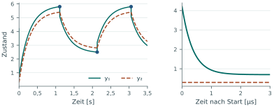

# Kapitel 11 · C05 – Zwei Zustände, Hysterese und schnelle Relaxation

## Einleitung · Welche Uhr verrät, ob ein schneller Schalter richtig gerechnet wurde?

Die Anzeige eines Reglers folgt einer langsam wandernden Sollgröße. Nach einem Wechsel liegt ihr neuer Sollwert plötzlich an einer anderen Stelle. Die Anzeige reagiert für einen kurzen Augenblick besonders schnell. Wer erst am Ende der Rechnung hinsieht, bemerkt diesen Augenblick kaum. Die nächste Schaltung hängt aber von der kontinuierlichen Bewegung bis zu einer Schwelle ab. Lässt sich die kurze Phase wirtschaftlich berechnen und der kommende Wechsel trotzdem genau treffen?

Das Wärmebild aus Kapitel 1 hilft beim Verständnis der beiden Zeitskalen. C05 selbst definiert ein mathematisches Zweizustandsmodell. Der zweite Zustand läuft innerhalb eines Modus exponentiell auf einen festen Sollwert zu. Der erste Zustand folgt ihm mit einem größeren Koeffizienten und einem modusabhängigen Versatz. Beim Durchgang durch die obere Schwelle wechselt die Regel, und erst an der unteren Schwelle gilt wieder die erste Regel. Dieser Unterschied heißt Hysterese.

Wir lösen die Phasen nacheinander analytisch und verwenden die Durchgangszeiten als Referenz. Das kurze Studienfenster von $3{,}5\,\mathrm s$ verlangt drei gerichtete Wechsel mit je $1\,\mathrm{ms}$ Zeitbudget und zwei Endwerte mit je $0{,}006$ Budget. Für die Diagnose reichen diese Endwerte allein nicht aus. Auf beiden Seiten eines Wechsels speichern wir auch den Modus und den Zustand. So können wir getrennt untersuchen, ob ein Integrator die schnelle Bewegung dämpft und ob er tatsächlich den richtigen Wächter zur richtigen Zeit erreicht.

[Übung: Stabilität, Schaltzeit und Aufwand](#druck-c05-entscheidung) · [Zum Schluss dieses Kapitels](#kap11-schluss)

<!-- Buchseite -->

## C05 · Wie klein ist ein schneller Vorgang?

**Lernziel.** Sie können im ARGESIM-Fall C05 die schnelle Zeitkonstante abschätzen, eine explizite Schrittweite beurteilen und Schaltzeit und Endzustand getrennt prüfen.

Eine Kurve auf dem Bildschirm umfasst mehrere Sekunden. Für ein schnell abklingendes Detail nennt das Modell eine Rate von $a=2{,}7\cdot10^6\,\mathrm{s^{-1}}$. Könnte ein Rechenschritt von einer Mikrosekunde schon zu groß sein? Für diese Vorrechnung betrachten wir eine einzelne Abweichung $z$ mit $\dot z=-az$.

### Ein überschaubares Experiment vor dem Benchmark

Starten wir mit $z_0=1$, ergibt Euler $z_1=1-ah$. Bei $h=1\,\mu\mathrm s$ ist $ah=2{,}7$. Also springt die Rechnung auf $-1{,}7$. Eine zweite Anwendung liefert $+2{,}89$. Der Betrag wächst, obwohl die exakte Abweichung $e^{-at}$ ständig abnimmt. Nach der ersten Mikrosekunde beträgt sie nur rund $0{,}0672$.

### Was diese Probe für die Solverwahl liefert

Probieren Sie $0{,}25\,\mu\mathrm s$. Der Faktor wird $0{,}325$. Die Abweichung fällt jetzt. Der Unterschied zur exakten Kurve bleibt eine eigene Frage. Für $a>0$ ist $|1-ah|<1$ genau bei $0<h<2/a$ erfüllt. Das erklärt die Kosten kleiner expliziter Schritte über mehrere Sekunden.

**Ihr Laborauftrag.** Prüfen Sie beim vollständigen Zweizustandsmodell zuerst Anzahl und Richtung der Schaltvorgänge. Vergleichen Sie danach jeden Zeitpunkt mit der Referenz und erst dann die beiden Endwerte. Ein Foto des Endzustands allein dokumentiert keinen einzigen Schaltzeitpunkt.

Die Parameter und Schaltregeln des offiziellen Modells folgen auf der nächsten Seite. Die skalare Abklingrechnung hier isoliert einen Teil der Dynamik.

**Kernweg**  [Gleichungen und Schalter](#fb-arg)  **Vertiefung**  [Exakte Phasen beweisen](#fb-schluss8) [Selbst prüfen](#fb-ueb8).

## C05 · Zwei Zeitskalen und drei Schaltungen

**Erst schätzen.** Wie schnell klingt eine Störung mit der Rate $2{,}7\cdot10^6\,\mathrm{s^{-1}}$ um den Faktor $e$ ab?

Nun gilt das vollständige C05-Modell. Es ist durch Gleichungen vorgegeben. Die schnelle Größe $y_1$ läuft dem momentanen Ziel $y_2+c_2$ nach, die langsamere Größe $y_2$ dem Ziel $c_4$. Mit den Raten $a,b$ ergeben sich die beiden Bilanzen

$$
\dot y_1=a(y_2+c_2-y_1),\qquad \dot y_2=b(c_4-y_2)
$$

Die Raten sind $a=2{,}7\cdot10^6\,\mathrm{s^{-1}}$ und $b=3{,}5651205\,\mathrm{s^{-1}}$, der Start ist $(4{,}2;\,0{,}3)$. Zuerst gilt $(c_2,c_4)=(0{,}4;\,5{,}5)$. Steigt $y_1$ auf $5{,}8$, wird $(-0{,}3;\,2{,}73)$ aktiv. Beim Absinken auf $2{,}5$ wird zurückgeschaltet. Beide Zustände sind beim Umschalten stetig, ihre Ableitungen können springen.

### Referenz innerhalb einer Phase

Seien $(y_{10},y_{20})$ der Phasenstart und $s$ die lokale Zeit. Für $d=y_{20}-c_4,\ B=ad/(a-b)$ gilt durch Lösung der zweiten Gleichung und Einsetzen in die erste

$$
y_2=c_4+d e^{-bs},\qquad
 y_1=c_4+c_2+B e^{-bs}+(y_{10}-c_4-c_2-B)e^{-as}.
$$

Eine Nullstellensuche auf der jeweiligen exakten Phase liefert bis $3{,}5\,\mathrm{s}$ die Schaltzeiten $1{,}108306$, $2{,}129685$ und $3{,}054153\,\mathrm{s}$. Die Anfangsschicht hat die Zeitkonstante $1/a=0{,}37037\,\mu\mathrm s$.

[Offizielle Aufgabe C05](https://www.argesim.org/benchmarks/c05) · [Phasenmodell](https://github.com/5H3LL3H5/argesim-hyperposition-benchmarks/blob/1824c9104152674b82de6cd84d53b0b4f68dca37/argesim_benchmarks/models/c05_two_state.py) · Schaltzeiten aus `c05_schaltungen` nachgerechnet.

## Labor C05 · Zwei Solver unter derselben Schaltregel

### Auftrag und Versuchsaufbau

Berechnen Sie für das [Zweizustandsmodell](#fb-arg) alle Schaltzeiten bis $3{,}5\,\mathrm{s}$ und den Endzustand. Verwenden Sie für diesen Lehrversuch die Schranken $10\,\mu\mathrm s$ je Ereignis und $10^{-5}$ je Zustandskomponente. Diese Grenzwerte sind enger als die des späteren Projektvergleichs. Halten Sie den jeweiligen Modus bis zum gerichteten Übergang fest, lokalisieren Sie die Nullstelle, schalten Sie um und starten Sie den Solver beim gefundenen Zeitpunkt neu. Ein Restart verwirft die Schrittgeschichte des bisherigen Modus.

Radau IIA und BDF erhalten hier $\mathrm{rtol}=10^{-8}$, $\mathrm{atol}=10^{-10}$, $h_\mathrm{max}=0{,}2\,\mathrm{s}$ sowie die gleiche exakte Jacobi-Matrix $J=\left(\begin{smallmatrix}-a&a\\0&-b\end{smallmatrix}\right)$. Als dritte, unabhängige Rechnung dienen die analytischen Phasen mit skalarem Nullstellensucher. Diese liefert $y(3{,}5)=(2{,}97475519,3{,}27475448)^\mathsf T$.

**Studie und Ziel.** Diese Tabelle gehört zum dreifachen Referenzvergleich über $3{,}5\,\mathrm s$ mit $10\,\mu\mathrm s$ Zeitbudget und $10^{-5}$ Endwertbudget. In der getrennten Acht-Fälle-Reihe versagen im C05-Fenster 54 QSS-Einstellungen und drei klassische Einstellungen, also 0 von 57. In der Steifigkeitsstudie mit 138 Gesamtkonfigurationen sind weitere Kandidaten zugelassen. Radau erreicht bei relativer Toleranz $10^{-3}$ den Score 0,4168 gegenüber der analytischen Phasenlösung. Dort gelten $1\,\mathrm{ms}$ je Schaltzeit und 0,006 je Endzustand. Erst Kandidaten und Vertrag zusammen erklären die unterschiedlichen Entscheidungen.

| Verfahren | $f$-Aufrufe | LU | max. Zeitfehler | max. Endfehler |
| --- | --- | --- | --- | --- |
| Radau IIA | 5 029 | 256 | $0{,}0152\,\mu\mathrm s$ | $2{,}95\cdot10^{-8}$ |
| BDF | 1 690 | 169 | $1{,}13\,\mu\mathrm s$ | $2{,}33\cdot10^{-6}$ |

Beide Verfahren liefern alle drei Übergänge und erfüllen beide Ziele. Am Zeitfehler ist Radau hier genauer. BDF benötigt weniger Funktionsauswertungen und Faktorisierungen. Bei einer verschärften Zeitgrenze von $1\,\mu\mathrm s$ qualifiziert sich in diesen Einstellungen allein Radau. So entscheidet ein geänderter Auftrag bei denselben Rohdaten anders.

### Gegenversuch

Verwenden Sie gedanklich Vorwärts Euler. Für die schnelle reelle Mode verlangt $|1-ha|\le1$ bereits $h\le 2/a=0{,}740740\ldots\,\mu\mathrm s$. Selbst an der Stabilitätsgrenze bräuchte ein gleichmäßiges Gitter über 3,5 Sekunden mindestens 4 725 000 Schritte. Bei $0{,}740\,\mu\mathrm s$ ist $R=-0{,}998$, bei $0{,}741\,\mu\mathrm s$ schon $R=-1{,}0007$. Für eine stabile Proberechnung eignet sich von diesen Werten nur der erste. Die Rechnung erklärt, warum ein naiver expliziter Vergleich hier teuer ist.

Neu gerechnet mit `python labor.py c05`, SciPy 1.17.0. [Referenz für die Modellparameter](https://github.com/5H3LL3H5/argesim-hyperposition-benchmarks/blob/1824c9104152674b82de6cd84d53b0b4f68dca37/argesim_benchmarks/models/c05_two_state.py).

### Was ein explizites Schrittlimit über den Aufwand verrät

Die analytische Lehrprobe kann neben Euler auch Dormand–Prince 5(4) beurteilen. Für die schnelle C05-Mode gilt $\lambda=-a$. Setzen wir $z=-ah$ in das Stabilitätspolynom der akzeptierten Formel ein, erhalten wir
$$
R(z)=1+z+\tfrac12z^2+\tfrac16z^3+\tfrac1{24}z^4+
\tfrac1{120}z^5+\tfrac1{600}z^6 .
$$

Warum endet das Intervall gerade hier? Für $x=ah>0$ ist $R(-x)$ größer als $e^{-x}$, denn es ist das Taylorpolynom sechsten Grades für $e^{-x}$ plus $x^6/3600$. Es genügt daher, $R(-x)=1$ zu lösen. Nach Ausklammern von $x/600$ bleibt
$$p(x)=x^5-5x^4+25x^3-100x^2+300x-600.$$
Es gilt $p(0)<0$, $p(4)>0$ und $p'(x)=5(x^2-2x)^2+55x^2-200x+300>0$. Das letzte Quadratpolynom hat negative Diskriminante. Die einzige positive Nullstelle $x_5=3{,}306567893\ldots$ liefert also genau $0\le ah\le x_5$. Bei $a=2{,}7\cdot10^6\,\mathrm{s^{-1}}$ folgt $h\le1{,}22465\,\mu\mathrm s$, also mindestens 2 857 949 gleich große Schritte über $3{,}5\,\mathrm s$. Das Labor gewinnt das Polynom unabhängig aus dem Stufentableau. [Dormand und Prince, 1980](https://doi.org/10.1016/0771-050X%2880%2990013-3)

**Zur Auswertung im Labor.** Die feste Schrittzahl ist eine Stabilitätsrechnung für eine skalare Mode. Ein adaptiver RK45-Lauf wählt seine Schritte anhand des tatsächlichen Zustands, seines Fehlerschätzers und der Ereignisbehandlung. Seine verworfenen Versuche sind eine eigene Messgröße. Die Tabelle oben dokumentiert für Radau IIA und BDF die gemessenen Aufrufe der rechten Seite, die LU-Zerlegungen und die Zeitfehler. Zählt man bei einem weiteren Solver auch Lösungsversuche und Ereignisaufrufe, lassen sich diese Arbeitsgrößen bei demselben Auftrag vergleichen.

<!-- Buchseite -->

### Was fünf schnelle Zeitkonstanten für die langsame Phase bedeuten

In der analytischen Phasenlösung fällt ein Anteil mit der Rate $a=2{,}7\cdot10^6\,\mathrm{s^{-1}}$, der andere mit $b\approx3{,}565\,\mathrm{s^{-1}}$. Nach der Zeit $5/a\approx1{,}85\,\mu\mathrm s$ hat sich der schnelle Anteil mit $e^{-5}\approx0{,}00674$ multipliziert. Von seiner ursprünglichen Amplitude sind also weniger als ein Prozent übrig. Für den langsamen Anteil ist in derselben Zeit der Exponent nur $5b/a\approx6{,}6\cdot10^{-6}$. Seine Amplitude hat sich kaum verändert.

Die Rechnung erklärt, was ein impliziter Solver gewinnen kann. Wenn der Auftrag nur den weiteren langsamen Verlauf verlangt, sollte die schnelle Mode nach einigen ihrer Zeitkonstanten numerisch nicht erneut wachsen. Wer dagegen die Form der ersten Übergangsschicht selbst messen will, braucht in genau diesem Abschnitt genügend Ausgabepunkte und eine Fehlerkontrolle. Jeder Moduswechsel kann erneut einen schnellen Anteil anregen, weil sich die rechte Seite ändert.

Das Ereignisbudget prüft eine weitere Eigenschaft. Die Schaltung findet dort statt, wo die Phasenlösung ihre Schwelle erreicht. Ein Solver kann die Anfangsschicht gut dämpfen und die Schwelle mit einer zu groben Zwischenwertkurve trotzdem zu spät finden. Darum bleiben die Phase und die Uhrzeit getrennte Prüfgrößen.

<!-- Buchseite -->

## C05 · Welche Messgröße den Vergleich entscheidet

Der Regler schaltet dreimal. Eine Berechnung kann jeden Schaltaugenblick fast genau treffen und am Ende trotzdem den schlechteren Zustandswert liefern. Das wird sichtbar, wenn man die Zeitfehler und die Endzustandsfehler vor dem Maximum getrennt normiert. Wir verwenden hier ausdrücklich die engen Grenzen des C05-Lehrversuchs [Labor C05 · Zwei Solver unter derselben Schaltregel](#fb-c05labor).

Dort betragen die Budgets $10\,\mu\mathrm{s}$ je Schaltung und $10^{-5}$ je Zustandskomponente. Für Radau ergeben die größten Abweichungen $0{,}0152\,\mu\mathrm{s}/(10\,\mu\mathrm{s})=0{,}00152$ und $2{,}95\cdot10^{-8}/10^{-5}=0{,}00295$. Für BDF erhält man $1{,}13/10=0{,}113$ sowie $2{,}33\cdot10^{-6}/10^{-5}=0{,}233$. Mit den gedruckten, gerundeten Werten ist also $S_{\rm Radau}\approx0{,}00295$ und $S_{\rm BDF}\approx0{,}233$. In beiden Fällen stammt das Maximum aus dem Endzustand. BDF benötigt im selben Versuch 169 LU-Zerlegungen, Radau 256. Genauigkeit und Faktorisierungsaufwand beantworten verschiedene Fragen.

Die ursprüngliche Matrix verwendet andere Budgets und andere Verfahrenseinstellungen. Dort meldet etwa QSS2 mit Quantenfaktor $10^{-3}$ einen Timeout. Für diesen Eintrag fehlt der vollständige Beobachtungsvektor. Eine freie Zahl wie „unendlicher Fehler“ würde eine nicht gemessene Größe vortäuschen. Die Standardaufgabe mit fünf Wechseln und der D-Versuch mit 62 Wechseln besitzen wiederum einen anderen Beobachtungshorizont.

**Erster Schritt bei abweichendem Befund.** Vergleichen Sie den aktiven Schalter, den Zeitpunkt seiner Aktivierung und die gerichtete Schwellenüberschreitung mit der analytischen Lösung des aktuellen Modus. Erst wenn alle drei Ereignisse zugeordnet sind, haben die zwei Endwertfehler dieselbe physikalische Bedeutung.

[Fehler und Aufwandszähler](#fb-c05labor) · [ARGESIM-Aufgaben](../lehrbuch_numerische_simulation.md#fb-refC05) · [Ursprüngliches Raster](https://github.com/5H3LL3H5/argesim-hyperposition-benchmarks/blob/16f0f2528fcf77f16898ecd74ad952be2c09eac2/docs/evidence/qss-extension.csv).

## Selbst prüfen · Zeitbudgets bei C05

**Merksatz.** Im C05-Versuch können schnelle Abweichungen längst abgeklungen sein, während ein expliziter Integrator für ihre numerische Stabilität weiterhin kleine Schritte benötigt.

### A · Eine Zeitskala erkennen

Für eine vereinfachte Abklingprobe sei $a=4\cdot10^5\,\mathrm{s^{-1}}$ und $\dot z=-az,\ z(0)=1$. Wie viele Mikrosekunden dauert es bis auf $1/e$, wie lange bis auf ein Prozent? Schreiben Sie erst die Gleichung für den Restanteil und dann den Zahlenwert.

### B · Einen vermeintlich sicheren Schritt prüfen

Für dieselbe Probe behauptet jemand, bei $h=5\,\mu\mathrm s$ bilde Euler das Abklingen gut ab, weil sein Zustandsbetrag begrenzt bleibt. Prüfen Sie die ersten drei Schritte. Untersuchen Sie anschließend $h=2{,}5\,\mu\mathrm s$. Welches Verhalten zeigt diese Rechnung nach nur einem Schritt im Vergleich zum exakten Rest?

### C · Einen Auftrag für Prüfdaten auswerten

Für einen Lehrvergleich seien alle drei Ereignisse richtig geordnet und beide Endzustände hinreichend genau. Bei Einstellung A betragen die absoluten Zeitfehler $0{,}3;\ 0{,}7;\ 0{,}9\,\mu\mathrm s$, bei B $0{,}2;\ 1{,}4;\ 0{,}4\,\mu\mathrm s$. A benötigt 200, B 120 Auswertungen derselben rechten Seite. Welche Einstellungen erfüllen eine Grenze von $1\,\mu\mathrm s$ je Ereignis? Wie verändert eine Grenze von $2\,\mu\mathrm s$ die Wahl, wenn nur diese Auswertungen gezählt werden? Dies sind Übungsdaten.

**Hinweis.** Bei einer Grenze pro Ereignis ist der größte Einzelwert entscheidend. Rechnen Sie Mikrosekunden vor dem Einsetzen in $1-ah$ in Sekunden um.

[Lösungswege A, B und C](#fb-loesweg8) · [Zum Kapitelauftakt](#fb-kap8).

## Lösungswege · Zeitbudgets bei C05

### A · Beide Restanteile berechnen

Mit $z=e^{-at}$ gehört zum Restanteil $1/e$ die Zeit $t=1/a=2{,}5\,\mu\mathrm s$. Für $z=0{,}01$ gilt $-at=\ln(0{,}01)$. Damit ist $t=\ln(100)/a\approx11{,}51\,\mu\mathrm s$. Eine Zeitkonstante senkt die Störung also noch lange nicht auf ein Prozent.

### B · Begrenzte Schwingung und richtiges Abklingen

Für $5\,\mu\mathrm s$ ist der Euler-Faktor $1-2=-1$. Aus $1$ entstehen $-1,1,-1$. Der Betrag bleibt konstant, die exakte Lösung fällt. Für $2{,}5\,\mu\mathrm s$ ist der Faktor null. Nun verschwindet die numerische Störung schon im ersten Schritt vollständig. Exakt bleibt $e^{-1}\approx0{,}3679$. Auch diese andere stabile Wahl erzeugt hier einen großen Fehler.

### C · Erst die Schwelle prüfen, dann zählen

Die größten absoluten Zeitfehler sind $0{,}9$ und $1{,}4\,\mu\mathrm s$. Bei $1\,\mu\mathrm s$ erfüllt nur A den gesamten Auftrag. Bei $2\,\mu\mathrm s$ erfüllen ihn beide. B braucht in den vorgegebenen Daten 80 Auswertungen weniger. Das sind bezogen auf A $80/200=40\,\%$ weniger Auswertungen. Ob die Wanduhr ebenfalls 40 Prozent weniger anzeigt, wurde in dieser Übung nicht gemessen.

**Bezug zum eigentlichen Labor.** Auch dort gibt es eine analytische Referenz innerhalb jeder Phase. Setzen Sie die Zeitmessung des Ereignisses an der verfeinerten Nullstelle an. Der nächste Ausgabepunkt eines Zeitrasters kann deutlich später liegen.

[Noch einmal selbst rechnen](#fb-ueb8) · [Forschungsstand und Beweisfragen](#fb-schluss8).

## Eine Schaltzeit ist eine eigene Messgröße

### Welche Frage die analytische Phase beantwortet

C05 gehört zu den frühen ARGESIM-Vergleichen für zustandsabhängiges Schalten. Die neuere Theorie hybrider Sensitivitäten erklärt, warum eine kleine Abweichung in einem kontinuierlichen Zustand den Zeitpunkt eines Wechsels verschieben kann. Untersuchungen zu adaptiven Reglern erklären außerdem, warum Schrittfolgen und Arbeitsaufwand vom implementierten Regler abhängen. Beide Fragen betreffen den vorliegenden Versuch.

### Beweis · Exakte Phasen trotz steifer Mode

In einem festen Modus ist $y_2-c_4=d e^{-bs}$. Die erste Gleichung hat die Form $\dot y_1+ay_1=a(c_4+c_2+d e^{-bs})$. Der Ansatz $A+B e^{-bs}+C e^{-as}$ liefert durch Koeffizientenvergleich $A=c_4+c_2,\ (a-b)B=ad$. Aus dem Anfangswert folgt $C=y_{10}-A-B$. Damit ist die [C05 · Zwei Zeitskalen und drei Schaltungen](#fb-arg) verwendete Phasenreferenz für $a\ne b$ bewiesen. Bei $a=b$ benötigt der Resonanzterm stattdessen einen Faktor $s e^{-as}$.

### Ergebnis der Nachuntersuchung

Für beide um bis zu $0{,}005$ veränderten Schaltschwellen lassen sich die ersten vier Übergänge per Intervallarithmetik einklammern. Drei davon liegen sicher innerhalb des Lehrversuchs von $3{,}5\,\mathrm{s}$.

[Nachweis und Ergebnis](../lehrbuch_numerische_simulation.md#fb-befundereignis) · [ARGESIM C05](https://www.argesim.org/benchmarks/c05) · [Kong u. a., Sensitivität an Ereignissen](https://arxiv.org/abs/2306.06862) · [Ranocha und Giesselmann, adaptive Schrittweitenkontrolle](https://doi.org/10.1007/s44207-024-00001-0).

**Gegenprobe im Rechenlabor.** Bei genau drei richtigen Schaltungen vergleicht `rechenlabor/kapitelvergleich.py` Radau und BDF mit denselben äußeren Budgets. Bei einem Zeitbudget von zehn Mikrosekunden trägt ein Fehler von 1,13 Mikrosekunden den Anteil 0,113 zum Maximalscore bei. Rechnen Sie anschließend den Anteil des Endwertes aus der Tabelle aus. Die Rangfolge der Zeitfehler beantwortet erst eine Hälfte der Frage.

<!-- Buchseite -->

## Wo in der Hystereseschleife steckt die Steifigkeit?

Verfolgen Sie die Bahn vom Stern aus. Auf der horizontalen Achse steht der langsamere Zustand $y_2$, auf der vertikalen der Schaltzustand $y_1$. Am oberen Schwellwert $5{,}8$ ändert der Regler das Vektorfeld. Beide Zustände behalten im Umschaltaugenblick ihren Wert. Kurz danach ändert sich $y_1$ so rasch, dass dieser Teil der Bahn im Phasenporträt beinahe senkrecht erscheint.

Die drei Referenzschaltungen liegen bei 1,108306 s, 2,129685 s und 3,054153 s. Die Vergrößerung erklärt, warum ein Integrator auf der Sekundenskala zugleich eine Mikrosekundenschicht auflösen muss. Am Ende dieser Schicht liegt die Bahn bereits nahe am langsamen Ast. Die zeitlich geordnete Spur zeigt, in welcher Richtung der Regler die Schleife durchläuft. Ein Beweis für die Existenz oder Stabilität eines asymptotischen Grenzzyklus verlangt zusätzliche Argumente.

<!-- Buchseite -->

## Übung · Welcher Aufwand lohnt sich bei C05?

**Auftrag.** Bis 3,5 s müssen alle drei gerichteten Schaltungen in der richtigen Reihenfolge und beide Endwerte getroffen werden. Das Endwertbudget je Komponente ist $10^{-5}$. Vergleichen Sie ein Zeitbudget von 10 µs mit einem von 1 µs. Für die schnellste lineare Mode gilt $\lambda=-2{,}7\cdot10^6\,\mathrm{s^{-1}}$. Die [Messung im selben Versuch](#tab-k11-01) liefert für Radau 0,0152 µs Zeitfehler, 5 029 Aufrufe der rechten Seite und 256 LU-Zerlegungen; für BDF 1,13 µs, 1 690 Aufrufe und 169 Zerlegungen. Beide Endwertfehler liegen im Budget.

**1. Erst die Stabilität.** Sind 0,740 µs und 0,741 µs für Vorwärts Euler auf der schnellen Mode zulässig? Wie viele gleich große Schritte verlangt das Stabilitätslimit mindestens?

**2. Dann die Entscheidung.** Welchen gemessenen Lauf wählen Sie unter jedem Zeitbudget? Was lässt sich aus den Arbeitszählern sagen, und was nicht?

**Lösung.** Der Euler-Faktor ist $R=1+h\lambda$. Die beiden Werte sind −0,998 und −1,0007. Nur der erste liegt im Stabilitätsintervall; am Grenzwert $h=2/|\lambda|$ ergeben sich mindestens $\lceil3{,}5/h\rceil=4\,725\,000$ Schritte. Das sagt nichts darüber aus, wie genau der Kalendereintrag einer Schaltung ist.

Bei 10 µs bestehen beide Läufe. BDF braucht in diesem Versuch weniger Aufrufe und LU-Zerlegungen. Bei 1 µs besteht nur Radau; die niedrigeren Zähler retten BDF dann nicht. Zähler sind keine Wandzeit: Eine LU-Zerlegung hat andere Kosten als ein Aufruf der rechten Seite, und der Ereignissucher kann zusätzliche Arbeit verursachen. Eine zusätzliche oder falsch zugeordnete Schaltung würde beide Zeitvergleiche ungültig machen.

<!-- Buchseite -->

## Schluss · Die schnelle Phase erklärt den Aufwand, die Schaltzeit entscheidet

Der Zeitpunkt der nächsten Schaltung wird durch den gerichteten Durchgang der ersten Zustandsgröße bestimmt. Die unterschiedlichen Zeitskalen erklären, weshalb eine explizite Festschrittrechnung sehr viele Schritte benötigen kann, obwohl die schnelle Komponente bald abklingt. Diese Stabilitätsrechnung sagt etwas über gewählte Schrittweiten. Wie viel Arbeit ein adaptiver Lauf tatsächlich leistet, entscheidet sein protokollierter Verlauf mit Ereignissuche.

Im kurzen Matrixfenster bestand keine der ursprünglichen 57 Einstellungen. Die spätere Auswahlstudie mit ereignisbewusstem Radau und BDF untersucht zusätzliche Kandidaten. Welche Rechnung geeignet ist, lässt sich hier anhand der analytischen Phasen und der drei zugeordneten Übergänge prüfen. Ein Zeitlimit ist eine Information über einen Versuch. Es begründet für sich allein weder die Genauigkeit der bis dahin berechneten Größen noch eine allgemeine Aussage über andere Einstellungen desselben Solvers.

In der Kugelreihe verändert der Wechsel nicht nur das nachfolgende Feld. Beim Stoß werden auch Geschwindigkeiten neu zugeordnet. Das nächste Kapitel führt die Prüfung darum vom einzelnen Zeitpunkt zur ganzen Ereignisfolge. [C12 und C21-Ball](../lehrbuch_numerische_simulation.md#fb-neu12)

Der Vergleich im Anhang erprobt eine Fourier-Schicht für die Zeit eines Schaltvorgangs und prüft den Kandidaten am vollständigen Phasenfluss. [Anhang D](../lehrbuch_numerische_simulation.md#fno-transfer-c05)

### Aktueller Stand der Forschung

Lopez und Maset untersuchen die Ereignissuche bei diskontinuierlichen differential-algebraischen Gleichungen. Sie ändern die unabhängige Zeitvariable so, dass der Ereigniszeitpunkt im transformierten Problem vorab festliegt. Die Arbeit zeigt einen Weg für Fälle, in denen eine Stufenauswertung jenseits der Grenzfläche problematisch wäre. C05 ist in seinen Phasen eine gewöhnliche Differentialgleichung und besitzt hier eine eigene geschlossene Referenz. Mit ihr ließe sich gezielt prüfen, ab welcher Schwellensteilheit eine alternative Lokalisierung Vorteile hat. Dafür müsste man Zahl und Identität der Schaltungen, Zeitabweichung und Zusatzarbeit mit derselben Abnahme messen. [Lopez und Maset, Time Reparametrization and Event Location (2024)](https://doi.org/10.1007/s10915-024-02546-w)

[Zur Einleitung dieses Kapitels](#kap11-einstieg)
