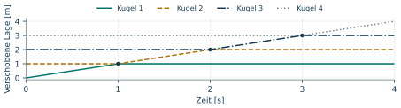
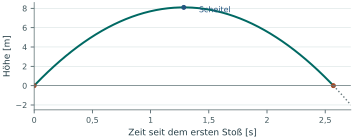

# Kapitel 12 · C12 und C21 – Stöße, Kontakte und Zeno-Kollaps

## Einleitung · Was erzählt die Reihenfolge der Stöße, die der Endzustand verschweigt?

Eine Kugel trifft auf eine Reihe ruhender Kugeln. Am Ende rollt die letzte davon. Um zu erklären, wie der Impuls dorthin kam, müssen wir wissen, welche Paare nacheinander in Kontakt waren. Bei einem fallenden Ball zeigt sich ein zweiter Grund, genau auf die Uhr zu schauen. Nach einem Rückprall folgt der nächste schneller. Die Flugzeiten können sich zu einer endlichen Grenzzeit summieren.

Wir behandeln den Flug und den Kontakt als zwei verschiedene Rechenaufgaben. Zwischen getrennten Stößen sind die geraden Bahnen der Kugeln leicht zu berechnen. Beim elastischen, zentralen Stoß zweier gleicher Massen tauschen sich ihre Geschwindigkeiten aus. Danach ändern sich die Kandidaten für die nächsten Kontakte. Für den freien Fall wirkt dagegen eine konstante Beschleunigung. Erst das Übergangsgesetz am Boden bestimmt die Geschwindigkeit des nächsten Flugs.

Die offizielle C12-Aufgabe umfasst unter anderem auch inverse und stochastische Untersuchungen. Hier prüfen wir zunächst das elastische Fenster mit Kontakten bei 1, 2 und 3 Sekunden und Endwerten bei 4 Sekunden. Im C21-Ballfenster liegen die beiden geforderten gerichteten Stöße vor Sekunde fünf. Das Zeitbudget beträgt jeweils eine Millisekunde. Aus diesen festgelegten Versuchen lernen wir, welche Kontaktinformationen ein Simulator für einen nachvollziehbaren Verlauf aufzeichnen muss.

[Zum Schluss dieses Kapitels](#kap12-schluss)

<!-- Buchseite -->

## C12 · Wann stoßen die Kugeln zusammen?

**Lernziel.** Sie können den nächsten isolierten Kontakt ausrechnen, die beiden Geschwindigkeiten aktualisieren und eine Simulation mit Impuls, Energie und Ereignisfolge prüfen.

Zwei gleich schwere Kugeln rollen auf einer Geraden nach rechts. Der freie Spalt zwischen ihren Oberflächen beträgt $0{,}60\,\mathrm{m}$. Links läuft die Kugel mit $0{,}80\,\mathrm{m/s}$, rechts mit $0{,}20\,\mathrm{m/s}$. Zu welchem Zeitpunkt müssen Sie die freie Bewegung unterbrechen?

### Zuerst die Geometrie, dann der Stoß

Jede Sekunde holt die linke Kugel $0{,}80-0{,}20=0{,}60\,\mathrm{m}$ auf. Im kräftefreien Modell verschwindet der Spalt nach einer Sekunde. Bei einem zentralen, ideal elastischen Einzelstoß gleicher Massen tauschen die Kugeln ihre Geschwindigkeiten. Unmittelbar danach nimmt der Spalt um $0{,}60\,\mathrm{m}$ pro Sekunde zu.

**Gültigkeitsbereich des Stoßgesetzes.** Im gerechneten C12-Fenster aktualisieren wir die Geschwindigkeiten im Kontaktaugenblick mit Stoßzahl eins. Kontaktkraft, Eindringtiefe und Kontaktdauer gehören zu einem anderen Modell. Für zwei elastische Kugeln liefert ein Hertzscher Kontakt bei kleiner Eindringtiefe $\delta>0$ die Normalkraft $F=K\delta^{3/2}$. Die lokale Tangentensteifigkeit bei einer Vorlast $\delta_0>0$ ist $(3/2)K\sqrt{\delta_0}$. Eine lineare Feder mit diesem Wert beschreibt kleine Änderungen um diese Vorlast. Ein zusätzlicher Dämpfer bräuchte eine eigene Verlustannahme. [C12, offizielle Definition](https://www.sne-journal.org/benchmarks/c12/definition/comparison-12-collision-processes-in-rows-of-spheres-definition).

### Wie prüft man eine vermeintliche Lösung?

Für $m=1\,\mathrm{kg}$ pro Kugel ist der Gesamtimpuls vor und nach dem Tausch $1{,}00\,\mathrm{kg\,m/s}$. Die kinetische Energie beträgt jeweils $(0{,}8^2+0{,}2^2)/2=0{,}34\,\mathrm{J}$. Würde ein Programm die beiden Geschwindigkeiten unverändert lassen, stimmten diese Summen ebenfalls. Dann würden die Kugeln ab dem Kontakt ineinander laufen.

**Jetzt Sie.** Prüfen Sie deshalb auch das Vorzeichen der relativen Geschwindigkeit nach dem Kontakt. Bei einem schon wachsenden Spalt gibt es in dieser freien Phase keinen zukünftigen Stoß desselben Paars. Wie unterscheiden Sie diesen Fall von einer Kollision genau jetzt?

Im ARGESIM-Fall C12 konkurrieren mehrere Paare um das nächste Ereignis. Beim rückprallenden Ball aus C21 kommt noch die Frage hinzu, wie viele Einzelereignisse in eine endliche Zeit passen.

**Kernweg**  [Kontaktzeiten](#fb-c12labor)  **Vertiefung**  [Mehrfachkontakt und Grenzzeit](#fb-schluss9) [Selbst prüfen](#fb-ueb9).

## Labor C12 · Ein Ereignis aus Abständen ausrechnen

Zur Handrechnung setzen wir jede Masse der reduzierten A2-Aufgabe auf $1\,\mathrm{kg}$. Um unmittelbar mit den freien Spalten zu rechnen, ziehen Sie von jeder Mittelpunktkoordinate die bis dorthin aufsummierten Kugeldurchmesser ab. In diesen verkürzten Koordinaten $X_i$ bedeutet Gleichheit benachbarter Werte Kontakt. Die Startabstände von einem Meter werden zu $X(0)=(0,1,2,3)\,\mathrm{m}$.

### Vom Modell zum Ereigniskalender

Der freie Spalt eines Paares beträgt $g_i=X_{i+1}-X_i$. Es schließt sich mit der Rate $w_i=v_i-v_{i+1}$. Zwischen Stößen bleiben die Geschwindigkeiten konstant, also $g_i(t+\tau)=g_i(t)-w_i\tau$. Nur für $w_i>0$ liegt ein künftiger schließender Kontakt bei $\tau_i=g_i/w_i\ge0$. Der kleinste solche Wert bestimmt den nächsten Übergang. Ohne schließendes Paar folgt freier Flug bis zum Ende.

Zu Beginn hat nur das erste Paar $w_1=1\,\mathrm{m/s}$. Nach einer Sekunde stößt es. Nach dem Geschwindigkeitstausch bewegt sich Kugel 2 mit $1\,\mathrm{m/s}$ auf Kugel 3 zu. Der nächste und übernächste Kontakt folgen je eine Sekunde später. Bei $3{,}5\,\mathrm{s}$ ergibt sich

$$
X=(1,2,3,3{,}5)\,\mathrm{m},\qquad v=(0,0,0,1)\,\mathrm{m/s}.
$$

Für jede Zeile müssen Gesamtimpuls $1\,\mathrm{kg\,m/s}$, kinetische Energie $0{,}5\,\mathrm{J}$ und nichtnegative Spalte erhalten bleiben.

### Wo ein scheinbar guter Test versagt

Gibt ein fehlerhafter Simulator nach dem ersten Stoß weiterhin $v=(1,0,0,0)$ aus, bleiben Gesamtimpuls und Energie ebenfalls richtig. Der Spalt des ersten Paares würde danach negativ. Prüfen Sie deshalb zusätzlich, dass der getroffene Kontakt unmittelbar nach dem Reset öffnet, und protokollieren Sie die Paarindizes.

**Eigener Versuch.** Vergrößern Sie nur den dritten Anfangsspalt von $1$ auf $1{,}2\,\mathrm{m}$. Der dritte Stoß verschiebt sich auf $3{,}2\,\mathrm{s}$. Die ersten beiden Zeiten und sämtliche Geschwindigkeitswechsel bleiben unter diesen Annahmen gleich.

Ereigniskalender `python labor.py c12` · [ARGESIM C12, Aufgabenfamilie](https://www.argesim.org/benchmarks/c12).

## C12 · Stöße in einer Kugelreihe

**Erst schätzen.** Eine Kugel trifft zentral und ideal elastisch eine ruhende, gleich schwere Kugel. Welche bewegt sich danach?

Die reduzierte C12-Aufgabe enthält vier gleich schwere Kugeln mit je $1\,\mathrm{m}$ freiem Abstand. Nur Kugel 1 bewegt sich anfangs nach rechts mit $1\,\mathrm{m/s}$. Reibung und äußere Kräfte fehlen. Prüfen Sie nun, warum bei einem zentralen, vollkommen elastischen Einzelstoß gleicher Massen genau die im ersten Beispiel verwendete Tauschregel gilt.

### Die Resetregel aus Erhaltungsgrößen gewinnen

Seien $u,v$ die Geschwindigkeiten unmittelbar vor und $u',v'$ nach dem Stoß. Für gleiche Massen führen Impuls und kinetische Energie auf

$$
u+v=u'+v',\qquad u^2+v^2=u'^2+v'^2 .
$$

Daraus folgt $uv=u'v'$. Also haben $u',v'$ dieselbe Summe und dasselbe Produkt wie $u,v$ und sind die beiden Wurzeln desselben quadratischen Polynoms. Bei Annäherung wählt die elastische Stoßregel den trennenden Zweig $u'=v,\ v'=u$.

| Zeit | Kontakt | Geschwindigkeiten danach [m/s] |
| --- | --- | --- |
| $0\,\mathrm{s}$ | Start | $(1,0,0,0)$ |
| $1\,\mathrm{s}$ | Kugel 1 / Kugel 2 | $(0,1,0,0)$ |
| $2\,\mathrm{s}$ | Kugel 2 / Kugel 3 | $(0,0,1,0)$ |
| $3\,\mathrm{s}$ | Kugel 3 / Kugel 4 | $(0,0,0,1)$ |

Die drei Oberflächenspalte $g_j$ erfüllen in der Flugphase $\dot g_j=v_{j+1}-v_j$. Damit sind sie stückweise linear. Ein gerichteter Wächter findet $g_j=0$ bei schließendem Spalt. Nach dem Reset muss eine erneute Auslösung auf derselben Fläche zur Bewegung passen.

Beim ersten Kontakt stehen die tatsächlichen Mittelpunkte bei $x_1=1\,\mathrm m$ und $x_2=2\,\mathrm m$. Zwischen ihnen liegt genau ein Kugeldurchmesser $d=1\,\mathrm m$. Für Teilbild und Rechnung mit verschobenen Koordinaten verwenden wir $\xi_j=x_j-(j-1)d$. Dann sind $\xi_1=1\,\mathrm m$ und $\xi_2=1\,\mathrm m$. Der Schnitt der beiden gezeichneten Linien bezeichnet dasselbe Ereignis wie ein Meter Mittelpunktabstand im Bild der tatsächlichen Lagen.

**Warum QSS2 hier passt.** Lineare Position und konstante Geschwindigkeit beschreiben jeden freien Abschnitt genau. Jeder Kontakt löst einen Neustart aus. Für nachgiebige Kugeln mit schnellen Kontaktmoden wäre ein neuer Vergleich nötig.

[Offizielle Aufgabe C12](https://www.argesim.org/benchmarks/c12) · [Definition der reduzierten A2-Aufgabe und ihrer Zielgrößen](https://github.com/5H3LL3H5/argesim-hyperposition-benchmarks/blob/1824c9104152674b82de6cd84d53b0b4f68dca37/benchmarks/benchmark_solver_extension.py).

## Wann trifft der Ball zum zweiten Mal auf?

Die C21-Teilaufgabe beginnt mit einem Ball in $H=10\,\mathrm{m}$ Höhe und $v_0=0$. Zwischen Kontakten wirkt die Schwerkraft. Daraus folgt $\dot y=v,\ \dot v=-g,\ g=9{,}81\,\mathrm{m/s^2}$. Der Boden ist starr. Beim Erreichen von $y=0$ mit $v^-<0$ setzt das Modell $y^+=0,\ v^+=-e\,v^-$ mit $e=0{,}9$. Masse und Luftwiderstand werden für diese Fallaufgabe nicht benötigt.

Integration liefert $y=H-gt^2/2$. Beim ersten Stoß ist $t_1=\sqrt{2H/g}=1{,}427843\,\mathrm{s}$. Danach gilt mit $s=t-t_1$ die Parabel $y=e g t_1s-gs^2/2$. Ihre nächste positive Nullstelle liegt bei $s=2et_1$. Damit ist $t_2=(1+2e)t_1=3{,}997961\,\mathrm{s}$.

### Warum der Detektor zur Solverwahl gehört

Startet ein Schritt auf der Resetfläche, kann die Flugbahn innerhalb desselben großen Schritts aufsteigen und nochmals aufschlagen. Ein Test nur auf unterschiedliche Vorzeichen an den Endpunkten kann dieses Ereignis übersehen. Die archivierte Projektfassung zerlegt bei Koordinatenwächtern den kubischen Hermite-Interpolanten an inneren Extrema und sucht gerichtete Nullstellen auf den Teilintervallen.

Im historischen Lauf `8332be4d` fehlte der zweite Stoß bei QSS3 und QSS4 auf allen drei Quantenstufen. Die Wiederholung des C21-Fensters mit zwei analytischen Aufprallzeiten erfüllt das Budget für 6 der sechs QSS3/4-Einstellungen. Eine unabhängige Gegenprobe mit längerem Zeitlimit enthält die Einzelwerte beider Solverstände.

Den Stand des ursprünglichen Ereignistreibers dokumentieren die [Regressionstests](https://github.com/5H3LL3H5/argesim-hyperposition-benchmarks/blob/1824c9104152674b82de6cd84d53b0b4f68dca37/tests/test_hybrid_runtime.py). Die aktuelle Wiederholung steht im Rechenlabor unter `qss_pruefung/messung/`.

### Warum nach einem Stoß auch ein Nachbarpaar neu gerechnet wird

Für ein Gedankenexperiment nehmen wir drei gleich schwere Kugeln mit den Geschwindigkeiten $(1,0,0)$ in derselben Einheit. Kugel 1 nähert sich Kugel 2 von links. Nach ihrem isolierten elastischen Kontakt stehen die Geschwindigkeiten bei $(0,1,0)$. Jetzt bewegt sich Kugel 2 auf Kugel 3 zu. Ein vorher geplanter Kontakttermin für dieses zweite Paar kann sich damit ändern. War die alte Relativgeschwindigkeit null, gab es vorher womöglich gar keinen solchen Termin.

Sind die beiden Kontakte gut getrennt, kann das Programm den ersten ausführen und dann mit dem neuen Zustand den nächsten bestimmen. Für bereits aneinanderliegende Kugeln zeigt dieselbe Rechnung einen Grenzfall. Würde das Programm Paar 2 und 3 vor Paar 1 und 2 prüfen, wären beide zunächst unbewegt. Unmittelbar nach dem ersten Stoß hat sich diese Beurteilung geändert. Die Reihenfolge im Kalender für gleichzeitige Einträge entscheidet damit noch nicht, wie ein physikalischer Mehrfachkontakt zu modellieren ist.

Das Ereignisprotokoll speichert deshalb Paar, Zeitpunkt und gerichtete Relativgeschwindigkeit. Die Endgeschwindigkeit der letzten Kugel lässt sich erst mit diesen Zahlen auf die tatsächlich gerechnete Folge zurückführen.

<!-- Buchseite -->

## C12 und C21 · Ein Stoßzähler braucht einen Namen

Zwischen zwei elastischen Stößen bewegen sich die Kugeln geradlinig. In diesem C12-Fenster meldet QSS2 mit Quantenfaktor 0,001 0 interne Updates und 36 Auswertungen der rechten Seite. RK45 benötigt 148 Aufrufe. Die beiden Scores betragen 0 und 0. Die physikalischen Kontakte bearbeitet der Ereignistreiber.

Warum ist das möglich? Die drei Spaltweiten ändern sich in jeder Flugphase linear. Mit Spalt $d>0$ und konstanter schließender Relativgeschwindigkeit $\dot d<0$ folgt aus $0=d+\dot d\,\Delta t$ der nächste Termin $\Delta t=-d/\dot d$. Beim Stoß zweier gleicher Massen werden im elastischen Fall die Geschwindigkeiten getauscht. Der Ereignistreiber setzt diesen Reset um und startet die nächste Flugphase. Angenommene Quantisiererupdates, physikalische Kontakte und Funktionsaufrufe sind somit drei getrennte Zähler.

Beim freien C21-Ball ist die Höhe zwischen zwei Stößen quadratisch. Nach dem Rückprall muss der Detektor die ausgehende Nullstelle bei Flugbeginn von der kommenden abwärts gerichteten Nullstelle unterscheiden. Die ursprüngliche Matrix verlangt zwei Stöße vor fünf Sekunden mit jeweils einer Millisekunde Budget. Der Zeno-Grenzwert betrifft die unendliche Fortsetzung des idealisierten Rückprallmodells.

**Gegenprobe.** Vertauschen Sie bei C12 im Ereignisprotokoll die Kennungen des ersten und zweiten Kontakts und behalten Sie alle Zeitstempel. Ein reiner Zeitvergleich gibt weiter null aus. Der richtige Test verwirft die Zuordnung bereits vor der Scoreberechnung.

[Variation der Stoßzahl und inverse Aufgabe](../lehrbuch_numerische_simulation.md#fb-refC12) · [Weitere Kontaktmodelle](../lehrbuch_numerische_simulation.md#fb-refC21) · [Gemessene Arbeitszähler](https://github.com/5H3LL3H5/argesim-hyperposition-benchmarks/blob/16f0f2528fcf77f16898ecd74ad952be2c09eac2/docs/evidence/qss-extension.csv).

## Selbst prüfen · Zeitpunkt und Stoßregel

**Merksatz.** Zuerst wird bis zum frühesten zulässigen Kontakt fortgerechnet. Danach ändern sich die Geschwindigkeiten und sämtliche möglichen Folgezeiten müssen zur neuen Lage passen.

### A · Die Ereignisliste für drei Kugeln aufbauen

Verwenden Sie um die Durchmesser verkürzte Koordinaten, in denen gleiche Nachbarkoordinaten Kontakt bedeuten. Drei gleich schwere Kugeln starten bei $X=(0;\,0{,}4;\,1{,}1)\,\mathrm{m}$ und $v=(1;\,0;\,0)\,\mathrm{m/s}$. Jeder isolierte Stoß ist ideal elastisch. Notieren Sie beide ersten Kontaktzeiten, die jeweils beteiligten Kugeln und die Geschwindigkeiten unmittelbar danach.

### B · Eine unzureichende Prüfung widerlegen

Ein Simulator lässt alle Kugeln kräftefrei durchlaufen und speichert bloß Gesamtimpuls und Gesamtenergie. Können beide Prüfwerte für das Experiment A stimmen? Finden Sie einen Zeitpunkt und ein Paar, an dem eine geometrische Prüfung den Fehler sicher entdeckt.

### C · Auf einen anderen Stoß übertragen

Zwei gleich schwere Kugeln von je $1\,\mathrm{kg}$ treffen zentral aufeinander. Vorher sind die Geschwindigkeiten $1$ und $0\,\mathrm{m/s}$. Der Stoß sei jetzt teilweise elastisch, mit Rückprallzahl $e=0{,}5$. Nach dem Stoß gilt $v'_2-v'_1=e(v_1-v_2)$. Berechnen Sie beide Geschwindigkeiten und die verlorene kinetische Energie unter der Annahme, dass kein äußerer Impuls wirkt.

**Hinweis.** Bei A bewegt sich nach dem ersten Stoß nur die mittlere Kugel. Bei C brauchen Sie die Impulsgleichung und genau eine Gleichung für die relative Geschwindigkeit.

[Lösungswege A, B und C](#fb-loesweg9) · [Zum Kapitelauftakt](#fb-kap9).

## Lösungswege · Zeitpunkt und Stoßregel

### A · Die freie Bewegung nach jedem Stoß neu starten

Der erste Spalt beträgt $0{,}4\,\mathrm{m}$, die Annäherungsgeschwindigkeit $1\,\mathrm{m/s}$. Bei $t=0{,}4\,\mathrm{s}$ stoßen Kugel 1 und 2. Danach ist $v=(0,1,0)$. Kugel 2 muss noch $1{,}1-0{,}4=0{,}7\,\mathrm{m}$ überwinden. Bei $t=1{,}1\,\mathrm{s}$ stößt sie auf Kugel 3. Es folgt $v=(0,0,1)$. Die $0{,}7$ ist eine Dauer ab dem ersten Stoß, keine absolute Uhrzeit.

### B · Eine Prüfung über die Geometrie ergänzen

Beim fehlerhaften Durchlaufen behält jede Kugel ihre Geschwindigkeit. Die Summen für Gesamtimpuls und Energie bleiben dadurch unverändert. Zur Zeit $0{,}5\,\mathrm{s}$ hätte der Simulator jedoch $X_1=0{,}5$ und $X_2=0{,}4\,\mathrm{m}$. Der Spalt $X_2-X_1=-0{,}1\,\mathrm{m}$ widerspricht der Reihenfolge und dem undurchdringlichen Kontaktmodell.

### C · Zwei lineare Gleichungen reichen hier aus

Impulserhaltung verlangt $v'_1+v'_2=1$, das Rückprallgesetz $v'_2-v'_1=0{,}5$, jeweils für die Zahlenwerte in $\mathrm{m/s}$. Addition liefert $v'_2=0{,}75$ und danach $v'_1=0{,}25$. Die kinetische Energie sinkt von $0{,}5\,\mathrm{J}$ auf $(0{,}25^2+0{,}75^2)/2=0{,}3125\,\mathrm{J}$. Der Verlust beträgt $0{,}1875\,\mathrm{J}$.

**Welcher Nachweis passt?** Ein Test auf exakte Energieerhaltung wäre bei C das falsche Kriterium. Prüfen Sie die vorhergesagte Energiedifferenz und den erhaltenen Impuls. Für gleichzeitige Mehrfachstöße ist zudem eine gemeinsame Kontaktregel nötig.

[Noch einmal selbst rechnen](#fb-ueb9) · [Forschungsstand und Beweisfragen](#fb-schluss9).

## Einzelstoß, Mehrfachkontakt und Zeno-Zeit

### Modellannahmen der getrennten Kontakte

Der folgende Beweis benutzt den einzelnen Bodenkontakt mit festem Rückprallfaktor. Die isolierten Zweierkontakte der Kugelreihe beruhen auf einer anderen Annahme. Sobald mehrere Kontakte gleichzeitig wirken, muss die Modellierung die gemeinsame Wechselwirkung angeben. Für den Ball können wir die Folgen des hier gewählten Gesetzes bereits aus der Dauer des ersten Flugs ableiten.

### Beweis · Unendlich viele Stöße in endlicher Zeit

Beim idealen C21-Ball mit Rückprallfaktor $0<e<1$ ist die Dauer nach dem ersten Stoß bis zum zweiten $2et_1$. Nach jedem Stoß wird die Geschwindigkeit erneut mit $e$ multipliziert. Die folgenden Flugdauern lauten daher $2e^2t_1,2e^3t_1,\dots$. Die geometrische Reihe konvergiert und ergibt

$$
T_*=t_1+\frac{2et_1}{1-e}.
$$

Für $H=10\,\mathrm m$ und $g=9{,}81\,\mathrm{m/s^2}$ erhalten wir $t_1=\sqrt{20/9{,}81}\,\mathrm s\approx1{,}427843\,\mathrm s$. Bei $e=0{,}9$ dauert der erste Rückflug rund $2{,}570118\,\mathrm s$. Die Summe aller Rückflüge beträgt $2e t_1/(1-e)=18t_1$. Zusammen mit dem ersten Fall ergibt sich $T_*=19t_1\approx27{,}129019\,\mathrm s$. Das Zusammenlaufen unendlich vieler diskreter Ereignisse in endlicher Zeit heißt *Zeno-Verhalten*. Die ersten zwei Stöße im kurzen Benchmarkfenster lassen sich unabhängig davon exakt prüfen.

### Ergebnis der Nachuntersuchung

Nach einem Stoß mit Aufwärtsgeschwindigkeit $v^+$ beträgt die verbleibende Folge der Flugzeiten insgesamt $2v^+/[g(1-e)]$. Die maximale Höhe der restlichen Flüge ist $(v^+)^2/(2g)$. Beide Werte erlauben einen budgetierten Übergang zum ruhenden Kontakt. Ein Simulator kann die Häufungszeit auch analytisch behandeln. Für die physikalische Fortsetzung ab dieser Zeit muss das Modell einen Kontaktzustand festlegen.

[Nachweis und Ergebnis](../lehrbuch_numerische_simulation.md#fb-befundereignis) · [Halm und Posa (2024), Set-valued rigid-body dynamics for simultaneous, inelastic, frictional impacts](https://doi.org/10.1177/02783649241236860) · [ARGESIM C21](https://www.argesim.org/benchmarks/c21).

**Gegenprobe im Rechenlabor.** In `beispiele/kontakt.py` wird der Stoßoperator aus Kapitel 5 auf gerichteten Kontakt geprüft. In `rechenlabor/kapitelvergleich.py` werden die Kennungen der Kugelpaare und ihre Zeitfehler getrennt geprüft. Der Übergang zum liegenden Ball in `beispiele/ball.py` hat eine weitere Voraussetzung. Erst das Budget für die verbleibende Flugzeit begründet die Fortsetzung in Ruhe. Die Zählung von C12-Kontakten allein kann dieses Kriterium nicht liefern.

<!-- Buchseite -->

## Wie der Impuls durch vier Kugeln läuft

Bei einem elastischen zentralen Stoß gleich schwerer Kugeln werden die Geschwindigkeiten getauscht. Legen Sie vor dem Lesen ein Lineal an die Bahn der ersten Kugel. Die Steigung ist bis zur ersten Sekunde eins. Welche Bahn muss anschließend dieselbe Steigung haben, wenn während des Kontakts Impuls und kinetische Energie erhalten bleiben?

Bei 1 s haben die benachbarten Mittelpunkte noch einen Meter Abstand. Ihre Oberflächen berühren sich. Bei 2 s und 3 s wiederholt sich die Übergabe am nächsten Paar. Abbildung 12.1 zog von jedem Mittelpunkt die vorangehenden Kugeldurchmesser ab. Dort treffen sich die Kurven im Stoß, während hier die endliche Kugelgröße sichtbar bleibt. Beide Darstellungen ergeben dieselbe Kontaktfolge.

<!-- Buchseite -->

## Schluss · Der Stoß ist ein Übergang mit Identität und Uhrzeit

In der Kugelreihe erklärt der Austausch bei getrennten Zweierkontakten, wie der Impuls nach rechts gelangt. Nach einem Stoß wird der Kalender für die betroffenen Paare mit den neuen Geschwindigkeiten berechnet. Die Endwerte können stimmen, obwohl sich der Simulator bei einem Kontakt verspätet hat. Ein Protokoll der gerichteten Kontakte prüft daher einen anderen Teil der Bewegung als Impuls- oder Energiebilanzen.

Beim Ball sind die freien Flüge analytisch berechenbar. Ein konstanter Rückprallfaktor $0<e<1$ verkürzt die folgenden Flugzeiten geometrisch. Die Summe liefert eine endliche Häufungszeit. Für eine Fortsetzung wählen wir eine Regel, die zum Modell passt, und prüfen die verbleibende Zeit und Höhe gegen das Budget. Ein kurzes Fenster mit zwei Stößen beantwortet zunächst nur die dafür festgelegte Frage.

Im nächsten Kapitel bestimmt der Wechsel zusätzlich, welche geometrische oder algebraische Bindung gelten soll. Damit bekommt der Zustand unmittelbar am Übergang eine weitere Zulässigkeitsprüfung. [C07 und C21-Diode](../lehrbuch_numerische_simulation.md#fb-neu13)

### Aktueller Stand der Forschung

Halm und Posa entwickeln für simultane, unelastische und reibungsbehaftete Starrkörperstöße ein mengenwertiges Modell. Unter ihren Annahmen kann dieselbe Ausgangslage mehrere modellierte Resultate zulassen. Für unser elastisches C12-Fenster mit isolierten Zweierkontakten arbeiten wir mit einem engeren Stoßgesetz. Die Arbeit erklärt, warum diese einfache Folge bei gleichzeitigem Kontakt nicht ohne Begründung übernommen werden darf. Ein Erweiterungsversuch könnte Kontaktabstände und Reibung so verändern, dass sich Ereignisse annähern. Dann wäre zu prüfen, ob ein Ergebnis allein vom Modell herrührt oder sich mit der künstlichen Reihenfolge der Einträge ändert. [Halm und Posa, Set-valued rigid-body dynamics for simultaneous, inelastic, frictional impacts (2024)](https://doi.org/10.1177/02783649241236860)

[Zur Einleitung dieses Kapitels](#kap12-einstieg)
