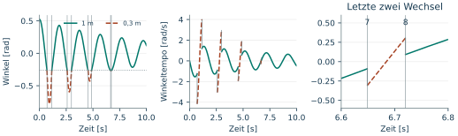

# Kapitel 13 · C07 und C21 – Stiftpendel, Diodenkennlinie und DAEs

## Einleitung · Welche Größe bleibt gültig, wenn eine Bindung wechselt?

Ein Pendelfaden legt sich an einen Stift. Vorher war seine ganze Länge in Bewegung, danach schwingt die Masse auf einem kleineren Kreis. Ihre Geschwindigkeit entlang der gemeinsamen Tangente kann dabei stetig sein. Der Winkel ändert sich nun schneller, weil derselbe Weg auf einem kürzeren Kreisbogen einem größeren Winkel entspricht. Wie prüfen wir, ob ein Solver den richtigen Zustand für den neuen Kreis übernommen hat?

Die Diodenschaltung stellt eine verwandte Frage mit anderen Größen. Hier wollen wir wissen, ob sich an einem gegebenen Arbeitspunkt die Diodenspannung eindeutig und mit vernünftiger Empfindlichkeit aus der Bindung ergibt. Zwei Formulierungen können in einem regulären Bereich denselben Verlauf beschreiben. In der Nähe einer Falte kann eine Inversion jedoch auf einen falsch gewählten Ast führen. Darum beobachten wir auch, welche Lösung der Solver im Inneren verwendet.

Für das Pendel vergleichen wir Winkelgleichung und kartesische Bewegung. Der Matrixfall prüft die ersten zwei Sekunden des Teilfalls A(i) mit Ereignisbudgets von einer Millisekunde. Der zusätzliche Diodenversuch dokumentiert auf $0{,}5\,\mathrm{ms}$ insgesamt 149 Schaltungen und betrachtet die Residualform im Vergleich mit expliziten Reduktionen. Beide Nachweise brauchen Angaben unmittelbar am Wechsel. Dazu gehören Bindungsfehler und die Zustandsgröße, deren Stetigkeit oder Sprung das konkrete Modell vorschreibt.

[Zum Schluss dieses Kapitels](#kap13-schluss)

<!-- Buchseite -->

## C07 · Was springt am Stift?

**Lernziel.** Sie können am C07-Stift vorhersagen, welche Größen stetig bleiben, die neue Winkelgeschwindigkeit berechnen und in C21 eine algebraische Bindung auf ihren Lösungszweig prüfen.

Der Faden eines Pendels trifft einen Stift. Der wirksame Radius fällt von $1\,\mathrm{m}$ auf $0{,}30\,\mathrm{m}$. Am Kontakt beträgt die Winkelgeschwindigkeit $-0{,}60\,\mathrm{rad/s}$. Erhält das Modell beim Wechsel die Winkelgeschwindigkeit oder die tangentiale Geschwindigkeit der Masse? Entscheiden Sie vor der Rechnung.

### Die Masse von außen beobachten

Unmittelbar vor dem Kontakt beträgt die gerichtete Tangentialgeschwindigkeit $v^-=\ell\omega^-=-0{,}60\,\mathrm{m/s}$. Beim idealisierten C07-Wechsel sind die Tangenten gleichgerichtet und diese Geschwindigkeit bleibt erhalten. Für den kürzeren Radius braucht man deshalb $\omega^+=v^-/\ell_s=-2{,}00\,\mathrm{rad/s}$. Ein kleinerer Kreis verlangt bei gleichem Tempo mehr Winkel pro Sekunde.

**Welche Stoßannahme steckt darin?** Im C07-Modell liegen alter Drehpunkt, Stift und Masse beim Kontakt auf einer Geraden. Die bisherige Geschwindigkeit ist daher bereits tangential zum neuen Kreis. Für eine ideale, augenblicklich auferlegte Bindung mit Einheitsnormaler $n$ lautet die impulsive Normalprojektion $v^+=v^--(n^\mathsf T v^-)n$. Der mögliche Verlust ist $E^-_{\rm kin}-E^+_{\rm kin}=m(n^\mathsf T v^-)^2/2$. In der C07-Geometrie verschwindet dieser Term. Der Solver überträgt die gerichtete Bahngeschwindigkeit und berechnet die neue Winkelgeschwindigkeit aus $v_{\rm tan}/L_+$. Ein schräg zur neuen Tangente gestraffter Faden hätte einen anderen Reset. [C07, F. Breitenecker, SNE 1993](https://www.sne-journal.org/benchmarks/c07/definition/comparison-7-constrained-pendulum-definition).

### Eine falsche Übergangsregel widerlegen

Ließe man $\omega$ unverändert, fiele $|v|$ auf $0{,}18\,\mathrm{m/s}$. Die kinetische Energie wäre nur noch $(0{,}18/0{,}60)^2=9\,\%$ ihres vorherigen Wertes. Ein solcher Verlust gehört nicht zum vereinbarten Übergang. Diese Rechnung prüft den einzelnen Wechsel. Die Dämpfung während des anschließenden Schwingens wirkt über ein Zeitintervall.

**Ihr Laborauftrag.** Notieren Sie vor einer Simulation die Position, die gerichtete Tangentialgeschwindigkeit und die Winkelgeschwindigkeit am Kontakt. Prüfen Sie anschließend den Ereigniszeitpunkt separat. Eine korrekte Sprungregel kann am falschen Zeitpunkt ausgeführt worden sein.

Für die Diode am Ende des Kapitels wird dieselbe Gewohnheit wichtig. Vor dem nächsten Schritt ist zu entscheiden, welcher durch die Gleichungen zugelassene Zustand tatsächlich zur bisherigen Bahn gehört.

**Kernweg**  [Geometrie des Stifts](#fb-praxisdae)  **Vertiefung**  [Kartesische Bindung](#fb-c07kart) [Selbst prüfen](#fb-ueb10).

## C07 · Das Pendel trifft einen Stift

**Erst schätzen.** Der Stift verkürzt den Pendelfaden von $1$ auf $0{,}3\,\mathrm{m}$. Was geschieht mit der Winkelgeschwindigkeit?

Skizzieren Sie bei C07 die Lage der Masse kurz vor dem Stift und im Augenblick des Kontakts. Ab dort dreht sich der untere Teil des Fadens um den Stift. Das Ereignis ändert damit den Drehpunkt und die Gleichungen für die weitere Bewegung. Wir legen Kräfte, Vorzeichen und Bedingung für den Wechsel fest, bevor wir den Solver starten.

### Systemgrenze und Kräfte

Der Massenpunkt $m=1{,}02\,\mathrm{kg}$ hängt am masselosen und undehnbaren Faden. Im langen Modus gilt $\ell=1\,\mathrm{m}$, im kurzen $\ell_s=0{,}3\,\mathrm{m}$. Der Stift liegt $0{,}7\,\mathrm{m}$ unterhalb des oberen Drehpunkts entlang der Geraden mit Winkel $\varphi_p=-\pi/12$ gegen die abwärts gerichtete Vertikale. Positive Winkel zeigen auf eine festgelegte Seite. Die Gewichtskraft zeigt nach unten. Auf die Tangente projiziert ergibt sie $-mg\sin\varphi$, in radialer Richtung nach außen $mg\cos\varphi$. Der Widerstand ist tangential. Mit $g=9{,}81\,\mathrm{m/s^2}$, $d=0{,}2\,\mathrm{kg/s}$ und aktueller Länge $L$ lautet die Tangentialbilanz

$$
mL\ddot\varphi=-mg\sin\varphi-dL\dot\varphi .
$$

Die Fadenspannung wirkt radial nach innen. Im ruhenden Tiefpunkt gilt $\ddot\varphi=0$, und die Spannung gleicht $mg$ aus. In jedem festen Modus ist $x=(\varphi,\omega)^\mathsf T$ mit $\dot\varphi=\omega,\ \dot\omega=-(g/L)\sin\varphi-(d/m)\omega$ eine explizite ODE erster Ordnung. Start für Aufgabe A(i) ist $(\pi/6,0)$, Laufzeit $10\,\mathrm{s}$.

### Was geschieht am Stift?

Der Wächter lautet $\varphi-\varphi_p=0$. Fallender Winkel im langen Modus führt zum Kontakt. Steigender Winkel im kurzen Modus führt zur Ablösung. Beim Wechsel ist die Position stetig und die gerichtete Tangentialgeschwindigkeit bleibt im Benchmark erhalten. Da dort beide Tangentialrichtungen zusammenfallen, folgt

$$
L^- \omega^-=L^+\omega^+,\qquad
 \omega^+=\frac{L^-}{L^+}\,\omega^- .
$$

Die Geschwindigkeit auf der Bahn bleibt beim Kontakt stetig. Die neue Länge verändert ihren Zahlenwert in Winkelkoordinaten. Der Sprung von $\omega$ gehört deshalb zum Modell.

[Originalaufgabe C07](https://www.argesim.org/benchmarks/c07) · [Parameter und Übergänge in der Projektfassung](https://github.com/5H3LL3H5/argesim-hyperposition-benchmarks/blob/1824c9104152674b82de6cd84d53b0b4f68dca37/argesim_benchmarks/models/c07_constrained_pendulum.py).

## Labor C07 · Acht Ereigniszeiten nachmessen

Halten Sie $L$ während jeder Integration fest. Stoppen Sie am gerichteten Wächter, rechnen Sie $\omega$ um und setzen Sie bei derselben Zeit mit der anderen Länge fort. Wir verwenden DOP853, ein explizites Runge–Kutta-Verfahren achter Ordnung, mit $\mathrm{rtol}=10^{-11}$, $\mathrm{atol}=10^{-13}$ und $h_\mathrm{max}=0{,}05\,\mathrm{s}$. Die veröffentlichte MATLAB-Spalte F liefert eine unabhängige numerische Vergleichsreihe. Zeiten in Sekunden, Differenzen gerundet in Millisekunden.

| Nr. | Übergang | Lehrversuch | Veröffentlichung F | Differenz [ms] |
| --- | --- | --- | --- | --- |
| 1 | Kontakt | 0,703459 | 0,703427 | +0,032 |
| 2 | Ablösung | 1,151780 | 1,151778 | +0,002 |
| 3 | Kontakt | 2,590418 | 2,590338 | +0,080 |
| 4 | Ablösung | 2,990529 | 2,990403 | +0,126 |
| 5 | Kontakt | 4,542741 | 4,542705 | +0,036 |
| 6 | Ablösung | 4,867488 | 4,867492 | −0,004 |
| 7 | Kontakt | 6,648707 | 6,648731 | −0,024 |
| 8 | Ablösung | 6,720384 | 6,720995 | −0,611 |

Alle acht Unterschiede bleiben unter $1\,\mathrm{ms}$. Ein zweiter Lauf mit RK45, $\mathrm{rtol}=10^{-8}$, $\mathrm{atol}=10^{-10}$ und gleichem Schrittmaximum unterscheidet sich hier von DOP853 in den Ereigniszeiten um höchstens $9{,}43\cdot10^{-8}\,\mathrm{s}$. Die größere Abweichung zur Publikation bleibt als eigener Befund stehen. Ein Vergleich zweier numerischer Kurven ergibt keine exakte physikalische Zeit.

Eigenes Labor `python labor.py c07` · [Grujic u. a., SNE 31(4), Tabelle 3, Spalte F](https://doi.org/10.11128/sne.31.bne07.10589).

## C07 · Reicht die Linearisierung für die Schaltzeit?

Eine Steuerung soll jede Berührung und Ablösung des Fadens auf $10\,\mathrm{ms}$ genau vorhersagen. Das ist ein hier gewähltes Lehrziel. Als Referenz verwenden wir die geprüfte nichtlineare Modellrechnung [Labor C07 · Acht Ereigniszeiten nachmessen](#fb-c07labor). Der Startwinkel ist $30^\circ$. Dämpfung, Stiftwinkel, Längen und Übergangsregel bleiben in beiden Rechnungen gleich. Nur das rücktreibende Glied wechselt von $\sin\varphi$ zu $\varphi$.

### Was sich zwischen zwei Kontakten analytisch lösen lässt

Im linearen Modell ist in jeder Phase $L$ fest. Schreiben wir $\alpha=d/(2m)$, $\beta=\sqrt{g/L-\alpha^2}$ und $s$ für die seit dem letzten Wechsel verstrichene Zeit, so gilt für Phasenanfangswerte $\varphi_i,\omega_i$

$$
\varphi(s)=e^{-\alpha s}\!\left[\varphi_i\cos(\beta s)+
 \frac{\omega_i+\alpha\varphi_i}{\beta}\sin(\beta s)\right].
$$

Wir suchen die nächste gerichtete Nullstelle von $\varphi(s)-\varphi_p$ zwischen zwei benachbarten Extremstellen oder Phasengrenzen. Am Treffer berechnen wir die neue Winkelgeschwindigkeit und setzen die Phasenformel neu an.

| Nr. | Übergang | Linear [s] | Nichtlinear [s] | Vorlauf linear [ms] |
| --- | --- | --- | --- | --- |
| 1 | Kontakt | 0,692023 | 0,703459 | 11,44 |
| 2 | Ablösung | 1,120545 | 1,151780 | 31,23 |
| 3 | Kontakt | 2,540860 | 2,590418 | 49,56 |
| 4 | Ablösung | 2,931799 | 2,990529 | 58,73 |
| 5 | Kontakt | 4,465755 | 4,542741 | 76,99 |
| 6 | Ablösung | 4,790786 | 4,867488 | 76,70 |
| 7 | Kontakt | 6,532058 | 6,648707 | 116,65 |
| 8 | Ablösung | 6,652995 | 6,720384 | 67,39 |

### Die Rechnung von der Modellwahl trennen

Die lineare Phasenformel und die numerisch integrierte lineare Gleichung liefern alle acht Zeiten mit weniger als $10^{-8}\,\mathrm{s}$ Unterschied. Die Abweichung von den publizierten linearen Zeiten in Spalte J bleibt unter drei Mikrosekunden. Dennoch liegt bereits der erste lineare Kontakt $11{,}44\,\mathrm{ms}$ vor der nichtlinearen Referenz. Die Ereigniszahl stimmt im Zehnsekundenfenster für beide Modelle. Für das gewählte Zeitziel verwenden wir die nichtlineare Dynamik.

Eigenes Labor `python labor.py c07linear` · [Grujic u. a., Tabelle 3, Spalten F und J](https://doi.org/10.11128/sne.31.bne07.10589).

## C07 · Was die kartesische DAE zusätzlich enthält

In einer festen Phase sei $p\in\mathbb R^2$ der Drehpunkt und $r$ die kartesische Position der Masse. Mit $s=r-p,\ v=\dot r,\ \mathbf g=(0,-g)$ und Fadenkraft $-\lambda s$ lautet eine Zwangsformulierung

$$
\dot r=v,\qquad m\dot v=m\mathbf g-dv-\lambda s,\qquad s^\mathsf T s=L^2 .
$$

Dabei gilt die Dämpfung tangential, weil $s^\mathsf Tv=0$ für die zulässige Bewegung. Am Phasenstart müssen Länge und Tangentialität stimmen. Die Zwangskraft folgt aus der zweiten Ableitung der Bindung wie [Kapitel 4](../lehrbuch_numerische_simulation.md#t1-k4). Diese Gleichungen gelten bei festem $p,L$, der diskrete Wechsel wird gesondert beschrieben.

### Beweis der Übereinstimmung mit der Winkel-ODE

Setze $e_r=(\sin\varphi,-\cos\varphi)^\mathsf T$, $e_t=(\cos\varphi,\sin\varphi)^\mathsf T$. Dann gilt $r=p+Le_r,\ v=L\omega e_t$ und $\dot v=L\dot\omega e_t-L\omega^2e_r$. Skalarmultiplikation der Kraftgleichung mit $e_t$ entfernt $\lambda$, da $e_t^\mathsf T e_r=0$. Es bleibt $mL\dot\omega=-mg\sin\varphi-dL\omega$, die Winkelgleichung des Versuchs. Die radiale Projektion bestimmt umgekehrt $\lambda=m(g\cos\varphi+L\omega^2)/L$. Für eine feste reguläre Phase heben sich Rekonstruktion und Projektion lokal auf.

### Eine Zahl als Prüfstein

Beim ersten Kontakt ist $\omega^-=-1{,}248739\,\mathrm{rad/s}$, danach $\omega^+=-4{,}162463\,\mathrm{rad/s}$. Das Produkt mit der jeweiligen Länge ergibt beidseits rund $-1{,}248739\,\mathrm{m/s}$. Im globalen Koordinatensystem bleibt $v$ am Stift gleich. Die neue Bindung beschreibt einen Kreis um $p_\mathrm{neu}=p_\mathrm{alt}+0{,}7e_r(\varphi_p)$. Beide Kreise haben am Berührungspunkt dieselbe Tangente.

**Was der Vergleich prüft.** Die Äquivalenz ist für glatte Phasen analytisch hergeleitet. Die Zahlen [Labor C07 · Acht Ereigniszeiten nachmessen](#fb-c07labor) stammen aus der Winkel-ODE. Der ergänzende RATTLE-Versuch löst die kartesischen Bindungen mit wechselndem Drehpunkt [C07 · Zwei Bindungen in jedem Rechenschritt](#fb-befundrattle).

<!-- Buchseite -->

### Was die kartesische Form am Stift beim Umschalten verlangt

In der freien Phase gelten der alte Drehpunkt $p^-$ und die Länge $L^-$. Am Kontakt wechseln sie zu $p^+,L^+$. In der Winkelgleichung zeigt sich das als Sprung in $\omega$. In der kartesischen Form treffen zwei Aufgaben zusammen. Der Solver muss die Flanke lokalisieren und beim neuen Drehpunkt mit konsistenten Index-3-Daten weiterrechnen.

1. **Wechsel finden.** Prüfen Sie Schaltkennung, Bewegungsrichtung und die Ereigniszeit auf der alten Phase.
2. **Geometrie und Reset prüfen.** Der Ort $r$ bleibt am Kontakt stetig. Die gemeinsame Tangente in diesem C07-Wechsel überträgt die gerichtete Bahngeschwindigkeit $L^-\omega^-=L^+\omega^+$. Prüfen Sie für die neue Bindung $(r-p^+)^\mathsf{T}(r-p^+)=(L^+)^2$ und $(r-p^+)^\mathsf{T}v^+=0$.
3. **Mit der neuen Phase starten.** Die Beschleunigungsbindung bestimmt die neue Zwangskraft. Ein Mehrschrittsolver baut die Historie zum neuen Vektorfeld neu auf. Die Prüfgrößen der neuen Phase enthalten Bindungsdefekte und die nächste Schaltzeit.

Setzen Sie für die erste Berührung die beiden gedruckten Winkelgeschwindigkeiten ein. Der Vergleich der Bahngeschwindigkeit erkennt die falsche Resetregel auch dann, wenn beide Ortsgleichungen am Stift bis auf Rundung passen. [Kartesische Bindungen und RATTLE](../lehrbuch_numerische_simulation.md#t1-k4) · [Ereignisse innerhalb eines Schritts](../lehrbuch_numerische_simulation.md#k5-detektion)

<!-- Buchseite -->

## C07 · Zwei Bindungen in jedem Rechenschritt

Ein Pendel der Länge $\ell$ mit Drehpunkt $p$ muss zwei Bedingungen erfüllen. Mit $s=r-p$ lauten sie $s\cdot s=\ell^2$ und $s\cdot v=0$. Die RATTLE-Methode bestimmt die Zwangskorrekturen bei Ort und Geschwindigkeit getrennt. Für Dämpfung verwenden wir je einen exakten halben Dämpfungsschritt vor und nach dem konservativen Teilschritt.

### Wie lässt sich die Ortsbindung lösen?

Nach halber Dämpfung, halbem Schwerkraftstoß und freier Drift ergäbe sich ein Versuchspunkt $w$ relativ zum Drehpunkt. Der Zwangsstoß wirkt in der bisherigen Seilrichtung $n=s/\ell$. Der orthogonale Anteil $w_\perp=w-(w\cdot n)n$ bleibt beim Korrigieren unverändert. Die kontinuierlich anschließende Lösung des quadratischen Ortszwangs ist

$$
s^+=w_\perp+\sqrt{\ell^2-\|w_\perp\|^2}\,n.
$$

Anschließend bestimmen die korrigierte Ortsdifferenz, der zweite halbe Schwerkraftstoß und eine orthogonale Projektion auf die neue Tangente die Geschwindigkeit. Beim Erreichen der Stiftrichtung klammert eine Teilung des Schritts die Zeit ein. Der neue Drehpunkt muss auf derselben Strahlgeraden liegen, damit die aktuelle Position und Tangente zu beiden Kreisen passen.

| Schrittweite | erkannte Wechsel | größter Zeitfehler |
| --- | --- | --- |
| $0{,}0100\,\mathrm{s}$ | 8 | $474{,}4\,\mu\mathrm s$ |
| $0{,}0050\,\mathrm{s}$ | 8 | $115{,}4\,\mu\mathrm s$ |
| $0{,}0025\,\mathrm{s}$ | 8 | $28{,}7\,\mu\mathrm s$ |

Referenz ist die separat integrierte kartesische Beschleunigungsform, die bereits an der Winkelrechnung geprüft wurde. In allen drei RATTLE-Läufen blieb der maximale Längenfehler unter $4{,}45\cdot10^{-16}\,\mathrm{m}$. Beim Halbieren der Schrittweite schrumpft hier der Zeitfehler um etwa den Faktor vier. Dass die Bindung bei allen drei Gittern auf Rundungsniveau erfüllt ist, macht die Unterschiede der Ereigniszeiten besonders gut sichtbar.

[Kontrolle der Moduswechsel](#fb-befundereignis) · `rattle.json` · `constrained_pendulum.py`.

## C21 · Eine Diodenspannung als algebraische Unbekannte

Beim Stift bleibt am gemeinsamen Tangentialpunkt die gerichtete Bahngeschwindigkeit erhalten. Deshalb erhält dieselbe Geschwindigkeit nach dem Wechsel einen anderen Winkelwert $\omega^+=L_-\omega^-/L_+$. Bei der Diode liefert die Vorgeschichte eine andere Information. Schon die einfache Gleichung $z^2=1$ hat zwei Lösungen mit Residuum null. Beginnt die Bahn auf dem Ast $z=+1$, wäre $z=-1$ im nächsten Schritt trotz exakt erfüllter Gleichung die falsche Fortsetzung. Im Schaltkreis brauchen wir deshalb außer einem kleinen Residuum einen konsistenten Start, die Astgeschichte und lokale Regularität.

Eine andere C21-Aufgabe enthält einen elektrischen Schwingkreis mit Diode. Spule und Kondensator speichern Energie. Als Zustände dienen Spulenstrom $i$ und Kondensatorspannung $u_C$, als algebraische Größe die Diodenspannung $u_D$. In den Vorzeichen des Projektmodells und mit Zeit in Sekunden lauten die Residuen

$$
\begin{aligned}
 0&=L\dot i+R_1 i+u_D+u_e(t),\\
 0&=C_e\dot u_C-i-i_D(u_D),\\
 0&=u_D-u_C-R_2(i+i_D(u_D)).
 \end{aligned}
$$

Die Quelle ist sinusförmig mit Amplitude $1\,\mathrm{V}$ und $150\,\mathrm{kHz}$. Im Modell gelten $R_1=1000\,\Omega,\ R_2=20\,\Omega,\ L=25{,}3\,\mu\mathrm H,\ C_e=100\,\mathrm{nF}$. Für $u_D>0$ verwendet es $i_D=I_S(e^{u_D/U_T}-1)$ mit $I_S=10^{-8}\,\mathrm{A},\ U_T=26\,\mathrm{mV}$, sonst $i_D=0$. Die drei Unbekannten und die beiden Differentialableitungen starten bei null.

### Wie prüft man die Rechnung?

Der archivierte Versuch liefert eine IDAS-Residualrechnung und zwei explizit reduzierte Modellvarianten. Das Zeitfenster beträgt $500\,\mu\mathrm s$. Auf 75 960 verschiedenen Ausgabezeiten werden Zustände und algebraische Größen abgeglichen. Alle Varianten ergeben 149 Schaltungen.

**Wiederholung aus dem Residualmodell.** Mit CasADi 3.8.2/IDAS wurden $500\,\mu\mathrm s$ ab dem konsistenten Nullzustand erneut integriert. Das Protokoll umfasst 75 960 Ausgabepunkte und 149 Übergänge. Der größte algebraische Residualbetrag beträgt $2{,}193\cdot10^{-10}$. Beide expliziten Astformulierungen treffen dieselben 149 Übergänge, die größte Zeitabweichung beträgt $9{,}83\cdot10^{-14}\,\mathrm s$. Die Wiederholung gehört zu diesem Anfangszustand und Eingangsverlauf. Laufbefehl, Bibliotheksversion und Ergebnisse stehen im [Messregister](../lehrbuch_numerische_simulation.md#revision-q-01).

| Größte Abweichung | beobachtet, gerundet | zulässig |
| --- | --- | --- |
| Spulenstrom | $9{,}76\cdot10^{-11}\,\mathrm{A}$ | $10^{-7}\,\mathrm{A}$ |
| Kondensatorspannung | $1{,}89\cdot10^{-10}\,\mathrm{V}$ | $10^{-5}\,\mathrm{V}$ |
| Diodenspannung | $2{,}09\cdot10^{-9}\,\mathrm{V}$ | $10^{-5}\,\mathrm{V}$ |
| Zeit zugehöriger Schaltvorgänge | $9{,}82\cdot10^{-14}\,\mathrm{s}$ | $2\cdot10^{-8}\,\mathrm{s}$ |

Das Ausgabegitter der Residualrechnung enthält auch die Zeitpunkte der Vergleichslöser. Das verbessert das Einklammern eines Vorzeichenwechsels und begrenzt die Aussage zur unabhängigen Zeitauflösung. Der Vergleich prüft die gewählten Gleichungen. Eine Validierung des realen Bauteils bräuchte Messdaten.

[Modell, Startwerte und Akzeptanzkriterien](https://github.com/5H3LL3H5/argesim-hyperposition-benchmarks/blob/1824c9104152674b82de6cd84d53b0b4f68dca37/scripts/c21_dae_reference.py) · [archivierter Zahlenabgleich](https://github.com/5H3LL3H5/argesim-hyperposition-benchmarks/blob/1824c9104152674b82de6cd84d53b0b4f68dca37/docs/evidence/c21-idas.json).

## Labor C21 · Wo lässt sich der Diodenstrom eliminieren?

Fixieren Sie den Spulenstrom $i$ und die Kondensatorspannung $u_C$ am selben Zeitpunkt. Die beiden Speicher sind vorgegeben, die gesuchte Diodenspannung $z$ muss zur Kennlinie passen. Auf welchen Ästen ist die algebraische Gleichung dafür lokal umkehrbar? Für die Stromrichtung [C21 · Eine Diodenspannung als algebraische Unbekannte](#fb-diode) lautet sie

$$
g(z)=z-u_C-R_2\bigl(i+i_D(z)\bigr)=0 .
$$

Im Sperrbereich $z<0$ gilt $i_D=0$, also $z=u_C+R_2i$, sofern dieser Wert negativ ist. Im leitenden Ast $z>0$ ist $g'(z)=1-(R_2I_S/U_T)e^{z/U_T}$. Beidseits des Schaltpunkts existieren einseitige Steigungen. Bei $z=0$ ist die stückweise Stromkennlinie stetig.

### Eine Grenze der Umformung ausrechnen

Setze im positiven Ast $g'(z)=0$. Die Zahlen der Schaltung ergeben

$$
z_* = U_T\ln\!\left(\frac{U_T}{R_2I_S}\right)
      =0{,}026\ln(130\,000)\,\mathrm{V}=0{,}306158\,\mathrm{V} .
$$

Hier versagt das lokale Invertierbarkeitskriterium in dieser Koordinate. Da $g''(z)<0$ für $z>0$, hat $g$ dort ein striktes Maximum. Ob eine vorgegebene Wahl von $u_C,i$ dort auch $g=0$ erfüllt, ist eine zweite Bedingung. Schon die Formel zeigt, weshalb ein pauschaler Satz „die Spannung lässt sich überall eindeutig ausrechnen“ zu stark wäre.

**Zwei positive Nullstellen.** Setzen Sie als Lehrwert $u_C+R_2i=0{,}2\,\mathrm{V}$. Links und rechts von $z_*$ ergeben sich $z\approx0{,}200446\,\mathrm{V}$ und $0{,}352082\,\mathrm{V}$, mit $g'\approx+0{,}983$ bzw. $-4{,}849$. Prüfen Sie beide Nullstellen im Residuum. Zur Fortsetzung braucht man den bisher erreichten Ast oder eine physikalische Auswahlregel.

### Vom Residuum zum Versuchsprotokoll

Setzen Sie $i=u_C=z=0$ bei $t=0$. Die sinusförmige Quelle und der Diodenstrom sind dort null. Die ersten beiden Gleichungen ergeben $\dot i=\dot u_C=0$. Für jeden späteren Ausgabepunkt sind die Strombilanz in Ampere, die Maschenbilanz in Volt und der für $z$ tatsächlich verwendete Zweig separat zu prüfen. Eine gemeinsame unskalierte Fehlersumme hätte keine klare Einheit.

**Nachweis für die Projektparameter.** Die 149 Schaltungen sind numerisch bestätigt. Eine unabhängige Schranke für die Diodenspannung sichert den Abstand von der Falte über das ganze Zeitfenster, siehe [C21 · Bleibt die Diodenspannung vor der Falte?](#fb-befunddiode).

`python labor.py c21` reproduziert die kritische Spannung. [Vorzeichen, Skalierung und Residuen der Vergleichsrechnung](https://github.com/5H3LL3H5/argesim-hyperposition-benchmarks/blob/1824c9104152674b82de6cd84d53b0b4f68dca37/scripts/c21_dae_reference.py).

## C21 · Bleibt die Diodenspannung vor der Falte?

Für die Schaltung aus Kapitel 13 mit Nullstart und sinusförmiger Einvoltquelle liegt die Falte bei $z_*=0{,}306158\,\mathrm{V}$. Wir zeigen für den vom Nullstart erreichten Niedrigstromast, dass $z$ unter $0{,}1\,\mathrm{V}$ bleibt. Damit bleibt die algebraische Gleichung auf diesem Ast invertierbar.

### Ein Widerspruch beim ersten Erreichen

Setze $b=u_C+R_2i$ und $d=i_D$, dann ist $z=b+R_2d$. Mit $X=(i,u_C)^\top$ lautet der lineare Schaltungsteil

$$
X'=AX+B_su_0+B_dd,\quad
 A=\begin{pmatrix}-(R_1+R_2)/L&-1/L\\1/C&0\end{pmatrix},
 \quad B_s=\binom{1/L}{0},\quad B_d=\binom{-R_2/L}{1/C}.
$$

Für $c^\top=(R_2,1)$ hat jeder Übertragungskern $c^\top e^{At}B$ die Form $\sum_j r_j e^{\lambda_jt}$, wobei die beiden verschiedenen Eigenwerte negativ sind. Die Residuen folgen direkt aus $r_j=c^\top(A-\lambda_\ell I)B/(\lambda_j-\lambda_\ell)$, $\ell\ne j$.

**Beweis.** Für die Sinusquelle beschränkt Integration der komplexen Exponentialfunktion jeden Beitrag durch $2|r_j|/|\mathrm i\omega-\lambda_j|$. Für beliebigen Diodenstrom liefert die Integration des Betrags $\sum_j |r_j|/(-\lambda_j)$ als Verstärkungsgrenze. Mit den Schaltungswerten ergeben sich weniger als $0{,}05915\,\mathrm{V}$ bzw. $981\,\Omega$. Bis zum ersten möglichen Erreichen von $0{,}1\,\mathrm{V}$ ist $0\le d\le I_S(e^{0{,}1/U_T}-1)$. Daraus folgt $|b|<0{,}05960\,\mathrm{V}$. Zum Erreichen wäre aber $b=0{,}1-R_2 I_S(e^{0{,}1/U_T}-1)>0{,}09999\,\mathrm{V}$ nötig.

Im leitenden Ast ist somit $g'(z)>0{,}99963$; im Sperrast gilt $g'=1$. Beide Äste schließen bei null stetig an. Damit entfällt für diese Parameter und diesen Start die bisher fehlende Fortsetzungsgarantie. Eine unabhängige Rechnung mit der reellen Hauptverzweigung der Lambert-$W$-Funktion fand in $500\,\mu\mathrm s$ die 149 späteren Nulldurchgänge. An 6 013 gesonderten Ausgabezeiten lag das größte $z$ bei $0{,}02212\,\mathrm{V}$ oder darunter.

[Kennlinie und Falte](#fb-diodenast) · `kapitel.json` · [Unabhängige Zeitgitter](#fb-diodengitter).

## C21 · Wie verändert das Zeitgitter die Schaltzeiten?

Wir prüfen die Diodenschaltung im Intervall $0$ bis $500\,\mu\mathrm s$ auf drei vorab gleichmäßig festgelegten Ausgabezeitgittern. Ein Vorzeichenwechsel des Wächters $u_C+R_2i$ klammert den Übergang ein. Dann verfeinert Brent die Nullstelle auf der dichten Ausgabe. Die Startnull bei $t=0$ zählt nicht. Jeder Radau-Lauf begrenzt die Schrittweite auf die Rasterbreite. Ein separat integrierter Lambert-$W$-Referenzlauf verwendet $h_{\max}=80\,\mathrm{ns}$ und engere Toleranzen.

| Raster [ns] | Wechsel | Zeit [s] | Strom [A] | Diodenspannung [V] |
| --- | --- | --- | --- | --- |
| 400 | 149 | $3{,}91\cdot10^{-14}$ | $7{,}67\cdot10^{-11}$ | $1{,}88\cdot10^{-9}$ |
| 200 | 149 | $4{,}79\cdot10^{-14}$ | $9{,}71\cdot10^{-11}$ | $2{,}36\cdot10^{-9}$ |
| 100 | 149 | $4{,}47\cdot10^{-14}$ | $3{,}91\cdot10^{-11}$ | $7{,}90\cdot10^{-10}$ |

Die letzten drei Spalten geben die maximalen Betragsabweichungen zur Referenz an, bei Strom und Spannung jeweils an den Punkten des festen Rasters. Die Zeitfehler beziehen sich dagegen auf die lokalisierten Übergänge. Alle 149 Zeitpunkte pro Raster stehen im Protokoll. Die Fehlerfolge ist hier nicht monoton. Daraus folgt keine Konvergenzordnung.

`diode_zeitgitter.json` · [Berechnung mit `--diode-grid`](https://github.com/5H3LL3H5/argesim-hyperposition-benchmarks/blob/16f0f2528fcf77f16898ecd74ad952be2c09eac2/scripts/cp2_accuracy/chapter_checks.py).

<!-- Buchseite -->

### Warum ein kleines Residuum den richtigen Ast offenlässt

Für eine Handrechnung ersetzen wir die Kennlinie vorübergehend durch die Lehrgleichung $g(z,\mu)=z^2-\mu=0$. Bei $\mu=0{,}01$ erfüllen $z=+0{,}1$ und $z=-0{,}1$ die Bindung exakt. Nehmen wir an, die vorangegangene Phase hat auf dem positiven Ast begonnen und blieb in dessen regulärer Umgebung. Ein Solver, der zum negativen Wert springt, hätte ein verschwindendes Residuum und unterbräche dennoch die beabsichtigte Fortsetzung.

Den Unterschied zur Kondition können wir ebenfalls ausrechnen. Auf dem positiven Ast erzeugt eine kleine Änderung von $\mu$ eine Änderung mit der Rate $1/(2\sqrt{\mu})$. Bei $\mu=0{,}01$ beträgt sie fünf, bei $\mu=0{,}0001$ bereits fünfzig. Am Grenzpunkt $\mu=0$ treffen sich beide Äste und die Ableitung nach $z$ verschwindet. Eine einfache lokale Auflösung funktioniert dort nicht.

Im C21-Versuch prüfen wir deshalb zuerst das Intervall, in dem der benutzte Ast regulär ist. Erst mit dieser Information sind Zeitfehler und Residuen der gespeicherten Läufe als Vergleich interpretierbar. Dieselbe Frage nach der gültigen Fortsetzung begegnet uns beim Pendel in geometrischer Form. Dort prüfen wir statt des Vorzeichens eines algebraischen Asts den neuen Kreis und seine Tangente.

<!-- Buchseite -->

## Ereignisse · Vier Fragen mit verschiedenen Antworten

### 7 · Kann endlich häufiges Abfragen jedes Ereignis erkennen?

Nein. Seien $t_i$ alle besuchten Stellen eines Detektors beim konstanten Signal eins. Das glatte Signal $1-A\prod_i(t-t_i)^2$ hat an jeder dieser Stellen denselben Wert und dieselbe erste Ableitung. Durch ein genügend großes $A$ wird es zwischen zwei Stellen negativ. Es gibt also ununterscheidbare Abfragen mit verschiedenen Nullstellen. Eine Garantie erfordert etwa eine geeignete Monotoniegrenze, eine Einschließung auf dem ganzen Intervall oder eine auswertbare Modellstruktur.

### 8 · Bleiben drei C05-Schaltungen bei veränderten Schwellen?

Ja, für die oberen Schwellen $5{,}8\pm0{,}005$ und unteren $2{,}5\pm0{,}005$ bei den Startwerten des Lehrversuchs. Der exakte Phasenfluss hat die Form $E+A e^{-c_3t}+B e^{-c_1t}$. Seine Ableitung besitzt höchstens eine Nullstelle, da eine Quotientenbildung der beiden Exponentialterme eine streng monotone Funktion liefert. Start und Gleichgewicht liegen auf entgegengesetzten Seiten der aktiven Schwelle. Daher ist die erste positive Durchquerung eindeutig.
Mit nach außen gerundeten Intervallen werden beide Vorzeichen eingeklammert und der Zustandsbereich an die nächste Phase übergeben. Die vier Zeiten liegen in $[1{,}0946;1{,}1227]$, $[2{,}0961;2{,}1654]$, $[3{,}0063;3{,}1048]$, $[4{,}0078;4{,}1476]\,\mathrm{s}$. Jede Durchquerung hat gerichtete Steigung größer als $0{,}2307$ pro Sekunde. Bis $3{,}5\,\mathrm{s}$ liegen folglich genau drei Schaltungen.

### 9 · Wie viel Flugzeit unterschlägt eine Ruhegrenze?

Sei $v\le v_{\min}$ die gerade erreichte *Abflug*geschwindigkeit, $g>0$ und $0\le e<1$ der Rückprallfaktor. Die verbleibenden Flüge dauern $2v/g,2ev/g,\ldots$. Ihre Summe ist $2v/[g(1-e)]$, die größte ausgelassene Höhe $v^2/(2g)$. Ersetzt man $v$ durch $v_{\min}$, erhält man garantierte Obergrenzen. Eine auf die Ankunftsgeschwindigkeit bezogene Regel muss erst mit $e$ auf den nächsten Abflug umgerechnet werden.

### 10 · Ist der C07-Wechsel auch kartesisch konsistent?

Ein zweiter Integrator führt Ort und Geschwindigkeit mit der aus der Bindung abgeleiteten Beschleunigung. Beim Stiftwechsel versetzt er den Drehpunkt und übernimmt die physische Geschwindigkeit. Über zehn Sekunden wurden alle acht Wechsel geprüft. Längenfehler blieben unter $1{,}18\cdot10^{-12}\,\mathrm{m}$, $|(r-p)\cdot v|$ unter $5{,}33\cdot10^{-12}\,\mathrm{m^2/s}$. Die größte Zeitabweichung von der Winkelrechnung betrug $3{,}77\cdot10^{-11}\,\mathrm{s}$. Der Impulssprung ist beim verwendeten Reset konstruktiv null.

`kapitel.json`, Abschnitte `thresholds` und `cartesian` · [C21-Astbeweis](#fb-befunddiode).

## C07 und C21 · Wie man den falschen Ast erkennt

Das Pendel trifft den Stift. Seine Tangentialgeschwindigkeit bleibt im idealen Übergang erhalten, der Abstand zum neuen Drehpunkt wird kleiner. Wer die Winkelgeschwindigkeit unverändert übernimmt, macht das Pendel unbemerkt langsamer. In der Diode kann ein anderer Fehler dieselbe Art von Täuschung erzeugen. Zwei algebraische Zustände können die Gleichung gleichermaßen gut erfüllen, obwohl nur einer zur Vorgeschichte der Schaltung passt.

Beim Stift prüft man $L^-\omega^-=L^+\omega^+$. Im ursprünglichen C07-Fenster sind die Endbudgets $0{,}001\,\mathrm{rad}$ und $0{,}004\,\mathrm{rad/s}$. Für jeden Stiftzeitpunkt kommen $0{,}001\,\mathrm{s}$ hinzu. QSS2 mit Quantenfaktor $10^{-3}$ erreicht in zwei Sekunden $S\approx1{,}583$ bei 910 Funktionsaufrufen. RK45 erreicht $S\approx3{,}25\cdot10^{-6}$ bei 1611 Aufrufen. Die archivierte Zeile nennt das Maximum. Ohne die einzelnen Rohfehler kann man daraus weder das verantwortliche Ereignis noch die verantwortliche Zustandskomponente zurückrechnen.

Bei der C21-Diode legen wir die Ereignisse beider Lösungen in zeitlicher Reihenfolge nebeneinander. Das IDAS-Archiv enthält 149 Übergänge in $500\,\mu\mathrm s$. Für die explizite Spannungsreduktion ist der größte zugehörige Zeitunterschied rund $9{,}82\cdot10^{-14}\,\mathrm{s}$. Zusätzlich misst die Residualrechnung einen maximalen algebraischen Defekt von rund $2{,}19\cdot10^{-10}$ in der Modellskalierung. Zeitzuordnung, Bindungsfehler und Trajektorienabweichung prüfen unterschiedliche Eigenschaften.

**Diagnose.** Speichern Sie beim Pendel den aktiven Radius links und rechts des Ereignisses. Speichern Sie bei der Diode die algebraische Variable und den Ast zu jedem Wechsel. Ein zu kleiner Rang der linearisierten Bindung stellt die lokale Fortsetzbarkeit infrage, selbst wenn der momentane Defekt sehr klein ist.

[Offizielle Pendelaufgaben](../lehrbuch_numerische_simulation.md#fb-refC07) · [Residualrechnung und explizite Gegenrechnungen](https://github.com/5H3LL3H5/argesim-hyperposition-benchmarks/blob/16f0f2528fcf77f16898ecd74ad952be2c09eac2/docs/evidence/c21-idas.json).

## Selbst prüfen · Sprungregel und Lösungszweig

**Merksatz.** Ein Wechsel kann eine Koordinate sprunghaft ändern, während der beobachtete physikalische Zustand stetig bleibt. In einem algebraischen Teilmodell entscheidet zusätzlich der gültige Lösungszweig.

### A · Das Pendel löst sich wieder

Beim Ablösen in C07 wechselt der wirksame Radius von $0{,}30$ auf $1\,\mathrm{m}$. Unmittelbar davor sei $\omega^-=+3\,\mathrm{rad/s}$. Berechnen Sie die gerichtete Tangentialgeschwindigkeit und $\omega^+$. Was geschieht mit der kinetischen Energie unmittelbar beim idealisierten Wechsel?

### B · Einen kartesischen Start prüfen

Im kurzen Modus ist der Vektor vom Drehpunkt zur Masse $s=(0;-0{,}30)\,\mathrm{m}$. Eine numerische Startschätzung setzt $v=(0{,}60;-0{,}10)\,\mathrm{m/s}$. Erfüllt sie die Geschwindigkeitsbindung? Geben Sie die orthogonale Projektion von $v$ auf die zulässige Tangente an. Welche Komponente entfernt sie?

### C · Den zulässigen Ast einer Diode wählen

Als einfache Vorübung zur C21-Diode verwenden wir eine eigene Kennlinie. Für $z\le0{,}7\,\mathrm{V}$ ist $i_D=0$, für $z>0{,}7\,\mathrm{V}$ gilt $i_D=(z-0{,}7\,\mathrm{V})/(100\,\Omega)$. Eine Quelle $U$ speist sie über $200\,\Omega$. Lösen Sie $(U-z)/(200\,\Omega)=i_D$ zuerst für $U=1\,\mathrm{V}$, dann für $U=0{,}6\,\mathrm{V}$. Prüfen Sie nach jedem Ansatz die Bereichsbedingung.

**Hinweis.** Die Ableitung von $s^\mathsf T s=\ell^2$ verlangt $s^\mathsf Tv=0$. Bei der Kennlinie darf erst nach dem Einsetzen entschieden werden, ob der benutzte Ast gilt.

[Lösungswege A, B und C](#fb-loesweg10) · [Zum Kapitelauftakt](#fb-kap10).

## Lösungswege · Sprungregel und Lösungszweig

### A · Die Geschwindigkeit in die neue Koordinate übertragen

Vor dem Wechsel beträgt die gerichtete Tangentialgeschwindigkeit $0{,}30\cdot3=0{,}90\,\mathrm{m/s}$. Direkt danach gilt $\omega^+=0{,}90/1=0{,}90\,\mathrm{rad/s}$. Die kinetische Energie $m|v|^2/2$ ist im Augenblick dieses idealisierten Wechsels stetig, weil Masse und Betrag der Geschwindigkeit gleich bleiben.

### B · Die Radialkomponente entfernen

Das Skalarprodukt beträgt $0\cdot0{,}60+(-0{,}30)(-0{,}10)=0{,}03\,\mathrm{m^2/s}$. Der Start würde zunächst die Länge ändern. Die Tangente liegt hier waagerecht. Orthogonale Projektion entfernt die vertikale Komponente und ergibt $v_\mathrm{tan}=(0{,}60;0)\,\mathrm{m/s}$. Eine solche Korrektur verändert den ursprünglichen Geschwindigkeitsbetrag. Ein Programm sollte sie als Korrektur erkennbar machen.

### C · Die Astbedingung gehört zur Lösung

Für $U=1\,\mathrm{V}$ würde der Sperrast $z=1\,\mathrm{V}$ erzwingen. Das verletzt $z\le0{,}7\,\mathrm{V}$. Auf dem leitenden Ast gilt für die Spannungszahlen $1-z=2(z-0{,}7)$. Es folgt $z=0{,}80\,\mathrm{V}$ und $i_D=1\,\mathrm{mA}$. Der Ast ist zulässig, und am Vorwiderstand fallen $0{,}20\,\mathrm{V}$ ab. Für $U=0{,}60\,\mathrm{V}$ erfüllt $z=0{,}60\,\mathrm{V},\ i_D=0$ die Gleichung und die Sperrbedingung.

**Vom Lehrmodell zum Benchmark.** Die vereinfachte Kennlinie in C macht die Bereichsprüfung auf Papier möglich. Im C21-Versuch können zusätzliche Zweige und ein verschwindender Ableitungswert die Wahl erschweren. Dort müssen auch Vorgeschichte und Modellregeln berücksichtigt werden.

[Noch einmal selbst rechnen](#fb-ueb10) · [Forschungsstand und Beweisfragen](#fb-schluss10).

## Ein Vergleich kann einen fehlenden Beweis präzisieren

### Analytische Formulierung und publizierte Vergleichszeiten

Grujic und Mitautoren vergleichen lineare und nichtlineare Pendelmodelle sowie verschiedene Verfahren zur Bestimmung der Ereigniszeiten. Neuere Forschung zur symbolischen Indexreduktion untersucht ergänzend, wie aus strukturierten Gleichungen lösbare Formulierungen entstehen. Bei Modellwechseln müssen die physikalischen Übergangsgesetze zusätzlich begründet werden.

### Was ist für die beiden Anwendungen gesichert?

Für C07 folgt aus der Tangentialprojektion in einer festen Phase exakt die Winkel-ODE. Am Stift ist $L^-\omega^-=L^+\omega^+$ eine Modellannahme über die Bahnkomponente. Sie erhält die kinetische Energie, denn $m(L^-\omega^-)^2/2=m(L^+\omega^+)^2/2$. Die acht verglichenen Zahlen belegen, dass das gewählte Ereignisprotokoll die publizierten Zeiten im vorgegebenen Fenster trifft.

Bei C21 zeigt $g''(z)<0$ für $z>0$, dass das gefundene stationäre $z_*$ ein Maximum der algebraischen Funktion ist. Das ist eine analytische Aussage über die Formulierung. Die 149 Schaltungen der archivierten Studie sind dagegen gemessene Übereinstimmung auf einem einzigen Ablauf.

### Ergebnis der Nachuntersuchung

Für C07 wurden alle acht Wechsel in zwei kartesischen Rechnungen kontrolliert, darunter eine RATTLE-Rechnung mit beiden Bindungen. Die Fortsetzung der C21-Diode auf ihrem erreichten Ast ist in der Nachrechnung zur Schaltung bewiesen.

[Nachweis und Ergebnis](#fb-befundereignis) · [Grujic u. a. (2021), C07 in MATLAB](https://doi.org/10.11128/sne.31.bne07.10589) · [Stocco und Bertolazzi (2024), symbolische Indexreduktion](https://doi.org/10.1016/j.cam.2024.115898) · IDA-Handbuch.

## Abschlussprojekt · Ein Schaltmodell abnehmen

Sie verantworten im Labor eine Simulation des C07-Stiftpendels. Ein Regler benötigt während der ersten zehn Sekunden alle Kontakte und Ablösungen in der richtigen Reihenfolge. Jede Ereigniszeit soll höchstens $10\,\mathrm{ms}$ von der vereinbarten nichtlinearen Vergleichsrechnung abweichen. Ihr Bericht soll entscheiden, ob die lineare Phasenformel für diesen Auftrag genügt.

### 1 · Das Modell vor der Software festlegen

Skizzieren Sie beide Drehpunkte, beschriften Sie Fadenlängen und Winkelrichtung. Geben Sie an, welche Koordinaten Sie integrieren, welche Schwelle einen Wechsel auslöst und welche Größe beim Übergang erhalten wird. Begründen Sie, wie aus der erhaltenen Größe ein neuer Zahlenwert für die Winkelgeschwindigkeit folgt.

### 2 · Einen Vergleich planen und durchführen

Verwenden Sie die Angaben [C07 · Das Pendel trifft einen Stift](#fb-praxisdae) und die Ereignistabellen [Labor C07 · Acht Ereigniszeiten nachmessen](#fb-c07labor) und [C07 · Reicht die Linearisierung für die Schaltzeit?](#fb-c07modell). Auf dem Rechner reproduzieren `python labor.py c07` und `python labor.py c07linear` die beiden Versuche. Auf Papier genügen die Tabellen. Ordnen Sie jede Zeit einem Kontakt oder einer Ablösung zu und bestimmen Sie den größten Betrag der Abweichung.

### 3 · Die Ursache des Fehlers eingrenzen

Welche Referenz kontrolliert die Integration des *linearen* Modells? Welcher Vergleich prüft den Unterschied zwischen Modellannahmen? Konstruieren Sie einen falschen Sprung, den eine Energieprüfung erkennen würde. Entscheiden Sie schließlich in drei Sätzen über die Eignung der linearen Formel für diesen Auftrag.

**Selbst bewerten.** Je zwei Punkte für nachvollziehbare Modellannahmen, Übergang mit Einheiten, Ereigniszuordnung, Vergleichszahl und eine Entscheidung mit klarer Reichweite. Die [Musterbearbeitung](#fb-projektantwort) zeigt zu jedem der fünf Kriterien einen prüfbaren Beleg.

<!-- Buchseite -->

## Musterbericht · Welches Pendelmodell erfüllt den Auftrag?

### Modell und Übergang

Wir verwenden pro Phase $(\varphi,\omega)$ mit $L=1$ oder $0{,}3\,\mathrm{m}$. Die Schwerkraft und eine tangentiale Dämpfung bestimmen das Gesetz. Beim fallenden Durchgang durch $\varphi_p=-\pi/12$ im langen Modus erfolgt Kontakt, beim steigenden Durchgang im kurzen die Ablösung. Am Wechsel gilt $L^-\omega^-=L^+\omega^+$. Das hat auf beiden Seiten die Einheit $\mathrm{m/s}$. Die Lage ist stetig.

### Messung und Gegenprobe

Beide Modelle liefern acht Übergänge in derselben abwechselnden Reihenfolge. Beim ersten Kontakt vergleicht man $0{,}692023\,\mathrm{s}$ mit $0{,}703459\,\mathrm{s}$. Der Betrag beträgt gerundet $11{,}44\,\mathrm{ms}$ und überschreitet bereits das Ziel. Der größte Zeitunterschied tritt beim siebten Ereignis auf und beträgt $116{,}65\,\mathrm{ms}$. Das entspricht dem $11{,}7$-Fachen des Zeitbudgets.

Die exakte lineare Phasenformel und eine numerische Integration derselben linearen Gleichung stimmen für die acht Zeiten bis auf weniger als $10^{-8}\,\mathrm{s}$ überein. Beim nichtlinearen Modell weicht der Lehrversuch von der publizierten Vergleichsspalte um maximal $0{,}611\,\mathrm{ms}$ ab. Beide Kontrollen erfüllen verschiedene Aufgaben.

### Fehlerprobe und Entscheidung

Würde man beim Wechsel auf den kurzen Faden $\omega$ beibehalten, sänke die kinetische Energie auf $0{,}3^2=0{,}09$ des vorherigen Werts. Das widerspricht dem idealisierten Wechsel. Für diesen Start und das gesetzte Zeitbudget verfehlt die Linearisierung die Anforderung. Die nichtlineare Winkelgleichung mit gerichteter Ereignissuche ist für den Vergleichsauftrag begründet. Eine Übertragung auf einen realen Prüfstand würde zusätzlich gemessene Schaltzeiten mit Unsicherheiten erfordern.

[Zur Aufgabenstellung](#fb-projekt) · [Ausgefülltes Laborjournal](../lehrbuch_numerische_simulation.md#fb-labjournal) · [Grujic u. a., Tabelle 3, Vergleichszeiten zum C07-Pendel](https://doi.org/10.11128/sne.31.bne07.10589).

**Gegenprobe im Rechenlabor.** Im Pendellabor `beispiele/dae_pendel.py` sind Längenbindung und Geschwindigkeitsbindung einzeln beobachtbar. Im Projektversuch zur Diode liest `rechenlabor/kapitelvergleich.py` die dokumentierten Schaltungsdaten. Den Nachweis für den zulässigen Ast liefert die Herleitung in diesem Kapitel. Wer nur ein kleines Residuum prüft, kann auf beiden Seiten einer Falte dieselbe Gleichung erfüllen. Deshalb gehören Startast, Vorzeichen der Ableitung und erreichter Zeitpunkt ins Laborjournal.

<!-- Buchseite -->

## Welche Spannung bestimmt den Ast der Diode?

Wer $z$ über der äußeren Sinusspannung $u_0(t)$ aufträgt, sieht eine Schleife. Wer die algebraische Gleichung nach ihrer wirksamen Spannung $b=u_C+R_2 i$ ordnet, sieht eine Falte. Die Unterscheidung wird beim Newton-Schritt entscheidend. Für positive $z$ lautet die Kennlinie $b=z-R_2 I_s(\exp(z/U_T)-1)$. An der Falte verschwindet $\mathrm db/\mathrm dz$. Damit kann die lokale Umkehrung $z(b)$ empfindlich werden.

Die zwei Wurzeln bei rund 0,200446 V und 0,352082 V bestehen denselben Residuentest. Erst die Fortsetzung vom konsistenten Anfangswert legt den Ast fest. Im 500-µs-Fenster beträgt die höchste berechnete Diodenspannung rund 22,12 mV. Der Verlauf wechselt 149-mal das Vorzeichen und hält dabei erheblichen Abstand zur Falte. Die beiden Wurzeln in A sind eine Gegenprobe zur Astwahl.

<!-- Buchseite -->

## Schluss · Eine konsistente Bindung muss sich auch richtig fortsetzen

Beim Stiftpendel bleibt die Masse am Übergang am selben Ort. In der idealisierten Rechnung bleibt ihre gerichtete Geschwindigkeit auf der gemeinsamen Tangente stetig. Deshalb ändert sich beim kürzeren Faden die Winkelgeschwindigkeit. In der kartesischen Beschreibung prüfen wir sowohl die neue Länge als auch die Tangentialität und berechnen die Zwangskraft aus der dazugehörigen Beschleunigungsbedingung.

In der Diodenschaltung reicht ein kleines Residuum nur als Kontrolle der algebraischen Gleichung. Für den gewünschten Verlauf muss es zum richtigen Ast gehören. Die Projektstudie vergleicht nachgewiesene Schaltungen und begrenzt im beschriebenen Zeitfenster den Abstand zur Falte. In einem anderen Spannungsbereich wären die Regularität und die Astwahl erneut zu begründen. Das gilt auch für andere Parameter, selbst wenn derselbe Residualsolver verwendet wird.

Beim Abtastregler und beim Kran ist der Zeitpunkt der Änderung oft bereits bekannt. Die nächste Aufgabe besteht darin, einen solchen Termin korrekt mit dem kontinuierlichen Zeitfortschritt zu verbinden. [C09 und C13](../lehrbuch_numerische_simulation.md#fb-neu14)

Für eine gelernte Zwischenbewegung kommt es darauf an, den Nahbereich des Stifts klassisch zu behandeln. Dieselbe Regel dient im Anhang als Gegenprobe zur Schrittfolge. [Anhang D](../lehrbuch_numerische_simulation.md#fno-transfer-c07)

### Aktueller Stand der Forschung

Stocco und Larcher stellen 2025 ein Verfahren vor, das symbolische Indexreduktion und numerische Integration für DAE-Systeme verbindet. Die symbolische Umformung kann den Rechenkern entlasten, weil Gleichungen in eine günstigere Form gelangen, bevor der Integrator sie löst. Für das Stiftpendel und die Diode bleibt der Wechsel zwischen regulären Abschnitten eine eigenständige Modellaufgabe. Aufschlussreich wäre eine Variante, die Drehpunkt oder Arbeitsspannung schrittweise verändert und neu prüft, wann die reduzierten Gleichungen und die Residualform dieselbe Fortsetzung liefern. Dazu müssen Übergangszeiten, Bindungsfehler und Astwahl zusammen dokumentiert werden. [Stocco und Larcher, A Symbolic-Numerical Approach to Index Reduction and Solution of Differential-Algebraic Equations (2025)](https://iris.unitn.it/handle/11572/447112)

[Zur Einleitung dieses Kapitels](#kap13-einstieg)
