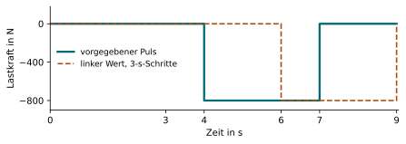
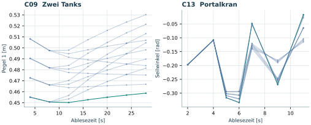
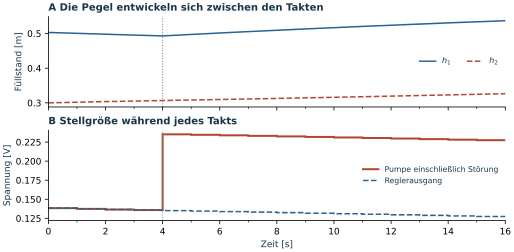

# Kapitel 14 · C09 und C13 – abgetastete Tanks und Lastpulse am Kran

## Einleitung · Wie hält ein kontinuierliches Modell den Takt einer Steuerung ein?

Ein digitaler Regler liest den Pegel in einem Tank einmal pro Sekunde aus. Zwischen zwei Abfragen verändert sich der Pegel weiter. Der Regler hält den zuletzt berechneten Stellwert für die Pumpe. Am Kran beginnt und endet ein Lastpuls ebenfalls zu bekannten Zeitpunkten. Die Kraft kann dabei unmittelbar springen. Der Wagen kann im selben Augenblick weder seinen Ort noch bei endlicher Kraft seine Geschwindigkeit sprunghaft ändern.

Beide Versuche fragen, welche Uhr zu welcher Rechnung gehört. Beim Tank folgt der Pegel aus dem Wasservolumen und den Zu- und Abflüssen, während der Stellwert nur bei einem Reglertakt neu berechnet wird. Beim Kran kann man die Bewegung mit konstanter äußerer Kraft abschnittsweise integrieren. In beiden Fällen teilen bekannte Termine die Rechnung in Phasen. Beim Erreichen eines Termins muss feststehen, ob ein Wert gelesen, neu berechnet oder gehalten wird.

Im kurzen C09-Fenster prüfen wir 16 Einsekundentakte mit einem Pegelbudget von $0{,}5\,\mathrm{mm}$ je Beobachtung. Für C13 lesen wir im Teilversuch A die fünf Zustände bei 4, 7 und 15 Sekunden aus. Weitere Teilaufgaben betrachten Bremsen und Halten. Das Kapitel leitet her, wie man eine Abweichung bis zum ersten falschen Takt oder zur ersten falsch gerechneten Pulsphase zurückverfolgt.

[Zum Schluss dieses Kapitels](#kap14-schluss)

<!-- Buchseite -->

## Vom nichtlinearen Tank zum abgetasteten Regelkreis

Ein offener Tank hat die konstante Querschnittsfläche $A_t=0{,}04\,\mathrm{m^2}$. Eine Pumpe speist den Volumenstrom $u$ ein. Bei freiem Ausfluss und konstanter Schwerkraft modellieren wir den Abfluss durch $c\sqrt H$, wobei $H>0$ der Füllstand und $c=0{,}002\,\mathrm{m}^{5/2}/\mathrm s$ der zusammengefasste Ausflusskoeffizient sind. Die Volumenbilanz lautet $A_t\dot H=u-c\sqrt H$. Bei $H_*=0{,}25\,\mathrm{m}$ hält $u_*=0{,}001\,\mathrm{m^3/s}$ den Stand konstant.

### Die Linearisierung macht den Arbeitspunkt sichtbar

Für $x=H-H_*,\ v=u-u_*$ liefert die Taylorentwicklung

$$
\dot x=-a x+bv,\qquad a=\frac{c}{2A_t\sqrt{H_*}}=0{,}05\,\mathrm{s^{-1}},
 \qquad b=1/A_t=25\,\mathrm{m^{-2}} .
$$

Das ungeregelte System hat eine Zeitkonstante von $20\,\mathrm{s}$. Ein kontinuierlicher Regler $v=-Kx,\ K=0{,}004\,\mathrm{m^2/s}$ verschiebt den Pol auf $-(a+bK)=-0{,}15\,\mathrm{s^{-1}}$. Im Versuch wirkt die Pumpe nur in der Nähe des Arbeitspunktes linear.

### Was ändert die digitale Abtastung?

Der Regler misst alle $T_{\rm ab}$ Sekunden und hält $v_n=-Kx_n$ dazwischen konstant. Die exakte Integration der linearen Streckengleichung bei konstantem Eingang ergibt

$$
x_{n+1}=e^{-aT_{\rm ab}}x_n+\frac{b}{a}(1-e^{-aT_{\rm ab}})v_n
       =(3e^{-0{,}05T_{\rm ab}}-2)x_n .
$$

Für $T_{\rm ab}=5\,\mathrm{s}$ ist der Faktor $0{,}3364$, die Störung fällt. Bei $T_{\rm ab}=25\,\mathrm{s}$ ist er $-1{,}1405$, die linearisierte Störung wechselt das Vorzeichen und wächst. Aus $|3e^{-0{,}05T_{\rm ab}}-2|<1$ folgt für positive Abtastzeiten $T_{\rm ab}<\ln(3)/0{,}05=21{,}97\,\mathrm{s}$.

**Modellzeit und Solverzeit.** Die Abtastzeit gehört zum Regelgesetz. Der Integrator darf innerhalb eines Takts beliebig viele geeignete Schritte ausführen, muss den Reglerwechsel aber am festgelegten Zeitpunkt behandeln. Selbst exakte Integration der Strecke kann die Instabilität einer zu langsam abgetasteten Rückkopplung abbilden.

Diese Herleitung ersetzt das frühere Aufgabenpaar zum Eintankregler. Für $T_{\rm ab}=20\,\mathrm{s}$ ist der Faktor $3/e-2\approx-0{,}89636$: Das Vorzeichen wechselt, der Betrag sinkt. Der ARGESIM-Fall C09 enthält zwei Tanks und einen anderen Regler, siehe [Was die acht Anwendungsfälle tatsächlich prüfen](../lehrbuch_numerische_simulation.md#fb-faelle).

## C09 · Den ersten Reglertakt selbst nachrechnen

Zwei Tanks sind über eine Verbindung gekoppelt. Eine Pumpe speist Tank 1, Tank 2 hat einen Ablauf. Die Zustände $h_1,h_2$ sind die Füllstände in Metern. Ein digitaler Regler liest $h_2$ im Abstand von einer Sekunde und hält die Pumpenspannung $u$ dazwischen konstant. Die Reibung in den Ausflüssen führt hier zu Wurzelgesetzen. In den kalibrierten Einheiten des Projektmodells gilt

$$
\begin{aligned}
 k_{12}&=0{,}06624\cdot0{,}4\,\operatorname{sgn}(h_1-h_2)\sqrt{|h_1-h_2|},\\
 k_a&=0{,}0605\cdot0{,}3\,\beta\sqrt{\max(0,h_2)},\\
 \dot h_1&=0{,}067u-k_{12},\qquad \dot h_2=k_{12}-k_a .
 \end{aligned}
$$

Die Vorzeichenfunktion $\operatorname{sgn}$ gibt die Strömungsrichtung vor. $\beta=1{,}2$ gilt unter $0{,}16\,\mathrm{m}$, sonst $\beta=1$. Die Kopplung tritt mit umgekehrten Vorzeichen auf. Die Summe der beiden Modellgleichungen liefert sofort die Kontrolle $\dot h_1+\dot h_2=0{,}067u-k_a$.

### Warum der Solver nur die Strecke integriert

Start $h_1=0{,}503\,\mathrm{m},\ h_2=0{,}30\,\mathrm{m}$, Sollwert $0{,}30\,\mathrm{m}$. Der proportionale Fuzzy-Regler kombiniert gewichtete Regeln. In diesem Startpunkt ist nur die Regel für guten Fehler und niedrigen Füllstand aktiv. Der Schwerpunkt ihres Dreiecks ist $u=(0{,}10+0{,}14+0{,}175)/3=0{,}138333\,\mathrm{V}$. Damit folgen $\dot h_1=-0{,}002670\,\mathrm{m/s}$ und $\dot h_2=0{,}001997\,\mathrm{m/s}$. Nach einem Takt berechnet DOP853 $h_1=0{,}500398\,\mathrm{m},\ h_2=0{,}301913\,\mathrm{m}$. Erst jetzt wird der Regler erneut aufgerufen.

**Was die Messreihe tatsächlich erfasst.** Der Archivversuch prüft beide Pegel nach jedem von 16 Takten mit einer Grenze von $0{,}5\,\mathrm{mm}$. Ab $t=4\,\mathrm{s}$ wird zusätzlich $0{,}1\,\mathrm{V}$ aufgeschaltet. Der eigenständige Lehrversuch prüft die erste Sekunde und die Bilanz. Eine Reglerauswertung in jeder RK-Stufe würde ein anderes Abtastsystem erzeugen.

`python labor.py c09` · [ARGESIM C09](https://www.argesim.org/benchmarks/c09) · [Strecke und Regeln](https://github.com/5H3LL3H5/argesim-hyperposition-benchmarks/blob/1824c9104152674b82de6cd84d53b0b4f68dca37/argesim_benchmarks/models/c09_fuzzy_tanks.py).

## C09 · Was aus der Pumpenaufgabe geworden ist

Der Pumpenbecher der Einleitung hatte einen vorgegebenen Zufluss. Im ARGESIM-Versuch verändern zwei Wasserstände den Durchfluss zwischen den Behältern. Reicht es für den ersten Reglertakt, die zu Beginn gemessenen Änderungen eine ganze Sekunde lang festzuhalten? Schreiben Sie vor der Rechnung auf, bei welchem Becken Sie einen steigenden Pegel erwarten.

### Zwei Vorhersagen für dieselbe Sekunde

Wir übernehmen die Anfangspegel $0{,}503\,\mathrm{m}$ und $0{,}300\,\mathrm{m}$ sowie die Pumpenstellung der vorigen Seite. Die einfachste Rechnung verwendet für beide Becken die Anfangsrate. Für Becken 1 ergibt sie $0{,}503-0{,}00266958=0{,}50033042\,\mathrm{m}$. Das ist genau ein Vorwärts-Euler-Schritt. Die Referenz integriert die beiden gekoppelten Pegelgleichungen innerhalb dieses Takts.

| Beobachtung | Ein Euler-Schritt | DOP853 | Euler minus Referenz |
| --- | --- | --- | --- |
| Pegel 1 [m] | 0,500330 | 0,500398 | $-0{,}0674\,\mathrm{mm}$ |
| Pegel 2 [m] | 0,301997 | 0,301913 | $+0{,}0834\,\mathrm{mm}$ |

### Wie präzise muss der erste Takt sein?

Für das in der Studie verwendete Pegelziel von $0{,}5\,\mathrm{mm}$ liegen beide Abweichungen im ersten Takt innerhalb der Grenze. Wählen wir im Lehrversuch ein strengeres Ziel von $0{,}05\,\mathrm{mm}$, verfehlt derselbe Schritt es an beiden Becken. Eine Entscheidung über alle 16 Takte erfordert auch die späteren Zustände und die jeweils neu berechnete Reglerausgabe.

### Was der Vergleich mit dem Becher lehrt

Bei der Pumpe konnten wir den gesamten Flächenfehler mit einer Krümmungsschranke begrenzen. Hier hängt schon die nächste Rate vom vorher berechneten Pegel ab. Zusätzlich muss die Wirkung früher Zustandsfehler erfasst werden. Genau dazu dient die [Abschätzung für die Fehlerfortpflanzung](../lehrbuch_numerische_simulation.md#t1-k2). Die Zahlen in dieser Tabelle sind Abstände zu einem unabhängigen Rechenweg. Eine garantierte globale Fehlerschranke würde einen eigenen Nachweis erfordern.

`python labor.py c09vergleich` · [Modell- und Reglergleichungen](#fb-c09takt) · [ARGESIM C09](https://www.argesim.org/benchmarks/c09).

## C13 · Einen Lastpuls ohne Zeitschritt kontrollieren

Der lineare Kranversuch verwendet Wagenposition $q$, Wagengeschwindigkeit $v$, Lastwinkel $\alpha$, Winkelgeschwindigkeit $\omega$ und Antriebskraft $F$ als Zustand. Zwei Gleichungen zweiter Ordnung für Wagen und Last werden zu vier ersten. Ein Antrieb mit eigener Trägheit ergänzt die fünfte. Der Versuch startet in Ruhe. Die Sollkraft ist $160\,\mathrm{N}$, die äußere Lastkraft $F_d$ ist von 4 bis 7 Sekunden $-800\,\mathrm{N}$ und sonst null.

In SI-Einheiten lauten die Projektgleichungen mit den eingesetzten Massen $10$ und $100\,\mathrm{kg}$ und Seillänge $5\,\mathrm{m}$

$$
\begin{aligned}
 \dot q&=v,\qquad \dot\alpha=\omega,\\
 \dot v&=-0{,}05v+98{,}1\alpha+0{,}1F,\\
 \dot\omega&=(0{,}05-0{,}00001)v/5-9{,}81\cdot11\alpha/5
              -0{,}00001\omega-0{,}02F+F_d/500,\\
 \dot F&=-4F+640 .
 \end{aligned}
$$

Für jede Phase ist das eine *affine* Gleichung $\dot x=Ax+b$, mit einem vom Zustand unabhängigen Zusatz $b$. Ergänzt man eine konstante sechste Komponente 1, gilt $\dot z=Bz,\ B=\left(\begin{smallmatrix}A&b\\0&0\end{smallmatrix}\right)$. Deshalb folgt $z(t+h)=e^{hB}z(t)$ für die ganze Phase. Der Rechner wertet das Matrixexponential numerisch aus. Er muss die Bewegung dafür nicht in Zeitschritte zerlegen.

| $t$ [s] | $q$ [m] | $v$ [m/s] | $\alpha$ [rad] | $\omega$ [rad/s] | $F$ [N] |
| --- | --- | --- | --- | --- | --- |
| 4 | 10,6947 | 3,7124 | −0,10830 | +0,372565 | 159,99998 |
| 7 | 0,8437 | −10,1442 | −0,13276 | −0,409117 | 160,00000 |
| 15 | −47,6444 | 1,0016 | −0,09579 | −0,252605 | 160,00000 |

Das Skript prüft alle fünf Zustände gegen eine gesondert formulierte DOP853-Rechnung. In der wiederholten Acht-Fälle-Studie erreicht der beste abgeschlossene QSS-Lauf zu C13 den Score 2,22. Eine genaue Zustandsbeobachtung an einem einzigen Lastzeitpunkt würde zur Methodenwahl für alle drei Zeitpunkte nicht ausreichen.

`python labor.py c13` · [ARGESIM C13](https://www.argesim.org/benchmarks/c13) · [Modellgleichungen](https://github.com/5H3LL3H5/argesim-hyperposition-benchmarks/blob/1824c9104152674b82de6cd84d53b0b4f68dca37/argesim_benchmarks/models/c13_crane.py).

<!-- Buchseite -->

### Bekannte Takte als Schrittgrenzen verwenden

Ein glattes nichtlineares Feld lässt sich lokal durch die Stufen des Solvers abtasten. Bei einem Takt mit sprungförmigem Ausgang oder einer Lastflanke gilt links und rechts je ein anderes Feld. Stufen, die auf beiden Seiten auswerten, vermischen diese beiden Gleichungen. Ein kurzer Lastpuls kann sogar vollständig zwischen den Stufen liegen. Dann bleibt ein lokaler Fehlerschätzer möglicherweise klein, obwohl ein ganzes Stück Anregung fehlt.

Für eine Messung unmittelbar an der Flanke gilt die [einseitige Auswertung aus Kapitel 2](../lehrbuch_numerische_simulation.md#auflage-k02-01).

Für die C09-Abtastung begrenzen wir die Integration vorab auf den nächsten bekannten Takt. Dort wird der Zustand für den Regler ausgewertet, die neue Stellgröße berechnet und bis zum folgenden Takt gehalten. Für C13 sind Anfang und Ende des Pulses vorgegeben. Jedes der drei Intervalle erhält seine eigene Last. Der Schritt, der eine Flanke erreicht, verwendet den Wert des alten Intervalls einschließlich des linksseitigen Grenzwerts am Schrittende. Der folgende Schritt startet mit der rechten Last.

Eine bekannte Ausgabezeit, zu der das Messgerät bloß mitliest, kann aus der dichten Ausgabe bedient werden. Eine Abtastung, deren Ergebnis ins Modell zurückwirkt, gehört zum diskreten Ablauf. Im Code lässt sich dieser Unterschied daran prüfen, ob der Callback nur misst oder auch einen gehaltenen Eingang aktualisiert. [Zeit- und Zustandsereignisse](../lehrbuch_numerische_simulation.md#k5-ereignisse)

<!-- Buchseite -->

### Wie ein um eine Zehntelsekunde verspäteter Takt im Pegel erscheint

Für eine Handrechnung hat ein Tank die Fläche $A=0{,}1\,\mathrm{m^2}$. Wir vernachlässigen einen Abfluss für das kurze betrachtete Intervall. Die Pumpe soll am bekannten Takt $t=1\,\mathrm s$ von null auf $0{,}2$ Liter pro Sekunde schalten. Der Volumenstrom entspricht $2\cdot10^{-4}\,\mathrm{m^3/s}$. Durch die Fläche geteilt liefert er eine Pegeländerung von $0{,}002\,\mathrm{m/s}$.

Rechnet ein Programm die alte Phase bis $1{,}1\,\mathrm s$ weiter, hat der Tank zu dieser Zeit noch den alten Pegel. Im vorgesehenen Modell ist der Pegel inzwischen um $0{,}002\cdot0{,}1\,\mathrm m=0{,}2\,\mathrm{mm}$ gestiegen. Die Abweichung stammt aus dem zu spät aktualisierten Stellwert. Dass der Zeitintegrator auf beiden Teilintervallen die jeweils übergebene Gleichung exakt löst, kann daran nichts ändern.

[Zum exakten Abtastfaktor des Eintankmodells](#fb-tank-abtastfaktor). Für den tatsächlichen Tankversuch protokollieren wir deshalb am Takt zunächst den aus der alten Phase eintreffenden Pegel. Dann prüfen wir den daraus berechneten Stellwert und erst danach seine Wirkung auf den weiteren Verlauf. Ein einzelner Endwert würde weder den ersten falschen Takt noch seine Ursache benennen.

<!-- Buchseite -->

## C09 und C13 · Die erste abweichende Abtastung finden

Im Wasserstand ist die Wirkung eines veränderten Ventils oft erst viele Takte später sichtbar. Beim Kran erhält die Last an einer festgelegten Grenze einen Kraftsprung. Ein Zeitschritt, der in beiden Versuchen äußerlich glatt aussieht, kann deshalb bereits das falsche Eingangssignal integriert haben. Die Suche beginnt bei dem ersten abweichenden Eingang.

Im kurzen C09-Versuch misst die Studie zwei Pegel zu 16 Abtastzeiten mit je $0{,}5\,\mathrm{mm}$ Budget. QSS2 mit Quantenfaktor $10^{-3}$ erzielt $S\approx0{,}01169$. Daraus folgt ein maximaler Pegelfehler von etwa $0{,}00584\,\mathrm{mm}$ an diesen 32 Beobachtungen. Im unabhängigen Langzeitvergleich wird dagegen ein Plateau des zweiten Tanks aus einer publizierten Abbildung abgelesen. Zwischen 54 000 und 56 000 s stehen $53{,}585\,\mathrm{cm}$ im Modell $41{,}916\,\mathrm{cm}$ im Diagramm gegenüber. Bei einem Zentimeter Ablesebudget ergibt dieses Fenster den Beitrag $11{,}669$. Das kurze Integrationsexperiment und die Langzeitvalidierung stellen verschiedene Fragen.

Beim Kran liegt der Lastpuls von $-800\,\mathrm{N}$ zwischen 4 und 7 s. In jedem Intervall gilt $y'=A y+b$ mit konstanten Koeffizienten. Ergänzt man die Komponente eins, folgt $(y,1)'=\bigl(\begin{smallmatrix}A&b\\0&0\end{smallmatrix}\bigr)(y,1)$. Die Matrixexponentialfunktion liefert damit eine Referenz an beiden Pulsgrenzen und am Ende bei 15 s. QSS2 mit demselben Quantenfaktor erhält hier $S\approx33{,}68$, RK45 $S\approx2{,}06\cdot10^{-5}$.

**Erster Unterschied.** Notieren Sie bei C09 den gemessenen Pegel unmittelbar vor dem Takt sowie den ab dann gehaltenen Ventilwert. Bei C13 protokollieren Sie die Eingangsseite beider Pulsgrenzen. Die Abtastung der Störung und eine feinere Solver-Toleranz verändern unterschiedliche Teile des Rechenwegs.

[Zeitfenster und Ventilvergleich](https://github.com/5H3LL3H5/argesim-hyperposition-benchmarks/blob/16f0f2528fcf77f16898ecd74ad952be2c09eac2/docs/C09_FIGURE_CHECKS.md) · [Aufgaben A bis C des Krans](../lehrbuch_numerische_simulation.md#fb-refC13).

## Rechenprobe · Warum ein richtiger Endimpuls täuschen kann

Der Kran erfährt zwischen 4 und 7 Sekunden eine zusätzliche Kraft von $-800$ Newton. Bis zur sechsten Sekunde beträgt der zusätzliche Impuls $-800(6-4)=-1600$ Newtonsekunden. Nach dem Ausschalten bleibt der Gesamtimpuls dieses Lastpulses bei $-2400$ Newtonsekunden. Das ist eine unabhängige Kontrolle des Eingangssignals. Die Reaktion des geregelten Krans umfasst weitere Kräfte.

**Aufgabe.** Ein Programm übernimmt den linken Kraftwert bei 0, 3 und 6 Sekunden und hält ihn jeweils drei Sekunden lang. Welche der Kontrollzeiten 6 und 9 Sekunden macht den Fehler sichtbar?

**Musterlösung.** Bei 6 Sekunden hat das Programm noch keinen zusätzlichen Impuls akkumuliert. Die Abweichung beträgt 1600 Newtonsekunden. Bei 9 Sekunden hat das Programm mit dem falschen Pulsbeginn zufällig den richtigen Endimpuls erreicht. Teilt es die Schritte an den bekannten Grenzen 4 und 7 Sekunden, stimmen beide Kontrollen. Die vier Aussagen werden in `beispiele/benchmarkbilanz.py` mit ganzen Zahlen geprüft.

<!-- Buchseite -->

## Lesebeispiel · Was zwei Abtastreihen über ihre Zielgrößen verraten

Die zwölf Tankläufe und die zwölf Kranläufe liefern verschiedenartige Sensorwerte. Links wird derselbe Pegel an sieben festgelegten Zeitpunkten abgelesen. Rechts misst der Regler den Winkel des Seils. Die spätere gesuchte Größe ist beim Kran die Lastposition. Eine gute Winkelmessung zu einem frühen Zeitpunkt kann über diese Position wenig aussagen.

Lesen Sie im rechten Bild zuerst nur bei zwei Sekunden ab. Zwei nahe beieinanderliegende Werte können im selben Quantisierungsintervall liegen. Ob sich die späteren Positionen dann noch unterscheiden lassen, hängt von den weiteren verfügbaren Kanälen ab. Beim Basisplan für C13 bleiben zwei Szenarien unentscheidbar. Mit dem dokumentierten Zusatzkanal lassen sich alle zwölf unterscheiden, soweit es der Auftrag erfordert. [Einzelergebnisse für C09 bis C16](../lehrbuch_numerische_simulation.md#atlas-reihe2)

Rechts in Abb. 14.2 lesen wir **den Seilwinkel bei zwei Sekunden** in Radiant. Die Zielgröße dieser Messaufgabe ist die **Lastposition bei 15 Sekunden** in Metern. Der Winkel ist eine Beobachtung, aus der der Katalog die Zielposition eingrenzt. Abb. 14.1 prüft wiederum den programmierten Eingang: Bei sechs Sekunden hat der korrekte Lastpuls bereits $-1600\,\mathrm{N\,s}$ geliefert, der verspätet geschaltete noch null. Bei neun Sekunden liefern beide $-2400\,\mathrm{N\,s}$. Der frühe Impulstest erkennt den Zeitfehler auch dann, wenn der Endimpuls stimmt.

<!-- Buchseite -->

## Was hält der Regler zwischen zwei Takten fest?

Beginnen Sie im unteren Diagramm. Zu jeder ganzen Sekunde misst der P-Fuzzy-Regler den Pegel im zweiten Tank. Aus dem aktuellen Pegel berechnet er die nächste Spannung und hält sie eine Sekunde lang. Das Wasser strömt währenddessen weiter. Deshalb verbinden im oberen Diagramm glatte Pegelkurven die Abtastzeitpunkte.

Der Regler startet mit 0,13833 V. Vor dem Störzeitpunkt verdecken sich die beiden Linien in B. Danach entspricht ihr Abstand genau der addierten Störung. Nach 16 s liegen die Pegel bei 0,53684 m und 0,32643 m. Eine unabhängig schrittweise integrierte Projektlösung weicht an den Taktenden um höchstens $1{,}9\cdot10^{-9}$ m ab. Eine stimmige Endhöhe allein würde die korrekte zeitliche Lage des Eingriffs noch offenlassen.

<!-- Buchseite -->

## Schluss · Getrennte Uhren werden an der richtigen Grenze verbunden

Beim Tank löst der vorgegebene Zeittakt die digitale Rechnung aus. Der Pegel gehört zur kontinuierlichen Phase, die Pumpe hält die vom letzten Takt bestimmte Anregung. Den nächsten Zeitschritt beginnt der Solver erst mit diesem neu vereinbarten Wert. Beim Lastpuls am Kran gilt dasselbe Prinzip für die Kraft. Die Beschleunigung kann an der Flanke springen, die Position und Geschwindigkeit bleiben in dem beschriebenen Modell stetig.

Die Gegenprobe am Kran erklärt, warum ein Endwert allein zu wenig über die Zeitfolge sagt. Verschiebt man einen gleich langen Rechteckpuls, kann die gesamte Kraft über die volle Dauer denselben Impuls liefern. Zu einem Zeitpunkt innerhalb der vorgesehenen Pulsphase fehlt jedoch schon ein Teil der Anregung. Für die Abnahme lesen wir deshalb auch an den Grenzen und dazwischen aus.

Im Grundwasserbeispiel verlagert sich diese Prüfung in den Raum. Entscheidend wird dort, wo Quelle und Beobachter auf einem Gitter liegen. [C19R](../lehrbuch_numerische_simulation.md#fb-neu15)

Der FNO-Transfer prüft den Tanktakt und den linearen Lastpuls mit ihren ursprünglichen Regeln in zwei ausführbaren Varianten. [Anhang D](../lehrbuch_numerische_simulation.md#fno-transfer-tanks)

### Aktueller Stand der Forschung

FMI 3.0 stellt Uhren zur Kopplung zeit- und ereignisgesteuerter Modelle bereit. Vanommeslaeghe und Mitautoren beschreiben eine Abbildung von Parallel DEVS auf Co-Simulation mit synchronen FMI-Uhren. In ihrem Fallbeispiel vergleichen sie die resultierende Abfolge mit einem etablierten Simulator für das Modell. Für einen gekoppelten Tankregler ließe sich daraus eine konkrete Prüfaufgabe ableiten. Stimmen bei einem gemeinsamen Uhrzeitpunkt die Reihenfolge der Eingaben und die Pegelwerte, auch wenn zwei Komponenten gleichzeitig melden? Dazu müsste der Vergleich Taktfolge, ausgetauschte Werte und die numerische Bahn getrennt aufzeichnen. [Vanommeslaeghe u. a., Adapting parallel DEVS semantics to FMI 3.0 co-simulation using synchronous clocks](https://doi.org/10.1177/00375497251393255)

[Zur Einleitung dieses Kapitels](#kap14-einstieg)
