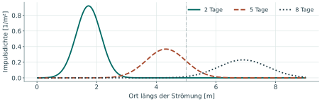
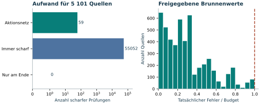

# Kapitel 15 · C19R – Schadstofftransport im Grundwasser

## Einleitung · Welche Änderung am Gitter darf die Konzentration am Brunnen verändern?

Ein Messbrunnen zeigt eine Konzentration an. Wir rechnen dasselbe Gebiet mit kleineren Zellen und lesen am Brunnen einen anderen Wert ab. Kann der Unterschied an der besseren räumlichen Auflösung liegen? Vor dieser Deutung müssen wir wissen, ob beide Simulationen dieselbe Stoffmenge in das Wasser einbringen und wirklich am selben Ort messen.

Wir beginnen mit der Bilanz von Speicherung, Eintrag und Transport. Die Strömung verschiebt den Stoff, Dispersion verbreitert seine Verteilung. Im Gitter erhält jede Zelle Beiträge ihrer Nachbarn und vorschriftsgemäße Beiträge der Quelle. Wird eine Zelle kleiner, verteilt sich derselbe Eintrag auf ein kleineres Wasservolumen. Damit nimmt ihre Konzentrationsrate zu, obwohl die insgesamt freigesetzte Masse gleich bleibt.

Im dokumentierten Vergleich halten wir die Quellrate von $2\,\mathrm{mg/s}$ und die Messstelle bei $(5,0)\,\mathrm m$ fest. Nach zehn Tagen lesen wir dort die Konzentration ab. Eine unabhängig hergeleitete Integralformel für das homogene Referenzproblem hilft bei der Kontrolle. Danach variieren wir Raumgitter, Zeitschritt und Außenflächen getrennt. Aus einer einzelnen Zahl am Brunnen soll ersichtlich werden, welche Ursache wir tatsächlich geprüft haben und weshalb ein passender Endwert noch keine Aussage über die ganze Ausbreitungsfahne liefert.

[Zum Schluss dieses Kapitels](#kap15-schluss)

<!-- Buchseite -->

## C19R · Wann erreicht ein Stoff den Sensor?

**Lernziel.** Sie können aus einem Wasser- und Stoffvolumen eine Konzentration berechnen, die Transportzeit abschätzen und räumlichen Fehler von Zeit- und Randfehler unterscheiden.

Eine Messstelle liegt fünf Meter stromabwärts. Das Grundwasser bewegt sich im Modell mit $0{,}864\,\mathrm{m/Tag}$. Eine Kollegin hält fest, der Sensor zeige am Tag $5/0{,}864$ erstmals einen Stoffeintrag an. Welcher Teil dieser Aussage lässt sich aus den beiden Zahlen wirklich ableiten?

### Eine Überschlagsrechnung mit geklärter Bedeutung

Ein mit der mittleren Strömung bewegtes Wasserpaket benötigt $5/0{,}864\approx5{,}79$ Tage für diese Strecke. Das Modell C19R beschreibt außerdem eine räumliche Ausbreitung um diesen Transportweg. Für den ersten messbaren Ausschlag braucht man die Konzentration am Sensor und dessen Nachweisgrenze. Die reine Reisezeit liefert keine von beiden.

### Eine zweite Rechnung prüft die Quelle

In einem Rechenfeld von $1\,\mathrm{m^2}$ Fläche und $10\,\mathrm{m}$ Schichtdicke nimmt Wasser ein Viertel des Volumens ein. Es enthält damit $2{,}5\,\mathrm{m^3}$ Wasser. Ein Eintrag von $2\,\mathrm{mg/s}$ bewirkt allein durch die Quelle $0{,}8\,\mathrm{mg/(m^3\,s)}$ Konzentrationszuwachs. Transport in Nachbarzellen kommt gesondert hinzu.

**Jetzt Sie.** Halbieren Sie die Seitenlänge der quadratischen Zelle. Beim erneuten Multiplizieren von lokaler Konzentrationsrate und neuem Wasservolumen müssen wieder $2\,\mathrm{mg/s}$ herauskommen. Diese Probe funktioniert auch, wenn keine exakte Konzentration an der Messstelle bekannt ist.

Der Laborauftrag vergleicht einen festen Zeitpunkt am festen Ort. Zu einer Behauptung über ein ganzes Konzentrationsfeld wären weitere Messgrößen nötig.

**Kernweg**  [Quellbilanz](#fb-c19)  **Vertiefung**  [Integral als Referenz](#fb-c19integral) [Selbst prüfen](#fb-ueb11).

## C19R · Wie erreicht ein Schadstoff die Messstelle?

**Erst schätzen.** Beide Zellbreiten halbieren sich, der Massenstrom einer Punktquelle bleibt gleich. Was ändert sich in der Quellzelle?

Ein Sensor liegt fünf Meter stromabwärts einer ortsfesten Quelle. Der Laborauftrag fragt nach der Konzentration am zehnten Tag. Die Grundwasserschicht sei anfangs sauber und im betrachteten Fall homogen. Die Aufbereitungsanlage bleibt ausgeschaltet. Andere Sensoren, Zeitpunkte und Betriebsarten der offiziellen Aufgabenfamilie ergeben eigene Versuche.

### Aus Volumen, Masse und Flüssen wird die Gleichung

Wir mitteln über eine Schicht konstanter Dicke $b$. Ein Bodenstück mit Grundfläche $\Delta A$ enthält bei wassergefüllter Porosität $\eta$ das Wasservolumen $\eta b\,\Delta A$. Seine gespeicherte Stoffmasse ist näherungsweise $\eta b\,c\,\Delta A$, wobei $c$ die Konzentration pro Wasservolumen bezeichnet. Der mittlere Wassertransport nimmt Stoff mit der Geschwindigkeit $\mathbf v=(v,0)$ mit. Die mechanische Dispersion verteilt ihn in Richtung fallender Konzentration. Daher ist der Fluss pro wasserführender Fläche $\mathbf j=\mathbf v c-D\nabla c$.

Die Stoffbilanz lautet Eintrag minus Nettostoffstrom nach außen. Für einen festen Gebietsausschnitt $A$ mit der Quelle in seinem Inneren folgt

$$
\frac{\mathrm{d}}{\mathrm{d} t}\int_A\eta b\,c\,\mathrm dA
   =\dot m-\int_{\partial A}\eta b\,\mathbf j\cdot\mathbf n\,\mathrm ds .
$$

$\partial A$ bezeichnet die Randlinie und $\mathbf n$ die äußere Einheitsnormale. Liegt die Quelle außerhalb dieser Fläche, entfällt $\dot m$. Im Inneren quellenfreier Teilgebiete folgt für die konstanten Koeffizienten $c_t+v c_x=D(c_{xx}+c_{yy})$.

### Zwei Modelle für denselben Prüfpunkt

Die analytische Vergleichsrechnung nimmt eine unendliche Ebene und fern der Quelle abklingende Konzentration an. Die Gitterrechnung nutzt ein begrenztes Rechteck. Ihre äußeren Nachbarwerte werden für den dispersiven Anteil aus der Randzelle fortgesetzt, sodass der Normalgradient verschwindet. Der konvektive Randtransport bleibt in der Bilanz. In der Quellzelle trägt $\dot m/(\eta b\Delta A)$ Konzentration pro Zeit ein. Die Halbierung beider Gitterweiten vervierfacht diese lokale Rate bei gleicher eingetragener Masse.

[ARGESIM C19R, Aufgabendefinition](https://www.argesim.org/benchmarks/c19) · [Kontrollvolumen, Quellzelle und Randflüsse](https://github.com/5H3LL3H5/argesim-hyperposition-benchmarks/blob/1824c9104152674b82de6cd84d53b0b4f68dca37/argesim_benchmarks/models/c19_groundwater.py).

## Labor C19R · Einen Kontrollwert unabhängig berechnen

Wir verwenden Aufgabe A ohne Aufbereitung. In einer homogenen Schicht von $b=10\,\mathrm{m}$ und Porosität $\eta=0{,}25$ setzt eine ortsfeste Quelle ab $t=0$ konstant $\dot m=2\,\mathrm{mg/s}$ frei. Die Porosität ist der wassergefüllte Volumenanteil. Für diesen Fall sind die Dispersivitäten in beiden Richtungen $\alpha=0{,}05\,\mathrm{m}$. Bei $v=10^{-5}\,\mathrm{m/s}$ ergibt das $D=\alpha v=5\cdot10^{-7}\,\mathrm{m^2/s}$. Es gilt der Geschwindigkeitswert aus Tabelle 1 der Definition, entsprechend $0{,}864\,\mathrm{m/Tag}$.

### Vom einzelnen Stoffimpuls zur Dauerquelle

Ein einzelner Punktimpuls verteilt sich auf der unendlichen Ebene als verschobene zweidimensionale Gaußglocke. Für sein Alter $a>0$ ist die normierte räumliche Dichte

$$
K(x,y,a)=\frac{1}{4\pi D a}
       \exp\!\left(-\frac{(x-va)^2+y^2}{4Da}\right).
$$

Ihr Mittelpunkt liegt bei $va$, ihre Varianz pro Koordinate ist $2Da$. Die über die Fläche integrierte Dichte ist eins. Ein Altersintervall $\mathrm{d} a$ trägt die Stoffmasse $\dot m\mathrm{d} a$ bei. Division durch $\eta b$ rechnet Flächenmasse in Konzentration im Porenwasser um. Addition aller Altersbeiträge liefert

$$
c(x,y,t)=\frac{\dot m}{\eta b}\int_0^t K(x,y,a)\,\mathrm{d} a .
$$

Für die Driftgeschwindigkeit $10^{-5}\,\mathrm{m/s}$ liegen die Maxima nach 2, 5 und 8 Tagen bei $1{,}728$, $4{,}320$ und $6{,}912\,\mathrm m$. Der Gipfel passiert den bei fünf Metern eingezeichneten Brunnen zwischen Tag 5 und Tag 8. Eine erste messbare Ankunft wäre zusätzlich durch eine Nachweisgrenze zu definieren.

Für $t=10$ Tage, $x=5\,\mathrm{m},\ y=0$ ergibt direkte Quadratur $45\,021{,}6231\,\mathrm{mg/m^3}$. Das Skript integriert über den dimensionslosen Altersanteil $a/t$. Verschärfung seiner relativen Quadraturtoleranz von $10^{-8}$ auf $10^{-12}$ verändert die gerundeten Stellen nicht. So entsteht ein Kontrollwert ohne Raumnetz.

`python labor.py c19r` · [Parameterwahl und Vergleich der unabhängigen Punktquellenrechnungen](https://github.com/5H3LL3H5/argesim-hyperposition-benchmarks/blob/1824c9104152674b82de6cd84d53b0b4f68dca37/docs/PUBLISHED_REFERENCE_CHECKS.md\#c19r-spatial-and-time-accuracy).

## C19R · Was die Gitterverfeinerung bewirkt

Die archivierte Rechnung misst nach zehn Tagen bei $(5,0)\,\mathrm{m}$ mit RK4 und $7200\,\mathrm{s}$. Die Quelle liegt bei $(0,0)\,\mathrm{m}$ und liefert $2\,\mathrm{mg/s}$. Das grobe, mittlere und feine Gitter enthalten $17\cdot9=153$, $33\cdot17=561$ und $65\cdot33=2145$ Zellzentren. Die gesamte Quelle bleibt jeweils einer Zelle zugeordnet. Verglichen wird mit dem unabhängig berechneten Wert für die unendliche Ebene.

| Gitterweite $\Delta x$ | $c$ [mg/m³] | absolute Differenz [mg/m³] |
| --- | --- | --- |
| 1,00 m | 48 677,18 | 3 655,56 |
| 0,50 m | 48 251,10 | 3 229,48 |
| 0,25 m | 45 440,70 | 419,08 |

Alle drei archivierten Läufe verwenden RK4 mit $7200\,\mathrm{s}$. Auf dem mittleren Gitter ändert die Halbierung des Zeitschritts allein das Ergebnis um $0{,}00233\,\mathrm{mg/m^3}$. Die Abweichung zur externen Referenz liegt an diesem Punkt um Größenordnungen höher.

### Interpretation für einen neuen Vergleich

Die äußeren Zentren liegen bei $x=-4,12$ und $y=-4,4\,\mathrm{m}$. Aus Zentrum $\pm\Delta x/2$ folgen die Außenflächen $(-4{,}5;12{,}5;-4{,}5;4{,}5)$, $(-4{,}25;12{,}25;-4{,}25;4{,}25)$ und $(-4{,}125;12{,}125;-4{,}125;4{,}125)$, jeweils West, Ost, Süd, Nord in Metern. Die Differenzen enthalten Raum- und Gebietseinfluss. Ein Wiederholungslauf mit festen Außenflächen steht [C19R · Ein Gitterversuch mit festen Außenflächen](#fb-befundgitterfest). Bei $0{,}25\,\mathrm{m}$ und $3600\,\mathrm{s}$ ergibt die getrennte Randvariation zweimal $45\,440{,}69\,\mathrm{mg/m^3}$ am Brunnen ([C19R · Positivität und Fehler an der Messstelle](#fb-befundtransport)). Für einen fairen Vergleich von RK gegen QSS fixiert man den räumlichen Operator, die äußeren Flüsse und die Beobachtungspunkte und misst die Arbeit bei gleicher Konzentrationsabweichung. Eine zweite Gitterweite prüft, ob die Schlussfolgerung trägt. Diese Datenreihe selbst vergleicht Gitterweiten unter RK4.

[Protokoll der Gitterstudie](https://github.com/5H3LL3H5/argesim-hyperposition-benchmarks/blob/1824c9104152674b82de6cd84d53b0b4f68dca37/docs/PUBLISHED_REFERENCE_CHECKS.md\#c19r-spatial-and-time-accuracy) · [Berechnung](https://github.com/5H3LL3H5/argesim-hyperposition-benchmarks/blob/16f0f2528fcf77f16898ecd74ad952be2c09eac2/scripts/c19_profiles.py) · [C19/C19R-Aufgabe](https://www.argesim.org/benchmarks/c19).

### Warum eine kleinere Quellzelle pro Volumen mehr Stoff erhält

Nehmen wir für eine Handrechnung an, die Quellzelle enthalte $4\,\mathrm{m^3}$ Wasser. Eine Quelle mit $2\,\mathrm{mg/s}$ erhöht ohne Abfluss die Konzentration dort pro Sekunde um $0{,}5\,\mathrm{mg/m^3}$. Wir halbieren nun in beiden horizontalen Richtungen die Zellweite und lassen Schichtdicke sowie wassergefüllten Volumenanteil gleich. Das Wasservolumen der Zelle beträgt dann nur noch $1\,\mathrm{m^3}$. Für dieselbe Quelle muss die Konzentration pro Sekunde um $2\,\mathrm{mg/m^3}$ steigen.

Nach fünf Sekunden liefern beide Rechnungen genau zehn Milligramm eingetragenen Stoff. Im gröberen Gitter erhält man sie aus $4\cdot(5\cdot0{,}5)$, im feineren aus $1\cdot(5\cdot2)$. Wenn wir stattdessen die alte Konzentrationsrate in die neue Zelle kopieren, beträgt der Eintrag dort nur noch ein Viertel. Eine scheinbare Gitterstudie hätte dann in Wahrheit die Quelle variiert.

Bei einer über mehrere Zellen verteilten Quelle gilt die Kontrolle für die Summe aus Konzentrationsquellen mal den jeweiligen Wasservolumina. Der Brunnen selbst bleibt an derselben physikalischen Stelle. Liegt er zwischen Knoten, gehört die Auswertungsmethode zum Versuch. Erst diese Festlegungen machen eine Abweichung gegenüber der Referenz als Raumfehler interpretierbar.

<!-- Buchseite -->

## C19R · Ist der Zeitintegrator der Engpass?

### Versuchsauftrag

Eine Messstelle liegt fünf Meter stromabwärts. Gewünscht sei nach zehn Tagen eine relative Abweichung von höchstens $1\,\%$ gegenüber der homogenen Referenz auf der unendlichen Ebene. Die finite Rechnung verwendet Zellzentren $x=-4\ldots12\,\mathrm{m},\ y=-4\ldots4\,\mathrm{m}$. Die Quellmasse muss beim Verfeinern gleich bleiben. Wird einfach der gleiche Konzentrationszuwachs pro Zeitschritt in die Quellzelle geschrieben, verschwindet bei kleinerer Zelle künstlich ein Teil der eingetragenen Masse.

### Rechnung und Entscheidung

Der Kontrollwert von [Labor C19R · Einen Kontrollwert unabhängig berechnen](#fb-c19integral) ergibt mit den drei archivierten Gitterwerten von [C19R · Was die Gitterverfeinerung bewirkt](#fb-c19gitter) relative Abweichungen von $8{,}12\,\%$, $7{,}17\,\%$ und $0{,}931\,\%$. Erst die Gitterweite $0{,}25\,\mathrm{m}$ erfüllt das gesetzte Ziel an *dieser* Messstelle. Der Zeitvergleich am mittleren Gitter verschiebt die Konzentration beim Halbieren von $h$ nur um $0{,}00233\,\mathrm{mg/m^3}$. Ein alleiniger Wechsel von RK4 zu einem höher geordneten Zeitverfahren hat auf Basis dieser Daten keine belegte Aussicht, die räumliche Abweichung um Größenordnungen zu beseitigen.

### Drei Kontrollrechnungen vor einer Verallgemeinerung

**Masse.** Nach zehn Tagen wurden $\dot m\,t=1\,728\,000\,\mathrm{mg}$ eingebracht. Im unendlichen Gebiet bleibt diese Masse vollständig im Wasser. Im endlichen Gebiet muss man die zeitlich integrierten äußeren Nettoflüsse mitbilanzieren.

**Weg und Breite.** Der älteste Einzelimpuls ist $vt=8{,}64\,\mathrm{m}$ gewandert. Seine Standardabweichung pro Koordinate ist $\sqrt{2Dt}=0{,}930\,\mathrm{m}$. Die Dauerquelle besteht zusätzlich aus allen jüngeren, schmaleren Anteilen.

**Gebiet.** Wiederholen Sie die Rechnung bei gleicher Gitterweite mit weiter entfernten äußeren Grenzen. Erst dieser Vergleich untersucht, wie die unendliche Referenz und der endliche Versuch am Messpunkt zusammenpassen.

**Grenze der Aussage.** Die 1-Prozent-Entscheidung betrifft Ort, Zeit und homogenes Medium dieses Auftrags. Eine belastbare Konvergenzordnung verlangt eine systematische asymptotische Gitterfolge mit kontrollierter Zeit-, Quellen- und Randabweichung.

<!-- Buchseite -->

### Bei welcher Gitterweite zentrale Advektion ihre Vorzeichen verliert

Für einen stationären, quellenfreien Ausschnitt in einer Raumrichtung sei $v>0$ konstant und $D>0$. Mit zentraler Advektion und Diffusion auf gleichmäßigen Zellen lautet die Differenzengleichung
$$
(1+\mathrm{Pe}_h/2)c_{i-1}-2c_i+(1-\mathrm{Pe}_h/2)c_{i+1}=0,
\qquad \mathrm{Pe}_h=v\,\Delta x/D .
$$
Mit $\mathrm{Pe}_h\le2$ sind beide Nachbargewichte nichtnegativ und summieren sich nach Division durch zwei zu eins. Bei $\mathrm{Pe}_h>2$ wird das stromabwärtige Gewicht negativ. Die zentrale Näherung verliert in diesem Modell ihr diskretes Maximumprinzip. Bei $\mathrm{Pe}_h=4$ und Randwerten $c_0=0,c_2=1$ ergibt die einzige innere Zeile $-2c_1-1=0$, also $c_1=-1/2$. Dieselbe Rechnung mit Upwind-Advektion liefert $c_1=1/6$. Ein begrenzter Fluss kann zusätzlich die numerische Verbreiterung der Front verringern. Seine Positivität hängt auch vom Zeitverfahren ab.

Im C19R-Fenster gilt $\mathrm{Pe}_h=\Delta x/(0{,}05\,\mathrm m)$. Die Gitterweiten $1$, $0{,}5$ und $0{,}25\,\mathrm m$ entsprechen damit $20$, $10$ und $5$. Die Schwelle zwei gilt für den gerade hergeleiteten, zentralen stationären Stencil. Die veröffentlichten C19R-Rechnungen verwenden eine begrenzte Flussrekonstruktion. Deren eigene Positivitäts- und Gitterprüfung erklärt der folgende Abschnitt. [Flussdiskretisierung in Kapitel 7](../lehrbuch_numerische_simulation.md#t1-k7) · [Versteeg und Malalasekera, Konvektion und Diffusion](https://www.flowthermolab.com/wp-content/uploads/2021/11/Versteeg_Malalasekera_2ed.pdf)

<!-- Buchseite -->

## C19R · Positivität und Fehler an der Messstelle

Bei nichtnegativen Zellwerten liegt der im Code rekonstruierte östliche Konzentrationswert zwischen null und dem Doppelten des Zellwerts $c_i$. Das folgt aus der Begrenzung der Steigung durch das Doppelte des jeweiligen Nachbarsprungs. Der von Westen einströmende Wert ist ebenfalls nichtnegativ. Diffusion bringt nichtnegative Nachbarbeiträge, eine positive Quelle fügt Masse hinzu. Für einen Euler-Teilschritt genügt deshalb

$$
h\left(2v/\Delta x+2D_x/\Delta x^2+2D_y/\Delta y^2+
 \lambda_{\max}\right)\le 1.
$$

Hier sind $v,D_x,D_y$ bereits um die Retardation skalierte Größen und $\lambda_{\max}$ begrenzt die lokale Abbaurate. Der verbleibende Koeffizient von $c_i$ ist dann nichtnegativ. Die örtliche Quellrate wird durch das Zellvolumen geteilt; Multiplikation mit Porenanteil, Dicke und Zellfläche ergibt bei $R=1$ auf jedem getesteten Gitter $2\,\mathrm{mg/s}$.

### Wie verhält sich das tatsächlich verwendete RK4?

In acht Varianten des Zehntageversuchs wurden alle Zwischenstufen und Endwerte auf ihr Minimum geprüft; es lag jeweils bei null. Eine unbedingte RK4-Positivitätsgarantie ist falsch. Auf $9\times9$ Zellen mit $0{,}25\,\mathrm{m}$ Abstand, schachbrettartigem Null-Eins-Start, Quelle außerhalb und $h=200\,000\,\mathrm{s}$ erzeugt ein einziger Schritt einen Wert unter $-12\,535$. Die Euler-Bedingung oben ist eine bewiesene Aussage für Euler.

### Was lässt sich am Brunnen garantieren?

Bei $x=5\,\mathrm{m},\ y=0$ nach zehn Tagen liegt die unendliche Punktquellenreferenz zwischen $45\,014{,}84$ und $45\,028{,}41\,\mathrm{mg/m^3}$. Der Alterskern steigt bis zu einem Maximum und fällt dann; seine totale Variation ist höchstens zweimal die Gipfelhöhe. Damit ist der Fehler der Trapezsumme durch Schrittweite mal totale Variation eingeschlossen. Die Rechnung nutzt 65 536 Intervalle.
Das $0{,}25\,\mathrm{m}$-Gitter liefert $45\,440{,}70$, das $0{,}125\,\mathrm{m}$-Gitter im erweiterten Gebiet $45\,085{,}52\,\mathrm{mg/m^3}$. Die gespeicherten Brunnenwerte liegen damit garantiert innerhalb von $0{,}95\,\%$ bzw. $0{,}16\,\%$ der kontinuierlichen Referenz. Auf dem Viertelmetergitter bewirkt Halbierung des Zeitschritts rund $0{,}006\,\mathrm{mg/m^3}$ Unterschied. Eine breiter verteilte Quelle gleicher Masse verschiebt den Wert auf $44\,212{,}64$. Am Quellpunkt selbst ist das zweidimensionale Altersintegral wegen $1/a$ singulär; eine globale punktweise Fehlerschranke über alle Orte wäre schon deshalb ungeeignet.

[Kern und Einheiten](#fb-c19integral) · `transport.json` · `gegenproben.json`.

## C19R · Ein Gitterversuch mit festen Außenflächen

Wir fixieren die physischen Grenzen bei $x\in[-4{,}5;12{,}5]\,\mathrm{m}$ und $y\in[-4{,}5;4{,}5]\,\mathrm{m}$. Das erste bzw. letzte Zentrum liegt um eine halbe Zellweite innerhalb dieser Grenzen. Die vier Flächen ergeben sich für jede Auflösung wieder als äußeres Zentrum plus oder minus halbe Zellweite.

### Quelle und Brunnen behalten ihre Position

Die Quelle bei $(0,0)\,\mathrm{m}$ liefert konstant $2\,\mathrm{mg/s}$. Auf feinen Gittern liegt dieser Punkt zwischen Zellzentren. Wir verteilen die Rate bilinear: Alle Gewichte sind nichtnegativ, summieren sich zu eins und ihr Ortsmittel ist der Quellpunkt. Am Brunnen $(5,0)\,\mathrm{m}$ interpolieren wir am Tag 10 mit derselben Regel. Der RK4-Schritt beträgt stets $7200\,\mathrm{s}$.

| Zellweite [m] | Zellzahl $x\times y$ | Brunnenwert [mg/m³] |
| --- | --- | --- |
| 1,00 | $17\times9$ | 48 677,18 |
| 0,50 | $34\times18$ | 41 471,80 |
| 0,25 | $68\times36$ | 44 134,39 |

Welche Geometrie gehört zur Zahl? Bei festgehaltenen äußersten **Zentren** liefert das Viertelmetergitter $45\,440{,}70\,\mathrm{mg/m^3}$, im erweiterten Gebiet mit Achtelmetergitter sind es $45\,085{,}52$. Die gesicherten Punktfehler betragen höchstens 0,95 % und 0,16 %. Bei festen **Außenflächen** ergibt die Viertelmeterreihe $44\,134{,}39$. Der Abstand zum Punktwert $45\,021{,}62$ verbraucht das 1-%-Budget rund 1,97-mal. Schreiben Sie vor jedem Vergleich neben die Zellweite auch Randlage, Quelle und Sensor.

Die Referenz für die unendliche Ebene beträgt etwa $45\,021{,}62\,\mathrm{mg/m^3}$. Das feine Gitter liegt wieder näher an dieser Referenz als das mittlere. Die Reihe verändert die Auflösung der Quellprojektion und der Beobachtung. Sie liefert für sich allein keine Konvergenzordnung. Zusätzlich lässt sich die Zeitintegration bei festem Operator, festem Gitter und gleicher Auswertung vergleichen.

[Rechnung mit `--fixed-faces`](https://github.com/5H3LL3H5/argesim-hyperposition-benchmarks/blob/16f0f2528fcf77f16898ecd74ad952be2c09eac2/scripts/cp2_accuracy/transport_check.py) · `transport_feste_raender.json` · [Archivierte Gitterreihe](#fb-c19gitter).

<!-- Buchseite -->

### Was ändert allein die Quellverteilung?

Wir halten Außenflächen, RK4-Schritt von 7 200 Sekunden, Quelle von 2 mg/s und bilinearen Brunnensensor fest. In der zweiten Rechnung glätten wir allein die Quellgewichte je Richtung mit $(1/4,1/2,1/4)$. Masse und Schwerpunkt bleiben gleich. Die letzte Spalte integriert den Green-Kern der Punktquelle auf der unendlichen Ebene über dieselben Sensorzellen und benutzt dieselben Beobachtungsgewichte. Alle Konzentrationen gelten am zehnten Tag in $\mathrm{mg/m^3}$.

| Quelltest · $h$ [m] | Bilinear | Breiter | Green am Zellsensor |
| --- | --- | --- | --- |
| 1,00 | 48677,18 | 31548,87 | 41541,96 |
| 0,50 | 41471,80 | 37592,20 | 41541,96 |
| 0,25 | 44134,39 | 42943,91 | 44104,47 |

Am Viertelmetergitter liegt der bilineare FV-Wert um $29{,}91\,\mathrm{mg/m^3}$ über der Green-Referenz mit denselben Sensorzellen. Gegen den physischen Punktwert von $45\,021{,}62\,\mathrm{mg/m^3}$ beträgt die Differenz $-887{,}24\,\mathrm{mg/m^3}$. Drei Gitter mit unterschiedlichen Quell- und Beobachtungsfehlern bestimmen noch keine asymptotische Ordnung des Flussverfahrens.

**Was ändert die Breite genau?** In jeder Richtung verschiebt der zusätzliche Filter die Quelle mit Gewichten $(1/4,1/2,1/4)$ um $-h,0,+h$. Die Summe ist eins, die mittlere Verschiebung null. Das zweite zentrale Ortsmoment steigt je Richtung um $h^2/2$. Am Viertelmetergitter messen wir beim Wechsel von bilinear zu verbreitert $42\,943{,}91-44\,134{,}39=-1\,190{,}48\,\mathrm{mg/m^3}$. Das ist die Antwort des festen FV-Verfahrens am Messort $(5,0)\,\mathrm m$ nach zehn Tagen auf genau diese Änderung.

**Wann hilft Peacemans Brunnenradius?** Betrachten wir eine stationär fördernde, vertikale Bohrung in einer homogenen isotropen Schicht der Dicke $b$, ohne zusätzlichen Bohrlochwiderstand. Mit Permeabilität $k$, dynamischer Viskosität $\mu$ und positiver Volumenförderrate $Q$ folgt aus dem radialen Darcy-Gesetz $dp/dr=\mu Q/(2\pi k b r)$. Integration vom Bohrlochradius $r_w$ zum effektiven Zellblockradius $r_e$ ergibt
$$p_{\rm Block}-p_{\rm Brunnen}=\frac{\mu Q}{2\pi k b}\log\!\frac{r_e}{r_w}.$$
Beim klassischen quadratischen Gitter im Inneren des Gebiets entspricht der Zelldruck ungefähr dem Druck bei $r_e\simeq0{,}2h$. Die linke Seite hat die Einheit Pascal. Im C19R-Versuch sind die Eingabe eine Stoffrate und die Ausgabe eine Konzentration stromabwärts. Dort trennt der kontrollierte Quellenwechsel den Einfluss der Quellgewichte vom übrigen diskreten Rechenweg. [Peaceman, 1978, SPE Journal](https://doi.org/10.2118/6893-PA)

## C19R · Ein Brunnenwert bekommt ein Fehlerbudget

Wir wollen am zehnten Tag an genau einem Ort eine Entscheidung treffen. Quelle und Messstelle bleiben auf denselben physischen Koordinaten. Die Außenflächen des endlichen Gebiets stehen fest. Für diesen Lehrversuch wählen wir am Brunnen eine Abweichung von höchstens einem Prozent zur Referenz der unendlichen Ebene. Wie fällt das Urteil aus, wenn das Gitter verfeinert wird?

Mit $Q^*=45\,021{,}62\,\mathrm{mg/m^3}$ ist das absolute Budget $b=450{,}2162\,\mathrm{mg/m^3}$. Die Reihe mit festen Außenflächen [C19R · Ein Gitterversuch mit festen Außenflächen](#fb-befundgitterfest) liefert folgende Nachrechnung aus den gerundeten Werten.

| Zellweite | Brunnenwert | $\vert Q-Q^*\vert /b$ | Lage zur Referenz |
| --- | --- | --- | --- |
| $1\,\mathrm{m}$ | 48 677,18 | 8,12 | zu hoch |
| $0{,}5\,\mathrm{m}$ | 41 471,80 | 7,88 | zu niedrig |
| $0{,}25\,\mathrm{m}$ | 44 134,39 | 1,97 | zu niedrig |

Alle drei Werte verfehlen dieses Ziel. In der früheren Reihe [C19R · Was die Gitterverfeinerung bewirkt](#fb-c19gitter) erreicht das feinste Gitter hingegen einen relativen Fehler von $0{,}931\,\%$. Dort liegen die äußersten Zellzentren fest, sodass sich die Außenflächen beim Verfeinern verschieben. Die Messung ist jeweils aussagekräftig, sobald Gittergeometrie, Quellprojektion, Interpolation und Referenz zugleich angegeben sind.

Eine zweite Probe führt die $2\,\mathrm{mg/s}$ eingespeiste Masse über zehn Tage auf $1\,728\,000\,\mathrm{mg}$ zurück. Bei anfangs leerem Gebiet ohne Abbau oder Entnahme müssen gespeicherte Masse und integrierter Nettoausfluss zusammen diese Menge ergeben. Der Probe liegt eine andere Messgröße zugrunde als dem Einzelwert am Brunnen.

**Diagnose.** Bleibt die Bilanz beim Verfeinern richtig, während der Sensorwert wandert, untersuchen Sie zuerst Quellverteilung, Auswertestelle, Randnähe und numerische Dispersion. Eine richtige Gesamtmasse ist auch mit einem zu breiten oder verschobenen Konzentrationspuls vereinbar.

[Profile und Behandlungsaufgaben](../lehrbuch_numerische_simulation.md#fb-refC19R) · [Unabhängige Referenz auf der Ebene](#fb-c19integral).

## Selbst prüfen · Quelle, Messort und Vergleich

**Merksatz.** Eine Referenz gehört zu einer bestimmten Messgröße, einem Ort, einer Zeit und Randbedingungen. Zeit-, Gitter- und Gebietsfehler lassen sich mit verschiedenen Gegenversuchen untersuchen.

### A · Den Stoffeintrag bilanzieren

Eine Quellzelle hat $0{,}5\,\mathrm{m}$ Seitenlänge, $10\,\mathrm{m}$ Schichtdicke und $0{,}25$ wassergefüllten Volumenanteil. Die Quelle gibt $2\,\mathrm{mg/s}$ ab. Welche Konzentrationszunahme in fünf Sekunden folgt aus dem Quellterm allein? Prüfen Sie über die Stoffmasse, ob die Konzentration im richtigen Volumen angegeben ist.

### B · Einen Datenbefund deuten

An derselben C19R-Messstelle wurden für grobes, mittleres und feines Gitter relative Abweichungen von $8{,}12\,\%$, $7{,}17\,\%$ und $0{,}931\,\%$ zur Referenz der unendlichen Ebene ermittelt. Welche der drei Rechnungen erfüllt hier das Ziel von einem Prozent? Erlauben diese drei Zahlen bereits eine Aussage über die Konzentration an allen anderen Punkten?

### C · Ein Gegenexperiment entwerfen

Ein Team will den verbleibenden Fehler durch einen neuen Zeitintegrator halbieren. Sie können drei paarweise Vergleiche durchführen. Beschreiben Sie, wie Sie nacheinander den Zeitschritt, die Zellbreite und den Abstand zum Außenrand verändern. Nennen Sie jeweils die Messgröße und eine Bedingung, unter der das Ergebnis mehrdeutig bliebe.

**Hinweis.** A zählt Masse pro Wasservolumen. Bei C sind gleicher Messort und gleiche Quellenstärke erst der Anfang. Auch Parameter, Anfangsdaten und Definition der Konzentration müssen zusammenpassen.

[Lösungswege A, B und C](#fb-loesweg11) · [Zum Kapitelauftakt](#fb-kap11).

## Lösungswege · Quelle, Messort und Vergleich

### A · Eine lokale und eine globale Einheit verbinden

Die Grundfläche beträgt $0{,}25\,\mathrm{m^2}$, das gesamte Zellvolumen $2{,}5\,\mathrm{m^3}$, das Wasservolumen $0{,}625\,\mathrm{m^3}$. Zehn Milligramm werden in fünf Sekunden freigesetzt. Der Quellterm allein liefert darum $10/0{,}625=16\,\mathrm{mg/m^3}$. Multiplizieren mit $0{,}625\,\mathrm{m^3}$ ergibt wieder $10\,\mathrm{mg}$.

### B · Die Reichweite des Befunds benennen

Nur das feine Gitter erfüllt mit $0{,}931\,\%$ die inklusive Ein-Prozent-Grenze. Diese Aussage betrifft den untersuchten Sensor zum untersuchten Zeitpunkt. Nahe der schmalen Quelle kann die Gitterempfindlichkeit anders ausfallen. Für eine Aussage über das ganze Feld wären Daten an mehreren Orten oder eine definierte räumliche Fehlernorm erforderlich.

### C · Drei Vergleiche mit je einer Stellgröße

**Zeit.** Lassen Sie Raumgitter, Gebiet und Quellenabbildung gleich und halbieren Sie $h$. Vergleichen Sie beide Sensorwerte zum selben physikalischen Zeitpunkt. Unterschiede beim Auslesen oder Interpolieren könnten den Zeitvergleich verfälschen.

**Raum.** Halbieren Sie die Zellweite bei festem Gebiet und kontrolliert kleinem Zeitfehler. Halten Sie die gesamte Quellmasse pro Zeit fest. Eine von der Zellfläche abhängige Gesamtmasse würde ein anderes Modell erzeugen.

**Gebiet.** Verlegen Sie bei unveränderter Zellweite den Rand weiter nach außen. Quelle und Sensor bleiben an ihrem physischen Ort. Eine Verschiebung des Sensors um eine halbe Zelle könnte wie ein Randeffekt aussehen. Vergleichen Sie in jedem Paar dieselbe Konzentration in $\mathrm{mg/m^3}$.

**Entscheidung.** Erst die Größe und Richtung dieser Änderungen helfen zu beurteilen, ob eine Änderung am Zeitintegrator das gewünschte Ziel erreichen kann.

[Noch einmal selbst rechnen](#fb-ueb11) · [Forschungsstand und Beweisfragen](#fb-schluss11).

<!-- Buchseite -->

## Welche Referenz passt zur Transportaufgabe?

### Bezug zu einer weiteren Modellrechnung

Die überarbeitete C19-Definition und die veröffentlichte COMSOL-Lösung bieten für den Grundwasserfall einen weiteren Modellierungsweg mit finiten Elementen. Aktuelle Arbeiten zu konservativen, maximumprinziperhaltenden Verfahren untersuchen die Kombination von Genauigkeit und physikalisch zulässigen Schranken bei konvektionsdominierter Diffusion. Solche allgemeinen Ergebnisse übertragen sich auf den konkreten Quellterm, die Randbehandlung und den Integrator nur unter den jeweiligen Voraussetzungen.

### Beweis · Die Referenz erhält die eingebrachte Masse

Für $a>0$ ist $K$ das Produkt zweier normierter Gaußdichten. Translation um $va$ verändert deren Integral nicht, also $\int_{\mathbb R^2}K(x,y,a)\,\mathrm dx\,\mathrm dy=1$. Der Integrand ist nichtnegativ. Daher dürfen wir die Reihenfolge der Orts- und Altersintegration vertauschen und erhalten

$$
\eta b\int_{\mathbb R^2}c(x,y,t)\,\mathrm dx\,\mathrm dy
   =\dot m\int_0^t 1\,\mathrm{d} a=\dot m t .
$$

Derselbe Kontrollwert kann für ein endliches Gebiet erst nach Addition des integrierten Nettoausflusses angewendet werden. Der Beweis für die unendliche Ebene klärt also, welcher Term im praktischen Gitterversuch zusätzlich gemessen werden muss.

### Ergebnis der Nachuntersuchung

An der festgelegten Messstelle ist der Fehler der gespeicherten Viertel- und Achtelmetergitter gegen die kontinuierliche Punktquellenlösung eingeschlossen. Änderungen von Zeitauflösung, Quellbreite und Außengrenzen sind einzeln nachgemessen. Eine allgemeine Konvergenzordnung für beliebige Messorte erfordert weitere Orts- und Regularitätsannahmen.

[Nachweis und Ergebnis](#fb-befundtransport) · [Definition und C19R-Lösungen](https://www.argesim.org/benchmarks/c19) · [Publizierter FEM-Vergleich in COMSOL](https://www.sne-journal.org/fileadmin/user_upload_sne/benchmarks/C19/C19R-solution-COMSOL.pdf) · [Konservative Verfahren mit Maximumprinzip](https://doi.org/10.4208/nmtma.OA-2023-0165).

**Gegenprobe im Rechenlabor.** `rechenlabor/kapitelvergleich.py` prüft für jede der drei Auflösungen die eingebrachte Masse und das Brunnenbudget aus dem Datensatz mit festen Außenflächen. Wer das Gitter verfeinert und zugleich die Stärke einer Zellquelle konstant je Volumen lässt, erzeugt einen anderen Versuch. Eine neue Brunnenkonzentration wäre dann zugleich Folge der veränderten Quelle.

<!-- Buchseite -->

## Lesebeispiel · Einen vorgeschlagenen Brunnenwert über das ganze Quellenintervall prüfen

In zwanzig Zeitabschnitten kann die dimensionslose Quellrate jeweils jeden Wert zwischen null und eins annehmen. Ihre Summe ist vier. Zwei kumulative Ablesungen begrenzen in einem Block $B$ die Summe $m$ der Raten. Für die Gewichte $w_i$ des positiven Green-Kerns hat dessen Beitrag die Form $\sum_{i\in B} w_i x_i$. Wählen wir eine beliebige Zahl $a$, so gilt
$$
a m-\sum_{i\in B}(a-w_i)_+\ \le\ \sum_{i\in B}w_i x_i\ \le\
a m+\sum_{i\in B}(w_i-a)_+ .
$$
Der Beweis steckt in $0\le x_i\le1$: Ein positiver Rest kann höchstens mit eins multipliziert werden. Ein trainiertes Polynom schlägt für jede Seite einen Multiplikator vor. Der Prüfer setzt in die untere und obere Rechnung die jeweils gerichteten Quadraturgewichte ein. Bei $L>0$ erreicht der Wert $2LU/(L+U)$ im ganzen Intervall $[L,U]$ einen relativen Fehler von höchstens $(U-L)/(U+L)$.

Das Aktionsnetz darf vor dem nächsten Ablesen eine scharfe Intervallrechnung auslösen. Es tat dies 59-mal und benötigte 55 030 Ablesungen für 5 101 Quellen. Wer die scharfe Rechnung immer versucht, spart 22 Ablesungen und benötigt dafür 55 052 scharfe Prüfungen. Ohne frühen Versuch genügten in dieser Stichprobe 55 052 Ablesungen und die gelernten Zeugen allein. Welche Variante günstiger ist, hängt von den Kosten einer zusätzlichen Messung ab.

<!-- Buchseite -->

## Wo liegen Quelle und Brunnen auf dem Gitter?

Legen Sie ein quadratisches Gitter mit Zellweite 1 m über das Gebiet. Die Quelle liegt bei $(0,0)$ m, der Brunnen bei $(5,0)$ m. Beide treffen zunächst genau eine Zellmitte. Beim Halbieren der Zellweite muss feststehen, welche Geometrie erhalten bleiben soll. Das ist eine physikalisch relevante Entscheidung, sobald die Konzentration an einem bestimmten Brunnen gefragt ist.

![Abbildung 15.3. A zeigt die Außenflächen $[-4{,}5;12{,}5]\times[-4{,}5;4{,}5]$ m und das Grundgitter mit 17 mal 9 Zellen. B und C vergrößern die Quelle bei 0,5 m Zellweite. Grün umrandete Punkte tragen Gewicht. Am Brunnen wiederholen sich dieselben Muster um 5 m versetzt.](../abbildungen/bild_c19r_gitter.svg)

Hält man die äußeren Zellmitten fest, entstehen 17 × 9, 33 × 17 und 65 × 33 Zellen. Die Gebietsflächen rücken bei der Verfeinerung nach innen. Hält man die Außenflächen fest, entstehen 17 × 9, 34 × 18 und 68 × 36 Zellen. Im zweiten und dritten dieser Gitter liegen die Messorte zwischen vier Zellmitten mit je einem Viertel Gewicht. In beiden Folgen ergeben die Gewichte Summe eins und ihren Schwerpunkt genau am angegebenen Ort. Diese Rechnung erklärt, warum ein Vergleich von Brunnenwerten seine Gitterkonvention angeben muss.

<!-- Buchseite -->

## Schluss · Die Stoffbilanz und der festgelegte Messort tragen den Gittervergleich

Die Antwort auf die Brunnenfrage beginnt mit dem Eintrag pro Sekunde. Halbiert man beide horizontalen Zellweiten, kann die Konzentrationsrate in der Quellzelle steigen, obwohl die eingetragene Masse gleich bleibt. Das ist ein beabsichtigter Effekt der kleineren Zelle. Die Summe der Einträge über das Gebiet prüft, ob wirklich dieselbe Quelle gerechnet wurde.

Danach lassen sich Unterschiede untersuchen. Auf festem Raumgitter zeigt die Zeitschrittfolge, wie stark die Zeitrechnung den Wert beeinflusst. Bei einer Raumreihe brauchen wir dieselben Außenflächen und denselben Beobachter. Die Referenz im unendlichen Gebiet ist analytisch zugänglich. Eine endliche Rechnung kann sich ihr am Brunnen ausreichend annähern und sich nahe der Quelle oder am Rand dennoch anders verhalten. Masse, kleinster Feldwert und lokaler Messwert prüfen verschiedene Fehler.

Das folgende Kapitel führt diese Unterscheidung an zwei Feldern weiter. Eine Kavität verlangt Profile im Inneren, und eine Saite verlangt die richtige Lage und Form einer Welle. [CP2](../lehrbuch_numerische_simulation.md#fb-neu16)

Eine achtstufige Quelle erweitert den Kontrollversuch aus Kapitel 15. Ihre Green-Referenz wird im Anhang mit einem trainierten Operator und finiten Volumen verglichen. [FNO-Vergleiche in Anhang C](../lehrbuch_numerische_simulation.md#fno-c19r-modell)

### Aktueller Stand der Forschung

Knobloch, Kuzmin und Jha untersuchen für stationäre Konvektions-Diffusions-Reaktions-Gleichungen eine Finite-Elemente-Formulierung, die einen erhaltenden und begrenzten Fluss mit einer Gleichgewichtskontrolle verbindet. Die Frage nach zulässigen Werten wird dort bereits bei der Raumdiskretisierung behandelt. Für unsere zeitabhängige Quellrechnung braucht man ergänzend die Zeitintegration und die Randflüsse. Ein passender Anschlussversuch würde bei gleichem Eintrag und festem Messort verschiedene begrenzte Flüsse vergleichen. Neben der Abweichung am Brunnen müssten die erhaltene Gesamtmasse und die kleinste Konzentration über die gesamte Ausbreitung ausgewertet werden. [Knobloch, Kuzmin und Jha, Well-balanced convex limiting (2024)](https://doi.org/10.1016/j.jcp.2024.113305)

[Zur Einleitung dieses Kapitels](#kap15-einstieg)
