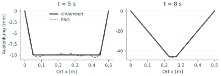
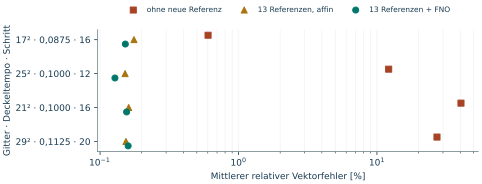
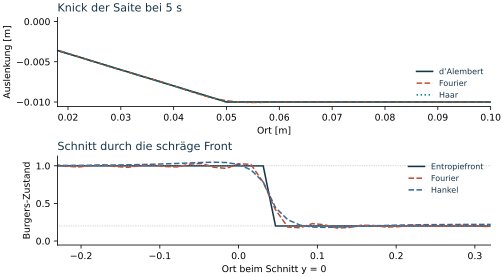
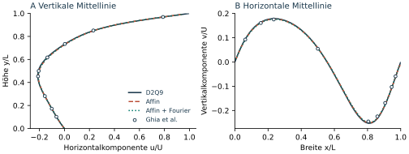
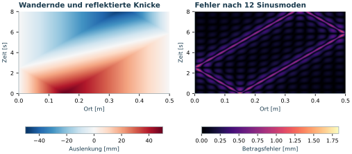
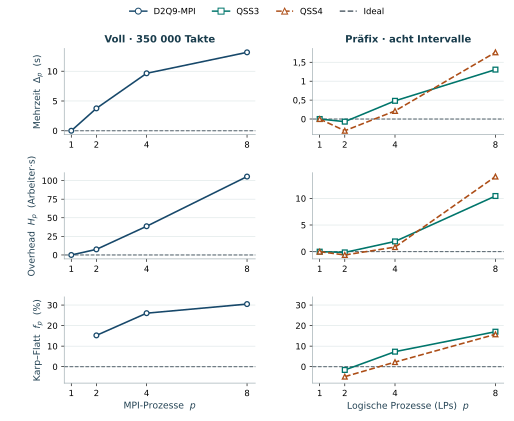

<a id="fb-neu16"></a>

# Kapitel 16 · CP2 – Deckel-Kavität, Saite und gelernte Feldoperatoren

<a id="kap16-einstieg"></a>

## Einleitung · Was muss ein berechnetes Feld zeigen, damit wir ihm vertrauen?

Unter einem gleitenden Deckel setzt sich Wasser in Bewegung. Weiter unten kehrt ein Teil der Strömung um. Auf einer gezupften Saite laufen zwei Knicke nach außen und werden an den Enden reflektiert. In beiden Fällen legt ein Programm Zahlen auf ein Gitter. Was wir darin kontrollieren müssen, unterscheidet sich. In der Kavität interessiert uns auch die Strömung unterhalb der vorgegebenen Wand. Auf der Saite fragen wir, ob Form und Lage der Welle zur gleichen Uhrzeit stimmen.

CP2 umfasst offiziell drei Parallelaufgaben. Die erste ist eine Monte-Carlo-Parameterstudie am Feder-Masse-System. Die beiden hier vertieften Aufgaben sind die Kavität und die Saite. Für die Flüssigkeit vergleichen wir Komponenten, Profile und Masse im D2Q9-Modell. Für die ungedämpfte Saite aus der Ruhe lässt sich eine unabhängige d’Alembert-Referenz aus der fortgesetzten Anfangsform gewinnen. Daran messen wir klassische Zeitintegratoren und die zusätzlich im Projekt untersuchten Feldoperatoren.

Uns interessieren die Fehler im Inneren und die Frage, woher eine Verbesserung tatsächlich kommt. Mehr Knoten, weiteres Training und das bekannte Wellengesetz verändern verschiedene Teile des Versuchs. Deshalb halten wir Eingabe, Beobachtungszeit und Fehlermaß innerhalb eines Vergleichs fest. Der Aufwand der offiziellen parallelen Programme ist eine eigene Messaufgabe. Auch bei einer gelernten Vorhersage müssen wir zuerst wissen, welcher Feldfehler zu welchem Gitter und welchem Zeitpunkt gehört. [Kapitel 9 · Gemeinsamer Prüfaufbau](../lehrbuch_numerische_simulation.md#no-auswertung)

[Zum Schluss dieses Kapitels](#kap16-schluss) · [Speedup, Overhead und CPU-Belegung](#cp2-skalierung-auswertung) · [Kavität mit wechselndem Antrieb](#cp2b-lidverfahren)

<!-- Buchseite -->

<a id="fb-pylbm"></a>

## CP2/2 · Wie bewegt ein Deckel die Flüssigkeit?

Ein quadratischer Behälter ist mit ruhender Flüssigkeit gefüllt. Sein oberer Deckel fährt nach rechts. Die anderen Wände stehen. Gesucht ist die örtliche Geschwindigkeit. Die Lattice-Boltzmann-Methode (LBM) speichert pro Gitterzelle gerichtete Verteilungswerte $f_i$. **D2Q9** bedeutet zwei Raumrichtungen und neun mögliche Gittergeschwindigkeiten $\mathbf c_i$: Ruhe, vier Achsenrichtungen, vier Diagonalen.

### Was ein Schritt wirklich berechnet

Im Inneren liefern $\rho=\sum_i f_i$ und $\rho\mathbf u=\sum_i f_i\mathbf c_i$ die Dichte und den Impuls. Bei der BGK-Kollision nähert sich jede Population mit dem Faktor $\omega$ ihrem lokalen Gleichgewicht an:

$$
f_i^*=f_i+\omega(f_i^{\mathrm{eq}}-f_i).
$$

Danach rückt jeder gerichtete Anteil um seinen Gittervektor weiter. An ruhenden Wänden kehren die Richtungen in der implementierten Vollweg-Reflexion um. An der oberen Zeile gibt die Implementierung das Gleichgewicht des bewegten Deckels vor. Ein eigener Ausgaberand setzt den vorgeschriebenen Deckelwert.

### Was lässt sich im kleinen Versuch messen?

Das Original fordert $257\times257$ Zellen und 350 000 Iterationen. Für einen CPU-Lehrversuch verwenden wir $17\times17$ und 16 Iterationen, $u_\mathrm{Deckel}=0{,}1$ in Gittereinheiten und $\mathrm{Re}=1000$. Die Messung betrifft den frühen Anlauf. Eine stationäre Wirbelstruktur würde eine eigene Rechnung erfordern.


<a id="revision-k16-01"></a>

Das Bild zeigt den Betrag $|u|/U$. Die Vektoren $(0{,}2U,0)$ und $(-0{,}2U,0)$ haben dieselbe Farbe, transportieren aber Flüssigkeit in entgegengesetzte Richtungen. Für die Deckelumkehr lesen wir daher zusätzlich das vorzeichenbehaftete $u_x/U$ und vergleichen im Inneren die vollständigen Geschwindigkeitsvektoren. Eine Wandprüfung braucht ihren eigenen Bezug zur vorgegebenen Randgeschwindigkeit.


Die native Zellauflösung lässt sich mit den [neu gerechneten und archivierten Feingitterfeldern](#bild-kavitaet) vergleichen.

[ARGESIM-Definition CP2, Fall 2](https://www.sne-journal.org/fileadmin/user_upload_sne/benchmarks/CP/CP2-definition.pdf) · [D2Q9-Schritt und Randregeln](https://github.com/5H3LL3H5/argesim-hyperposition-benchmarks/blob/52f8a33e469d36514e7830db544b9fc27243a82c/argesim_benchmarks/models/cp2_parallel_and_distributed.py).

<a id="fb-pysaite"></a>

## CP2/3 · Wohin wandert ein Knick in der Saite?

Eine an beiden Enden befestigte Saite ist $L=0{,}5\,\mathrm{m}$ lang. Ziehen Sie ihre Mitte um $0{,}05\,\mathrm{m}$ aus und lassen Sie sie aus der Ruhe los. Für kleine Auslenkungen bei konstanter Spannung und homogener Massendichte gilt

$$
u_{tt}=c^2u_{xx},\qquad u(0,t)=u(L,t)=0,\qquad u(x,0)=g(x),\quad u_t(x,0)=0 .
$$

Wir verwenden $c=0{,}06\,\mathrm{m/s}$ aus der korrigierten CP2-Studie. Der Buchversuch fragt nach den Profilen bei fünf und acht Sekunden.

### Eine Referenz ohne Zeit- oder Raumgitterfehler

Setzen wir die Anfangsform $g$ ungerade und $2L$-periodisch fort, nennen wir diese Fortsetzung $\tilde g$. Je eine halbe Welle wandert nach links und rechts:

$$
u(x,t)=\tfrac12[\tilde g(x-ct)+\tilde g(x+ct)] .
$$

Bei $t=0$ gibt die Formel $g$ zurück, die beiden Anfangsgeschwindigkeiten heben sich auf. Die ungerade Spiegelung liefert an beiden Enden null. Auf glatten Teilstücken bestätigt zweimaliges Ableiten die Wellengleichung. Die stetige Dreiecksform besitzt am Knick eine schwache Lösung, die dieselbe Verschiebungsformel beschreibt.

### Was wird zum Gleichungssystem?

Die Linienmethode ersetzt $u_{xx}$ durch $(u_{j-1}-2u_j+u_{j+1})/\Delta x^2$. Auf 500 Intervallen bleiben 499 innere Auslenkungen. Der vorhandene implizite Newmark-Solver berechnet sie mit $\Delta t=0{,}01\,\mathrm{s}$. Verglichen wird am selben Ort zur selben Zeit.



[Jammer, Junglas und Pawletta (2022), korrigierte CP2-Saitendaten](https://www.sne-journal.org/fileadmin/user_upload_sne/SNE_Issues_OA/SNE_32_4/articles/sne.32.4.10625.bncp2.OA.pdf) · [Linienmethode](../lehrbuch_numerische_simulation.md#t1-k7).

<a id="fb-cpverlet"></a>

## Dieselbe Saite mit Störmer–Verlet

Durch die Linienmethode hat jeder innere Knoten eine Beschleunigung $A_j(U)=c^2(U_{j-1}-2U_j+U_{j+1})/\Delta x^2$. Bei festen Enden bleiben $U_0=U_{N-1}=0$. Wie weit kommt eine explizite Rechnung, wenn wir den gleichen Zeitschritt wie für Newmark verwenden?

### Aus Beschleunigung werden neue Auslenkungen

Für Anfangsruhe lautet der erste Schritt $U^1=U^0+\tfrac12 h^2 A(U^0)$. Danach berechnet die Ortsform von Störmer–Verlet die nächste Auslenkung aus den beiden vorangegangenen und der aktuellen Beschleunigung:

$$
U^{n+1}=2U^n-U^{n-1}+h^2 A(U^n).
$$

Die Formel folgt aus der zentralen zweiten Differenz in der Zeit. Bei glatter Lösung bleibt nach Division durch $h^2$ ein Taylor-Rest der Ordnung $h^2$. Das dreieckige Anfangsprofil hat einen Knick. Dort muss die Fehlerentwicklung gesondert gemessen werden.

### Die Schrittgrenze vor der Rechnung prüfen

Für eine Eigenmode mit Kreisfrequenz $\omega$ lautet die Faktoren-Gleichung $r^2-(2-h^2\omega^2)r+1=0$. Bei $0<h\omega<2$ sind die Wurzeln komplex konjugiert und haben Betrag eins. Bei $h\omega>2$ wächst eine Mode. Die größten Kreisfrequenzen der zentralen Raumdifferenz liegen bei festen Enden unter $2c/\Delta x$. Daher genügt hier $C=ch/\Delta x\le1$. Mit $h=0{,}01\,\mathrm{s}$ ist $C=0{,}0768$ auf 65 Knoten und $0{,}6$ auf 501 Knoten.

<a id="tab-k16-01"></a>

| 501 Knoten, relativer Feldfehler | Verlet | Newmark | FNO |
| --- | --- | --- | --- |
| CP2-Dreieck, $5\,\mathrm{s}$ | 0,231  % | 0,374  % | 3,001  % |
| CP2-Dreieck, $8\,\mathrm{s}$ | 0,095  % | 0,152  % | 0,882  % |

Die Gegenprobe ist wieder die verschobene und gespiegelte Anfangsform. Bei 65 Knoten beträgt der Verlet-Fehler 2,484  % und 0,931  %. Prüfen Sie, was bei Beibehaltung von $h$ und 1001 Knoten geschieht. Dann ist $C=1{,}2$ und die hier verwendete Stabilitätsbedingung verletzt.

[Hairer, Lubich und Wanner (2003), Störmer--Verlet](https://www.cambridge.org/core/journals/acta-numerica/article/abs/geometric-numerical-integration-illustrated-by-the-stormerverlet-method/E55395D5DD7A4E0526D10EA74DA6C46B) · `python methodenlabor.py` · [Referenz und Fehlermaß](#fb-pyvergleich).

<a id="fb-pyvergleich"></a>

## Wie groß ist der Fehler wirklich?

Für eine Feldvorhersage $p$ und eine Referenz $r\ne0$ messen wir den relativen Fehler $\|p-r\|_2/\|r\|_2$. Die Norm ist die Quadratwurzel aus der Summe der quadrierten Gitterwerte. Beim Mittel zählt jedes unabhängige Feld und bei der Saite jeder Ausgabetermin gleich. Bei der Kavität bewerten wir die $15\times15$ inneren Fluidzellen. Als einfache Vergleichsvorhersage dient das ortsweise Mittel der Trainingszielfelder.

<a id="tab-k16-02"></a>

| Versuch und Referenz | FNO | Vergleich |
| --- | --- | --- |
| Saite, 24 glatte Testfelder, exakte Moden | 1,54  % | Trainingsmittel 101,98  % |
| CP2-Dreieck, 501 Knoten, 5 s, d’Alembert | 3,00  % | Newmark 0,37  % |
| CP2-Dreieck, 501 Knoten, 8 s, d’Alembert | 0,88  % | Newmark 0,15  % |
| Kavität, 24 Testfelder, D2Q9 | 11,98  % | Trainingsmittel 14,91  % |
| Kavität, einheitliche Dichte, D2Q9 | 11,59  % | 17 mal 17, 16 Schritte |

### Welche Schlussfolgerung trägt der Gitterversuch?

Beim CP2-Dreieck nach fünf Sekunden ergibt das grobe Gitter mit 65 Knoten für Newmark $2{,}50\,\%$, für das FNO $3{,}00\,\%$. Auf 501 Knoten sinkt der gemessene Newmark-Fehler auf $0{,}37\,\%$. Das auf 65 Knoten trainierte Netz lässt sich mit denselben Gewichten auswerten und bleibt bei ungefähr $3\,\%$. Einen Datensatz auf mehr Punkten auszugeben und eine numerische Näherung systematisch zu verfeinern sind verschiedene Operationen.

### Welche Genauigkeit reicht für den Auftrag?

Bei einem Grenzwert von $1\,\%$ erreicht das Netz die geforderte Saitengenauigkeit auf dem feinen Gitter bei acht Sekunden. Bei fünf Sekunden verfehlt es das Ziel. Obwohl der relative Fehler von $3{,}001\,\%$ auf $0{,}882\,\%$ sinkt, steigt der örtliche Spitzenfehler von $0{,}705$ auf $0{,}762\,\mathrm{mm}$. Bei begrenztem Abstand zu einem Hindernis zählt der Spitzenfehler. An den Knicken bei 5 s (50/450 mm) ist FNO minus Referenz +0,677/+0,705 mm; bei 8 s (230/270 mm) +0,663/+0,720 mm. Dazwischen liegt bei 250 mm der negative Spitzenfehler −0,762 mm. [Beide Fehlerprofile als CSV](https://github.com/5H3LL3H5/argesim-hyperposition-benchmarks/blob/719ebd46850dc882bf05ad9e01ea41c4bb7f0312/docs/lehrbuch/studienbuch/material/cp2_genauigkeit/saite_fehlerprofile.csv), auch in der Anlage `CP2_Genauigkeit.zip`. Für die Kavität ist der Vergleich ein Nachweis der Annäherung an den vorhandenen LBM-Code. Eine unabhängige Strömungsmessung wäre eine zusätzliche Prüfung der physikalischen Güte. Trainingszeit, Erzeugung der Referenzen und Auswertung mit festen Gewichten sind getrennte Kosten.

[Einzelmessungen, Zeiten und Umgebung](https://github.com/5H3LL3H5/argesim-hyperposition-benchmarks/blob/52f8a33e469d36514e7830db544b9fc27243a82c/docs/evidence/cp2-operators.json) · Seed 2027, 80 Epochen, ein CPU-Thread, PyTorch 2.8.0+cpu und NeuralOperator 2.0.0.

<!-- Buchseite -->

<a id="kap16-schrittfolge"></a>

### Warum die reine Vorhersagezeit noch keine Kostenbilanz ergibt

Ein klassischer Solver braucht bei jeder neuen Anfangsform eine Rechnung. Ein trainierter Operator berechnet seine Vorhersage möglicherweise schneller, hat davor aber Trainingsdaten und Rechenzeit verbraucht. Vergleichen wir nur Verfahren, die das vereinbarte Feldbudget erfüllen, können wir diesen Unterschied ausdrücken. Für $N$ neue Anfragen seien $T_\mathrm A$ die einmaligen Zusatzkosten des Operators einschließlich Training und Datenerzeugung, $t_\mathrm S$ die Solverzeit pro Anfrage und $t_\mathrm O$ die Zeit einer Vorhersage. Dann lautet die Bedingung für den Kostenvorteil
$$
T_\mathrm A+Nt_\mathrm O<Nt_\mathrm S.
$$

Zur Handrechnung wählen wir Lehrzahlen von $T_\mathrm A=60\,\mathrm s$, $t_\mathrm S=40\,\mathrm{ms}$ und $t_\mathrm O=10\,\mathrm{ms}$. Bei jeder Anfrage werden dann $30\,\mathrm{ms}$ eingespart. Nach genau 2000 Anfragen decken sich beide Kosten, ab 2001 entsteht in dieser Modellrechnung ein Vorteil. Das Beispiel gilt nur für Anfragen, die zum geprüften Einsatzbereich passen. Benötigt ein anderer Zupfpunkt ein neues Training oder überschreitet das Ergebnis sein Fehlerbudget, muss man diese Änderung vor der Entscheidung einrechnen.

Für CP2 verwenden wir getrennte Nachweise für Genauigkeit, Vorhersage und die ursprünglichen Parallelaufgaben. Wir können denselben Kostenvergleich erst dann mit Messwerten füllen, wenn Zahl der Anfragen, Hardware und Feldanforderungen übereinstimmen.

<!-- Buchseite -->

<a id="fb-fnoprotokoll"></a>

## Wie würde man ein genaueres FNO erkennen?

Sie zupfen eine Saite an, zeichnen ihre Form auf und möchten wissen, wo sie nach fünf Sekunden steht. Ein Netz liefert 501 Zahlen. Wie entscheiden Sie, ob eine zweite Version besser geworden ist? Eine größere Zahl von Gewichten gibt darauf noch keine Antwort. Wir behalten die erste Version samt Gewichten und prüfen beide an identischen Eingaben.

### Vor der Rechnung festlegen

Bei der Saite ist der Eingang die Anfangsauslenkung in Metern bei Anfangsruhe. Die Referenz für ein Dreieck ist die entlang der Charakteristiken fortgesetzte Anfangsform. Bei der Kavität ist der Eingang eine ruhende Dichteverteilung. Hier berechnet der D2Q9-Code die Geschwindigkeit. Für den direkten Vergleich mit dem früheren Netz werten wir deren Betrag in den inneren Zellen aus. Zusätzlich prüfen wir bei den neuen Netzen den Vektor aus beiden Komponenten. So können zwei gleich schnelle, gegensinnige Wirbel unterschieden werden.

$$
E_{\rm RMS}=\sqrt{\tfrac1m\textstyle\sum_{j=1}^m(p_j-y_j)^2},
 \qquad E_{\rm rel}=\frac{\|p-y\|_2}{\|y\|_2}.
$$

$p$ ist die Vorhersage, $y$ das Referenzfeld und $m$ die Anzahl bewerteter Werte. Bei mehreren Fällen bilden wir zuerst je Feld den relativen Fehler und mitteln anschließend. Bei der Saite berichten wir nur den absoluten Fehler, falls der Referenz-RMS höchstens $10^{-10}$ der Zupfhöhe beträgt.

### Was darf das Training sehen?

Die frühere und die verbesserte Kavitätsrechnung nutzen dieselben 96 Trainings-, 16 Validierungs- und 24 Testfelder. Die Validierung bestimmt die Trainingsepoche. Seed 2027 bezeichnet den veröffentlichten Lauf; zwei weitere Initialisierungen prüfen die Streuung. Der Saitenversuch erhält zusätzliche hochfrequente Trainingsbeispiele und Zeitpunkte. Alle sechs Dreieckslagen bleiben bei seiner Anpassung außen vor.

**Selbst prüfen.** Warum darf die exakte Lösung im Training vorkommen? Eine Paardatei kann die Lösung zu einem Trainingsprofil enthalten. Erst wenn die Prognose für das neue Profil vorliegt, wird sie mit dessen eigener Referenz verglichen.

[Rechnung an der Saite](../lehrbuch_numerische_simulation.md#t1-k9) · [Kavitätsversuch](#fb-fnokav) · `cp2_genauigkeit/auswerten.py` im Rechenlabor.

<a id="fb-fnooriginal"></a>

## Was bringt Nachtraining beim ursprünglichen FNO?

Die lineare Fourier-Schicht nutzt feinere Trainingsmoden und die lineare Wellengleichung. Wie viel gewinnt das ursprüngliche FNO durch zusätzliches Training bei gleicher Architektur?

### Ein Versuch am veröffentlichten Modell

Wir laden dessen Gewichte einschließlich der beiden Ausgabekanäle für 5 und 8 s. Alle Schichten, Modenzahlen und Aktivierungsfunktionen bleiben erhalten. Hinzu kommen 48 glatte Anfangsprofile und 48 Dreiecke mit verschiedenen Lagen, Amplituden und Vorzeichen. Ein Abstand von mindestens $0{,}012L$ zu den sechs später bewerteten Zupfpositionen hält diese Lagen aus dem Zusatztraining und der Validierung heraus. Die Trainingsschritte wechseln zwischen 65 und 129 Knoten. Kleine Auslenkungen erhalten eine Untergrenze bei der Normierung des Trainingsfehlers.
Nach höchstens 160 Epochen verwenden wir die Epoche mit dem kleinsten Fehler auf 16 separaten Validierungsprofilen. Die drei Wiederholungen starten bei denselben veröffentlichten Gewichten und verändern die Mischfolge der Trainingsbeispiele. Der ausgewiesene Lauf verwendet wie zuvor den vorab festgelegten Seed 2027.

<a id="tab-k16-03"></a>

| Operator | Dreieck, 5 s | Dreieck, 8 s | glatte Testfelder |
| --- | --- | --- | --- |
| Früheres FNO | $3{,}0009\,\%$ | $0{,}8816\,\%$ | $1{,}5376\,\%$ |
| Dasselbe FNO, nachtrainiert | $2{,}1815\,\%$ | $0{,}6218\,\%$ | $0{,}9538\,\%$ |
| Lineare Fourier-Schicht | $0{,}04303\,\%$ | $0{,}01416\,\%$ | $<0{,}00001\,\%$ |

Die Dreiecke in der Tabelle sind mittig gezupft und werden auf 501 Knoten geprüft. Die letzte Spalte mittelt dieselben 24 glatten Testfelder auf 65 Knoten über beide Zeiten. Alle drei Mischfolgen verbessern beide Dreieckswerte. Beim nachtrainierten Netz bleibt dort der größere Fehler gegenüber Newmark und Verlet bestehen. Die lineare Fourier-Schicht erreicht auf dem glatten Test auf das Ausgabeformat bezogen nahezu Rundungsgenauigkeit, da dort ausschließlich acht aufgelöste Sinusmoden vorkommen.

**Was können wir daraus schließen?** Für denselben nichtlinearen Netzaufbau hilft das zusätzliche Trainingspaket. Sein Ergebnis allein verrät noch nicht, welcher Anteil auf Dreiecke, Gitterwechsel oder geänderte Fehlergewichtung entfällt. Der stärkste Gewinn im geprüften linearen Modell entsteht durch die modale Darstellung mit breiterer Trainingsabdeckung.

[Spiegeltest](#fb-fnospiegel) · `saite_nachtraining.json`.

<a id="fb-fnospiegel"></a>

## Spiegeltest · Reagiert die Saite symmetrisch?

Wir zupfen zwei Dreiecke mit je $50\,\mathrm{mm}$ Höhe bei $0{,}125\,\mathrm{m}$ und $0{,}375\,\mathrm{m}$ auf $L=0{,}5\,\mathrm{m}$. Beide beginnen aus Ruhe. Die d’Alembert-Referenzen aus der jeweiligen ungeraden Fortsetzung sind Spiegelbilder. Alle drei Operatoren verwenden ihre veröffentlichten Gewichte und dasselbe Gitter mit 501 Knoten.

<a id="tab-k16-04"></a>

| Operator | Zeit [s] | Links [ %] | Rechts [ %] | Spiegelabweichung [mm] |
| --- | --- | --- | --- | --- |
| Ursprüngliches FNO | 5 | 3,415 | 3,125 | 0,342 |
|  | 8 | 0,887 | 1,183 | 0,431 |
| Nachtrainiertes FNO | 5 | 2,030 | 1,951 | 0,103 |
|  | 8 | 0,705 | 0,698 | 0,113 |
| Lineare Fourier-Schicht | 5 | 0,04512 | 0,04512 | $<3\cdot10^{-14}$ |
|  | 8 | 0,01894 | 0,01894 | $<3\cdot10^{-14}$ |

Links und rechts geben $100\|p-r\|_2/\|r\|_2$ je Zupfposition an. Die letzte Spalte ist $\max_i|p_{\mathrm{links},i}-p_{\mathrm{rechts},500-i}|$ in Millimetern. Nach acht Sekunden liegt das ursprüngliche FNO nur links unter einem Prozent. Das nachtrainierte FNO besteht dort bei beiden Lagen, überschreitet die Grenze aber jeweils nach fünf Sekunden. Die lineare Schicht besteht alle vier Vergleiche.

**Warum spiegelt der lineare Operator korrekt?** Spiegelung multipliziert jede Sinusmode mit $(-1)^{k+1}$. Der zeitabhängige modale Faktor ist ein Skalar und vertauscht mit dieser Multiplikation.

`saite_spiegelung.json` · [Auswertung ohne Training](https://github.com/5H3LL3H5/argesim-hyperposition-benchmarks/blob/16f0f2528fcf77f16898ecd74ad952be2c09eac2/scripts/cp2_accuracy/rope_symmetry.py) · [Mittig gezupfter Vergleich](#fb-fnooriginal).

<a id="fb-fnoabl"></a>

## Wo verliert die Saite an Genauigkeit?

Zupfen Sie bei $x=0{,}13L$. Auf der kurzen Seite steigt das Dreieck steiler an als beim mittigen Zupfen. Eine grobe Abtastung verfehlt den Knick leichter. Deshalb untersuchen wir sechs Zupfstellen zwischen $0{,}13L$ und $0{,}81L$, vier Gitter mit 65, 129, 251 und 501 Knoten sowie 99 Zeiten, darunter Zwischenzeiten. Das ergibt 2 376 einzelne Feldvergleiche.


Auf 501 Knoten bleibt der relative Fehler der neuen Schicht an den sechs Positionen nach 5 und 8 s unter $0{,}065\,\%$; auf 65 Knoten reicht er bis $0{,}492\,\%$. Der größte absolute RMS über alle 2 376 Vergleiche beträgt $68{,}21\,\mu\mathrm m$ (65 Knoten, Zupfpunkt $0{,}13L$, $t=2{,}693\,\mathrm s$). Das ist ein Maximum auf dem ausgewerteten Raster, kein gemessenes Kontinuumsmaximum. Die Werte im Diagramm rechts gelten für das feinste Gitter.

### Was geschieht beim Durchgang durch die Ruhelage?

Beim mittigen Dreieck sind alle geraden Sinusmoden null. Zum Zeitpunkt $t=L/(2c)=4{,}1667\,\mathrm{s}$ haben alle ungeraden Moden den Faktor $\cos(k\pi/2)=0$. Die exakte Saite ist dann überall gerade, obwohl sie sich bewegt. Auf 501 Knoten beträgt der absolute RMS der Vorhersage rund $0{,}327\,\mu\mathrm m$. Ein relativer Prozentwert hätte hier keinen definierten physikalischen Nenner.

**Versuch am Schreibtisch.** Speisen Sie auf 501 Knoten allein Mode 193 ein. Bei $t=0$ liefert die auf 192 Moden begrenzte Schicht bis auf Rundung das Nullfeld. Der relative Fehler beträgt eins. Die Genauigkeit hängt also von der Klasse der Eingaben ab.

[Modale Fehlerschranke und Eingabeklasse](../lehrbuch_numerische_simulation.md#druck-saite-modenschranke) · `saite_zeitreihen.npz` enthält absolute und relative Fehler jeder Rechnung.

<a id="fb-fnokav"></a>

## Kavität · Was trägt das Netz zusätzlich bei?

Ein bewegter Deckel zieht die Flüssigkeit im Quadrat mit. Wir kennen die Anfangsdichte, suchen aber die beiden Geschwindigkeitskomponenten nach 16 Gitterschritten. Die Trainingsdichten sind kleine Überlagerungen von sechs räumlichen Mustern. Das legt ein erstes Modell nahe. Für jede Zelle lernt eine lineare Regression einen Grundwert $b$ und sechs Empfindlichkeiten $B_j$. Das erste Modell liefert $b+\sum B_j a_j$ für die aus der Eingabedichte bestimmten Amplituden $a_j$.

### Warum den Rest lernen?

Wenn zwei Dichtemuster zusammenwirken, kann ihre Antwort von der Summe ihrer Einzelwirkungen abweichen. Wir teilen die verbleibende Differenz durch ihren Trainings-RMS und lassen ein zweischichtiges FNO aus `neuraloperator` diese Korrektur für beide Geschwindigkeitskomponenten vorhersagen. Die Rückskalierung und Addition ergeben das Feld. Am Deckel gilt der vorgeschriebene Vektor. Das Grundfeld stammt allein aus den Trainingsdaten.


Die native Zellauflösung lässt sich mit den [neu gerechneten und archivierten Feingitterfeldern](#bild-kavitaet) vergleichen.

<a id="revision-k16-05"></a>

Wir werten die relativen Fehler des Geschwindigkeitsbetrags im $15\times15$-Innenfeld der 24 zurückgehaltenen Anfangsdichten aus, nach 16 Schritten auf dem $17\times17$-Gitter. Zähler und Nenner sind die euklidischen Feldnormen der Betragsdifferenz und des D2Q9-Betragsfelds. Die rechte Spalte enthält das Maximum der 24 Einzelfehler, die mittlere deren Mittelwert. Für die lernende Korrektur gilt Seed 2027. Die getrennte Vektorauswertung berücksichtigt später auch die Richtung.

<a id="tab-k16-05"></a>

| Modell auf $17\times17$, Schritt 16 | Mittel, Betrag | Maximum, Betrag |
| --- | --- | --- |
| Früheres FNO | $11{,}976\,\%$ | $18{,}013\,\%$ |
| Affines Modell allein | $0{,}1299\,\%$ | $0{,}2935\,\%$ |
| Affines Modell mit FNO, Seed 2027 | $0{,}05074\,\%$ | $0{,}1277\,\%$ |

<a id="fb-kavitaet-korrektur916"></a>

Jede Spalte umfasst dieselben 24 Testfelder. Alle drei Netzinitialisierungen ergeben mittlere Betragsfehler zwischen $0{,}0507$ und $0{,}0527\,\%$. Der Vektorfehler des veröffentlichten Laufs beträgt im Mittel $0{,}0700\,\%$. Der größte Genauigkeitssprung stammt vom affinen Modell; die trainierte Fourier-Korrektur verringert dessen verbleibenden mittleren Betragsfehler nochmals um rund 61  %.

`kavitaet.json` · [Übertragung auf andere Gitter und Zeiten](#fb-fnotransfer).

<a id="fb-fnotransfer"></a>

## Kann das Netz ein neues Gitter vorhersagen?

Ein weiteres FNO erhält neben der Dichte drei Eingaben für Knotenzahl, Deckelgeschwindigkeit und Ausgabeschritt. Trainiert wird auf den 27 Kombinationen von $N=17,25,33$, $U=0{,}075,0{,}100,0{,}125$ und Schritt $8,16,24$. Je Kombination dienen 32 Dichten zum Lernen und acht zur Validierung. Zwölf weitere bleiben für die Prüfung reserviert. Ein affines Grundfeld wird für jede Trainingskombination bestimmt.

### Zwei verschiedene Prüfungen

Bei bekannten Einstellungen und neuen Dichten beträgt der Vektorfehler im Mittel über die 27 Fallmittel $0{,}186\,\%$. Liegt die Einstellung dazwischen, werden die affinen Gewichte räumlich und zwischen benachbarten Einstellungen interpoliert. Bei $21^2$, $U=0{,}1$ und Schritt 16 liegt der mittlere Vektorfehler so bei $40{,}48\,\%$. Eine neue räumliche Dichtemode außerhalb der sechs Trainingsmuster führt auf dem bekannten $17^2$-Gitter ebenfalls zu rund $24{,}94\,\%$.



### Was ändern 13 zusätzliche Referenzläufe?

Wir rechnen am neuen Betriebspunkt die ruhende Einheitsdichte und je eine positive und negative Anregung pro Mode. Ihre zentralen Differenzen ergeben sechs neue Empfindlichkeiten. Hinzu kommt die bereits gelernte FNO-Korrektur, auf das neue Grundfeld zentriert. Auf allen vier Testpunkten liegen die mittleren Vektorfehler dann zwischen $0{,}128$ und $0{,}160\,\%$. Beim vierten Punkt ist die affine Kalibrierung allein leicht genauer. Die 13 D2Q9-Läufe können weitere Prognosen derselben Einstellung stützen.

`kavitaet_familie.json` · `zielkalibrierung.json` · Rohdaten und trainierte Gewichte im Rechenlabor.

<a id="fb-fnolang"></a>

## Re = 1000 · Der vollständige CP2-Kavitätslauf

<a id="auflage-k16-01"></a>

Nach 16 Schritten wird die Strömung gerade erst angeregt. Wie sieht sie am Ende der offiziellen CP2-Aufgabe aus? Für $Re=1000$, $U=0{,}1$ und anfangs ruhende Flüssigkeit wurden auf $257^2$ Zellen 350 000 D2Q9-Schritte berechnet. Zwei gröbere Vergleichsgitter enden bei derselben dimensionslosen Zeit $t^*=\mathrm{Schritte}\,U/(N-1)=136{,}71875$. Der schnelle C++-Kern setzt dieselben Kollisions-, Rand- und Transportregeln wie der skalare Python-Code um. Auf $17^2$ stimmen Dichte und beide Geschwindigkeitskomponenten bei den Schritten 1, 7 und 16 bis auf $2{,}45\cdot10^{-15}$ überein.


<a id="tab-k16-06"></a>

| Gitter und Schritte | RMS horizontal | RMS vertikal | Endmasse / Start |
| --- | --- | --- | --- |
| $65^2$, 87 500 | 0,04440 | 0,00614 | 0,90772 |
| $129^2$, 175 000 | 0,01986 | 0,00242 | 0,95756 |
| $257^2$, 350 000 | 0,00961 | 0,00244 | 0,98099 |

Die horizontale Komponente nähert sich an diesen Messpunkten mit der Verfeinerung der Literaturkurve. Die vertikale RMS-Abweichung steigt vom mittleren zum feinsten Gitter geringfügig. Über die letzten 10 000 Schritte des feinen Gitters beträgt die relative Änderung des inneren Geschwindigkeitsvektors $1{,}35\cdot10^{-6}$. Das erfüllt ein nachprüfbares Quasistationaritätskriterium von $10^{-5}$ über dieses Fenster. Die Gesamtmasse hat sich um $-1{,}90\,\%$ geändert. Dieser Lauf prüft die LBM-Referenz. Die zuvor vorgestellten Netze sind für den frühen Zeitraum trainiert. Die [Vollgitterstudie](#cp2-voll-vertrag) lernt und prüft eigene Modelle bis zum letzten CP2-Takt.

[ARGESIM CP2, Aufgabendefinition](https://www.sne-journal.org/fileadmin/user_upload_sne/benchmarks/CP/CP2-definition.pdf) · [Ghia, Ghia und Shin (1982), Tabellen I und II](https://doi.org/10.1016/0021-9991(82)90058-4) · `kavitaet_stationaer.json`.

<!-- Buchseite -->

<a id="v91-cp2-vergleich"></a>

### Was man bei Kavität und Saite jeweils vergleichen kann

Unter dem gleitenden Deckel interessiert ein zweidimensionales Strömungsfeld. Der lange CP2-Lauf verwendet $\mathrm{Re}=1000$, 350 000 Schritte und $257^2$ Gitterorte. Seine Geschwindigkeitsprofile und Dichteabweichungen gehören zu einem D2Q9-Gitter und einem bestimmten Randmodell. Aus $U_L=0{,}1$ folgt für das Deckeltempo $\mathrm{Ma}\approx0{,}173$. Eine Aussage über die Güte der inkompressiblen Näherung braucht zusätzlich eine Auflösungs-, Rand- und Mach-Zahl-Prüfung. Die Gitterumrechnung liefert [Kapitel 8](../lehrbuch_numerische_simulation.md#v91-lbmeinheiten).

Bei der gezupften Saite transportiert die lineare Wellengleichung den Knick des Anfangsprofils. Die Vergleichsgröße ist das Auslenkungsfeld an denselben Orten zur selben Zeit gegen die d’Alembert-Referenz. Auf 501 Knoten und bei fünf Sekunden liefert das ursprüngliche FNO einen relativen Feldfehler von $3{,}001\,\%$. Newmark erreicht $0{,}374\,\%$, Störmer–Verlet $0{,}231\,\%$. Bei einem Prozent Budget sind damit die beiden klassischen Läufe bei diesem Ausgabetermin zulässig.

Das Archiv des ursprünglichen Saitennetzes nennt $3{,}354\,\mathrm s$ Trainingszeit und $4{,}339\,\mathrm{ms}$ für das protokollierte Feld `cpu_inference_test_batch` bei einem CPU-Thread. Für eine Latenzaussage zu einer einzelnen Anfrage auf 501 Knoten muss genau diese Anfrage gemessen werden. Für einen Zeitvergleich innerhalb der Saitenaufgabe gehören das gleiche Gitter, das gleiche Fehlerbudget, dieselbe Zahl vorhergesagter Felder und getrennte Trainings- und Auswertungskosten ins Protokoll. Für ein Strömungssurrogat gelten analog die Referenzfelder und Zielgrößen der Kavität.

<!-- Buchseite -->

<a id="fb-pruefung16"></a>

## CP2 · Was von der Verbesserung an der Saite dem Netz gehört

Am Knick einer gezupften Saite fehlen einer glatten Näherung gerade die kleinen räumlichen Skalen. Kann ein gelerntes Modell diese Information aus der Anfangsform transportieren? Wir prüfen auf 501 Knoten gegen die d’Alembert-Lösung und verwenden in diesem Rechenbeispiel ein selbst gewähltes Feldbudget von $1\,\%$. Die relative Feldnorm ist $\|u-u^*\|_2/\|u^*\|_2$ mit $\|u^*\|_2>0$. Ihr Verhältnis zum Budget ist hier der jeweilige Beitrag zum Score.

Nach fünf Sekunden betragen die relativen Fehler des ursprünglichen FNO $3{,}0009\,\%$, von Newmark rund $0{,}374\,\%$ und der modalen Erweiterung $0{,}04303\,\%$. Ihre Beiträge lauten also $3{,}0009$, $0{,}374$ und $0{,}04303$. Nach acht Sekunden ergeben sich ungefähr $0{,}8816$, $0{,}152$ und $0{,}01416$. Fordern wir beide Zeiten gemeinsam, entscheidet jeweils das größere Verhältnis. Die analytische Kontrollschicht erreicht auf diesem Fall dieselben gerundeten Fehler wie die modale Erweiterung. Der Vorteil gegenüber dem ursprünglichen FNO lässt sich deshalb auf diesem Feld nicht allein den gelernten Gewichten zuschreiben.

Was wäre ein fairer Anschlussversuch? Man verschiebt die Zupfstelle, friert Modell und Gewichtung ein und bestimmt den Fehler am vollständigen Feld einschließlich der Ränder. Für eine Kavität verlangt dieselbe Frage zwei Geschwindigkeitsebenen sowie beide Mittellinien. Eine Wirbelposition oder ein kleines Residuum allein lässt dabei unterschiedliche Felder zu. Ein Vergleich von Rechenzeiten muss außerdem Aufbau der Referenz, Training, Aufwärmläufe und Inferenz einzeln ausweisen.

**Umfang der offiziellen Aufgabe.** CP2 umfasst Monte Carlo, Kavität und Saite sowie Fragen zur parallelen Ausführung. Der Maximalscore oben gehört zu zwei Beobachtungszeiten der Saitenstudie. Über die parallele Beschleunigung oder den stationären Strömungsfehler sagt er nichts aus.

[Die drei Teilaufgaben](../lehrbuch_numerische_simulation.md#fb-refCP2) · [Analytische Kontrollrechnung mit gleichem Filter](../lehrbuch_numerische_simulation.md#druck-saite-analytische-kontrolle).

<a id="fb-ueb13"></a>

## Selbst prüfen · Den Versuch auf dem eigenen Rechner prüfen

### Mit gespeicherten Feldern beginnen

Die archivierten Feldfehler sind im Begleitpaket als Metriken enthalten. Im ursprünglichen CP2-Feldlabor lassen sich zusätzlich die Rohfelder mit den gespeicherten Netzgewichten auswerten. Die historische Auswertung nutzt NumPy. [Gewichte, Referenzfelder und Vergleichsskript](https://github.com/5H3LL3H5/argesim-hyperposition-benchmarks/tree/16f0f2528fcf77f16898ecd74ad952be2c09eac2/docs/lehrbuch/studienbuch/material/cp2_feldlabor)

```text
python -m pip install -e '.[operators]'
lab=argesim_benchmarks.experiments.cp2_operators
python -m "$lab" train rope --out saite
python -m "$lab" train cavity --out kavitaet
python -m "$lab" predict saite/rope-weights.npz \
    saite/rope-501-input.npy neues_profil.npy
```

Die Befehle verwenden eine POSIX-Shell. Die Gewichte im verlinkten CP2-Feldlabor können Sie direkt an `predict` übergeben. Die Saite erwartet ausgelenkte Höhen in Metern einschließlich zweier fester Enden, die Kavität ein positives $17\times17$-Dichtefeld bei Anfangsruhe.

### A · Einen Callback kontrollieren

Welche Rückgabe erwarten Sie für `heizstab(0.0, (0.0,))` und für `heizstab(60.0, (40.0,))`? Warum wäre das Fortschalten einer globalen Modelluhr bei jedem Aufruf mit der Tabelle [Kapitel 2](../lehrbuch_numerische_simulation.md#t1-k2) unvereinbar?

### B · Eine unwirksame Gegenprobe erkennen

Ein Student misst nur die Deckelzeile und erhält dort exakt denselben Wert wie D2Q9. Erklären Sie das Ergebnis. Wählen Sie einen Vergleich, der das Feld im Inneren wirklich prüft.

### C · Den technischen Auftrag entscheiden

Die relative räumliche Abweichung darf an beiden Ausgabeterminen der Saite höchstens $1\,\%$ betragen. Welche der drei Rechnungen mit Newmark, Störmer–Verlet und dem ursprünglichen FNO auf 501 Knoten erfüllen diesen Auftrag? Prüfen Sie danach die drei Operatorvarianten [Was bringt Nachtraining beim ursprünglichen FNO?](#fb-fnooriginal). Was müsste für einen Auftrag über alle Zeiten zusätzlich geprüft werden?

[Kapitelanfang](#fb-neu16) · [Lösungswege](#fb-loesweg13) · [Python-Praktikum mit startfähigen Befehlen](https://github.com/5H3LL3H5/argesim-hyperposition-benchmarks/blob/52f8a33e469d36514e7830db544b9fc27243a82c/docs/CP2_NEURAL_OPERATORS.md).

<a id="fb-loesweg13"></a>

## Lösungswege · Von einem Messwert zur Aussage

### A · Eine Funktion beschreibt die Änderung

Zu Beginn ist der Verlust null. $10/120=1/12$ ergibt das Tupel $(0{,}083333\ldots,)$ in K/s. Bei $40\,\mathrm{K}$ gleichen sich die $10\,\mathrm{W}$ Heizleistung und $40/4=10\,\mathrm{W}$ Verlust aus. Die Rückgabe ist $(0,)$. RK45 benötigt für die eine betrachtete Minute 31 Aufrufe, speichert aber nur drei angenommene Schritte. Die Zeit im Callback stammt daher aus seinem Argument. Eine Zählung der Aufrufe ist eine Rechendiagnose.

### B · Einen vorgeschriebenen Rand erkennen

Für die Deckelzeile setzt die Python-Implementierung $|\mathbf u|/u_\mathrm{Deckel}=1$ bei Referenz und Netzausgabe. Eine Nullabweichung kann dort ein falsch vorhergesagtes Wirbelzentrum verdecken. Der relative Feldfehler von $11{,}59\,\%$ bezieht sich auf das Innere. Die Karten [CP2/2 · Wie bewegt ein Deckel die Flüssigkeit?](#fb-pylbm) zeigen, wo die größten absoluten Unterschiede liegen. Aus einem Geschwindigkeitsbetrag allein lassen sich weder die Richtung des Vektors noch die neun Populationen rekonstruieren.

### C · Jede vereinbarte Bedingung einzeln prüfen

Newmark und Störmer–Verlet erfüllen auf 501 Knoten das Ziel beim CP2-Dreieck für fünf und acht Sekunden ([Dieselbe Saite mit Störmer–Verlet](#fb-cpverlet)). Das ursprüngliche FNO besteht nur bei acht Sekunden. Beim Operatorvergleich besteht von den drei Varianten allein die lineare Fourier-Schicht zu beiden Zeiten ([Was bringt Nachtraining beim ursprünglichen FNO?](#fb-fnooriginal)). Beide Punktprüfungen lassen andere Zeiten frei. Für eine empirische Erweiterung würden wir viele zusätzliche Zeitpunkte ausgeben und getrennt testen. Der hier trainierte FNO gibt genau zwei Zeiten aus. Für eine garantierte Schranke über das ganze Intervall wäre außerdem eine mathematische Abschätzung zwischen den Prüfzeitpunkten nötig.

**Eine kleine Programmierprobe.** Rufen Sie `python kapitelproben.py 13` im Rechenlabor auf. Die Standardbibliothek genügt für die Heizrate, die Summe der neun Ruhegewichte und das Vorzeichen einer reflektierten Welle.

[Zurück zum Aufgabenblatt](#fb-ueb13) · [Vergleichstabelle](#fb-pyvergleich) · [Forschung und Beweisfragen](#fb-schluss13).

<a id="fb-schluss13"></a>

## Welche Aussage kann ein Beweis liefern?

### Eine exakte Invariante beim lokalen Kollisionsschritt

Sind die Gleichgewichtspopulationen so normiert, dass $\sum_i f_i^{\mathrm{eq}}=\sum_i f_i=\rho$, bleibt die Dichte bei der lokalen BGK-Kollision erhalten.

**Beweis.** Summation der Kollisionsformel ergibt $\sum_i f_i^*=\sum_i f_i+\omega(\sum_i f_i^{\mathrm{eq}}-\sum_i f_i)=\rho$.

Der Schritt beweist eine lokale Eigenschaft im Inneren. Für eine globale Massenbilanz müssen auch Transport und Ränder erfasst werden. Beim reduzierten Kavitätslauf meldete das Programm eine Änderung von $-0{,}00746$ bei anfänglicher Gittermasse 289. Das FNO gibt hier nur den Geschwindigkeitsbetrag aus und hat keinen entsprechenden Massenmesswert.

### Weshalb ist jede Trainingsmode der Saite überprüfbar?

Setzen Sie $u(x,t)=a(t)\sin(k\pi x/L)$ in die Wellengleichung ein. Dann folgt $a''=-(ck\pi/L)^2a$. Bei Anfangsruhe ist $a(t)=a(0)\cos(ck\pi t/L)$. Linearität erlaubt die Summe der acht Moden und liefert die Referenzen für den Glatttest. Der Knick des CP2-Dreiecks enthält weitere Frequenzen.

### Was sich für den Lehrfall beweisen lässt

Li und Mitautoren untersuchten FNOs an parametrisierten PDE-Familien. Kovachki und Mitautoren analysierten die Approximation kontinuierlicher Operatoren unter mathematischen Voraussetzungen. Der [Satz zur Saite](../lehrbuch_numerische_simulation.md#druck-saite-modenschranke) spezialisiert die Fragestellung auf die hier gespeicherten Gewichte und eine festgelegte Eingabeklasse. Der Fall Mode 193 zeigt, welche Genauigkeit ohne Glattheitsannahme verloren geht.

[Kovachki u. a. (2023), Neural Operator](https://www.jmlr.org/papers/v24/21-1524.html) · [Ausführbare Gegenproben](https://github.com/5H3LL3H5/argesim-hyperposition-benchmarks/blob/52f8a33e469d36514e7830db544b9fc27243a82c/tests/test_cp2_operators.py) · [Forschungsfragen](../lehrbuch_numerische_simulation.md#t1-k9) · [Abschluss des Praktikums](../lehrbuch_numerische_simulation.md#fb-finalII).

## Vom CP2-Vergleich zurück zur Physik-Schicht

Beim mittigen Zupfen auf 501 Knoten zeigt der Feldfehler nach fünf Sekunden drei verschiedene Wirkungen. Der ursprüngliche FNO erreicht 3,0009 Prozent. Nachtraining derselben Architektur senkt den Fehler auf 2,1815 Prozent. Für eine modale Variante, die das Verhalten der linearen Saite ausnutzt, ergeben sich 0,04303 Prozent. Der letzte Wert hängt von den Annahmen über Saite, Startgeschwindigkeit und Messzeit ab.

Kapitel 9.7 stellt eine andere Frage. Dort transportiert ein eingebauter Wellenschritt die aufgelösten Moden, und ein ergänzendes Netz kann eine Korrektur lernen. Bei 113 Knoten und 3,5 Zellen Ausbreitungsweg betragen die Feldfehler des dortigen FNO 0,9935 Prozent, des Physik-Layers 0,05947 Prozent und des Layers mit Netzkorrektur 0,1205 Prozent. Die ergänzende Korrektur vergrößert in diesem Versuch den Fehler gegenüber der Physik allein. Gerade deshalb braucht ein Hybridmodell drei Messungen unter identischen Bedingungen. Die Prozentwerte dieses Tests und des CP2-Versuchs haben unterschiedliche Bezugslösungen und Anfangsdaten.

**Rechenweg.** `rechenlabor/kapitelvergleich.py` liest die archivierten CP2-Werte. `beispiele/fno_physiklayer.py` trainiert und prüft den separaten Lehrversuch. Die Definition der Feldnorm, die Anfangsdaten und die Kontrollen zur Phasenlage stehen in [Kapitel 9](../lehrbuch_numerische_simulation.md#t1-k9).

<!-- Buchseite -->

<a id="druck-saite-modenschranke"></a>

## Saitenoperator · Eine Schranke zwischen den Messzeiten

Wir betrachten die lineare Wellengleichung mit festen Enden, Anfangsgeschwindigkeit null, Länge $L=0{,}5\,\mathrm m$ und Wellengeschwindigkeit $c=0{,}06\,\mathrm{m/s}$. Aus den 501 Knoten bilden wir den Sinusinterpolanten $g=\sum_{k=1}^{499}a_k e_k$, mit orthonormalen Funktionen $e_k(x)=\sqrt{2/L}\sin(k\pi x/L)$. Die diskrete Sinustransformation liefert $a_k=\Delta x\sum_{j=1}^{499}g_j e_k(j\Delta x)$ mit $\Delta x=L/500$. Als Eingabeklasse verlangen wir $\sum_{k=1}^{499} k^{2s}|a_k|^2\le R^2$ mit $s>0$. Für $s=1$ ist das die Ableitungsenergie des Interpolanten, skaliert mit $(L/\pi)^2$.

**Abgeschnittene Moden.** Die exakte Entwicklung des Interpolanten multipliziert $a_k$ mit $f_k(t)=\cos(\omega_k t)$, $\omega_k=ck\pi/L$. Für $k\ge193$ gilt $|f_k|\le1$ und $k^{2s}\ge193^{2s}$. Orthogonalität liefert für den Rest
$$
\sqrt{\sum_{k\ge193}|a_k f_k(t)|^2}
\le 193^{-s}\sqrt{\sum_{k\ge193}k^{2s}|a_k|^2}
\le R/193^s .
$$
Für $s=1$ sind das höchstens $R/193\approx0{,}0051814R$.

**Beibehaltene Moden.** Im Ausgabefenster $0\le t\le8\,\mathrm s$ werden die gespeicherten Faktoren zwischen benachbarten Zeiten linear interpoliert. Ist $h$ der größte Abstand, so liefert der Rest der linearen Interpolation wegen $|f_k''|\le\omega_k^2$ höchstens $\omega_k^2 h^2/8$ pro Faktor: Das Produkt der beiden Abstände zu den Intervallenden ist höchstens $h^2/4$, der Rest enthält zusätzlich den Faktor $1/2$. Den maximalen Fehler der gespeicherten Werte an den Stützzeiten nennen wir $\epsilon_*$. Die linearen Gewichte sind nichtnegativ und summieren sich zu eins, daher addiert die Speicherung zwischen den Knoten höchstens $\epsilon_*$. Für $k\le192$ und $s=1$ ergibt sich
$$
\left(\sum_{k\le192}|a_k|^2\,|\hat f_k(t)-f_k(t)|^2\right)^{1/2}
\le \left[\epsilon_* + \tfrac{192}{8}(c\pi/L)^2 h^2\right]R .
$$
Mit $h\le0{,}025000000000001\,\mathrm s$ und $\epsilon_*<1{,}36\cdot10^{-13}$ ist dieser Beitrag kleiner als $0{,}002132R$. Beide Fehler liegen in orthogonalen Modenräumen, ihre Quadrate addieren sich. Das ist eine absolute Schranke in exakter Arithmetik gegen die Entwicklung des Sinusinterpolanten, keine Schranke für Abtast- oder Rundungsfehler und kein relatives Budget nahe der Ruhelage.

<a id="druck-saite-analytische-kontrolle"></a>

### Analytische Kontrollrechnung mit gleichem Filter

Im Rechenlabor ersetzt `python cp2_genauigkeit/auswerten.py` die gespeicherten Faktoren durch $f_k$ an denselben Stützzeiten. 192 Moden und lineare Zeitinterpolation bleiben unverändert. Gegen d’Alembert am ursprünglichen mittigen Dreieck liefern beide Varianten auf 501 Knoten $0{,}04303\,\%$ (5 s) und $0{,}01416\,\%$ (8 s). Die beiden Zeiten liegen auf Stützstellen; die Interpolationsschranke gilt auch dazwischen. [Intervallprüfung der Stützwerte](https://github.com/5H3LL3H5/argesim-hyperposition-benchmarks/blob/3a8f97f861ac77903289316947adb1e7ddf62433/scripts/cp2_accuracy/operator_bounds.py).

<!-- Buchseite -->

<a id="cp2-operator-saite"></a>

## Saite · Der Nullversuch und sein Spiegel

Die CP2-Saite wird in der Mitte um $0{,}05\,\mathrm m$ ausgelenkt. Auf 501 Knoten lesen wir das Feld nach 5 und nach 8 Sekunden aus. Jede Variante verwendet dasselbe Punktbudget von 1 % für die relative Feldnorm an jedem der beiden Zeitpunkte. Den Originalfall ergänzen vier asymmetrische Profile. Wir wählen zwei Zupfpositionen und jeweils ihr Gegenstück an der anderen Seite der Mitte.

Für identische festgehaltene Enden kommutiert der Evolutionsoperator $P_t$ mit der Spiegelung $R g(x)=g(L-x)$. Die Formel ergibt sich bereits aus der Eindeutigkeit der Wellengleichung. Der Spiegeltest liest

$$
E_R(t)=\frac{\|\widehat P_t(Rg)-R\widehat P_t(g)\|_2}
                   {\|R\widehat P_t(g)\|_2}.
$$

Mit dem exakten Grundfeld sind die Referenzausgaben und die Zielwerte für den Hybrid identisch. Die Zielfunktion erhält daher in allen sieben Fällen einen Nullvektor für die Korrektur. Prüfeingaben, Spiegelfelder und verschobene Wellen werden danach unabhängig neu berechnet. Alle sieben Modelle liefern in allen fünf Fällen die d’Alembert-Werte bis auf Rundung. Der maximale relative Spiegeldefekt beträgt 5.53e-16. Beim Newmark-Schritt bleibt das maximale algebraische Residuum unter $3\cdot10^{-17}$.

### Welche Fehler Newmark und Verlet beitragen

Ein Sinus-Eigenvektor des Raumgitters hat die Frequenz $\omega_h=2c\sin(k\pi/(2(N-1)))/\Delta x$. Seine zeitkontinuierliche Auslenkung ist proportional zu $\cos(t\omega_h)$. Das ist die exakt integrierte Linienmethode. Newmark und Verlet ersetzen den Phasenwinkel pro Schritt durch $2\arctan(\Delta t\omega_h/2)$ beziehungsweise $2\arcsin(\Delta t\omega_h/2)$. So erhalten wir drei unterschiedliche Vergleiche auf denselben Knoten. Die Raumdiskretisierung wird gegen d’Alembert gemessen, der Zeitfehler gegen die zeitkontinuierlichen Gittermoden und der Implementierungsfehler gegen die voll diskrete modale Formel.

<a id="druck-verlet"></a>

Mit $\xi=\omega_h\Delta t>0$ lautet die Verlet-Gleichung $q_{n+1}-(2-\xi^2)q_n+q_{n-1}=0$. Ihre Wurzeln haben Produkt eins. Für $0<\xi<2$ liegen sie getrennt auf dem Einheitskreis, für $\xi>2$ wächst eine. Bei $\xi=2$ liefert die doppelte Wurzel $-1$ die Folge $(a+bn)(-1)^n$. Beliebige Startstörungen bleiben also nur für $\xi<2$ beschränkt. Beim Newmark-Verfahren mit mittlerer Beschleunigung hat $(1+i\xi/2)/(1-i\xi/2)$ stets Betrag eins.

<a id="tab-k16-07"></a>

| Fehlerzerlegung | 5 Sekunden | 8 Sekunden | 
| :--- | ---: | ---: | 
| Nur Raumdiskretisierung | 0,285 % | 0,117 % | 
| Newmark, nur Zeitanteil | 0,243 % | 0,099 % | 
| Verlet, nur Zeitanteil | 0,172 % | 0,071 % | 
| Newmark, Gesamtfehler | 0,374 % | 0,152 % | 
| Verlet, Gesamtfehler | 0,231 % | 0,095 % | 

Die Dreiecksungleichung begrenzt den Gesamtfehler durch die Summe der Teilfehler. Phasenabweichungen können sich teilweise aufheben.

<!-- Buchseite -->

## Saite mit Biegesteifigkeit · Eine Korrektur mit messbarem Ziel

Für die Gegenprobe setzen wir an zwei einfach gestützten Enden $u=u_{xx}=0$ und erweitern das Gesetz um den Term $-\gamma u_{xxxx}$. Auf der Sinusmode mit Wellenzahl $k$ folgt unmittelbar

$$
\omega_\gamma(k)=\sqrt{c^2k^2+\gamma k^4}.
$$

Der Parameter beträgt $\gamma=1{,}2\cdot10^{-8}\,\mathrm{m^4/s^2}$. Die d’Alembert-Auslenkung bleibt das Grundfeld des Hybrids. Die beiden zusätzlichen Eingangskanäle enthalten je eine erste Näherung der Frequenzverschiebung, für Sinusmoden 1 bis 12 und 13 bis 40. Dazu entwickeln wir die Wurzel um $\gamma=0$ und setzen den neuen Phasenwinkel in den Kosinus ein. Wenn die Krümmung stärker wird, weicht diese Näherung von der Referenz ab. Aus 22 anderen Anfangsformen lernt das Netz die Differenz gegen eine Reihe mit 4096 Moden.

Der größte Fehler allein mit dem idealen Grundfeld beträgt 1,769 %. Nach der Anpassung liegen die sieben maximalen Fehler zwischen 0,549 % (HNO) und 0,862 % (FMNO). Alle erreichen in den fünf Prüffällen das 1-%-Budget an beiden Zeitpunkten. Der größte relative Spiegeldefekt der dispersiven Hybride ist 2.12e-03. Der Abgleich von 4096 und 8192 Reihenmoden verändert das Referenzfeld um höchstens 0,0003 %.

Die größte relative Abweichung der diskret ausgewerteten Energie von der Referenz im glatten Kontrollfall beträgt 0,0609 %.

### Die Kontrolle der Energie

Für glatte Formen bleibt die Summe der kinetischen, der Spannungs- und der Biegeenergie konstant. Das folgt, wenn man die Gleichung mit $u_t$ multipliziert und in $x$ integriert. Die Randterme fallen wegen der einfach gestützten Enden weg. Das Labor prüft einen zurückgehaltenen glatten Fall mit zentrierter Zeitdifferenz. Beim idealisierten Dreieck ist die Krümmung am Knick singulär. Die Biegeenergie wird deshalb im glatten Kontrollfall gemessen und der Knick separat an der Auslenkung beurteilt.

[Herleitung der Lernregel](../lehrbuch_numerische_simulation.md#cp2-operator-lernregel) · [Messordnung und Trainingsdaten](../lehrbuch_numerische_simulation.md#cp2-operator-code)

<!-- Buchseite -->

## Knicktest · Wo ein Filter die Form verändert

Beim Knicktest bekommt jede Transformation bereits das zu rekonstruierende Profil. Wir kontrollieren dadurch gezielt die räumliche Darstellung. Für die Saite verwenden wir das Dreieck und die fortgelaufenen Knicke. Die zweite Probe nimmt eine ebene Entropiefront der skalaren Burgers-Gleichung in mehreren Winkeln. Bei $u_-=1$ und $u_+=0{,}2$ wandert sie mit Geschwindigkeit $(u_-+u_+)/2=0{,}6$ in Normalenrichtung. Auf der Kavität vergleichen wir später die steilen Schergradienten am Deckel. Das Modell der inkompressiblen Kavität besitzt keine Stoßfront dieser Art.



<!-- Buchseite -->

## Knicktest · Was ein Überschwinger verrät

Unterhalb des kleineren und oberhalb des größeren Plateaus messen wir den größten Überschwinger relativ zur Sprunghöhe. Der Frontfehler enthält zusätzlich den Fehler innerhalb der Plateaus. Eine geglättete Front kann also ohne Überschwingen ungenau sein. Beim FNO fehlen alle Moden oberhalb des festgelegten Spektrums. Die Haar-Variante behält alle Details und kann die Eingabe dadurch rekonstruieren. Die Laplace-Variante besitzt für diesen Versuch einen Pfad für den aktuellen Ortszustand. Das Ergebnis hängt folglich auch davon ab, welche Information die jeweilige Architektur durchlässt.

<a id="tab-k16-08"></a>

| Knickvariante | Saite, Feld | Saite, Spitze | Burgers, Feld | Burgers, Überschwinger | 
| :--- | ---: | ---: | ---: | ---: | 
| FNO | 0,32 % | 0,59 % | 6,55 % | 13,96 % | 
| LNO | 0,00 % | 0,00 % | 0,00 % | 0,00 % | 
| WNO | 0,00 % | 0,00 % | 0,00 % | 0,00 % | 
| HNO | 0,32 % | 0,62 % | 19,18 % | 6,30 % | 
| RNO | 0,01 % | 0,02 % | 59,87 % | 314,17 % | 
| WLNO | 0,00 % | 0,00 % | 0,00 % | 0,00 % | 
| FMNO | 6,68 % | 4,80 % | 12,33 % | 14,38 % | 

Die Zahlen gelten für die abgespeckte Schicht und ihre festgelegten Bänder. Vor allem ein guter Wert mit direktem Eingabepfad ist ein Nachweis der Informationsweitergabe. Eine Vorhersage aus einem noch unbekannten zukünftigen Zustand ist eine andere Aufgabe. In zwei Dimensionen wird sich der Frontfehler zudem mit Winkelzahl und Rampenfilter ändern.

<!-- Buchseite -->

<a id="cp2-operator-kavitaet"></a>

## Kavität · Welche Korrektur dem Grundfeld fehlt

Der Deckel bewegt sich mit $U[1+a\sin^2(\pi x)]$ über einer quadratischen Kavität. $x$ ist hier durch die Kantenlänge geteilt. Die anderen Wände ruhen. Auf dem regulären Gitter berechnet ein C++20-Programm die D2Q9-Kollision und den halbweg reflektierten Transport. Wir verwenden $U=0{,}055$ in Gittereinheiten. Bei $a=0$ entspricht die Wandvorgabe der quadratischen Kavität bei Ghia, Ghia und Shin. Der neue Versuch setzt $\mathrm{Re}=100$ und ergänzt die vorangegangene CP2-Rechnung bei $\mathrm{Re}=1000$.

Die zwölf Trainingsläufe umfassen drei Reynolds-Zahlen und vier Deckelprofile pro Reynolds-Zahl. Zu jedem Lauf liegen Anlaufzustände und das ausgewertete Endfeld vor. Für jeden Zeitpunkt und jede Zelle bestimmen kleinste Quadrate das affine Modell $b+B_1(\mathrm{Re}-90)/30+B_2a/0{,}3$. Seine vorberechneten Zustände bilden die Eingabe der Laplace-Zweige. Der Korrekturzweig lernt beide Geschwindigkeitskomponenten. Die Auswertung verwendet ein Innenfeld mit ausgesparter Randzone, eine Divergenzprobe und bei $\mathrm{Re}=100,a=0$ die beiden Mittellinienprofile.

$$
S=\max\left(\frac{E_{\mathrm{Feld}}}{0{,}03},
             \frac{\mathrm{RMS}(D_hv)}{0{,}045},
             \frac{\mathrm{RMS}_{\mathrm{Profil}}}{0{,}025}\right).
$$

Die Geschwindigkeiten sind durch $U$ und die Koordinaten durch die Kantenlänge geteilt. Der Profilanteil gilt für die beiden Ghia-Linien und entfällt bei geändertem Deckelprofil. Die Scherzone direkt am Deckel wird zusätzlich ausgewiesen. Die analytisch vorgeschriebene Wandgeschwindigkeit und der Zellmittelpunkt an der Wand sind unterschiedliche Orte.

### Wie die Referenz aufgelöst wird

Die Relaxationszeit folgt aus $\tau=1/2+3UN/\mathrm{Re}$ auf $N^2$ Zellen. Wir messen die relative Feldänderung über ein ganzes dimensionsloses Intervall von 0,5. Ein Lauf endet beim Erreichen von $10^{-4}$ oder an der Zeitgrenze. Feinere Gitter starten mit einem interpolierten, bis dahin klassisch berechneten 65er-Feld und laufen danach mit einem eigenen D2Q9-Zustand weiter. Ghia-Werte werden nur in der Auswertung verwendet. Die Gitterabhängigkeit der LBM-Felder und die Korrekturabweichung vom jeweils gleichen Gitter werden getrennt gemessen.

[Ghia, Ghia und Shin (1982)](https://doi.org/10.1016/0021-9991(82)90058-4) · [Innere Profilwerte, Sandia-Verifikation](https://www.osti.gov/servlets/purl/2547076)

<!-- Buchseite -->

## Kavität · Was sich über die Gitter überträgt

<a id="tab-k16-09"></a>

| Kavitätsvariante | $65^2$, Re=100 | $65^2$, Re=140 | $129^2$ | $257^2$ | $421^2$ | 
| :--- | ---: | ---: | ---: | ---: | ---: | 
| Affin | 0,757 | 1,591 | 0,606 | 0,762 | 0,993 | 
| FNO | 0,745 | 1,587 | 0,637 | 0,798 | 0,995 | 
| LNO | 0,762 | 1,628 | 0,569 | 0,760 | 0,996 | 
| WNO | 0,757 | 1,580 | 0,635 | 0,797 | 0,996 | 
| HNO | 0,754 | 1,389 | 0,648 | 0,816 | 0,997 | 
| RNO | 0,761 | 1,526 | 0,643 | 0,811 | 1,006 | 
| WLNO | 0,760 | 1,563 | 0,633 | 0,795 | 0,997 | 
| FMNO | 0,759 | 1,538 | 0,631 | 0,794 | 0,997 | 

Der Vergleich prüft zwei Änderungen. Bei $\mathrm{Re}=140$ bleibt das Gitter $65^2$. Bei $\mathrm{Re}=100$ verfeinern wir das Gitter bis $421^2$. Die beiden Fälle bei $421^2$ haben jeweils ein eigenes D2Q9-Feld. Neuauflösung von Gewichten allein würde nur einen Interpolationsversuch liefern.

Die Tabelle zeigt die größten Scores $S$ pro Einstellung. $S\leq1$ erfüllt alle jeweils geltenden Budgets. Bei $\mathrm{Re}=100$ ändert sich das interpolierte 65er-Referenzfeld gegen die unabhängige Zielrechnung um 1,78 % auf $129^2$, 2,68 % auf $257^2$ und 3,45 % auf $421^2$. Diese Zahlen sind gemessene Gitterempfindlichkeiten, einschließlich der geänderten Wandauflösung und des verbliebenen Anlaufs.

Der nominelle Lauf auf $421^2$ umfasst 61 232 feine Schritte. Seine letzte relative Feldänderung über das Messfenster beträgt 1.04e-04. Der D2Q9-Vergleich auf $9^2$ bestätigt unabhängig die Implementierung der kurzen Schritte. Bei der langen Rechnung dienen Massenbilanz und Feldänderung als zusätzliche Kontrollen.

<!-- Buchseite -->

## Re = 100 · Mittellinien und Wandfluss im Lehrversuch

Hier gelten die Ghia-Profilwerte für $\mathrm{Re}=100$. Der vollständige CP2-Lauf in Abb. 16.6 verwendet $\mathrm{Re}=1000$. Beide Vergleiche verwenden eigene D2Q9-Felder und die Literaturwerte ihrer jeweiligen Reynolds-Zahl.




Auf $421^2$ beträgt die RMS-Abweichung der beiden D2Q9-Mittellinien von Ghia 0,00238 und 0,00516 in Einheiten des Deckeltempos. Mit affinem Grundfeld und Fourier-Korrektur ergibt die gleiche Probe 0,00381 und 0,00383. Das schmale Band direkt am Deckel hat in dieser Fourier-Probe 3,63 % relativen Vektorfehler.

Ein einzelnes neues Referenzfeld am Zielparameter ergibt einen Ortsversatz der Vorhersage. Zwei Felder erlauben zusätzlich eine lineare Änderung dieses Versatzes mit der Deckelamplitude. Wir prüfen die Kalibrierung auf anderen Profilen. Danach kann man die Korrektur als diskrete Flussprojektion rechnen. Hierzu mitteln wir die Geschwindigkeiten an benachbarten Zellen auf die gemeinsamen Flächen. Die äußeren Normalflüsse sind null. Im nächsten Schritt ziehen wir den kleinsten Korrekturvektor ab, der den resultierenden diskreten Flussdefekt entfernt.

Die vektorielle Abweichung von D2Q9 und die Divergenzprobe haben dadurch getrennte Aufgaben. Ein D2Q9-Feld mit endlicher Mach-Zahl kann den Divergenzschwellwert des Lehrversuchs auf seinem Raster überschreiten. Die Auswertung verwendet das Referenzfeld für die Geschwindigkeitsdifferenz und misst die physikalische Bedingung zusätzlich am Prädiktor. [Anhang C · Welche Kalibrierung das Budget erfüllt](../lehrbuch_numerische_simulation.md#cp2-operator-amort)

<!-- Buchseite -->

<a id="atlas-reflexion"></a>

## Bildversuch · Eine Reflexion im Raum-Zeit-Bild verfolgen

Beim Loslassen enthält die dreieckige Zupfung einen Knick. Je eine Kopie des Anfangsprofils läuft nach links und rechts. Ein festes Ende kehrt das Vorzeichen der reflektierten Welle um. Wo müsste die nach links laufende Spitze erstmals an der Wand eintreffen, wenn sie 0,15 m vom Rand entfernt ist und die Wellengeschwindigkeit 0,06 m/s beträgt?



Auf der Zeitachse liegt der erste Treffer bei 2,5 Sekunden. Die nach rechts laufende Spitze benötigt für 0,35 m rund 5,83 Sekunden. Der ideale Wellenoperator mit ungerader Fortsetzung beschreibt beide Reflexionen. Rechts wird dieselbe Anfangsform auf die ersten zwölf Sinusmoden projiziert. Obwohl auch diese die festen Enden genau einhalten, fehlen kurze Wellenlängen an den wandernden Knicken. Die hellen Spuren folgen den Knicken über das Gitter.

Diese kontrollierte Rechnung isoliert einen Mechanismus, der auch bei der Auslegung eines Fourier Neural Operators wichtig ist. Das rechte Feld stammt aus der analytischen Modentrunkierung. Die Ergebnisse der tatsächlich trainierten Operatoren stehen im [Vergleich der sieben Kerne](../lehrbuch_numerische_simulation.md#atlas-kerne). Eine genauere Wandbedingung und eine höhere Modenzahl lösen zwei verschiedene Teile des Auftrags.

<!-- Buchseite -->

<a id="bild-kavitaet"></a>

## Welche Struktur ist tatsächlich aufgelöst?

Die 17 × 17 Werte in Abbildung 16.1 stammen aus dem gerechneten Anlauf. Jede der 15 × 15 Farben in Abbildung 16.4 steht für eine tatsächlich bewertete Innenzelle. Wie sieht die Grenzschicht aus, wenn wir das Strömungsproblem bei gleichem dimensionslosen Zeitpunkt auf einem feineren Gitter neu lösen? Die obere Reihe zeigt dieses Experiment.

**Unabhängig neu integrierte Referenzen.** Für die beiden nicht zur Kalibrierung benutzten $421^2$-Deckelprofile bei $\mathrm{Re}=100$ (Profilparameter 0 und 0,23) wurden das $65^2$-Startfeld und anschließend jeweils 61 232 Feinschritte neu berechnet. Das im Archiv gespeicherte letzte Vektorfeld stimmt bei beiden Profilen in jeder Komponente mit der Wiederholung überein. Von vier neu erzeugten Zeitständen ist nur der letzte im historischen Paket erhalten. Die relativen Änderungen am Ende betragen $1{,}0401\cdot10^{-4}$ und $1{,}0967\cdot10^{-4}$. Beide liegen knapp über der vereinbarten Stationaritätsgrenze $10^{-4}$. Die Übereinstimmung bestätigt hier die diskrete Rechnung bis zum Endzeitpunkt.


Im oberen Paar ist die aufgeprägte Deckelbewegung bereits sichtbar. Eine Aussage zum stationären Wirbel wäre zu diesem frühen Zeitpunkt verfrüht. Im unteren Paar liegen die größten lokalen Fehler bei 0,00611 bzw. 0,42340 Deckelgeschwindigkeiten. Die 65er-Referenz reicht bis $t^*=26{,}004$. Die 421er-Referenz läuft nach einer Warmstart-Übertragung weitere $t^*\approx8$ und hat das Stationaritätskriterium verfehlt. Jede Karte vergleicht die Vorhersage mit ihrem eigenen D2Q9-Feld. Aus dem Unterschied der Maxima lässt sich daher keine räumliche Konvergenzordnung bestimmen.

<!-- Buchseite -->

<a id="cp2b-lidverfahren"></a>

## Kann ein Operator die Deckelbewegung direkt in ein Strömungsfeld übersetzen?

Stellen Sie sich den Deckel einer zunächst ruhenden Kavität vor. Vier Intervalle lang zieht er die Flüssigkeit nach rechts, dann läuft er nach links. Direkt an der oberen Wand ändert sich die Bewegungsrichtung zuerst. Tiefer im Inneren trägt die Strömung noch die Geschichte der früheren Bewegung. Deshalb muss ein Operator auch bei identischer augenblicklicher Deckelgeschwindigkeit unterschiedliche Geschwindigkeitsfelder liefern können.

Im ursprünglichen CP2/2 läuft der Deckel gleichförmig. Die veröffentlichte Darstellung bei $\mathrm{Re}=1000$ verwendet $257\times257$ Gitterpunkte und 350 000 Schritte. Unser ergänzender Versuch variiert den Antrieb bei fester Viskosität, festen Wänden und ruhendem Anfangszustand. Die acht Deckelfaktoren $a_k$ geben die Geschwindigkeit in Einheiten von $U=0{,}055$ an. Auf $33\times33$ Zellen liegen 66 D2Q9-Schritte zwischen zwei Ausgaben. Wir beobachten beide Geschwindigkeitskomponenten bis zur dimensionslosen Zeit $t^*=0{,}88$. Die auf $U$ bezogene Reynolds-Zahl ist 100. [ARGESIM, CP2, zweiter Teilversuch](https://www.sne-journal.org/fileadmin/user_upload_sne/benchmarks/CP/CP2-definition.pdf)

Aus 64 Trainingsantrieben gewinnen wir 40 räumliche POD-Moden. Für das Feld nach Intervall $k$ sieht die Rechnung nur die Faktoren bis einschließlich $a_k$. Frühere Faktoren stehen in absteigender zeitlicher Folge im Vektor $h_k$. Eine lineare Antwort beschreibt die Überlagerung einzelner Antriebe. Paarprodukte $h_i h_j$ ergänzen ihre Wechselwirkung. Das Netz mit 24 verborgenen Einheiten lernt den verbleibenden Fehler in den Modengewichten. Die Antwort bei Ruhe wird im Netz exakt abgezogen. Der vollständige Geschwindigkeitsverlauf entsteht damit bei der Abfrage ohne Kollisions- oder Streaming-Schritte.

Das zeitliche Vorzeichen liefert eine einfache Gegenprobe. Zwei Antriebe, die erst nach dem vierten Intervall auseinanderlaufen, müssen bis dahin identische Felder liefern. Diese Prüfung besteht das Netz. Die [Messung nach einer Umkehr](#cp2b-lidvergleich) zeigt, wie groß der verbleibende Fehler im Inneren ist.

<!-- Buchseite -->

<a id="cp2b-lidvergleich"></a>

## Vor und nach der Umkehr des Deckels

![Abbildung 16.11. Der Deckel wechselt von $+0{,}8U$ zu $-0{,}8U$. In der ersten Feldzeile ist das Feld am Ende des vierten Intervalls bei $t^*=0{,}44$ zu sehen, in der zweiten ein Intervall nach der Umkehr bei $t^*=0{,}55$. Die ersten zwei Spalten teilen eine vorzeichenbehaftete Farbskala. Rechts steht der lokale Vektorfehler in Einheiten von $U$. Darunter vergleicht das Punktdiagramm für drei Methoden die medianen relativen Feldfehler gegen zwei D2Q9-Gitter. Die senkrechte Marke bezeichnet das 2-%-Feldbudget.](../abbildungen/dynamik_kavitaet.svg)

Das Band direkt unter dem Deckel wechselt die Farbe. Die Flüssigkeit darunter bewegt sich noch nach rechts. Dieses dünne Band verlangt eine lokale Prüfung. Unser Budget lässt 2 % relativen Fehler über beide Geschwindigkeitskomponenten, alle Zellen und alle acht Felder zu. Zusätzlich darf der Vektorfehler an keiner ausgewerteten Zelle $0{,}05U$ überschreiten.

Im unteren Diagramm bleibt die Quadratik auf dem groben Gitter ebenso wie das Netz links der Budgetmarke. Verwenden wir die feinere Referenz, wandern beide rechts davon. Die anschließende Tabelle prüft zusätzlich den maximalen lokalen Vektorfehler.


Das Netz besteht alle 16 unbekannten Antriebe im Trainingsbereich, vier besondere Profile und acht Antriebe mit Spitzen bis $1{,}6U$. Die besonderen Profile sind Gleichlauf, Umkehr, Stopp und wiederholter Wechsel. Im Trainingsbereich beträgt der mediane relative Feldfehler 0,102 % mit Netz und 0,194 % mit dem quadratischen Vergleichsmodell. Beide bestehen alle 28 Prüfungen. Das lineare Modell besteht zwei. Die Anpassung des Netzes erreichte das festgelegte Limit von 220 Optimierungsschritten.

Die Zeitmessung umfasst die acht Felder einer vollständigen Anfrage auf einem CPU-Thread. Die folgende Gegenprobe hält zusätzlich den Referenzvertrag fest.

<!-- Buchseite -->

<a id="revision-k16-02"></a>

### Was gewinnt der gelernte Anteil bei gleicher Referenz?

Acht aufeinanderfolgende Deckelfaktoren führen zu acht Vektorfeldern. Jedes Modell wird zuerst gegen D2Q9 auf $33^2$, dann gegen die auf dieselben Zentren interpolierte $65^2$-Rechnung getestet. In jeder Spalte gilt die Norm ihrer eigenen Referenz. Die Mediane betreffen 16 Innenantriebe, die Freigaben zusätzlich vier Sonderprofile und acht Außenantriebe. Ein relativer Feldfehler von höchstens 2 % und ein maximaler Vektorfehler von höchstens $0{,}05U$ sind gemeinsam gefordert.

<a id="tab-k16-10"></a>

| Kandidat auf 33² | Median 33² [%] | Bestanden 33² | Median 65² [%] | Bestanden 65² |
| --- | --- | --- | --- | --- |
| D2Q9 grob | 0,000 | 28/28 | 10,961 | 0/28 |
| Linear | 3,385 | 2/28 | 11,687 | 0/28 |
| Quadratik | 0,194 | 28/28 | 10,953 | 0/28 |
| Quadratik + Netz | 0,102 | 28/28 | 10,959 | 0/28 |

Das Netz spart gegenüber der Quadratik im inneren Median $0{,}0913$ Prozentpunkte. Beim selben Umkehrprofil sind es $0{,}415671-0{,}293646=0{,}122025$ Prozentpunkte. Die Gitterabweichung beträgt dort $9{,}953415\,\%$, zahlenmäßig etwa das 82-Fache dieser Verbesserung. Der Gittervergleich bezieht auf die rückübertragene Feinlösung. der Modellgewinn bezieht auf die Groblösung. Auf einem CPU-Thread brauchen Quadratik und Netz je Anfrage 0,08573 und 0,10502 ms, D2Q9 grob 20,53 ms. Mit 2,97 s Voraufwand entsteht die Schwelle von 146 Anfragen gegenüber D2Q9 **für den groben Fehlervertrag**. Gegen die ebenfalls in 28 von 28 Fällen akzeptierte Quadratik gibt es bei diesen Abfragezeiten keinen Kostenvorteil. Die 112 Einzelvergleiche sind mit ihrem Nenner im Messregister hinterlegt.


<!-- Buchseite -->

<a id="cp-dynamik-kerne"></a>

## Was leisten Laplace, Hankel und die fünf anderen Kerne?


Für einen fairen Vergleich erhält jeder Kern im selben Versuch denselben Eingang, dieselbe Grundrechnung und 96 feste nichtlineare Merkmale. Trainiert werden deren Ausgabegewichte. Bei CP1/B sieht der Kern die ersten 64 Zeitproben einer aus dem Startwert berechneten affinen Bahn. Bei der Kavität sieht er nur die bisherige Deckelgeschichte. Die sieben eindimensionalen Transformationen stammen aus dem Rechenlabor. Hier bedeutet »Radon« die dort beschriebene eindimensionale Variante. Das Strömungsfeld selbst wird in räumlichen POD-Moden ausgegeben.

Bei CP1/B bestehen alle sieben Kerne die 16 Innenfälle und den nominellen Start. Keiner besteht einen der acht Außenfälle. Für die Kavität lohnt ein Blick auf den Unterschied zwischen einzelnen Fällen und ganzen Gruppen. Der Hankel-Kern besteht 16 von 16 im Trainingsbereich sowie alle vier besonderen Antriebe. Laplace besteht 15 von 16 und einen der vier besonderen Antriebe. Bei den acht Außenfällen besteht Wavelet einen Fall. Die übrigen sechs Kerne bestehen dort keinen.

Das gemeinsame Grundmodell der sieben Kavitätskerne ist linear. Der Vergleich mit dem quadratischen Ansatz auf der vorigen Seite zeigt, wie viel die Wahl der Grundrechnung ausmacht. Der Rangplatz eines Kerns hängt auch von seiner endlichen Darstellung und dem Lernverfahren ab. Die 371 Einzelmessungen des Kernvergleichs und die trainierten Gewichte stehen im Rechenlabor `cp_dynamik`.

<!-- Buchseite -->

<a id="revision-k16-03"></a>

### Welche Geschichte gelangt bis zur Korrektur?

Die lineare Abbildung $B$ führt 64 Zeitwerte auf 24 Merkmale. Sie liest je Band acht Positionen mit den Indizes 0, 17, 31, 42, 51, 58, 62 und 63 ab. Acht konstante Deckelintervalle erzeugen die Zeitwerte durch achtfache Wiederholung je Faktor. Damit ist für die Korrektur der Rang dieser Zusammensetzung entscheidend. Die drei rechten Spalten zählen tatsächlich angenommene Kavitätsantriebe relativ zum Grobgitter. Abb. 16.12 zeichnet dagegen je Gruppe nur den **größten** Score.

<a id="tab-k16-11"></a>

| Zeitkern | Rang 64 auf 24 | Rang 8 auf 24 | Innen /16 | Profile /4 | Außen /8 |
| --- | --- | --- | --- | --- | --- |
| Fourier | 24 | 8 | 12 | 2 | 0 |
| Laplace | 8 | 6 | 15 | 1 | 0 |
| Wavelet | 20 | 6 | 15 | 3 | 1 |
| Hankel | 18 | 8 | 16 | 4 | 0 |
| Radon (1D) | 23 | 8 | 16 | 3 | 0 |
| Wavelet–Laplace | 21 | 6 | 15 | 2 | 0 |
| Fourier–Mellin | 24 | 8 | 13 | 0 | 0 |

Bei Laplace, Haar und Wavelet–Laplace existieren zwei unabhängige Änderungen der acht Blockwerte, auf die der Merkmalszweig nicht reagiert. Als Gegenprobe nehmen wir einen normierten linken Nullvektor der $8\times24$-Matrix, addieren ihn zu einem Antrieb und vergleichen die Merkmale. Im Labor bleibt ihre Änderung im Rundungsbereich. Der lineare Grundzweig erhält weiterhin alle acht Blockwerte. Der Feldfehler des Gesamtmodells lässt sich daher nicht allein aus diesem Rang vorhersagen. Der einzige bestandene äußere Einzelfall gehört zum Wavelet-Kern. Die acht Außenfälle testen gewählte Amplituden bis $1{,}6U$. Die vier Profile prüfen Gleichlauf, Umkehr, Stopp und wiederholten Wechsel.


<!-- Buchseite -->

### Bleibt die Entscheidung bei anderen Trainingsfällen bestehen?

Wir erzeugen zwei weitere Aufteilungen mit unabhängig verwürfelten Sobol-Punkten. Jeder Durchgang erhält 64 neue Trainingsfälle, 16 Validierungsfälle und 16 eigene Innenprüfungen. Die Klassen der Modelle, die Parameterauswahl und die Auswertung bleiben gleich. Jede Familie wird neu angepasst. DOP853 bzw. D2Q9 auf $33^2$ liefern für alle neuen Eingaben eigene Referenzen.

<a id="tab-k16-12"></a>

| Neue Innenstarts | Durchgang 91510 | Durchgang 91520 |
| --- | --- | --- |
| Populationen, affin | 5/16 | 4/16 |
| Populationen, RBF-POD | 16/16 | 16/16 |
| Kavität, linear | 1/16 | 1/16 |
| Kavität, quadratisch | 16/16 | 16/16 |
| Kavität, Quadratik + Netz | 16/16 | 16/16 |

Das RBF-POD-Modell und beide nichtlinearen Kavitätsmodelle bestehen auch diese beiden inneren Testgruppen. Für die einfachen linearen Modelle hängt die Bestehenszahl sichtbar von der Stichprobe ab. Beide Durchgänge betreffen denselben Parameterbereich. Neue Wandgesetze, Außenamplituden und andere Muskelmessungen erfordern eigene Referenzen.


Die Fourier-Auslese trennt die Moden 0–4, 5–12 und 13–32. Laplace verwendet das feste Polpaar $-2\pm5i$ und feste zeitliche Gewichte. Haar liest grobe Mittel und Details, Hankel drei gespiegelte diskrete Green-Antworten. Radon mittelt in drei symmetrischen Zeitfenstern. Wavelet–Laplace kombiniert Haar-Bänder mit Polgewichten, Fourier–Mellin filtert getrennte Achsenhälften auf einem logarithmischen Radius. Die Lage der acht Ablesestellen ist bei allen sieben fest vorgegeben.


<!-- Buchseite -->

<a id="cp2-voll-vertrag"></a>

## Das offizielle Gitter als gemeinsamer Messauftrag

Wir betrachten die zweite von drei CP2-Aufgaben. Die quadratische Kavität besitzt 257 Knoten je Richtung, folglich 256 Intervalle und 65 025 innere Orte. Anfangs ruht die Flüssigkeit bei Dichte eins. Der Deckel fährt mit $U_L=0{,}1$, die Reynolds-Zahl beträgt 1000. Nach 350 000 Gittertakten verlangt ARGESIM den relativen Geschwindigkeitsbetrag und einen Vergleich serieller und paralleler Laufzeiten. Wir erweitern diesen Auftrag um die Entwicklung des Vektorfeldes bei den Takten 256, 4096, 16 384, 65 536, 131 072, 262 144 und 350 000.

Für die Abweichung zum Referenzfeld $v$ zählen beide Komponenten an sämtlichen inneren Orten. Über alle sieben Zeiten verwenden wir
$$ E_2=\max_k \frac{\|u_k-v_k\|_2}{\|v_k\|_2},\qquad E_\infty=\max_{k,i}\frac{|u_{k,i}-v_{k,i}|_2}{U}. $$
Die Lehrbudgets sind $E_2\leq 0{,}01$ und $E_\infty\leq0{,}01$. Für D2Q9-Treue ist $v$ die feine Gitterbahn. Für den QSS-Zeitfehler ist $v$ die eng integrierte Bahn desselben Wirbelmodells. Randwerte, Dichte und Mittellinien haben eigene Messreihen. Ein abgebrochener Lauf liefert einen belegten Präfix. Nur ein Lauf bis zum letzten Zeitpunkt kann das Gesamtbudget erfüllen.


[Breitenecker u. a., CP2-Definition, S. 55](https://www.sne-journal.org/fileadmin/user_upload_sne/benchmarks/CP/CP2-definition.pdf) · [Ghia, Ghia und Shin, Tabellen I und II](https://doi.org/10.1016/0021-9991(82)90058-4).

<!-- Buchseite -->

<a id="cp2-voll-zeiten"></a>

## Wie viel Zeit kostet eine vollständige Strömungsrechnung?

| Vollgitterverfahren | CPU s | Wand s | Feld % | Lokal / $U$ |
| --- | --- | --- | --- | --- |
| D2Q9, 1 Thread | 281,78 | 296,33 | 0,000 | 0,0000 |
| D2Q9, 4 Threads | 1266,11 | 748,52 | 0,000 | 0,0000 |
| NS, AB2 | 375,74 | 413,11 | 15,774 | 0,2938 |
| Gruppe 1, 0,0010 | 144,56 | 324,90 | 15,726 | 0,2938 |
| Gruppe 1, 0,0002 | 84,92 | 95,90 | 15,764 | 0,2938 |
| Gruppe 2, 0,0010 | 259,49 | 479,21 | 15,791 | 0,2938 |
| Gruppe 2, 0,0002 | 295,04 | 403,30 | 15,777 | 0,2938 |

Die Fehler in dieser Tabelle beziehen sich auf D2Q9. An allen 37 gespeicherten Takten stimmen die Rohfelder des seriellen und des OpenMP-Laufs in Dichte und beiden Geschwindigkeitskomponenten bis auf 0 überein. Aus den gemessenen Wandzeiten folgt ein Faktor 0,40 für diese Ausführung. Die CPU-Zeit summiert die Prozessorthreads. Zwei spätere Messpaare über je 350 000 Takte ergaben auf einem anderen Rechner mit gebundenen Threads die Faktoren 2,74 und 2,85. In einer Lastgegenprobe über 4 096 Takte sank der Faktor von 2,54 auf 0,63, als Zusatzarbeit genau einen der vier Threads verzögerte. Die übrigen Threads warten nach jedem Gittertakt an der Barriere. Im historischen Lauf wurde diese Wartezeit je Thread nicht aufgezeichnet. Die Kernzeiten schließen Dateiausgabe aus.

Die Quanten in der Tabelle betreffen $z=h\omega$. Für $\Delta=0{,}001$ beträgt das Maximum des relativen QSS-Zeitfehlers bei Gruppen-QSS1 0,215 %, bei Gruppen-QSS2 0,032 %. Zwischen AB2 mit zwei und vier Takten messen wir höchstens 0,0037 %. Der viel größere Abstand zu D2Q9 ist am ersten Prüfzeitpunkt am stärksten. Am Ende betragen die Profil-RMS-Fehler an sechs Kontrollpunkten je Richtung für D2Q9 0,01011 und 0,00360 in Einheiten des Deckeltempos. Die mittlere Dichte erreicht 0,980986. Die Geschwindigkeitsänderung während der letzten 10 000 Takte beträgt relativ 1,35e-06. Für diese unabhängige Profilprobe sind die sechs Koordinaten je Komponente in der Messdatei aufgeführt. Die ältere Profilstichprobe weiter vorn im Kapitel hat eine andere Punktauswahl. Im Gruppenlauf erster Ordnung fallen bei feinerem Quantum 42 127 statt 36 675 Gruppentermine an. Die dafür gemessene kürzere Laufzeit tritt unter wechselnder Rechnerlast auf.

Am ruhenden Rand misst die makroskopische Ausgabe nach dem Streaming zum Endzeitpunkt maximal 0,0383 $U$. Bei der Wirbelrechnung setzt die Rekonstruktion dort beide Komponenten auf null. Für die Hankel-Korrektur liegt das lokale Fehlmaximum am Takt 4096 bei $x/L=0{,}930$, $y/L=0{,}758$. Die größte Abweichung kann beim Anfahren also auch im Innenraum auftreten. Eine separate Wiederholung mit sieben Dateiausgaben misst vom Prozessstart bis zum Ende 170,5 s auf einem Thread und 365,5 s auf vier Threads. Der beobachtete Beschleunigungsfaktor beträgt 0,47.

<!-- Buchseite -->

<a id="cp2-voll-direktvergleich"></a>

## Welcher Solver erreicht das letzte Feld zuerst?

Zwei Stoppuhren können verschiedene Fragen beantworten. Beim Speedup führen ein und acht Prozesse **denselben** Algorithmus bis zum selben Zustand aus. Bei der Methodenwahl interessiert, wie lange verschiedene Modelle und Integratoren bis zum verlangten Geschwindigkeitsfeld brauchen und wie gut dieses Feld übereinstimmt.

Wir starten sieben Rechnungen auf dem vollen Gitter bei Ruhe, $\mathrm{Re}=1000$ und gleichem Deckeltempo. Alle erreichen $t^*=136{,}71875$, entsprechend 350 000 LBM-Takten. Geschrieben werden 37 Felder. Die Fehler sind Maxima über die sieben vereinbarten Prüfzeiten und alle inneren Orte. Die Wandzeit umfasst den Integrationskern einschließlich der für die DOP853-Ausgabe benötigten Interpolation. Das Schreiben der Felddateien ist ausgeklammert. Die Hardware ist ein AMD EPYC 9V45. Jeder serielle Lauf war an eine logische CPU gebunden, der OpenMP-Lauf an vier. DOP853 lief zeitweise auf einer separaten CPU parallel zur nativen Messreihe. Jeder Tabellenwert stammt aus einem Volllauf. DOP853 läuft in SciPy mit $\mathrm{rtol}=10^{-7}$ und $\mathrm{atol}=10^{-10}$, die übrigen Kerne in kompiliertem C++.

| Integrator im Vollgitter | Wand s | Feldabstand zu D2Q9, % | Feldabstand zu DOP853, % |
| --- | ---: | ---: | ---: |
| D2Q9, 1 Thread | 58,71 | 0 | 18,05739 |
| D2Q9, 4 Threads | 23,35 | 0 | 18,05739 |
| AB2, 2 Takte | 180,26 | 15,77358 | 0,00123 |
| AB2, 4 Takte | 91,44 | 15,77461 | 0,00497 |
| DOP853, adaptiv | 205,46 | 15,77325 | 0 |
| Gruppen-QSS1 | 42,77 | 15,72579 | 0,21521 |
| Gruppen-QSS2 | 89,64 | 15,79072 | 0,03337 |

D2Q9 entwickelt neun Populationen pro Gitterknoten. AB2 (Adams–Bashforth zweiter Ordnung), DOP853 und die beiden Gruppen-QSS-Verfahren integrieren dieselbe räumlich diskretisierte inkompressible Wirbelgleichung mit 65 025 Zuständen. AB2 verwendet feste Schritte von zwei bzw. vier LBM-Takten. Die Gruppe setzt beim ersten Bandtreffer einen gemeinsamen Termin für den gesamten Wirbelvektor, mit $\Delta=0{,}001$ für $z=h\omega$. Ihre Zeiten sind vollständige QSS-Rechnungen. Die [komponentenweisen QSS3/4-Läufe](#pdes-kavitaet) besitzen eigene Termine und haben bisher nur den Anlauf durchlaufen.

Die beiden D2Q9-Läufe liefern 37 bytegleiche Felder. Vier Threads gewinnen hier den Faktor $58{,}71/23{,}35=2{,}51$. Bei Gruppen-QSS1 kostet die ganze Rechnung 42,77 s. Der größte Feldabstand zu DOP853 beträgt 0,2152 %, zur D2Q9-Bahn 15,73 %. Der Normierungsnenner ist jeweils das Feld des genannten Referenzverfahrens. DOP853 selbst weicht von D2Q9 anfangs um 15,77 %, am Endtermin noch um 3,29 % ab. Eine kleinere Zeitschrittweite allein beseitigt diesen Modellabstand nicht.

**Lesetest.** Welches Verfahren würden Sie als Gegenprobe des QSS-Zeitfehlers wählen? DOP853 oder schrittverfeinertes AB2 auf derselben Wirbelgleichung. Für die Frage, wie gut die verlangte kinetische LBM-Bahn reproduziert wird, vergleichen Sie dagegen mit D2Q9. Die PDF-Anlage `CP2_Vollgitter_v9_20.json` enthält die Einzelzeiten und Feldprüfsummen.

<!-- Buchseite -->

<a id="cp2-mpi-skalierung"></a>

### Eine Aufgabe, vier Prozesszahlen

Im seriellen D2Q9-Programm lebt die gesamte Kavität in einem Adressraum. Für die MPI-Fassung teilen wir sie in Rechtecke. Nach der Kollision wandert jede Population genau um einen Gittervektor. Überschreitet sie eine Partitionsgrenze, übergibt der Eigentümer sie an den Nachbarn. Ein horizontaler Schnitt muss daher auch die schräg gestreamten Populationen berücksichtigen. Die Form der Kopplung bestimmt, welche Zahlen unterwegs sind. Die vollständige Strömung verlangt in allen vier Rechnungen 350 000 Kollisionen und Streaming-Schritte pro Knoten.

| MPI-Prozesse | Karte | Kern (s) | Gesamt (s) | $S_p$ | $E_p$ (%) |
| --- | ---: | ---: | ---: | ---: | ---: |
| 1 | 1 × 1 | 49,39 | 49,66 | 1,00 | 100,0 |
| 2 | 1 × 2 | 28,46 | 28,73 | 1,74 | 86,8 |
| 4 | 2 × 2 | 22,00 | 22,28 | 2,25 | 56,1 |
| 8 | 2 × 4 | 19,35 | 19,67 | 2,55 | 31,9 |

Die beiden Längen der Karte zählen Gebiete in horizontaler und vertikaler Richtung. Der MPI-Kern beginnt nach der Anfangsbarriere und endet nach der letzten gemeinsamen Barriere. Die Gesamtzeit umfasst zusätzlich den Programmstart, das Einsammeln des Endfelds und dessen Dateiausgabe. Jede Zeile steht für einen gemessenen Lauf. Bei allen vier Aufteilungen sind die gespeicherten Endwerte für Dichte und beide Geschwindigkeitskomponenten an allen 257 × 257 Knoten bytegleich mit der seriellen D2Q9-Referenz.

Mit acht Prozessen wandern 6 140 Gleitkommazahlen pro Takt über die Grenzen. Bei acht Byte pro Zahl summiert sich das auf 17,19 GB über den gesamten Versuch. Von vier auf acht Prozesse sinkt die Kernzeit um 2,65 s. Die doppelte Prozesszahl verdoppelt zugleich fast das Volumen der Grenzdaten. Abbildung 16.13 zeigt das zugehörige Endfeld. In der vorherigen OpenMP-Reihe führten vier Threads den Lauf in 23,35 s aus. Sowohl der MPI-Speedup als auch der OpenMP-Speedup beziehen sich jeweils auf die eigene Ein-Prozess- bzw. Ein-Thread-Messung. [CP2-Definition, Fallstudie 2](https://www.sne-journal.org/fileadmin/user_upload_sne/benchmarks/CP/CP2-definition.pdf) · [MPI-Referenzstudie von Jammer und Kollegen](https://www.sne-journal.org/fileadmin/user_upload_sne/SNE_Issues_OA/SNE_33_2/articles/sne.33.2.10646.bncp2.OA.pdf)

<!-- Buchseite -->

<a id="cp2-sequenzielle-laufzeit"></a>

### Von der Modelluhr zur seriellen Laufzeit

Nach 350 000 D2Q9-Takten ist die dimensionslose Zeit $t^*=350\,000\cdot0{,}1/256=136{,}71875$ erreicht. In dieser Zeit legt der bewegte Deckel rechnerisch gut 136 Kavitätsbreiten zurück. Um daraus physikalische Sekunden zu erhalten, braucht man die Kantenlänge $L$ und die Deckelgeschwindigkeit $U$ in physikalischen Einheiten. Zur Messung der Rechenzeit dient dagegen die Wanduhr des Rechners.

| Serieller Aufruf | Kern (s) | Gesamt (s) | Arbeit bis zum gemeinsamen Endfeld |
| --- | ---: | ---: | --- |
| D2Q9, 1 Thread | 58,71 | 58,92 | 350 000 Gittertakte |
| MoL, AB2 mit vier Takten | 91,44 | 91,53 | 87 500 feste Schritte |
| MoL, AB2 mit zwei Takten | 180,26 | 180,34 | 175 000 feste Schritte |
| MoL, DOP853 | 205,46 | 205,54 | 11 218 adaptive Schritte |
| MoL, Gruppen-QSS1 | 42,77 | 42,85 | Schwellenkontakte der Vektorgruppe |
| MoL, Gruppen-QSS2 | 89,64 | 89,70 | Schwellenkontakte der Vektorgruppe |
| MoL, Gruppen-QSS3 | 113,46 | 113,58 | 28 529 Gruppenintervalle |
| MoL, Gruppen-QSS4 | 140,06 | 140,12 | 25 734 Gruppenintervalle |

Die Gesamtspalte erfasst bei den nativen Programmen Start, Initialisierung und Feldausgabe. Beim SciPy-Lauf reicht die Messung von der Solverinitialisierung bis zur letzten Ausgabe. Insgesamt speichert jeder Aufruf 37 Felder. Bei der MoL-Formulierung berechnet jede Auswertung der rechten Seite die Geschwindigkeit aus der diskreten Poisson-Gleichung. Dies erklärt, weshalb 11 218 Runge-Kutta-Schritte trotz geringerer Schrittzahl länger dauern können als 87 500 AB2-Schritte. DOP853 benötigte einschließlich dichter Ausgabe 135 074 Auswertungen der rechten Seite.

Die **Zeitersparnis gegenüber einem seriellen Verfahren** lässt sich direkt ablesen. Gegenüber feinem AB2 spart Gruppen-QSS1 in dieser Reihe 137,49 s Kernzeit. An den sieben Prüfterminen steigt dabei der maximale relative Abstand zu DOP853 von 0,0012 % auf 0,2152 %. Wer ein Verfahren für einen neuen Lastfall auswählt, muss zusammen mit der Zeitersparnis festlegen, welchen Feldfehler die Anwendung zulässt.

<!-- Buchseite -->

<a id="cp2-gruppen-hoehere-ordnung"></a>

### Wie genau ist ein gemeinsamer Termin höherer Ordnung?

Für die Linienmethode (Method of Lines, MoL) bleibt nach der räumlichen Diskretisierung ein Anfangswertproblem für $z=h\omega$ mit 65 025 inneren Wirbelwerten. Die diskrete Poisson-Gleichung liefert die Geschwindigkeit aus dem gesamten Feld. Für den neuen Versuch bilden alle Wirbelwerte eine Quantisierungsgruppe. Jedes Mal, wenn eine Komponente das Band erreicht, erneuert die Gruppe ihre Polynome gemeinsam.

Am bestätigten Zeitpunkt sei $s$ die seitdem verstrichene Modellzeit. Bei Ordnung $r$ setzt die Gruppe $q(s)=\sum_{j=0}^{r-1}a_js^j$ und $x(s)=q(s)+a_rs^r$. Die Diffusion ist linear, die Advektion ist ein Produkt aus Geschwindigkeit und Wirbelgradient. Durch Koeffizientenvergleich in $x'=F(q)$ erhält man $(j+1)a_{j+1}=[s^j]F(q(s))$. Der Poisson-Löser wird auf jede benötigte Koeffizientenschicht angewandt. Die bewegte Wand geht allein in den konstanten Term ein. Das nächste Ereignis liegt bei $s=(\Delta/\|a_r\|_\infty)^{1/r}$, sofern vorher die Endzeit nicht erreicht wird. Verschwindet der letzte Koeffizient, bleibt der Defekt in diesem lokalen Polynom null.

| Verfahren | Kern (s) | Gesamt (s) | zu DOP853 (%) | zu D2Q9 (%) |
| --- | ---: | ---: | ---: | ---: |
| Gruppen-QSS3 | 113,46 | 113,58 | 0,005267 | 15,771 |
| Gruppen-QSS4 | 140,06 | 140,12 | 0,000391 | 15,773 |

Angegeben sind Sekunden Wandzeit und der größte relative Geschwindigkeitsfeldabstand in Prozent über sieben Prüfzeiten. Beide Gruppenläufe verwenden $\Delta=0{,}001$, speichern 37 Felder und erreichen $t^*=136{,}71875$. Die Maximalwerte des modellinternen Fehlers liegen bei 0,00527 % und 0,000391 %. Die feinere AB2-Rechnung braucht 180,26 s für einen entsprechenden Abstand von 0,0012 %. Für die kinetische D2Q9-Bahn liegen beide Gruppenmethoden rund 15,77 % auseinander. Eine höhere zeitliche Ordnung kann die Differenz der Raum- und Wandmodelle nur in dem Umfang beeinflussen, in dem auch ein Zeitfehler beteiligt ist.

**Rechenfrage.** Warum reicht eine kleine Quantisierungsschwelle allein als Genauigkeitsbeleg nicht aus? Sie begrenzt hier den lokalen Unterschied der beiden Polynome. Den Geschwindigkeitsfehler über die ganze Bahn prüfen wir deshalb an unabhängigen DOP853-Feldern. Die 28 529 bzw. 25 734 gemeinsamen Intervalle bezeichnen Termine der ganzen Gruppe. Die Einzelkalender der nächsten Rechnung können zwischen zwei solchen Terminen zahlreiche Ereignisse haben.

<!-- Buchseite -->

<a id="cp2-voll-komponenten"></a>

## Was leisten die 19 vorhandenen QSS-Verfahren?

| QSS-Lauf | Ende $t^*$¹ | CPU s¹ | Felder² | CPU s² | Zeitfehler %² |
| --- | --- | --- | --- | --- | --- |
| QSS1 | 0,000187 | 238,6 | 7/7 | 14,2 | 0,21 |
| QSS2 | 0,00129 | 239,3 | 7/7 | 50,0 | 0,21 |
| QSS3 | 0,000895 | 239,3 | 3/7 | 179,4 | – |
| QSS4 | 0,00185 | 238,6 | 3/7 | 179,9 | – |
| CQSS1 | 0,000144 | 239,4 | 0/7 | 0,5 | – |
| BQSS1 | 7,06e-6 | 4,6 | 7/7 | 1,3 | 86,11 |
| LIQSS1 | 1,53e-5 | 239,9 | 7/7 | 118,0 | 0,46 |
| LIQSS2 | 0,000248 | 243,3 | 3/7 | 179,5 | – |
| LIQSS3 | 0,000981 | 248,9 | 4/7 | 183,0 | – |
| mLIQSS1 | 0 | 249,4 | 7/7 | 148,3 | 0,66 |
| mLIQSS2 | 0 | 239,1 | 3/7 | 185,6 | – |
| mLIQSS3 | 0 | 238,8 | 4/7 | 179,1 | – |
| eLIQSS1 | 4,61e-5 | 237,8 | 7/7 | 49,3 | 0,21 |
| eLIQSS2 | 0,0005 | 239,0 | 7/7 | 170,2 | 0,17 |
| eLIQSS3 | 0,0019 | 237,0 | 5/7 | 179,3 | – |
| CheQSS1 | 4,61e-5 | 238,9 | 7/7 | 45,3 | 0,21 |
| CheQSS2 | 0,000639 | 239,4 | 7/7 | 170,4 | 0,14 |
| CheQSS3 | 0,00287 | 240,4 | 5/7 | 179,9 | – |
| LIQSS–BDF | 0,000255 | 254,7 | 4/7 | 179,6 | – |

¹ Einzelkalender auf allen 65 025 Zuständen, Quantum 0,001, Zielzeit 136,71875. Die CPU-Spalte enthält den tatsächlichen Verbrauch bis zum Abbruch. Das Signal war nach 240 CPU-Sekunden programmiert. Eine laufende Bibliotheksoperation kann den Abschluss verzögern. BQSS1 erreichte zuerst seine Ereignisgrenze. ² Dieselben Verfahren auf 24 skalierten Galerkin-Koordinaten, Quantum 0,003, einschließlich Feldrekonstruktion zu den erreichten Ausgabezeiten. Der Zeitfehler ist der größte relative Abstand zum eng integrierten **reduzierten** Modell. Ein Strich kennzeichnet einen fehlenden Gesamtwert. Status, Teilfehler, Wandzeiten und Arbeit bis zum Abbruch stehen je Versuch in der Methodenmatrix.

<!-- Buchseite -->

<a id="qss-feldpruefung"></a>

## Wie weit trägt der korrigierte Kalender im Vollgitter?

Die offizielle CP2-Kavität umfasst 257 mal 257 Knoten und 350 000 D2Q9-Takte. In der Wirbelformulierung bleiben 65 025 innere Unbekannte. Schon die Änderung einer einzigen gemeldeten Wirbelstärke verändert über die Poisson-Gleichung das rekonstruierte Geschwindigkeitsfeld. Die dichte Rückkopplung und die globale Suche nach dem frühesten Termin kosten Rechenzeit. Das erste vereinbarte Vergleichsfeld liegt bei $t^*=0{,}1$, das letzte bei $136{,}71875$. [Offizielle Aufgabendefinition](https://www.sne-journal.org/fileadmin/user_upload_sne/benchmarks/CP/CP2-definition.pdf).

Mit derselben nominellen Schranke von 240 CPU-Sekunden erreicht QSS3 $t^*=0,000895183$ und QSS4 $t^*=0,00185089$. Bis dahin meldet der Lauf 141 beziehungsweise 114 akzeptierte Zeitabschnitte. An vier Kontrollzeiten je Segment bleibt der relative Feldfehler gegenüber der unabhängigen Wirbelreferenz unter 0,01776 % (QSS3) und 0,01323 % (QSS4). Die Bernstein-Obergrenzen für den Segmentdefekt überschreiten ein Quantum relativ um höchstens $9{,}3\cdot10^{-10}$. Wie viel Prozesszeit bis zum Ende nötig wäre, lässt sich aus diesem Anlauf allein nicht ableiten. Die ersten vier D2Q9-Takte werden zusätzlich mit dichter Ausgabe, unabhängig integrierter Wirbelgleichung und D2Q9 verglichen. Diese vier frühen Takte bilden eine andere Prüfreihe als die sieben veröffentlichten Lastzeitpunkte.

Die Klein- und Kurzzeitserie enthält 221 Konfigurationen, darunter 28 mit QSS3 oder QSS4. In diesen 28 Rechnungen erreichen 25 sämtliche verlangten Ausgaben. Das begleitende Kavitätenlabor enthält die Rohfelder, Zeit- und Raumfehler sowie die Versuchsgrenzen.

**Den Befund selbst nachrechnen.** Lesen Sie das erste Wurzelpolynom in Kapitel 6, vergleichen Sie den ersten ausgegebenen Zeitpunkt und verfolgen Sie für dieselbe Zelle $|x-q|/\Delta$. Eine zutreffende erste Meldung und ein vollständiges Strömungsfeld am letzten Takt beantworten zwei verschiedene Fragen. Die Methodenmatrix bewahrt für jede der 19 nativen Methoden sowohl die erreichte Zeit als auch den Abbruchstatus.

<!-- Buchseite -->

<a id="pdes-kavitaet"></a>

### Warum beschleunigt sich schon der Anlauf?

Beim Anfahren des Deckels quantisieren zuerst Zellen nahe der oberen Wand. Eine Zeilenpartition hält viele dieser Zellen im selben Teilgebiet. Spalten verteilen sie auf mehrere Prozesse. Dazu kommt eine zweite, räumlich globale Aufgabe. Für die Geschwindigkeit braucht der Poisson-Löser das vollständige Wirbelfeld. Im Versuchsprogramm liegen die lokalen Taylor-Polynome auf acht Prozessen. Ein Prozess sammelt die Felder, berechnet die rechte Seite und gibt die Ergebnisse an die Eigentümer zurück.

| Aufteilung der Kavität | QSS3-Faktor | QSS4-Faktor | Rücksetzungen QSS3 | Rücksetzungen QSS4 |
| --- | ---: | ---: | ---: | ---: |
| Zeilen am Deckel | 5,03 | 4,98 | 31 | 0 |
| Zwei mal vier Kacheln | 4,93 | 5,32 | 96 | 96 |
| Spalten | 4,38 | 4,92 | 224 | 224 |

Die Zeitspalten betreffen acht akzeptierte Ereignisabschnitte im konservativen Modus. Der Faktor ist $S_8=T_1/T_8$ aus den Medianen von je drei Wandzeiten einschließlich Prozessstart und Rückgabe der Prüffelder. QSS3 benötigt in der Zeilenaufteilung 8,90 s mit einem und 1,77 s mit acht Prozessen. Bei QSS4 sind es für die Kacheln 11,84 s und 2,23 s. Die Rücksetzungen stammen aus einem eigenen Lauf über **32** Abschnitte je Aufteilung mit begrenzter Spekulation über $0{,}003$ Einheiten $t^*$. Vorläufige Ausgaben blieben bis zur Bestätigung lokal. Jede Rücksetzung macht tatsächlich ausgeführte lokale Arbeit rückgängig.

Alle geprüften Zeitstempel und vollständigen Wirbelfelder stimmen bytegenau mit der seriellen Referenz überein. Nach 32 Abschnitten erreicht QSS3 $t^*=0{,}000894246$, QSS4 $t^*=0{,}001849961$. Bis zum ersten regulären Vergleichsfeld bei $0{,}1$ fehlt bei beiden noch der größte Teil der Simulationszeit. Die medianen Abstände aufeinanderfolgender globaler Termine betragen bei allen drei Aufteilungen $1{,}03\cdot10^{-9}$ bzw. $1{,}61\cdot10^{-9}$ in $t^*$. Aus der Partitionsbreite folgt hier kein garantierter positiver Lookahead. Eine Änderung der Wirbelstärke wirkt über die Poisson-Lösung sofort im gesamten Feld. Für eine Hochrechnung bis Takt 350 000 müsste man zudem die spätere Ereignisdichte kennen.

Beim D2Q9-Streaming benötigt eine Zelle nur Populationen ihrer direkten und diagonalen Nachbarn. Im MPI-Versuch über 1 024 Gittertakte übertrugen acht Kacheln nur 6 140 Populationen pro Takt, acht Zeilenstreifen dagegen 10 766. Die Kacheln bedienten 32 gerichtete Prozesspaare, die Streifen nur 14. Die Streifen erreichten Faktor 1,34, die beiden Kachelanordnungen 1,06 und 1,13. Wer nur Bytes zählt, übersieht die Kosten der einzelnen Nachrichten.

**Was kostet der Kalender?** Im seriellen Profil beansprucht die Auswahl des Minimums aus den bereits berechneten Kandidaten 0,03–0,04 Prozent der CPU-Zeit. Die Kandidaten selbst kosten 25–27 Prozent, das Verschieben der Polynome 25–28 Prozent und die Taylor-Koeffizienten 37–43 Prozent. Ein schnelleres Minimum lässt die Kosten dieser Arbeiten bestehen. Für QSS3 über 32 Abschnitte transportierte der zentrale Poisson-Pfad in Zeilen 159,22 MB und in Kacheln 159,13 MB. Bei gleich vielen Zellen auf dem koordinierenden Prozess ist dieses Volumen für alle Aufteilungen identisch. Die [lokale Kopplung in Kapitel 6](06.md#pdes-schnitt) erklärt, wann günstig gelegte Schnitte deutlich mehr bewirken.

<!-- Buchseite -->

<a id="cp2-komponenten-langlauf"></a>

### Was der Langlauf mit einem Quantisierer je Zelle misst

Beim komponentenweisen QSS behält jede der 65 025 Zellen ihr eigenes gemeldetes Polynom. Beim ersten Bandkontakt übernehmen die fälligen Zellen ihre neuen Koeffizienten. Alle übrigen behalten ihre Meldung. Dadurch können sich zwei Zellen an derselben Wand zu sehr dicht aufeinanderfolgenden Zeiten melden. Die gemeinsame Poisson-Lösung koppelt ihre Vorhersagen über das ganze Gebiet. Welchen Teil dieser Arbeit können mehrere LPs gleichzeitig ausführen?

| LPs | QSS3 (s) | $S_p$ | QSS4 (s) | $S_p$ |
| --- | ---: | ---: | ---: | ---: |
| 1 | 8,76 | 1,00 | 12,79 | 1,00 |
| 2 | 4,31 | 2,03 | 6,08 | 2,10 |
| 4 | 2,67 | 3,28 | 3,41 | 3,75 |
| 8 | 2,40 | 3,65 | 3,36 | 3,81 |

Für einen kontrollierten Vergleich verarbeiten alle Varianten genau die ersten acht Ereignisintervalle. Angegeben sind die Mediane dreier Wandzeiten einschließlich Prozessstart und Rückgabe der Prüffelder. QSS3 verwendet Zeilen. Bei QSS4 werden die Gebiete in zwei Reihen von Kacheln zerlegt, sobald mindestens zwei LPs beteiligt sind. Für jeden der 24 Läufe stimmen alle neun Zeitstempel und die zugehörigen vollständigen Zustandsvektoren bytegenau mit dem jeweiligen seriellen Referenzsolver überein. Die Spalte mit einem LP ist die Bezugszeit dieses Versuchs.

**Der Auftrag bis zum Endfeld.** Für den langen seriellen Lauf werden nur die benötigten Felder und die aktuellen Polynomkoeffizienten aufbewahrt. Vor der Wurzelsuche schließt eine Dreiecksabschätzung Zellen aus, die das Band im betrachteten Zeitfenster sicher einhalten. Die verbleibenden Zellen benutzen denselben berührungssensitiven Wurzelisolator wie der Referenzsolver. Auch ein Aufsetzen auf die Schwelle ohne Vorzeichenwechsel löst ein Ereignis aus. Über die ersten 32 Intervalle beträgt die größte absolute Abweichung in $z$ gegenüber der unabhängigen Referenzausführung $3{,}9\cdot10^{-15}$ bei QSS3 und $1{,}74\cdot10^{-13}$ bei QSS4.

Der Zwischenstand in den Skalierungsprotokollen umfasst bei QSS3 47 807 Intervalle bis zum Äquivalent von 111,29 Takten. Bei QSS4 sind es 13 197 Intervalle bis 42,88 Takte. Beide Rechnungen starteten mit ruhendem Fluid und dem Ziel 350 000. Die erste vereinbarte Referenzausgabe liegt bei Takt 256. QSS3 hat sie im anschließenden Langlauf erreicht. Über das gesamte innere Geschwindigkeitsfeld beträgt der relative Abstand zu DOP853 dort 0,10323 %, zu D2Q9 dagegen 15,755 %. Der maximale lokale Abstand zu DOP853 beträgt 0,000537 Deckelgeschwindigkeiten. Dieses erste Feld ist im neueren Fortsetzungspunkt enthalten.

Die Taktäquivalente sind $k=t^*\,256/0{,}1$. Die Originalbytes des Messintegrators fehlen; sein Hash `422c69fa…` steht in [Messmanifest und Zuständen](https://github.com/5H3LL3H5/argesim-hyperposition-benchmarks/blob/3a8f97f861ac77903289316947adb1e7ddf62433/docs/lehrbuch/gesamtausgabe/rechenlabor/pdes_partitionierung/Skalierung_Messdaten.zip). Das Labor trennt die Fortsetzung mit [`b9f58ba`](https://github.com/5H3LL3H5/argesim-hyperposition-benchmarks/blob/b9f58ba26978818e6c0cba8149f47221d2b68e51/docs/lehrbuch/gesamtausgabe/rechenlabor/pdes_partitionierung/qss_langlauf.py) und Modellstand [`eb1e551`](https://github.com/5H3LL3H5/argesim-hyperposition-benchmarks/tree/eb1e5519c446d4b226006e30cadda6fda9d3dd76) von der historischen Messung. Die Fortsetzungsprobe prüft genau ein Segment je Zustand. Gesamtzeit und Speedup bleiben ohne Einzelkalender-Endfeld bei Takt 350 000 offen.

<!-- Buchseite -->

<a id="cp2-voll-reduktion"></a>

## Was bleibt nach einer Modellreduktion vom Wirbel erhalten?

Für ein zweites Experiment bilden wir aus zwei vollständigen Wirbelbahnen bei Re = 850 und 1150 eine räumliche POD-Basis. Bei Re = 950 erfüllt keiner der fünf geprüften Ränge beide Budgets. Rang 24 liefert den kleinsten Budgetquotienten und wird vor dem Test fixiert. Auf dem zurückgestellten Zielparameter Re = 1000 beträgt allein der Unterschied der engen reduzierten Radau-Lösung zur vollen AB2-Bahn über sieben Zeiten maximal 18,26 %. Ein QSS-Zeitfehler innerhalb des reduzierten Modells kommt hinzu. Die linke und die rechte Hälfte der vorherigen Tabelle vergleichen deshalb verschiedene Zustandsräume. Auf Rang 24 erreichen 9 von 19 Originalverfahren alle sieben Ausgaben.

Wie viel hilft ein bereits bekanntes Grundfeld? In einer weiteren Rechnung interpolieren wir zwei gespeicherte Wirbelfelder bei Re = 850 und 1150 zeitgleich. Eine glatte räumliche Korrekturmode erfüllt homogene Haftbedingungen. Ihre Amplitude folgt aus der Projektion der Wirbelgleichung. Eine zweite Koordinate beschreibt den Fortschritt im aktuellen Zeitabschnitt. Die Ausgabe enthält weiterhin beide Geschwindigkeitskomponenten auf allen $257^2$ Knoten.

Auf der einzelnen räumlichen Korrekturmode mit Phasenzustand erreichen 18 von 19 Verfahren alle Ausgaben. QSS2 benötigt 0,0103 CPU-Sekunden. Sein größter relativer Abstand zur vollen Wirbelreferenz beträgt 26,64 %. Das Grundfeld allein weicht um 0,70 % ab. Für CQSS1 ergeben vier Verschiebungen des Quantenrasters -0,25 Δ (5/7), 0 Δ (7/7), 0,25 Δ (4/7), 0,75 Δ (5/7). Im getrennten Rang-24-Lauf für QSS4 sind 3/7 Felder protokolliert. Sein maximaler relativer Zeitfehler auf diesen gespeicherten Feldern beträgt 0,005369 %. Für den Zielzeitpunkt braucht es alle sieben Ausgaben.

<!-- Buchseite -->

<a id="cp2-voll-netze"></a>

## Sieben Zeitkerne und zwei einfache Interpolationen

| Eingangskern | Direkt · s / % / $U$ | Mit Grobgitter · s / % / $U$ |
| --- | --- | --- |
| Fourier | 0,0061 / 33,89 / 0,269 | 6,2603 / 5,34 / 0,050 |
| Laplace | 0,0056 / 23,35 / 0,221 | 6,2619 / 5,48 / 0,135 |
| Wavelet | 0,0058 / 44,62 / 0,272 | 6,2602 / 5,52 / 0,108 |
| Hankel | 0,0059 / 26,99 / 0,234 | 6,2599 / 3,63 / 0,046 |
| Radon (1D) | 0,0056 / 40,65 / 0,329 | 6,2610 / 4,72 / 0,063 |
| Wavelet–Laplace | 0,0056 / 41,74 / 0,227 | 6,2599 / 4,38 / 0,049 |
| Fourier–Mellin | 0,0057 / 32,22 / 0,252 | 6,2601 / 6,91 / 0,129 |

Jede Zelle enthält CPU-Sekunden für alle sieben Felder, den größten relativen Feldfehler in Prozent und den größten lokalen Vektorfehler in Einheiten von $U$. Der Netzanteil wird nach einem Warmlauf fünfmal gemessen. Bei der Korrektur enthält jede Anfrage zusätzlich den eigenen $65^2$-D2Q9-Lauf. Alle Vorhersagen werden gegen die zurückgehaltene $257^2$-Bahn bei Re = 1000 geprüft.

Die lineare Interpolation erreicht 0,0117 / 13,34 / 0,175, die quadratische 0,0174 / 13,35 / 0,175. Das alleinige Grobgitter erreicht 6,2529 / 51,50 / 0,683 in denselben Einheiten. Beide Budgets gemeinsam erfüllen 0 von 14 gelernten Varianten. Der gemeinsame Aufbau der Trainings- und Validierungsfelder auf zehn Reynolds-Zahlen kostet bereits 0,75 CPU-Stunden einschließlich POD und einer Ausgabeschicht. Eine einzelne Anfrage mit gespeicherten Gewichten darf diesen Voraufwand getrennt ausweisen. Beim Vergleich vom leeren Datenbestand an gehört er in die Gesamtrechnung.

Wenn nur die Reynolds-Zahl neu ist und beide Referenzläufe bei 950 und 1050 auch die drei sonst verdeckten Zeiten speichern, genügt ihr zeitgleiches Mittel. Es erzielt über alle sieben Zeiten 0,063 % und 0,00059 $U$. Unter genau diesem Datenangebot erreicht es den Kostenschnitt nach 3 gleichartigen Anfragen auf Basis der gemessenen CPU-Zeiten. Die Trainings- und Vergleichsfelder bleiben auf anderen Reynolds-Zahlen. Die zusätzliche Zeitinformation ist genau der Unterschied zum vorherigen Versuch. Als räumliche Gegenprobe benötigt die 2D-Fourierschicht direkt 0,238 CPU-s, mit dem Grobgitter 6,511 CPU-s. Ihre lokalen Maximalfehler betragen 0,669 und 0,517 $U$. In der Hauptreihe waren alle sieben Zeitpunkte bei den beiden Validierungs-Re für die Wahl der Regularisierung verfügbar. In einer zweiten Reihe blieben die drei im Training ausgesparten Zeiten auch bei dieser Wahl verborgen. Jetzt erzielt die Laplace-Korrektur den kleinsten maximalen Feldfehler (5,28 %), die Fourier-Korrektur den kleinsten maximalen Budgetquotienten (5,85 % Feldfehler und 0,0566 $U$ lokal). Die Hankel-Korrektur erreicht 10,48 % Feldfehler. Keine der 14 Varianten erfüllt in dieser strengeren Prüfung beide Budgets.

<!-- Buchseite -->

<a id="cp2-voll-interpretation"></a>

## Wann trägt der Fehlervergleich eine Methodenwahl?


**Übung.** Ein Auftrag verlangt den amtlichen CP2-Endzustand, ein anderer verlangt eine QSS-Bahn der inkompressiblen Wirbelgleichung. Weshalb kann dieselbe Rechnung nur den zweiten Auftrag erfüllen, obwohl beide eine kreisende Strömung zeigen?

**Lösung.** Die Prüfung des ersten Auftrags bindet Randregel, Gitterzeit und Ausgabe an D2Q9. Beim zweiten bestimmt die Wirbelgleichung die Referenz. Die QSS-Schwelle steuert die Differenz zwischen gemeldetem und fortgeschriebenem Zustand. Eine kleinere Schwelle kann den Zeitfehler senken. Die räumliche Behandlung des Deckels und der Unterschied zwischen inkompressiblem und kinetischem Modell bleiben Teil des beobachteten Abstands. Ein Geschwindigkeitsvergleich braucht deshalb vorab dieselbe Zielgröße und dasselbe Fehlerbudget.

<!-- Buchseite -->

<a id="cp2-skalierung-auswertung"></a>

## Wie schnell wird die Kavität mit acht Prozessen?

<a id="druck-cp2-skalierung"></a>

Unter dem bewegten Deckel eines quadratischen Behälters bildet sich ein Wirbel. Wir wollen wissen, wie schnell der Rechner sein Geschwindigkeitsfeld bestimmt. Dazu teilen wir dasselbe Gitter auf immer mehr Prozesse auf. Wenn die Teilgebiete halb so groß werden, warum halbiert sich die Laufzeit dann nur anfangs?

#### Welche Rechnung hält die Stoppuhr fest?

Die CP2-Kavität hat $257 \times 257$ Knoten und die Reynolds-Zahl 1 000. Bei D2Q9 umfasst der Auftrag 350 000 Gittertakte. Das entspricht der dimensionslosen Endzeit $t^*=136{,}71875$. Ein MPI-Rang führt auf seinem Teilgebiet Kollision und Streaming aus. Die gemessene Zeit reicht vom Ende der Anfangsbarriere bis zum Ende der Schlussbarriere. Das langsamste Rangintervall bestimmt die Kernzeit. Alle vier Endfelder aus Dichte und beiden Geschwindigkeitskomponenten stimmen byteweise mit der seriellen D2Q9-Referenz überein.

Beim komponentenweisen QSS hat jede der 65 025 inneren Wirbelstärken ein eigenes Quantisierungspolynom. Ein *logischer Prozess* (LP) bearbeitet eine Gruppe dieser Zustände in einem eigenen Betriebssystemprozess. Die kurze Skalierungsreihe endet nach acht akzeptierten Ereignisintervallen. Ihr Timer umfasst auch den Start und die Rückgabe der Prüffelder. Alle 24 Läufe reproduzieren für ihre Ordnung neun Zeitstempel mit den zugehörigen Zustandsvektoren. [Messprotokolle](https://github.com/5H3LL3H5/argesim-hyperposition-benchmarks/blob/4e8e40d38fc21e38ad7ea0a6471a3ac40e2e6689/docs/lehrbuch/gesamtausgabe/rechenlabor/pdes_partitionierung/Skalierung_Messdaten.zip)

| Verfahren und Messumfang | 1 | 2 | 4 | 8 | Läufe je Punkt |
|:--|--:|--:|--:|--:|--:|
| **Voll** · D2Q9-MPI, Kernzeit | 49,39 | 28,46 | 22,00 | 19,35 | 1 |
| **Präfix** · QSS3, Zeilen, Wandzeit | 8,76 | 4,31 | 2,67 | 2,40 | 3 |
| **Präfix** · QSS4, Kacheln¹, Wandzeit | 12,79 | 6,08 | 3,41 | 3,36 | 3 |

*Alle Zeiten in Sekunden. Spaltenköpfe geben die Anzahl der MPI-Ränge beziehungsweise LPs an. Bei QSS steht der Median. ¹ Ein LP besitzt das gesamte Gebiet. Ab zwei LPs hat die QSS4-Karte zwei Kachelreihen.*

#### Warum der Endpunkt mit in die Abbildung gehört

Nach acht Intervallen erreicht QSS3 $t^*=0{,}000894215$, QSS4 $0{,}001849914$. Der erste reguläre Feldvergleich liegt bei $0{,}1$. In den **separaten seriellen Fortsetzungsständen** erreicht QSS3 das Äquivalent von 258,34 Takten mit einem regulären Prüffeld, QSS4 103,17 Takte mit keinem. Beide Datensätze tragen den Status „unvollständig“. Die Ereignisdichte ändert sich mit der Strömung. Eine Endzeit oder ein Speedup bis Takt 350 000 lässt sich daraus nicht bestimmen. Vollständiges **Gruppen-QSS** hat eine andere Arbeitsteilung und erreicht bei Ordnung 3 bzw. 4 auf einem Prozess 113,46 bzw. 140,06 s Kernzeit. [Fortsetzungsstände](https://github.com/5H3LL3H5/argesim-hyperposition-benchmarks/blob/4e8e40d38fc21e38ad7ea0a6471a3ac40e2e6689/docs/lehrbuch/gesamtausgabe/rechenlabor/pdes_partitionierung/Einzelkalender_Stand.json) · [Gruppenläufe](https://github.com/5H3LL3H5/argesim-hyperposition-benchmarks/blob/4e8e40d38fc21e38ad7ea0a6471a3ac40e2e6689/docs/lehrbuch/gesamtausgabe/rechenlabor/pdes_partitionierung/Skalierung_Messdaten.zip)

<!-- Buchseite -->

### Speedup und Effizienz lesen

Beim *Strong Scaling* bleiben Problemgröße, Verfahren und Endkriterium einer Reihe fest. Wir teilen ihre Wandzeit $T_1$ durch die Wandzeit $T_p$ bei $p$ Arbeitern. Ein Speedup von 2 bedeutet, dass sich die Wartezeit halbiert. Teilt man den Speedup noch einmal durch $p$, erhält man die **parallele Effizienz**.

$S_p=\frac{T_1}{T_p},\qquad E_p=\frac{S_p}{p}=\frac{T_1}{pT_p}.$


| Speedup / Effizienz | 2 Arbeiter | 4 Arbeiter | 8 Arbeiter |
|:--|--:|--:|--:|
| D2Q9 · Voll | 1,736 / 86,8 % | 2,245 / 56,1 % | 2,553 / 31,9 % |
| QSS3 · Präfix | 2,032 / 101,6 % | 3,280 / 82,0 % | 3,649 / 45,6 % |
| QSS4 · Präfix | 2,102 / 105,1 % | 3,750 / 93,7 % | 3,805 / 47,6 % |

**Beispiel D2Q9.** Von vier auf acht Ränge spart die Rechnung 2,65 s. Das sind 12,1 % der Vier-Rang-Zeit. Der zusätzliche Speedup beträgt $T_4/T_8=1{,}137$, also 13,7 % Zuwachs. Die Nenner beider Prozentwerte unterscheiden sich. Von der Ein-Rang-Basis aus erreicht die Kurve $S_8=2{,}553$ und $E_8=31{,}9\,\%$.

**Wie genau ist das QSS4-Plateau?** Bei vier LPs liegen die Einzelzeiten zwischen 3,349 und 3,848 s, bei acht zwischen 3,222 und 4,176 s. Der Median sinkt um 0,0496 s. Das entspricht 1,48 % mehr Speedup. Die Spannen überlappen so stark, dass die drei Wiederholungen keinen stabilen Vorteil der Achterkonfiguration erkennen lassen. QSS3 gewinnt beim gleichen Schritt 11,25 % Speedup. [Einzelmessungen](https://github.com/5H3LL3H5/argesim-hyperposition-benchmarks/blob/4e8e40d38fc21e38ad7ea0a6471a3ac40e2e6689/docs/lehrbuch/gesamtausgabe/rechenlabor/pdes_partitionierung/Skalierung_Messdaten.zip)

<!-- Buchseite -->

### Wie groß ist der Abstand zum Ideal?

Bei idealer Teilung wäre D2Q9 nach $49{,}3893/8=6{,}174$ s fertig. Gemessen sind 19,346 s. Die **Mehrzeit** $\Delta_p=T_p-T_1/p$ beträgt also 13,173 s auf der Wanduhr. Der **Parallelisierungsoverhead** $H_p=pT_p-T_1=p\Delta_p$ beträgt 105,38 Arbeitersekunden. Er zählt die verfügbare Arbeiterzeit. Verbrauchte CPU-Zeit wird separat gemessen.

Auflösen von $T_p/T_1=f+(1-f)/p$ nach $f$ ergibt den effektiven Serialisierungsanteil nach Karp und Flatt. Er erfasst auch Wartezeit und Mehrarbeit. [A. H. Karp und H. P. Flatt, *Measuring Parallel Processor Performance*, CACM 33 (1990), 539–543](https://doi.org/10.1145/78607.78614)

$f_p=\frac{1/S_p-1/p}{1-1/p}
     =\frac{pT_p-T_1}{(p-1)T_1},\qquad p>1.$



D2Q9 ergibt 15,23/26,05/30,48 % bei 2/4/8 Rängen. Ein konstantes $f=f_2$ würde bei acht Rängen 12,76 s ergeben, 6,59 s unter der Messung. Bei zwei LPs gilt für QSS3/QSS4 rechnerisch $f_2=-1{,}59\,\%$ bzw. $-4{,}86\,\%$. Ihre Median-Speedups sind überlinear. Mögliche Gründe sind Streuung, Cache und Takt.

<!-- Buchseite -->

### D2Q9 · Was kostet die Grenze zwischen zwei Teilgebieten?

Bei der Kollision hat ein Rang alle neun Populationen seiner Zelle zur Hand. Beim Streaming kann die Zielzelle einem anderen Rang gehören. Der Kern packt die betreffenden Werte, ruft bei mehr als einem Rang in jedem Takt einmal je Rang `MPI_Alltoallv` auf und entpackt die Empfangspuffer. Das ergibt 350 000 gemeinsame Austauschvorgänge im Vollversuch. Die Zähler geben die Nutzdaten der Anwendung an. [MPI-Kern und Karten](https://github.com/5H3LL3H5/argesim-hyperposition-benchmarks/blob/4e8e40d38fc21e38ad7ea0a6471a3ac40e2e6689/docs/lehrbuch/gesamtausgabe/rechenlabor/pdes_partitionierung/PDES_Partitionierung_Messpaket.zip)

| Ränge · Karte $p_x\times p_y$ | Populationen über Grenzen je Takt | Gerichtete Rangpaare | Nutzlast im Lauf (GB) | Durchsatz (MLUPS) |
|:--|--:|--:|--:|--:|
| 1 · 1 × 1 | 0 | 0 | 0,00 | 468 |
| 2 · 1 × 2 | 1 538 | 2 | 4,31 | 812 |
| 4 · 2 × 2 | 3 072 | 12 | 8,60 | 1 051 |
| 8 · 2 × 4 | 6 140 | 32 | 17,19 | 1 195 |

*MLUPS zählt Millionen Gitterknoten-Aktualisierungen je Sekunde. GB sind dezimale Gigabyte. Gezählt wird jede gesendete Population einmal. Aus der Zahl gerichteter Rangpaare folgt keine Paketanzahl auf einem physischen Netzwerk.*

**Kommunikation und Synchronisation.** Von vier auf acht Ränge steigt das Nutzvolumen um den Faktor 2,00 und die Zahl aktiver gerichteter Paare von 12 auf 32. Jede gezählte Population umfasst acht Byte. Damit ergeben sich $6\,140 \cdot 8 \cdot 350\,000=17\,192\,000\,000$ Byte. Wie viel Wandzeit Packen, Kopieren und Warten kosten, bleibt offen. Die Zeitmessung enthält die Schlussbarriere. Ein blockierendes Kollektiv kann durch spät eintreffende Ränge verzögert werden. Die MPI-Spezifikation garantiert für einen gewöhnlichen kollektiven Austausch keine Barriere. [Rohdaten](https://github.com/5H3LL3H5/argesim-hyperposition-benchmarks/blob/4e8e40d38fc21e38ad7ea0a6471a3ac40e2e6689/docs/lehrbuch/gesamtausgabe/rechenlabor/pdes_partitionierung/Skalierung_Messdaten.zip) · [MPI-Standard](https://www.mpi-forum.org/docs/mpi-2.1/mpi21-report.pdf)

**Bandbreite und Speicheranordnung.** Modelliert man pro Knoten und Takt neun gelesene und neun geschriebene `double`-Werte, ergibt das 144 Byte pro Aktualisierung. Der berechnete Anwendungsdurchsatz steigt von 67,4 über 117,0 und 151,3 auf 172,1 GB/s. Cache-Treffer, Schreiballokation und Halo-Kopien verändern den DRAM-Verkehr. Eine Sättigung ließe sich mit Speichercontroller-Zählern und einer Bandbreitenreferenz unter gleicher Bindung prüfen.

**Gegenprobe am selben Gitter.** Über 1 024 Takte tauschen acht Zeilenstreifen und acht Spaltenstreifen exakt 10 766 Werte je Takt zwischen 14 gerichteten Paaren. Trotzdem erreichen sie $S_8=1{,}343$ und $0{,}774$ (je drei Läufe). Die innere Schleife durchläuft Zeilen. Zeilenstreifen erhalten die langen zusammenhängenden Abschnitte. Der Vergleich zeigt, wie wenig das Bytevolumen allein vorhersagt. Eine Zuordnung zu Cache, Vektorisierung oder Wartezeit erfordert Phasen- und Hardwarezähler. [Partitionsversuch](https://github.com/5H3LL3H5/argesim-hyperposition-benchmarks/blob/4e8e40d38fc21e38ad7ea0a6471a3ac40e2e6689/docs/lehrbuch/gesamtausgabe/rechenlabor/pdes_partitionierung/PDES_Partitionierung_Messpaket.zip)

**Last und Programmstart.** Bei der 2 × 4-Karte besitzt das größte Gebiet 8 385 Zellen, nur 1,56 % mehr als der Mittelwert. Unterschiedliche Kosten für Randzellen und Wartezeiten bleiben möglich. Der Abstand von äußerer Gesamtzeit zu Kernzeit steigt von 0,268 s bei einem auf 0,328 s bei acht Rängen. Er umfasst Start, Initialisierung, Einsammeln und Schreiben des Endfelds. Der reine Prozessstart wurde nicht separat gestoppt. Diese äußeren Abschnitte liegen außerhalb des ausgewiesenen Kern-Speedups. [Messuhren](https://github.com/5H3LL3H5/argesim-hyperposition-benchmarks/blob/4e8e40d38fc21e38ad7ea0a6471a3ac40e2e6689/docs/lehrbuch/gesamtausgabe/rechenlabor/pdes_partitionierung/Skalierung_Messdaten.zip)

<!-- Buchseite -->

### QSS · Gleich große Gebiete können verschieden viel Arbeit haben

Eine Zelle am bewegten Deckel erreicht ihre Quantisierungsschwelle. Alle LPs suchen den frühesten lokalen Bandkontakt und einigen sich über das globale Minimum auf den nächsten Zeitpunkt. Anders als beim lokalen D2Q9-Streaming benötigt die Rekonstruktion der Geschwindigkeit hier das gesamte Wirbelfeld. Die Implementierung verwendet Python-Prozesse mit Pipes. Rang 0 sammelt die Teilfelder, löst bei jeder Auswertung der rechten Seite das globale Poisson-Problem und schickt die Ergebnisanteile zurück. [Implementierung](https://github.com/5H3LL3H5/argesim-hyperposition-benchmarks/blob/4e8e40d38fc21e38ad7ea0a6471a3ac40e2e6689/docs/lehrbuch/gesamtausgabe/rechenlabor/pdes_partitionierung/PDES_Partitionierung_Messpaket.zip)

| Acht Intervalle | Rechte-Seite-Aufrufe | Poisson-Nutzlast 4 $\to$ 8 LPs | Feldnachrichten 4 $\to$ 8 LPs | $f_4$ $\to$ $f_8$ |
|:--|--:|--:|--:|--:|
| QSS3 · Zeilen | 55 | 42,86 $\to$ 50,04 MB | 330 $\to$ 770 | 7,31 $\to$ 17,03 % |
| QSS4 · Kacheln | 84 | 65,37 $\to$ 76,38 MB | 504 $\to$ 1 176 | 2,23 $\to$ 15,75 % |

**Warum wächst das Volumen?** Bezeichne $n_0$ die auf Rang 0 liegenden Zellen und $R$ die Zahl der Aufrufe einschließlich Initialisierung. Pro fremder Zelle gehen acht Byte hin und acht zurück. Das ergibt $16(65\,025-n_0)R$ Byte und $2(p-1)R$ Feldnachrichten. Für QSS4 mit $n_0=8\,192$ und $R=84$ sind das 76 383 552 Byte. Hinzu kommen bei acht LPs 112 skalare Nachrichten für acht Ereignisminima, 336 für die Schrittmaßbestimmung und 4,09 MB zur Validierung der Felder. Die konservative Reihe hat null Rollbacks. [Zähler und Einzelzeiten](https://github.com/5H3LL3H5/argesim-hyperposition-benchmarks/blob/4e8e40d38fc21e38ad7ea0a6471a3ac40e2e6689/docs/lehrbuch/gesamtausgabe/rechenlabor/pdes_partitionierung/Skalierung_Messdaten.zip)

**Warum stehen im Kapitel auch andere Achterzeiten?** Die frühere Partitionsreihe vergleicht mehrere Karten. Dort benötigt QSS3 in Zeilen 8,90/1,77 s mit einem/acht LPs, QSS4 auf Kacheln 11,84/2,23 s. Diese eigenständige Messserie besitzt eine eigene Ein-LP-Basis. Für Abbildung 16.15 stammen alle vier Punkte je Ordnung aus demselben Skalierungsprotokoll. [Partitionsreihe](https://github.com/5H3LL3H5/argesim-hyperposition-benchmarks/blob/4e8e40d38fc21e38ad7ea0a6471a3ac40e2e6689/docs/lehrbuch/gesamtausgabe/rechenlabor/pdes_partitionierung/PDES_Partitionierung_Messpaket.zip) · [Skalierungsreihe](https://github.com/5H3LL3H5/argesim-hyperposition-benchmarks/blob/4e8e40d38fc21e38ad7ea0a6471a3ac40e2e6689/docs/lehrbuch/gesamtausgabe/rechenlabor/pdes_partitionierung/Skalierung_Messdaten.zip)

**Welche Arbeit ist konzentriert?** QSS3 verteilt 7 905 bis 8 160 Zellen je LP. Alle acht Bandkontakte treten im letzten Zeilenstreifen auf. Bei QSS4 verteilen sich die acht Kontakte auf die LPs 4, 5 und 7 im Verhältnis 4 : 3 : 1 (Nummerierung ab null). Die anderen LPs berechnen dennoch lokale Prognosen und verschieben Polynome. Allein aus der Zahl ausgelöster Ereignisse lässt sich ihr Rechenzeitanteil nicht ableiten.

**Was misst das Profil?** Im separaten seriellen Präfix entfallen bei QSS3/QSS4 26,95/25,34 % der CPU-Zeit auf Kandidaten, 27,78/24,97 % auf das Verschieben und 36,56/42,61 % auf Taylor-Koeffizienten. Darin ist die reine Poisson-Rechnung mit 0,78/0,86 % bereits enthalten. Das lokale Minimum kostet 0,037/0,029 %. Hinzu kommen im Parallelprogramm die Transfers und das Warten auf Rang 0. Für deren Anteil am kritischen Pfad fehlen Rangzeitlinien. Die serielle Profilierung liefert folglich keine Aufteilung der 15,75 % von Karp–Flatt bei QSS4. [Serielles Phasenprofil](https://github.com/5H3LL3H5/argesim-hyperposition-benchmarks/blob/4e8e40d38fc21e38ad7ea0a6471a3ac40e2e6689/docs/lehrbuch/gesamtausgabe/rechenlabor/pdes_partitionierung/CP2_Kavitaet_257_QSS_Profil_eb1e551.zip)

**Lässt sich das Plateau allein dem Start zuschreiben?** Je Lauf kann man die längste innere Arbeiterzeit von der äußeren Wandzeit abziehen. Bei QSS4 wächst der Median dieser Differenzen von 22,8 auf 28,8 ms (vier $\to$ acht LPs). Die inneren Mediane liegen bereits bei 3,387 und 3,332 s. Das Plateau ist damit schon im inneren Zeitfenster sichtbar. Dieses Fenster enthält auch Prüffeldtransport, Hashbildung auf Rang 0 und die Schlussbarriere. Für eine isolierte Startlatenz wäre eine eigene Zeitmarke nötig. [Messprogramm](https://github.com/5H3LL3H5/argesim-hyperposition-benchmarks/blob/4e8e40d38fc21e38ad7ea0a6471a3ac40e2e6689/docs/lehrbuch/gesamtausgabe/rechenlabor/pdes_partitionierung/PDES_Partitionierung_Messpaket.zip) · [Zeitpaare](https://github.com/5H3LL3H5/argesim-hyperposition-benchmarks/blob/4e8e40d38fc21e38ad7ea0a6471a3ac40e2e6689/docs/lehrbuch/gesamtausgabe/rechenlabor/pdes_partitionierung/Skalierung_Messdaten.zip)

<!-- Buchseite -->

### Vier Threads, längere Laufzeit

Auf dem Intel Xeon Platinum 8370C liefern ein und vier Threads 37 identische Felder. Die Kernzeiten betragen 296,33 und 748,52 s. Das ergibt $S_4=0{,}396$. Der Anwender wartet auf vier Threads **2,53-mal so lange**. Die Prozess-CPU-Zeit steigt von 281,78 auf 1 266,11 s, also auf das 4,49-Fache. Auf eine Wandsekunde kommen im Vier-Thread-Lauf 1,69 CPU-Sekunden. Das Maß kann aktives Warten einschließen. [Historische Einzelprotokolle](https://github.com/5H3LL3H5/argesim-hyperposition-benchmarks/blob/4e8e40d38fc21e38ad7ea0a6471a3ac40e2e6689/docs/lehrbuch/gesamtausgabe/pakete/Laborquellen.zip)


**Ein zeitliches Indiz.** Schon in den ersten 1 024 Takten des historischen Hauptlaufs beträgt der Speedup nur 0,225. Ein gesonderter Pilot über ebenso viele Takte erreicht 1,970 und 3,97 CPU-Sekunden je Wandsekunde auf vier Threads. Das frühe Auseinanderlaufen spricht gegen eine Erklärung allein durch die lange Simulationsdauer. Damals liefen zeitweise weitere Aufgaben. Bindungen, Quoten und individuelle Wartezeiten wurden für diesen Lauf nicht erfasst. [Historischer Aufbau](https://github.com/5H3LL3H5/argesim-hyperposition-benchmarks/blob/4e8e40d38fc21e38ad7ea0a6471a3ac40e2e6689/docs/lehrbuch/gesamtausgabe/pakete/Laborquellen.zip)

**Ein kontrollierter Eingriff.** Auf dem EPYC erhält jeder der vier Threads eine eigene logische CPU. Drei konkurrierende Prozesse belasten gezielt CPU 3. Die Vier-Thread-Medianzeit wächst von 0,270 auf 1,111 s, die Ein-Thread-Zeit auf CPU 0 von 0,688 auf 0,703 s. Der Median der gepaarten Speedups fällt von 2,542 auf 0,633. Jeder OpenMP-Takt endet mit einer Barriere. Ein verzögerter Thread kann so das Team aufhalten. Der Eingriff belegt den Effekt asymmetrischer Konkurrenz auf dem EPYC. Die damalige Intel-Last bleibt offen. [Vollpaare und Lastgegenprobe](https://github.com/5H3LL3H5/argesim-hyperposition-benchmarks/blob/4e8e40d38fc21e38ad7ea0a6471a3ac40e2e6689/docs/lehrbuch/gesamtausgabe/rechenlabor/pdes_partitionierung/CP2_D2Q9_Ursache_Slowdown_257.zip)

<!-- Buchseite -->

### Zwei weitere Slowdowns mit unterschiedlicher Ursache

Beim konservativen PDES-Verfahren darf ein LP nur so weit fortschreiten, wie der früheste mögliche Eingang eines anderen LPs erlaubt. Beim optimistischen Verfahren darf er vorauseilen. Eine zu spät bekannt werdende Grenzmeldung kann ihn zum Wiederherstellen eines früheren Zustands zwingen. Ein Vergleich aus Grundwasser und Saite zeigt, was diese Regeln kosten können. Jede Kurve wird mit ihrem eigenen Ein-Rang-Lauf normiert.


**C19R, zehn Modelltage.** Das konservative Protokoll bestätigt dieselben 65 292 Ereignisse. Von einem auf acht Ränge wächst die Zahl der Freigaben von 8 auf 11 556. Nun entfallen nur 5,65 bestätigte Ereignisse auf eine Freigabe über alle Ränge, zusätzlich fallen 297 710 Probeereignisse an. Die Medianzeit steigt von 37,60 auf 383,67 ms ($S_8=0{,}098$). Beim optimistischen Protokoll werden 726 381 von 791 673 bearbeiteten Ereignissen verworfen. 2 284 Rollbacks und 844 Abstimmungsrunden ergeben 501,26 ms gegenüber 26,23 ms ($S_8=0{,}052$). Die Ereigniszähler belegen Mehrarbeit. Die Sekunden für diese Mehrarbeit sind ungemessen. [C19R-Skalierungsreihe](https://github.com/5H3LL3H5/argesim-hyperposition-benchmarks/blob/4e8e40d38fc21e38ad7ea0a6471a3ac40e2e6689/docs/lehrbuch/gesamtausgabe/rechenlabor/pdes_partitionierung/Skalierung_Messdaten.zip)

**Wie robust ist die Richtung?** Die getrennte Partitionsreihe mit drei Wiederholungen liefert für den C19R-Nennfall $S_8=0{,}090/0{,}076$ (konservativ/optimistisch) und für den Doppelpuls $0{,}087/0{,}069$. Die optimistischen Fenster dieser Reihe betragen 6 750 simulierte Sekunden, in der Fünferreihe 13 500. Jede Reihe behält ihr eigenes Protokoll und ihre eigene Basis. [Partitionsmessungen](https://github.com/5H3LL3H5/argesim-hyperposition-benchmarks/blob/4e8e40d38fc21e38ad7ea0a6471a3ac40e2e6689/docs/lehrbuch/gesamtausgabe/rechenlabor/pdes_partitionierung/PDES_Partitionierung_Messpaket.zip)

**CP1/C, vier Modellsekunden.** Auf vier ereignisgewichteten Gebieten entfallen 99,93 % der bestätigten Ereignisse auf das aktivste Gebiet, bei acht noch 75,79 %. Von vier auf acht steigen die konservativen Grenzmeldungen von 1 773 auf 24 861. Trotz gleichmäßigerer Ereignislast fällt $S_4=0{,}970$ auf $S_8=0{,}425$. Im optimistischen Achterlauf kommen 28,77 Mio. verworfene auf 4,66 Mio. bestätigte Ereignisse ($S_8=0{,}271$). Beim Frequenzfall (2,6 rad/s) liegen die Achterwerte bei 0,615 bzw. 0,121. Für den kompletten nominellen Saitenlauf über 30 s liegt nur eine serielle Messung vor. [Saitenspur und Ranglast](https://github.com/5H3LL3H5/argesim-hyperposition-benchmarks/blob/4e8e40d38fc21e38ad7ea0a6471a3ac40e2e6689/docs/lehrbuch/gesamtausgabe/rechenlabor/pdes_partitionierung/PDES_Partitionierung_Messpaket.zip)

<!-- Buchseite -->

### Auf welchen CPUs liefen die Prozesse?

Eine Rangzahl zählt Softwareprozesse. Für die physische Platzierung brauchen wir zusätzlich die Bindungsmaske sowie die Zuordnung jeder erlaubten logischen CPU zu Sockel und Kern.

| Versuch | Protokoll und Bindung | Was offenbleibt |
|:--|:--|:--|
| **D2Q9-MPI, vollständig** | AMD EPYC 9V45 „96-Core Processor“, Linux 6.18.57, GCC 14.2, Open MPI 5.0.7. Laut Manifest belegt Rang $r$ die $r$-te erlaubte logische CPU, ab CPU 0. | Die Rangprotokolle enthalten Zeiten und Rangzahl. Individuell zurückgelesene Masken und Hosttopologie fehlen. |
| **Komponenten-QSS, 8 Intervalle** | EPYC 9V45. 1/2/4/8 verschiedene Prozess-IDs. `cpu_ids` enthält `[0]`, `[0,1]`, `[0,…,3]` bzw. `[0,…,7]`. Jeder Worker setzt eine Ein-CPU-Affinität. | Zeitgleiche CPU-Residenz und SMT-Geschwister wurden nicht aufgezeichnet. |
| **OpenMP, Hauptlauf** | Intel Xeon Platinum 8370C, Linux 6.18.57. Ein bzw. vier Threads, zeitweise parallele Last. | Thread-Bindung, CPU-Quote und Identität der konkurrierenden Aufgaben fehlen. |
| **OpenMP, Gegenprobe** | EPYC 9V45. `taskset` und feste OpenMP-Plätze. Ein Thread auf CPU 0, vier auf 0–3. Drei Lastprozesse auf CPU 3. | Gemessen ist Konkurrenz um dieselbe logische CPU. Die physischen Kerne bleiben unbekannt. |

Der MPI-Starter erlaubt mit `--oversubscribe` eine Überbuchung und überlässt mit `--bind-to none` die Bindung dem Programm. Der C++-Kern prüft die Zahl erlaubter CPUs und bricht bei einem Bindungsfehler ab. Die separaten seriellen QSS-Langläufe teilten sich beim ersten Sicherungsstand die logische CPU 8. [Plattformmanifest](https://github.com/5H3LL3H5/argesim-hyperposition-benchmarks/blob/4e8e40d38fc21e38ad7ea0a6471a3ac40e2e6689/docs/lehrbuch/gesamtausgabe/rechenlabor/pdes_partitionierung/Skalierung_Messdaten.zip) · [MPI- und LP-Kerne](https://github.com/5H3LL3H5/argesim-hyperposition-benchmarks/blob/4e8e40d38fc21e38ad7ea0a6471a3ac40e2e6689/docs/lehrbuch/gesamtausgabe/rechenlabor/pdes_partitionierung/PDES_Partitionierung_Messpaket.zip) · [Intel-Umgebung](https://github.com/5H3LL3H5/argesim-hyperposition-benchmarks/blob/4e8e40d38fc21e38ad7ea0a6471a3ac40e2e6689/docs/lehrbuch/gesamtausgabe/pakete/Laborquellen.zip)

**Liefen acht physische Kerne auf poi?** Die Messarchive nennen keinen Hostnamen `poi`. Die CPU-Modellbezeichnung allein verrät die Belegung der Kerne nicht. Vier Kerne mit je zwei SMT-Kontexten und acht getrennte Kerne sind mit acht logischen IDs vereinbar. In einer VM kann die Platzierung auf dem Host zusätzlich wechseln.

**Wie groß ist der Einfluss der verfügbaren CPUs?** Eine eigene EPYC-Probe hält vier Threads und 1 024 Takte fest. Bei der Standard-Wartepolitik ergeben sich mit vier erlaubten logischen CPUs $S_4=2{,}72$, mit zwei noch $1{,}48$ (Median fünf gepaarter Quotienten). Das belegt einen Platzierungseffekt für diesen Versuch. Zur Bezifferung des SMT-Effekts müsste man bei gleicher Arbeiterzahl gezielt getrennte Kerne und bekannte SMT-Geschwister vergleichen. [Bindungsversuch](https://github.com/5H3LL3H5/argesim-hyperposition-benchmarks/blob/4e8e40d38fc21e38ad7ea0a6471a3ac40e2e6689/docs/lehrbuch/gesamtausgabe/rechenlabor/pdes_partitionierung/CP2_D2Q9_Ursache_Slowdown_257.zip)

**Welche Angaben fehlen dafür?** Zum Startzeitpunkt Hostkennung, `lscpu -e=CPU,CORE,SOCKET,NODE`, Geschwisterlisten, effektives cpuset und CPU-Quote sichern. Nach der Bindung pro Worker PID/TID und `sched_getaffinity` protokollieren. Für Aussagen über physische Kerne eines virtualisierten Hosts ist auch die Hypervisor-Zuordnung nötig. [Linux-Topologie](https://docs.kernel.org/admin-guide/cputopology.html) · [CPU-Affinität](https://man7.org/linux/man-pages/man2/sched_getaffinity.2.html)

<!-- Buchseite -->

### Rechenlabor und Lesetest

Das [Rechenlabor zur Skalierung](https://github.com/5H3LL3H5/argesim-hyperposition-benchmarks/tree/main/docs/lehrbuch/gesamtausgabe/rechenlabor/pdes_partitionierung/skalierungsanalyse) verarbeitet die Originalmessungen offline. Die Quellenliste bezieht sich auf den am 27. November 2026 geprüften Buchstand `4e8e40d3`. [Kapitelquelle](https://github.com/5H3LL3H5/argesim-hyperposition-benchmarks/blob/4e8e40d38fc21e38ad7ea0a6471a3ac40e2e6689/docs/lehrbuch/gesamtausgabe/kapitel/16.md) · [PR 88](https://github.com/5H3LL3H5/argesim-hyperposition-benchmarks/pull/88)

#### Vom Rohprotokoll zur Abbildung

Im Laborverzeichnis `skalierungsanalyse` genügen Python 3, NumPy und Matplotlib. Der Aufruf schreibt die Ausgaben ins angegebene Zielverzeichnis.

```sh
python3 auswerten.py --ausgabe /tmp/cp2-auswertung
```

Die Auswertung prüft die Prüfsummen der Quellen und gleicht die archivierten Feld-Hashes ab. Aus den Zeitlisten einer vergleichbaren Konfiguration berechnet dieser Python-Ausschnitt die Kennzahlen.

```python
from statistics import median
t1, tp = median(zeiten_1), median(zeiten_p)
speedup = t1 / tp
effizienz, overhead = speedup / p, p * tp - t1
karp_flatt = None if p == 1 else overhead / ((p - 1) * t1)
```

OpenMP-Lastpaare werden vor der Medianbildung dividiert. Die Ausgaben umfassen CSV, Vektorgrafiken (PDF, SVG) und PNG mit 300 dpi.

#### Drei Fragen zum Nachrechnen

1. **Wann ist der Overhead so groß, dass Parallelisierung bremst?** Setzen Sie $S_p=1$ in die Formeln ein. Dann ist $T_p=T_1$, also $H_p=(p-1)T_1$ und $f_p=1$. Für $S_p<1$ gilt $H_p>(p-1)T_1$ und $f_p>1$. Beim historischen Intel-Kern ergeben sich $f_4=303{,}5\,\%$. Der Wert ist als Diagnose zulässig. Er wäre als Anteil serieller Quellcodezeilen sinnlos.
2. **Würden weniger Halo-Bytes das D2Q9-Ergebnis erklären?** Vergleichen Sie bei acht MPI-Rängen die Zeilen- mit der Spaltenkarte über 1 024 Takte. Die Bytes und die Zahl gerichteter Paare sind gleich, die Mediane unterscheiden sich um den Faktor $1{,}343/0{,}774\approx1{,}73$. Um die Ursache einzugrenzen, müssten bei identischer Karte und Bindung Packen, Kollektiv, Entpacken und lokale Zellarbeit pro Rang getrennt erfasst werden. DRAM- und Cache-Zähler prüfen die Speicherhypothese.
3. **Welches Messergebnis würde die Poisson-Hypothese stützen?** Markieren Sie auf Rang 0 Feldsammlung, numerische Lösung und Rückgabe. Auf den übrigen LPs markieren Sie Sendezeit, lokale Arbeit und Warten auf das Ergebnis. Wächst der zeitlich zugeordnete Warteabschnitt von vier auf acht LPs, während der Löser auf Rang 0 arbeitet, lässt sich dessen Beitrag zum kritischen Pfad beziffern. Summierte Wartezeiten über alle LPs können dieselben Wandzeitintervalle mehrfach enthalten.

<!-- Buchseite -->

<a id="kap16-schluss"></a>

## Schluss · Im Innenfeld und an der Phase wird der Auftrag geprüft

Die Strömung an der Deckelwand kann schon durch die Randvorschrift feststehen. Eine Prüfung im Inneren liest daher Geschwindigkeitskomponenten und Profile aus und kontrolliert die Massenbilanz. Bei der Saite gehen wir vom anderen Ende aus. Die fortgesetzte Anfangsform liefert eine unabhängige Referenz für das ganze Feld. Bei einer fast verschwindenden Referenz ist eine absolute Größe hilfreich. Beim sichtbaren Knick entscheidet auch, wie gut die räumliche Darstellung die feinen Anteile erfasst.

Der modale Ansatz verringert den gemessenen Fehler beim mittigen Zupfen deutlich. Im betrachteten Versuch erzielt eine analytische Kontrollschicht mit derselben Auflösung den gleichen gerundeten Wert. Das bekannte Wellengesetz reicht in diesem Versuch damit für den beobachteten Gewinn aus. Für einen Nachweis des zusätzlichen Werts gelernter Korrekturen müssten diese gegen die Kontrollschicht gemessen werden, auch bei bisher ungesehenen Formen.


Die ideale Saite liefert die Nullprobe. Für einen lokalen Sensor lässt sich der [duale Fehlernachweis](../lehrbuch_numerische_simulation.md#op-zeuge) aus einem Newmark-Schritt ableiten. Die Biegesteifigkeit macht den Zusatzbeitrag messbar. In der Kavität muss eine Projektion auch am Innenfeld bestehen. Die [gemeinsame Fluss- und Wandprüfung](../lehrbuch_numerische_simulation.md#pr-kavitaet) führt diesen Vergleich auf dem 65er-Gitter aus. Beim [wechselnden Deckel](#cp2b-lidvergleich) bestehen ein quadratisches Modell und ein neuronaler Operator dieselben 28 Feldprüfungen. [Rechenlabor](../lehrbuch_numerische_simulation.md#cp2-operator-code)

<a id="revision-k16-04"></a>

Zwei Quellen können dieselbe Stoffmenge freisetzen. Gibt die erste Quelle ihre Fracht früh ab und die zweite spät, erreicht am zehnten Tag unterschiedlich viel den Brunnen. Selbst ein exakt gerechnetes Strömungsfeld beseitigt diese Ungewissheit nicht. Bevor wir einen schnelleren Solver auswählen, müssen wir also wissen, ob unsere Messungen den gesuchten Wert überhaupt festlegen. Im nächsten Kapitel wählen wir den Zeitpunkt einer zusätzlichen Ablesung so, dass die verbleibende Spanne am Brunnen kleiner wird. Die [Messplanung in Kapitel 17](../lehrbuch_numerische_simulation.md#mp-kapitel) setzt diese Frage in einen Messauftrag um.


<a id="kap16-forschung"></a>

### Aktueller Stand der Forschung

Bartolucci und Mitautoren untersuchen, unter welchen Bedingungen ein Operator und seine diskrete Darstellung dieselbe Abbildung beschreiben. Das liefert einen theoretischen Bezug für den Gitterwechsel. Unsere zwei D2Q9-Vergleiche messen die Abweichung für genau den gewählten Deckelantrieb und die angegebenen Gitter. [Originalarbeit zur Darstellungsäquivalenz](https://arxiv.org/abs/2305.19913)


Die Sammlung The Well stellt Simulationen aus mehreren Gebieten mit einer gemeinsamen Schnittstelle zur Auswertung lernender Modelle bereit. Sie erlaubt Untersuchungen über viele numerisch erzeugte Felder. Was ein Netz in einem Gebiet gelernt hat, muss aber an den Messgrößen einer neuen Aufgabe geprüft werden. Bei CP2 könnte man zum Beispiel die Zupfpositionen beim Training und beim Prüfen bewusst trennen und bei der Kavität zusätzlich die Veränderung eines Profils unter einer anderen Wandregel messen. Die unabhängigen Referenzen der beiden Lehrversuche helfen dabei, eine Abweichung des gelernten Felds von einem Fehler in den Eingabedaten zu unterscheiden. [The Well, NeurIPS Datasets and Benchmarks (2024)](https://proceedings.nips.cc/paper_files/paper/2024/hash/4f9a5acd91ac76569f2fe291b1f4772b-Abstract-Datasets_and_Benchmarks_Track.html)

Xue und Mitautoren lernen große Zeitsprünge für kinetische Verteilungsfunktionen. Momentenbedingungen und Symmetrien sind Teil des Modells. Damit bleibt ein kinetischer Zustand für die Fortsetzung verfügbar. Unser [Deckelversuch](#cp2b-lidverfahren) gibt makroskopische Geschwindigkeiten aus. Diese Unterscheidung entscheidet, ob ein klassischer LBM-Lauf unmittelbar an die Vorhersage anschließen kann. [Xue u. a., Nature Communications (2026)](https://doi.org/10.1038/s41467-026-75730-1)

[Zur Einleitung dieses Kapitels](#kap16-einstieg)
