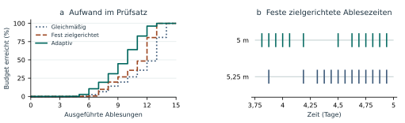
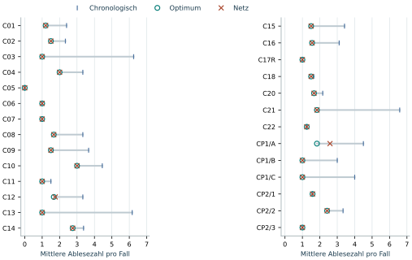

# Kapitel 17 · Zielgerichtete Messplanung und Fehlergarantien

## Einleitung · Welche Messung kann die Entscheidung ändern?

Am zehnten Tag soll ein Brunnenwert mit höchstens einem Prozent Fehler vorhergesagt werden. Bekannt ist die insgesamt eingetragene Stoffmenge. Ein früher Puls hat mehr Zeit, zum Brunnen zu gelangen, als ein später Puls. Beide können den gleichen Summenzählerstand erzeugen. Wie viele weitere Ablesungen braucht die Rechnung, bis der vorhergesagte Brunnenwert belastbar ist?

Die Frage tritt auch bei einem Schalter, einer Warteschlange oder einer Saite auf. In [Kapitel 10](../lehrbuch_numerische_simulation.md#fb-neu10) hatten wir Zielgröße, Referenz und Budget festgelegt. Jetzt untersuchen wir, welche der zulässigen Beobachtungen die Zielgröße genügend einschränkt. Dafür betrachten wir zuerst alle Verläufe, die zu den bisherigen Angaben passen. Erst danach wählen wir die nächste Ablesung.

Wir rechnen je eine abgegrenzte Messaufgabe zu allen 22 C-Familien des [Referenzkatalogs](../lehrbuch_numerische_simulation.md#fb-refteil) und zu allen sechs CP-Teilaufgaben. Beim C19R-Brunnen können die Raten ein ganzes kontinuierliches Intervall ausfüllen. Die übrigen Versuche verwenden ausdrücklich festgelegte Referenzverläufe. Die Wahl des Messauftrags und der zugelassenen Verläufe ist Teil jeder Aussage.

[Zum Schluss dieses Kapitels](#mp-schluss) · [Vergleich der gelernten Auswahlregeln](#atlas-kosten) · [Zur Messmatrix](#mp-matrix-c01)

<!-- Buchseite -->

## 17.1 · Was die bekannten Werte bereits bestimmen

Für jeden Katalogversuch legen wir die zulässigen Szenarien, die beobachtbaren Kanäle, ihre Quantisierung, Zielwerte und Budgets **vor der Auswahl** fest. Der Prüfer muss alle zu den bisherigen Beobachtungen passenden Einträge berücksichtigen. Beim C05-Beispiel gibt es zwölf zugelassene Geschichten mit übereinstimmenden Labels und genügend nahen ersten Schaltzeiten. Daher kann schon die leere Ableseliste ausreichen. Was geschieht mit einem dreizehnten, außerhalb gewählten Start? Seine Schaltfolge und Zielzeit müssen erst ermittelt werden. Die Garantie für die zwölf bekannten Antworten deckt diese Erweiterung nicht ab.

Ein Szenario $\theta$ legt die gewählte Anfangsform, den Eingang und gegebenenfalls die festgeschriebene Zufallsspur fest. Es liefert einen Zielwert $Q_j(\theta)$ und für jede verfügbare Ablesung $i$ einen Geräteeintrag $H_i(\theta)$. Die Ablesung kann ein Pegel zu festgelegter Zeit, ein gerundeter Wert aus dem Protokoll oder ein Zählerstand sein. Das Rechenlabor verwendet die angegebene Rundungsstufe je Kanal.

Nach den bereits gelesenen Einträgen bleibt eine Menge $A$ kompatibler Szenarien. Für eine skalare Zielgröße bestimmen wir

$$
L_j=\min_{\theta\in A} Q_j(\theta),\qquad
U_j=\max_{\theta\in A} Q_j(\theta).
$$

Die Mitte $\widehat Q_j=(L_j+U_j)/2$ erreicht im ungünstigsten Fall den absoluten Fehler $(U_j-L_j)/2$. Jeder andere Schätzwert liegt von mindestens einem der beiden Enden weiter entfernt. Das lässt sich direkt prüfen. Sind an einer Saite noch $1$ und $5\,\mathrm{mm}$ möglich, hat die Mitte $3\,\mathrm{mm}$ einen maximalen Fehler von $2\,\mathrm{mm}$. Mit $1\,\mathrm{mm}$ Budget muss der Versuch weiter messen.

In einem Mehrgrößenauftrag vergleichen wir jede halbe Spannweite mit ihrem eigenen Budget $b_j$. Wir dürfen stoppen, wenn

$$
S(A)=\max_j\frac{U_j-L_j}{2b_j}\leq1
$$

und alle Szenarien in $A$ dieselbe verlangte Ereigniskategorie haben. Bei C10 gehört der Gewinner des gleichzeitigen Zugriffs zum Auftrag. Ein numerisch passender Mittelwert entscheidet diesen Zugriff allein nicht.

### Was ein unentscheidbares Paar beweist

Liefern zwei Szenarien auf sämtlichen erlaubten Kanälen gleiche Geräteeinträge, bilden sie auch nach der letzten möglichen Ablesung dieselbe Beobachtungsklasse. Haben ihre Zielwerte Abstand größer als $2b_j$ oder verschiedene Ereigniskategorien, existiert keine zulässige gemeinsame Antwort. Das Rechenlabor nennt dann das Paar, seine Geräteeinträge und die widersprechenden Zielwerte. So lässt sich die fehlende Information im Modellversuch auf eine konkrete Messfrage zurückführen.

<!-- Buchseite -->

## 17.2 · Den nächsten zulässigen Zeitpunkt wählen

### Vor der Rechnung

In einer kleinen Lehrprobe sind zwei Betriebsarten A und B möglich. In jeder gibt es zwei Fälle, und alle vier verlangen verschiedene Zielwerte. Kanal 1 meldet die Betriebsart. Kanal 2 unterscheidet die beiden Fälle von A, Kanal 3 die beiden von B. Bei der jeweils anderen Betriebsart melden diese beiden Kanäle denselben Grundwert. In jedem Fall ist eine Ablesung nur vor dem Übergang zu einem späteren Kanal möglich.

Ein im Voraus festgelegter Plan braucht alle drei Kanäle. Fehlt Kanal 1, bleiben die beiden Grundwerte ununterscheidbar. Fehlt Kanal 2 oder 3, bleibt die entsprechende Betriebsart unentschieden. Eine adaptive Regel liest zuerst Kanal 1 und dann genau den Kanal der erkannten Betriebsart. In jedem Fall genügen zwei Ablesungen. Das Rechenlabor prüft diese Handprobe und zusätzlich eine unauflösbare Verwechslung zweier Ereigniskategorien.

**Wann stimmen Bayes-Schätzwert und Minimax-Mitte überein?** Nehmen wir für das Saitenbeispiel aus Abschnitt 17.1 an, dass der unbekannte Wert gleichverteilt in $[1,5]\,\mathrm{mm}$ liegt. Bei quadratischem Verlust ist der Bayes-Schätzwert der Mittelwert, hier ebenfalls $3\,\mathrm{mm}$. Bei diesem Schätzwert beträgt der mittlere absolute Fehler $1\,\mathrm{mm}$ und der größte mögliche $2\,\mathrm{mm}$. Schon dasselbe Beispiel liefert also zwei verschiedene Qualitätszahlen. Liegen die Wahrscheinlichkeiten $3/4$ und $1/4$ auf den Endpunkten, wandert der Bayes-Mittelwert auf $2\,\mathrm{mm}$. Die Minimax-Mitte bleibt bei $3\,\mathrm{mm}$. Für unseren Messplan entscheidet die größte noch mögliche Abweichung.

### Der Algorithmus für endliche Referenzkataloge

Nach Ablesung $i$ mit Ergebnis $v$ bleiben die Szenarien $A_{i,v}=\{\theta\in A:H_i(\theta)=v\}$. An diesem Knoten darf der Plan nur spätere Kanäle wählen. Bei schon erfülltem Vertrag kostet der Rest null. Ansonsten gilt für die kleinste sichere Restzahl

$$
C(A,k)=\min_{i\geq k}\left(1+\max_{v:\;A_{i,v}\ne\varnothing}
 C(A_{i,v},i+1)\right).
$$

Ohne weitere Ablesung und bei verletztem Vertrag ist die Restzahl unendlich. Da der Index $i$ in jedem Ast wächst, lässt sich diese Rechnung von hinten aufbauen. In Python speichert ein Cache die bereits ausgewerteten Restprobleme. Bei mehreren Regeln mit derselben maximalen Anzahl wählen wir die kleinste Summe der Ablesungen über die angegebenen Fälle. Die erlaubte Restzahl bleibt in diesem zweiten Suchschritt Teil des Zustands.

### Drei Pläne unter demselben Vertrag

Der gleichmäßige Plan verwendet eine im Voraus festgelegte Folge aus den erlaubten Positionen. Der längste Abstand ist höchstens um eine Position größer als der kürzeste. Beide Ränder zählen mit. Der feste zielgerichtete Plan darf alle Positionskombinationen durchsuchen. Beide suchen die kürzeste ausreichende Folge. Der adaptive Plan legt die nächste Position erst nach der vorherigen Ablesung fest. Jede Ablesung zählt gleich viel und derselbe Test erlaubt vorzeitiges Stoppen. Für bereits vorliegende Protokolle ist die Position eine Reihenfolge der erlaubten Kanalabfragen.

<!-- Buchseite -->

## 17.3 · C19R mit kontinuierlich variierender Quellrate

Am Brunnen bei $5\,\mathrm m$ wird die Konzentration am zehnten Tag verlangt. Bekannt sind $21{,}6\,\mathrm g$ Gesamtmasse, eine Quellrate von höchstens $1\,\mathrm{mg/s}$ und zwanzig Abschnitte von je 90 Minuten zwischen Tag 3,75 und Tag 5. Die Rate darf in jedem Abschnitt jeden Wert zwischen null und der Obergrenze annehmen. Eine Ablesung liefert die bis dahin freigesetzte Masse.

Der positive Green-Kern aus [Kapitel 15](../lehrbuch_numerische_simulation.md#fb-neu15) ordnet der Rate in jedem Abschnitt ein Gewicht zu. Zwischen zwei Zählerständen verlagern wir die bekannte Masse für die größtmögliche Konzentration auf die größten Gewichte und für die kleinstmögliche auf die kleinsten. Die Mengen bleiben durch die Ratenobergrenze beschränkt. Bei $0<L\le U$ gleichen sich die relativen Fehler an den beiden Enden mit $\widehat Q=2LU/(L+U)$ aus. Der relative Fehler beträgt höchstens $(U-L)/(U+L)$.

Ohne weitere Ablesung liegt der maximale relative Fehler bei rund 13,26 Prozent. Die beste Einzelablesung findet an Tag 4,75 statt und senkt ihn auf 8,51 Prozent. Für $1\,\%$ braucht der gleichmäßige Plan 14 und der feste zielgerichtete Plan 13 Ablesungen. Die Quadratur wird durch gerichtete Schranken eingeschlossen. Eine unabhängige Aufzählung schließt alle 50 388 festen Pläne mit zwölf Ablesungen aus.

Die festen Pläne garantieren das Budget bei exakten Zählerständen für die ganze Ratenmenge. In den 5 101 Prüfraten braucht die adaptive Regel höchstens 13 Ablesungen. Im Mittel sind es 9,48 gegenüber 11,65 beim gleichmäßigen Plan. Beim frühen Puls genügen ihr drei. Für den zweiten Brunnen bleiben im festen Plan 13 Ablesungen nötig. Die gewählten Zeiten verschieben sich mit der Lage der Zielgröße.

<!-- Buchseite -->

## 17.4 · Messaufgaben C01 bis C08

Jede Zeile hat ein eigenes physikalisches Budget. **G/F/A** gibt die größte ausgeführte Ablesezahl des gleichmäßigen, festen zielgerichteten und adaptiven Plans an. **Offen** bedeutet, dass auch alle verfügbaren Ablesungen mindestens zwei widersprechende Fälle in derselben Klasse lassen. Das vollständige Protokoll nennt dort die Anzahl der betroffenen Fälle und ein konkretes Paar.

| Messaufgabe | Zielgröße und Budget | Zugelassene Ablesungen | Fälle | G/F/A |
|---|---|---|---:|---:|
| [C01](../lehrbuch_numerische_simulation.md#fb-refC01) · Lithium-Cluster | Größe $m$ bei 10 s, 0,08 | Clustergröße $f$ | 15 | offen |
| [C02](../lehrbuch_numerische_simulation.md#fb-refC02) · Fertigung | Ausgebrachte Menge, 12 Teile | Belegung, Zulassungszeit, Transit | 12 | offen |
| [C03](../lehrbuch_numerische_simulation.md#fb-refC03) · Klasse-E-Schalter | Spannung $u_4$ bei 20 µs, 0,10 V | Spannung $u_2$ | 12 | offen |
| [C04](../lehrbuch_numerische_simulation.md#fb-refC04) · Philosophen | Mahlzeiten, 2. Verklemmungskategorie | Zustandsanteile und Mahlzeiten | 12 | 2 / 2 / 2 |
| [C05](../lehrbuch_numerische_simulation.md#fb-refC05) · Hysterese | Erste Schaltzeit, 15 ms. Modusfolge | Zustandsdifferenz | 12 | 0 / 0 / 0 |
| [C06](../lehrbuch_numerische_simulation.md#fb-refC06) · Notaufnahme | Mittlere Aufenthaltszeit, 3 min | Klassenmittel, Schließzeit, Streuung | 16 | 1 / 1 / 1 |
| [C07](../lehrbuch_numerische_simulation.md#fb-refC07) · Stiftpendel | Winkel bei 1,3 s, 0,018 rad. Stiftkontakt | Frühere Winkel | 12 | 1 / 1 / 1 |
| [C08](../lehrbuch_numerische_simulation.md#fb-refC08) · Schleuse | Mittlere Transitzeit, 25 s | Verkehrszahlen und Transitmittel | 12 | 2 / 2 / 2 |

**C01 und C05 zeigen, wann Ablesungen etwas ändern.** Bei C01 zeigen alle sieben erlaubten $f$-Ablesungen für zwei Szenarien denselben Gerätecode. Die möglichen Endgrößen sind 3,370 und 3,579. Ihre Differenz übersteigt das doppelte Budget von 0,16. Eine Ablesung von $m$ bei 3 s löst den Vertrag in allen 15 Fällen. Bei C05 reichen die vorab gegebenen Startbereiche und der identische Moduswechsel bereits für das verlangte Budget.

Bei C04 muss der gleiche Plan eine Mahlzeitenzahl und die Verklemmungskategorie treffen. Alle zwölf untersuchten Spuren bleiben hier lebendig. Bei C06 und C08 werten wir festgeschriebene Ereignisspuren aus. Sie zeigen, welche Programmeingänge zu einem gegebenen Protokoll passen. [Rechenweg und Stichproben](#mp-labor)

<!-- Buchseite -->

## 17.5 · Messaufgaben C09 bis C16

Beim Tank messen wir einen Pegel und prüfen beide Endpegel. Im SCARA-Kurzfenster wird die vertikale Position aus dem Ankerstrom eingegrenzt. In der Stoßreihe ist neben der Endgeschwindigkeit auch die Kontaktzahl angegeben. Die Fallbeschreibung im Rechenlabor legt jeweils den Horizont fest.

| Messaufgabe | Zielgröße und Budget | Zugelassene Ablesungen | Fälle | G/F/A |
|---|---|---|---:|---:|
| [C09](../lehrbuch_numerische_simulation.md#fb-refC09) · Tanks | Zwei Pegel bei 36 s, je 4 mm | Frühere Pegel von Tank 1 | 12 | 2 / 2 / 2 |
| [C10](../lehrbuch_numerische_simulation.md#fb-refC10) · Stäbchen | Neue Mahlzeiten, 0,25. Zugriffsfolge | Freie Stäbchen und Anforderungen | 20 | 5 / 5 / 4 |
| [C11](../lehrbuch_numerische_simulation.md#fb-refC11) · SCARA | $z$ bei 0,9 ms, 0,45 mm | Ankerstrom der $z$-Achse | 12 | 1 / 1 / 1 |
| [C12](../lehrbuch_numerische_simulation.md#fb-refC12) · Kugelreihe | Endgeschwindigkeit von Kugel 4, 0,025 m/s. Kontaktzahl | Geschwindigkeit von Kugel 2 | 12 | 2 / 2 / 2 |
| [C13](../lehrbuch_numerische_simulation.md#fb-refC13) · Lastkran | Lastposition bei 15 s, 0,25 m | Seilwinkel | 12 | offen |
| [C14](../lehrbuch_numerische_simulation.md#fb-refC14) · Lieferkette | D1 an Tag 30, 6 Produkte | Bestandsstände von D1 | 16 | 4 / 1 / 1 |
| [C15](../lehrbuch_numerische_simulation.md#fb-refC15) · Zweikammermodell | $A$ bei 160 ZE, 0,30 auf Modellskala | Frühere Konzentration $A$ | 12 | 2 / 2 / 2 |
| [C16](../lehrbuch_numerische_simulation.md#fb-refC16) · Restaurantmarkt | Nach fünf Jahren, 1 Restaurant | Frühere Restaurantzahl | 9 | 2 / 1 / 1 |

**C10 gewinnt durch die Reihenfolge der Fragen.** Die ersten Angaben schränken ein, welche Plätze noch als Gewinner des Zugriffs infrage kommen. Der feste Plan braucht höchstens 5 Ablesungen, der adaptive 4. Im Mittel sinkt die Zahl von 3,80 auf 2,75.

**C14 gewinnt durch den Zeitpunkt.** Der D1-Bestand an Tag 27 genügt allein, um den Bestand an Tag 30 auf sechs Produkte genau einzugrenzen. Der gleichmäßige Plan braucht bis zu vier Ablesungen. Der gezielte feste Plan benötigt eine.

<!-- Buchseite -->

## 17.6 · Messaufgaben C17R bis C22

Die Endgröße kann aus einer simulierten Bahn, einer rekonstruierten Messkurve oder einem Integral stammen. In C17R bleiben die Raten des abstrakten SIR-Lehrmodells fest. In C18 stammt jedes Prüffenster aus der separat rekonstruierten Kurve. Für C19R gilt die relative Schranke aus [Abschnitt 17.3](#mp-c19). Die Zahl der Prüfraten bezeichnet dort die zusätzliche Stichprobe zur Aufwandsermittlung.

| Messaufgabe | Zielgröße und Budget | Zugelassene Ablesungen | Fälle | G/F/A |
|---|---|---|---:|---:|
| [C17R](../lehrbuch_numerische_simulation.md#fb-refC17R) · SIR | $R$ bei 60 ZE, 8 Modellpersonen | Frühere Werte für $I$ | 12 | 1 / 1 / 1 |
| [C18](../lehrbuch_numerische_simulation.md#fb-refC18) · Identifikation | Kraft bei 450 ms, 0,04 auf Datenskala | Verdickung im früheren Fenster | 20 | 2 / 2 / 2 |
| [C19R](../lehrbuch_numerische_simulation.md#fb-refC19R) · Grundwasser | Brunnen an Tag 10, 1 % relativ | Kumulierte Quellmasse | 5 101 | 14 / 13 / 13 |
| [C20](../lehrbuch_numerische_simulation.md#fb-refC20) · Produktion | Median der Durchlaufzeit, 65 s | Durchlaufzeiten einzelner Aufträge | 12 | 2 / 1 / 1 |
| [C21](../lehrbuch_numerische_simulation.md#fb-refC21) · Ball | Dritter Kontakt, 60 ms. Zahl bis 4 s | Ballhöhe | 12 | 4 / 2 / 2 |
| [C22](../lehrbuch_numerische_simulation.md#fb-refC22) · Warteschlange | Mittlere Wartezeit, 0,40 ZE. Abbruch | Warteschlangen- und Ereignislog | 16 | 1 / 1 / 1 |

Die Ereignisbedingungen der Ballprobe beziehen sich auf Anzahl und Zeitpunkt von Bodenkontakten. Bei C22 wird der Abbruch als eigene Kategorie geführt. Beide Aufgaben machen sichtbar, welche numerische Genauigkeit und welches Ereigniswissen dieselbe Auswahl der Ablesungen erfüllen muss.

<!-- Buchseite -->

## 17.7 · Die sechs Teilaufgaben aus CP1 und CP2

Bei der Parallelserie ist die abgelesene physikalische Größe von der CPU-Zeit getrennt. Wir wählen beispielsweise einen Punkt der Saite oder einen Block des festgelegten Monte-Carlo-Ensembles. Der hier gezählte Aufwand ist die Anzahl dieser Ablesungen. Die Laufzeitkosten der eigentlichen Simulation lassen sich zusätzlich separat messen.

| Messaufgabe | Zielgröße und Budget | Zugelassene Ablesungen | Fälle | G/F/A |
|---|---|---|---:|---:|
| [CP1/A](../lehrbuch_numerische_simulation.md#fb-refCP1) · Federwagen | Position bei 1,6 s, 0,8 mm | Frühere Positionen | 12 | 3 / 3 / 2 |
| [CP1/B](../lehrbuch_numerische_simulation.md#fb-refCP1) · Populationen | $z_2$ bei 10 ZE, 0,06 auf Modellskala | Frühere Werte für $v_1$ | 12 | 1 / 1 / 1 |
| [CP1/C](../lehrbuch_numerische_simulation.md#fb-refCP1) · Erregte Saite | Auslenkung bei 7,5 m und 20 s, 12 mm | Auslenkung bei 5 m | 12 | 1 / 1 / 1 |
| [CP2/1](../lehrbuch_numerische_simulation.md#fb-refCP2) · Ensemble | Positionsmittel bei 1,6 s, 0,12 mm | Mittel jedes Viererblocks | 12 | 1 / 1 / 1 |
| [CP2/2](../lehrbuch_numerische_simulation.md#fb-refCP2) · Kavität | Tempo bei $(13,9)$, 0,0012 Gittereinheiten | Tempo in Spalte 9 | 12 | 2 / 1 / 1 |
| [CP2/3](../lehrbuch_numerische_simulation.md#fb-refCP2) · Gezupfte Saite | Auslenkung bei 0,375 m und 8 s, 1,5 mm | Auslenkung bei 0,25 m | 12 | 2 / 1 / 1 |

Beim CP2-Ensemble liest ein Zugriff den Mittelwert von vier Einzelläufen. Die Prüfgröße ist das Mittel über 28 Läufe des festgelegten Ensembles. Die Kavitätsprobe verwendet ein Gitter mit 19 × 19 Knoten und 215 LBM-Schritte. Die Zielgeschwindigkeit kommt aus den D2Q9-Impulsmomenten an einem Innenknoten. Die Sensoren folgen einer Spalte desselben Gitters. Kapitel 16 verwendet feinere Vergleichsrechnungen.

**CP1/A gewinnt durch die adaptive Wahl.** Der beste feste Plan hat maximal 3 Ablesungen. Adaptiv genügen 2. Beim Federwagen hängt der Informationswert einer weiteren Position davon ab, welche Kombinationen von Masse und Dämpfung nach der ersten Ablesung noch infrage kommen.

<!-- Buchseite -->

## 17.8 · Rechenlabor und Geltungsbereich

Mit der ursprünglichen Kanalliste ist der Vertrag in 24 der 28 Aufgaben für alle Referenzfälle erfüllbar. In 9 davon ist die maximale Zahl der adaptiven Ablesungen kleiner als beim gleichmäßigen Plan. Bei C10 und CP1/A unterschreitet sie auch die des besten festen Plans.

Die vier offenen Aufgaben zeigen, welche Information zusätzlich nötig ist. Bei C01 und C03 reicht die jeweilige Zielgröße zu einem früheren Zeitpunkt aus, bei C13 die Katzposition bei 12 s. Bei C02 liefert das Steuerprotokoll die Zuordnung von An- und Ausfahrt. Dort braucht der adaptive Plan bis zu zwei Abfragen. In den drei anderen Aufgaben genügt je eine. Damit sind alle 28 Aufträge mit den entsprechend erweiterten Kanallisten für ihre Referenzfälle erfüllbar.

Das Rechenlabor hält den zugrunde liegenden [Projektstand](https://github.com/5H3LL3H5/argesim-hyperposition-benchmarks/tree/16f0f2528fcf77f16898ecd74ad952be2c09eac2) lokal fest. Die Fallmodule erzeugen daraus Zielwerte und die erlaubten Beobachtungen. Der Planer rechnet mit diesen gespeicherten Referenzwerten. Die formale Unterteilung bezieht sich auf den festgelegten Katalog. Änderungen an Randbedingungen, Gitter, Auflösung, Quellen und Horizont bilden einen neuen Versuch.

~~~sh
python3 rechenlabor/messplanung/vergleich.py --out messausgabe
python3 rechenlabor/messplanung/vergleich.py --case C10 --out c10_messung
~~~

`messplanung.csv` enthält die kompakte Ergebnismatrix. `messplanung.json` weist Zielwerte, Budgets, Beobachtungen, Auflösungen und Gerätecodes je Fall aus. Für die adaptive Wahl sind dort die Ablesepfade hinterlegt. Ein Fall mit offenem Vertrag verweist auf das konkrete unentscheidbare Paar. Im Grundwasserversuch enthält dieselbe Datei zusätzlich die kontinuierliche Schranke und die unabhängige Prüfauszählung.

### Wenn die gesuchte Größe eine Wahrscheinlichkeit ist

Ein festgelegter Zufallsstart definiert eine Modellspur. Wird stattdessen etwa die Verklemmungswahrscheinlichkeit gesucht, ist jede unabhängige Wiederholung eine Beobachtung mit Wert 0 oder 1. Mit $n$ unabhängigen Wiederholungen liefert Hoeffdings Schranke $\Pr(|\widehat p-p|\ge b)\le2e^{-2nb^2}$. Für $b=0{,}05$ und eine vorab festgelegte Irrtumswahrscheinlichkeit von fünf Prozent genügen nach dieser Schranke 738 Wiederholungen. Ein Zwischentest mit vorzeitigem Stopp braucht ein zusätzlich festgelegtes statistisches Prüfverfahren. Die endliche Szenariengarantie und die Stichprobenaussage haben damit eigene Voraussetzungen.

<!-- Buchseite -->

## 17.9 · Was ein Fehlernachweis bei einem Ereignismodell bedeutet

Betrachten Sie zwei Verläufe, die alle bisher abgefragten Sensorcodes teilen. Im ersten gewinnt Person P1 einen Zugriff, im zweiten P2. Jede Regel, die nur diese Codes kennt, muss beiden dieselbe Antwort geben. Für mindestens einen Verlauf wäre das Ereignislabel falsch. Für eine Zahl $q$ mit Budget $b$ gilt ebenso: Liegen zwei mögliche Werte weiter als $2b$ auseinander, kann kein gemeinsamer Schätzwert beide Budgets einhalten.

Für die endlichen Aufgaben sei $H$ die Matrix der quantisierten Beobachtungen. Jede Spalte gehört zu einem festgelegten Referenzszenario, jede Zeile zu einem Messkanal. Der Zielwert pro Szenario, geteilt durch sein Budget, bildet den Vektor $q$. Aus den bereits gelesenen Zeilen $S$ lernt der duale Operator für diesen Zielwert einen affinen Schätzer $c+z^T y$. Der Fehler ist für jede Katalogspalte durch
$$
r=\max_i\left|q_i-c-(H_S^Tz)_i\right|
$$
beschränkt. Eine Freigabe mit diesem Zeugen verlangt $r\le1$ für jede Zielgröße und ein eindeutiges Ereignislabel. Die Implementierung prüft die gerundeten Koeffizienten mit rationaler Arithmetik. Reicht die globale Schranke nicht, bildet der Prüfer für jede Zielgröße das Intervall aller noch möglichen Katalogwerte. Dessen Mittelpunkt minimiert den maximalen absoluten Fehler.

**Was war vorher bekannt?** Die Gewichte $c,z$ werden nur an den Trainingsszenarien des jeweiligen Durchgangs angepasst. Für die Schranke stehen die Referenzwerte *aller* Katalogspalten bereits beim Aufbau des Prüfers zur Verfügung. Ein neuer, unmodellierter Verlauf kann dieselben Codes liefern. Die geschlossene Liste ist deshalb Teil der Aussage. Für neue Quellen bei C19R trägt die [Ungleichung für beliebige Raten](../lehrbuch_numerische_simulation.md#atlas-quelle), bei der Saite die [diskrete Newmark-Gleichung](../lehrbuch_numerische_simulation.md#op-nachweis). Diese Nachweise haben einen anderen Geltungsbereich.

<!-- Buchseite -->

## 17.10 · Wie der Planer den nächsten Sensor auswählt

Ein Messkanal kann früh gut trennen und gerade dadurch den entscheidenden späteren Kanal entbehrlich machen. Der kurze Lehrversuch verwendet deshalb als Trainingsziel die Zahl der verbleibenden Ablesungen. Für eine Gruppe noch möglicher Fälle minimiert eine Rückwärtsrechnung den heutigen Aufwand von eins plus die mittlere optimale Restarbeit der entstehenden Gruppen. Alle Katalogszenarien werden für diese Rechnung gleich gewichtet.

Das Aktionsnetz lernt diese Fortsetzungskosten aus anderen Benchmarkfamilien. Drei getrennte Durchgänge halten ganze Familien zurück. So bleiben die drei CP1-Teilaufgaben beim Training der zugehörigen Auswahlregel gemeinsam außen vor, ebenso die drei CP2-Teilaufgaben. Am Zielort sind Sensorkanäle, Codes und zulässige Referenzfälle für die Planung bekannt. Die Regel erhält beim Einsatz nur angeforderte Codes in steigender Kanalreihenfolge. Sie darf eine letzte verbleibende Trennmöglichkeit für verschiedene Sensorsignaturen nicht überspringen.

**Gezählte Ablesungen für 352 Szenarien.** Der gelernte Planer benötigt zusammen 538, die gierige Aufteilung nach Gruppengröße 535, das Optimum unter denselben Zulässigkeitsregeln 528 und das chronologische Ablesen 1 014. Der Vergleich bezieht sich auf die vollständige Ausstattung mit den vier dokumentierten Zusatzkanälen. Die Zahlen messen Sensorzugriffe. Inferenzzeit, Aufbau der Referenzbank und Laufzeit des klassischen Solvers sind eigene Kosten. Allein bei CP1/A benötigt das Netz 31 Ablesungen, die gierige Regel kommt mit 22 aus.

Von den 352 akzeptierten Aufgaben erhalten 60 direkt einen global geprüften affinen Zeugen. Ein konstanter Zeuge schafft zwölf. In den verbleibenden 292 Fällen liefert das Intervall der kompatiblen Szenarien die Freigabe. C05 trägt alle zwölf konstanten Freigaben bei: Schon vor der ersten Ablesung liegen die modellierten Schaltzeiten im Budget und das Label steht fest. Eine genauere Zeitvorgabe wäre ein anderer Versuch.

<!-- Buchseite -->

## 17.11 · C01 bis C08 im direkten Vergleich

Die ersten drei Zahlen zählen Prüffälle und ihre Art der Freigabe. Die letzten drei zählen alle Ablesungen je Auswahlregel, summiert über die Fälle einer Zeile. Ein kleinerer Wert bedeutet bei demselben Auftrag weniger Sensorzugriffe.

| Atlasauftrag | Fälle | Dual | Hülle | Netz | Gierig | Opt. |
| --- | ---: | ---: | ---: | ---: | ---: | ---: |
| C01 | 15 | 0 | 15 | 18 | 18 | 18 |
| C02 | 12 | 0 | 12 | 18 | 18 | 18 |
| C03 | 12 | 8 | 4 | 12 | 12 | 12 |
| C04 | 12 | 0 | 12 | 24 | 24 | 24 |
| C05 | 12 | 12 | 0 | 0 | 0 | 0 |
| C06 | 16 | 0 | 16 | 16 | 16 | 16 |
| C07 | 12 | 12 | 0 | 12 | 12 | 12 |
| C08 | 12 | 0 | 12 | 20 | 20 | 20 |

Im Basissatz bleiben bei C01 drei, bei C02 vier und bei C03 zwei Fälle offen. Die Zusatzkanäle sind in den Tabellenwerten enthalten. Bei C04 trägt stets das Intervall der noch möglichen Mahlzeiten. Der Scheduler kann über den Status eines Wartekreises mehr aussagen als über die künftige Anzahl der Mahlzeiten.

Die zugehörigen Messpaare stehen im [bebilderten Referenzkatalog](../lehrbuch_numerische_simulation.md#atlas-mess-c01). In den Einzelprotokollen sind die tatsächlich gelesenen Kanäle, die Freigabe und der nachträglich geprüfte Fehler je Fall ausgewiesen.

<!-- Buchseite -->

## 17.12 · C09 bis C16 im direkten Vergleich

Die ersten drei Zahlen zählen Prüffälle und ihre Art der Freigabe. Die letzten drei zählen alle Ablesungen je Auswahlregel, summiert über die Fälle einer Zeile. Ein kleinerer Wert bedeutet bei demselben Auftrag weniger Sensorzugriffe.

| Atlasauftrag | Fälle | Dual | Hülle | Netz | Gierig | Opt. |
| --- | ---: | ---: | ---: | ---: | ---: | ---: |
| C09 | 12 | 0 | 12 | 18 | 18 | 18 |
| C10 | 20 | 0 | 20 | 60 | 60 | 60 |
| C11 | 12 | 12 | 0 | 12 | 12 | 12 |
| C12 | 12 | 0 | 12 | 21 | 21 | 20 |
| C13 | 12 | 0 | 12 | 12 | 12 | 12 |
| C14 | 16 | 0 | 16 | 44 | 45 | 44 |
| C15 | 12 | 0 | 12 | 18 | 18 | 18 |
| C16 | 9 | 0 | 9 | 14 | 18 | 14 |

C09 hat zwei Zielpegel. Beide müssen gleichzeitig im Budget liegen. C10 verlangt zusätzlich den richtigen Gewinner einer Konkurrenz: Die Zahl neuer Mahlzeiten allein kann sogar null sein und der Zustandswechsel dennoch entscheidend. Für C13 ist der Zusatzkanal einbezogen; ohne ihn bleiben zwei Fälle offen.

Die zugehörigen Messpaare stehen im [bebilderten Referenzkatalog](../lehrbuch_numerische_simulation.md#atlas-mess-c09). In den Einzelprotokollen sind die tatsächlich gelesenen Kanäle, die Freigabe und der nachträglich geprüfte Fehler je Fall ausgewiesen.

<!-- Buchseite -->

## 17.13 · C17R bis C22 im direkten Vergleich

Die ersten drei Zahlen zählen Prüffälle und ihre Art der Freigabe. Die letzten drei zählen alle Ablesungen je Auswahlregel, summiert über die Fälle einer Zeile. Ein kleinerer Wert bedeutet bei demselben Auftrag weniger Sensorzugriffe.

| Atlasauftrag | Fälle | Dual | Hülle | Netz | Gierig | Opt. |
| --- | ---: | ---: | ---: | ---: | ---: | ---: |
| C17R | 12 | 8 | 4 | 12 | 12 | 12 |
| C18 | 20 | 0 | 20 | 30 | 30 | 30 |
| C20 | 12 | 0 | 12 | 20 | 21 | 20 |
| C21 | 12 | 0 | 12 | 22 | 22 | 22 |
| C22 | 16 | 0 | 16 | 20 | 20 | 20 |

C19R verwendet eine kontinuierliche Quellenmenge. In 5 101 Testfällen werden mit Aktionsnetz 5 079 Werte direkt über den gelernten Multiplikator und 22 über die scharfe Intervallrechnung freigegeben. Maximal waren 13 Ablesungen nötig. Die separate Auswertung in [Kapitel 15](../lehrbuch_numerische_simulation.md#atlas-quelle) erhält diesen größeren Geltungsbereich. Bei C18 stammen die Kraftwerte aus der dokumentierten Kurvenrekonstruktion.

Die zugehörigen Messpaare stehen im [bebilderten Referenzkatalog](../lehrbuch_numerische_simulation.md#atlas-mess-c17). In den Einzelprotokollen sind die tatsächlich gelesenen Kanäle, die Freigabe und der nachträglich geprüfte Fehler je Fall ausgewiesen.

<!-- Buchseite -->

## 17.14 · CP1 und CP2 im direkten Vergleich

Die ersten drei Zahlen zählen Prüffälle und ihre Art der Freigabe. Die letzten drei zählen alle Ablesungen je Auswahlregel, summiert über die Fälle einer Zeile. Ein kleinerer Wert bedeutet bei demselben Auftrag weniger Sensorzugriffe.

| Atlasauftrag | Fälle | Dual | Hülle | Netz | Gierig | Opt. |
| --- | ---: | ---: | ---: | ---: | ---: | ---: |
| CP1/A | 12 | 0 | 12 | 31 | 22 | 22 |
| CP1/B | 12 | 0 | 12 | 12 | 12 | 12 |
| CP1/C | 12 | 0 | 12 | 12 | 12 | 12 |
| CP2/1 | 12 | 0 | 12 | 19 | 19 | 19 |
| CP2/2 | 12 | 0 | 12 | 29 | 29 | 29 |
| CP2/3 | 12 | 8 | 4 | 12 | 12 | 12 |

CP2/1 betrifft das Mittel des festgelegten Ensembles. Eine Aussage über den Erwartungswert weiterer Zufallsläufe erfordert eine eigene statistische Prüfung. CP2/2 schätzt einen Knoten der kleinen Kavitätsrechnung. Bei CP2/3 ist ein Wegsensor nach acht Sekunden das Ziel. Für das Feld und das duale Problem eines einzelnen Newmark-Schritts gelten die gesonderten Versuche in Kapitel 9 und 16.

Die zugehörigen Messpaare stehen im [bebilderten Referenzkatalog](../lehrbuch_numerische_simulation.md#atlas-mess-cp1). In den Einzelprotokollen sind die tatsächlich gelesenen Kanäle, die Freigabe und der nachträglich geprüfte Fehler je Fall ausgewiesen.

<!-- Buchseite -->

## 17.15 · Wo eine andere Messreihenfolge tatsächlich Arbeit spart

Der graue Abschnitt zeigt, wie viele Ablesungen sich zwischen chronologischem Vorgehen und optimaler Wahl einsparen lassen. Wo Kreuz und Kreis übereinanderliegen, erreicht das gelernte Netz dieselbe mittlere Zahl von Zugriffen wie die Rückwärtsrechnung. Bei CP1/A lässt das Kreuz einen sichtbaren Abstand. Das Netz liest im Mittel 2,58-mal, das Optimum und die gierige Regel 1,83-mal.

C05 steht bei null, weil die Schaltzeit und das Ereignislabel im vereinbarten Katalog schon vor dem Ablesen ausreichend bestimmt sind. Der kontinuierliche Brunnen ist in [Abbildung 15.2](../lehrbuch_numerische_simulation.md#atlas-quelle) separat dargestellt. Dort besitzt die scharfe physikalische Intervallrechnung eigene Kosten. Wer beide Modelle nach Ablesungen vergleicht, muss daher auch festhalten, welche Rechnung zwischen zwei Messungen erlaubt war.

<!-- Buchseite -->

## Schluss · Ein Fehlerbudget bestimmt den nächsten Messschritt

Der Brunnenversuch beantwortet die Eingangsfrage im angegebenen Lehrmodell. Die bekannte Masse bestimmt eine Spanne für die Konzentration. Die Ablesungen beschränken die Verteilung dieser Masse in der Zeit. Mit gezielter Wahl sind für einen festen Plan im ungünstigsten Fall 13 Ablesungen erforderlich. Die adaptive Regel nutzt neu bekannt gewordene Zählerstände und braucht im Prüfsatz im Mittel 9,48.

Bei den übrigen Aufgaben führen dieselben Schritte von der Zielgröße und dem Budget zur Menge der kompatiblen Verläufe. Die halbe Spannweite erklärt, wann eine numerische Ausgabe genügt. Für begrenzt genaue Zähler zeigt der [Brunnenversuch mit zwei Messgeräten](../lehrbuch_numerische_simulation.md#pr-messversuch) die Wirkung einer weiteren Ablesung. Die Ereigniskategorie stellt eine eigene Entscheidung dar. Ist ein unentscheidbares Paar vorhanden, sehen wir direkt, welche Szenarien einen weiteren Kanal oder eine andere Auflösung erfordern.

Damit kann eine Solverwahl aus zwei Rechnungen bestehen. Zuerst prüfen wir die Information, die dem Algorithmus zur Verfügung steht. Danach vergleichen wir geeignete Integratoren oder Vorhersagemodelle unter demselben Zielvertrag. [Synthese in Kapitel 18](../lehrbuch_numerische_simulation.md#fb-neu17)

### Aktueller Stand der Forschung

Zielgerichtete Versuchsplanung richtet die Auswahl von Beobachtungen an einer Zielgröße aus. Attia, Alexanderian und Saibaba reduzieren in linearen Bayes-Inversionen die Unsicherheit der gesuchten Ausgabe. Unser Lehrversuch untersucht für die angegebenen Szenarien die maximale Abweichung. Im Vorabdruck von Hsiang, George und Anandkumar gehen die Garantien für neuronale Operatoren über einzelne Gitterpunkte hinaus. Der [gelernte Brunnenplaner](../lehrbuch_numerische_simulation.md#op-brunnen) verbindet die Auswahl mit einer überprüfbaren Schranke. Der Versuch mit ungenauerem Sensor zeigt, welche Anfragen offenbleiben. Unvorhergesehene Randsignale sind eine weitere Forschungsfrage. [Zielgerichtete Versuchsplanung](https://arxiv.org/abs/1802.06517) · [Zertifizierung im Funktionenraum, 2026](https://arxiv.org/abs/2611.09038)

Die [vollständige Rechnung](#atlas-kosten) zeigt, wie nah die gierige und die gelernte Auswahl unter denselben Prüfregeln an das Optimum kommen.

[Zur Einleitung dieses Kapitels](#mp-einstieg)
