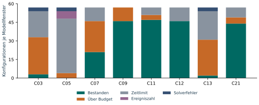

# Kapitel 18 · Synthese und Entscheidungsmatrix der 456 Konfigurationen

## Einleitung · Wie wählen wir nach einem überprüften Versuch das nächste Verfahren?

Am Anfang des Buchs schwang ein Federwagen auf dem Bildschirm immer weiter aus. Wir haben in Kapitel 1 erklärt, warum die Integration diesem Wagen Energie zuführt. Jetzt nehmen wir die drei Fragen aus der [Einleitung](../lehrbuch_numerische_simulation.md#buch-einleitung) wieder auf. Was wollen wir wissen? Wo entsteht die Abweichung? Woran erkennen wir eine belastbare Entscheidung? Beim [Messplan](../lehrbuch_numerische_simulation.md#mp-einstieg) haben wir zuvor geprüft, welche Beobachtungen die Entscheidung überhaupt tragen. Die Leitbenchmarks zeigen, wie dieselben Fragen bei vielen Zuständen, Ereignissen und Feldern praktisch beantwortet werden.

Bei der Kugelreihe kann eine glatte Strecke zwischen zwei Stößen mit wenig Arbeit berechnet werden. Beim steifen Zweizustandsmodell begrenzt ein kurzer Vorgang die explizite Schrittweite, und die Uhrzeit der nächsten Schaltung bleibt dennoch das eigentliche Ziel. Für ein gebundenes Pendel zählt auch die Zulässigkeit des Zustands. Welches Verfahren wir für das nächste Modell untersuchen, hängt darum von seinem Auftrag und seiner Gleichungsstruktur ab.

Wir lesen das Raster der acht Modelle mit insgesamt 456 Konfigurationen zuerst auf Erfolg und Fehlerursachen. Danach vergleichen wir die Arbeit unter den Einstellungen, die den gleichen Test bestehen. So wird aus einer Tabelle die Begründung für eine Auswahl. Am Ende steht ein Vorgehen, das man auf ein neues Modell anwenden und mit einer unabhängigen Gegenprobe überprüfen kann.

**Vier verschiedene Nenner.** Die Reihe mit 399 historischen Einstellungen hat eine andere Modellauswahl. Im Archiv mit 456 Einstellungen prüfen wir acht definierte Fenster zu je 57 Konfigurationen, einschließlich aller Abbrüche. Die Auswahlstudie mit 520 Einstellungen und die Steifigkeitsstudie mit 138 Einstellungen besitzen eigene Kandidaten und Budgets. Die 17 gemeinsam verfügbaren Kandidaten des Leistungsprofils sind die Schnittmenge über acht Fälle der Auswahlstudie. Bevor wir Zeiten vergleichen, müssen Modellfenster, Referenz, Fehlerbudget und erwünschtes Ereignis übereinstimmen.

[Zum Schluss dieses Kapitels](#kap17-schluss) · [Ergebnisse aller 28 Messaufgaben](../lehrbuch_numerische_simulation.md#atlas-kosten)

<!-- Buchseite -->

## Welcher Solver erfüllt den Auftrag?

**Lernziel.** Sie können einen Vergleich vor dem Start festlegen, fehlerhafte Läufe einordnen und eine Methodenwahl mit einem nachrechenbaren Genauigkeits- und Aufwandsergebnis begründen.

Zwei Programme liefern dieselbe Endtemperatur. Das erste braucht nur die Hälfte der Rechenzeit. Sie sollen den schnelleren Solver für einen Regler auswählen, der zusätzlich drei Schaltvorgänge protokollieren muss. Welche Daten fehlen Ihnen vor einer Entscheidung?

### Machen Sie den Auftrag messbar

Wir verlangen in einem kleinen Lehrversuch drei Ereignisse in der richtigen Reihenfolge, höchstens $2\,\mathrm{ms}$ Zeitabweichung je Ereignis und höchstens $0{,}10\,\mathrm{K}$ Endfehler. Die Laufzeiten stammen in dieser Übung aus demselben angenommenen Versuchsaufbau.

**Versuchsbezug.** Lehrbeispiel zur Abnahme. Zwei Kandidaten, drei bezeichnete Ereignisse und derselbe vorgegebene Referenz-Endzustand.

| Lauf | Ereignisse | größter Zeitfehler | Endfehler | Laufzeit |
| --- | --- | --- | --- | --- |
| A | 2 von 3 | offen | $0{,}01\,\mathrm{K}$ | $4\,\mathrm{ms}$ |
| B | 3 von 3 | $1{,}6\,\mathrm{ms}$ | $0{,}04\,\mathrm{K}$ | $8\,\mathrm{ms}$ |

Nur B erfüllt hier den Auftrag. Ein fehlendes Ereignis kann bei A auch durch eine noch so gute Endtemperatur nicht rekonstruiert werden. Die Daten sind konstruierte Lehrwerte. Die archivierten ARGESIM-Messungen folgen später mit ihren eigenen Grenzwerten.

**Ändern Sie den Auftrag.** Fordert eine andere Anwendung ausschließlich die Endtemperatur mit derselben Toleranz, dann erfüllen A und B diese Anforderung. Für diesen Versuch benötigt A die kürzere gemessene Zeit. Eine Änderung der Messaufgabe kann eine vernünftige Wahl umkehren.

Übertragen Sie dieses Vorgehen auf die Acht-Fälle-Auswertung. Ein Methodenname allein legt weder die Schrittweite noch die Behandlung von Ereignissen oder das Fehlerziel fest.

**Kernweg**  [Erster Reglertakt](../lehrbuch_numerische_simulation.md#fb-c09takt)  **Vertiefung**  [Acht-Fälle-Matrix](#fb-matrix) [Selbst prüfen](#fb-ueb12).

## Eine Solverwahl begründen

**Erst schätzen.** Der schnellste Lauf trifft den Endwert, überspringt aber eine geforderte Schaltung. Wie ordnen Sie ihn im Vergleich ein?

Eine Modellgruppe fragt nach dem „besten Solver“. Formulieren Sie zuerst den Prüfauftrag. Welche Größe, zu welcher Zeit, in welcher Einheit und mit welchem Fehlerbudget soll stimmen? Die Tabelle verbindet eine solche Frage mit einem ersten Verfahren und einer Gegenprobe. Ihr Versuch entscheidet, ob die Wahl trägt.

**Versuchsbezug.** Lesetabelle zur Methodenwahl. Die Zeilen benennen Modellklassen und die Zielgröße der anschließenden Gegenprobe.

| Modellmerkmal | Erster sinnvoller Versuch | Was entscheidet? |
| --- | --- | --- |
| Glatte ODE ohne schnelle Abklingmode | RK45 für adaptive Schritte, RK4 als transparente Kontrolle auf festem Gitter. | Zustandsfehler und beobachtete Ordnung beim Verfeinern. |
| Schnelle stabile Mode, langsames Ziel | Radau IIA, BDF oder ESDIRK. Explizites RK als Kostenvergleich. | Fehler in der Anfangsschicht und am verlangten Ausgang, $f$-Aufrufe und LU. |
| Konservativer Oszillator | Störmer–Verlet bei separierbarer Mechanik. RK4 bei begrenztem Horizont mitmessen. | Phasenfehler und maximale Energiedrift über den relevanten Zeitraum. |
| Ortsabhängiges Feld | FDM, FVM oder FEM nach Geometrie, Fluss und Glattheit. Danach passende Zeitintegration. | Raum und Zeit getrennt verfeinern. Flüsse und Randbedingungen prüfen. |
| Algebraische Bindung | Bei regulärem Index 1 Elimination gegen IDA/IDAS vergleichen. Bei höherem Index Formulierung prüfen. | Konsistente Starts, skalierte Residuen, unabhängige Zustandsgrößen. |
| Lokale oder schaltende Dynamik | QSS2 sowie einen klassischen Integrator unter identischem Wächter- und Resetvertrag erproben. | Ereignisfolge, Zeiten, Zahl betroffener Komponenten und Arbeit bei zulässigem Fehler. |

### Wie ein Vergleich fair wird

Bei einem Solverpaar sind dieselben ODE-Toleranzen nur eine Eingabe. Ein Quantum misst sogar eine andere Größe. Für jeden Kandidaten sucht man eine Einstellung, die das gleiche physikalische Ziel erreicht. Erst die qualifizierten Läufe werden nach Aufwand verglichen. Zeitüberschreitung, Solverfehler, falsche Ereignisfolge und reguläre Zielverfehlung bleiben als unterschiedliche Ergebnisse sichtbar.

[Steifes Folgesystem](../lehrbuch_numerische_simulation.md#k3-stabilitaet) · [C05 und C12](#fb-vergleich) · [getrennte Fehlerbilanz](../lehrbuch_numerische_simulation.md#t1-k7).

## C05 und C12 am gleichen Fehlerziel vergleichen

Ein Lauf qualifiziert sich, wenn Ereigniszahl und Reihenfolge stimmen und jede Messgröße ihre eigene physikalische Schranke $b_j>0$ einhält. Der dimensionslose Score ist $S=\max_j|Q_j-Q_j^\star|/b_j$. Bei $S\le1$ besteht der Lauf. Auf C05 sind die Schranken $1\,\mathrm{ms}$ je Schaltzeit und $0{,}006$ je Endzustand. Auf C12 werden Kontaktzeiten und Endgeschwindigkeiten mit $0{,}001\,\mathrm{s}$ bzw. $0{,}001\,\mathrm{m/s}$ geprüft.

**Versuchsbezug.** Steifigkeitsstudie (138 Konfigurationen insgesamt). C05 bis 3,5 s gegen analytische Phasen, drei Toleranzen je Kandidat.

| C05 · Score | rtol $10^{-3}$ | rtol $10^{-5}$ | rtol $10^{-7}$ |
| --- | --- | --- | --- |
| ESDIRK32 | 6,262 | 0,0889 | 0,0009469 |
| Radau IIA | 0,4168 | 0,006296 | 5,068e-05 |
| BDF | 16,93 | 0,1755 | 0,006925 |
| RK23 | T | T | T |

Wiederholung der Steifigkeitsstudie mit 138 Einstellungen. T bezeichnet das Zeitlimit, F das dokumentierte Solver- oder Arbeitslimit. Die Diagnosen und die jeweils abgeschlossenen Aufrufe stehen in `daten/rk23-devs.csv`.

Für den Schalter entscheidet der Fehler der Übergangszeiten gegenüber den analytischen Phasen. Steife Stabilität allein garantiert die geforderte zeitliche Auflösung nicht. Bei einem abgebrochenen Lauf bleibt die globale Fehlerbewertung offen.

**Versuchsbezug.** Steifigkeitsstudie. C12, vier Kugeln bis nach dem dritten Kontakt, gegen die analytische Kontaktkette. Die erste Stufe zählt Funktionsaufrufe, die zweite Zeile bestandene Einstellungen von jeweils drei.

| C12 · erste Stufe | QSS2 | RK23 | RK45 | ESDIRK32 |
| --- | --- | --- | --- | --- |
| Auswertungen der rechten Seite | 36 | 139 | 148 | 414 |
| Einstellungen im Ziel (von 3) | 3 | 3 | 3 | 3 |

Für die freie Kugelreihe reichen QSS2 wenige Auswertungen. Die nativen Zähler umfassen hier auch Ereignisarbeit und gegebenenfalls numerische Jacobi-Matrizen. Das Zählverfahren des jeweiligen Backends sowie die Kosten einer Faktorisierung sind bei einem Vergleich mit anderen Bibliotheken mitzulesen. Aus einem Zähler allein folgt keine allgemeine Laufzeitrangfolge.

**Aufgabe.** Ein C05-Lauf trifft die drei Schaltungen in Reihenfolge. Sein größter Zeitfehler beträgt $0{,}4\,\mathrm{ms}$, die Endfehler sind 0,0024 und 0,0072. Bestimmen Sie den Score. Was passiert bei einer zusätzlichen Schaltung?

Einzelversuche und Zählkonventionen stehen in `daten/rk23-devs.csv` und im Rechenlabor. Die Zahl der Funktionsaufrufe umfasst die jeweils protokollierte Ereignisarbeit.

## Was die acht Anwendungsfälle tatsächlich prüfen

Lesen Sie die Kurzbezeichnung zusammen mit dem tatsächlich geprüften Ausschnitt. Ein Pendelversuch über zwei Sekunden und einer über zehn Sekunden können verschiedene Ereignisse enthalten. Jede Zeile nennt deshalb Modell, Zeitfenster oder Messgröße und Referenz.

**Versuchsbezug.** Acht-Fälle-Archiv. Jede Zeile bezeichnet das physische Modellfenster und die dafür benutzte unabhängige Referenz.

| Fall | Modellbildung, Vergleich und Reichweite |
| --- | --- |
| C03 · Verstärker | Idealer Schalter im Class-E-Verstärker. Vier Zustände bei 5 und 10 $\mu\mathrm s$ gegen separat aufgestellte affine Phasenmatrizen. Endliche Schaltflanken liegen außerhalb dieser Reihe. |
| C05 · Schaltung | Zwei stabile Relaxationen, umgeschaltet an Zustandsgrenzen. Drei Schaltzeiten und zwei Endwerte bis 3,5 s gegen analytische Phasen. |
| C07 · Pendel | Anschlagstift verändert die wirksame Pendelgeometrie. Stiftübergänge und Endwinkel/-geschwindigkeit in den ersten 2 s gegen separate Bewegungsgleichungen und DOP853. |
| C09 · Tanks | Volumenbilanzen mit abgetastetem Fuzzy-Regler. 16 Reglertakte à 1 s. Beide Wasserstände gegen DOP853 bei gleicher Regelung, Grenze 0,5 mm. |
| C11 · Roboter | Neun Zustände des SCARA-Antriebs nach 0,1 ms, noch vor der Strombegrenzung. Referenz ist Radau bei derselben rechten Seite. |
| C12 · Kugeln | Vier gleiche Massen mit drei elastischen Kontakten. Analytische Impulsübertragung liefert Zeiten, Reihenfolge und Endgeschwindigkeiten. |
| C13 · Kran | Lineares Zustandsmodell mit Lastpuls von $-800\,\mathrm{N}$. Fünf Zustände bei 4, 7 und 15 s gegen unabhängig übertragene affine Phasenmatrizen. |
| C21 · Ball | Freier Fall, starrer Boden und Rückprall. Zwei analytische Aufprallzeiten innerhalb der ersten 5 s mit einer Schranke von je 1 ms. |

Die acht Fälle ergeben 456 Konfigurationen. Die ältere 399er-Reihe umfasste unter anderem C01, C15, C17R, CP1 und ein auf drei innere Knoten reduziertes CP2-Seil. Die spätere 520er-Auswahlstudie verbindet analytische Prüfmodelle mit gezielten Wiederholungen. Die 138er-Reihe ergänzt insbesondere RK23 und ESDIRK32. Solche Reihen haben verschiedene Versuchsraster und Nenner.

Die vier wiederholten Matrizen sind im Quellenpaket unter `rechenlabor/qss_pruefung/messung/` mit den unveränderten Studienbezeichnungen baseline, extension, selection und rk23 abgelegt.

## Die vollständige Acht-Fälle-Matrix

Jede Zahl zählt bestandene Einstellungen. Für jeden QSS-Namen wurden drei Quantenfaktoren $0{,}005,\ 0{,}001,\ 0{,}0002$ mal Komponentenskala geprüft. Euler, RK4 und RK45 haben hier je eine Einstellung pro Fall. Fettdruck kennzeichnet Zellen, in denen alle geprüften Einstellungen bestehen.

**Versuchsbezug.** Acht-Fälle-Archiv. Je Modell 18 QSS-Verfahren zu drei Quanten und drei klassische Kontrollen. Bezugsfenster und Referenzen stehen in der vorangehenden Falltabelle.

| Verfahren | C03 | C05 | C07 | C09 | C11 | C12 | C13 | C21 |
| --- | --- | --- | --- | --- | --- | --- | --- | --- |
| `qss1` | 0 | 0 | 1 | **3** | **3** | **3** | 0 | 1 |
| `qss2` | 0 | 0 | 1 | **3** | **3** | **3** | 0 | **3** |
| `qss3` | 0 | 0 | 1 | **3** | **3** | **3** | 0 | **3** |
| `qss4` | 0 | 0 | 2 | **3** | **3** | **3** | 0 | **3** |
| `cqss1` | 0 | 0 | **3** | **3** | **3** | 2 | 0 | **3** |
| `liqss1` | 0 | 0 | 0 | **3** | 2 | 1 | 0 | 0 |
| `liqss2` | 0 | 0 | 1 | 2 | **3** | **3** | 0 | **3** |
| `liqss3` | 0 | 0 | 1 | 2 | 2 | **3** | 0 | **3** |
| `mliqss1` | 0 | 0 | 0 | **3** | 2 | 2 | 0 | 0 |
| `mliqss2` | 0 | 0 | 1 | 2 | **3** | **3** | 0 | **3** |
| `mliqss3` | 0 | 0 | 1 | 2 | 2 | **3** | 0 | **3** |
| `eliqss1` | 1 | 0 | 2 | 2 | 2 | 2 | 0 | 2 |
| `eliqss2` | 0 | 0 | 1 | 2 | **3** | **3** | 0 | **3** |
| `eliqss3` | 1 | 0 | 2 | 2 | 2 | **3** | 0 | **3** |
| `cheqss1` | 0 | 0 | 2 | 2 | 2 | 2 | 0 | 2 |
| `cheqss2` | 0 | 0 | 1 | 2 | **3** | **3** | 0 | **3** |
| `cheqss3` | 0 | 0 | 1 | 2 | 2 | **3** | 0 | **3** |
| `liqss-bdf` | 0 | 0 | **3** | 2 | **3** | **3** | 0 | **3** |
| `euler` | 0 | 0 | 0 | **1** | **1** | **1** | 0 | 0 |
| `rk4` | **1** | 0 | **1** | **1** | **1** | **1** | **1** | **1** |
| `rk45` | **1** | 0 | **1** | **1** | **1** | **1** | **1** | **1** |

**Methodenkürzel der Matrix.** Bei `qss1` bis `qss4` gibt die Ziffer die Ordnung des lokalen QSS-Modells an. Der quantisierte Zustand ist stückweise konstant, linear, quadratisch oder kubisch. Eine Meldung wird fällig, wenn der vorhergesagte Zustandsabstand das Quantum erreicht. `cqss1` gibt die Mitte der aktuellen Zelle aus und wechselt beim Überschreiten ihrer Kante.

`liqss1–3` beziehen die lokale lineare Selbstkopplung ein. `mliqss1–3` (Modified LIQSS) behandeln bei Bedarf zwei gekoppelte Zustände gemeinsam. `eliqss1–3` (Extended LIQSS) nutzen das zulässige Fehlerband für die Prognose. `cheqss1–3` formen den Fehler mit verschobenen Tschebyscheff-Polynomen. In erster Ordnung stimmen die letzten beiden Regeln im Projekt überein. `liqss-bdf` koppelt einen LIQSS2-Teil an einen impliziten Block mit Euler-Start und BDF2-Fortsetzung. `euler`, `rk4` und `rk45` sind die drei zeitgesteuerten Kontrollen. In jeder Zelle zählt die Zahl die bestandenen Einstellungen. Die [Einzelwerte in B.1](../lehrbuch_numerische_simulation.md#fb-runs) unterscheiden zusätzlich Fehlsituationen. [Implementierungsstand der Matrix](https://github.com/5H3LL3H5/argesim-hyperposition-benchmarks/blob/1824c9104152674b82de6cd84d53b0b4f68dca37/QSS_SOLVERS.md).

Von 456 Läufen bestehen 224. Weitere 126 verfehlen das Fehlerbudget, 13 liefern eine andere Beobachtungszahl, 81 erreichen das Zeitlimit und 12 enden mit Solverfehler oder ausgeschöpftem Arbeitsbudget. Eine Null in der Tabelle zählt alle Einstellungen ohne Freigabe. Anhang B weist die Ursache je Eintrag aus.

Bei C13 beträgt der kleinste abgeschlossene QSS-Score 2,22 (QSS3, Quantenfaktor 0,0002). Die fünf Kranvariablen werden an drei Lastzeitpunkten verglichen. C09, C11 und C12 verlangen andere Beobachtungen, etwa das Verhalten am Reglertakt oder den Zeitpunkt eines Kontakts.

Die Wiederholungsdaten stehen in `daten/qss-extension.csv`. Der paarweise Vergleich mit dem Solverstand `c635504` steht in der PDF-Beilage `QSS_Kontaktvergleich_v9_19.csv`.

<!-- Buchseite -->

### Wie ein anderes Fehlerbudget die Reihenfolge ändert

Drei Läufe eines gedachten Versuchs seien vollständig und hätten dieselbe Ereignisfolge geliefert. Ihre Scores betragen $0{,}4$, $0{,}2$ und $0{,}9$. Die beobachteten Rechenzeiten lägen bei 10, 13 und 4 Millisekunden. Alle erfüllen den ursprünglichen Auftrag. Unter diesem Auftrag hat der dritte Lauf die kürzeste Zeit. Der zweite hat dagegen den größten Abstand zum Grenzwert.

Jetzt halbieren wir im Gedankenversuch sämtliche numerischen Budgets und beurteilen dieselben gespeicherten Werte erneut. Jeder Quotient aus Fehler und Budget verdoppelt sich, also werden die Scores zu $0{,}8$, $0{,}4$ und $1{,}8$. Der dritte Lauf scheidet aus. Von den verbleibenden Läufen ist der erste schneller. Die gemessenen Zeiten haben sich nicht geändert. Nur die Entscheidung über geeignete Ergebnisse ist anders.

Im wirklichen Vergleich können wir einen Solver für den strengeren Auftrag neu einstellen und vermessen. Dann dürfen auch Zeit und Fehler neu ausfallen. Das Beispiel erklärt, weshalb eine durchgehende Rangliste ohne die Budgets keine Aussage für eine neue Aufgabe liefert. Für die 456 Konfigurationen prüfen wir daher zuerst, welches Fenster und welches Budget zu jeder gespeicherten Messung gehören.

<!-- Buchseite -->

## Wann eignet sich der schnellste Solver für das nächste Modell?

Ein Solver ist für eine neue Modellfamilie auszuwählen, bevor wir deren Zeiten kennen. Als einfache Regel betrachten wir die 17 Einstellungen, die für alle acht archivierten C-Modelle vorliegen. Wir lassen jeweils ein Modell vollständig außen vor. Auf den sieben übrigen Modellen minimieren wir zuerst die Zahl der Fehlschläge und anschließend die mittlere Laufzeit relativ zur schnellsten erfolgreichen Einstellung je Modell. Ein Gleichstand wird nach dem Methoden- und Einstellungsnamen entschieden.

### Was passiert am zurückgehaltenen Modell?

Je Durchgang bleiben sämtliche Zeilen eines Modells außen vor. Unter 17 gemeinsamen Einstellungen ergibt die Auswahl auf den jeweils sieben Trainingsmodellen 8 Mal RK45. Auf den acht zurückgehaltenen Fenstern erfüllt die gewählte Einstellung 7 Mal den Auftrag. C05 ist der einzige außen beobachtete Fehllauf: RK45 erreicht dort das Integrationszeitlimit. Unter den 17 gemeinsamen Einstellungen für C05 besteht keine: 3 verfehlen das Genauigkeitsziel, 10 erreichen das Zeitlimit und 4 enden mit einem Solverfehler. C05 zählt bei den übrigen sieben Faltungen daher für jede Einstellung als ein Trainingsfehlschlag. Der Zeitfaktor bezieht sich hier auf die schnellste bestandene Einstellung aus der Schnittmenge des jeweiligen Modells. Laufzeit und Zeitüberschreitungen sind Eigenschaften dieser Messumgebung.

### Zwei zusätzliche Systeme mit bekannten Lösungen

Als separate Gegenprobe fixieren wir dieselbe Wahl und rechnen ein erzwungenes Duffing-System mit exakter Schwingung und ein steifes gekoppeltes System mit exaktem Verlauf $(\cos t,e^{-t})$. Für alle drei Solver gelten $\mathrm{rtol}=10^{-6}$, $\mathrm{atol}=10^{-8}$, maximal $10^{-4}$ gemessener Fehler auf 1 001 Ausgabezeiten und höchstens 8 000 Aufrufe der rechten Seite im Laufprotokoll.

**Versuchsbezug.** Zusätzliche analytische Gegenprobe. Zwei konstruierte Systeme, drei Solver, je 1 001 Ausgabezeiten pro Lauf. Gemeinsame Arbeitsschranke und Referenzfunktionen stehen unmittelbar vor der Tabelle.

| Modell | RK45 | Radau | BDF |
| --- | --- | --- | --- |
| Erzwungene Schwingung | 98 | 208 | 90 |
| Schnelle gekoppelte Mode | 50 300 | 148 | 89 |

Zellen nennen `nfev`; Faktorisierungen stehen separat in der Datei. RK45 überschreitet beim gekoppelten System das Aufrufbudget. Radau und BDF erfüllen hier beide Ziele. Die beiden Gegenproben sind eigenständige Läufe mit fester Toleranz und eigenem Budget. Sie gehen in die 7-von-8-Quote nicht ein. Eine nutzbare Regel muss ihre Modellfamilie, die Fehlergröße und das Budget mit angeben.

**Welche Frage verlangt Außendaten?** Genauigkeit und Sensorort (Kapitel 1) verlangen Messdaten vom Bauteil und eine kalibrierte Messkette.

Die Faltauswahl und der vollständige Satz von 520 Einstellungen stehen in `rechenlabor/qss_pruefung/messung/kontakt_v919/bilanz.json` und `daten/qss-selection.csv`.

## Aus 456 Zeilen eine Entscheidung nachrechnen

Angenommen, Sie wählen einen Solver für eine neue Koppelstange mit Kontakt. Ein Kollege schlägt QSS2 vor, weil der elastische C12-Fall mit 36 Funktionsaufrufen und $S=0$ auskommt. Das ist ein konkreter Startpunkt. Wie belastbar ist seine Übertragung auf eine andere Kontaktgeometrie und auf schnelle Rückkopplung?

Wir halten den Quantenfaktor 0,001 fest. Beim Stiftpendel meldet QSS2 den Score 1,583, beim Zweitankmodell 0,01169. Dieselbe Schwelle führt bei den beiden unterschiedlichen Messaufträgen zu verschiedenen Entscheidungen.

Von den 456 begonnenen Einstellungen liefern 350 eine abgeschlossene numerische Bewertung. Davon halten 224 das Budget ein und 126 überschreiten es. Die übrigen 106 Läufe behalten ihren Abbruch- oder Ereignisstatus. Wer nur abgeschlossene Läufe zählt, verändert den Nenner der Erfolgsquote.

**Entscheidung am neuen Problem.** Legen Sie die Kontaktkennungen und die zulässigen Zeitfehler vorab fest. Rechnen Sie eine vereinfachte Bewegung exakt, prüfen Sie im vollen Modell eine unabhängige Referenz, zählen Sie verworfene Schritte und physikalische Kontakte einzeln. Vergleichen Sie anschließend ausschließlich innerhalb der erreichten Genauigkeitsklasse den Aufwand auf demselben Rechner.

[Ergebnisse nach Methoden](#fb-matrix) · [Alle 456 Einträge mit Status und Aufwand](../lehrbuch_numerische_simulation.md#fb-runs).

## Selbst prüfen · Aus Messwerten entscheiden

**Merksatz.** Die Genauigkeitsanforderung legt fest, welche Läufe für die Aufgabe brauchbar sind. Erst innerhalb dieser Menge lässt sich eine definierte Aufwandsgröße vergleichen.

### A · Eine Auswahl schriftlich begründen

Alle drei Lehrläufe melden die richtige Ereignisfolge. Gefordert sind höchstens $0{,}5\,\mathrm{ms}$ Zeitfehler und $0{,}020$ absoluter Endfehler. Die Messungen sind als Tripel aus Zeitfehler in ms, Endfehler und Laufzeit in ms angegeben. Für die drei Läufe gelten $A=(0{,}3;\,0{,}018;\,90)$, $B=(0{,}6;\,0{,}002;\,40)$, $C=(0{,}4;\,0{,}010;\,110)$. Welchen Lauf wählen Sie für die kürzeste Zeit? Entscheiden Sie erneut bei $0{,}75\,\mathrm{ms}$ Zeitfehlergrenze.

### B · Aufwand lesen, ohne die Messgröße zu wechseln

Ein expliziter Lauf benötigt 300 Auswertungen der rechten Seite. Ein impliziter Lauf benötigt 90 und zusätzlich 15 Matrixfaktorisierungen. Beide treffen das Ziel. Genügt das für eine Entscheidung über die Laufzeit? Geben Sie zwei mögliche Kostenmodelle an, bei denen sich die Reihenfolge umkehrt.

### C · Eine kleine Studie selbst zusammenfassen

Vier Aufgaben haben dasselbe Abnahmeschema. Die Laufzeiten von A sind $1,\ 2,\ \text{Ausfall},\ 3$ und die von B $2,\ 2,\ 4,\ 6$ in einer gemeinsamen Zeiteinheit. Ein Lauf zählt, wenn er erfolgreich ist und höchstens das 1,5-Fache der besten erfolgreichen Zeit *derselben Aufgabe* kostet. Welchen Anteil aller vier Aufgaben erreicht jede Methode? Wie groß ist ihr jeweiliger Anteil für einen sehr großen Zeitfaktor?

**Hinweis.** Der Ausfall zählt bei der Mindestzeit des einzelnen Falls nicht mit. Für den Gesamtanteil bleiben alle vier Aufgaben im Nenner.

[Lösungswege A, B und C](#fb-loesweg12) · [Zum Kapitelauftakt](#fb-kap12).

## Lösungswege · Aus Messwerten entscheiden

### A · Ein Lauf mit kleinem Endfehler kann ausscheiden

A und C erfüllen die beiden ursprünglichen Fehlergrenzen. B verfehlt mit $0{,}6\,\mathrm{ms}$ die Zeitgrenze. Für minimale gemessene Laufzeit unter den zulässigen Kandidaten gewinnt A mit $90\,\mathrm{ms}$. Bei $0{,}75\,\mathrm{ms}$ Zeitfehlergrenze qualifiziert sich auch B und übernimmt mit $40\,\mathrm{ms}$ den ersten Platz.

### B · Die fehlende Messung durch Gegenmodelle sichtbar machen

Setzen wir die Kosten einer Auswertung auf eine Einheit. Kostet eine Faktorisierung fünf Einheiten, ergeben sich für den impliziten Lauf $90+15\cdot5=165$ gegenüber 300. Kostet sie zwanzig Einheiten, sind es $90+15\cdot20=390$. Dieselben Zähler führen zu beiden Rangfolgen. Ein Laufzeitvergleich braucht deshalb Messungen auf einer vergleichbaren Umgebung oder ein begründetes Kostenmodell.

### C · Erst pro Fall normieren, dann zählen

Die besten erfolgreichen Zeiten in den vier Spalten sind $1,2,4,3$. Für A ergeben sich die Faktoren $1,1,\infty,1$, für B die Faktoren $2,1,1,2$. Der unendliche Eintrag kennzeichnet den Ausfall. Bei Faktor $1{,}5$ zählen für A drei der vier Aufgaben und für B zwei der vier. Für jeden endlichen Faktor ab 2 erreicht B alle vier, während A bei drei bleibt.

**Ihr eigener Methodensatz.** Ein präziser Schlusssatz nennt die Aufgabenmenge, die geforderte Genauigkeit, die Erfolgsquote und die gemessene Aufwandsgröße. In diesem Beispiel kann A auf drei Fällen am schnellsten sein, während B alle Fälle löst.

[Noch einmal selbst rechnen](#fb-ueb12) · [Forschungsstand und Beweisfragen](#fb-schluss12).

## Was eine Ergebnismatrix belegen kann

### Zwei Darstellungen von Vergleichsdaten

Dolan und Moré führen Leistungsprofile für Algorithmenvergleiche ein. Ein Profil beschreibt, auf welchem Anteil einer festgelegten Fallmenge ein Verfahren innerhalb eines vorgegebenen Faktors zum besten Ergebnis liegt. In der ODE-Praxis stellen Aufwand-Genauigkeits-Diagramme für jede Solverkonfiguration gemessenen Fehler und Rechenarbeit gegenüber. Beide Darstellungen brauchen klar definierte Referenzen und eine festgelegte Behandlung fehlerhafter Läufe.

### Beweis · Warum Trefferzahlen allein keine Rangfolge ergeben

Ein Solver liege in zwei gleich gewichteten Aufgaben um Faktoren $1$ und $3$ über den minimalen Kosten, ein anderer um $2$ und $1$. Beide erfüllen beide Genauigkeitsziele. Werden die Aufgaben mit Gewichten $p$ und $1-p$ versehen, sind die gemittelten Faktoren $3-2p$ und $1+p$. Der erste ist günstiger genau für $p>2/3$, der zweite für $p<2/3$. Bei identischer Erfolgszahl kann also schon das Gewicht der Anwendungsfälle die Entscheidung umkehren.

### Ergebnis der Nachuntersuchung

Die Nachrechnung hält nacheinander jedes der acht Modelle von der Auswahl zurück und prüft die gewählte Methode anschließend an zwei zusätzlich definierten Gleichungssystemen. Die Auswahlregel, ihre Fehlwahl und die Rechenbudgets sind dokumentiert.

[Nachweis und Ergebnis](#fb-befundwahl) · [Dolan und Moré (2002), Benchmarking optimization software with performance profiles](https://doi.org/10.1007/s101070100263) · [SciMLBenchmarks, reproduzierbare Aufwand-Genauigkeits-Vergleiche](https://docs.sciml.ai/SciMLBenchmarksOutput/stable/) · [ARGESIM-Matrix](#fb-matrix).

## Was wir aus den Benchmarks gelernt haben

### Was die Referenzen für die einzelnen Fälle sichern

Die ARGESIM-Definitionen und publizierten Lösungen machen unterschiedliche Implementierungen vergleichbar. Welcher Solver einen technischen Auftrag erfüllt, hängt weiterhin von Modellfenster, Formulierung und Messgröße ab. C05 besitzt im festen Modus eine analytische Referenz. Bei C07 ergänzt eine Fachpublikation die selbst berechneten Ereigniszeiten. Bei C19R ist sogar die Wahl des räumlichen Referenzgebiets Teil der Fragestellung.

**Versuchsbezug.** Einzelnachweise. Jede Zeile ist eine eigene Studie. Beobachtungsort, Referenz und Reichweite der Messung sind Teil der Aussage.

| Fall | Gesichert im beschriebenen Versuch | Was darüber hinaus offen ist |
| --- | --- | --- |
| C05 | Genau drei Übergänge bis $3{,}5\,\mathrm{s}$ für die Schwellen $5{,}8\pm0{,}005$, $2{,}5\pm0{,}005$ ([Ereignisse · Vier Fragen mit verschiedenen Antworten](../lehrbuch_numerische_simulation.md#fb-befundereignis)). | Wie groß darf das Schwellenintervall werden? |
| C12 / C21 | Geschwindigkeitstausch bei zwei Kugeln. Für den idealen Ball mit $0\le e<1$ sind ausgelassene Flugzeit und Höhe begrenzt ([Ereignisse · Vier Fragen mit verschiedenen Antworten](../lehrbuch_numerische_simulation.md#fb-befundereignis)). | Simultane Mehrfachkontakte, Reibung und geschwindigkeitsabhängiger Rückprall. |
| C07 | Acht Wechsel in 10 s, unabhängige kartesische Rechnung und RATTLE ([Ereignisse · Vier Fragen mit verschiedenen Antworten](../lehrbuch_numerische_simulation.md#fb-befundereignis) und [C07 · Zwei Bindungen in jedem Rechenschritt](../lehrbuch_numerische_simulation.md#fb-befundrattle)). | Wie robust sind Kontaktzahl und Zeitgenauigkeit bei variiertem Stiftwinkel? |
| C21-Diode | Bei Nullstart und Einvolt-Sinusquelle gilt $z<0{,}1\,\mathrm{V}<z_*$ ([C21 · Bleibt die Diodenspannung vor der Falte?](../lehrbuch_numerische_simulation.md#fb-befunddiode)). | Welche höheren Quellamplituden bleiben sicher vor der Falte? |
| C19R | Brunnen $(5,0)\,\mathrm m$, Tag 10, Referenz der unendlichen Ebene. Feste äußere Zentren bei 0,25 m: höchstens 0,95 % Punktfehler. Erweitertes Gebiet bei 0,125 m: höchstens 0,16 %. Feste Außenflächen bei 0,25 m: $44\,134{,}39$ gegen $45\,021{,}62\,\mathrm{mg/m^3}$, Score 1,97. | Weitere Orte und veränderte Quellen benötigen eigene Messungen. [Gitter und Sensor](../lehrbuch_numerische_simulation.md#quelle-kontrolle). |
| CP2 | Fehlerschranke für die lineare Saite aus Ruhelage mit $\sum k^{2s}\vert a_k\vert ^2\le R^2$, $s>0$, und linearem Fourier-Operator ([Kapitel 9](../lehrbuch_numerische_simulation.md#t1-k9)). | Andere Wellengeschwindigkeiten, Anfangsgeschwindigkeiten und nichtlineare Netze gesondert prüfen. |

### Eine weiterführende Abschlussarbeit

Wählen Sie eine Zeile. Formulieren Sie eine Behauptung mit Quantoren, Parameterbereich und den benötigten Daten. Verdoppeln oder halbieren Sie zunächst eine numerische Auflösung und suchen Sie gezielt ein Gegenbeispiel. Ist die Behauptung weiterhin plausibel, benennen Sie, welche Abschätzung aus den Theoriekapiteln noch fehlt. Ein wiederholbarer Versuch und ein Beweis können auf diese Weise dieselbe, vorher präzise festgelegte Frage beantworten.

[ARGESIM, offizieller Benchmarkkatalog](https://www.argesim.org/benchmarks) · [Aussagekraft des Solververgleichs](#fb-schluss12).

## Wie ein Zeitlimit den Nenner verändert

Die Ergebnisdatei enthält 354 befüllte Scorefelder. Für den Vergleich von Laufzeit und Fehler sind die 350 Zeilen mit abgeschlossener Bewertung zugelassen. Ein im Vorlauf gespeicherter Zahlenwert verliert bei einem späteren Abbruch seine Eignung für den Kostenvergleich.

Bezogen auf alle begonnenen Läufe beträgt die Erfolgsquote 224/456 = 49,1 %. Unter den numerisch vollständig bewerteten Läufen beträgt sie 224/350 = 64,0 %. Der erste Nenner beantwortet die Frage nach der Zuverlässigkeit der gesamten Auswahl.

<!-- Buchseite -->

## Checkliste · Einen Solver auswählen

1. **Auftrag festlegen.** Bestimmen Sie Beobachtungen, Einheiten, Referenz, Budget und zulässige Ereignisfolge. Wählen Sie den zu messenden Aufwand und protokollieren Sie Solver-, Modell- und Gitterstand.
2. **Gleichungsform klären.** Bei Bindungen prüfen Sie die Konsistenz der Anfangsdaten und den Index. Für ein reguläres Index-1-Residualmodell kommt etwa IDA infrage. Bei höherem Index wählen Sie eine geeignete Formulierung, Indexreduktion oder für mechanische Bindungen ein passendes Projektionsverfahren.
3. **Glattheit und Zeitskalen prüfen.** Für eine glatte nichtsteife ODE ist ein eingebettetes explizites Runge–Kutta-Verfahren ein Referenzkandidat. Beschränkt eine schnell abklingende Mode den expliziten Schritt wesentlich, vergleichen Sie Radau IIA und BDF bei gleicher äußerer Genauigkeit. Für langzeitige konservative Rechnungen messen Sie Energie und Phase und nehmen bei passender Problemform ein strukturerhaltendes Verfahren hinzu.
4. **Wechsel und Kopplung erfassen.** Geben Sie bekannte Takte als Schrittgrenzen vor, lokalisieren Sie gerichtete Zustandsereignisse und initialisieren Sie nach dem Modellwechsel passend neu. Bei spärlicher Kopplung kann QSS ein Vergleichskandidat sein. Messen Sie dafür auch interne Meldungen und die Kosten des Kalenders.
5. **Gitter und Zeit getrennt variieren.** Bei Feldmodellen prüfen Sie Raumgitter, Randdarstellung und Zeitintegrator mit getrennten Versuchen. Eine gelernte Vorhersage braucht unabhängige Testfelder, Referenzen und eine Aufwandsmessung für den vorgesehenen Einsatz.
6. **Treffer vor Kosten werten.** Prüfen Sie Vollständigkeit, Zuordnung und den Status. Vergleichen Sie Aufwand und Robustheit unter den Läufen, die den Auftrag erfüllen. Wiederholen Sie die Auswahl an einem zweiten Modellfenster.

Die 456 archivierten Einstellungen liefern Beispiele für diese Entscheidungen. Auf ein neues Modell übertragen sich die Prüfschritte. Welche Verfahren dort bestehen, entscheidet dessen eigener Versuch.

<!-- Buchseite -->

## Welchen Aufwand kostet ein kleinerer Fehler?

Jeder Punkt gehört zu einer bestimmten Konfiguration in genau einem Modellfenster. Links bedeuten kleinere Medianlaufzeiten, unten kleinere Budgetanteile. Eine Konfiguration liegt auf der grün markierten Pareto-Front, wenn keine andere mindestens ebenso schnell und mindestens ebenso genau ist und in einer der beiden Größen besser abschneidet.

C05 liefert 7 abgeschlossene Zahlenpaare. Ein Punkt auf einer Pareto-Front kann oberhalb des Fehlerbudgets liegen. Für die 106 unvollständigen Bewertungen über alle acht Fenster zeigt Abb. 18.1 die Ursachen.

<!-- Buchseite -->

## Wie viele Aufgaben löst eine feste Konfiguration?

Ein Ingenieur möchte eine Einstellung für mehrere Modelle verwenden. Für jede bestandene Aufgabe teilen wir ihre Medianlaufzeit durch die schnellste bestandene Zeit derselben Aufgabe. Bei einem Faktor zwei zählt die Einstellung also alle Aufgaben, auf denen sie das Budget einhält und höchstens doppelt so lange braucht wie die dort schnellste. Der Nenner bleibt acht, auch wenn auf einer Aufgabe niemand besteht.

Sei $m_p$ die kleinste Medianzeit eines bestandenen Laufs in Fenster $p$. Ein bestandener Lauf der festen Einstellung $s$ erhält $r_{p,s}=t_{p,s}/m_p$, jeder Fehllauf $r_{p,s}=+\infty$. Hat ein Fenster keinen Gewinner, setzen wir alle seine Quotienten auf $+\infty$. Für endliches $\tau\ge1$ zeigt die rechtsstetige Treppe
$$\rho_s(\tau)=\tfrac18\sum_{p=1}^{8}\mathbf{1}\{r_{p,s}\le\tau\}.$$
Bei Zeitfaktor eins werden auch geteilte Bestzeiten gezählt. Für RK45 ergeben sich bei den Faktoren 1, 10 und 5 000 die Werte 2/8, 6/8, 7/8. Für QSS2 mit Quantenfaktor 0,0002 ergeben sich 0/8, 3/8, 5/8. Die Medianzeiten gehören zur angegebenen Messumgebung. [Dolan und Moré](https://doi.org/10.1007/s101070100263).

Im Fenster C05 bestehen 0 von 57 Konfigurationen. Dieses Fenster bleibt im Nenner acht. Die gesonderte Quantenreihe für LIQSS–BDF dokumentiert die Laufzeitgrenze ausdrücklich. Mit 45 Sekunden je Integration anstelle von zwei ergeben sich bei Faktoren 0,0002, 0,00004, 0,000008 und 0,0000016 die Scores 7,572, 1,486, 0,2627, 0,1651. Die längere Ausführung gehört zur Zusatzreihe. Die Kurven in Abbildung 18.3 verwenden ausschließlich das reguläre Zeitlimit.

<!-- Buchseite -->

## Was ändert die Kalenderkorrektur in den vier Studien?

Für jede Konfiguration verbinden wir Fall, Methodenname und Einstellung mit der gleich bezeichneten Zeile der Vorfassung. Bei der 399er-Reihe wurde der historische Modellvertrag mit dem aktuellen Solver wiederholt. Die archivierten und die neuen Laufzeiten stammen aus verschiedenen Ausführungen. Ein Wechsel zum Zeitlimit erlaubt daher für sich allein keine Aussage über den mathematischen Fehler.

**Basisreihe.** 399 Einstellungen, 167 bestanden. Zwei Statuswechsel gegenüber `c635504`.

**Acht Modellfenster.** 456 Einstellungen, 224 bestanden. 15 Statuswechsel.

**Auswahlstudie.** 520 Einstellungen, 285 bestanden. 13 Statuswechsel.

**Steifigkeitsstudie.** 138 Einstellungen, 108 bestanden. Vier Statuswechsel.

**Welche Unterschiede folgen aus der Rechnung?** Von 1 272 beidseitig gespeicherten Fehlerwerten unterscheiden sich 121. Betroffen sind vor allem erweiterte und Tschebyscheff-basierte Quantisierer. Alle 34 Statuswechsel berühren ein Zeitlimit. Laufzeit, Ereigniszahl, Rohfehler und Grenzüberschreitung sind im Messprotokoll getrennt. Bei QSS3/4 stimmen alle 96 beidseitig verfügbaren Fehlerwerte der 120 Einstellungen überein. In C12 treffen beide Verfahren mit Faktor 0,001 die Kontaktfolge mit Score null. Im gezielten 45-Sekunden-Gegenlauf verfehlt C03/QSS4 mit Faktor 0,005 das Budget weiterhin.

Die PDF-Anlage `QSS_Kontaktvergleich_v9_19.csv` verbindet jede Einstellung mit ihrem Vorgänger. Zwei weitere Anlagen bewahren die früheren Vergleiche der Ausgabe v9.18. Alle vier Primärdateien und die Arbeitszähler liegen im Rechenlabor.

<!-- Buchseite -->

## Eine Rechenanfrage oder eine ganze Serie?

Die Vollgitterkavität gibt dem Methodenentscheid zwei verschiedene Ziele. Die vollständige D2Q9-Rechnung kostet 281,8 CPU-Sekunden. Für eine Wirbelrechnung gelten eigene Referenzfelder. Gruppen-QSS1 benötigt bei Quantum 0,001 144,6 CPU-Sekunden. Der Versuch mit 19 Einzelkalendern misst unter denselben räumlichen Bedingungen die jeweils erreichte Zeit. Ein abgebrochener Lauf besitzt noch keine Kosten für eine vollständige Bahn. Die [Gegenüberstellung](../lehrbuch_numerische_simulation.md#cp2-voll-komponenten) enthält deshalb auch den Stand der Integration.

Für wiederkehrende D2Q9-Anfragen schreiben wir den einmaligen Aufwand als $C_0$ und die Kosten je Anfrage als $C_A$. Bei passendem Fehlerbudget lohnt sich die Vorbereitung nach $m>C_0/(C_{\rm D2Q9}-C_A)$ Anfragen, falls der Nenner positiv ist. Eine Interpolation zwischen vorhandenen Referenzfeldern ist hier eine eigene Vergleichsmethode. Die Auswertung prüft den offiziellen Reynolds-Wert bei konstantem Deckel. Für einen anderen Antriebsverlauf muss die Einhaltung beider Budgets erneut belegt werden.

<!-- Buchseite -->

## Schluss · Was eine belastbare Simulation ausmacht

Die Frage aus der Einleitung lässt sich jetzt mit einer Zahl beantworten. Nach dem ersten Schritt hat der Federwagen rechnerisch $0{,}0208\,\mathrm J$. Das vereinbarte Ein-Prozent-Budget von $0{,}0002\,\mathrm J$ wird vierfach verbraucht. Wer diesen Entwurf weiterverwenden möchte, muss Schrittweite oder Integrationsregel ändern und den gleichen Test erneut ausführen.

**Was wollten wir wissen?** Beim Federwagen war es zunächst die Frage, ob die wachsenden Ausschläge mit der Energiebilanz vereinbar sind. Beim Schalter war es die Uhrzeit des Durchgangs, beim Brunnen die Konzentration am gewählten Ort und bei der Saite das Feld mit seiner Phase. Ein Auftrag entsteht, wenn wir diese Größe mit Referenz, zulässiger Abweichung und Ereignisfolge festlegen.

**Wo entstand die Abweichung?** Beim Wagen zeigt die diskrete Energiebilanz auf den Schritt. Bei C05 unterscheidet die analytische Phase eine steife Mode von einer verschobenen Schaltung. In der Stoßkette prüft die Kontaktliste die Reihenfolge, in der Diode die Astprüfung die zulässige Fortsetzung. Bei einem Feld können Rand, Gitter, Zeit und Darstellung getrennt variiert werden. Die Gegenprobe erklärt, welche Änderung eine beobachtete Abweichung beeinflusst.

**Woran erkennen wir eine belastbare Entscheidung?** Von 456 erneut gerechneten Einstellungen erfüllen 224 den jeweiligen Auftrag. Eine abweichende Ereigniszahl und ein Zeitlimit haben andere Ursachen als eine gemessene Abweichung über dem Budget. Für die geeigneten Läufe können wir dann Aufwand und Verlässlichkeit vergleichen. Für das nächste Modell beginnt die Auswahl wieder mit der beobachtbaren Aufgabe, einer unabhängigen Referenz und einem Versuch, der auch scheitern kann. [Zur Einleitung des Buchs](../lehrbuch_numerische_simulation.md#buch-einleitung)

Dieselben Entscheidungskriterien leiten den Vergleich gelernter Operatoren. Kapitel 9 zeigt an zehn Teilaufgaben den Beitrag des lernenden Teils. Der [Physik-Residual-Operator](../lehrbuch_numerische_simulation.md#pr-verfahren) prüft jede Ausgabe. Beim [gelernten Fehlernachweis](../lehrbuch_numerische_simulation.md#op-bilanz) entscheidet der Vergleich mit dem analytischen Filter darüber, wie viel der lernende Teil beiträgt. [Auswertung in Kapitel 9](../lehrbuch_numerische_simulation.md#no-auswertung) · [Messmatrix](../lehrbuch_numerische_simulation.md#no-vergleichsmatrix)

### Aktueller Stand der Forschung

Dravins und Mitautoren untersuchen Runge–Kutta-Verfahren mit gemischter Rechengenauigkeit für partielle Differentialgleichungen. Sie messen, wie sich Fehler und Laufzeit mit Ausführung und Rechner ändern. Die Implementierungen und Messdaten sind öffentlich zugänglich. Für die Auswertung in diesem Buch ist der Zusammenhang direkt relevant. Ein Verfahren kann auf einer Plattform weniger Zeit brauchen und auf einer anderen einen anderen Anteil seiner Arbeit in linearen Lösungen oder Speicherzugriffen verbringen. Eine fortgeführte ARGESIM-Studie würde daher abgeleitete Methodenempfehlungen an zurückgehaltenen Modellen sowie unter identischen Fehlerbudgets auf mehreren Rechnern prüfen. [Dravins u. a., Performance evaluation of mixed-precision Runge–Kutta methods (2026)](https://doi.org/10.1177/10943420251392963)

Die [28 Messaufgaben](../lehrbuch_numerische_simulation.md#atlas-vertrag) führen zur [Eingangsfrage dieses Kapitels](#kap17-einstieg) zurück. Ein Solver kann eine Mahlzeit, einen Wegsensor oder einen Brunnenwert bestätigen, wenn der Messauftrag und sein Geltungsbereich feststehen. Beim [Wartekreis](../lehrbuch_numerische_simulation.md#atlas-kreis) lässt sich der Grund sogar Pfeil für Pfeil nachgehen.
