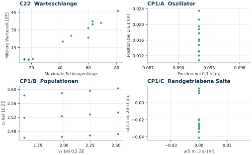
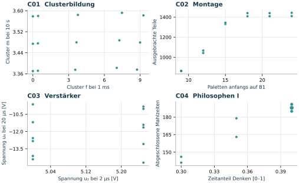
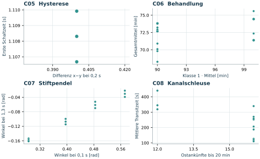
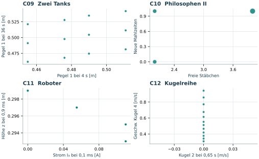
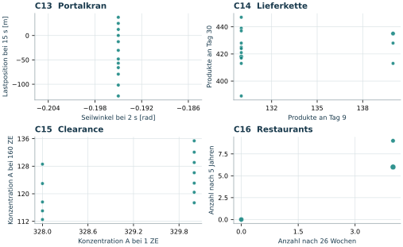
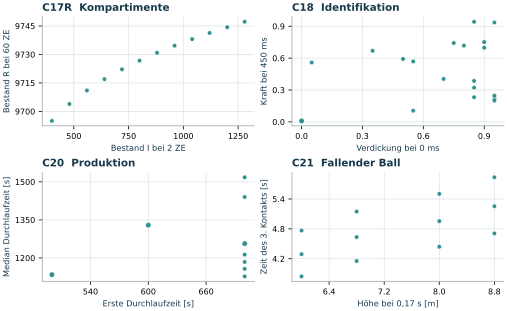
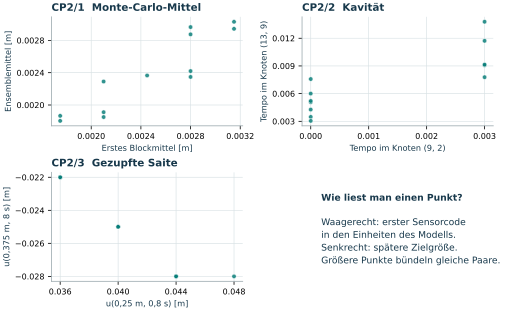
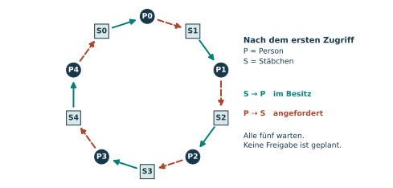
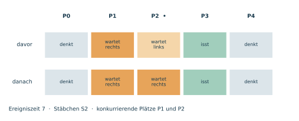

# Anhang A · ARGESIM-Referenzkatalog

Anhang A beginnt mit den vierzehn Referenzblättern zu den im Studiengang ausgewählten Familien. Zehn weitere Blätter schließen die übrigen Einträge des Projektkatalogs ein. Offizielle Aufgabe, lokal implementierter Teil und beobachtete Zielerfüllung sind je Modell benannt.

**Welchen Rechner braucht der Versuch?** Die Standardprüfungen starten ab Paketwurzel mit `python3 pruefen.py`. Sie laufen mit der Python-Standardbibliothek. Für den Vergleich der Populationsbahnen mit DOP853 verwendet `rechenlabor/cp_dynamik/populationen.py` NumPy und `scipy.integrate`. Die Feldprojektion verwendet SciPys dünn besetzte Matrizen. Die IDAS-Wiederholung benötigt CasADi mit dem IDAS-Plugin, die Feingitterrechnung einen C++20-Compiler. Wer die archivierten Messungen nachliest, kann die CSV- und JSON-Dateien unmittelbar öffnen. Die Abhängigkeiten für eine neue Rechnung stehen beim jeweiligen Versuch.

### Welcher Nachweis zur Aufgabe passt

Bei einer numerischen Zielgröße bilden wir für jedes festgelegte Budget $b_j>0$ den Quotienten $|Q_j-Q_j^*|/b_j$. Das Maximum $S$ darf höchstens eins sein. Ein fehlender Messwert oder eine falsche Ereigniskennung verhindert den Vergleich. Eine Besitz- oder Bestandsregel wird unmittelbar als erfüllt oder verletzt geprüft. Für zufällige Größen gehören Anzahl unabhängiger Replikationen, geschätzte Streuung und eine erklärte statistische Vergleichsregel zum Ergebnis. Wo veröffentlichte Rohdaten oder ein Budget fehlen, bleibt ein entsprechender numerischer Score offen.

[Projektkatalog und Aufgabenregister](https://github.com/5H3LL3H5/argesim-hyperposition-benchmarks/blob/16f0f2528fcf77f16898ecd74ad952be2c09eac2/ARGESIM_COVERAGE.md) · [ARGESIM-Übersicht](https://www.argesim.org/benchmarks).

<!-- Buchseite -->

## A.1 · CP1 · Parallele Simulationstechniken

### 1 · Phänomen und Leitfrage

Ein Team verteilt tausend Feder-Masse-Versuche auf mehrere Kerne. Kommt dieselbe Lösung heraus und welche Arbeit bleibt seriell?

### 2 · Modellbildung

A variiert die Dämpfung eines Federwagens. B koppelt fünf Räuber-Beute-Paare. Kapitel 9 verfolgt [alle zehn Populationsverläufe](../lehrbuch_numerische_simulation.md#cp1b-bahn). C diskretisiert die angeregte Saite in Ortsrichtung.

### 3 · Numerischer Härtefall

Bei A sind Läufe unabhängig. Bei C benötigen benachbarte Teilgebiete Randwerte. Eine andere Summationsreihenfolge kann kleine Gleitkommaabweichungen erzeugen.

### 4 · Methodenvergleich

Vergleichen Sie serielles RK4 und die zerlegte Rechnung bei gleicher Schrittweite. Der Speed-up ist die serielle Zeit geteilt durch die parallele Zeit.

### 5 · Aufgaben und Validierung

A, B, C und die Projektprüfung B-validate sind registriert. Die zehn Endwerte von B werden bei t=100 mit der Definition verglichen. Eine Laufzeitaussage braucht eine eigene Messung.

### 6 · Diagnoseprotokoll

Reihenfolge der Parameter, Zahl der Prozesse, Kommunikationszeit und Komponentenfehler speichern. Ein schnellerer Lauf mit fehlenden Fällen ist unvollständig.

**Gegenprobe zum Versuch.** Die zehn Endwerte von B gehören zu einem gemeinsamen Zeitstand. Prüfen Sie jede Population in derselben Reihenfolge und erst danach den Speed-up $T_1/T_p$ mit $p$ Prozessen. Erfasst der Timer bei der parallelen Rechnung auch den Aufbau und Datenaustausch? Für eine Verhältniszahl brauchen beide Zeiten dieselben Messgrenzen.

[ARGESIM, Definition und Referenzen](https://www.argesim.org/benchmarks/cp) · [Aufgaben und Prüfstand im Projekt](https://github.com/5H3LL3H5/argesim-hyperposition-benchmarks/blob/16f0f2528fcf77f16898ecd74ad952be2c09eac2/ARGESIM_COVERAGE.md). [Messbild](#atlas-mess-cp1).

<!-- Buchseite -->

## Bildversuch · Warteschlange und drei parallele Modellaufträge

Bei C22 wird aus der maximalen Schlange eine mittlere Wartezeit geschätzt. Bei CP1/A bis C geht es um Auslenkung, Population oder die Antwort auf einen Randantrieb. Die gemeinsame Achsenlogik verbindet diese unterschiedlichen Größen. Die Zeit- und Ortsangaben in den vier Feldern zeigen, was jeweils tatsächlich gemessen wurde.

Je Punkt sehen wir **einen** Eingabekanal und **einen** Zielwert. Für CP1/B steht horizontal $v_1(0{,}5)$ und vertikal $z_2(10)$ in Modellzeiteinheiten. Die [vollständige Bahn](../lehrbuch_numerische_simulation.md#revision-k09-01) benötigt zwei Anfangswerte und liefert 4 010 Komponentenwerte. CP1/C koppelt hier den Saitensensor bei $(5\,\mathrm m,3\,\mathrm s)$ an eine zweite Ablesung bei $(7{,}5\,\mathrm m,20\,\mathrm s)$. Für das Raumzeitfeld und die fünf Sensorverläufe gilt der eigene Auftrag in [D.8](../lehrbuch_numerische_simulation.md#sensor-frequenz).

Lesen Sie das Diagramm von links nach rechts. Auf der waagerechten Achse steht der erste auf seine Geräteauflösung gerundete Messwert, auf der senkrechten Achse die erste Zielgröße der Referenz. Die Punktfläche wächst mit der Zahl gleicher Paare. Weder eine Verbindung der Punkte in der Zeit noch ein Mittelwert über mehrere Einheiten ist vorausgesetzt. Die weiteren Sensoren und Ereignislabels gehen in die [Auswahlregel](../lehrbuch_numerische_simulation.md#atlas-kosten) ein.

<!-- Buchseite -->

## A.2 · C01 · Lithiumcluster unter Elektronenbeschuss

### 1 · Phänomen und Leitfrage

Nach Änderung der Anregung reagieren gekoppelte Clustergrößen unterschiedlich schnell. Welcher Integrator erhält die frühe Übergangsschicht?

### 2 · Modellbildung

Das Benchmarkmodell verwendet drei gekoppelte Zustände und einen Verlustparameter. Startzustand der Abschaltstudie ist (84,99 / 1,674 / 9,975) in der Skalierung der Definition.

### 3 · Numerischer Härtefall

Bei hoher Verlustrate kann eine kurze Übergangsschicht trotz langsamer Endphase die Schrittweite beschränken.

### 4 · Methodenvergleich

Nehmen Sie die analytischen Gleichgewichtsbedingungen und die unabhängig transkribierte Radau-Rechnung als zwei getrennte Kontrollen. Ein RK45-Selbstvergleich prüft zusätzlich das Timingexperiment.

### 5 · Aufgaben und Validierung

A untersucht die Trajektorie und Laufzeit, B fünf Verlustparameter, C zwei stationäre Zustände. Die fünf Referenzverläufe und stationären Dymola-Werte stehen im Projektbericht.

### 6 · Diagnoseprotokoll

Protokollieren Sie alle drei Komponenten, Anregung, Verlustparameter und Beobachtungszeit. Ein Fehler im stationären Zustand kann durch Überprüfen jeder einzelnen Bilanz eingegrenzt werden.

**Gegenprobe zum Versuch.** Setzen Sie einen als stationär gemeldeten Dreiervektor nochmals in jede Bilanz ein. Ein kleiner Defekt prüft die Stationarität, ein Vergleich mit den beiden veröffentlichten Zuständen die Wahl des Gleichgewichts. Für fünf Abschalttrajektorien werden zusätzlich dieselbe Verlustkonstante, Abschaltzeit und Komponentenskalierung benötigt.

[ARGESIM, Definition und Referenzen](https://www.argesim.org/benchmarks/c01) · [Aufgaben und Prüfstand im Projekt](https://github.com/5H3LL3H5/argesim-hyperposition-benchmarks/blob/16f0f2528fcf77f16898ecd74ad952be2c09eac2/ARGESIM_COVERAGE.md). [Messbild](#atlas-mess-c01).

<!-- Buchseite -->

## Bildversuch · Vom ersten Messwert zum späteren Ergebnis

In C01 ist der erste Sensor eine andere Clustergröße als das Ziel. In C02 werden Anfangsplätze und ausgelieferte Teile verglichen. In C03 liegen sogar zwei verschiedene Kondensatorspannungen vor. Bei C04 ist die erste Messung ein Anteil der Denkzeit aus dem Laufprotokoll. Sie steht erst nach der zugehörigen Beobachtungsperiode zur Verfügung.

C01 liest einen Clusterwert bei 1 ms und prüft einen Clusterwert bei 10 s. C02 zählt ausgebrachte Teile, C03 prüft eine spätere Spannung und C04 abgeschlossene Mahlzeiten. Jeder Punkt hat ein skalares Ziel.

Lesen Sie das Diagramm von links nach rechts. Auf der waagerechten Achse steht der erste auf seine Geräteauflösung gerundete Messwert, auf der senkrechten Achse die erste Zielgröße der Referenz. Die Punktfläche wächst mit der Zahl gleicher Paare. Weder eine Verbindung der Punkte in der Zeit noch ein Mittelwert über mehrere Einheiten ist vorausgesetzt. Die weiteren Sensoren und Ereignislabels gehen in die [Auswahlregel](../lehrbuch_numerische_simulation.md#atlas-kosten) ein.

<!-- Buchseite -->

## A.3 · C03 · Geschalteter Klasse-E-Verstärker

### 1 · Phänomen und Leitfrage

Ein elektronischer Schalter ändert die Verbindung eines schwingenden Netzwerks. Stimmen Phase und Amplitude nach einer halben Periode?

### 2 · Modellbildung

Vier Zustände beschreiben die Strom- und Spannungsspeicher. Im ideal geschalteten Fall ist das System in jeder Phase affin. Endliche Schaltflanken stellen eine eigene Variante dar.

### 3 · Numerischer Härtefall

Mikrosekunden und Sekunden zu verwechseln verändert das ganze Experiment. Ein Schritt über eine Schaltgrenze mischt zwei verschiedene Gleichungen.

### 4 · Methodenvergleich

Die separate Matrixexponentialrechnung propagiert den idealen Schaltzustand. Klassische Integratoren und Quantisierer vergleichen ihre vier Komponenten mit dieser Referenz.

### 5 · Aufgaben und Validierung

Die 456er-Studie beobachtet vier Zustände nach 5 und 10 Mikrosekunden, mit Budget 0,001 mal Komponentenskala. Fünf von 57 Einstellungen bestehen.

### 6 · Diagnoseprotokoll

Prüfen Sie Schalterlogik und Halbperioden vor dem Solververgleich. Eine endliche Rampe braucht eine Referenz mit derselben Rampe.

**Gegenprobe zum Versuch.** A prüft Eigenwerte für beide Schalterstellungen. B verfolgt den Idealschalter über 20 Halbperioden. C übernimmt den Endzustand von B als Start für endliche Flanken. Ein Start mit vier Nullen in C erzeugt eine andere Referenz. Im kurzen Zwei-Halbperioden-Raster erhält QSS2 bei Faktor $10^{-3}$ den Score $7{,}738$, RK45 rund $1{,}06\cdot10^{-6}$.

[ARGESIM, Definition und Referenzen](https://www.argesim.org/benchmarks/c03) · [Aufgaben und Prüfstand im Projekt](https://github.com/5H3LL3H5/argesim-hyperposition-benchmarks/blob/16f0f2528fcf77f16898ecd74ad952be2c09eac2/ARGESIM_COVERAGE.md). [Messbild](#atlas-mess-c01).

<!-- Buchseite -->

## A.4 · C05 · Steifes Zweizustandsmodell mit Hysterese

[Phasenbahn und Schaltschwellen im Benchmarkkapitel](../lehrbuch_numerische_simulation.md#bild-c05)

### 1 · Phänomen und Leitfrage

Ein schneller Zustand folgt einem langsamen. Wann überschreitet der gekoppelte Zustand die nächste Schwelle?

### 2 · Modellbildung

Zwei lineare Gleichungen pro Modus und zwei gerichtete Rückschaltschwellen definieren die Bahn. Die Anfangswerte sind 4,2 und 0,3.

### 3 · Numerischer Härtefall

Die schnelle Zeitkonstante beträgt etwa 0,370 Mikrosekunden. Nach dem Umschalten kann die neue schnelle Komponente die alte Historie entwerten.

### 4 · Methodenvergleich

Vergleichen Sie den exakten Phasenfluss und die eingeklammerte Schaltzeit mit Radau, BDF und den Quantisierern. Kapitel 11 zeigt die verschiedenen Versuchsraster.

### 5 · Aufgaben und Validierung

Die Standardreferenz hat fünf Schaltungen im vollen Versuch, Aufgabe D hat 62. Das kurze 3,5-s-Fenster enthält drei. Im ursprünglichen Raster bestehen null von 57 Einstellungen.

### 6 · Diagnoseprotokoll

Speichern Sie Schwelle, Richtung, beide Moduskennungen und Zustand unmittelbar am Übergang. Zu jedem Endfehler gehört die vorher überprüfte Ereignisfolge.

**Gegenprobe zum Versuch.** Die Standardfolge, die Genauigkeitsvariation und D mit häufigen Ereignissen prüfen verschiedene Eigenschaften. Ein Kontrolllauf mit vertauschter Schaltreihenfolge scheitert vor dem Zahlenvergleich. Bei richtiger Reihenfolge lautet der Projektwert $\max(\max_k|\delta t_k|/0{,}001,\max_i|\delta y_i|/0{,}006)$, Zeiten in Sekunden, im 3,5-s-Fenster.

[ARGESIM, Definition und Referenzen](https://www.argesim.org/benchmarks/c05) · [Aufgaben und Prüfstand im Projekt](https://github.com/5H3LL3H5/argesim-hyperposition-benchmarks/blob/16f0f2528fcf77f16898ecd74ad952be2c09eac2/ARGESIM_COVERAGE.md). [Messbild](#atlas-mess-c05).

<!-- Buchseite -->

## Bildversuch · Schaltzeit, Aufenthaltszeit, Winkel und Transit

Beim Pendel sind Eingang und Ziel Winkel desselben Systems zu verschiedenen Zeiten. Für die Schleuse ist der Zusammenhang weniger direkt: Eine frühe Ankunftszahl liefert keine vollständige Information über die spätere Transitzeit. In C05 ist das Zeitbudget so weit, dass das Referenzintervall bereits ohne Ablesung hineinpasst.

Im C05-Teilbild bildet eine Zustandsdifferenz bei 0,2 s die waagerechte Koordinate. Senkrecht steht die erste Schaltzeit. Das Kapitel-11-Labor verlangt mehrere Ereignisse und den Endzustand.

Lesen Sie das Diagramm von links nach rechts. Auf der waagerechten Achse steht der erste auf seine Geräteauflösung gerundete Messwert, auf der senkrechten Achse die erste Zielgröße der Referenz. Die Punktfläche wächst mit der Zahl gleicher Paare. Weder eine Verbindung der Punkte in der Zeit noch ein Mittelwert über mehrere Einheiten ist vorausgesetzt. Die weiteren Sensoren und Ereignislabels gehen in die [Auswahlregel](../lehrbuch_numerische_simulation.md#atlas-kosten) ein.

<!-- Buchseite -->

## A.5 · C07 · Stiftpendel

### 1 · Phänomen und Leitfrage

Ein Faden wickelt sich an einem Stift um. Warum kann die Winkelgeschwindigkeit springen, während die Bahngeschwindigkeit stetig bleibt?

### 2 · Modellbildung

Für jeden Drehpunkt gilt eine Winkel-ODE. Die kartesische Form ergänzt die Fadenlänge als Zwang und die Zugkraft als Multiplikator.

### 3 · Numerischer Härtefall

Ein falscher Längenfaktor am Reset verändert kinetische Energie. Kleine Phasenfehler verlagern spätere Stiftkontakte.

### 4 · Methodenvergleich

Hohe Genauigkeit der Winkelintegration, eine unabhängige DOP853-Rechnung sowie die kartesische Bindungsprüfung und RATTLE liefern unterschiedliche Kontrollen.

### 5 · Aufgaben und Validierung

Der Matrixfall A(i) bis 2 s verwendet 1 ms Zeitbudget und Komponentenbudgets für Winkel und Winkelgeschwindigkeit. 28 von 57 Einstellungen bestehen.

### 6 · Diagnoseprotokoll

Nach jedem Kontakt Drehpunkt, Radius, Tangentialgeschwindigkeit und Bindungsfehler prüfen. Die Übung in Kapitel 13 unterscheidet Modellvereinfachung und Integrationsfehler.

**Gegenprobe zum Versuch.** A vergleicht zwei vorgegebene Startfälle, B die lineare und die nichtlineare Pendelgleichung, C sucht eine Anfangswinkelgeschwindigkeit für die maximale Auslenkung $-\pi/2$ am kurzen Faden. Ein passender Endwinkel nach zwei Sekunden löst dieses inverse Problem noch nicht. Prüfen Sie in C zusätzlich die Umkehrbedingung $\omega=0$.

[ARGESIM, Definition und Referenzen](https://www.argesim.org/benchmarks/c07) · [Aufgaben und Prüfstand im Projekt](https://github.com/5H3LL3H5/argesim-hyperposition-benchmarks/blob/16f0f2528fcf77f16898ecd74ad952be2c09eac2/ARGESIM_COVERAGE.md). [Messbild](#atlas-mess-c05).

<!-- Buchseite -->

## A.6 · C09 · Fuzzy-Regelung zweier Tanks

[Pegel und gehaltene Pumpenspannung im Benchmarkkapitel](../lehrbuch_numerische_simulation.md#bild-c09)

### 1 · Phänomen und Leitfrage

Der Regler stellt ein Ventil zu festen Takten. Was sieht er, wenn sich zwischen zwei Abtastungen der Pegel ändert?

### 2 · Modellbildung

Massenbilanzen mit höhenabhängigen Flüssen koppeln zwei Speicher. Die Fuzzy-Regel liefert aus den gemessenen Signalen den gehaltenen Stellwert.

### 3 · Numerischer Härtefall

Abtastverzögerung, Vorzeichen des Fehlers und die Einheit cm statt m verändern die Regeloberfläche. Ein scheinbar kleiner Signaturfehler kann einen Langzeitversuch verschieben.

### 4 · Methodenvergleich

Bei gleicher Reglerfunktion trennt ein DOP853-Vergleich den Integrationsfehler ab. Eine publizierte Simulink-Kurve prüft zusätzlich die Modell- und Reglerübertragung.

### 5 · Aufgaben und Validierung

Die Projektbefehle run und validate decken Reglervarianten und Figurenprüfungen ab. Im kurzen 16-Takt-Fenster bestehen 46 von 57 Einstellungen. Eines von drei Langzeit-Figurenfenstern trifft das vereinbarte Band.

### 6 · Diagnoseprotokoll

Pegel und Stellwert an beiden Seiten jedes Takts sichern. Bei Abweichung zuerst den ersten unterschiedlichen Ventilwert finden.

**Gegenprobe zum Versuch.** Ein Kontrollversuch löst beide Tankbilanzen mit genau demselben abgetasteten Regler. Eine zweite Kontrolle liest das zweite Niveau in veröffentlichten Kurven für P-FC und I-FC2 ab. Bei jeweils einem Zentimeter Ablesebudget ergeben die drei veröffentlichten Differenzen aus Kapitel 14 Beiträge von etwa $2{,}986$, $0{,}137$ und $11{,}669$.

[ARGESIM, Definition und Referenzen](https://www.argesim.org/benchmarks/c09) · [Aufgaben und Prüfstand im Projekt](https://github.com/5H3LL3H5/argesim-hyperposition-benchmarks/blob/16f0f2528fcf77f16898ecd74ad952be2c09eac2/ARGESIM_COVERAGE.md). [Messbild](#atlas-mess-c09).

<!-- Buchseite -->

## Bildversuch · Gleicher Messkanal, verschiedene Zielgrößen

Ein Pegel heute kann einen späteren Pegel eingrenzen. Eine freie Ressource am Tisch sagt dagegen für sich allein wenig über gleichzeitig beginnende Mahlzeiten. In C11 stehen Strom und mechanische Position auf den beiden Achsen. Beim Stoßzug misst man unterschiedliche Kugeln. Für C09 ist hier nur der erste von zwei geforderten Pegeln gezeichnet.

Bei C09 stehen einzelne Pegel an zwei Zeiten auf den Achsen. Bei C12 verknüpfen die Achsen die Geschwindigkeit der zweiten Kugel bei 0,65 s mit der späteren Geschwindigkeit der vierten. Zur Kontaktfolge gehören zusätzliche Ereigniszeiten.

Lesen Sie das Diagramm von links nach rechts. Auf der waagerechten Achse steht der erste auf seine Geräteauflösung gerundete Messwert, auf der senkrechten Achse die erste Zielgröße der Referenz. Die Punktfläche wächst mit der Zahl gleicher Paare. Weder eine Verbindung der Punkte in der Zeit noch ein Mittelwert über mehrere Einheiten ist vorausgesetzt. Die weiteren Sensoren und Ereignislabels gehen in die [Auswahlregel](../lehrbuch_numerische_simulation.md#atlas-kosten) ein.

<!-- Buchseite -->

## A.7 · C11 · SCARA-Roboter mit strombegrenzten Antrieben

### 1 · Phänomen und Leitfrage

Ein Roboterarm beschleunigt. Wann verändert die Strombegrenzung die tatsächliche Bewegung?

### 2 · Modellbildung

Mechanik und elektrische Zustände gehören in denselben Zustand. Der Regler fordert ein Antriebssignal an, die Stromgrenze beschränkt die erlaubte Realisierung.

### 3 · Numerischer Härtefall

Ein zulässiger Strom am ausgegebenen Zeitpunkt belegt noch keine korrekte begrenzte Bewegung im ganzen Intervall.

### 4 · Methodenvergleich

Der kurze Neun-Zustände-Vergleich verwendet SciPy Radau mit identischer rechter Seite. Er isoliert den Integrationsfehler vor der Strombegrenzung.

### 5 · Aufgaben und Validierung

A, B, C und main sind registriert. In der 0,1-ms-Matrixprüfung bestehen 52 von 57 Einstellungen. Eine unabhängige Vergleichstrajektorie für den ganzen begrenzten Betrieb bleibt offen.

### 6 · Diagnoseprotokoll

Kommandierte und wirksame Antriebssignale, Stromgrenzen, Gelenkzustände und Zeitpunkt der Begrenzung protokollieren.

**Gegenprobe zum Versuch.** A dokumentiert die Modellform und die Trägheitsterme, B die geregelte Punkt-zu-Punkt-Bewegung, C die Kollisionsvermeidung. Die neun Endgrößen bei $0{,}1$ ms liegen vor der Strombegrenzung. Im kurzen Raster erreicht QSS2 bei Faktor $10^{-3}$ einen Score von $0{,}08517$. Ob der Arm später das Hindernis freihält, verlangt die eigene Bahnprüfung von C.

[ARGESIM, Definition und Referenzen](https://www.argesim.org/benchmarks/c11) · [Aufgaben und Prüfstand im Projekt](https://github.com/5H3LL3H5/argesim-hyperposition-benchmarks/blob/16f0f2528fcf77f16898ecd74ad952be2c09eac2/ARGESIM_COVERAGE.md). [Messbild](#atlas-mess-c09).

<!-- Buchseite -->

## A.8 · C12 · Stoßprozesse in einer Kugelreihe

[Mittelpunkte und Geschwindigkeiten im Benchmarkkapitel](../lehrbuch_numerische_simulation.md#bild-c12)

### 1 · Phänomen und Leitfrage

Ein Impuls wandert von links nach rechts. Wie erkennt man, ob er durch die richtige Folge von Kontakten übertragen wurde?

### 2 · Modellbildung

Freier Flug beschreibt die glatten Abschnitte. Beim zentralen Stoß verbinden Impulsbilanz und Stoßzahl die Geschwindigkeiten vor und nach dem Ereignis.

### 3 · Numerischer Härtefall

Zeitgleiche Mehrfachkontakte können eine eigene Kontaktauflösung erfordern. Die einfache Zweikugelregel setzt einen isolierten Stoß voraus.

### 4 · Methodenvergleich

Ein elastischer Test mit vier gleichen Massen besitzt eine analytische Folge. QSS2 und RK45 lassen sich dort nach RHS-Zahl bei gleichem Zeitbudget vergleichen.

### 5 · Aufgaben und Validierung

A, B und C enthalten auch die Bestimmung einer Stoßzahl und eine Verteilungsaufgabe. Im reduzierten Matrixfall bestehen 53 von 57 Einstellungen.

### 6 · Diagnoseprotokoll

Zeit, beteiligte Kugeln, Abstand, Impuls und Energie vor und nach jedem Kontakt festhalten. Ein verfrühter zweiter Reset verändert die Reihenfolge.

**Gegenprobe zum Versuch.** A liefert Weg-Zeit-Kurven und Endgeschwindigkeiten. B variiert die Stoßzahl und zählt Kollisionen. C sucht eine Stoßzahl aus einer Zielbedingung und untersucht die zufällige Streuung der Endgeschwindigkeit. Nur für den isolierten elastischen Matrixfall sind die sieben Zielgrößen unmittelbar $1,2,3$ Sekunden und $0,0,0,1$ Meter pro Sekunde.

[ARGESIM, Definition und Referenzen](https://www.argesim.org/benchmarks/c12) · [Aufgaben und Prüfstand im Projekt](https://github.com/5H3LL3H5/argesim-hyperposition-benchmarks/blob/16f0f2528fcf77f16898ecd74ad952be2c09eac2/ARGESIM_COVERAGE.md). [Messbild](#atlas-mess-c09).

<!-- Buchseite -->

## A.9 · C13 · Portalkran mit eingebetteter Regelung

### 1 · Phänomen und Leitfrage

Ein Lastpuls setzt den Kran in Bewegung. Welche Zustände tragen seine Wirkung noch nach Pulsende?

### 2 · Modellbildung

Eine lineare Phase lässt sich als affine Zustandsdynamik schreiben. Durch Ergänzen einer konstanten Eins lässt sich ihr Übergang mit einer Matrixexponentialfunktion berechnen.

### 3 · Numerischer Härtefall

Eine falsche Pulsgrenze beeinflusst alle nachfolgenden Zustände. Die Bremslogik der weiteren Aufgaben führt zusätzliche Modi ein.

### 4 · Methodenvergleich

Die unabhängige affine Phasenrechnung kontrolliert klassische und quantisierte Integratoren für die lineare Aufgabe A. B und C stellen eigene Anforderungen.

### 5 · Aufgaben und Validierung

Im Raster für den Lastpuls -800 N werden fünf Zustände bei 4, 7 und 15 s beobachtet, zwei Einstellungen bestehen. Die veröffentlichte lineare Referenz umfasst drei Lasten.

### 6 · Diagnoseprotokoll

Pulsrichtung, Kraft in Newton, Zustandsreihenfolge und beide Grenzzeiten prüfen. Ein passender Positionsendwert genügt für die Winkelgeschwindigkeit nicht.

**Gegenprobe zum Versuch.** A prüft die offene lineare Fahrt mit Lastpuls. B betrachtet die geregelte Fahrt mit Haltebremse. C ergänzt die Diagnose und die verriegelnde Notbremsung. Ein Fehler im letzten Pulszustand wird beim Start der nächsten Phase übernommen. Prüfen Sie in A deshalb alle fünf Zustände an beiden Pulsgrenzen, in C zusätzlich Auslösezeit und Verriegelung.

[ARGESIM, Definition und Referenzen](https://www.argesim.org/benchmarks/c13) · [Aufgaben und Prüfstand im Projekt](https://github.com/5H3LL3H5/argesim-hyperposition-benchmarks/blob/16f0f2528fcf77f16898ecd74ad952be2c09eac2/ARGESIM_COVERAGE.md). [Messbild](#atlas-mess-c13).

<!-- Buchseite -->

## Bildversuch · Bewegung und Bestände aus einem frühen Kanal

Beim Portalkran zielt die Messung auf eine Position, obwohl der frühe Sensor einen Winkel meldet. C14, C15 und C16 zeigen dieselbe Menge zu zwei Zeitpunkten. Selbst dann kann die Zwischenentwicklung von Lieferereignissen, Parametern oder Entscheidungen abhängen. Mehrere Zielwerte über demselben Messcode sind im Diagramm unmittelbar erkennbar.

Bei C13 ist der Eingang ein Winkel in Radiant, das Ziel die Lastposition in Metern. Die Messzeitpunkte sind 2 und 15 s. Eine Kurve der Winkel allein liefert keine Ortskurve.

Lesen Sie das Diagramm von links nach rechts. Auf der waagerechten Achse steht der erste auf seine Geräteauflösung gerundete Messwert, auf der senkrechten Achse die erste Zielgröße der Referenz. Die Punktfläche wächst mit der Zahl gleicher Paare. Weder eine Verbindung der Punkte in der Zeit noch ein Mittelwert über mehrere Einheiten ist vorausgesetzt. Die weiteren Sensoren und Ereignislabels gehen in die [Auswahlregel](../lehrbuch_numerische_simulation.md#atlas-kosten) ein.

<!-- Buchseite -->

## A.10 · C15 · Clearance-Identifikation

### 1 · Phänomen und Leitfrage

Zwei Konzentrationskurven können ähnlich aussehen, obwohl ihre geschätzten Parameter voneinander abweichen. Welche Messungen trennen die Parameter?

### 2 · Modellbildung

Ein Zweikompartimentmodell erhält einen zeitlich begrenzten Eingang. Austausch und Abfluss bestimmen die Konzentrationskurve und die Sensitivität der Anpassung.

### 3 · Numerischer Härtefall

Ein kleiner Ausgabefehler führt bei schlecht konditionierter Anpassung zu großen Parameteränderungen. Einheit und Dauer des Eingangs müssen zur analytischen Lösung passen.

### 4 · Methodenvergleich

Die stückweise analytische Modelllösung kontrolliert die Integration. Die Parameterschätzung minimiert darüber hinaus Residuen der Messkurve. Eine Monte-Carlo-Auswertung untersucht die Streuung.

### 5 · Aufgaben und Validierung

A verwendet dieselbe Eingangsmenge bei drei Dauern, B passt Parameter an die Messwerte an, C wiederholt die Schätzung an künstlichen Datensätzen. Die Matrix der 456 Einstellungen enthält C15 nicht.

### 6 · Diagnoseprotokoll

Speichern Sie Eingangsmenge, Dauern, Messzeitpunkte, Anpassungsresiduen und Zufallsstartwert. Wiederholte Modellläufe ohne neue Messfehler prüfen eine andere Größe.

**Gegenprobe zum Versuch.** In A ist die Eingangsmenge $D=2500$ für die drei Dauern $0{,}5,\ 3,\ 240$ gleich. Das Rechtecksignal hat Höhe $D/\tau$ und Fläche $D$. Wer die Höhe konstant lässt, ändert die Menge. Verfolgen Sie bei B das Residuum an den Messzeiten und bei C die Verteilung der Parameterschätzungen über die 1000 künstlichen Datensätze.

[ARGESIM, Definition und Referenzen](https://www.argesim.org/benchmarks/c15) · [Aufgaben und Prüfstand im Projekt](https://github.com/5H3LL3H5/argesim-hyperposition-benchmarks/blob/16f0f2528fcf77f16898ecd74ad952be2c09eac2/ARGESIM_COVERAGE.md). [Messbild](#atlas-mess-c13).

<!-- Buchseite -->

## A.11 · C17R · SIR-Dynamik mit ODE und zellulärem Automaten

### 1 · Phänomen und Leitfrage

Ein räumliches und ein homogen gemischtes Modell können eine ähnlich hohe Kurvenspitze zeigen. Wie unterscheiden sich ihre zeitlichen Verläufe?

### 2 · Modellbildung

Die ODE bilanziert drei Bevölkerungsgruppen. Der räumliche Automat beschreibt lokale Zustände und Nachbarschaftswechsel. Beide liefern aggregierte Zeitreihen.

### 3 · Numerischer Härtefall

Eine einzelne Realisierung des Automaten streut. Gleiche Gesamtzahlen verdecken unterschiedliche räumliche Muster.

### 4 · Methodenvergleich

Die deterministische Standardtrajektorie und die Streuung mehrerer reproduzierbarer Automatenläufe werden gegen die jeweils passenden Referenzen verglichen.

### 5 · Aufgaben und Validierung

Die Einträge task1, compare, ca und ode bilden die Projektzugänge. Die ODE-Referenz gilt für den Standardfall. Für den räumlichen Vergleich liegt ein veröffentlichter Einzelwert vor.

### 6 · Diagnoseprotokoll

Prüfen Sie die Bilanz der Gesamtpopulation, die Anfangsbelegung, den Zufallsstartwert und die Zahl der Wiederholungen. Geben Sie bei stochastischen Resultaten die Streuung an.

**Gegenprobe zum Versuch.** Für das betrachtete geschlossene, ohne Demografie formulierte Gruppenmodell muss sich die Summe der drei Zustände erhalten. Ein einzelner räumlicher Zufallslauf hat einen anderen Streubereich als eine deterministische ODE. Vergleichen Sie Wiederholungen nur bei derselben statistischen Zielgröße und geben Sie die Zahl der unabhängigen Läufe an.

[ARGESIM, Definition und Referenzen](https://www.argesim.org/benchmarks/c17r) · [Aufgaben und Prüfstand im Projekt](https://github.com/5H3LL3H5/argesim-hyperposition-benchmarks/blob/16f0f2528fcf77f16898ecd74ad952be2c09eac2/ARGESIM_COVERAGE.md). [Messbild](#atlas-mess-c17).

<!-- Buchseite -->

## Bildversuch · Modellbestand, Kraft, Durchlaufzeit und Kontakt

Bei C18 stehen Verdickung und Kraft in der Datenskala der rekonstruierten Kurven. In C20 ist die Laufzeit des ersten Auftrags ein anderer statistischer Gegenstand als der Median aller fertiggestellten Aufträge. In C21 dient eine frühe Höhe als Hinweis auf den dritten Kontakt. Sein Zeitpunkt wird am Ereignis der Referenzbahn bestimmt.

Das C18-Teilbild zeigt eine einzelne Verdickungsablesung und eine Kraft bei 450 ms. Die kausale Schätzung in Anhang C verwendet jeweils eine Vorgeschichte von 64 Werten.

Lesen Sie das Diagramm von links nach rechts. Auf der waagerechten Achse steht der erste auf seine Geräteauflösung gerundete Messwert, auf der senkrechten Achse die erste Zielgröße der Referenz. Die Punktfläche wächst mit der Zahl gleicher Paare. Weder eine Verbindung der Punkte in der Zeit noch ein Mittelwert über mehrere Einheiten ist vorausgesetzt. Die weiteren Sensoren und Ereignislabels gehen in die [Auswahlregel](../lehrbuch_numerische_simulation.md#atlas-kosten) ein.

<!-- Buchseite -->

## A.12 · C19R · Transport im Grundwasser

[Lage der Quelle und des Brunnens im Benchmarkkapitel](../lehrbuch_numerische_simulation.md#bild-c19r)

### 1 · Phänomen und Leitfrage

Wann erreicht eine Stofffahne einen festgelegten Brunnen? Eine farbige Karte kann einen Fehler genau an dieser Stelle verbergen.

### 2 · Modellbildung

Zweidimensionale Advektion und Dispersion verteilen den Stoff. Quellen und Behandlung ändern die Bilanz. Festgelegte Außenflächen bestimmen das Rechengebiet.

### 3 · Numerischer Härtefall

Beim Verfeinern verändern sich Quell- und Messgewichte. Eine physikalisch konstante Massenrate muss im diskreten Modell dieselbe Gesamtrate ergeben.

### 4 · Methodenvergleich

Die Kontrollrechnung vergleicht die Brunnenkonzentration mit einer unabhängigen Integralreferenz sowie mit Orts- und Zeitverfeinerung.

### 5 · Aufgaben und Validierung

A, B und C untersuchen Profile und Behandlungsvarianten. Kapitel 15 nennt die Geometrie und die drei Messwerte der Reihe mit festen Rändern. Der Fall liegt außerhalb der 456er-Matrix.

### 6 · Diagnoseprotokoll

Protokollieren Sie Masse pro Zeit, Positionen und Einheiten, Auswertezeit, kleinste Konzentration und Randflächen. Prüfen Sie, ob zwei Rechnungen tatsächlich dieselben Koordinaten beobachten.

**Gegenprobe zum Versuch.** A bestimmt räumliche Konzentrationsprofile, B untersucht die kontinuierliche, C die zeitlich geschaltete Behandlung. Für das feste Quellgitter mit $0{,}25$ m Zellweite beträgt der Brunnenbeitrag für das im Buch gewählte Ein-Prozent-Ziel rund $1{,}97$. Eine Aussage über die Behandlungsaufgaben benötigt deren eigene Schaltzeiten und Messorte.

[ARGESIM, Definition und Referenzen](https://www.argesim.org/benchmarks/c19) · [Aufgaben und Prüfstand im Projekt](https://github.com/5H3LL3H5/argesim-hyperposition-benchmarks/blob/16f0f2528fcf77f16898ecd74ad952be2c09eac2/ARGESIM_COVERAGE.md). [Messbild](../lehrbuch_numerische_simulation.md#atlas-quelle).

<!-- Buchseite -->

## A.13 · C21 · Zustandsereignisse und strukturvariable Systeme

[Algebraische Falte und Betriebsbahn im Benchmarkkapitel](../lehrbuch_numerische_simulation.md#bild-c21)

### 1 · Phänomen und Leitfrage

Ein Ball kehrt nach dem Rückprall zur Bodenfläche zurück. Eine Diodengleichung kann auf einem Ast gut und nahe einer Falte schlecht lösbar sein. Welche Ereignisse sehen wir zuverlässig?

### 2 · Modellbildung

Ballistik und Übergangsregel geben eine mechanische Referenz. Das elektrische Modell koppelt dynamische Speicher und eine algebraische Kennlinie. Die Definition enthält außerdem Pendel- und Kontaktvarianten.

### 3 · Numerischer Härtefall

Beim Ball kann der zweite gerichtete Durchgang übersehen werden. Bei der Diode kann eine ungeeignete Inversion unnötige numerische Schwierigkeiten erzeugen.

### 4 · Methodenvergleich

Die Ballzeiten sind analytisch kontrollierbar. Bei der Schaltung vergleichen wir zwei explizite Reduktionen mit unabhängiger IDAS-Residualform.

### 5 · Aufgaben und Validierung

Projektaufgaben sind event-contact, dynamic-contact, pendulum-basic, pendulum-kick und rlc-diode. Die 456er-Matrix enthält nur das Ballfenster. Dort bestehen 36 von 57 Einstellungen.

### 6 · Diagnoseprotokoll

Zeit, Modus, Richtung und Zustand beidseits des Kontakts sichern. Für die Schaltung kommen Astinformation, algebraisches Residuum und die 149 einzeln zugeordneten Wechsel hinzu.

**Gegenprobe zum Versuch.** Beim freifliegenden Ball erhält im Raster jeder der ersten zwei Stöße ein Budget von $1$ ms. Beim Diodenkreis haben Astzuordnung, Ereigniszeiten und algebraischer Defekt jeweils eine eigene Bedeutung. Die 149 im Protokoll übereinstimmenden Übergänge gehören zum 500-Mikrosekunden-Fenster der Schaltung.

[ARGESIM, Definition und Referenzen](https://www.argesim.org/benchmarks/c21) · [Aufgaben und Prüfstand im Projekt](https://github.com/5H3LL3H5/argesim-hyperposition-benchmarks/blob/16f0f2528fcf77f16898ecd74ad952be2c09eac2/ARGESIM_COVERAGE.md). [Messbild](#atlas-mess-c17).

<!-- Buchseite -->

## A.14 · CP2 · Parallele und verteilte Simulation

### 1 · Phänomen und Leitfrage

Ein schnelleres Programm hilft erst, wenn die richtige Strömung, Saite oder Stichprobe gerechnet wurde. Wie lassen sich Ergebnis und Rechenzeit unabhängig prüfen?

### 2 · Modellbildung

Fall 1 variiert Feder-Masse-Parameter, Fall 2 transportiert neun D2Q9-Populationen je Gitterpunkt, Fall 3 berechnet das Feld einer eingespannten Saite.

### 3 · Numerischer Härtefall

Grobe Gitter glätten Knicke, ein bewegter Deckel verändert die Impulsbilanz. Eine symmetrische Testform kann Richtungsfehler eines Feldoperators verdecken.

### 4 · Methodenvergleich

Vergleichen Sie serielle und parallele Algorithmen für dieselbe Aufgabe. Im erweiterten Feldlabor stehen LBM und seine Strömungssurrogate sowie Newmark, Verlet und FNO für die Saite einander gegenüber.

### 5 · Aufgaben und Validierung

Die drei offiziellen Fallnummern 1, 2 und 3 sind registriert. Trainings- und Testfelder, Lösungszeiten und Normen des Zusatzexperiments stehen in Kapitel 16. Ein FNO ist dort ein Projektvergleich.

### 6 · Diagnoseprotokoll

Für die Kavität beide Komponenten und die Mittellinien, für die Saite exaktes Referenzfeld, Fehlerprofil und Symmetrie prüfen. Bei einer Beschleunigung die Kosten der Referenz und des Trainings separat angeben.

**Gegenprobe zum Versuch.** 1 untersucht Monte Carlo, 2 die Kavität, 3 die Saite. Vergleichen Sie für eine Beschleunigungsangabe serielle und parallele Rechnung derselben Aufgabe. Für den Feldvergleich der Saite braucht es dieselben festen Enden und Auswertezeiten. Bei der Kavität gehören Wandvorschrift, Reynolds-Zahl und Komponenten in den Vergleich.

[ARGESIM, Definition und Referenzen](https://www.argesim.org/benchmarks/cp) · [Aufgaben und Prüfstand im Projekt](https://github.com/5H3LL3H5/argesim-hyperposition-benchmarks/blob/16f0f2528fcf77f16898ecd74ad952be2c09eac2/ARGESIM_COVERAGE.md). [Messbild](#atlas-mess-cp2).

<!-- Buchseite -->

## Bildversuch · Drei verschiedene Bedeutungen eines Sensors

Bei CP2/1 ist ein Datenpunkt der Mittelwert von vier Läufen eines Blocks. Bei CP2/2 sind die beiden Achsen Geschwindigkeitsbeträge in Gittereinheiten an verschiedenen Knoten. Bei CP2/3 wechseln sowohl Ort als auch Zeit. Wer beim Vergleich nur den Namen CP2 festhält, verliert diese Unterschiede des Messauftrags.

Im mittleren Teilbild steht links der Betrag der Geschwindigkeit an Knoten $(9,2)$, als Ziel der Betrag an $(13,9)$. Beide sind Skalare. Die [dynamische Kavität](../lehrbuch_numerische_simulation.md#revision-k16-02) liefert hingegen zwei gerichtete Komponenten je Ort für acht aufeinanderfolgende Felder. Bei CP2/3 vergleicht der Katalog zwei Saitensensoren. Der Feldversuch in Kapitel 16 prüft die Auslenkung an 501 Orten.

Lesen Sie das Diagramm von links nach rechts. Auf der waagerechten Achse steht der erste auf seine Geräteauflösung gerundete Messwert, auf der senkrechten Achse die erste Zielgröße der Referenz. Die Punktfläche wächst mit der Zahl gleicher Paare. Weder eine Verbindung der Punkte in der Zeit noch ein Mittelwert über mehrere Einheiten ist vorausgesetzt. Die weiteren Sensoren und Ereignislabels gehen in die [Auswahlregel](../lehrbuch_numerische_simulation.md#atlas-kosten) ein.

<!-- Buchseite -->

## A.15 · C02 · Flexible Montageanlage

### 1 · Phänomen und Leitfrage

Werkstücke warten vor belegten Förderern. Wie stark begrenzt die Zahl der Paletten den Durchsatz?

### 2 · Modellbildung

Ein diskretes Ereignismodell verbindet Arbeitsplätze, Paletten und endliche Fördersegmente.

### 3 · Numerischer Härtefall

Blockierung und eine geänderte Reihenfolge gleichzeitiger Freigaben können das gesamte Fließbild ändern.

### 4 · Methodenvergleich

Serien identischer Auftragslast mit der gewählten Transportregel vergleichen, dazu den veröffentlichten CSIM- und SimEvents-Fall ausweisen.

### 5 · Aufgaben und Validierung

main und study liefern Versuche zur Anlage. Elf CSIM-Lasten passen unter einer benannten Konvention. Drei Abweichungen zur Standard-SimEvents-Reihe sind dokumentiert.

### 6 · Diagnoseprotokoll

Belegung, Reservierungen, Palettenbestand und jede Übergabe prüfen.

**Gegenprobe zum Versuch.** Eine Palette kann sich im Transport, im Puffer oder in einer Station befinden. Ihre eindeutige Kennung darf zwischen zwei Journalzeiten weder verschwinden noch doppelt belegt sein. Für die drei abweichenden Lastfälle 13, 14 und 25 empfiehlt sich der erste unterschiedliche Übergabezeitpunkt als Ausgangspunkt.

[ARGESIM, Definition und Referenzen](https://www.argesim.org/benchmarks/c02) · [Aufgaben und Prüfstand im Projekt](https://github.com/5H3LL3H5/argesim-hyperposition-benchmarks/blob/16f0f2528fcf77f16898ecd74ad952be2c09eac2/ARGESIM_COVERAGE.md). [Messbild](#atlas-mess-c01).

<!-- Buchseite -->

## A.16 · C04 · Speisende Philosophen

### 1 · Phänomen und Leitfrage

Mehrere Prozesse warten auf dieselben Gabeln. Ob jeder lange genug erhält, hängt von der Konfliktregel ab.

### 2 · Modellbildung

Ein diskretes Modell verwaltet Ressourcenzustand, Anforderung und Freigabe.

### 3 · Numerischer Härtefall

Eine gleichzeitige Anforderung kann Verklemmung oder unfaire Bedienung auslösen.

### 4 · Methodenvergleich

Vergleichen Sie Ereignisspuren unter gleicher Ordnung und anschließend unterschiedliche zugelassene Strategien.

### 5 · Aufgaben und Validierung

run, compare und refinements prüfen Gabelerhaltung, Reinigung und Wiederholung. Eine Übereinstimmung publizierter Fairness-Verteilungen bleibt offen.

### 6 · Diagnoseprotokoll

Zu jedem Ereignis Eigentümer und freie Gabeln ausgeben.

**Gegenprobe zum Versuch.** Eine Gabel hat zu einer Ereigniszeit genau einen zulässigen Zustand. Der Bestand über alle Zustände ist konstant. Diese ganzzahlige Prüfung entdeckt Doppelvergabe. Ob einzelne Teilnehmer selten essen, erfordert daneben die Wartezeit je Teilnehmer und eine Verteilung über mehrere Läufe.

[ARGESIM, Definition und Referenzen](https://www.argesim.org/benchmarks/c04) · [Aufgaben und Prüfstand im Projekt](https://github.com/5H3LL3H5/argesim-hyperposition-benchmarks/blob/16f0f2528fcf77f16898ecd74ad952be2c09eac2/ARGESIM_COVERAGE.md). [Messbild](#atlas-mess-c01).

<!-- Buchseite -->

## Bildversuch · Den Wartekreis von C04 lesen

Beginnen Sie bei P0 und folgen Sie den Pfeilen. P0 verlangt S1. Dieses Stäbchen ist P1 zugeteilt. P1 fordert S2. Nach zehn Kanten kehrt der Weg zu seinem Ausgangspunkt zurück. Keine Person kann den Zustand Essen erreichen und dadurch später ein Stäbchen freigeben.

Der Graph stammt aus dem Endzustand des ungeschützten Laufs der [Zeitspur in Kapitel 5](../lehrbuch_numerische_simulation.md#atlas-essverlauf). Das Protokoll bestätigt beide Voraussetzungen für den Stillstand: Alle fünf Personen warten, und im Kalender steht kein Ereignis mehr, das die Belegung ändern kann. Genau hier hilft der Ressourcenblick. Ein Foto von fünf Wartenden könnte auch eine vorübergehende Verzögerung zeigen.

Die offizielle C04-Definition stellt die fünf Philosophen und fünf Stäbchen als eigene diskrete Fallstudie vor. [ARGESIM C04](https://www.argesim.org/benchmarks/c04)

<!-- Buchseite -->

## A.17 · C06 · Notaufnahme und Folgebehandlung

### 1 · Phänomen und Leitfrage

Patienten kehren zur Folgebehandlung zurück. Wie verändern diese Wege Wartezeit und Auslastung?

### 2 · Modellbildung

Stochastische Ankünfte, Behandlungsstationen und Rückkehrereignisse bilden ein Ressourcenmodell.

### 3 · Numerischer Härtefall

Ein einzelner Tag kann stark vom Mittel abweichen. Anfangsleerstand und Priorität beeinflussen Wartezeiten.

### 4 · Methodenvergleich

Gleiche Personalpolitik, Zeitfenster und Wiederholungszahl sind Voraussetzung für den Vergleich.

### 5 · Aufgaben und Validierung

A, B und C vergleichen drei Bedienpolitiken. Der Bericht stellt 21 Tagesgrößen einer publizierten STROBOSCOPE-Studie mit 100 Replikationen gegenüber.

### 6 · Diagnoseprotokoll

Personenzahl zwischen Ankunft, Station und Abgang bilanzieren und Unsicherheit je Kennzahl nennen.

**Gegenprobe zum Versuch.** Für jedes Tagesfenster gilt bei eindeutigen Personengrenzen Anfangsbestand plus Zugänge gleich Endbestand plus Abgänge. Zum externen Vergleich der 21 Größen gehören das gleiche Tagesfenster, die gleiche Bedienpolitik und die Stichprobenstreuung. Ein Einzelwert aus einer Replikation darf nicht als Mittelwert von 100 ausgegeben werden.

[ARGESIM, Definition und Referenzen](https://www.argesim.org/benchmarks/c06) · [Aufgaben und Prüfstand im Projekt](https://github.com/5H3LL3H5/argesim-hyperposition-benchmarks/blob/16f0f2528fcf77f16898ecd74ad952be2c09eac2/ARGESIM_COVERAGE.md). [Messbild](#atlas-mess-c05).

<!-- Buchseite -->

## A.18 · C08 · Kanal und Schleuse

### 1 · Phänomen und Leitfrage

Schiffe kommen von beiden Seiten. Eine Fahrt in die falsche Richtung verschwendet Schleusenzeit.

### 2 · Modellbildung

Diskrete Ankünfte und Schleusenbetrieb erzeugen zwei Warteschlangen mit wechselnder Fahrtrichtung.

### 3 · Numerischer Härtefall

Gleiche Zeitpunkte benötigen eine festgelegte Bearbeitungsreihenfolge.

### 4 · Methodenvergleich

Deterministische Referenzfolgen prüfen den Betrieb. Stochastische Ankünfte prüfen dessen Verteilung.

### 5 · Aufgaben und Validierung

replication und C führen die Versuche aus. Fünf veröffentlichte deterministische Datensätze sind hinterlegt.

### 6 · Diagnoseprotokoll

Uhrzeit, Richtung, Warteschlangen und belegte Kapazität im Ereignisjournal prüfen.

**Gegenprobe zum Versuch.** Ein Schiff belegt bei der Übergabe nur einen der zulässigen Orte. Führen Sie Einfahrt, Kammerbelegung und Ausfahrt mit derselben Schiffskennung zusammen. Prüfen Sie deterministische Fahrpläne zuerst mit ihren vorgegebenen Ereignissen. Bei Zufallsankünften gehört die Streuung zur mittleren Wartezeit.

[ARGESIM, Definition und Referenzen](https://www.argesim.org/benchmarks/c08) · [Aufgaben und Prüfstand im Projekt](https://github.com/5H3LL3H5/argesim-hyperposition-benchmarks/blob/16f0f2528fcf77f16898ecd74ad952be2c09eac2/ARGESIM_COVERAGE.md). [Messbild](#atlas-mess-c05).

<!-- Buchseite -->

## A.19 · C10 · Speisende Philosophen II

### 1 · Phänomen und Leitfrage

Wie ändert eine bevorzugte Reihenfolge die Wartezeiten konkurrierender Prozesse?

### 2 · Modellbildung

Das Ereignissystem koppelt Anforderung, Zuteilung und Freigabe begrenzter Ressourcen.

### 3 · Numerischer Härtefall

Verklemmung verlangt eine erkennbare Beendigung. Hunger einzelner Teilnehmer kann trotz weiterlaufendem Gesamtsystem auftreten.

### 4 · Methodenvergleich

Vergleichen Sie gleiche Zugangsregeln und kontrollieren Sie zusätzlich die Wartezeit jedes Teilnehmers.

### 5 · Aufgaben und Validierung

A und B umfassen Priorität bei simultanem Zugang und eine Studie mit 50 Läufen. Vergleichbare veröffentlichte Wartezeitverteilungen bleiben offen.

### 6 · Diagnoseprotokoll

Ereignisfolge und Eigentumsinvarianten sowie den Endgrund jedes Laufs sichern.

**Gegenprobe zum Versuch.** Wer bei simultanem Zugriff die erste Gabel erhält, kann die gesamte Fortsetzung beeinflussen. Spielen Sie die gleiche Anfragefolge mit denselben Prioritäten erneut ab. Eine Verklemmung ist ein kategorischer Ausgang. Einen solchen Lauf als Wartezeit null zu zählen, würde den Durchschnitt verkleinern.

[ARGESIM, Definition und Referenzen](https://www.argesim.org/benchmarks/c10) · [Aufgaben und Prüfstand im Projekt](https://github.com/5H3LL3H5/argesim-hyperposition-benchmarks/blob/16f0f2528fcf77f16898ecd74ad952be2c09eac2/ARGESIM_COVERAGE.md). [Messbild](#atlas-mess-c09).

<!-- Buchseite -->

## Bildversuch · Wer beim gleichzeitigen Zugriff gewinnt

Im C10-Lauf mit Startwert 21 tritt der erste protokollierte Konkurrenzfall zur Modellzeit 7 auf. Person P1 wartet auf ihr rechtes, P2 auf ihr linkes Stäbchen. Beide meinen S2. Nach der vorgeschriebenen Prioritätsregel bekommt P2 das Stäbchen. Modellzeit und Zahl neu begonnener Mahlzeiten können bei diesem Teilschritt unverändert bleiben.

Lesen Sie die beiden Zeilen spaltenweise. Nur bei P2 wechselt „wartet links“ zu „wartet rechts“. P1 muss weiter auf S2 warten. Die Tabelle erfasst den Zustand unmittelbar vor und nach **dieser Vergabe** innerhalb derselben Ereigniszeit. Der vollständige Lauf protokolliert weitere Vergaben getrennt. Im [Messauftrag C10](../lehrbuch_numerische_simulation.md#atlas-reihe2) werden 20 kontrollierte Konkurrenzkonstellationen mit den tatsächlichen Gewinnern geprüft.

C10 legt für die gleichzeitigen Zugriffe eine Priorität fest. Damit beantwortet dieser Versuch eine andere Frage als der [Wartekreis bei C04](#atlas-kreis). [ARGESIM C10](https://www.argesim.org/benchmarks/c10)

<!-- Buchseite -->

## A.20 · C14 · Lieferkette

### 1 · Phänomen und Leitfrage

Bestellungen werden heute ausgelöst, treffen aber erst später ein. Welche Kosten entstehen an welcher Stelle?

### 2 · Modellbildung

Fabriken, Verteiler, Bestände, Aufträge und zeitverzögerte Transporte bilden ein diskretes System.

### 3 · Numerischer Härtefall

Ein Bestand ohne unterwegs befindliche Ware führt zu falschen Nachbestellungen.

### 4 · Methodenvergleich

Vergleichen Sie Bestellpolitiken mit gleicher Nachfrage und derselben Definition von Lager- und Transportkosten.

### 5 · Aufgaben und Validierung

A1 bis C2 untersuchen Tagesbestände sowie 30-Tage-Kosten und Lieferungen. Referenzvarianten sind im Projektbericht benannt.

### 6 · Diagnoseprotokoll

Bestand, offene Aufträge und Transitmengen getrennt buchen.

**Gegenprobe zum Versuch.** Buchen Sie für jedes Lager den Tagesendbestand als Anfangsbestand plus erhaltene Lieferungen minus tatsächlich versandte Menge. Eine offene Bestellung ist noch kein Wareneingang. Identische Gesamtkosten können Verspätungen einzelner Lieferungen verdecken. Die Tagesprotokolle aus D1 erlauben, die erste Abweichung zu finden.

[ARGESIM, Definition und Referenzen](https://www.argesim.org/benchmarks/c14) · [Aufgaben und Prüfstand im Projekt](https://github.com/5H3LL3H5/argesim-hyperposition-benchmarks/blob/16f0f2528fcf77f16898ecd74ad952be2c09eac2/ARGESIM_COVERAGE.md). [Messbild](#atlas-mess-c13).

<!-- Buchseite -->

## A.21 · C16 · Restaurantdynamik

### 1 · Phänomen und Leitfrage

Ein neues Restaurant zieht Gäste an. Wie entsteht aus Entscheidungen einzelner Akteure die Restaurantzahl nach fünf Jahren?

### 2 · Modellbildung

Agenten, Ressourcen und stochastische Übergänge bilden ein diskretes Langzeitmodell.

### 3 · Numerischer Härtefall

Zufallsreihung und Zeitkonvention können sich über Jahre verstärken.

### 4 · Methodenvergleich

Mehrere Replikationen und veröffentlichte Vergleichsstudien liefern unterschiedliche Kontrollen der Endgröße.

### 5 · Aufgaben und Validierung

Die Restaurantzahl im fünften Jahr wird mit zwei publizierten Studien verglichen.

### 6 · Diagnoseprotokoll

Anfangsbestand, Ein- und Austritte, Stichprobenumfang und Streuung festhalten.

**Gegenprobe zum Versuch.** A verlangt Zeitverläufe über ein, fünf und zehn Jahre und den Mittelwert nach fünf Jahren aus 50 Läufen. B variiert den Steuersatz und betrachtet das Steueraufkommen. C variiert den Dichteparameter für die Standortwahl und betrachtet den Erlös neuer Restaurants. Vergleichen Sie diese drei Zielgrößen getrennt.

[ARGESIM, Definition und Referenzen](https://www.argesim.org/benchmarks/c16) · [Aufgaben und Prüfstand im Projekt](https://github.com/5H3LL3H5/argesim-hyperposition-benchmarks/blob/16f0f2528fcf77f16898ecd74ad952be2c09eac2/ARGESIM_COVERAGE.md). [Messbild](#atlas-mess-c13).

<!-- Buchseite -->

## A.22 · C18 · Identifikation nichtlinearer Dynamik

### 1 · Phänomen und Leitfrage

Ein zeitlicher Datensatz kann durch ein lineares Modell mit Gedächtnis oder ein neuronales Netz beschrieben werden. Wie gut sagt jedes Modell freie Folgeschritte voraus?

### 2 · Modellbildung

ARX sowie statische und rekurrente Netze werden auf getrennten Trainings- und Validierungsfolgen untersucht.

### 3 · Numerischer Härtefall

Bei einer Ein-Schritt-Prognose können gemessene frühere Ausgaben einfließen. Das ist eine andere Aufgabe als ein freier Rollout.

### 4 · Methodenvergleich

Die synthetische Rechenprobe und rekonstruierte Abbildung prüfen Implementierung und Größenordnung.

### 5 · Aufgaben und Validierung

Der Eintrag all führt die Algorithmen aus. Die ursprünglichen beiden 100-Hz-Messreihen stehen für die offizielle Datenvalidierung weiterhin aus.

### 6 · Diagnoseprotokoll

Herkunft jeder Eingabe, Trennstelle, Skalierung und Initialisierung der freien Prognose dokumentieren.

**Gegenprobe zum Versuch.** Bei einer Einschrittprognose darf der vorige Messwert Eingang sein. In der freien Simulation muss an derselben Stelle die eigene frühere Vorhersage stehen. Berichten Sie daher beide Fehler mit Zeitfenster und Datensatz. Für die fehlenden Originalmessreihen ist ein numerischer Zielscore zur offiziellen Datenreihe nicht bestimmbar.

[ARGESIM, Definition und Referenzen](https://www.argesim.org/benchmarks/c18) · [Aufgaben und Prüfstand im Projekt](https://github.com/5H3LL3H5/argesim-hyperposition-benchmarks/blob/16f0f2528fcf77f16898ecd74ad952be2c09eac2/ARGESIM_COVERAGE.md). [Messbild](#atlas-mess-c17).

Die Fourier-Variante mit demselben Prüfaufbau steht im [Anhang C](../lehrbuch_numerische_simulation.md#fno-c18-modell).

<!-- Buchseite -->

## A.23 · C20 · Komplexe Produktionsanlage

### 1 · Phänomen und Leitfrage

Ein Werkstück belegt eine Strecke, während das nächste bereits angefordert wird. Welcher Auftrag kommt wann an?

### 2 · Modellbildung

Maschinen, begrenzte Puffer, Transport und Nacharbeit bilden eine ereignisgesteuerte Anlage.

### 3 · Numerischer Härtefall

Blockierte Strecken und konkurrierende Reservierungen beeinflussen den gesamten Ablauf.

### 4 · Methodenvergleich

Ein unabhängiges Nachspielen der Transportspur kontrolliert Reihenfolge, Kapazität und Besitz der Teile.

### 5 · Aufgaben und Validierung

replication und experiment umfassen die Produktionsstudie. Der veröffentlichte Projektversuch nutzt drei erzeugte Auftragsbücher, 360 Läufe und 36 ausführliche Replay-Prüfungen.

### 6 · Diagnoseprotokoll

Eingangsbuch, Fehlerrealisierung, Replikationsindex, Teilenummer, Ein- und Ausgang abgleichen.

**Gegenprobe zum Versuch.** Ein Teil, das nachgearbeitet wird, bleibt im System. Es als neues Teil zu zählen erzeugt scheinbar höheren Durchsatz. Vergleichen Sie zwei Anlagenvarianten bei identischem Auftragsbuch und passenden Störungsrealisierungen paarweise. Die hier verwendeten drei erzeugten Auftragsbücher begrenzen die Reichweite des Vergleichs.

[ARGESIM, Definition und Referenzen](https://www.argesim.org/benchmarks/c20) · [Aufgaben und Prüfstand im Projekt](https://github.com/5H3LL3H5/argesim-hyperposition-benchmarks/blob/16f0f2528fcf77f16898ecd74ad952be2c09eac2/ARGESIM_COVERAGE.md). [Messbild](#atlas-mess-c17).

<!-- Buchseite -->

## A.24 · C22 · Warteschlangen mit Sonderregeln

### 1 · Phänomen und Leitfrage

Eine wartende Person wechselt die Schlange oder verlässt sie. Wie verändern diese Entscheidungen die Wartezeit der verbleibenden Personen?

### 2 · Modellbildung

Bediener, Warteschlangen und Ereignisse für Abbruch, Wechsel und Klassen regeln den Ablauf.

### 3 · Numerischer Härtefall

Ein bereits abgegangener Auftrag darf später nicht noch bedient werden. Wechsel zur selben Uhrzeit brauchen eine Reihenfolge.

### 4 · Methodenvergleich

Gleiche Ankunftsfolgen und Regeln erlauben deterministische Gegenproben zu den publizierten Kennzahlen.

### 5 · Aufgaben und Validierung

basic, jockeying, reneging und classing sind registriert. Wartezeiten für Wechsel, Abbruch und Klassen besitzen publizierte Referenzen.

### 6 · Diagnoseprotokoll

Ankünfte gleich bediente, abgebrochene und verbliebene Kunden setzen und die bisherige Wartezeit beim Wechsel konsistent fortführen.

**Gegenprobe zum Versuch.** Beim Schlangenwechsel endet der bisherige Warteabschnitt, die Kundenidentität bleibt erhalten. Für die Zeit bis zum Bedienbeginn müssen alle Abschnitte addiert werden. Kunden mit Abbruch erhalten einen eigenen Ausgang. Eine mittlere Wartezeit benötigt die ausdrücklich bezeichnete Grundgesamtheit und das gleiche Beobachtungsfenster.

[ARGESIM, Definition und Referenzen](https://www.argesim.org/benchmarks/c22) · [Aufgaben und Prüfstand im Projekt](https://github.com/5H3LL3H5/argesim-hyperposition-benchmarks/blob/16f0f2528fcf77f16898ecd74ad952be2c09eac2/ARGESIM_COVERAGE.md). [Messbild](#atlas-mess-cp1).
