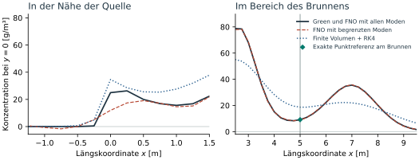
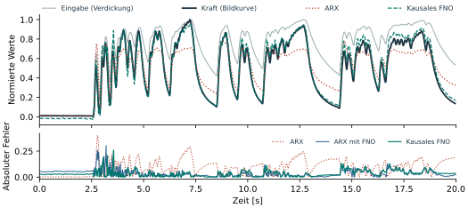

# Anhang C · Neuronale Operatoren in ARGESIM

## Einleitung · Wann hilft ein gelernter Operator?

Drehen Sie den Hahn einer Schadstoffquelle für zwei Tage weiter auf. Der Brunnen reagiert erst später und der Konzentrationsgipfel kann sich verschieben. In einem anderen Versuch möchten wir aus der Verdickung eines Muskels auf seine Kraft schließen. Derselbe Dickenwert kann während des Anstiegs und beim Abklingen zu verschiedener Kraft gehören. In beiden Fällen zählt die Vorgeschichte. Wir fragen, ob ein Fourier Neural Operator diese Vorgeschichte so verarbeitet, dass er an einer neuen Eingabe dieselben Prüfungen wie ein klassisches Verfahren besteht.

Bei [C19R](#fno-c19r-modell) rechnen wir dasselbe Konzentrationsfeld mit finiten Volumen und RK4, mit einem Greenschen Operator und mit einer gelernten Fourier-Schicht. Bei [C18](#fno-c18-modell) vergleichen wir die Übertragungsfunktion, bestehende neuronale Modelle und eine kausale Fourier-Schicht. Der [Schluss zu diesem Anhang](#fno-anhang-schluss) greift beide Eingangsfragen wieder auf. Für CP2 vergleichen wir in [C.8](#cp2-operator-code) zusätzlich alternative Transformationen und ihre Kosten.

Das FNO aus [Kapitel 9](../lehrbuch_numerische_simulation.md#kap09-einstieg) wird hier für zwei neue Rechenaufträge angepasst. Für den Boden leiten wir zuerst die lineare Abbildung her. Für die Muskelkurven muss sich die Trainingsentscheidung auf eine einzige veröffentlichte Kurve stützen. Im Ergebnisprotokoll stehen deshalb das Gitter, die Quellenfolge oder Messreihe und das genaue Fehlermaß neben jeder Zahl.

<!-- Buchseite -->

## C.1 · C19R und die Quelle im Zeitverlauf

Im Referenzfall von [Kapitel 15](../lehrbuch_numerische_simulation.md#fb-c19integral) gibt die Quelle ab dem Start ständig $2\,\mathrm{mg/s}$ ab. Für den neuen Versuch teilen wir zehn Tage in acht Abschnitte zu je $1{,}25$ Tagen. Die Quelle bleibt am Ursprung. In Abschnitt $j$ wird eine konstante Rate $q_j$ gehalten. Die übrigen Größen übernehmen wir aus dem Lehrfall. Je Quadratmeter Grundfläche enthält die Schicht $\eta b=2{,}5\,\mathrm{m^3/m^2}$ Wasser. Die Fließgeschwindigkeit beträgt $10^{-5}\,\mathrm{m/s}$ und der isotrope Dispersionskoeffizient $5\cdot10^{-7}\,\mathrm{m^2/s}$. Die Aufbereitung bleibt ausgeschaltet.

Wir messen das Feld nach zehn Tagen auf $65\times33$ quadratischen Zellen mit $0{,}25\,\mathrm m$ Kantenlänge. Jede Ausgabe ist ein Zellmittel. Der Brunnen bei $(5,0)\,\mathrm m$ liegt im Zentrum einer Zelle. Der tatsächliche Punktwert kommt aus einer eigenen Quadratur der in Kapitel 15 hergeleiteten Formel. So sehen wir auch den Fehler, der entsteht, wenn man den Zellwert für die Punktmessung verwendet.

### Weshalb acht Rechnungen genügen

Der Stoff eines kurzen Quellstoßes verteilt sich als driftende Gaußglocke. Integrieren wir diese Glocke über eine Zelle und alle Freisetzungszeiten des Abschnitts $j$, erhalten wir ein Antwortfeld $G_j$. Es gibt die Konzentrationsänderung pro Einheit der Freisetzungsrate in diesem Abschnitt an. Bei konstanten Transportkoeffizienten lässt sich der Stoffeintrag addieren. Deshalb lautet das berechnete Feld für den ganzen Verlauf

$$
c_{\mathrm{Zelle}}(T)=\sum_{j=1}^{8}q_j G_j.
$$

Die ersten $G_j$ gehören zu altem Stoff und ihr Schwerpunkt liegt weiter stromabwärts. In den letzten $G_j$ steckt die frischere, steile Konzentrationsfahne nahe der Quelle. Die klassische Green-Rechnung speichert diese acht Felder und summiert sie pro neuer Anfrage gewichtet. Die Referenz verwendet dieselbe physikalische Lösung und eine feinere Quadratur. Die Quadraturen unterscheiden sich in der Norm der acht Felder relativ um $3{,}60\cdot10^{-12}$.

### Was die Fourier-Schicht lernt

Jede Rate $q_j$ bildet einen Eingangskanal mit einem Wert in der Quellzelle und null in allen anderen Zellen. Für jede behaltene Raumfrequenz lernt eine lineare Fourier-Schicht acht komplexe Gewichte. Die gewichtete Summe der acht Eingangskoeffizienten liefert den Ausgabekoeffizienten. Die inverse FFT ergibt daraus die Konzentrationen. Wir bestimmen die Gewichte aus 80 Quellverläufen per kleinsten Quadraten. Die Raten liegen beim Training gleichverteilt zwischen $0{,}3$ und $3{,}7\,\mathrm{mg/s}$. Die acht Testverläufe enthalten unter anderem die konstante Quelle, zwei getrennte Pulse und späte Änderungen. Diese Verläufe bleiben bis zur Auswertung zurückgehalten.

[Aufgabenfamilie C19R](https://www.argesim.org/benchmarks/c19) · [Green-Referenz im Lehrbuch](../lehrbuch_numerische_simulation.md#fb-c19integral) · [FNO-Schicht](../lehrbuch_numerische_simulation.md#t1-k9)

<!-- Buchseite -->

## C.2 · C19R und die Verteilung des Stoffs

Für die acht neuen Verläufe gelten je $1\,\%$ Budget für den relativen Feldfehler und für den Punktwert am Brunnen. Die Differenz der Stoffmasse im Rechteck darf höchstens $0{,}1\,\%$ der eingetragenen Masse betragen. Wir prüfen zudem die Nichtnegativität der Konzentration bis auf eine Rundungsschranke. Der Score $S$ ist das Maximum der drei Anteile am Budget. Das Fehlerziel gilt jeweils für einen ganzen Verlauf.

| Methode C19R | Feldfehler max. | Brunnenfehler max. | Max. $S$ | Bestanden |
|:--|--:|--:|--:|--:|
| Green-Summe | $<10^{-8}\,\%$ | 0,729 % | 0,729 | 8 von 8 |
| Finite Volumen und RK4 | 33,85 % | 104,903 % | 104,903 | 0 von 8 |
| FNO mit begrenzten Moden | 25,97 % | 17,641 % | 25,971 | 0 von 8 |
| FNO mit allen Moden | $<10^{-8}\,\%$ | 0,729 % | 0,729 | 8 von 8 |

**Warum das Abschneiden der Moden auffällt.** Mit $|k_x|\le12$ und $|k_y|\le8$ bleibt die Nullmode erhalten. Sie repräsentiert die Summe der Zellwerte und damit die Masse im Rechteck. Dennoch können einzelne Zellwerte negativ werden und die Spitze kann zu flach sein. Mit allen darstellbaren Moden reproduziert die gelernte Schicht die lineare Green-Abbildung bis auf Rechen- und Quadraturfehler. Die verbleibende Abweichung am Brunnen entsteht, weil wir einen Zellmittelwert am Mittelpunkt auswerten.

**Was der klassische Vergleich erklärt.** Beim Lauf mit finiten Volumen erhält das RK4-Modell die Bilanz aus Innenmasse plus ausgetragener Masse bis auf Rundung. Halbieren wir auf demselben Gitter seinen Zeitschritt von 7 200 s, ändert sich das Feld relativ zur Referenznorm um höchstens $2{,}55\cdot10^{-6}$. Die deutlich größere verbleibende Abweichung liegt überwiegend in der räumlichen Näherung. Ein Upwind-Fluss verschmiert die Konzentrationsfront, obwohl er die Bilanz erfüllt.

<!-- Buchseite -->

## C.3 · Warum wir den klassischen Operator mitmessen

Für die konstante Quelle von $2\,\mathrm{mg/s}$ liefert die punktweise Quadratur am Brunnen $45\,021{,}62\,\mathrm{mg/m^3}$. Die Green-Zellrechnung und die Fourier-Schicht mit allen Moden liefern dort beide $44\,789{,}24\,\mathrm{mg/m^3}$. Bei einem stark zeitveränderlichen Eintrag zählen beide Größen, die Masse und die Konzentration an der Messstelle. Verschiebt man einen Puls zeitlich, kann er dieselbe Masse eintragen und den Gipfel am Brunnen früher oder später erzeugen.

In der Zeitmessung erhalten alle Verfahren dieselben acht Anfragen. Die Green-Felder sind für den Einsatz vorberechnet, die Fourier-Gewichte trainiert. Pro Variante wird einmal aufgewärmt, dann werden sieben vollständige Auswertungen gemessen. `vergleich.json` gibt den Median und die einmaligen Kosten getrennt an. Auf diesem Rechner war die Green-Summe schneller als die Fourier-Auswertung. Sie benötigt für die acht Eingänge nur gewichtete Additionen. Das RK4-Ergebnis liegt auf dem betrachteten Gitter oberhalb des gemeinsamen Fehlerbudgets. [Messung nachrechnen](#fno-reproduktion)

**Selbst prüfen.** Multiplizieren Sie für einen der acht Testverläufe jede Rate mit zwei. Welche der Vorhersagen verdoppelt sich? Die Gleichung für $c_{\mathrm{Zelle}}$ beweist die Antwort für das Green-Feld. Dieselbe Prüfung am gelernten Modell zeigt, was seine hier gewählte lineare Bauform bereits festlegt. Für eine veränderte Strömungsrichtung, andere Dispersivität oder eine laufende Pumpe brauchen wir eigene Referenzen. Die acht gelernten Gewichtssätze kodieren genau die festgelegte Kombination aus Physik, Quellort und Ausgabezeit.

Der Versuch erweitert das Modell der Aufgabe A ohne Gegenmaßnahmen um zeitabhängige Raten. In den übrigen C19R-Aufgaben greifen Pumpe, Infiltration und zeitliche Steuerung in das Transportproblem ein. Wie die Originalaufgaben abgegrenzt sind, beschreibt das [Referenzblatt C19R](../lehrbuch_numerische_simulation.md#fb-refC19R).

<!-- Buchseite -->

## C.4 · C18 und die Kraft aus der Vorgeschichte

Bei C18 ist die beobachtete Verdickung $u_n$ der Eingang und die zu schätzende Kraft $y_n$ der Ausgang. Die zwei veröffentlichten normierten Kurvenpaare stammen von zwei Muskeln. Je Folge stehen 2 000 Abtastwerte von 0 bis 19,99 Sekunden auf einem 100-Hz-Raster. Wir verwenden die aus den Vektorgrafiken rekonstruierten Werte und prüfen ihren Hash gegen den Projektstand. Die Originalmessdateien werden im Rechenlabor durch zwei separat angegebene CSVs unterstützt. Die folgenden Zahlen gelten für die rekonstruierten Kurven.

### Dieselben Messzeiten und Anfangswerte

Wir identifizieren alle lernenden Parameter auf dem ersten Muskel. Der zweite dient der Auswertung. Ein klassisches ARX-Modell zweiter Ordnung verwendet die zwei letzten Kräfte und die aktuelle sowie vorherige Verdickung,

$$
\widehat y_n
 = a_1\widehat y_{n-1}+a_2\widehat y_{n-2}+b_0u_n+b_1u_{n-1}.
$$

Die ersten zwei gemessenen Kräfte setzen die Anfangswerte des ARX. Danach benutzt die Rechnung ihre eigenen Ausgaben. Für alle Methoden beginnt der Fehlervergleich bei Index 2. Das direkte FNO benutzt für seine gesamte Vorhersage nur die Verdickung. Ein zweites FNO lernt die Abweichung des ARX von der Kraft auf dem ersten Muskel und addiert seine Schätzung bei der Anwendung zum frei gerechneten ARX.

### Wie aus einem FFT-Fenster eine kausale Schätzung wird

Für die Probe $n$ erhält die Schicht die letzten 64 Verdickungswerte einschließlich $u_n$. Vor dem Anfang wiederholen wir den ersten Wert. Die reelle FFT zerlegt das Fenster in die Nullmode und positive Frequenzen. Von ihnen behalten wir zwölf. Je verdeckter Einheit gewichten wir die komplexen Koeffizienten und lesen den letzten Wert der inversen FFT ab. Dazu kommen ein direkter Anteil aus $u_n$ und eine Konstante. Acht solche Größen gehen durch den Tangens hyperbolicus. Eine gelernte Linearkombination liefert Kraft oder Residuum.

Im Labor ändern wir die zweite Hälfte des Eingangssignals und kontrollieren, dass alle Vorhersagen für die erste Hälfte bis auf Rundung gleich bleiben. Die Fourier-Auswertung wird zusätzlich gegen eine direkte inverse FFT und die Trainingsableitung gegen Differenzen geprüft. Für jede der beiden FNO-Varianten gibt es drei Initialisierungen. Die Auswahl erfolgt anhand des regularisierten Verlusts am ersten Muskel. Alle sechs Trainingsläufe erreichen das festgelegte Limit von 450 Optimierungsschritten. Die gemeldeten Ergebnisse verwenden die dort erhaltenen Gewichte.

[Belič, Originaldefinition und Abbildungen](https://www.sne-journal.org/fileadmin/user_upload_sne/benchmarks/C18/C18-definition.pdf) · [Rekonstruktion der Kurven](https://github.com/5H3LL3H5/argesim-hyperposition-benchmarks/blob/main/docs/C18_FIGURE_RECONSTRUCTION.md)

<!-- Buchseite -->

## C.5 · C18 auf der zweiten Kurve

Die Vorhersage bleibt auf der Abtastfolge des zweiten Muskels. Wir berechnen den RMSE in der normierten Kraftskala und die Korrelation. RMSE misst die Größe der Abweichung. Korrelation gibt an, wie ähnlich beide Signale gemeinsam steigen und fallen. Ein systematischer Versatz kann daher im RMSE sichtbar sein, auch wenn die Korrelation hoch ist.

Die unabhängige Beobachtungseinheit ist hier eine vollständige publizierte Muskelkurve. Jede der beiden digitalisierten Reihen enthält 2 000 Abtastwerte bei 100 Hz. Die erste Reihe dient der Anpassung, die zweite dem Transfer auf einen anderen Muskel. Zwanzig Fenster aus der zweiten Reihe ergeben zwanzig Startzeiten mit derselben Kalibrierung. Für eine Aussage über die Streuung zwischen Muskeln wären weitere vollständige Reihen nötig. In dieser Auswertung erreicht das direkte kausale FNO beim zweiten Muskel RMSE 0,04491, die erste ARX-plus-FNO-Fassung 0,04833. Die getrennte Bandstudie in D.17 erreicht mit ARX plus Fourier 0,04266.

| Methode C18 | RMSE erster Muskel | RMSE zweiter Muskel | Korrelation zweiter Muskel |
|:--|--:|--:|--:|
| Publizierte ARX-Koeffizienten | 0,11739 | 0,11340 | 0,94221 |
| ARX neu identifiziert | 0,12558 | 0,11732 | 0,93299 |
| ARX und statisches Netz | 0,09034 | 0,10514 | 0,94371 |
| Rekurrentes Netz | 0,03492 | 0,11937 | 0,92642 |
| Kausales FNO | 0,02465 | 0,04491 | 0,99178 |
| ARX und Residual-FNO | 0,02128 | 0,04833 | 0,99043 |

Auf dem zweiten Muskel erreicht das direkte FNO 0,04491 RMSE, das neu identifizierte ARX 0,11732. Eine Übertragung auf die offizielle Rohdatenaufgabe erfordert die ursprünglichen Messdateien.

<!-- Buchseite -->

## C.6 · Beide Versuche nachrechnen

Im Quellenpaket führt `rechenlabor/fno_benchmarks/vergleich.py` zu beiden Versuchen. NumPy und SciPy genügen. Die zwei Studien können über `--case c19r` oder `--case c18` einzeln ausgeführt werden. Der gemeinsame Lauf wird im entpackten Stammordner so gestartet.

~~~sh
OPENBLAS_NUM_THREADS=1 OMP_NUM_THREADS=1 python3 \
  rechenlabor/fno_benchmarks/vergleich.py --out fno_ergebnisse
~~~

Der Lauf schreibt `vergleich.json` mit Ergebnissen je Test, Softwarestand, Zeitmessung und Datennachweis. Die zwei `.npz`-Dateien enthalten trainierte Gewichte, Eingaben, Referenzen und Vorhersagen. Die gespeicherte Buchmessung steht unter `rechenlabor/fno_benchmarks/messung/`. Dort liegt auch der getrennt neu gerechnete Vergleich mit der bestehenden C18-Implementierung. Ihre Git-Blob-Kennungen sind protokolliert.

Wenn beide C18-Messdateien vorliegen, werden sie mit `--training train.csv --validation test.csv` übergeben. Beide müssen die Spalten `time_s`, `thickening` und `force` und einen Zeitschritt von $0{,}01\,\mathrm s$ haben. Die Ergebnisse kennzeichnen die Herkunft und die Prüfsummen. Die Wahl der Normalisierung und der Gewichte bleibt auch dann auf die erste Messreihe beschränkt.

<!-- Buchseite -->

## C.7 · Wie der Vergleich auf weitere Fälle übertragen wird

Wir beginnen jeden nächsten Fall mit der Frage, was überhaupt vorherzusagen ist. Für ein neues Feld müssen Ort, Raster und gemessene Komponenten übereinstimmen. Für einen Übergang werden Zeitpunkt und Folgezustand geprüft. Die folgenden Aufgaben ergänzen die Klassifikation im [Referenzkatalog](../lehrbuch_numerische_simulation.md#fb-refteil).

| Aufgabe oder Familie | Rolle und Prüfgröße im nächsten Versuch |
|:--|:--|
| **C19R, CP1/3, CP2/2–3** | Ein Feld lernen und mit Feldnorm sowie festen Messorten prüfen. C19R und frühe CP2-Felder haben hier eigene Messungen. Für neue Gitter und den langen Strömungslauf sind weitere Vergleiche erforderlich. |
| **C18, C09, C11, C13** | Ein Signal oder eine Regelstrecke lernen. Testen mit neuen Zeitfolgen, vorgegebenen Takten und den beobachteten Größen der Originalaufgabe. C18 ist oben an zwei rekonstruierten Folgen geprüft. |
| **C03, C05, C07, C12, C21** | Eine Phase oder einen Startwert schätzen. Vektorfeld, Nullstellen, Stoßgesetz, DAE-Residuum und Regeln für die Fortsetzung mit dem jeweiligen klassischen Modell prüfen. |
| **C01, C15, CP1/1–2, CP2/1** | Wiederholte Parameterstudien oder Identifikation. Pro Anfrage dieselbe Zielgröße und dasselbe Genauigkeitsziel vergleichen. Bei CP1 und CP2 zusätzlich den Auftrag zur Parallelisierung auswerten. |
| **C17R** | Aggregierte Zeitreihen oder räumlich gemittelte Werte prüfen. Der diskrete Automat liefert die Referenz für die gewählte Aggregation. |
| **C02, C04, C06, C08, C10, C14, C16, C20, C22** | Kennzahlen aus Szenarien schätzen, etwa den Durchsatz oder die Wartezeit. Die Referenz erzeugt die Ressourcen- und Ereignisfolge nach den jeweiligen Regeln. |

Wo eine Ausgabe aus Ereignissen besteht, werden Ereigniskennungen, Reihenfolge, Uhrzeiten und Zustandsresets vor dem Feld- oder Zeitvergleich geprüft. Bei einem FNO als Startschätzung für Newton entscheidet der bestehende Solver anhand seines Residuums und der Fehlerkontrolle über die Annahme. So lässt sich die zusätzliche Arbeit der Netzvorhersage gegen gesparte Iterationen messen.

Die sechs neuen Übertragungsrechnungen und die Einzelprüfung aller Familien stehen in [Anhang D](../lehrbuch_numerische_simulation.md#fno-transfer-anhang).

<!-- Buchseite -->

## C.8 · Ausführbare Vergleiche für Saite und Kavität

Die ergänzenden Programme stehen unter `rechenlabor/cp2_operatoren`. Dieselbe PyTorch-Klasse `HybridNeuralOperator` nimmt eine bekannte Folge von Eingangsfeldern, die Konditionierung und optional ein Grundfeld entgegen. Sie baut drei Transformationsgruppen auf und lernt deren Mischung. In der Saite begrenzt die Maske die Korrektur an beiden Endpunkten auf null. In der Kavität erhalten beide Geschwindigkeitskomponenten eine Ausgabe. Die Skripte verwenden PyTorch, NumPy, SciPy und psutil. Ein C++20-Compiler erzeugt die zwei unabhängigen numerischen Referenzrechnungen im Ergebnisordner.

~~~sh
python3 rechenlabor/cp2_operatoren/test_operatoren.py
python3 rechenlabor/cp2_operatoren/cp2_saite_benchmark.py --out saite
python3 rechenlabor/cp2_operatoren/cp2_lbm_cavity_surrogate.py --out kavitaet
~~~

Das erste Programm prüft alle sieben Transformationspfade in beiden Raumdimensionen, die Identität bei Nullgewichten, die Übernahme des Zustands und die Gradienten. D2Q9 wird nach 1, 7 und 16 Schritten gegen den einfachen Python-Solver geprüft. Die diskrete Flussprojektion wird zweimal hintereinander angewendet. Ihr zweiter Schritt muss bis auf Rundung denselben Vektor liefern. Die Saitenrechnung vergleicht Newmark und Verlet mit voll diskreten Eigenmoden.

Bei der Saite bleiben die versetzten Testformen und die glatte Energiekontrolle vom Training getrennt. Bei der Kavität sind die zwölf Trainingsparameter, die Kalibrierfälle und die Testparameter im JSON aufgeführt. Die Rechenzeitmessung erfolgt nach einer Aufwärmauswertung. Der Code speichert Einzelfehler, Feldvergleiche und die Zahl der tatsächlich ausgeführten D2Q9-Schritte. Ein vorhandener Referenzordner kann per `--reference` für getrennte Neuauswertungen weiterverwendet werden.

[Schicht und Verlustfunktion in Kapitel 9](../lehrbuch_numerische_simulation.md#cp2-operator-lernregel) · [CP2-Nachweise](../lehrbuch_numerische_simulation.md#cp2-operator-saite)

<!-- Buchseite -->

## C.9 · Laufzeit, Parameter und Speicher messen

Die folgende Tabelle misst eine vollständige Vorhersage mit Grundfeld und Korrektur auf der CPU. In der Saite umfasst eine Abfrage beide Zeitpunkte. In der Kavität steht jeweils ein Feld pro Aufruf. Die Fit-Zeit misst den jeweiligen Korrekturfit. Gemeinsame Kosten für die Referenzen und das affine Grundfeld kommen einmal hinzu. Die CPU-Speicherspalte umfasst den beobachteten Prozess-RSS während der Kavitätsabfrage auf $421^2$. Bereits geladene Felder und Laufzeitbibliotheken tragen dazu bei.

| Zeitvariante | Saite Fit [ms] | Saite Abfrage [ms] | Kavität Fit [ms] | $65^2$ [ms] | $421^2$ [ms] | RSS [MiB] | 
| :--- | ---: | ---: | ---: | ---: | ---: | ---: | 
| FNO | 24,80 | 0,426 | 197,68 | 0,418 | 53,623 | 608 | 
| LNO | 15,34 | 0,214 | 34,13 | 0,270 | 31,754 | 723 | 
| WNO | 14,74 | 0,226 | 27,90 | 0,256 | 27,537 | 743 | 
| HNO | 18,52 | 0,345 | 42,77 | 0,817 | 80,265 | 770 | 
| RNO | 20,94 | 0,300 | 45,71 | 1,558 | 88,855 | 738 | 
| WLNO | 17,87 | 0,342 | 40,75 | 0,485 | 37,200 | 768 | 
| FMNO | 18,86 | 0,483 | 31,81 | 0,746 | 25,446 | 710 | 

An der Saite kosten d’Alembert 0,031 ms, Verlet 0,183 ms und Newmark 2,977 ms. Die Referenzdaten für den Saitenfit benötigen einmalig 0,495 s. Für die Kavität stammen die Trainingsdaten aus 35,47 s D2Q9-Rechenzeit. Der nominale 65er-Lauf kostet 3,00 s, der 421er-Lauf mit grobem Startfeld 248,9 s. Die C++-Puffer enthalten an der Saite 27,4 KiB und in der feinsten Kavität 37,9 MiB Nutzdaten.

Die Saitenschicht hat 9 gelernte Koeffizienten. In der Kavität sind es 72 zusätzliche Koeffizienten zum gemeinsamen affinen Feld mit 101 400 gespeicherten Zahlen. Der gespeicherte Parameterumfang und der vorübergehende Arbeitsbereich sind verschiedene Größen. Die Referenzen verwenden C++20 mit Double-Präzision. PyTorch verwendet ebenfalls Double-Präzision. Die Option `--device cuda` misst bei einer verfügbaren CUDA-GPU synchronisiert und protokolliert den vom PyTorch-Allocator belegten Spitzenspeicher. Für die hier dokumentierte Messung stand eine CPU zur Verfügung.

<!-- Buchseite -->

## C.10 · Amortisation und neue Betriebspunkte

Aus $T_A+N t_O<N t_S$ folgt für $t_O<t_S$ eine erste ganze Aufrufzahl von

$$
N_{\min}=\left\lfloor \frac{T_A}{t_S-t_O}\right\rfloor+1.
$$

Diese Rechnung setzt gleichwertige Ausgaben für den Auftrag voraus. An der idealen Saite ist das analytische Grundfeld allein maßgeblich. Bei der Kavität zählen zwölf D2Q9-Trainingsläufe, der affine Fit und der jeweilige Korrekturfit zu $T_A$. Für $421^2$ zählt die Erzeugung des groben Startfelds zur einzelnen klassischen Rechnung. Die folgende Kalibrierung vergleicht auch, was auf dem neuen Betriebspunkt mit zusätzlichen Referenzfeldern geschieht.

| Kalibriervariante | $N_{\min}$, $65^2$ | $N_{\min}$, $421^2$ | Anker Re=140 | Anker $421^2$ | 
| :--- | ---: | ---: | ---: | ---: | 
| FNO | 12 | 1 | 2 | 0 | 
| LNO | 12 | 1 | 2 | 0 | 
| WNO | 12 | 1 | 2 | 0 | 
| HNO | 12 | 1 | 2 | 0 | 
| RNO | 12 | Budget offen | 2 | 1 | 
| WLNO | 12 | 1 | 2 | 0 | 
| FMNO | 12 | 1 | 2 | 0 | 

Mit den angegebenen Ankern und der anschließenden Flussprojektion beziehen sich die beiden rechten Spalten auf alle Prüffelder des jeweiligen Zielpunkts. Die beiden linken Spalten vergleichen die ungeänderten Hybride mit der klassischen Referenz. Für das affine Modell sind es bei Re=140 2 und auf $421^2$ 0 zusätzliche Referenzfelder. Eine null in der Kalibrierspalte bedeutet, dass das Ausgangsmodell dort bereits besteht. Das Labor erfasst die Rechenzeit einschließlich der Flussprojektion gesondert. Die Auswertung im JSON enthält außerdem das reine Nachpassen der kleinen Mischmatrix.

Ein *Few-Shot*-Wert gilt für die gewählten Anker und zurückgehaltenen Testprofile. Der Feldeffekt einer Reynolds-Zahl und die Änderung eines Ortsgitters liefern verschiedene Aufgaben. Eine Korrektur am Rand der Trainingsverteilung muss sich am Zielpunkt erneut am Feld, an der Kontinuität und gegebenenfalls an den beiden Mittellinien messen lassen.

[Kapitel 16 · Kavitätsreferenz und Profile](../lehrbuch_numerische_simulation.md#cp2-operator-kavitaet)

<!-- Buchseite -->

## Schluss · Was der Operator gelernt hat

Beim Brunnen ist die Abbildung der acht Freisetzungsraten bereits linear in der Physik enthalten. Das volle FNO erreicht hier die Genauigkeit dieser Abbildung. Das begrenzte FNO behält die Masse, verteilt den Stoff aber ungenauer. Deshalb wird ein gelerntes Feld sowohl an einer lokalen Messstelle als auch an der Bilanz geprüft. Für dieses Modell liefert die vorberechnete Green-Summe eine schnelle Vergleichslösung.

Bei der Kraft enthält das aktuelle Verdickungssignal für sich genommen zu wenig Information über den Verlauf. Die vergangenen Werte im Fourier-Fenster ermöglichen auf der rekonstruierten zweiten Kurve eine genauere Vorhersage als die geprüften ARX- und ANN-Varianten. Der Wert des Ergebnisses hängt davon ab, woher die Vergleichsdaten stammen und ob die nächste Anwendung dieselbe Information rechtzeitig bereitstellt.

### Aktueller Stand der Forschung

Li und Mitautoren zeigen, wie sich eine Abbildung zwischen räumlichen Funktionen über gelernte Fourier-Multiplikatoren parametrisieren lässt. Berner und Mitautoren untersuchen, welche Eigenschaften eines auf einem Funktionenraum definierten Operators bei verschiedenen diskreten Auswertungen erhalten bleiben. Für den nächsten C19R-Versuch lässt sich daraus eine konkrete Frage formulieren. Wie groß wird der Fehler, wenn wir Dispersivität oder Quellort ändern und auf einem zweiten Gitter dieselben physikalischen Messstellen prüfen? Bei C18 ist die entsprechende Frage, ob die Kausalität und der Fehlergewinn auch auf weiteren Messreihen mit anderem Anregungsverlauf erhalten bleiben. Die Radon- und Hankel-Arbeiten untersuchen geometrische beziehungsweise randbedingte Strukturen. [Vergleich auf CP2](../lehrbuch_numerische_simulation.md#cp2-operator-saite)

[Li u. a., Fourier Neural Operator (2021)](https://arxiv.org/abs/2010.08895) · [Berner u. a., Operator Learning auf Funktionenräumen (2026)](https://www.nature.com/articles/s42256-026-01267-z) · [Zur Einleitung des Anhangs](#fb-fno-anhang)
