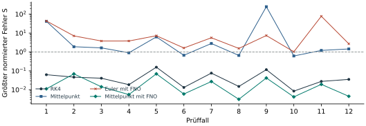

# Anhang D · FNO-Transfer und Vergleich neuronaler Operatoren

## Einleitung · Welche Teile lassen sich übertragen?

In [Anhang C](../lehrbuch_numerische_simulation.md#fb-fno-anhang) lernt ein Operator die Ausbreitung aus einer Quellgeschichte oder die Kraft aus einer Folge beobachteter Verdickungen. Nun verändern wir die Frage. An einer Saite bewegt sich der Rand nach einem vorgegebenen Signal. Im Tank wird die Pumpe erst am nächsten Takt neu gesetzt. Beim Stiftpendel bestimmt die Bahn selbst, wann die Länge wechselt. Welche Ausgabe können wir in diesen Fällen lernen, und welche Prüfung entscheidet über ihre Verwendung?

Wir wählen sechs konkrete Teilaufgaben mit prüfbarer Referenz. Ein Modell aus der linearen Gruppe erhält eine Folge von Eingängen oder eine vorbereitete Randzeitreihe. Bei den gekoppelten Schaltaufgaben arbeitet der trainierte Operator mit einer klassischen Rechnung zusammen. Zu jedem Versuch gehören dieselbe Anregung für beide Verfahren, getrennte Trainings- und Prüffälle, definierte Ausgaben und mindestens eine Gegenprobe. Der [Schluss dieses Anhangs](#fno-transfer-schluss) beantwortet die Eingangsfrage anhand der Messungen. Die [Messmatrix](#no-vergleichsmatrix) führt später für zehn Teilaufgaben sieben Operatoren zusammen. [Kapitel 9](../lehrbuch_numerische_simulation.md#no-auswertung) erklärt die Prüfschritte und die Befunde dazu.

Der folgende Katalog umfasst die 24 Familien des [ARGESIM-Referenzkatalogs](../lehrbuch_numerische_simulation.md#fb-refteil). Für die Parallelfamilien CP1 und CP2 sind die je drei Aufgaben einzeln aufgeführt. Das ergibt 28 Einträge. Der geprüfte Umfang je Zeile bestimmt, wie weit sich ein Ergebnis übertragen lässt.

## Wegweiser

[Räumliches Feld CP1/C](#fno-transfer-saite) · [Zeitverläufe C13 und C15](#fno-transfer-zeit) · [Tankregelung C09](#fno-transfer-tanks) · [Hysterese C05](#fno-transfer-c05) · [Stiftpendel C07](#fno-transfer-c07) · [Ergebnisse und Rechenlabor](#fno-transfer-ergebnisse)

<!-- Buchseite -->

## D.1 · Prüfkatalog für C01 bis C08

**Woran eine Übertragung gemessen wird.** Wir beginnen beim geforderten Ergebnis. Eine Feldnorm misst die Abweichung vieler Werte. Bei einem diskreten Übergang muss außerdem feststehen, dass beide Rechnungen denselben Kontakt, dieselbe Freigabe oder dieselbe Schaltung ausführen. Ein trainierter Phasenfluss wird in dem Umfang geprüft, in dem sich seine Ausgabe mit einer Referenz am Modell vergleichen lässt.

| Aufgabe | Geforderte Ausgabe | Entscheidung für den geprüften Umfang |
|:---|:---|:---|
| [C01](https://www.argesim.org/benchmarks/c01) | Drei steife Zustände, Wechsel der Dynamik und stationäre Lösungen. | **Klassisch**. Steife Integration und stationäre Gleichungen liefern die geforderten Kurven und Fixpunkte direkt. |
| [C02](https://www.argesim.org/benchmarks/c02) | Montageanlage, Palettenbelegung und Durchsatz bei gegebenen Ressourcen. | **Klassisch**. Die geprüfte Belegung entsteht aus den Regeln für Reihenfolge, Konflikte und Zeitfortschritt. |
| [C03](https://www.argesim.org/benchmarks/c03) | Class-E-Schaltung, Halbzyklen, Eigenwerte und endliche Schaltflanken. | **Klassisch**. Affiner Phasenfluss oder Integration mit aufgelöster Flanke führen die exakte Schaltlogik mit. |
| [C04](https://www.argesim.org/benchmarks/c04) | Philosophen mit konkurrierender Ressourcenzuteilung. | **Klassisch**. Deadlock und Freigabereihenfolge gehören zur Lösung und werden am diskreten Modell geprüft. |
| [C05](https://www.argesim.org/benchmarks/c05) | Zweizustandsmodell mit sehr schneller Relaxation und Hysterese. | **[Versuch](#fno-transfer-c05)**. Fourier-Schätzung der langsamen Verzögerung. Geprüft am normalen Lauf, an Aufgabe D und an weiteren Startwerten. |
| [C06](https://www.argesim.org/benchmarks/c06) | Notaufnahme, Wiederbehandlung und Verteilung der täglichen Kennzahlen. | **Klassisch**. Das Ereignismodell verfolgt einzelne Vorgänge und liefert die Wiederholungen für die statistische Prüfung. |
| [C07](https://www.argesim.org/benchmarks/c07) | Pendel am Stift, Bewegung zwischen den Kontakten und Winkelgeschwindigkeit am Übergang. | **[Versuch](#fno-transfer-c07)**. Fourier-Korrektur in zwei glatten Moden. Nullstelle und physikalischer Reset werden im Hybridmodell berechnet. |
| [C08](https://www.argesim.org/benchmarks/c08) | Kanalschleuse, Ankünfte und Steuerungsregeln. | **Klassisch**. Betrieb und Abfertigungsfolge folgen aus dem Ereigniszustand. Kennzahlen werden pro Strategie aus Wiederholungen bestimmt. |

**Leseschlüssel.** „Versuch“ führt zu einer eigens gerechneten Teilaufgabe. „Im Buch“ verweist auf eine bereits vorhandene Untersuchung. „Klassisch“ bezeichnet die Methode, mit der die hier geprüfte Aufgabenstellung erfüllt wird.

<!-- Buchseite -->

## D.2 · Prüfkatalog für C09 bis C16

| Aufgabe | Geforderte Ausgabe | Entscheidung für den geprüften Umfang |
|:---|:---|:---|
| [C09](https://www.argesim.org/benchmarks/c09) | Fuzzy-Regelung zweier Tanks mit gemessenen Pegeln an jedem Takt. | **[Versuch](#fno-transfer-tanks)**. Fourier-Korrektur der Strecke bei klassischem PFC und Sample-and-Hold. Geprüft für 16 Takte. |
| [C10](https://www.argesim.org/benchmarks/c10) | Philosophen II mit alternativen Zugriffspolitiken. | **Klassisch**. Blockierungen und Wartezeiten hängen von der diskreten Konfliktauflösung ab. |
| [C11](https://www.argesim.org/benchmarks/c11) | SCARA mit Antriebsdynamik, Stromgrenzen und Regelung. | **Klassisch**. Der Vergleich verlangt konsistente Zwangszustände, absolute Bahnfehler und die korrekten aktiven Grenzen des Reglers. |
| [C12](https://www.argesim.org/benchmarks/c12) | Stoßprozesse in Kugelreihen unter mehreren Kontaktmodellen. | **Klassisch**. Teilchenkennungen, Reihenfolge, Stoßzeit und Impulsreset sind die Zielgrößen. Für freie Teilbewegungen genügt der Phasenfluss. |
| [C13](https://www.argesim.org/benchmarks/c13) | Linearer Lastpuls und weitere Aufgaben mit Steuerungslogik. | **[Versuch](#fno-transfer-zeit)**. Kausales FNO für die lineare Phase aus Aufgabe A. Der stationäre Wert wird aus dem Endzustand klassisch fortgesetzt. |
| [C14](https://www.argesim.org/benchmarks/c14) | Bestandsdynamik und explizite Bestellstrategien. | **Klassisch**. Die Bestandsrekursion ist bereits diskret und erhält Bilanz, Lieferverzug und Bestellregeln gemäß Aufgabenstellung. |
| [C15](https://www.argesim.org/benchmarks/c15) | Zweikompartimentmodell für Vergleich und Identifikation. | **[Versuch](#fno-transfer-zeit)**. Kausales FNO für die Vorwärtsrechnung aus Aufgabe A bei festen Raten. Die Parameterschätzung aus B bleibt klassisch. |
| [C16](https://www.argesim.org/benchmarks/c16) | Standortentscheidungen und stochastische Filialdynamik. | **Klassisch**. Aufbau, Schließung und Wettbewerb hängen von einzelnen diskreten Entscheidungen ab. |

Beim Kran und beim Clearance-Modell kann ein bekannter Eingang als Zeitfunktion an die Rechnung übergeben werden. Beim Tank ist der nächste Stellwert erst aus dem gemessenen Pegel bekannt. Das Zeitfenster bestimmt deshalb, welche Information der gelernte Operator beim jeweiligen Aufruf tatsächlich erhält.

<!-- Buchseite -->

## D.3 · Prüfkatalog für C17R bis C22

| Aufgabe | Geforderte Ausgabe | Entscheidung für den geprüften Umfang |
|:---|:---|:---|
| [C17R](https://www.argesim.org/benchmarks/c17r) | Aggregierte Populationskurven und räumliche Entwicklung des zellulären Automaten. | **Klassisch**. ODE und Automat sind getrennte Vergleichsmodelle. Die geforderten räumlichen Muster und lokalen Übergänge bleiben im Automaten. |
| [C18](https://www.argesim.org/benchmarks/c18) | Kraft aus Verdickungsverlauf auf einem anderen Muskel schätzen. | **[Im Buch](../lehrbuch_numerische_simulation.md#fno-c18-modell)**. Anhang C verwendet die rekonstruierten Publikationskurven. Der Prüfstand unterstützt Originaldateien. |
| [C19R](https://www.argesim.org/benchmarks/c19) | Räumliche Stoffverteilung und Brunnenwert bei zeitlich veränderter Quelle. | **[Im Buch](../lehrbuch_numerische_simulation.md#fno-c19r-modell)**. Anhang C prüft die Erweiterung von A mit acht Quellverläufen. Regelung und Pumpen bleiben separate Aufgaben. |
| [C20](https://www.argesim.org/benchmarks/c20) | Komplexe Produktion, Transport, Puffer und Nacharbeit. | **Klassisch**. Die Durchsatzverteilung wird über die diskreten Kapazitäts- und Sperrregeln bestimmt. |
| [C21](https://www.argesim.org/benchmarks/c21) | Zustandsereignisse und strukturwechselnde Systeme in mehreren Teilbeispielen. | **Klassisch**. Kontakte, Schaltfolgen und Algebraik werden mit Ereignis- und DAE-Solvern geprüft. C05 und C07 erproben die passenden Hybridbausteine separat. |
| [C22](https://www.sne-journal.org/benchmarks/c22) | Sonderregeln für Wechsel, Abbruch und Sortierung von Warteschlangen. | **Klassisch**. Reihenfolge und einzelne Abbrüche benötigen die Originalregeln für Warteschlange und Priorität. |

Kennzahlen einer Warteschlange lassen sich als Erwartungswerte schätzen. Ein solcher Schätzer beantwortet die Frage nach einem bestimmten Wechsel der Reihenfolge nicht direkt. Die hier genannten klassischen Verfahren bilden die zu prüfenden Regeln ab und liefern auch die dafür nötigen Stichproben.

<!-- Buchseite -->

## D.4 · Prüfkatalog für CP1 und CP2

| Aufgabe | Geforderte Ausgabe | Entscheidung für den geprüften Umfang |
|:---|:---|:---|
| [CP1/A](https://www.argesim.org/benchmarks/cp) | Paralleler Dämpfungs-Sweep eines Oszillators. | **Klassisch**. Die lineare Lösung liefert die einzelnen Bahnen direkt. Der Originalvergleich bewertet die parallele Ausführung. |
| [CP1/B](https://www.argesim.org/benchmarks/cp) | Stark gekoppeltes Zehn-Zustands-System. | **Klassisch**. Die Kopplungsstruktur und ihre Auswirkung auf die Parallelausführung sind hier die Vergleichsgrößen. |
| [CP1/C](https://www.argesim.org/benchmarks/cp) | Einseitig angeregte Saite, schwach gekoppelte Ortsdiskretisierung. | **[Versuch](#fno-transfer-saite)**. Räumliches FNO auf dem 800er-Gitter. Beobachter- und Feldfehler sowie eine ungesehene Frequenz sind gemessen. |
| [CP2/1](https://www.argesim.org/benchmarks/cp) | Monte-Carlo-Parameterstudie für ein mechanisches System. | **Klassisch**. Die Stichproben und die Ausführungskosten werden im Originalverfahren bewertet. Die kleine Vorwärtsrechnung ist direkt. |
| [CP2/2](https://www.argesim.org/benchmarks/cp) | Deckelgetriebene Kavität, D2Q9-Strömungsfeld. | **[Im Buch](../lehrbuch_numerische_simulation.md#fb-fnokav)**. Kapitel 16 prüft FNO-Varianten für das Frühfenster und einen Gittertransfer. Der lange Lauf ist mit LBM berechnet. |
| [CP2/3](https://www.argesim.org/benchmarks/cp) | Gezupfte Saite und Wellenfortschritt. | **[Im Buch](../lehrbuch_numerische_simulation.md#fb-neu16)**. Kapitel 9 und 16 vergleichen FNO, modale Physik und klassische Integratoren. |

Die Parallelaufgaben fragen zusätzlich nach Zerlegung und Rechenzeit auf der vorgesehenen Architektur. Unsere CP1-Messung verwendet dasselbe Ortsmodell der angeregten Saite und prüft sein Feld nacheinander auf einem Rechner. Zur Frage nach Beschleunigung durch parallele Zerlegung gehört ein eigener Vergleich.

<!-- Buchseite -->

## D.5 · C13 und C15 lernen eine kausale Antwortfolge

Während des Lastpulses beim Kran wirkt die zusätzliche Kraft einige Sekunden lang. Jede frühere Teilwirkung trägt zur Schwingung nach dem Puls bei. Auch im linearen Clearance-Modell bleibt nach Ende des Bolus ein Teil der Masse in beiden Kompartimenten. Wenn das System linear ist, können wir diese einzelnen Wirkungen zusammenzählen.

Sei der Eingang $u_n$ während des Intervalls $[nh,(n+1)h)$ konstant. Eine exakte Matrixrechnung für dieses Intervall ergibt

$$
y_{n+1}=\Phi y_n+\Gamma u_n,\qquad
y_{n+1}=\sum_{k=0}^{n}\Phi^k\Gamma u_{n-k}\quad\text{für }y_0=0.
$$

Damit sind $\Phi^k\Gamma$ die Antworten auf eine einzelne, ein Intervall lange Anregung. Die physikalische Vergleichsrechnung bildet sie aus $\Phi$ und $\Gamma$. Das FNO schätzt denselben kausalen Kern aus Paaren von Eingangs- und Ausgangsfolgen. Wir bestimmen seine Gewichte per kleinsten Quadraten. Die Fourier-Schicht berechnet anschließend die Faltung über komplexe Multiplikationen. Ihr Zeitraster wird vor der FFT mit Nullen auf die doppelte Länge erweitert. So wickelt sich die Antwort am Ende des Fensters nicht an dessen Anfang zurück.

### Wie die Kausalität geprüft wird

Die Frequenzvariante mit wenigen Moden glättet den geschätzten Kern und setzt dessen Werte außerhalb der kausalen Stütze anschließend wieder auf null. Ihr endgültiges Spektrum kann dadurch erneut hohe Anteile enthalten. Bei jedem Verfahren ändern wir ab einem Prüfzeitpunkt den Eingang und vergleichen alle Ausgaben davor. Jede dieser Ausgaben muss gleich bleiben. Der Eingang einer Vorwärtsrechnung ist somit für den Prüffall zwar vollständig bekannt, eine Belastungsflanke hat aber erst ab ihrem tatsächlichen Zeitpunkt Wirkung.

**C13.** Wir trainieren mit 24 Kraftfolgen und prüfen acht andere Pulse auf einem Raster von $0{,}25\,\mathrm s$ bis 15 Sekunden. Die originale Lastphase von 4 bis 7 Sekunden mit $-800\,\mathrm N$ ist einer der Prüffälle. Der Antrieb erhält in diesem Zeitraum den Aufgabe-A-Sollwert $160\,\mathrm N$. Für die anschließende Phase bis $t=2000\,\mathrm s$ verwenden wir den klassischen linearen Phasenfluss mit Sollwert null. Der nominale Endwert der Last beträgt rund $-0{,}0057068685\,\mathrm m$.

**C15.** Wir verwenden die Aufgabe A mit festen Raten. Der Ausgang folgt aus den beiden gespeicherten Mengen und der Konzentration im ersten Kompartiment. Das Raster hat eine halbe Zeiteinheit und reicht bis 240. Zwölf Eingangsfolgen liefern die Daten. Sechs Prüffälle enthalten die drei veröffentlichten Boluslängen $0{,}5$, $3$ und $240$. Die inverse Aufgabe, aus Messdaten die Raten zu identifizieren, würde einen eigenen Versuch erfordern.

[ARGESIM C13](https://www.argesim.org/benchmarks/c13) · [ARGESIM C15](https://www.argesim.org/benchmarks/c15)

<!-- Buchseite -->

## D.6 · Was beim Glätten der Antwort verloren geht

Zu den Lastpulsen in C13 berechnen wir eine unabhängige DOP853-Referenz. Deren Integrator hält die Kräfte während jeder Phase fest. Für C15 ergibt sich die Referenz aus der Matrixexponentialfunktion vor und nach dem Bolusende. Die Prüfung benutzt alle Zeitmarken der Ausgabegitter.

In C13 bestehen acht und in C15 sechs Prüffälle mit der ganzen gelernten Antwort. Die Version mit begrenzter Frequenzzahl überschreitet in beiden Gruppen das gesetzte Fehlerbudget. Ein kurzer Puls hat neben langsamen Anteilen auch schnelle Anteile. Entfernen wir sie aus der Antwort, ändern wir die Form der Reaktion gerade in der Nähe der Flanke und je nach Fall auch noch im späteren Verlauf.

Die FFT-Auswertung lässt sich auch mit dem physikalisch bestimmten Kern ausführen. Für beide Ansätze sind die FFT und die Zahl der verarbeiteten Werte gleich. Die Laufzeit der schrittweisen Matrixrechnung ist eine weitere Vergleichsgröße. Ein Gewinn gegenüber dieser Schleife kann aus der Faltung selbst stammen. Der Vergleich der beiden vorbereiteten FFT-Auswertungen zeigt, ob das Lernen innerhalb dieser Bauform zusätzliche Rechenarbeit spart.

**Selbst prüfen.** Halbieren Sie eine Lastfolge und vergleichen Sie nur den Anteil der Bewegung, der durch diese Last entsteht. Er muss sich in beiden linearen Rechnungen halbieren. In C13 ziehen wir dazu den Verlauf mit dem fest vorgegebenen Antrieb und ohne Störung ab. Beim Clearance-Versuch ist der Startzustand null und der Bolus die einzige Anregung. [Zeitbasierte FNO-Schicht](#fno-transfer-rechenlabor)

<!-- Buchseite -->

## D.7 · CP1/C und die angeregte Saite

In CP1/C bleibt die Saite bei $x=0$ fest. Am rechten Ende ist der Verlauf im Nennfall $e^{-0{,}2t}\sin(t)$ vorgegeben. Wir verwenden 800 Raumintervalle und ein Vergleichsfenster von 30 Sekunden. An jeder Viertelsekunde lesen wir das gesamte Innenfeld und die fünf festgelegten Beobachter zwischen $0{,}1L$ und $0{,}9L$ aus.

Die räumlichen Differenzen koppeln jeweils Nachbarn. Eine diskrete Sinustransformation diagonalisiert den Innenraumoperator. Die Modenfrequenz $\Omega_j$ hängt vom Ortsgitter ab. Ein Randanteil der Form $e^{\lambda t}$ mit $\lambda=-0{,}2+i\omega$ liefert bei Anfangsruhe pro Mode die Antwort proportional zu

$$
\frac{e^{\lambda t}-\cos(\Omega_j t)-(\lambda/\Omega_j)\sin(\Omega_j t)}
     {\lambda^2+\Omega_j^2}.
$$

Der Imaginärteil ergibt die Antwort auf die gedämpfte Sinusfunktion. Die vorbereitete Modalrechnung summiert solche Antwortfelder für sechs feste Anregungsfrequenzen. Für die FNO-Schicht codieren deren Amplituden sechs Eingangskanäle an der rechten Randzelle. Sie lernt die räumlichen Fourier-Multiplikatoren für die Abtastzeiten aus 32 gemischten Anregungen. Die acht Prüfeingänge enthalten die nominelle Anregung und sieben neue Mischungen. Die Nennkurve prüfen wir zusätzlich mit RK4 bei zwei Schrittweiten.

<!-- Buchseite -->

## D.8 · CP1/C bei einer neuen Frequenz

Die volle gelernte Schicht trifft die Prüfmischungen aus dem vorgegebenen Frequenzraum bis auf Rundung. Bei $\omega=2{,}6\,\mathrm{rad/s}$ ergibt die Darstellung mit denselben sechs Eingangskanälen bereits am Rand einen relativen Fehler von rund $97\,\%$. Der relative Fehler des Innenfelds beträgt etwa $96\,\%$. Mehr räumliche Ausgabemoden können den Fehler in der Anregung nicht korrigieren.

Am Sensor $x=5\,\mathrm m$ beträgt der größte zeitgleiche Abstand zur modalen Referenz rund $0{,}683\,\mathrm m$. Über alle fünf Sensoren steigt das Maximum auf $703{,}826\,\mathrm{mm}$ beim neuen Eingang mit $\omega=2{,}6\,\mathrm{rad/s}$. Der Wert $134{,}3\,\mathrm{mm}$ in [D.18](#baender-abnahme) stammt aus acht bekannten Frequenzmischungen mit kompakter Radon-Korrektur.

Die Modalrechnung kann für dieses bekannte Modell eine weitere Frequenz direkt behandeln. Für einen Einsatz mit unbekannten Randverläufen wäre der Darstellungsfehler am Rand eine Prüfung vor der Vorhersage. Der Vergleich macht sichtbar, welche Eigenschaft in der ersten Versuchsreihe günstig ist. Aus der Linearität folgt die Superposition innerhalb des gewählten Frequenzraums. Sie garantiert keine brauchbare Darstellung eines anderen Signals durch genau diese sechs Funktionen.

[ARGESIM CP1 und CP2](https://www.argesim.org/benchmarks/cp) · [Angeregte Saite im Referenzkatalog](../lehrbuch_numerische_simulation.md#fb-refCP1)

<!-- Buchseite -->

## D.9 · C09 und der Pegel am nächsten Takt

Beim Tank berechnet der ursprüngliche Fuzzy-Regler einmal pro Sekunde eine Spannung. Sie bleibt bis zum nächsten Takt konstant. Die geplante Störung wird ab Sekunde vier zusätzlich zur Spannung aufgeschaltet. Wir rechnen 16 Takte und verwenden beim Prüffall mit dem ursprünglichen Startzustand den veröffentlichten Sollwert von $0{,}30\,\mathrm m$ aus [Kapitel 14](../lehrbuch_numerische_simulation.md#fb-neu14).

Für ein Taktintervall erzeugen vier Euler-Teilschritte fünf beobachtbare Zustände. Ein Fenster enthält diese Pegel sowie die gehaltene Spannung. Die spektrale Schicht kombiniert Nullmode, eine positive Mode und den aktuellen Wert. Zehn verdeckte Einheiten bilden eine nichtlineare Korrektur des Euler-Endwerts. Die Trainingsdaten stammen aus lokalen Lösungen mit DOP853 für variierte Startpegel und Spannungen. Bei der Anwendung wird der nächste Stellwert mit dem **korrigierten** Pegel berechnet. Auf diese Weise beeinflusst jede Abweichung die weitere Regelung.

### Wie der klassische Solver wieder übernimmt

Wir lernen im Bereich getrennter Pegel und oberhalb der Umschaltschwelle des Abflusses. Deshalb prüft das Rechenlabor die Zustände und die Spannung des ganzen Euler-Fensters. Verlässt es den vorgesehenen Bereich oder ist die Vorhersage unzulässig, wird das Intervall klassisch integriert. Zwei der zehn Prüfstarts liegen absichtlich außerhalb des Trainingsbereichs. Einer davon löst in allen 16 Takten die klassische Fortsetzung aus. Insgesamt verwendet der Hybrid in 134 der 160 Takte die gelernte Korrektur.

Der größte Pegelfehler sinkt gegenüber dem Eulerfenster von etwa $0{,}201\,\mathrm{mm}$ auf $0{,}00261\,\mathrm{mm}$. Ein klassischer RK4-Schritt pro Takt bleibt genauer und läuft hier schneller. Das FNO zeigt damit, wie sich eine grobe Strecke mit festem Regler korrigieren lässt. Der Vergleich umfasst $0{,}5\,\mathrm{mm}$ Budget je Pegel und $5\,\mathrm{mV}$ je gehaltene Spannung.

Vier Größen erklären die hybride Rechnung. Zehn vorab festgelegte Tankstarts liefern je 16 Takte. Der Prüfer beobachtet den groben Euler-Verlauf, die Spannung, den Abstand der beiden Pegel und die Zulässigkeit der vorgeschlagenen Endpegel. Diese Informationen sind auch während einer Anfrage verfügbar. Die hochgenaue DOP853-Bahn dient anschließend der Auswertung.

| Tankanfrage | Klassischer Rückfall | Prüfkosten | Quelle der Entscheidung |
| --- | --- | --- | --- |
| 134/160 direkt (83,75 %) | 26/160, klassisch integriert | 6,656 ms für den gesamten Hybridstapel. Einzelzeit des Prüfers ungemessen. | Grobe Bahn und Spannungsgrenzen, danach Endzustand des Vorschlags. |

Der gemessene RK4-Stapel benötigt 0,891 ms für dieselben zehn Starts. Die gezählte direkte Übernahme ist noch kein Beweis einer allgemeinen Fehlergarantie. Beim separat geprüften Messkatalog kann ein engeres Budget dazu führen, dass eine vertrauenswürdige Referenzausgabe zur Ersatzrechnung benötigt wird. Deren Beschaffung zählt dann zum Aufwand.

[ARGESIM C09](https://www.argesim.org/benchmarks/c09) · [Klassischer Versuchsaufbau](../lehrbuch_numerische_simulation.md#fb-neu14)

<!-- Buchseite -->

## D.10 · C05 und die Prüfung einer Schaltzeit

Bei C05 relaxiert $y_1$ sehr schnell in Richtung $y_2+c_2$. Trotzdem liegt $y_1$ auch nach dem anfänglichen Einschwingen noch ein wenig hinter diesem wandernden Ziel. Bei einem langen Verlauf mit vielen Schaltungen beeinflussen kleine Fehler in den Übergangszeiten die folgende Phase. Besonders gut sieht man das in Aufgabe D mit 62 Schaltungen.

Innerhalb einer Phase gilt für die langsame Größe $y_2(s)=c_4+d e^{-bs}$ mit $d=y_2(0)-c_4$. Nach dem Abklingen der schnellen Exponentialfunktion nähert sich die Abweichung von $y_2+c_2$ der Formel
$$
y_1-(y_2+c_2)\simeq \frac{b}{a-b}\,[y_2(s)-c_4].
$$
Die lineare Fourier-Schicht lernt diesen Versatz aus 96 Fenstern, die aus der vollen Phase berechnet werden. Fünf frühere oder aktuelle Werte der langsamen Abweichung bilden einen Eingang. Bei festem $b$ sind diese Werte Vielfache des aktuellen Zustands. Wir können die gelernte Schicht dann als einen einzigen Faktor auswerten. Im Versuch beträgt er $1{,}32042\cdot10^{-6}$ und entspricht der analytischen Formel.

### Was der Prüfschritt zum Kandidaten beiträgt

In den ersten $40/a$ Sekunden kann der schnelle Anteil noch einen Übergang auslösen. Wir schließen ihn mit einer Schranke für $y_1$ zwischen Startwert und bewegtem Ziel aus oder lokalisieren die Nullstelle klassisch. Später schlägt die gelernte Gleichung eine Zeit vor. An den Enden eines kleinen Zeitintervalls um den Kandidaten prüfen wir mit der vollständigen analytischen Phase den gerichteten Vorzeichenwechsel. Wenn er dort nicht bestätigt ist, kommt die volle Nullstellensuche zum Einsatz. Der Zustand aus der analytischen Phase bildet den Eingang der nächsten Phase.

In der Nennrechnung treffen sowohl der klassische als auch der FNO-gestützte Lauf fünf Schaltzeiten. Aufgabe D ergibt 62. Die gelernte Variante besteht alle acht Prüffälle mit einem Zeitbudget von $0{,}05\,\mu\mathrm{s}$ und einem Endwertbudget von $10^{-6}$ je Komponente. Die direkt aus den Modellkoeffizienten bestimmte Verzögerung besteht dieselben Fälle. Sie bietet dieselbe Verkürzung der Suche ohne Training.

[ARGESIM C05](https://www.argesim.org/benchmarks/c05) · [Geschlossene Phasen aus Kapitel 11](../lehrbuch_numerische_simulation.md#fb-neu11)

<!-- Buchseite -->

## D.11 · C07 und der Abstand zum Stift

Das Pendel bewegt sich mit einer von zwei Fadenlängen. Nahe am Stift kann die freie Bahn den Kontakt erreichen. Die Fourier-Korrektur ist für ein ganzes freies Fenster trainiert. Um zu entscheiden, wann dieses Fenster verwendbar ist, betrachten wir die größte mögliche Winkeländerung.

Der Winkel $\phi$ erfüllt bei fester Länge die nichtlineare Pendelgleichung mit $\omega=\dot\phi$. Die Beschleunigung durch die Gravitation hat den Betrag höchstens $g/L$. Die Dämpfung begrenzt zusätzlich den Betrag der Winkelgeschwindigkeit. Daraus folgt
$$
|\omega(t)|\le|\omega(0)|+gt/L,\qquad
|\phi(h)-\phi(0)|\le h|\omega(0)|+\frac{g h^2}{2L}.
$$

Wir verwenden $h=0{,}04\,\mathrm s$. Wenn der Abstand des aktuellen Winkels von der Stiftschwelle größer ist als diese Schranke, kann die ODE von diesem Startwert den Stift innerhalb des Fensters nicht erreichen. Ist der Kontakt möglich, übernimmt DOP853 die Phase mit einer gerichteten Nullstelle. Dort wechseln wir die Länge. Die tangentiale Geschwindigkeit bleibt erhalten. Aus $L^-\omega^-=L^+\omega^+$ folgt der neue Winkelzustand. Die restliche Zeit des Fensters wird in der neuen Phase berechnet.

### Wo die Vorhersage trainiert wird

Für jede der beiden Längen lernen wir aus 1 250 Fenstern die Differenz zwischen einem groben freien Schritt und seiner DOP853-Referenz. Die FNO-Architektur entspricht dem Tankversuch. Wir vergleichen eine Euler-Basis und eine Basis mit expliziten Mittelpunktschritten. Für beide gelten dieselben Zustandsbereiche und dieselbe klassische Ereignisbehandlung. Der Dämpfungskoeffizient ist ein zusätzlicher Eingang.

Bei den ausgegebenen kartesischen Werten prüfen wir Länge und Tangentialität zum jeweils aktiven Drehpunkt. Diese Bedingungen folgen aus der Winkelparametrisierung. Der wesentliche empirische Test ist die Folge der Winkel und Ereignisse über zehn Sekunden. Eine genaue lokale Korrektur kann sich über viele Schritte verändern. Deshalb enthält die Bewertung auch die zurückgehaltenen vollständigen Bahnen.

[ARGESIM C07](https://www.argesim.org/benchmarks/c07) · [Kontaktzeiten aus Kapitel 13](../lehrbuch_numerische_simulation.md#fb-neu13)

<!-- Buchseite -->

## D.12 · C07 und der aufsummierte Phasenfehler

Die Mittelpunktsmethode mit vier Teilschritten je Fenster liegt in vier Prüffällen innerhalb aller Grenzen. Mit der gelernten Korrektur liegen zwölf Fälle innerhalb der Grenzen. Der FNO-Versuch auf der Euler-Bahn überschreitet in jedem ganzen Prüflauf das gemeinsame Fehlerbudget. Ein kleiner Fehler bei der Anpassung eines einzelnen Fensters sagt noch wenig über den durch viele Schritte aufgelaufenen Phasenfehler aus.

Am festen Ausgaberaster kann ein leicht verschobener Kontakt eine besonders große Abweichung der Winkelgeschwindigkeit erzeugen. Liegt der Abtastzeitpunkt zwischen den beiden Kontaktzeiten, liegt auf einer der Kurven der Sprung schon zurück, auf der anderen steht er noch aus. Deshalb gehen die Schaltzeit, die Richtung und beide Winkelzustände getrennt in die Prüfung ein. Das gemeinsame $S$ nimmt ihren größten normierten Beitrag.

RK4 besteht dieselben zwölf Fälle. Es hat in diesem Versuch den kleineren maximalen Ereigniszeitfehler. Der Mittelpunkt-FNO-Hybrid erzielt den kleineren größten Gesamtwert $S$, braucht hier aber mehr Auswertungszeit. Die Länge und die Tangentialbedingung sind bei der kartesischen Ausgabe beider Verfahren bis auf Rundung erfüllt.

<!-- Buchseite -->

## D.13 · Die sechs Vergleiche auf einen Blick

Die FNO-Zeile bezeichnet die jeweils vollständigere Variante auf den festgelegten Prüfeingaben. Der größte Score berücksichtigt die im Labor eingestellten Budgets. Bei C07 und C05 wird eine fehlerhafte Ereignisfolge gesondert als Misserfolg gezählt. Die rechte Spalte nennt die passende klassische Rechnung sowie einen Versuch, der die Reichweite des FNO-Ergebnisses bestimmt.

| Familie | FNO bestanden | Max. $S$ | Maßgeblicher Vergleich und Gegenprobe |
|:---|---:|---:|:---|
| C05 | 8 von 8 | 0,003229 | Analytischer Verzögerungsfaktor besteht ebenfalls. Der schnelle Grenzfall nutzt die klassische Nullstellensuche. |
| C07 | 12 von 12 | 0,0696 | RK4 besteht 12 von 12. Das Euler-FNO besteht keinen Fall. Beide Hybridvarianten haben dieselbe Kontaktlogik. |
| C09 | 10 von 10 | 0,005211 | RK4 besteht 10 von 10 und ist genauer. Der FNO-Hybrid verwendet 134 gelernte und 26 klassische Takte. |
| C13 | 8 von 8 | $1{,}04\cdot10^{-7}$ | Analytisches FFT-Faltungsglied besteht 8 von 8. Der geglättete gelernte Kern besteht keinen Puls. |
| C15 | 6 von 6 | $5{,}06\cdot10^{-11}$ | Analytische Faltung besteht 6 von 6. Das Begrenzen der Moden verändert besonders die kurzen Bolusantworten. |
| CP1/C | 8 von 8 | $6{,}66\cdot10^{-13}$ | Modalsumme besteht 8 von 8. Außerhalb der Anregungsbasis verfehlt $\omega=2{,}6$ das Feld- und Beobachterbudget. |

Die Zeitmessung im Quellenpaket enthält Medianwerte wiederholter, aufgewärmter Auswertungen. Einmalige Datenerzeugung und Anpassung gehören zusätzlich zum Aufwand. Bei C13 und C15 ist die kausale Faltung mit analytischem Kern die passende Kontrolle für die FFT-Auswertung. Bei C07 und C09 wird die Ereignisbehandlung oder der erneute Takt im Hybrid mitgemessen. Unter diesen Vergleichen zeigt keine der sechs Anwendungen einen reproduzierbar belegten Rechenzeitgewinn gegenüber der jeweils passenden vorbereiteten klassischen Lösung.

<!-- Buchseite -->

## D.14 · Rechenlabor und Nachweise

Der Einstieg `rechenlabor/fno_transfer/labor.py` rechnet alle sechs Teilaufgaben. Wählen Sie für einen Einzelversuch `--case c05`, `c07`, `c09`, `c13`, `c15` oder `cp1`. NumPy und SciPy genügen. Der folgende Aufruf beginnt im entpackten Stammordner.

~~~sh
OPENBLAS_NUM_THREADS=1 OMP_NUM_THREADS=1 python3 \
  rechenlabor/fno_transfer/labor.py --out transfer_ergebnisse
~~~

Das Ergebnisprotokoll `transfer.json` enthält die Budgets, die Ergebnisse der einzelnen Läufe, Ereignisfolgen und Zeitmessungen. Für jede Aufgabe liegt daneben eine NumPy-Datei mit Ausgaben oder Gewichten. Der vollständige Prüfkatalog steht in `katalog.json`. Die Ausgangsdateien der sechs Modelle sind mit ihren Git-Blobs dokumentiert.

Bei C07 und C09 endete die Anpassung am festgelegten Limit von 600 Iterationen. Das Protokoll hält den Abbruchstatus und die verbliebene Abweichung auf den Trainingsfenstern fest. Für die Bewertung zählen die davon getrennten vollständigen Bahnen.

Der Laborlauf prüft die FFT-Auslese des Fensters gegen die direkte inverse Transformation. Für das Training vergleicht er die Ableitung mit zentralen Differenzen. Die linearen Verfahren bestehen eine Prüfung auf unveränderte Vorhersagen vor einem geänderten zukünftigen Eingang. C05 wird gegen fünf bekannte Schaltzeiten und gegen Aufgabe D geprüft. Bei C07 und C09 kontrollieren je ein publizierter Kontrolllauf und die unabhängige Phasen- oder Streckenrechnung die verwendeten Modelle. Die gespeicherten Buchmessungen stehen unter `rechenlabor/fno_transfer/messung/`.

**Selbst prüfen.** Ändern Sie zunächst nur einen späteren Kraftwert einer Eingabefolge für C13. Welche Werte dürfen sich bereits vor der Änderung bewegen? Vergleichen Sie beim Pendel stattdessen die Kontaktrichtung, die Kontaktzeit und den Winkelgeschwindigkeitssprung. Diese drei Eingriffe trennen die Frage nach verfügbarer Information von der Frage nach der physikalisch festgelegten Fortsetzung.

<!-- Buchseite -->

## D.15 · Zehn Aufgaben, sieben Operatoren

In Kapitel 16 werden die Eingaben der dynamischen Aufgaben entlang der Zeitachse transformiert. Beim räumlichen Feldvergleich operiert derselbe Familienname auf anderen Daten, mit anderen Parametern. Die vollständige Matrix in `daten/operatorvergleiche.csv` führt pro Versuch Eingang, Ausgabe, gelernte Komponente, klassische und einfache Referenz, Trenneinheit, Budget und Ergebnis zusammen.

Die beiden CP2-Aufgaben führen in Kapitel 16 vom Feldvergleich zu einer kalibrierten Vorhersage. Nun kommt dieselbe Frage für die übrigen acht Aufgaben hinzu, für die im Buch bereits ein FNO gemessen wurde. In jeder Aufgabe laufen Fourier, Laplace, Wavelet, Hankel, Radon, Wavelet–Laplace und Fourier–Mellin auf denselben Trainings- und Prüfdaten. Das ergibt siebzig Kombinationen aus Aufgabe und Operatorfamilie.

### Zeitfenster als gemeinsamer Eingang

C05, C07 und C09 geben dem Operator nur die bereits verfügbaren Beobachtungen eines Fensters. Bei C18 enthält jedes Fenster 64 Verdickungswerte bis zum aktuellen Abtastzeitpunkt. Mehrere Ablesepunkte je Band bilden den Eingang des kleinen gelernten Modells. Für die Laplace-Familien tritt jeder Wert erst an seiner Abtastzeit in das Historienfeld ein. Die Kopplung der Bandmerkmale mit diesem Zeitverlauf lässt sich vorab als Matrix berechnen. Die Fenstermatrix wird gegen die PyTorch-Schicht aus Kapitel 9 geprüft.

Bei C13 und C15 ist auch die Ausgabe eine Zeitfolge. Der gelernte Filter mit Impulsantwort $k_j$ berechnet aus den bisherigen Eingängen $a_ell$

$$
\widehat y_n=y_{\mathrm{phys},n}+\sum_{j=0}^{n} k_j a_{n-j}.
$$

Die zugehörigen linearen Fits lesen zunächst bis zu 32 Positionen je Band aus. Danach lesen sie jede Position des vorgegebenen Bandes aus. Diese zweite Rechnung prüft, ob der beobachtete Fehler von der Abtastung der Bandmerkmale abhängt. Beide Rechnungen verwenden dieselben Trainingsdaten. Die Fourier-Grenze aus Kapitel 9 und die gewählten Hankel-Randwerte bleiben Teil der jeweiligen Versuchsanordnung.

### Felder als gemeinsamer Ausgang

Bei C19R korrigieren alle Varianten das Feld der Finite-Volumen-Rechnung. Bei CP1/C liefern 200 räumliche Intervalle eine grobe Referenz mit bekannter Randbewegung. Die Korrektur wird für das feinere Prüfgitter bestimmt. Das Labor verwendet in beiden Fällen die kompakte Bandmischung aus Kapitel 9. Auf einer Linie besteht die Radon-Variante aus gerichteten Abtastungen und Filtern. Eine ebene Sinogramm-Rechnung findet bei C19R und der Kavität statt.

[Kapitel 9 · Transformationen](../lehrbuch_numerische_simulation.md#cp2-operator-grundlagen) · [CP2 · Saiten- und Kavitätsversuche](../lehrbuch_numerische_simulation.md#cp2-operator-saite)

<!-- Buchseite -->

### Welche Methode führt vom Eingang zur Ausgabe?

Eine einzige Bezeichnung wie „Kavität“ kann drei verschiedene Experimente meinen. Folgen Sie derselben Zeile bis zur nächsten Seite. Dort stehen die zugehörigen Testbedingungen und Ergebnisse.

| Operatorversuch | Eingang und Ausgabe | Kandidat im Versuch | Klassische und einfache Referenz |
| --- | --- | --- | --- |
| CP1/B · Bahn | Zwei freie Anfangswerte, zehn Populationen an 401 Zeiten bis 100. | Direktes RBF-POD. Separat sieben Korrekturen zur affinen POD-Bahn. | DOP853. Einfache Referenz ist die affine POD-Regression. |
| CP2/2 · Anlauf | Anfangsdichte auf 17², fester Deckel, Geschwindigkeit nach 16 Schritten. | Direktes FNO, affine Abbildung und affine Abbildung plus FNO-Rest. | D2Q9 auf 17² und affine Vorhersage. |
| CP2/2 · Wechsel | Acht Deckelfaktoren, acht gerichtete Vektorfelder. | Quadratik in POD-Koordinaten mit und ohne Restnetz. Separat sieben Korrekturen zu einer linearen Basis. | D2Q9 auf 33² und 65², lineares und quadratisches Modell. |
| CP2/3 · Saite | Gezupfte Anfangsform, Anfangsgeschwindigkeit null. Auslenkung bei 5 und 8 s. | Direktes oder nachtrainiertes FNO, modale Physikvariante. | Analytische Wellenlösung, Newmark, reine Physikschicht. |
| CP1/C · Saite | Randzeitreihe, Raumzeitfeld und fünf Sensoren über 30 s. | Volle Fourier-Schicht im trainierten Eingaberaum, separat kompakte Korrekturen. | Analytische modale Antwort, klassischer Raumgitterlauf. |
| C18 · Muskel | 64 bis jetzt bekannte Verdickungswerte, momentane Kraft. | Kausales FNO direkt oder als Korrektur zu ARX. | Digitalisierte zweite Kraftmessung und ARX. |
| C19R · Quelle | Acht Quellraten, Zellmittel am Tag 10, Brunnen und Massenbilanz. | Volle Fourier-Antwort oder sieben kompakte Korrekturen zur FV-Basis. | Zellintegriertes Green-Feld, Punktreferenz und klassische FV-RK4-Rechnung. |

Ein klassischer Rückfall kann die **ausgegebene** Antwort retten. Die hier angegebenen Fehler der Kandidaten sind vor einer solchen Ersatzrechnung gemessen. Für eine gemischte Endausgabe zählt D.9 direkte Übernahmen und Rückfälle getrennt.

<!-- Buchseite -->

### Bei welchem Fehlerbudget gilt die Entscheidung?

| Vergleichsfall | Zurückgehaltene Prüfung | Maßstab | Beobachtetes Ergebnis |
| --- | --- | --- | --- |
| CP1/B · Bahn | 16 innen, ein nomineller Start, acht außen nach 64/16 Training und Validierung. | Bahn 1 %, Maximum 0,10, Endwert 0,02, Sensor 0,06. | RBF und sieben Kerne je 16/16 innen, 1/1 nominell, 0/8 außen. Affin 2/16 innen. |
| CP2/2 · Anlauf | 96/16/24 Dichtefelder für Training, Validierung und Test. | Relativer Fehler des Geschwindigkeitsbetrags, Mittel der 24 Testfälle. | Direkt 11,976 %, affin 0,1299 %, affin plus FNO 0,05074 %. |
| CP2/2 · Wechsel | 64/16/16, dazu vier Sonderprofile und acht Außenantriebe. | 2 % Feld, lokales Maximum 0,05 U. | Am 33er-Gitter Quadratik und Netz je 28/28, am 65er-Gitter je 0/28. |
| CP2/3 · Saite | Mittiges Dreieck, 501 Knoten, hier bei 5 s. | Relativer Feldfehler. In der separaten Siebenerreihe Budget 1 %. | Direkt 3,0009 %, nachtrainiert 2,1815 %, modal 0,04303 %, Newmark etwa 0,37 %. |
| CP1/C · Saite | 32 Trainingsmischungen, acht neue bekannte Mischungen, eine neue Frequenz. | 1 % Feld und 1 mm maximal an fünf Sensoren. | Volle Schicht 8/8 innerhalb des Frequenzraums. Bei 2,6 rad/s bis 703,826 mm Sensorfehler. |
| C18 · Muskel | Zwei Messreihen. Anpassung an Muskel 1, Transfer auf Muskel 2. | RMSE auf normierter Kraftskala ohne vorab vereinbarte Bestehensgrenze. | Direkt 0,04491, ARX 0,11732, erste Kombination 0,04833. Separate Bandstudie 0,04266. |
| C19R · Quelle | 80 Trainingsraten, acht neue Testgeschichten. | Feld und Brunnen je 1 %, Bilanz 0,1 %, Nichtnegativität. | Volle Antwort 8/8. Sieben kompakte Korrekturen je 0/8, kleinstes Gruppenmaximum 15,12. |

Für die räumliche CP2/2-Variante werden zusätzlich die diskrete Divergenz und gegebenenfalls die Geschwindigkeiten auf den Mittellinien geprüft. Die beiden unkalibrierten 421er-Rechnungen, die beiden neuen Trainingsaufteilungen und ihre Grenzen stehen in Kapitel 16.

<!-- Buchseite -->

## D.16 · Die Messmatrix

Die Brüche geben bestandene Prüffälle an. Jede Aufgabe behält ihr eigenes Fehlerbudget. Bei C18 steht anstelle eines Bestanden-Quotienten der RMSE auf der rekonstruierten zweiten Kraftkurve. Die direkte Schätzung und der Korrekturterm zum ARX-Modell erhalten getrennte Zeilen.

| Prüfvariante | FNO | LNO | WNO | HNO | RNO | WLNO | FMNO |
| :--- | ---: | ---: | ---: | ---: | ---: | ---: | ---: |
| C05 | 8/8 | 8/8 | 8/8 | 8/8 | 8/8 | 8/8 | 8/8 |
| C07 | 12/12 | 12/12 | 12/12 | 12/12 | 12/12 | 12/12 | 12/12 |
| C09 | 10/10 | 10/10 | 10/10 | 10/10 | 10/10 | 10/10 | 10/10 |
| C13 kompakt | 7/8 | 0/8 | 0/8 | 0/8 | 0/8 | 0/8 | 0/8 |
| C13 volle Auslese | 8/8 | 8/8 | 8/8 | 0/8 | 8/8 | 8/8 | 0/8 |
| C15 kompakt | 0/6 | 0/6 | 0/6 | 0/6 | 0/6 | 0/6 | 0/6 |
| C15 volle Auslese | 0/6 | 6/6 | 6/6 | 0/6 | 6/6 | 6/6 | 0/6 |
| C18 direkt | 0,04730 | 0,04654 | 0,04980 | 0,04957 | 0,04576 | 0,04716 | 0,04567 |
| C18 mit ARX | 0,04266 | 0,05717 | 0,05083 | 0,05016 | 0,05550 | 0,04997 | 0,06299 |
| C19R | 0/8 | 0/8 | 0/8 | 0/8 | 0/8 | 0/8 | 0/8 |
| CP1/C | 0/8 | 0/8 | 0/8 | 0/8 | 0/8 | 0/8 | 0/8 |
| CP2/2 | 2/2 | 2/2 | 2/2 | 2/2 | 1/2 | 2/2 | 2/2 |
| CP2/3 | 5/5 | 5/5 | 5/5 | 5/5 | 5/5 | 5/5 | 5/5 |

Bei C07 steht in dieser Tabelle die Mittelpunktsvariante mit klassischer Behandlung der Stiftkontakte. Bei CP1/C zählen das Feld und die fünf Abnahmepunkte für acht bekannte Randanregungen. CP2/2 bezeichnet die beiden unkalibrierten Läufe auf $421^2$ bei $\mathrm{Re}=100$. CP2/3 prüft fünf Anfangsprofile bei 5 und 8 Sekunden. Die Detailprotokolle enthalten die weiteren Gitter, die Kalibrierung, die Euler-Gegenprobe und das dispersive Saitenmodell.

Die frühere volle Fourier-Schicht lernt in C13 und C15 einen ungekürzten Faltungskern. Sie erfüllt die bestehenden acht beziehungsweise sechs Prüffälle. Die FNO-Spalte in dieser Tabelle verwendet dieselbe Bandarchitektur wie die übrigen Zeilen des neuen Versuchs. So wird der Einfluss der Band- und Fensterauslese sichtbar.

<!-- Buchseite -->

## D.17 · Was ein bestandener Lauf belegt

Bei C05 hat die Trainingsmatrix Rang eins. Jede Variante identifiziert denselben Verzögerungsfaktor und erreicht $S_{\max}=0{,}003229$ nach Prüfung der gerichteten Schaltzeiten. Mindestens 201 Übergänge je Variante sind durch die analytische Prüfung der vorhergesagten Zeit bestätigt. In frühen oder unklaren Phasen bleibt die klassische Nullstellensuche aktiv.

Beim Stiftpendel besteht die Mittelpunktsbasis mit jedem Operator in zwölf Fällen. Mit Euler als Grundschritt sind es je nach Operator null bis 3 Fälle. Bei den Tanks übernimmt der Operator 134 der 160 Takte. In den restlichen 26 Takten rechnet der klassische Solver.

### Kausale Kraftschätzung

Die kleinste Abweichung bei direkter Schätzung liefert FMNO mit RMSE 0,04567. Bei der ARX-Korrektur erzielt FNO 0,04266. Die Vergleichsrechnung mit neu identifiziertem ARX allein liegt bei 0,11732. Ändern wir den Eingang ab der Mitte des Signals, bleiben die vorhergesagten Werte davor gleich. Der Vergleich verwendet zwei getrennte rekonstruierte Veröffentlichungskurven.

### Von der Auslese zum mathematischen Rang

Bei C13 bestehen mit voller Auslese FNO, LNO, WNO, RNO und WLNO. Bei C15 sind es LNO, WNO, RNO und WLNO. In C15 reichen die Fourier-Bänder bis zur Mode 32 und spannen mit Gleichanteil und positiven und negativen Moden 65 von 480 Dimensionen auf. Die volle Faltung aus dem früheren Versuch verwendet sämtliche zeitlichen Gewichte.

Wenn die Bandmerkmale den Raum der zeitlichen Gewichtungen aufspannen, kann der lineare Fit jeden diskreten, kausalen Kern aus diesem Fenster darstellen. Der Rang beurteilt diese Möglichkeit anhand der Trainingsrechnung. Die Testpulse prüfen getrennt, was davon tatsächlich in der vorhergesagten Zeitfolge ankommt. Die analytische Faltung bleibt als Kontrolle pro Methode sichtbar.

<!-- Buchseite -->

## D.18 · Abnahmepunkte und Wiederholung

C19R hält nach der Feldprojektion die Stoffbilanz im Modellgebiet ein, da die acht Massengewichte aus den Trainingsläufen bestimmt sind. LNO erzielt mit 15,12 den niedrigsten Maximalscore. In keinem der acht Fälle erfüllen die Korrekturen alle Budgets für Feld, Brunnen und Bilanz.

Bei CP1/C erzielt RNO mit 134,3 den niedrigsten Maximalscore. Der größte Fehler an einem Abnahmepunkt beträgt dabei 134,3 mm bei 1 mm Budget. Hier entscheidet die Amplitude am Beobachter. Das volle Modalmodell und die frühere Fourier-Schicht auf dem feinen Gitter bestehen die acht Fälle.

<!-- Buchseite -->

### C19R im kontrollierten Breitentest

Die acht Quellsegmente, 80 Trainingsraten und acht Testverläufe bleiben fest. Aus den Trainingsfeldern lernen wir die acht Antworten. Wir ziehen die unveränderte FV-Basis ab, projizieren allein diese Differenz auf ein rechteckiges Fourier-Band und addieren sie zurück. Alle sechs Läufe verwenden dieselbe Positivitäts- und Massenprojektion, dieselbe Punktreferenz am Brunnen und dieselben drei Budgets. Die Breiten nennen die maximalen Modenindizes je Richtung.

| Breitentest · $k_x,k_y$ | Rang der Korrektur | Größter Score | Bestanden /8 |
| --- | --- | --- | --- |
| 0, 0 | 1 | 104,907 | 0/8 |
| 4, 2 | 8 | 32,231 | 0/8 |
| 8, 4 | 8 | 17,018 | 0/8 |
| 12, 8 | 8 | 11,222 | 0/8 |
| 24, 12 | 8 | 7,422 | 1/8 |
| 32, 16 | 8 | 0,729 | 8/8 |

Schon beim Band $(4,2)$ haben die acht Korrekturfelder Rang acht. Trotzdem verfehlen alle acht Fälle ihr Budget. Erst die volle Auflösung besteht alle acht. Damit trennt der Versuch den algebraischen Rang der acht Antworten von der räumlichen Auflösung ihrer Form. Er erklärt die Wirkung der Bandwahl in dieser Fourier-Familie. Welche Einschränkung bei jedem der sieben kompakten Kerne dominiert, ist weiterhin eigens zu prüfen. Singulärwerte und Fehler pro Fall stehen im [Messregister](../lehrbuch_numerische_simulation.md#revision-q-01).

Für CP1/C erhält jede Variante dieselbe Projektion der zusätzlichen Anregung mit 2,6 rad/s auf die bekannten Randprofile. Der Fehler dieser Darstellung ist bereits am Eingang messbar. Eine erfolgreiche Rekonstruktion aus anderen Frequenzmischungen beantwortet diese Extrapolationsfrage deshalb nicht.

### Rechenweg aus dem Quellenpaket

Die Abhängigkeiten sind dieselben wie beim CP2-Versuch. Der erste Aufruf prüft sämtliche Fenstermatrizen und die Kausalität des Faltungskerns. Der zweite startet alle zehn Aufgaben.

~~~sh
python3 rechenlabor/operator_vergleich/test_operator_vergleich.py
python3 rechenlabor/operator_vergleich/vergleich.py --out operator_messung
~~~

Bei der CP2-Kavität verwendet der Lauf die gespeicherten D2Q9-Referenzfelder. Die Saitenreferenz, die Lernschichten und die Prüfwerte werden erneut berechnet. Die Datei `operator_vergleich.json` hält die Einzelfehler, Ereignisse, Ränge, Laufzeiten und Rückfälle auf den klassischen Solver fest. Die Matrix in `operator_matrix.csv` öffnet dieselben Werte als Tabelle. Felder und Gewichte dienen als zusätzliche Vergleichsdaten. [CP2 · ursprüngliches Labor](../lehrbuch_numerische_simulation.md#cp2-operator-code)

<!-- Buchseite -->

## Die Vollgitterstudie anhand der Rohfelder nachprüfen

Das Rechenlabor enthält für die sieben Prüfzeiten die D2Q9-Felder, die Referenzwirbel und die vollständigen Gruppen-QSS-Zustände. Die Datei mit der Methodenmatrix nennt Richtung der Fehlernormierung, CPU- und Wandzeit, bei Teilresultaten die erreichte Modellzeit. Die Einzelprotokolle enthalten die Abbruchursache. Die trainierten Gewichte und die räumlichen POD-Basen ermöglichen weitere Vorhersagen mit denselben Modellparametern. Die Dateigruppe `qss_pruefung/messung` enthält darüber hinaus für QSS3 und QSS4 die Defekte der einzelnen akzeptierten Vollgittersegmente sowie die Vergleiche an den ersten vier Lattice-Takten.

Zum Nachrechnen des Feldfehlers werden die vier Randlinien beim Normieren entfernt. Der Nenner ist die gemeinsame euklidische Norm der beiden Referenzkomponenten auf den 255 mal 255 inneren Knoten. Für den lokalen Fehler wird zuerst an jedem Ort die Länge des Differenzvektors berechnet, dann das Maximum über Raum und Prüfzeiten genommen. Eine zusätzliche Auswertung liest die Wandgeschwindigkeit separat. Das vollständige Wiederholungsskript und die Dateibeschreibungen liegen in `rechenlabor/kavitaet_vollgitter/`. Der [Messauftrag](../lehrbuch_numerische_simulation.md#cp2-voll-vertrag) begründet die Wahl der beiden Referenzen. Fourier liest drei FFT-Bänder, Laplace einen festen komplexen Polfilter und Haar die Blockmittel und Details zweier Breiten. Hankel verwendet drei gespiegelte Dirichlet-Green-Antworten, Radon Richtungsmittel dreier Zeitfenster. Wavelet–Laplace verbindet Haar- und Polfilter. Fourier–Mellin verarbeitet die beiden Vorzeichenhälften auf einem logarithmischen Radiusgitter. Die letzte Frequenz- oder Richtungsabbildung ist bei allen Verfahren ein gespeichertes endliches Wörterbuch.

<!-- Buchseite -->

## Schluss · Erforderliche Messgrößen bleiben am Modell

Bei bekannten Eingangsverläufen lernen die linearen Fourier-Schichten die Abbildung auf das beobachtete Feld oder die Zeitfolge. Der Vergleich mit dem analytischen Kern zeigt, ob diese Abbildung bereits in geschlossener Form vorliegt. Bei der angeregten Saite bestimmt zusätzlich der gewählte Eingangsraum, welche Frequenzen das trainierte Modell überhaupt beschreiben kann.

Im Tank wird die Korrektur erst mit dem nächsten Takt wirksam. Beim Pendel und beim steifen Schaltmodell prüft die klassische Rechnung den aktiven Übergang und setzt die vorgeschriebene Dynamik fort. Der Nahbereich einer Schwelle braucht dabei eine eigene Messung. So erklärt der Vergleich, weshalb ein passendes Feld und eine passende Folge von Übergängen getrennte Eigenschaften derselben Lösung sind.

Die vollständige Matrix hält beide Seiten des Vergleichs fest. Beim Stiftpendel bestehen alle Korrekturen auf der Mittelpunktsbahn. Bei Feldproblemen und gekürzten Impulsantworten entscheiden die Abnahmepunkte und der Rang der Darstellung. [Messmatrix](#no-vergleichsmatrix)

### Aktueller Stand der Forschung

Approximationssätze zu FNOs beziehen sich auf festgelegte Eingabeklassen und Fehlernormen. Shikhman (2026) untersucht zusätzlich, wie sich Änderungen von Randdaten, Auflösung oder Vorhersagedauer bei fünf PDE-Familien auswirken. Die Genauigkeit innerhalb der Trainingsverteilung erwies sich dabei als schwacher Hinweis auf die Genauigkeit bei solchen Änderungen. Der neue Randverlauf der CP1-Saite und die vollständigen Pendelbahnen zeigen im Kleinen, was solche Gegenproben sichtbar machen.

Offen bleibt, wie man bei veränderten Randdaten oder nahe einem Übergang früh erkennt, ob die gelernte Ausgabe das Budget einhalten wird. Beim Wechsel des Gitters käme eine weitere Prüfung hinzu. Dann wäre zu untersuchen, welche Fehler aus der Auflösung der Fourier-Moden und welche aus dem gewählten Eingangsraum stammen.

[Li u. a., Fourier Neural Operator (2021)](https://arxiv.org/abs/2010.08895) · [Kovachki, Lanthaler und Mishra, Approximationssätze für FNO](https://arxiv.org/abs/2107.07562) · [Shikhman, TMLR (2026)](https://openreview.net/pdf/5f9a8276e0927f1e355598c2f3fbb0f21e74f0e5.pdf) · [Zur Einleitung des Anhangs](#fno-transfer-anhang)
