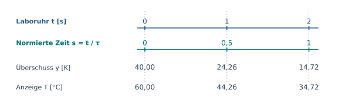
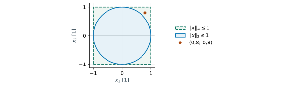
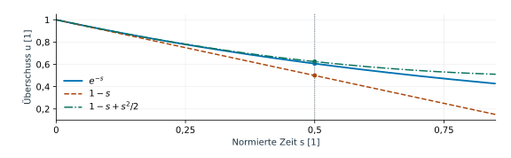
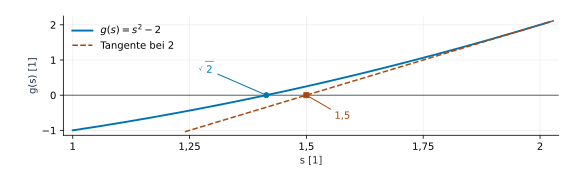
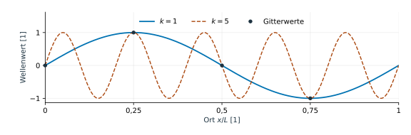

<a id="grundlagen"></a>

# Mathematische Grundlagen

## Einleitung · Welche Mathematik braucht der erste Versuch?

Zwei Studierende simulieren denselben abkühlenden Fühler. Beide Programme liefern eine fallende Kurve. Eines rechnet mit Sekunden, das andere mit Millisekunden. Am Ende der ersten Sekunde zeigen die Programme verschiedene Temperaturen. Welche Zahl erwarten wir aus dem Modell? Was bedeutet der Abstand zwischen zwei Kurven? Und wie können wir aus einem kleinen Defekt schließen, dass der berechnete Zustand nahe an der Lösung liegt?

Wir beantworten solche Fragen zunächst an Rechnungen, die sich auf Papier überprüfen lassen. Die Beispiele kehren im Buch wieder. Aus dem Abkühlmodell wird ein Anfangswertproblem, aus gekoppelten Temperaturen wird eine Matrix, aus einer Schwelle eine Nullstelle. Später werden aus einer Saite und einem Wärmeleiter räumliche Felder. Mit denselben Prüfideen lassen sich die Ergebnisse von klassischen und gelernten Verfahren beurteilen.

**Kernweg für die Erstlektüre.** Beginnen Sie mit [Größen und Skalen](#g-skalen), [Vektoren und Matrizen](#g-lineare-algebra) und [Ableitungen und Integralen](#g-analysis). Danach führen [Anfangswertprobleme](#g-ode) und [Fehler und Konvergenz](#g-fehler) direkt in [Kapitel 1](../lehrbuch_numerische_simulation.md#kap01-einstieg). Kennen Sie einen Begriff bereits, können Sie bei der zugehörigen Rechenprobe einsetzen.

**Vertiefung nach Bedarf.** [Nullstellen, Fixpunkte und Schranken](#g-fixpunkte) bereiten die Existenzbeweise, impliziten Schritte und Ereignissuche vor. Für die räumlichen Kapitel folgen [Felder und schwache Ableitungen](#g-felder). [Fourier-Moden](#g-fourier) und [Messdaten](#g-daten) liefern die Werkzeuge für das Saitenbeispiel und das Lernen von Feldoperatoren.

**Selbst prüfen.** Am Ende stehen [neun Aufgaben](#g-aufgaben) und [getrennte Lösungsseiten](#g-loesungen). Der [erste Versuch](#g-skalen) benötigt Bruchrechnung, Potenzen und das Lesen eines Funktionsgraphen. Die übrigen Werkzeuge entwickeln wir aus den Beispielen.

[Zum Schluss der Grundlagen](#kapG-schluss)

<!-- Buchseite -->

<a id="g-skalen"></a>

## G.1 Größen, Funktionen und Skalen

Ein Fühler beginnt bei $60\,^\circ\mathrm C$ in Luft mit $20\,^\circ\mathrm C$. Wir unterscheiden die gemessene Temperatur $T(t)$ und den **Temperaturüberschuss** $y(t)=T(t)-T_\mathrm{Luft}$. Am Anfang ist $y(0)=40\,\mathrm K$. Ein Temperaturunterschied von einem Grad Celsius entspricht einem Kelvin. Die Eingabe der Funktion $y$ ist eine Zeit, ihre Ausgabe ein Temperaturunterschied. Der Anfangswert gehört zur konkreten Messung. Die feste Zeitkonstante $\tau=2\,\mathrm s$ gehört zum Modell.

Nehmen wir an, der Überschuss sinkt zu jedem Zeitpunkt mit der Rate $y'=-y/\tau$. Bei $y=40\,\mathrm K$ beträgt die Rate $-20\,\mathrm{K/s}$. Bei der halben Temperaturdifferenz halbiert sich auch die Rate. Das Minuszeichen ist eine Aussage über die Richtung der Änderung. An den Einheiten lässt sich prüfen, ob beide Seiten der Gleichung dieselbe Größe meinen.

Wir wählen $s=t/\tau$ und $u(s)=y(\tau s)/y(0)$. Eine Einheit der neuen Uhr umfasst hier zwei Sekunden. Halbiert sich $u$, dann hat sich auch der Temperaturüberschuss halbiert. Wie hängen die beiden Änderungsraten zusammen?

<a id="revision-g-01"></a>

Während die neue Uhr um $\Delta s$ vorrückt, vergehen $\tau\Delta s$ Sekunden. Deshalb gilt
$$
\frac{u(s+\Delta s)-u(s)}{\Delta s}
=\frac{\tau}{y(0)}\frac{y(t+\tau\Delta s)-y(t)}{\tau\Delta s}.
$$
Für $\Delta s\to0$ nähert sich der rechte Quotient der gemessenen Abkühlrate $y'(t)=-y(t)/\tau$. Einsetzen ergibt

$$
\frac{\mathrm d u}{\mathrm d s}
 =\frac{\tau}{y(0)}y'(\tau s)=-u,\qquad u(0)=1.
$$

Die Zeit und der Zustand sind jetzt dimensionslos. Das Modell in diesen Koordinaten gilt auch für einen anderen Fühler mit gleicher Abkühlregel und anderer Zeitkonstante. Für die Rückrechnung gilt $T(t)=T_\mathrm{Luft}+40\,\mathrm K\,u(t/(2\,\mathrm s))$. Wenn ein Programm in Millisekunden rechnet, muss die Zeitkonstante dort als 2000 Millisekunden erscheinen.

Den Unterschied zwischen physikalischer und normierter Zeit können Sie in [Abb. G.1](#fuehler-skalen) auf zwei ausgerichteten Skalen ablesen.


**Notation für die folgenden Kapitel.** Ein Punkt über einer Größe bedeutet Ableitung nach der physikalischen Zeit $t$. Der Index $i$ bezeichnet häufig eine Zustandskomponente und $n$ einen Zeitschritt. In $y_{n,i}$ steht somit sowohl die Zeitstufe als auch die Komponente. Welcher Zahlenwert einen Fehler von eins bedeutet, hängt von der jeweiligen Skala ab. Diese Frage greift [Kapitel 2](../lehrbuch_numerische_simulation.md#t1-k2) bei der Schrittprüfung auf.

<!-- Buchseite -->

### Zwei Uhren für dieselbe Messung

<a id="fuehler-skalen"></a>



Halten Sie bei einer Sekunde an. Auf der unteren Uhr ist eine halbe Einheit vergangen. Lesen Sie in derselben Spalte erst den Überschuss ab und addieren Sie die Umgebungstemperatur von 20 °C. Rechnen Sie anschließend den dritten Messpunkt selbst nach. Die Anzeige fällt weiter, obwohl die beiden Uhren gleichmäßig laufen.


<!-- Buchseite -->

<a id="g-lineare-algebra"></a>

## G.2 Vektoren, Matrizen und lineare Gleichungen

Wir beobachten zwei gekoppelte Speicher gleichzeitig. Den Zustand schreiben wir als Spaltenvektor $x=(x_1,x_2)^\mathsf T$. Allgemein bezeichnet $\mathbb R^d$ den Raum von $d$ reellen Komponenten. Eine Matrix sammelt die Koeffizienten mehrerer linearer Gleichungen. Für
$$
A=\begin{pmatrix}2&-1\\-1&2\end{pmatrix},\qquad
b=\begin{pmatrix}1\\0\end{pmatrix}
$$
bedeutet $Ax=b$ die beiden Zeilen $2x_1-x_2=1$ und $-x_1+2x_2=0$. Aus der zweiten Gleichung folgt $x_1=2x_2$. Damit gibt die erste $3x_2=1$, also $x=(2/3,1/3)^\mathsf T$. Wir prüfen die Lösung, indem wir sie in beide Zeilen einsetzen. Das Eliminieren von Unbekannten ist die Idee hinter den Dreieckslösungen in [Kapitel 3](../lehrbuch_numerische_simulation.md#k3-newton).

Das **Skalarprodukt** zweier reeller Vektoren ist $x^\mathsf T z=\sum_i x_i z_i$. Für orthogonale Vektoren verschwindet es. Die euklidische Norm ist $\|x\|_2=\sqrt{x^\mathsf T x}$. Die Maximumsnorm $\|x\|_\infty=\max_i|x_i|$ liest die größte Komponente ab. Für $x=(3,4)^\mathsf T$ ergeben sich fünf und vier. Bei gemischten Einheiten dividieren wir jede Komponente vor dem Bilden einer Norm durch eine passende Skala. Eine Längenabweichung und eine Spannungsabweichung dürfen so denselben dimensionslosen Fehlerwert haben.

**Ort und Geschwindigkeit vergleichen.** Wählen wir feste positive Bezugswerte $s_q$ in Metern und $s_v$ in Metern pro Sekunde. Für $y=(q,v)^\mathsf T$ wird $Dy=(q/s_q,v/s_v)^\mathsf T$ mit $D=\operatorname{diag}(1/s_q,1/s_v)$ dimensionslos. Bei $s_q=0{,}10\,\mathrm m$ und $s_v=0{,}20\,\mathrm{m/s}$ verbrauchen ein Zentimeter Ortsfehler und zwei Zentimeter pro Sekunde Geschwindigkeitsfehler jeweils ein Zehntel der Bezugsskala. Eine Umrechnung von Metern auf Zentimeter lässt beide Quotienten unverändert. Für das Vektorfeld verwenden wir in [Kapitel 1](../lehrbuch_numerische_simulation.md#auflage-k01-01) dieselben Skalen.




**Projektion auf eine Tangente.** Sei $n=(0,1)^\mathsf T$ ein Einheitsvektor senkrecht zur Tangente und $v=(3,4)^\mathsf T$. Der Normalanteil beträgt $n^\mathsf T v=4$. Durch Abziehen von $4n$ bleibt $(3,0)^\mathsf T$. Allgemein ist $v-n(n^\mathsf T v)$ orthogonal zu $n$, weil $n^\mathsf Tn=1$. So lässt sich die Geschwindigkeitskorrektur in [Kapitel 4](../lehrbuch_numerische_simulation.md#t1-k4) prüfen.

<!-- Buchseite -->

### Was ein kleines Residuum über die Lösung verrät

Für einen Näherungswert $\widehat x$ des Gleichungssystems $Ax=b$ heißt $r=b-A\widehat x$ **Residuum**. Der tatsächliche Fehler ist $e=x-\widehat x$. Subtraktion der beiden Gleichungen ergibt $Ae=r$. Bei invertierbarem $A$ folgt $e=A^{-1}r$. Wenn die Wirkung der Inversen groß ist, kann ein kleines Residuum zu einem erheblichen Fehler gehören.

Die zu einer Vektornorm passende Matrixnorm misst die größte Verstärkung. In der Maximumsnorm ist $\|A\|_\infty=\max_i\sum_j|a_{ij}|$. Jede Zeile erfüllt die obere Schranke durch die Dreiecksungleichung. Für eine Zeile mit maximaler Summe erreicht ein Vektor mit den Vorzeichen ihrer Koeffizienten diese Schranke. Mit der Konditionszahl $\kappa_\infty(A)=\|A\|_\infty\|A^{-1}\|_\infty$ erhält man für $b\ne0$
$$
\frac{\|x-\widehat x\|_\infty}{\|x\|_\infty}
 \le \kappa_\infty(A)\frac{\|r\|_\infty}{\|b\|_\infty}.
$$
Hier verwenden wir zuerst $\|e\|_\infty\le\|A^{-1}\|_\infty\|r\|_\infty$ und anschließend $\|b\|_\infty\le\|A\|_\infty\|x\|_\infty$.

In einem zugespitzten Beispiel seien die Zeilen $x_1+x_2=2$ und $x_1+(1+\epsilon)x_2=2+\epsilon$. Subtraktion ergibt $\epsilon x_2=\epsilon$, also $x=(1,1)^\mathsf T$. Erhöhen wir die zweite rechte Seite um $\epsilon=10^{-3}$, ergibt sich $x_2=2$ und $x_1=0$. Die rechte Seite ändert sich in der Maximumsnorm relativ um ungefähr $0{,}05\,\%$. Der Zustand ändert sich relativ um $100\,\%$. Bei $\epsilon=0$ geben beide Zeilen dieselbe Information und die Lösung ist nicht eindeutig bestimmt.

Die Kondition gehört zum mathematischen Problem. In einem Solver prüfen wir zusätzlich, wie genau sein Algorithmus das gestellte Problem löst. Bei der [algebraischen Bindung](../lehrbuch_numerische_simulation.md#t1-k4) und der [Diodenkennlinie](../lehrbuch_numerische_simulation.md#fb-diode) treffen beide Fragen aufeinander. [Driscoll und Braun, Kondition von Rechenproblemen](https://fncbook.com/conditioning/)

<!-- Buchseite -->

<a id="revision-g-02"></a>

### Zwei Bedeutungen eines kleinen Singulärwerts

Eine skalierte Abbildung $K=\operatorname{diag}(2,0{,}1)$ streckt einen Einheitsvektor in der ersten Richtung um den Faktor zwei, in der zweiten schrumpft er auf ein Zehntel. Für $\|z\|_2=1$ ist $\|Kz\|_2^2=4z_1^2+0{,}01z_2^2$. Der kleinste mögliche Betrag ist also $\sigma_{\min}(K)=0{,}1$. Bei einem Residuum der Länge $0{,}02$ kann der Lösungsfehler bis $0{,}2$ betragen. Diese Eigenschaft der Gleichung verwenden wir beim [dualen Fehlernachweis](../lehrbuch_numerische_simulation.md#revision-k09-02).

Andere Singulärwerte erhalten wir aus Messdaten. Ziehen wir an jedem der beiden Zeitpunkte den Mittelwert der zwei Trainingsbeispiele ab. Als Abweichungen seien $d_1=(1,2)^\mathsf T$ und $d_2=-d_1$ gegeben. Sie bilden die Spalten einer Matrix $D$. In der gemeinsamen Richtung $(1,2)^\mathsf T/\sqrt5$ liegt die gesamte quadrierte Amplitude $5+5=10$. Senkrecht dazu liegt keine. Die Datensingulärwerte sind $s_1(D)=\sqrt{10}$ und $s_2(D)=0$. Eine einzige Zeitform stellt beide Spuren exakt dar. Auf dieser Idee beruht die [POD der Populationsbahnen](../lehrbuch_numerische_simulation.md#cp1b-gegenprobe).

<!-- Buchseite -->


<a id="g-analysis"></a>

## G.3 Ableitungen, Integrale und Taylorentwicklung

Ein Wagen legt zwischen $t$ und $t+h$ die Strecke $q(t+h)-q(t)$ mit Vorzeichen zurück. Der Quotient $\bigl(q(t+h)-q(t)\bigr)/h$ ist seine mittlere Geschwindigkeit auf diesem Intervall. Hat er einen Grenzwert für $h\to0$, so ist dieser die momentane Geschwindigkeit $q'(t)$. Sie hat die Einheit Meter pro Sekunde. Das Vorzeichen zeigt, in welche Richtung der Ort zunimmt.

Das Integral sammelt die Änderung auf. Für eine stetige Geschwindigkeit $v$ mit $q'=v$ liefert der Hauptsatz der Differential- und Integralrechnung
$$
q(t+h)=q(t)+\int_t^{t+h} v(s)\,\mathrm ds.
$$
Ist $v(t+s)=v(t)+as$ mit konstanter Beschleunigung $a$, folgt $q(t+h)=q(t)+hv(t)+ah^2/2$. Bei $q(t)=0$, $v(t)=2\,\mathrm{m/s}$, $a=-4\,\mathrm{m/s^2}$ und $h=0{,}25\,\mathrm s$ beträgt der Ort am Ende $0{,}375\,\mathrm m$. Nur die Startgeschwindigkeit zu verwenden ergäbe $0{,}5\,\mathrm m$. Der ausgelassene Term $ah^2/2$ erklärt den Unterschied exakt.

### Eine Schranke für den ausgelassenen Teil

Für eine zweimal stetig differenzierbare Funktion $y$ gilt $y'(t+s)=y'(t)+\int_0^s y''(t+r)\,\mathrm dr$. Setzen wir das in das Integral für den neuen Zustand ein und vertauschen die Integrationsreihenfolge über $0\le r\le s\le h$, folgt
$$
y(t+h)=y(t)+hy'(t)+\int_0^h (h-r)y''(t+r)\,\mathrm dr,\qquad h>0 .
$$
Bei $|y''|\le M$ ist der Rest höchstens $Mh^2/2$ im Betrag. Nimmt man auch $h^2 y''(t)/2$ auf und setzt $|y'''|\le M_3$ voraus, liefert dieselbe Rechnung einen Rest von höchstens $M_3h^3/6$. Das sind Taylor-Näherungen mit einer überprüfbaren Voraussetzung über das Stück der Bahn. Die Notation $O(h^p)$ meint, dass eine feste Konstante den Betrag für alle hinreichend kleinen $h$ durch $C h^p$ beschränkt.

Beim normierten Fühler ist $u(s)=e^{-s}$. Für $s=1/4$ ergeben die lineare Näherung $0{,}75$, die quadratische $0{,}78125$ und die Referenz rund $0{,}778801$. Die kubische Restschranke der quadratischen Näherung ist $(1/4)^3/6\approx0{,}0026042$, da $|u'''|\le1$ auf dem betrachteten Intervall. In [Kapitel 2](../lehrbuch_numerische_simulation.md#t1-k2-fehler) geht diese Idee in die Fehlerschätzung von Zeitschritten ein.

<!-- Buchseite -->

<a id="g-mehrere-eingaben"></a>

### Wie sich eine Funktion mit mehreren Eingaben ändert

Ein Modell kann von mehreren Größen abhängen. Für $g(x,z)=x+z^2-1$ bedeutet $\partial g/\partial z=2z$, dass $x$ während der Ableitung festgehalten wird. Das Paar der partiellen Ableitungen bildet den Gradienten $\nabla g=(1,2z)^\mathsf T$. Wenn sich beide Größen auf einer Bahn ändern, gilt nach der Kettenregel
$$
\frac{\mathrm d}{\mathrm dt}g(x(t),z(t))=x'(t)+2z(t)z'(t).
$$
Mit der Bindung $g=0$ und der Rate $x'=z=1$ ergibt sich am Start $z'=-1/2$. Genau diese Frage nach zulässigen Änderungen begegnet uns bei [DAEs](../lehrbuch_numerische_simulation.md#t1-k4). Ist $z=0$, verschwindet der Koeffizient vor $z'$. An dieser Stelle liefert diese Rechnung keine eindeutige Rate für $z$.

Für ein Vektorfeld enthält die **Jacobi-Matrix** die partiellen Ableitungen jeder Ausgabekomponente nach jeder Eingabe. Für ein normiertes Federwagenfeld $f(q,v)=(v,-4q-v/2)^\mathsf T$ ergibt sich
$$
J=\frac{\partial f}{\partial(q,v)}
 =\begin{pmatrix}0&1\\-4&-1/2\end{pmatrix}.
$$
Eine kleine Zustandsänderung $\delta y$ ändert das Feld in erster Näherung um $J\,\delta y$. Bei diesem linearen Feld ist die Beziehung exakt. Für einen Wächter $g(t,y)$ mit expliziter Zeitabhängigkeit lautet die Ableitung längs $y'=f(t,y)$ entsprechend $g_t+\nabla_y g^\mathsf T f$. Ein großer Betrag an der Schwelle hilft, den Durchgang zeitlich genau zu lokalisieren. [Ereignissuche auf einer dichten Ausgabe](../lehrbuch_numerische_simulation.md#k5-detektion)



<!-- Buchseite -->

<a id="auflage-gl-04"></a>

### Von Messpunkten zu einer Quadraturregel

Der Wagen legt in einem Schritt die Strecke $h\int_0^1 v(t_n+hs)\,\mathrm ds$ zurück. An welchen Stellen $s$ sollen wir die Geschwindigkeit abfragen? Bei $n$ verschiedenen Knoten $c_i$ legen wir durch die gemessenen Werte ein Polynom vom Grad höchstens $n-1$. Das $i$-te Lagrange-Polynom $\ell_i$ nimmt am eigenen Knoten den Wert eins und an allen anderen den Wert null an. Sein Integral $b_i=\int_0^1\ell_i(s)\,\mathrm ds$ ist das Gewicht des Messwerts. Für jedes Polynom bis Grad $n-1$ ist die gewichtete Summe dadurch exakt.

Lassen sich die Knoten so wählen, dass auch höhere Grade stimmen? Das Knotenpolynom $w(s)=\prod_{i=1}^n(s-c_i)$ hat an jeder Messstelle den Wert null. Soll die Regel ein Produkt $wq$ exakt integrieren, muss also $\int_0^1w(s)q(s)\,\mathrm ds=0$ gelten. Diese Gleichheit heißt Orthogonalität zum Testpolynom $q$. Sie reicht auch aus. Bei der Polynomdivision $p=wq+r$ hat der Rest $r$ Grad kleiner als $n$ und wird schon durch die Interpolation exakt integriert.

**Zwei Messungen, eine am Schrittende.** Wir setzen $c_2=1$. Für Genauigkeit bis Grad zwei genügt der Test $q=1$. Aus $\int_0^1(s-c_1)(s-1)\,\mathrm ds=c_1/2-1/6=0$ folgt $c_1=1/3$. Die Funktionen $1$ und $s$ liefern $b_1+b_2=1$ und $b_1/3+b_2=1/2$. Damit sind die Gewichte $3/4$ und $1/4$. Prüfen Sie $s^2$ selbst. Die gewichtete Summe ist $(3/4)/9+1/4=1/3$, genau sein Integral.

Bei der Gauß-Regel sind alle $n$ Knoten frei. Orthogonalität gegen $1,s,\ldots,s^{n-1}$ ermöglicht Exaktheit bis Grad $2n-1$. Bei der rechten Radau-Regel ist ein Knoten fest. Die Tests reichen bis $s^{n-2}$, die Exaktheit bis Grad $2n-2$ (für $n\ge2$). Mit drei Radau-Knoten bleiben genau die Tests $1$ und $s$. Mit ihnen leitet [Kapitel 3](../lehrbuch_numerische_simulation.md#k3-radau) die beiden inneren Messzeiten her.

<!-- Buchseite -->

<a id="g-ode"></a>

## G.4 Anfangswertprobleme, Eigenwerte und Moden

Eine **gewöhnliche Differentialgleichung** $y'=f(t,y)$ gibt in jedem Zustand eine Änderungsrate vor. Ein Anfangswert $y(t_0)=y_0$ benennt die Bahn, die wir verfolgen möchten. Für das skalare Testproblem $y'=\lambda y$ ist
$$
y(t)=y_0e^{\lambda(t-t_0)}
$$
die Lösung. Man sieht das auch, wenn man die Gleichung mit $e^{-\lambda(t-t_0)}$ multipliziert. Dann ist die Ableitung von $e^{-\lambda(t-t_0)}y(t)$ null. Dieses Produkt behält also den Anfangswert $y_0$. Bei $\lambda<0$ klingt die Ausgangsstörung ab. Ist $\lambda=-1/\tau$, bleibt nach einer Zeitkonstante $\tau$ der Anteil $e^{-1}$. Bei $\lambda>0$ wächst die Störung. In physikalischer Zeit hat $\lambda$ die Einheit $\mathrm{s^{-1}}$.

Für das normierte Fühlermodell aus [G.1](#g-skalen) ist demnach $u(s)=e^{-s}$. Nach zwei Sekunden beträgt die Temperatur $20\,^\circ\mathrm C+40\,\mathrm K/e\approx34{,}72\,^\circ\mathrm C$. Diese Rechnung liefert eine Referenz für jeden Zeitintegrator auf demselben Modell. Sie prüft die Implementierung der Differentialgleichung. Ob das Abkühlgesetz den realen Fühler beschreibt, entscheidet ein Vergleich mit Messdaten.

### Zwei Speicher in gemeinsame und gegenläufige Anteile zerlegen

Sei $x'=Ax$ und $A=\left(\begin{smallmatrix}-3&2\\2&-3\end{smallmatrix}\right)$ in normierten Koordinaten. Wenn beide Speicher denselben Wert haben, wirkt die Kopplung auf beide gleich. Rechnen wir $A(1,1)^\mathsf T$, erhalten wir $-(1,1)^\mathsf T$. Für $(1,-1)^\mathsf T$ ergibt sich $-5(1,-1)^\mathsf T$. Ein Vektor $w\ne0$ mit $Aw=\lambda w$ heißt **Eigenvektor**, $\lambda$ ist sein Eigenwert. Entlang $w$ gilt dieselbe Skalargleichung wie oben.

<a id="auflage-gl-03"></a>

Die Kopplungsmatrix ist reell und symmetrisch. Für Eigenvektoren $Av=\lambda v$ und $Aw=\mu w$ gilt deshalb $\lambda v^\mathsf T w=(Av)^\mathsf T w=v^\mathsf T Aw=\mu v^\mathsf T w$. Verschiedene Eigenwerte erzwingen $v^\mathsf T w=0$. Nach Normierung stehen die beiden Richtungen als Spalten in einer orthogonalen Matrix $Q$ mit $Q^{-1}=Q^\mathsf T$. Bei einem mehrfachen Eigenwert lässt sich im Eigenraum eine orthonormale Basis wählen. Für eine allgemeine Kopplungsmatrix muss die Wahl der Basis eigens begründet werden.

Der Anfangszustand $(1,0)^\mathsf T$ ist die Summe der beiden Eigenvektoren mit je einem halben Faktor. Somit lautet seine Bahn
$$
x(t)=\tfrac12 e^{-t}\begin{pmatrix}1\\1\end{pmatrix}
     +\tfrac12 e^{-5t}\begin{pmatrix}1\\-1\end{pmatrix}.
$$
Die Summe $x_1+x_2$ misst allein $e^{-t}$. Die Differenz misst $e^{-5t}$. Ein Sensor, der bloß die Summe beobachtet, sieht die schnelle Mode gar nicht. In [Kapitel 1](../lehrbuch_numerische_simulation.md#steifigkeit) wird diese Beobachtung zur numerischen Probe für Steifigkeit.

<!-- Buchseite -->

### Von reellen Eigenwerten zur Schwingung

Für einen ungedämpften Federwagen mit $q''=-\omega^2 q$ ergibt die Wahl $y=(q,v)^\mathsf T$ mit $v=q'$ die Matrix
$$
A=\begin{pmatrix}0&1\\-\omega^2&0\end{pmatrix}.
$$
Ein Eigenvektor zu $\lambda$ existiert, wenn $A-\lambda I$ singulär ist. $I$ ist die Einheitsmatrix. Für eine $2\times2$-Matrix mit Zeilen $(a,b)$ und $(c,d)$ prüft man Singularität mit der Determinante $ad-bc$. Hier ergibt sie $\lambda^2+\omega^2$. Mit $\mathrm i^2=-1$ lauten die Eigenwerte $\pm\mathrm i\omega$. Die Formel $e^{\mathrm i\theta}=\cos\theta+\mathrm i\sin\theta$ beschreibt die Drehung eines Punktes in der komplexen Ebene. Bei $\lambda=a+\mathrm i b$ wächst oder fällt der Betrag mit $e^{at}$, und die Phase ändert sich um $bt$.

Für $q(0)=q_0$ und $v(0)=0$ ergibt sich reell $q(t)=q_0\cos(\omega t)$. Ableiten liefert $v(t)=-\omega q_0\sin(\omega t)$ und bestätigt das Anfangswertproblem. Bei $\omega=2\,\mathrm{s^{-1}}$ liegt der erste Durchgang durch die Ruhelage bei $t=\pi/4\,\mathrm s$. Die Amplitude bleibt im exakten Modell erhalten. An diesem Prüffall unterscheiden sich Methoden, die für abklingende Moden zuverlässig sind, in ihren Amplituden- und Phasenfehlern. [Stabilität und numerische Dämpfung](../lehrbuch_numerische_simulation.md#k3-stabilitaet)

**Ein Werkzeug für konstante Matrizen.** Die Zeitentwicklung eines linearen Systems $y'=Ay$ lässt sich als $y(t)=e^{(t-t_0)A}y_0$ schreiben. Dabei ist $e^{sA}=\sum_{k=0}^\infty s^k A^k/k!$ und $A^0=I$. Die Reihe konvergiert in einer Matrixnorm, denn $\|A^k\|\le\|A\|^k$. In einem System mit einer Basis aus Eigenvektoren genügt es, die einzelnen Anteile mit $e^{s\lambda}$ fortzuführen. Ein einzelner Eigenwert erfasst im Allgemeinen weder die Überlagerung der Anteile noch das Verhalten einer beliebigen Zustandsnorm über kurze Zeiten. [Lebl, Matrixexponentialfunktion](https://www.jirka.org/diffyqs/html/sec_matexp.html)

<!-- Buchseite -->

<a id="g-fehler"></a>

## G.5 Fehlermaße und Gleitkommazahlen

Ein Prüfwert von $0{,}998$ bei Referenz eins hat absoluten Fehler $0{,}002$ und relativen Fehler $0{,}2\,\%$. Ist die Referenz null, ist die Division durch ihren Betrag nicht definiert. Für einen Positionssensor am Nullpunkt kann ein absolutes Budget in Millimetern sinnvoll sein. Für die Amplitude eines ganzen Feldes kann man eine Norm wählen und durch die Referenznorm teilen, sofern diese positiv ist.

Für Zustände mit verschiedenen Einheiten bietet eine Skala $s_i=a_i+r_i|y_i^\ast|>0$ eine einfache Normierung. $a_i$ ist eine absolute Toleranz in der Einheit der Komponente und $r_i$ ist dimensionslos. Der Vergleich $\max_i |\widehat y_i-y_i^\ast|/s_i\le1$ prüft alle einzelnen Toleranzbänder. Bei einer Zeitsteuerung wird statt der exakten Referenz eine verfügbare Skala aus den Schrittwerten und ein geschätzter lokaler Fehler verwendet. [Schrittprüfung in Kapitel 2](../lehrbuch_numerische_simulation.md#t1-k2) · [Äußeres Fehlerbudget in Kapitel 10](../lehrbuch_numerische_simulation.md#v91-abnahme)

### Warum dieselbe Formel zwei Ergebnisse liefern kann

Eine binäre Gleitkommazahl speichert eine endliche Zahl signifikanter Binärstellen. Bei IEEE-754 binary64 beträgt der Abstand zwischen eins und der nächsten größeren darstellbaren Zahl $2^{-52}$. In der üblichen Rundung zur nächsten Zahl gilt daher $(1+2^{-54})-1=0$ in binary64. Das kleine Plus wird bereits bei der ersten Addition gerundet.

Für $x=2^{-54}$ liefert auch die direkte Auswertung von $\sqrt{1+x}-1$ null. Multiplizieren wir in exakter Arithmetik mit dem konjugierten Ausdruck, ergibt sich dieselbe Funktion in der Form
$$
 \sqrt{1+x}-1=\frac{x}{\sqrt{1+x}+1}.
$$
Die rechte Formel liefert in binary64 ungefähr $2^{-55}$. Die Rechnung hängt nicht mehr von der Differenz zweier fast gleicher Wurzelausdrücke ab. Ähnlich lässt sich beim [quadratischen QSS2-Termin](../lehrbuch_numerische_simulation.md#v91-qss2) die kleinere Wurzel über das Produkt der Wurzeln berechnen. [Driscoll und Braun, Gleitkommazahlen](https://fncbook.com/floating-point/)

<!-- Buchseite -->

### Wie sich Fehler über viele Schritte ausbreiten

Ein lokaler Schrittfehler misst eine Abweichung, wenn die Rechnung mit dem **exakten** Zustand am Schrittanfang startet. Der globale Fehler vergleicht die berechnete Bahn mit der Referenz nach vielen Schritten. Die Fehlerfolge lässt sich an einem linearen Verfahren als
$$
e_{n+1}=R\,e_n+\delta_n
$$
schreiben. $R$ multipliziert den bisherigen Fehler. $\delta_n$ ist der neu hinzukommende lokale Beitrag. Beginnen wir exakt, so ergibt wiederholtes Einsetzen $e_N=\sum_{j=0}^{N-1} R^{N-1-j}\delta_j$. Für $|R|\le1$ ist sein Betrag höchstens die Summe der Beträge der Einzelbeiträge. Bei lokalen Beiträgen von höchstens $C h^{p+1}$ und $N=T/h$ folgt an festem Endpunkt die globale Schranke $CT h^p$.

Am normierten Fühler ergibt Vorwärts-Euler nach $N$ Schritten bis $s=1$ den Wert $(1-1/N)^N$. Die Referenz ist $e^{-1}$. Die absoluten Endfehler betragen für $N=10,20,40$ ungefähr
$$
 E_{10}=0{,}01920,\qquad E_{20}=0{,}009394,\qquad E_{40}=0{,}004647 .
$$
Aus $E(h)\approx C h^p$ folgt beim Halbieren $E(h)/E(h/2)\approx2^p$. Mit $p_\mathrm{mess}=\log_2(E(h)/E(h/2))$ ergeben sich ungefähr $1{,}03$ und $1{,}02$. Diese Zahlen nähern sich der erwarteten Ordnung eins. Dazu halten wir Beobachtungszeit und Modell fest und verändern ausschließlich die Schrittzahl. Bei sehr kleiner Schrittweite kann die Rundung die führende Abweichung mitbestimmen.

**Stabilität und Genauigkeit.** Für $y'=\lambda y$ hat Vorwärts-Euler den Faktor $R=1+h\lambda$. Bei $\lambda=-5\,\mathrm{s^{-1}}$ und $h=0{,}4\,\mathrm s$ ist $R=-1$. Der Betrag wächst im exakten Rechenmodell nicht, er klingt aber auch nicht ab. Die exakte Mode fällt pro Schritt auf $e^{-2}\approx0{,}1353$ ihres vorherigen Betrags. Der Test zeigt, weshalb ein begrenzter numerischer Verlauf noch ein eigenes Genauigkeitsbudget braucht. [Lokaler und globaler Fehler](../lehrbuch_numerische_simulation.md#t1-k2-fehler)


<!-- Buchseite -->

<a id="g-fixpunkte"></a>

## G.6 Nullstellen, Fixpunkte und Schranken

Ein Relais schaltet, wenn das Signal $g$ den Wert null erreicht. Für das Lehrsignal $g(s)=s^2-2$ liegt auf $[1,2]$ eine Nullstelle, weil $g$ stetig ist und die Randwerte verschiedene Vorzeichen haben. Auf diesem Intervall ist $g$ streng wachsend, weil $g'(s)=2s>0$ gilt. Damit ist die Nullstelle eindeutig. Die **Intervallhalbierung** wertet $g$ in der Mitte $1{,}5$ aus. Weil $g(1{,}5)=0{,}25>0$, bleibt $[1,1{,}5]$ als Klammer. Nach $k$ Halbierungen misst die ursprüngliche Einheitsklammer $2^{-k}$. Ihr Mittelpunkt weicht um höchstens die halbe Breite von der eingeschlossenen Nullstelle ab.

Das **Newton-Verfahren** verwendet zusätzlich die Steigung. Für eine kleine Korrektur $\delta$ setzen wir $g(s+\delta)\approx g(s)+g'(s)\delta$. Die Nullstelle dieser Tangente liefert bei $g'(s)\ne0$
$$
s_\mathrm{neu}=s-\frac{g(s)}{g'(s)}.
$$
Vom Startwert zwei führt der erste Schritt zu $1{,}5$, der zweite zu $17/12\approx1{,}416667$. In der Nähe einer einfachen Nullstelle liefert eine glatte Funktion oft sehr schnelle Konvergenz. An einer doppelten Nullstelle $g(s)=(s-s^\ast)^2$ halbiert Newton dagegen den Abstand in jedem Schritt. Die Wahl eines Startwerts und die Prüfung des Residuums bleiben wichtig.



In mehreren Dimensionen wird aus der Division durch $g'$ eine lineare Lösung mit der Jacobi-Matrix. Für eine zeitliche Nullstelle ist zusätzlich die Güte der zugrunde liegenden Bahn entscheidend. Bei einer Berührung können die Vorzeichen an beiden Rändern gleich sein. Die [Ereignisprüfung in Kapitel 5](../lehrbuch_numerische_simulation.md#v91-ereignisisolation) betrachtet diesen Fall eigens. [Newton-Verfahren, Driscoll und Braun](https://fncbook.com/newton/)

<!-- Buchseite -->

### Warum sich wiederholte Korrekturen einer Lösung nähern können

Ein **Fixpunkt** erfüllt $x^\ast=P(x^\ast)$. Angenommen, $P$ bildet den gewählten Bereich in sich ab und verkleinert Abstände um höchstens den Faktor $0\le q<1$. Für die Iteration $x_{k+1}=P(x_k)$ gilt $\|x_{k+1}-x_k\|\le q\|x_k-x_{k-1}\|$. Für $k\ge1$ ist die Summe aller noch folgenden Änderungen höchstens
$$
\frac{q}{1-q}\|x_k-x_{k-1}\|.
$$
Die Summe folgt aus der geometrischen Reihe $q+q^2+\cdots=q/(1-q)$. Sie zeigt zugleich, dass die Folge **Cauchy** ist. Zwei hinreichend späte Glieder liegen beliebig nah beieinander. In einem vollständigen, abgeschlossenen Arbeitsbereich existiert deshalb ihr Grenzwert. Wegen der Stetigkeit von $P$ ist er ein Fixpunkt. Zwei Fixpunkte müssten ihren gegenseitigen Abstand bei Anwendung von $P$ beibehalten, obwohl $P$ ihn um den Faktor $q$ begrenzt. Das geht nur bei Abstand null.

Für $P(x)=(x+2)/3$ auf $[0,1]$ ist $q=1/3$. Vom Start null ergeben sich $x_1=2/3$ und $x_2=8/9$. Die letzte Änderung beträgt $2/9$. Die obige Schranke liefert $1/9$ für den Abstand zum Fixpunkt eins. In [Kapitel 1](../lehrbuch_numerische_simulation.md#loesbarkeit) ist ein Iterationsglied bei Picard eine **ganze Kurve**. Der Abstand zweier Kurven ist der größte Zustandsabstand im Zeitintervall. Für jeden Zeitpunkt liegt zunächst eine Cauchy-Folge in $\mathbb R^d$ vor. Dieselbe Cauchy-Schranke gilt über das ganze Zeitintervall. Die Konvergenz ist daher gleichmäßig, und die Grenzkurve ist stetig.

**Wie Störungen der Anfangsdaten wachsen können.** Für eine nichtnegative stetige Abweichung $u(t)$ gelte $u(t)\le a+L\int_0^t u(s)\,\mathrm ds$ mit $a,L\ge0$. Nennen wir die rechte Seite $w(t)$, so gilt $w'=Lu\le Lw$. Damit ist $(e^{-Lt}w)'=e^{-Lt}(w'-Lw)\le0$. Es folgt $u(t)\le w(t)\le ae^{Lt}$. Die Grönwall-Schranke aus Kapitel 1 entsteht also aus einer Integration mit einem geeigneten Faktor.

<!-- Buchseite -->

<a id="g-felder"></a>

## G.7 Felder, Randwerte und schwache Ableitungen

Die Konzentration in einem Rohr hängt vom Ort $x$ und von der Zeit $t$ ab. Wir schreiben $u(t,x)$. Mit $u_t$ betrachten wir die Änderung bei festem Ort. Mit $u_x$ betrachten wir die räumliche Änderung bei fester Zeit. Eine **partielle Differentialgleichung** verknüpft solche Ableitungen. In einem eindimensionalen Diffusionsmodell mit konstantem $D>0$ fließt Stoff nach $j=-D u_x$ in Richtung kleinerer Konzentration.

Für einen Abschnitt $[a,b]$ ohne Quelle gilt
$$
\frac{\mathrm d}{\mathrm dt}\int_a^b u(t,x)\,\mathrm dx
  = j(t,a)-j(t,b) = -\int_a^b j_x(t,x)\,\mathrm dx .
$$
Der linke Rand speist bei positiver Flussrichtung Stoff ein, am rechten Rand verlässt er den Abschnitt. Weil die Bilanz für jeden Abschnitt gelten soll, folgt für glatte Felder $u_t=-j_x=D u_{xx}$. In zwei Raumrichtungen sammelt der Gradient die beiden Steigungen in einem Vektor. Für einen Flussvektor lautet die Divergenz $\partial_x j_1+\partial_y j_2$. Auf einem glatten Feld ist $\Delta u=u_{xx}+u_{yy}$ der Laplace-Operator.

<a id="revision-g-03"></a>

Die Divergenz ist der nach außen gerichtete Nettofluss **je Volumen** im Grenzfall einer schrumpfenden Zelle. In einer eindimensionalen Zelle mit Einheitsquerschnitt und $j(x)=ax$ ist der Nettoabfluss $j(x+\Delta x)-j(x)=a\Delta x$. Erst die Division durch $\Delta x$ ergibt $a$. In einer quellenfreien Stoffbilanz gilt daher $\partial_t u=-\nabla\cdot j$. Positive Divergenz entleert die Zelle. Dieselbe Vorzeichenregel verwenden wir später im Grundwasserleiter.


Der **Anfangswert** bestimmt das Profil im ganzen Raum zur Startzeit. Eine **Dirichlet-Bedingung** legt den Feldwert am Rand fest. Eine **Neumann-Bedingung** legt die Normalenableitung fest, die bei konstantem $D$ zum Normalfluss proportional ist. Ein abgeschlossener Behälter hat am Rand Normalfluss null. Dann ist die Gesamtmenge bei fehlender Quelle konstant. Ein fest auf null gehaltener Rand kann Stoff aufnehmen.

**Brücke zur Diskretisierung.** Für benachbarte Zellen ist der aus der linken Zelle ausfließende Grenzstrom derselbe, der der rechten Zelle zufließt. Beim Addieren beider Zellbilanzen hebt er sich auf. Die [Finite-Volumen-Rechnung](../lehrbuch_numerische_simulation.md#t1-k7) nutzt diese Aufhebung als Test für die diskrete Gesamtbilanz.

<!-- Buchseite -->

<a id="g-schwach"></a>

### Wie partielle Integration eine Ableitung verschiebt

Betrachten wir die Diffusionsgleichung auf $0\le x\le1$ mit fest auf null gesetzten Randwerten. Wir multiplizieren mit einer glatten Testfunktion $v(x)$, die an den Enden ebenfalls null ist, und integrieren. Partielle Integration liefert
$$
\int_0^1 u_t v\,\mathrm dx
  = D[u_x v]_0^1 - D\int_0^1 u_x v_x\,\mathrm dx
  =-D\int_0^1 u_x v_x\,\mathrm dx .
$$
Damit genügt auf der rechten Seite eine räumliche Ableitung von $u$. Die Bedingung soll für alle zulässigen Testfunktionen gelten. Bei einer hinreichend glatten Lösung dürfen wir zum betrachteten Zeitpunkt $v=u(t,\cdot)$ wählen. Dann gilt
$$
\tfrac12\frac{\mathrm d}{\mathrm dt}\int_0^1 u^2\,\mathrm dx
 =-D\int_0^1 u_x^2\,\mathrm dx\le0 .
$$
Das Integral über die quadrierte Konzentration nimmt in diesem Randproblem ab. Ein berechnetes Feld lässt sich auf diese Eigenschaft prüfen.

Eine **schwache Ableitung** $w$ erfüllt $\int u v'=-\int w v$ für alle glatten Testfunktionen, die im Inneren des Intervalls getragen sind. Das Dreieck $u(x)=2x$ bis $x=1/2$ und $u(x)=2(1-x)$ danach hat an der Spitze keine klassische Ableitung. Bei stückweiser partieller Integration heben sich die Beiträge an der Spitze auf, weil $u$ dort stetig ist. Als schwache Ableitung bleibt stückweise $w=2$ links und $w=-2$ rechts.

Im Raum $L^2(0,L)$ fassen wir Funktionen zusammen, die bis auf eine Menge vom Maß null übereinstimmen. Das Integral ihres quadrierten Betrags kann einen einzelnen geänderten Punkt nicht erkennen. Für eine Saite brauchen wir trotzdem eine eindeutige Bedeutung für „am Ende eingespannt“.

<!-- Buchseite -->

<a id="auflage-k09-03"></a>

### Wie eine Saite zwei eindeutige Randwerte bekommt

Der Raum $H^1(0,L)$ enthält die $L^2$-Klassen mit erster schwacher Ableitung in $L^2$. In einer Raumdimension hat jede solche Klasse einen eindeutigen stetigen, sogar absolut stetigen Vertreter. Für glatte Funktionen setzen wir $\gamma_0 u=(u(0),u(L))$. Aus $u(0)=u(x)-\int_0^x u'(s)\,\mathrm ds$ folgen durch Mitteln über $x$ und die Cauchy-Schwarz-Ungleichung die Schranke
$$
 |u(0)|\le L^{-1/2}\|u\|_{L^2}+\sqrt L\,\|u'\|_{L^2}.
$$
Dieselbe Schranke gilt am rechten Ende. Konvergieren glatte Näherungen in $H^1$, konvergieren also auch ihre beiden Randwerte. Durch Dichte erhalten wir so die stetige Abbildung $\gamma_0:H^1(0,L)\to\mathbb R^2$, die **Spur**. Sie liest die Endwerte des stetigen Vertreters.

Der Raum der beidseitig eingespannten Formen ist $H_0^1(0,L)=\ker\gamma_0=\overline{C_c^\infty(0,L)}^{\,H^1}$. Der Abschluss bedeutet, dass wir diese Formen samt ihrer schwachen Ableitung durch glatte, im Inneren getragene Funktionen annähern können. Das oben berechnete Dreieck hat Spur $(0,0)$. Die Gerade $x/L$ hat Spur $(0,1)$. Beide besitzen endliche Energie, für die fest eingespannte Saite ist allein das Dreieck zulässig. Im schwachen Wärmeproblem verwenden wir Testfunktionen mit Spur null, sodass der Randterm entfällt. [Spursatz und Randbedingungen](https://jschoeberl.github.io/iFEM/sobolevspaces/Traces.html) · [Saitenoperator in Kapitel 9](../lehrbuch_numerische_simulation.md#t1-k9).


<!-- Buchseite -->

<a id="g-fourier"></a>

## G.8 Fourier-Moden und Projektion auf Felder

Eine fest eingespannte Saite der Länge $L$ hat an beiden Enden Auslenkung null. Die Formen $\sin(k\pi x/L)$ für ganze $k\ge1$ erfüllen diese Randbedingungen. Bei konstanter Wellengeschwindigkeit führt jede Form unter der Wellengleichung ihre eigene Schwingung aus. Um ihre Amplitude aus einem beliebigen Anfangsprofil abzulesen, verwenden wir das Skalarprodukt von Funktionen.

Für reelle Felder ist $\langle u,v\rangle=\int_0^L u(x)v(x)\,\mathrm dx$. Es ist das Gegenstück zur Summe beim Skalarprodukt von Vektoren. Die Norm lautet $\|u\|_2^2=\langle u,u\rangle$. Für die normierten Formen
$$
e_k(x)=\sqrt{2/L}\,\sin(k\pi x/L)
$$
liefert $\langle e_j,e_k\rangle$ eins bei $j=k$ und sonst null. Die Produktformel $2\sin a\sin b=\cos(a-b)-\cos(a+b)$ erklärt das. Jeder Kosinus mit nichtverschwindendem ganzzahligen Vielfachen von $\pi x/L$ integriert sich über $[0,L]$ zu null, denn $\sin(m\pi)=0$ für ganzzahliges $m$. Für gleiche Indizes bleibt der konstante Term.

Der Anteil von $u$ in Richtung $e_k$ ist $a_k=\langle u,e_k\rangle$. Die Näherung $P_Ku=\sum_{k=1}^K a_k e_k$ heißt **orthogonale Projektion**. Der Rest $u-P_Ku$ ist zu jeder behaltenen Mode senkrecht. Beim Quadrieren der Norm fällt der Kreuzterm daher weg
$$
\|u\|_2^2=\|P_Ku\|_2^2+\|u-P_Ku\|_2^2 .
$$
Für $u=e_1+\tfrac12 e_2$ und $K=1$ bleibt ein Fehler mit Norm $1/2$. Seine relative Norm beträgt $1/\sqrt5\approx44{,}7\,\%$. Weitere Stützstellen können die Darstellung von $e_1$ verfeinern. Zur Wiedergabe des fehlenden Anteils braucht die Näherung auch $e_2$. In [Kapitel 9](../lehrbuch_numerische_simulation.md#t1-k9) ist dieser Unterschied für die geknickte Saitenform messbar.

<!-- Buchseite -->

### Welche Wellen auf demselben Gitter gleich aussehen

<a id="auflage-gl-01"></a>

Für den Abtastversuch in Abb. G.5 wechseln wir von der eingespannten Saite auf ein periodisches Intervall. Wir schließen die Enden mit $u(0)=u(L)$ zusammen. Seine Fourier-Moden durchlaufen auf der Länge $L$ jeweils eine ganze Zahl von Perioden. Für ein periodisches Intervall der Länge $L$ ohne doppelt gespeicherten Endpunkt sind die Knoten $x_j=jL/N$ für $j=0,\dots,N-1$. Die komplexe Welle zur Wellenzahl $k$ hat dort die Werte
$$
w_k(x_j)=e^{2\pi\mathrm i k j/N}.
$$
Ersetzen wir $k$ durch $k+N$, kommt der Faktor $e^{2\pi\mathrm i j}=1$ hinzu. Damit sind die Werte an **allen** Gitterknoten identisch. Dieses Zusammenfallen verschiedener Wellen auf demselben Abtastgitter heißt **Aliasing**. Auf vier Knoten liefern die Sinusmoden zu $k=1$ und $k=5$ beide die Folge $(0,1,0,-1)$.



Ein Algorithmus, der nur diese vier Zahlen erhält, kann die beiden Eingabefelder daran nicht unterscheiden. Für die Prüfung eines Feldoperators muss daher klar sein, ob ein feineres Gitter zusätzliche Messwerte liefert oder ob dieselben groben Werte lediglich interpoliert werden. Feste Nullränder lassen sich über die Sinusbasis aus G.8 oder eine ungerade Fortsetzung behandeln. Das [Saitenbeispiel in Kapitel 9](../lehrbuch_numerische_simulation.md#v91-fno-rand) zeigt die Fortsetzung mit denselben vier Werten.

<!-- Buchseite -->

<a id="g-daten"></a>

## G.9 Messdaten, Mittelwerte und kleinste Quadrate

Fünf Rechenläufe liefern die absoluten Fehler $1,2,2,7,8$ in Mikrometern. Das arithmetische Mittel ist vier. Der **Median** ist die mittlere Zahl der sortierten Folge, hier zwei. Das **quadratische Mittel** der Fehler, häufig RMS genannt, ist
$$
\sqrt{\tfrac15(1^2+2^2+2^2+7^2+8^2)}=\sqrt{24{,}4}\approx4{,}94 .
$$
Ein quadratisches Mittel gewichtet größere Einzelabweichungen stärker. Der Maximalfehler ist acht. Welche Zahl für eine Entscheidung zählt, hängt vom Auftrag ab. In einem Test mit Grenzwert für jeden Lauf wäre das Maximum die passende Prüfgröße.

### Einen unbekannten Koeffizienten bestimmen

Wir wollen aus Messpaaren $(x_i,y_i)$ den Faktor $a$ eines Modells $y\approx a x$ bestimmen. Maß sei die Summe der quadratischen Abweichungen $J(a)=\sum_i(a x_i-y_i)^2$. Ableiten ergibt $J'(a)=2\sum_i x_i(a x_i-y_i)$. Wenn mindestens ein $x_i\ne0$ ist, ist $J''(a)=2\sum_i x_i^2$ positiv. Das einzige Minimum erfüllt
$$
a=\frac{\sum_i x_i y_i}{\sum_i x_i^2}.
$$
Für die Paare $(1,2)$ und $(2,3)$ ergibt sich $a=8/5$. Die Differenzen zwischen Modell und Messung sind $-0{,}4$ und $0{,}2$. Dass ihre gewichtete Summe $1\cdot(-0{,}4)+2\cdot0{,}2$ null ist, prüft die Rechnung. Bei lauter $x_i=0$ kann kein Koeffizient aus diesen Daten bestimmt werden.

In [Kapitel 9](../lehrbuch_numerische_simulation.md#fno-physik-lernen) übernehmen modale Größen die Rolle der Eingaben und Beschleunigungen die Rolle der Ausgaben. Der gefundene Faktor ist zunächst für die verwendeten Daten begründet. Zur Prüfung einer Vorhersage braucht man eigene Felder oder Messungen, die beim Fit nicht verwendet wurden.

<!-- Buchseite -->

<a id="g-aufgaben"></a>

## Aufgaben zum Selbstversuch

Versuchen Sie zuerst eine Vorhersage auf Papier. Notieren Sie bei jeder Rechnung, welche Größen dimensionslos sind, was die Referenz ist und welche Aussage sich daraus ableiten lässt. Die [Lösungen](#g-loesungen) beginnen auf einer eigenen Seite.

### A · Einen zweiten Fühler skalieren

Ein Fühler hat zu Beginn einen Temperaturüberschuss von $30\,\mathrm K$. Seine Zeitkonstante beträgt vier Sekunden. Nach welcher normierten Zeit liest man bei $t=2\,\mathrm s$ ab? Berechnen Sie aus der Lösung von $u'=-u$ den tatsächlichen Überschuss.

### B · Zwei fast gleiche Gleichungen vergleichen

Setzen Sie im Beispiel aus G.2 $\epsilon=0{,}01$ und erhöhen Sie nur die zweite rechte Seite um $0{,}002$. Bestimmen Sie den neuen Zustand durch Elimination. Wie groß ist die Zustandsänderung in der Maximumsnorm?

### C · Eine Taylor-Näherung beurteilen

Entwickeln Sie $u(s)=e^{-s}$ um $s=0$ und setzen Sie $s=1/2$ ein. Berechnen Sie die lineare und die quadratische Näherung. Prüfen Sie die Abweichung der zweiten gegen die Schranke aus G.3.

### D · Eine schnelle Mode im Sensor finden

Verwenden Sie die Zweikomponentenmatrix aus G.4, aber starten Sie bei $x(0)=(3,1)^\mathsf T$. Drücken Sie den Anfangswert als Kombination der beiden Eigenvektoren aus. Welche Größen sehen ein Summen- und ein Differenzsensor? Würde ein expliziter Euler-Schritt mit $h=1/2$ die schnelle Mode im Betrag verkleinern?

### E · Die Ordnung aus einer Fehlerreihe lesen

Drei Rechnungen am selben Endzeitpunkt ergeben beim Halbieren von $h$ die Fehler $4\cdot10^{-3}$, $10^{-3}$ und $2{,}5\cdot10^{-4}$. Bestimmen Sie die beobachtete Ordnung. Warum ist der relative Fehler mit Referenzwert null an einem anderen Messzeitpunkt ungeeignet?

<!-- Buchseite -->

### F · Eine Nullstelle einklammern

Für $g(s)=s^2-3$ ist $[1,2]$ eine Startklammer. Berechnen Sie die Klammer nach zwei Halbierungen. Bestimmen Sie außerdem einen Newton-Schritt ausgehend vom rechten Rand. Wie können Sie die resultierenden Zahlen prüfen?

### G · Ein Dreieck im Funktionenraum einordnen

Das Dreieck aus G.7 hat an der Spitze keine klassische Ableitung. Bestimmen Sie die stückweise schwache Ableitung und ihre quadratische Norm. Warum ist ihre Existenz für die schwache Diffusionsbilanz ausreichend?

### H · Eine Mode weglassen und Abtastwerte zählen

Das Profil sei $u=e_1+\tfrac34 e_3$ in der normierten Sinusbasis. Berechnen Sie die Projektion auf $e_1$ sowie relativen und absoluten Feldfehler. Welche periodischen Wellen zu $k=1$ und $k=7$ unterscheidet ein Gitter mit sechs gleichmäßig verteilten Knoten?

### I · Einen Faktor aus Messwerten lernen

Passen Sie $y\approx a x$ an die drei Paare $(1,1)$, $(2,3)$ und $(3,4)$ an. Prüfen Sie die gewichtete Summe der Residuen. Welches zusätzliche Experiment wäre für eine Aussage bei $x=10$ erforderlich?

### Rechenlabor · Dieselben Rechnungen im Programm prüfen

`python3 rechenlabor/grundlagen.py` führt die Gegenproben vom Stammordner des Quellenpakets aus. Der Code prüft exakte Brüche, wo es eine rationale Referenz gibt. Für Exponentialwerte, Quadratwurzeln und Wellenwerte verwendet er die jeweilige analytische Formel. Der ausgegebene Endwert beim Fühler, die beobachtete Ordnung und die kleine Gleitkommadifferenz lassen sich mit den Handrechnungen abgleichen.

<!-- Buchseite -->

<a id="g-loesungen"></a>

## Lösungen und Gegenproben

**A · Zeit und Zustand zurückrechnen.** Aus $s=t/\tau$ folgt $s=1/2$. Der Überschuss beträgt $y(t)=30\,\mathrm K\,e^{-1/2}\approx18{,}196\,\mathrm K$. Multipliziert man stattdessen direkt mit $e^{-2}$, hätte man die physikalische Zeit in Sekunden ohne Berücksichtigung der Zeitkonstante verwendet.

**B · Die zweite Gleichung von der ersten trennen.** Der neue Überschuss der zweiten rechten Seite über der ersten ist $0{,}01+0{,}002=0{,}012$. Nach Subtraktion folgt $0{,}01x_2=0{,}012$, also $x_2=1{,}2$. Die erste Gleichung erzwingt $x_1=0{,}8$. Gegenüber $(1,1)^\mathsf T$ beträgt die Änderung in der Maximumsnorm $0{,}2$.

**C · Die ausgelassene Krümmung messen.** Der lineare Wert ist $1-1/2=1/2$, der quadratische $1-1/2+1/8=5/8$. Der exakte Wert $e^{-1/2}\approx0{,}606531$ liegt dazwischen. Die quadratische Näherung liegt darüber und ihr Fehler von ungefähr $0{,}018469$ bleibt unter $(1/2)^3/6=1/48\approx0{,}020833$.

**D · Sensoren und Stabilität getrennt prüfen.** $(3,1)^\mathsf T=2(1,1)^\mathsf T+(1,-1)^\mathsf T$. Die Summe der Komponenten ist $4e^{-t}$, die Differenz $2e^{-5t}$. Euler liefert für die schnelle Mode den Faktor $1-(1/2)5=-1{,}5$. Der Betrag wächst im Schritt, während sich das Vorzeichen ändert. Der Summensensor würde diese Abweichung im exakt entkoppelten Modell verdecken.

**E · Halbierung vergleichen.** Die aufeinanderfolgenden Quotienten sind beide vier. Daraus folgt $p_\mathrm{mess}=\log_2 4=2$. Bei Referenzwert null lässt sich ein absolutes Budget einsetzen, etwa eine vorab gewählte Ortsabweichung. Für ein ganzes Feld kommt die relative Norm mit positiver Referenznorm infrage.

<!-- Buchseite -->

### Lösungen zu Nullstellen, Feldern und Messdaten

**F · Intervall und Tangente.** Die Vorzeichen von $g(1{,}5)$ und $g(1{,}75)$ sind negativ und positiv. Die Klammern lauten $[1{,}5,2]$ und $[1{,}5,1{,}75]$. Der erste Newton-Wert ist $2-(4-3)/4=1{,}75$. Die positive analytische Referenz $\sqrt3\approx1{,}73205$ liegt in der letzten Klammer. Die Schranke für deren Mittelpunkt beträgt $0{,}125$.

**G · Stückweise ableiten.** $w=2$ auf $(0,1/2)$ und $w=-2$ auf $(1/2,1)$. Der einzelne Spitzenpunkt beeinflusst das Integral nicht. Es gilt $\|w\|_2^2=4/2+4/2=4$ und damit $\|w\|_2=2$. In der schwachen Form wird nur diese erste räumliche Ableitung integriert. Für eine zeitabhängige Lösung ist außerdem die Zeitabhängigkeit in der Bilanz zu erfüllen.

**H · Orthogonalität und Alias.** $P_1 u=e_1$ und der Rest ist $\tfrac34 e_3$. Damit beträgt seine Norm $3/4$ und die Referenznorm $\sqrt{1+9/16}=5/4$. Der relative Fehler ist $3/5$. Auf sechs periodischen Knoten unterscheidet sich die Phase der beiden Wellen um $2\pi j$. Ihre Abtastwerte sind gleich.

**I · Die Normalbedingung auswerten.** Der Zähler ist $1+6+12=19$, der Nenner $1+4+9=14$. Für $a=19/14$ ergeben sich die Residuen $5/14,-4/14,1/14$. Ihr mit den Eingaben gewichtetes Skalarprodukt ist $(5-8+3)/14=0$. Eine unabhängige Messung bei $x=10$ prüft die Vorhersage dort. Mehrere Messungen um diesen Wert helfen, Messrauschen und eine Änderung des Zusammenhangs auseinanderzuhalten.

<!-- Buchseite -->

<a id="kapG-schluss"></a>

## Schluss · Was eine Gegenprobe verrät

Der Fühler vom Beginn dieses Teils liefert nach einer Zeitkonstante den Wert $e^{-1}$ seiner normierten Ausgangsanzeige. Wer Sekunden und Millisekunden in verschiedenen Programmteilen mischt, kann daran schon vor der eigentlichen Simulation scheitern. Mit der Skalierung steht fest, welcher Zeitpunkt und welche Größe denselben Versuch beschreiben. Eine Referenz aus dem Modell gibt anschließend eine Zahl vor, die beide Programme treffen müssen.

Nach **einer Sekunde** gilt $s=1/2$ und der Fühler zeigt $20+40e^{-1/2}=44{,}26\,^\circ\mathrm C$. Nach **einer Zeitkonstante** von zwei Sekunden gilt $s=1$ und die Anzeige beträgt $20+40/e=34{,}72\,^\circ\mathrm C$. Mit Millisekunden wird aus dem ersten Quotienten $1000/2000$, also dieselbe Anzeige.


Die Werkzeuge dieses Teils beantworten jeweils eine andere Frage. In einem Gleichungssystem verbindet die Kondition das Residuum mit dem tatsächlichen Fehler. Taylorentwicklung erklärt, was ein einzelner Schritt auslässt. Stabilität bestimmt, wie stark sich derartige Fehler entlang der Bahn auswirken. Bei Feldern machen die schwache Ableitung und die Zerlegung in Fourier-Moden sichtbar, welche Information eine Darstellung beibehält. Auf einem Gitter können verschiedene Wellen an allen gemessenen Knoten gleich aussehen. Ob eine ausgelassene Mode wichtig ist, entscheidet daher die Messaufgabe.

### Aktueller Stand der Forschung

Bei Gleitkommaprogrammen entsteht ein zusätzlicher Fehler dadurch, dass eine Rundung die Seite eines Vergleichs ändern kann. PRECiSA 4.0 analysiert Rundungsfehler und kann zu berechneten Schranken formal prüfbare Zertifikate erzeugen. Die Garantie stützt sich auf das analysierte Programm, seine Rundungsannahmen und die zugelassenen Eingaben. Für die Ereignissuche in diesem Buch ist eine verwandte Prüffrage interessant. An einer Schwelle kann ein sicher gerundeter Zahlenwert immer noch zu einer schlecht aufgelösten Bahn gehören. Eine belastbare Ereignisprüfung muss beide Beiträge an derselben Messgröße zusammenführen. [Rigorous Floating-Point Round-Off Error Analysis in PRECiSA 4.0 (2024)](https://link.springer.com/chapter/10.1007/978-3-031-71177-0_2)

[Zur Einleitung der Grundlagen](#grundlagen) · [Kapitel 1](../lehrbuch_numerische_simulation.md#kap01-einstieg)

<!-- Buchseite -->

<a id="fb-laborstart"></a>

## Erster Laborversuch mit Bleistift und Python

Für das erste Programm genügt Python 3. Erstellen Sie eine Datei `start.py`, übernehmen Sie die fünf Zeilen und starten Sie sie mit `python start.py` (unter vielen Linux-Installationen `python3 start.py`). Wer auf Papier arbeitet, kann die vier Durchläufe von Hand nebeneinanderschreiben.

### Vorhersagen

Ein normiertes Signal erfüllt $\dot x=-2x,\ x(0)=1$. Wir verwenden vier Euler-Schritte von je $0{,}25\,\mathrm{s}$. Wird $x$ im ersten Schritt halbiert, verdoppelt oder auf null gesetzt? Begründen Sie Ihre Wahl vor dem Start.

```python
x = 1.0
h = 0.25
for k in range(4):
    x = x + h * (-2 * x)
    print(k + 1, x)
```

Die Einrückung gehört zum Programm. Zuerst verwendet die rechte Seite das alte $x$, danach ersetzt die Zuweisung diesen Wert. Der Bildschirm zeigt nach den Schritten $0{,}5;\ 0{,}25;\ 0{,}125;\ 0{,}0625$. Nach insgesamt einer Sekunde beträgt der unabhängige exakte Wert $e^{-2}\approx0{,}135335$. Das Programm hat die vereinbarte Rechenregel richtig ausgeführt und doch eine Abweichung erzeugt.

### Jetzt eine Einstellung ändern

Setzen Sie $h=0{,}125$ und die Schrittzahl auf 8, damit die Endzeit identisch bleibt. Erwartet wird $0{,}75^8\approx0{,}100113$. Die Abweichung zum exakten Endwert sinkt. Würden Sie bei vier Schritten bleiben, verglichen Sie zwei verschiedene Endzeiten.

**Die Versuche starten.** Im entpackten Buchmaterial führt `python3 pruefen.py` die Rechnungen aus. Die folgenden Kapitel nennen die jeweilige Datei. Die in den Quellennachweisen erwähnten historischen Vergleichsläufe lassen sich in der ursprünglichen Projektumgebung wiederholen.

<!-- Buchseite -->

<a id="fb-kap13"></a>

## Wer ruft das Modell auf?

**Lernziel.** Sie können dieselbe Modellfunktion an verschiedene Integratoren übergeben und erklären, was sich bei einem Gittermodell und bei einem trainierten Feldoperator an den Ein- und Ausgaben ändert.

Ein Heizstab startet auf Umgebungstemperatur. Ein Student baut für Euler einen „Euler-Heizstab“ und für Runge–Kutta einen zweiten Heizstab. Nach einer Änderung der Heizleistung liefern die Programme verschiedene Gleichgewichtstemperaturen. Wie müsste der Code aufgebaut sein, damit beide Versuche dieselbe physikalische Annahme prüfen?

### Vom Bauteil zur Funktion

Der Temperaturüberschuss $\theta$ wird in Kelvin gemessen. Die Wärmekapazität des Stabes beträgt $120\,\mathrm{J/K}$, der Heizer liefert $10\,\mathrm{W}$, der Wärmeverlust beträgt $\theta/4$ Watt, wenn $\theta$ in Kelvin eingesetzt wird. Die Wärmebilanz liefert $\dot\theta=(10-\theta/4)/120$ in Kelvin pro Sekunde. Die Modellfunktion nimmt die aktuelle Zeit und den Zustand entgegen und gibt einen Vektor von Änderungsraten zurück.

```python
def heizstab(t, zustand):
    theta, = zustand
    return ((10.0 - theta / 4.0) / 120.0,)
```

Das Komma in einem Tupel mit einem Element ist wichtig. Ein Modell mit zwei Zuständen liefert entsprechend zwei Raten. Hier kann dieselbe Uhrzeit mit verschiedenen angenommenen Temperaturen aufgerufen werden. Das kommt bei Zwischenstufen tatsächlich vor.

### Warum ohne Klammern?

`heizstab` ist das Funktionsobjekt. Python kann es wie eine Zahl an eine andere Funktion übergeben. `heizstab(0.0, (0.0,))` führt die Funktion sofort aus und ergibt das Tupel $(1/12,)$ in K/s. In C kann ein Funktionszeiger dieselbe Rolle übernehmen. Im Projekt heißt die Python-Typangabe für diese aufrufbare rechte Seite `Rhs`.

**Erst ausprobieren.** Setzen Sie $40\,\mathrm{K}$ in die rechte Seite ein. Die Rate muss null sein, unabhängig vom später gewählten Solver. Damit haben Sie bereits einen Test für das Modell.

[Handrechnung am Heizstab](../lehrbuch_numerische_simulation.md#t1-k2) · [InitialValueProblem und Rhs](https://github.com/5H3LL3H5/argesim-hyperposition-benchmarks/blob/52f8a33e469d36514e7830db544b9fc27243a82c/argesim_benchmarks/ivp.py) · [Solveraufruf](../lehrbuch_numerische_simulation.md#t1-k2) · [Aufgaben](../lehrbuch_numerische_simulation.md#fb-ueb13).
