# Numerische Simulation dynamischer Systeme

**Christian Stenzel**  
Gesamtausgabe · Revision v9.22 · Parallele QSS und Kavität im Vollgitter · 18 Fachkapitel und vier Anhänge

<a id="buch-einleitung"></a>

## Einleitung · Wann trägt eine Simulation unsere Entscheidung?

<a id="auflage-ein-01"></a>

Ein Federwagen schwingt auf einer reibungsfreien Schiene. Am Umkehrpunkt ruht er, die Energie steckt in der Feder. Beim Durchgang durch die Ruhelage steckt sie in der Bewegung. Die Simulation zeigt eine glatte Kurve mit wachsenden Ausschlägen. Können wir ihr trauen? Wir prüfen gleich den ersten Schritt. [Kapitel 1](#wagen-energietest) leitet den Term her, der die zusätzliche Energie erzeugt.

<a id="revision-e-01"></a>

**Ihr erster Prüfentscheid.** Der Wagen startet bei $q=0{,}10\,\mathrm m$ aus der Ruhe. Mit $m=1\,\mathrm{kg}$ und $k=4\,\mathrm{N/m}$ stecken $0{,}0200\,\mathrm J$ in der Feder. Vorwärts-Euler lässt im ersten Schritt von $0{,}1\,\mathrm s$ den Ort stehen und gibt dem Wagen $-0{,}04\,\mathrm{m/s}$. Wie viel Energie hat er jetzt? Bei einem vereinbarten Budget von einem Prozent ist der Schritt abzulehnen. Die zusätzlich berechneten $0{,}0008\,\mathrm J$ sind vier Prozent der Anfangsenergie. Im [Energietest mit Programm](#wagen-energietest) können Sie den Schritt verkleinern und Ihre Entscheidung wiederholen.


**Was wollen wir wissen?** Soll der Federwagen nach einer Sekunde am richtigen Ort sein, oder muss seine Schwingung über hundert Umläufe erhalten bleiben? Bei einem Regler kann die Uhrzeit einer Schaltung wichtiger sein als der Endwert. Bei einem Brunnen zählt die Konzentration an einer bestimmten Stelle. Erst eine beobachtbare Größe mit Einheit, Referenz und zulässiger Abweichung macht aus einer allgemeinen Frage einen Rechenauftrag.

**Wo entsteht die Abweichung?** Wir verfolgen den Weg von der Physik über das mathematische Modell bis zum Algorithmus. Ein Zeitschritt kann eine schnelle Mode verstärken. Eine unpassende Fortsetzung kann einen Kontakt übersehen. Ein grobes Gitter oder ein trainierter Operator kann einen Knick im Feld verlieren. Mit getrennten Gegenproben lässt sich herausfinden, an welcher Stelle die Rechnung ihren Auftrag verfehlt.

**Woran erkennen wir eine belastbare Entscheidung?** Die ARGESIM-Versuche verbinden eine Referenz mit konkreten Fehlerbudgets. Wir prüfen die beobachteten Größen und Ereignisse und vergleichen dann den Aufwand der geeigneten Rechnungen. [Kapitel 18](#fb-neu17) nimmt dieselben drei Fragen wieder auf und führt sie zu einer praktischen Auswahl eines Solvers zusammen.

Die [mathematischen Grundlagen](#grundlagen) führen die Rechenwerkzeuge vor Kapitel 1 ein. Der [Einstiegsversuch mit Bleistift und Python](#fb-laborstart) setzt die erste Gleichung in ein Programm um. Die Einleitungen der Kapitel stellen die jeweilige Frage. Die Schlüsse beantworten sie, greifen den Rechenweg auf und ordnen den Befund in die Forschung ein. Der Literaturstand ist November 2026.

[Energietest](#wagen-energietest) · [Leseschlüssel für Belege](#druck-beleglegende) · [Fahrplan und Kapitelzugang](#kapitelfahrplan) · [Mathematische Grundlagen](#grundlagen) · [Synthese](#kap17-schluss)


<!-- Buchseite -->

<a id="kapitelfahrplan"></a>


# Kapitelfahrplan

## Teil I · Mathematische Fundierung und Solver-Algorithmik

<a id="revision-e-02"></a>

**[Mathematische Grundlagen](#grundlagen)** Der Kernweg führt von Skalen, Matrizen und Taylorentwicklung zu Differentialgleichungen und Fehlern. Die Vertiefung behandelt Nullstellen, Felder, Fourier-Moden und Messdaten. Der [erste Laborversuch](#fb-laborstart) schließt die Vorbereitung auf Kapitel 1 ab.

**[1 · Dynamische Systeme, Modellierungsformen und Steifigkeit.](#kap01-einstieg)** Aus einer Kraftbilanz entsteht ein Vektorfeld. Picard–Lindelöf klärt die lokale Eindeutigkeit, die Ordnungsreduktion liefert die Solver-Eingabe. Ein Reaktionsmodell mit zwei Zuständen macht eine verborgene Schrittweitengrenze messbar.

**[2 · Explizite Einschrittverfahren und Schrittweitensteuerung.](#kap02-einstieg)** Vom Butcher-Tableau zum angenommenen Schritt. RK23, RK45 und DOP853 liefern Fehlerschätzer und dichte Ausgaben. Absolute und relative Toleranzen sowie I- und PI-Regler bestimmen den nächsten Vorschlag. [Verfahrensübersicht][scipy]

**[3 · Implizite Integration, Radau IIA und BDF.](#kap03-einstieg)** Aus dem Stabilitätsgebiet folgen A- und L-Stabilität. Das dreistufige Radau IIA erreicht Ordnung fünf und übernimmt seine letzte Stufe als Schrittendwert (*stiff accuracy*). Beim Vergleich mit BDF verfolgen wir Newton-Korrekturen und die Wiederverwendung einer LU-Faktorisierung.

**[4 · Differential-algebraische Gleichungen.](#kap04-einstieg)** Am kartesischen Pendel verlangt die Längenbindung passende Orte, Geschwindigkeiten und Beschleunigungen. Wir vergleichen Indexreduktion, Baumgarte-Stabilisierung, Projektion und RATTLE. [Residualform mit IDA][ida]

**[5 · Hybride Systeme und Ereignisse.](#kap05-einstieg)** Richtung und Vorzeichen einer Schaltfunktion führen zur Ereigniszeit. Reset, Neustart und Saltationsmatrix beschreiben die Folgen des Übergangs.

**[6 · Zustandsquantisierung und DEVS.](#kap06-einstieg)** Bei QSS1 bis QSS4 löst das Erreichen einer Zustandsschwelle die nächste Aktualisierung aus. Am gekoppelten System prüfen wir Quantisierungsfehler und Aufwand. [Herleitung für QSS2][qss2]

**[7 · Partielle Differentialgleichungen und Linienmethode.](#kap07-einstieg)** Finite Differenzen, konservative Volumenflüsse mit Upwind- oder TVD-Verfahren und die schwache Form der finiten Elemente liefern räumlich diskrete Systeme. Am Wärmestab erklärt die Schranke $\Delta t=O(\Delta x^2)$ den Aufwand expliziter Zeitintegration.

**[8 · Lattice-Boltzmann-Verfahren.](#kap08-einstieg)** Neun D2Q9-Populationen transportieren Masse und Impuls. Am bewegten Deckel prüfen wir, wie die gewählte Randbehandlung die gemessene Geschwindigkeit beeinflusst. [Randmodelle][lbm]

**[9 · Scientific Machine Learning und Operator Learning.](#kap09-einstieg)** PINNs nutzen Gleichungsresiduen. Ein [FNO][fno] lernt Abbildungen zwischen Feldern. Die Versuche prüfen Gittertransfer, [Wellenphysik](#fno-physik-lernen) und [Physik-Layer](#fno-physiklayer). [Zehn Teilaufgaben](#no-auswertung) · [Projektion](#pr-verfahren) · [Aktionswahl und Fehlernachweis](#op-entscheidung).

<!-- Buchseite -->

## Teil II · Die didaktischen ARGESIM-Leitbenchmarks

**[10 · Was gilt als bestandener Versuch?](#fb-neu10)** Beobachtungsgrößen, Referenzwerte und Fehlerbudgets werden vor dem Lauf festgelegt. Für numerische Zielgrößen gilt der dimensionslose Score $S=\max_j |Q_j-Q_j^*|/b_j$ mit Budgets $b_j>0$. Zur Entscheidung $S\leq1$ gehören gegebenenfalls die richtige Anzahl, Identität und Reihenfolge der Ereignisse.

**[11 · C05, Zweizustandsmodell mit Hysterese.](#fb-neu11)** Nach einer Umschaltung relaxiert ein Zustand wesentlich schneller als der andere. An Schaltzeiten und Endwerten werden DOP853, Radau IIA und eLIQSS in den zugehörigen Versuchsreihen verglichen. Das thermische Bild in Kapitel 1 erklärt die Zeitskalen. C05 besitzt eigene Gleichungen und Schwellen. [C05 im Projekt][c05]

**[12 · C12 und C21-Ball, Stoßzeiten und Kontaktfolgen.](#fb-neu12)** In der Kugelreihe zählen Reihenfolge und Impulsübertragung. Beim Ball verkürzen sich die freien Flugphasen. Wer eine Nullstelle auf einer kontinuierlichen Näherung oder aus einem QSS-Polynom sucht, muss nach jedem Stoß die nächsten Ereignisse neu bestimmen.

**[13 · C07 und C21-Diode, Bindungen und Lösungszweige.](#fb-neu13)** Am Stiftpendel ändern sich wirksame Länge und Winkelgeschwindigkeit. In der Diodenschaltung entscheidet die gewählte algebraische Variable über die Kondition der Gleichung. Bindungsdefekte, Astwahl und Ereigniszeiten machen die Formulierungen vergleichbar.

**[14 · C09 und C13, Abtastregler und Lastpulse.](#fb-neu14)** Bei den Tanks misst der Regler am Takt und hält den Stellwert zwischen zwei Messungen. Am Kran ändert ein Lastpuls die Beschleunigung. Eine Totzeit würde das Signal zusätzlich um ein vorgegebenes Zeitintervall verzögern.

**[15 · C19R, Transport im Grundwasser.](#fb-neu15)** Wir lesen die Konzentration am selben Brunnen ab und halten bei Gitterverfeinerung die eingebrachte Stoffmenge fest. Getrennte Raum- und Zeitstudien zeigen, welcher Teil der Abweichung überhaupt dem Zeitintegrator zugeschrieben werden kann.

**[16 · CP2, Deckel-Kavität und schwingende Saite.](#fb-neu16)** Im Strömungsfeld prüfen wir Geschwindigkeitsprofile und Massenbilanz. Auf der Saite erlaubt die Wellengleichung eine unabhängige Referenz für Newmark, Verlet und gelernte Feldoperatoren. Die FNO-Vergleiche sind eine Projekterweiterung zu den offiziellen Parallelaufgaben. [CP2 im Projekt][cp2]

**[17 · Zielgerichtete Messplanung.](#mp-kapitel)** In allen 28 Messaufgaben bestimmt ein Fehlerbudget, welche Ablesungen nötig sind.

**[18 · Synthese und Methodenwahl.](#fb-neu17)** Acht Modellfenster liefern je 57 Einstellungen. Erst wenn beobachtete Größe, Gitter, Ereignisbehandlung und Fehlerbudget vergleichbar sind, hat eine Rangfolge nach Rechenaufwand eine fachliche Bedeutung. [Einzelmessungen][matrix]

<!-- Buchseite -->


## Teil III · Referenzkatalog und Nachweise

**[Anhang A · Die Benchmark-Datenblätter.](#fb-refteil)** Jedes Blatt folgt sechs Fragen. Welches Phänomen wird beobachtet? Welche Annahmen ergeben das Modell? Wodurch wird die Rechnung schwierig? Welche Verfahren lassen sich vergleichen? Welche Aufgabe und welches Kriterium entscheiden über den Erfolg? Welche Größen helfen bei der Fehlerdiagnose?

<a id="tab-e-01"></a>

| Umfang im Projekt | Familien |
|---|---|
| 14 vertiefte Referenzblätter | CP1, C01, C03, C05, C07, C09, C11, C12, C13, C15, C17R, C19R, C21 und CP2 |
| 10 weitere Referenzblätter | C02, C04, C06, C08, C10, C14, C16, C18, C20 und C22 |

<a id="auflage-ein-02"></a>

Seit 1990 veröffentlicht ARGESIM in der Wiener Vergleichsreihe Modellaufgaben, an denen verschiedene Simulationswerkzeuge denselben Auftrag bearbeiten können. Das Definitionsblatt legt Modell, Teilaufgaben und Ausgaben fest. Ein engeres Zeitfenster oder ein zusätzliches Fehlerbudget kennzeichnet hier den Lehrversuch. So lässt sich am Ergebnis ablesen, welcher Teil des Originals geprüft wurde. Die Kürzel im Buch folgen dem Projektregister. [ARGESIM, Geschichte und Aufgabendefinitionen](https://www.argesim.org/benchmarks) · [Projektkatalog][katalog].

**[Anhang B · Beweise, Einzelmessungen und Code-Schnittstellen.](#fb-beweise)** Nullstellenlokalisierung, Astfortsetzung und Intervallschranken erläutern die Voraussetzungen der Nachweise. Der Python- und C++-Leitfaden legt die im Projekt verwendeten Schnittstellen offen. Für einen Messwert führt der Weg zurück zur einzelnen Konfiguration. [Beweise und Schnittstellen][anhangb]

**[Anhang C · Neuronale Operatoren in ARGESIM.](#fb-fno-anhang)** C19R und C18 vergleichen gelernte Felder und Zeitreihen. Die CP2-Ergänzung stellt Trainingskosten, Laufzeiten und Kalibrierung gegenüber.

**[Anhang D · Operatorvergleich.](#fno-transfer-anhang)** Der Prüfkatalog nennt die relevanten Messgrößen. Die Messmatrix vergleicht sieben Operatorfamilien auf zehn gerechneten Teilaufgaben.

### Wie weit reichen die 456 Messungen?

Das Raster umfasst C03, C05, C07, C09, C11, C12, C13 und C21-Ball. Pro Modellfenster ergeben 18 Bezeichnungen für QSS-Verfahren mit je drei Quantisierungen und drei klassische Einstellungen insgesamt $18\cdot3+3=57$ Zeilen. Zwei Bezeichnungen der ersten Ordnung führen dieselbe mathematische Aktualisierung aus. Die archivierten 456 Zeilen enthalten 222 bestandene Konfigurationen, 151 Überschreitungen des Fehlerbudgets, 46 Zeitüberschreitungen, 20 Abweichungen bei der Ereigniszahl und 17 Solverfehler. C19R, C21-Diode und die CP2-Feldvergleiche besitzen eigene Nachweise. [Historische Messdaten](https://github.com/5H3LL3H5/argesim-hyperposition-benchmarks/blob/16f0f2528fcf77f16898ecd74ad952be2c09eac2/docs/evidence/qss-extension.csv) · [Aktuelle Synthese](#fb-matrix) · [Wiederholung][matrix]

Die archivierten Projektstudien beziehen sich auf den Quellstand `16f0f252`. Die Zuordnung von Buchfassung, Laborrechnung und Messdatei steht im [Quellenregister](#revision-q-01).

<!-- Buchseite -->

<a id="grundlagen"></a>

# Mathematische Grundlagen

## Einleitung · Welche Mathematik braucht der erste Versuch?

Zwei Studierende simulieren denselben abkühlenden Fühler. Beide Programme liefern eine fallende Kurve. Eines rechnet mit Sekunden, das andere mit Millisekunden. Am Ende der ersten Sekunde zeigen die Programme verschiedene Temperaturen. Welche Zahl erwarten wir aus dem Modell? Was bedeutet der Abstand zwischen zwei Kurven? Und wie können wir aus einem kleinen Defekt schließen, dass der berechnete Zustand nahe an der Lösung liegt?

Wir beantworten solche Fragen zunächst an Rechnungen, die sich auf Papier überprüfen lassen. Die Beispiele kehren im Buch wieder. Aus dem Abkühlmodell wird ein Anfangswertproblem, aus gekoppelten Temperaturen wird eine Matrix, aus einer Schwelle eine Nullstelle. Später werden aus einer Saite und einem Wärmeleiter räumliche Felder. Mit denselben Prüfideen lassen sich die Ergebnisse von klassischen und gelernten Verfahren beurteilen.

**Kernweg für die Erstlektüre.** Beginnen Sie mit [Größen und Skalen](#g-skalen), [Vektoren und Matrizen](#g-lineare-algebra) und [Ableitungen und Integralen](#g-analysis). Danach führen [Anfangswertprobleme](#g-ode) und [Fehler und Konvergenz](#g-fehler) direkt in [Kapitel 1](#kap01-einstieg). Kennen Sie einen Begriff bereits, können Sie bei der zugehörigen Rechenprobe einsetzen.

**Vertiefung nach Bedarf.** [Nullstellen, Fixpunkte und Schranken](#g-fixpunkte) bereiten die Existenzbeweise, impliziten Schritte und Ereignissuche vor. Für die räumlichen Kapitel folgen [Felder und schwache Ableitungen](#g-felder). [Fourier-Moden](#g-fourier) und [Messdaten](#g-daten) liefern die Werkzeuge für das Saitenbeispiel und das Lernen von Feldoperatoren.

**Selbst prüfen.** Am Ende stehen [neun Aufgaben](#g-aufgaben) und [getrennte Lösungsseiten](#g-loesungen). Der [erste Versuch](#g-skalen) benötigt Bruchrechnung, Potenzen und das Lesen eines Funktionsgraphen. Die übrigen Werkzeuge entwickeln wir aus den Beispielen.

[Zum Schluss der Grundlagen](#kapG-schluss)

<!-- Buchseite -->

<a id="g-skalen"></a>

## G.1 Größen, Funktionen und Skalen

Ein Fühler beginnt bei $60\,^\circ\mathrm C$ in Luft mit $20\,^\circ\mathrm C$. Wir unterscheiden die gemessene Temperatur $T(t)$ und den **Temperaturüberschuss** $y(t)=T(t)-T_\mathrm{Luft}$. Am Anfang ist $y(0)=40\,\mathrm K$. Ein Temperaturunterschied von einem Grad Celsius entspricht einem Kelvin. Die Eingabe der Funktion $y$ ist eine Zeit, ihre Ausgabe ein Temperaturunterschied. Der Anfangswert gehört zur konkreten Messung. Die feste Zeitkonstante $\tau=2\,\mathrm s$ gehört zum Modell.

Nehmen wir an, der Überschuss sinkt zu jedem Zeitpunkt mit der Rate $y'=-y/\tau$. Bei $y=40\,\mathrm K$ beträgt die Rate $-20\,\mathrm{K/s}$. Bei der halben Temperaturdifferenz halbiert sich auch die Rate. Das Minuszeichen ist eine Aussage über die Richtung der Änderung. An den Einheiten lässt sich prüfen, ob beide Seiten der Gleichung dieselbe Größe meinen.

Wir wählen $s=t/\tau$ und $u(s)=y(\tau s)/y(0)$. Eine Einheit der neuen Uhr umfasst hier zwei Sekunden. Halbiert sich $u$, dann hat sich auch der Temperaturüberschuss halbiert. Wie hängen die beiden Änderungsraten zusammen?

<a id="revision-g-01"></a>

Während die neue Uhr um $\Delta s$ vorrückt, vergehen $\tau\Delta s$ Sekunden. Deshalb gilt
$$
\frac{u(s+\Delta s)-u(s)}{\Delta s}
=\frac{\tau}{y(0)}\frac{y(t+\tau\Delta s)-y(t)}{\tau\Delta s}.
$$
Für $\Delta s\to0$ nähert sich der rechte Quotient der gemessenen Abkühlrate $y'(t)=-y(t)/\tau$. Einsetzen ergibt

$$
\frac{\mathrm d u}{\mathrm d s}
 =\frac{\tau}{y(0)}y'(\tau s)=-u,\qquad u(0)=1.
$$

Die Zeit und der Zustand sind jetzt dimensionslos. Das Modell in diesen Koordinaten gilt auch für einen anderen Fühler mit gleicher Abkühlregel und anderer Zeitkonstante. Für die Rückrechnung gilt $T(t)=T_\mathrm{Luft}+40\,\mathrm K\,u(t/(2\,\mathrm s))$. Wenn ein Programm in Millisekunden rechnet, muss die Zeitkonstante dort als 2000 Millisekunden erscheinen.

Den Unterschied zwischen physikalischer und normierter Zeit können Sie in [Abb. G.1](#fuehler-skalen) auf zwei ausgerichteten Skalen ablesen.


**Notation für die folgenden Kapitel.** Ein Punkt über einer Größe bedeutet Ableitung nach der physikalischen Zeit $t$. Der Index $i$ bezeichnet häufig eine Zustandskomponente und $n$ einen Zeitschritt. In $y_{n,i}$ steht somit sowohl die Zeitstufe als auch die Komponente. Welcher Zahlenwert einen Fehler von eins bedeutet, hängt von der jeweiligen Skala ab. Diese Frage greift [Kapitel 2](#t1-k2) bei der Schrittprüfung auf.

<!-- Buchseite -->

### Zwei Uhren für dieselbe Messung

<a id="fuehler-skalen"></a>

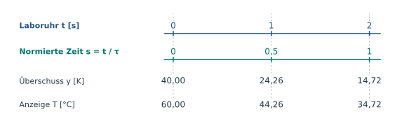

Halten Sie bei einer Sekunde an. Auf der unteren Uhr ist eine halbe Einheit vergangen. Lesen Sie in derselben Spalte erst den Überschuss ab und addieren Sie die Umgebungstemperatur von 20 °C. Rechnen Sie anschließend den dritten Messpunkt selbst nach. Die Anzeige fällt weiter, obwohl die beiden Uhren gleichmäßig laufen.


<!-- Buchseite -->

<a id="g-lineare-algebra"></a>

## G.2 Vektoren, Matrizen und lineare Gleichungen

Wir beobachten zwei gekoppelte Speicher gleichzeitig. Den Zustand schreiben wir als Spaltenvektor $x=(x_1,x_2)^\mathsf T$. Allgemein bezeichnet $\mathbb R^d$ den Raum von $d$ reellen Komponenten. Eine Matrix sammelt die Koeffizienten mehrerer linearer Gleichungen. Für
$$
A=\begin{pmatrix}2&-1\\-1&2\end{pmatrix},\qquad
b=\begin{pmatrix}1\\0\end{pmatrix}
$$
bedeutet $Ax=b$ die beiden Zeilen $2x_1-x_2=1$ und $-x_1+2x_2=0$. Aus der zweiten Gleichung folgt $x_1=2x_2$. Damit gibt die erste $3x_2=1$, also $x=(2/3,1/3)^\mathsf T$. Wir prüfen die Lösung, indem wir sie in beide Zeilen einsetzen. Das Eliminieren von Unbekannten ist die Idee hinter den Dreieckslösungen in [Kapitel 3](#k3-newton).

Das **Skalarprodukt** zweier reeller Vektoren ist $x^\mathsf T z=\sum_i x_i z_i$. Für orthogonale Vektoren verschwindet es. Die euklidische Norm ist $\|x\|_2=\sqrt{x^\mathsf T x}$. Die Maximumsnorm $\|x\|_\infty=\max_i|x_i|$ liest die größte Komponente ab. Für $x=(3,4)^\mathsf T$ ergeben sich fünf und vier. Bei gemischten Einheiten dividieren wir jede Komponente vor dem Bilden einer Norm durch eine passende Skala. Eine Längenabweichung und eine Spannungsabweichung dürfen so denselben dimensionslosen Fehlerwert haben.

**Ort und Geschwindigkeit vergleichen.** Wählen wir feste positive Bezugswerte $s_q$ in Metern und $s_v$ in Metern pro Sekunde. Für $y=(q,v)^\mathsf T$ wird $Dy=(q/s_q,v/s_v)^\mathsf T$ mit $D=\operatorname{diag}(1/s_q,1/s_v)$ dimensionslos. Bei $s_q=0{,}10\,\mathrm m$ und $s_v=0{,}20\,\mathrm{m/s}$ verbrauchen ein Zentimeter Ortsfehler und zwei Zentimeter pro Sekunde Geschwindigkeitsfehler jeweils ein Zehntel der Bezugsskala. Eine Umrechnung von Metern auf Zentimeter lässt beide Quotienten unverändert. Für das Vektorfeld verwenden wir in [Kapitel 1](#auflage-k01-01) dieselben Skalen.


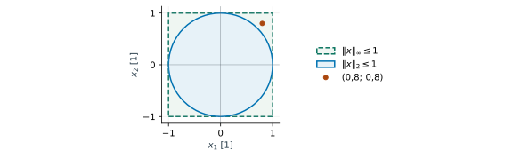

**Projektion auf eine Tangente.** Sei $n=(0,1)^\mathsf T$ ein Einheitsvektor senkrecht zur Tangente und $v=(3,4)^\mathsf T$. Der Normalanteil beträgt $n^\mathsf T v=4$. Durch Abziehen von $4n$ bleibt $(3,0)^\mathsf T$. Allgemein ist $v-n(n^\mathsf T v)$ orthogonal zu $n$, weil $n^\mathsf Tn=1$. So lässt sich die Geschwindigkeitskorrektur in [Kapitel 4](#t1-k4) prüfen.

<!-- Buchseite -->

### Was ein kleines Residuum über die Lösung verrät

Für einen Näherungswert $\widehat x$ des Gleichungssystems $Ax=b$ heißt $r=b-A\widehat x$ **Residuum**. Der tatsächliche Fehler ist $e=x-\widehat x$. Subtraktion der beiden Gleichungen ergibt $Ae=r$. Bei invertierbarem $A$ folgt $e=A^{-1}r$. Wenn die Wirkung der Inversen groß ist, kann ein kleines Residuum zu einem erheblichen Fehler gehören.

Die zu einer Vektornorm passende Matrixnorm misst die größte Verstärkung. In der Maximumsnorm ist $\|A\|_\infty=\max_i\sum_j|a_{ij}|$. Jede Zeile erfüllt die obere Schranke durch die Dreiecksungleichung. Für eine Zeile mit maximaler Summe erreicht ein Vektor mit den Vorzeichen ihrer Koeffizienten diese Schranke. Mit der Konditionszahl $\kappa_\infty(A)=\|A\|_\infty\|A^{-1}\|_\infty$ erhält man für $b\ne0$
$$
\frac{\|x-\widehat x\|_\infty}{\|x\|_\infty}
 \le \kappa_\infty(A)\frac{\|r\|_\infty}{\|b\|_\infty}.
$$
Hier verwenden wir zuerst $\|e\|_\infty\le\|A^{-1}\|_\infty\|r\|_\infty$ und anschließend $\|b\|_\infty\le\|A\|_\infty\|x\|_\infty$.

In einem zugespitzten Beispiel seien die Zeilen $x_1+x_2=2$ und $x_1+(1+\epsilon)x_2=2+\epsilon$. Subtraktion ergibt $\epsilon x_2=\epsilon$, also $x=(1,1)^\mathsf T$. Erhöhen wir die zweite rechte Seite um $\epsilon=10^{-3}$, ergibt sich $x_2=2$ und $x_1=0$. Die rechte Seite ändert sich in der Maximumsnorm relativ um ungefähr $0{,}05\,\%$. Der Zustand ändert sich relativ um $100\,\%$. Bei $\epsilon=0$ geben beide Zeilen dieselbe Information und die Lösung ist nicht eindeutig bestimmt.

Die Kondition gehört zum mathematischen Problem. In einem Solver prüfen wir zusätzlich, wie genau sein Algorithmus das gestellte Problem löst. Bei der [algebraischen Bindung](#t1-k4) und der [Diodenkennlinie](#fb-diode) treffen beide Fragen aufeinander. [Driscoll und Braun, Kondition von Rechenproblemen](https://fncbook.com/conditioning/)

<!-- Buchseite -->

<a id="revision-g-02"></a>

### Zwei Bedeutungen eines kleinen Singulärwerts

Eine skalierte Abbildung $K=\operatorname{diag}(2,0{,}1)$ streckt einen Einheitsvektor in der ersten Richtung um den Faktor zwei, in der zweiten schrumpft er auf ein Zehntel. Für $\|z\|_2=1$ ist $\|Kz\|_2^2=4z_1^2+0{,}01z_2^2$. Der kleinste mögliche Betrag ist also $\sigma_{\min}(K)=0{,}1$. Bei einem Residuum der Länge $0{,}02$ kann der Lösungsfehler bis $0{,}2$ betragen. Diese Eigenschaft der Gleichung verwenden wir beim [dualen Fehlernachweis](#revision-k09-02).

Andere Singulärwerte erhalten wir aus Messdaten. Ziehen wir an jedem der beiden Zeitpunkte den Mittelwert der zwei Trainingsbeispiele ab. Als Abweichungen seien $d_1=(1,2)^\mathsf T$ und $d_2=-d_1$ gegeben. Sie bilden die Spalten einer Matrix $D$. In der gemeinsamen Richtung $(1,2)^\mathsf T/\sqrt5$ liegt die gesamte quadrierte Amplitude $5+5=10$. Senkrecht dazu liegt keine. Die Datensingulärwerte sind $s_1(D)=\sqrt{10}$ und $s_2(D)=0$. Eine einzige Zeitform stellt beide Spuren exakt dar. Auf dieser Idee beruht die [POD der Populationsbahnen](#cp1b-gegenprobe).

<!-- Buchseite -->


<a id="g-analysis"></a>

## G.3 Ableitungen, Integrale und Taylorentwicklung

Ein Wagen legt zwischen $t$ und $t+h$ die Strecke $q(t+h)-q(t)$ mit Vorzeichen zurück. Der Quotient $\bigl(q(t+h)-q(t)\bigr)/h$ ist seine mittlere Geschwindigkeit auf diesem Intervall. Hat er einen Grenzwert für $h\to0$, so ist dieser die momentane Geschwindigkeit $q'(t)$. Sie hat die Einheit Meter pro Sekunde. Das Vorzeichen zeigt, in welche Richtung der Ort zunimmt.

Das Integral sammelt die Änderung auf. Für eine stetige Geschwindigkeit $v$ mit $q'=v$ liefert der Hauptsatz der Differential- und Integralrechnung
$$
q(t+h)=q(t)+\int_t^{t+h} v(s)\,\mathrm ds.
$$
Ist $v(t+s)=v(t)+as$ mit konstanter Beschleunigung $a$, folgt $q(t+h)=q(t)+hv(t)+ah^2/2$. Bei $q(t)=0$, $v(t)=2\,\mathrm{m/s}$, $a=-4\,\mathrm{m/s^2}$ und $h=0{,}25\,\mathrm s$ beträgt der Ort am Ende $0{,}375\,\mathrm m$. Nur die Startgeschwindigkeit zu verwenden ergäbe $0{,}5\,\mathrm m$. Der ausgelassene Term $ah^2/2$ erklärt den Unterschied exakt.

### Eine Schranke für den ausgelassenen Teil

Für eine zweimal stetig differenzierbare Funktion $y$ gilt $y'(t+s)=y'(t)+\int_0^s y''(t+r)\,\mathrm dr$. Setzen wir das in das Integral für den neuen Zustand ein und vertauschen die Integrationsreihenfolge über $0\le r\le s\le h$, folgt
$$
y(t+h)=y(t)+hy'(t)+\int_0^h (h-r)y''(t+r)\,\mathrm dr,\qquad h>0 .
$$
Bei $|y''|\le M$ ist der Rest höchstens $Mh^2/2$ im Betrag. Nimmt man auch $h^2 y''(t)/2$ auf und setzt $|y'''|\le M_3$ voraus, liefert dieselbe Rechnung einen Rest von höchstens $M_3h^3/6$. Das sind Taylor-Näherungen mit einer überprüfbaren Voraussetzung über das Stück der Bahn. Die Notation $O(h^p)$ meint, dass eine feste Konstante den Betrag für alle hinreichend kleinen $h$ durch $C h^p$ beschränkt.

Beim normierten Fühler ist $u(s)=e^{-s}$. Für $s=1/4$ ergeben die lineare Näherung $0{,}75$, die quadratische $0{,}78125$ und die Referenz rund $0{,}778801$. Die kubische Restschranke der quadratischen Näherung ist $(1/4)^3/6\approx0{,}0026042$, da $|u'''|\le1$ auf dem betrachteten Intervall. In [Kapitel 2](#t1-k2-fehler) geht diese Idee in die Fehlerschätzung von Zeitschritten ein.

<!-- Buchseite -->

<a id="g-mehrere-eingaben"></a>

### Wie sich eine Funktion mit mehreren Eingaben ändert

Ein Modell kann von mehreren Größen abhängen. Für $g(x,z)=x+z^2-1$ bedeutet $\partial g/\partial z=2z$, dass $x$ während der Ableitung festgehalten wird. Das Paar der partiellen Ableitungen bildet den Gradienten $\nabla g=(1,2z)^\mathsf T$. Wenn sich beide Größen auf einer Bahn ändern, gilt nach der Kettenregel
$$
\frac{\mathrm d}{\mathrm dt}g(x(t),z(t))=x'(t)+2z(t)z'(t).
$$
Mit der Bindung $g=0$ und der Rate $x'=z=1$ ergibt sich am Start $z'=-1/2$. Genau diese Frage nach zulässigen Änderungen begegnet uns bei [DAEs](#t1-k4). Ist $z=0$, verschwindet der Koeffizient vor $z'$. An dieser Stelle liefert diese Rechnung keine eindeutige Rate für $z$.

Für ein Vektorfeld enthält die **Jacobi-Matrix** die partiellen Ableitungen jeder Ausgabekomponente nach jeder Eingabe. Für ein normiertes Federwagenfeld $f(q,v)=(v,-4q-v/2)^\mathsf T$ ergibt sich
$$
J=\frac{\partial f}{\partial(q,v)}
 =\begin{pmatrix}0&1\\-4&-1/2\end{pmatrix}.
$$
Eine kleine Zustandsänderung $\delta y$ ändert das Feld in erster Näherung um $J\,\delta y$. Bei diesem linearen Feld ist die Beziehung exakt. Für einen Wächter $g(t,y)$ mit expliziter Zeitabhängigkeit lautet die Ableitung längs $y'=f(t,y)$ entsprechend $g_t+\nabla_y g^\mathsf T f$. Ein großer Betrag an der Schwelle hilft, den Durchgang zeitlich genau zu lokalisieren. [Ereignissuche auf einer dichten Ausgabe](#k5-detektion)

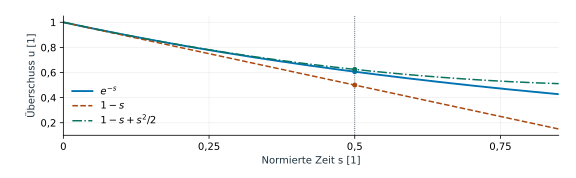

<!-- Buchseite -->

<a id="auflage-gl-04"></a>

### Von Messpunkten zu einer Quadraturregel

Der Wagen legt in einem Schritt die Strecke $h\int_0^1 v(t_n+hs)\,\mathrm ds$ zurück. An welchen Stellen $s$ sollen wir die Geschwindigkeit abfragen? Bei $n$ verschiedenen Knoten $c_i$ legen wir durch die gemessenen Werte ein Polynom vom Grad höchstens $n-1$. Das $i$-te Lagrange-Polynom $\ell_i$ nimmt am eigenen Knoten den Wert eins und an allen anderen den Wert null an. Sein Integral $b_i=\int_0^1\ell_i(s)\,\mathrm ds$ ist das Gewicht des Messwerts. Für jedes Polynom bis Grad $n-1$ ist die gewichtete Summe dadurch exakt.

Lassen sich die Knoten so wählen, dass auch höhere Grade stimmen? Das Knotenpolynom $w(s)=\prod_{i=1}^n(s-c_i)$ hat an jeder Messstelle den Wert null. Soll die Regel ein Produkt $wq$ exakt integrieren, muss also $\int_0^1w(s)q(s)\,\mathrm ds=0$ gelten. Diese Gleichheit heißt Orthogonalität zum Testpolynom $q$. Sie reicht auch aus. Bei der Polynomdivision $p=wq+r$ hat der Rest $r$ Grad kleiner als $n$ und wird schon durch die Interpolation exakt integriert.

**Zwei Messungen, eine am Schrittende.** Wir setzen $c_2=1$. Für Genauigkeit bis Grad zwei genügt der Test $q=1$. Aus $\int_0^1(s-c_1)(s-1)\,\mathrm ds=c_1/2-1/6=0$ folgt $c_1=1/3$. Die Funktionen $1$ und $s$ liefern $b_1+b_2=1$ und $b_1/3+b_2=1/2$. Damit sind die Gewichte $3/4$ und $1/4$. Prüfen Sie $s^2$ selbst. Die gewichtete Summe ist $(3/4)/9+1/4=1/3$, genau sein Integral.

Bei der Gauß-Regel sind alle $n$ Knoten frei. Orthogonalität gegen $1,s,\ldots,s^{n-1}$ ermöglicht Exaktheit bis Grad $2n-1$. Bei der rechten Radau-Regel ist ein Knoten fest. Die Tests reichen bis $s^{n-2}$, die Exaktheit bis Grad $2n-2$ (für $n\ge2$). Mit drei Radau-Knoten bleiben genau die Tests $1$ und $s$. Mit ihnen leitet [Kapitel 3](#k3-radau) die beiden inneren Messzeiten her.

<!-- Buchseite -->

<a id="g-ode"></a>

## G.4 Anfangswertprobleme, Eigenwerte und Moden

Eine **gewöhnliche Differentialgleichung** $y'=f(t,y)$ gibt in jedem Zustand eine Änderungsrate vor. Ein Anfangswert $y(t_0)=y_0$ benennt die Bahn, die wir verfolgen möchten. Für das skalare Testproblem $y'=\lambda y$ ist
$$
y(t)=y_0e^{\lambda(t-t_0)}
$$
die Lösung. Man sieht das auch, wenn man die Gleichung mit $e^{-\lambda(t-t_0)}$ multipliziert. Dann ist die Ableitung von $e^{-\lambda(t-t_0)}y(t)$ null. Dieses Produkt behält also den Anfangswert $y_0$. Bei $\lambda<0$ klingt die Ausgangsstörung ab. Ist $\lambda=-1/\tau$, bleibt nach einer Zeitkonstante $\tau$ der Anteil $e^{-1}$. Bei $\lambda>0$ wächst die Störung. In physikalischer Zeit hat $\lambda$ die Einheit $\mathrm{s^{-1}}$.

Für das normierte Fühlermodell aus [G.1](#g-skalen) ist demnach $u(s)=e^{-s}$. Nach zwei Sekunden beträgt die Temperatur $20\,^\circ\mathrm C+40\,\mathrm K/e\approx34{,}72\,^\circ\mathrm C$. Diese Rechnung liefert eine Referenz für jeden Zeitintegrator auf demselben Modell. Sie prüft die Implementierung der Differentialgleichung. Ob das Abkühlgesetz den realen Fühler beschreibt, entscheidet ein Vergleich mit Messdaten.

### Zwei Speicher in gemeinsame und gegenläufige Anteile zerlegen

Sei $x'=Ax$ und $A=\left(\begin{smallmatrix}-3&2\\2&-3\end{smallmatrix}\right)$ in normierten Koordinaten. Wenn beide Speicher denselben Wert haben, wirkt die Kopplung auf beide gleich. Rechnen wir $A(1,1)^\mathsf T$, erhalten wir $-(1,1)^\mathsf T$. Für $(1,-1)^\mathsf T$ ergibt sich $-5(1,-1)^\mathsf T$. Ein Vektor $w\ne0$ mit $Aw=\lambda w$ heißt **Eigenvektor**, $\lambda$ ist sein Eigenwert. Entlang $w$ gilt dieselbe Skalargleichung wie oben.

<a id="auflage-gl-03"></a>

Die Kopplungsmatrix ist reell und symmetrisch. Für Eigenvektoren $Av=\lambda v$ und $Aw=\mu w$ gilt deshalb $\lambda v^\mathsf T w=(Av)^\mathsf T w=v^\mathsf T Aw=\mu v^\mathsf T w$. Verschiedene Eigenwerte erzwingen $v^\mathsf T w=0$. Nach Normierung stehen die beiden Richtungen als Spalten in einer orthogonalen Matrix $Q$ mit $Q^{-1}=Q^\mathsf T$. Bei einem mehrfachen Eigenwert lässt sich im Eigenraum eine orthonormale Basis wählen. Für eine allgemeine Kopplungsmatrix muss die Wahl der Basis eigens begründet werden.

Der Anfangszustand $(1,0)^\mathsf T$ ist die Summe der beiden Eigenvektoren mit je einem halben Faktor. Somit lautet seine Bahn
$$
x(t)=\tfrac12 e^{-t}\begin{pmatrix}1\\1\end{pmatrix}
     +\tfrac12 e^{-5t}\begin{pmatrix}1\\-1\end{pmatrix}.
$$
Die Summe $x_1+x_2$ misst allein $e^{-t}$. Die Differenz misst $e^{-5t}$. Ein Sensor, der bloß die Summe beobachtet, sieht die schnelle Mode gar nicht. In [Kapitel 1](#steifigkeit) wird diese Beobachtung zur numerischen Probe für Steifigkeit.

<!-- Buchseite -->

### Von reellen Eigenwerten zur Schwingung

Für einen ungedämpften Federwagen mit $q''=-\omega^2 q$ ergibt die Wahl $y=(q,v)^\mathsf T$ mit $v=q'$ die Matrix
$$
A=\begin{pmatrix}0&1\\-\omega^2&0\end{pmatrix}.
$$
Ein Eigenvektor zu $\lambda$ existiert, wenn $A-\lambda I$ singulär ist. $I$ ist die Einheitsmatrix. Für eine $2\times2$-Matrix mit Zeilen $(a,b)$ und $(c,d)$ prüft man Singularität mit der Determinante $ad-bc$. Hier ergibt sie $\lambda^2+\omega^2$. Mit $\mathrm i^2=-1$ lauten die Eigenwerte $\pm\mathrm i\omega$. Die Formel $e^{\mathrm i\theta}=\cos\theta+\mathrm i\sin\theta$ beschreibt die Drehung eines Punktes in der komplexen Ebene. Bei $\lambda=a+\mathrm i b$ wächst oder fällt der Betrag mit $e^{at}$, und die Phase ändert sich um $bt$.

Für $q(0)=q_0$ und $v(0)=0$ ergibt sich reell $q(t)=q_0\cos(\omega t)$. Ableiten liefert $v(t)=-\omega q_0\sin(\omega t)$ und bestätigt das Anfangswertproblem. Bei $\omega=2\,\mathrm{s^{-1}}$ liegt der erste Durchgang durch die Ruhelage bei $t=\pi/4\,\mathrm s$. Die Amplitude bleibt im exakten Modell erhalten. An diesem Prüffall unterscheiden sich Methoden, die für abklingende Moden zuverlässig sind, in ihren Amplituden- und Phasenfehlern. [Stabilität und numerische Dämpfung](#k3-stabilitaet)

**Ein Werkzeug für konstante Matrizen.** Die Zeitentwicklung eines linearen Systems $y'=Ay$ lässt sich als $y(t)=e^{(t-t_0)A}y_0$ schreiben. Dabei ist $e^{sA}=\sum_{k=0}^\infty s^k A^k/k!$ und $A^0=I$. Die Reihe konvergiert in einer Matrixnorm, denn $\|A^k\|\le\|A\|^k$. In einem System mit einer Basis aus Eigenvektoren genügt es, die einzelnen Anteile mit $e^{s\lambda}$ fortzuführen. Ein einzelner Eigenwert erfasst im Allgemeinen weder die Überlagerung der Anteile noch das Verhalten einer beliebigen Zustandsnorm über kurze Zeiten. [Lebl, Matrixexponentialfunktion](https://www.jirka.org/diffyqs/html/sec_matexp.html)

<!-- Buchseite -->

<a id="g-fehler"></a>

## G.5 Fehlermaße und Gleitkommazahlen

Ein Prüfwert von $0{,}998$ bei Referenz eins hat absoluten Fehler $0{,}002$ und relativen Fehler $0{,}2\,\%$. Ist die Referenz null, ist die Division durch ihren Betrag nicht definiert. Für einen Positionssensor am Nullpunkt kann ein absolutes Budget in Millimetern sinnvoll sein. Für die Amplitude eines ganzen Feldes kann man eine Norm wählen und durch die Referenznorm teilen, sofern diese positiv ist.

Für Zustände mit verschiedenen Einheiten bietet eine Skala $s_i=a_i+r_i|y_i^\ast|>0$ eine einfache Normierung. $a_i$ ist eine absolute Toleranz in der Einheit der Komponente und $r_i$ ist dimensionslos. Der Vergleich $\max_i |\widehat y_i-y_i^\ast|/s_i\le1$ prüft alle einzelnen Toleranzbänder. Bei einer Zeitsteuerung wird statt der exakten Referenz eine verfügbare Skala aus den Schrittwerten und ein geschätzter lokaler Fehler verwendet. [Schrittprüfung in Kapitel 2](#t1-k2) · [Äußeres Fehlerbudget in Kapitel 10](#v91-abnahme)

### Warum dieselbe Formel zwei Ergebnisse liefern kann

Eine binäre Gleitkommazahl speichert eine endliche Zahl signifikanter Binärstellen. Bei IEEE-754 binary64 beträgt der Abstand zwischen eins und der nächsten größeren darstellbaren Zahl $2^{-52}$. In der üblichen Rundung zur nächsten Zahl gilt daher $(1+2^{-54})-1=0$ in binary64. Das kleine Plus wird bereits bei der ersten Addition gerundet.

Für $x=2^{-54}$ liefert auch die direkte Auswertung von $\sqrt{1+x}-1$ null. Multiplizieren wir in exakter Arithmetik mit dem konjugierten Ausdruck, ergibt sich dieselbe Funktion in der Form
$$
 \sqrt{1+x}-1=\frac{x}{\sqrt{1+x}+1}.
$$
Die rechte Formel liefert in binary64 ungefähr $2^{-55}$. Die Rechnung hängt nicht mehr von der Differenz zweier fast gleicher Wurzelausdrücke ab. Ähnlich lässt sich beim [quadratischen QSS2-Termin](#v91-qss2) die kleinere Wurzel über das Produkt der Wurzeln berechnen. [Driscoll und Braun, Gleitkommazahlen](https://fncbook.com/floating-point/)

<!-- Buchseite -->

### Wie sich Fehler über viele Schritte ausbreiten

Ein lokaler Schrittfehler misst eine Abweichung, wenn die Rechnung mit dem **exakten** Zustand am Schrittanfang startet. Der globale Fehler vergleicht die berechnete Bahn mit der Referenz nach vielen Schritten. Die Fehlerfolge lässt sich an einem linearen Verfahren als
$$
e_{n+1}=R\,e_n+\delta_n
$$
schreiben. $R$ multipliziert den bisherigen Fehler. $\delta_n$ ist der neu hinzukommende lokale Beitrag. Beginnen wir exakt, so ergibt wiederholtes Einsetzen $e_N=\sum_{j=0}^{N-1} R^{N-1-j}\delta_j$. Für $|R|\le1$ ist sein Betrag höchstens die Summe der Beträge der Einzelbeiträge. Bei lokalen Beiträgen von höchstens $C h^{p+1}$ und $N=T/h$ folgt an festem Endpunkt die globale Schranke $CT h^p$.

Am normierten Fühler ergibt Vorwärts-Euler nach $N$ Schritten bis $s=1$ den Wert $(1-1/N)^N$. Die Referenz ist $e^{-1}$. Die absoluten Endfehler betragen für $N=10,20,40$ ungefähr
$$
 E_{10}=0{,}01920,\qquad E_{20}=0{,}009394,\qquad E_{40}=0{,}004647 .
$$
Aus $E(h)\approx C h^p$ folgt beim Halbieren $E(h)/E(h/2)\approx2^p$. Mit $p_\mathrm{mess}=\log_2(E(h)/E(h/2))$ ergeben sich ungefähr $1{,}03$ und $1{,}02$. Diese Zahlen nähern sich der erwarteten Ordnung eins. Dazu halten wir Beobachtungszeit und Modell fest und verändern ausschließlich die Schrittzahl. Bei sehr kleiner Schrittweite kann die Rundung die führende Abweichung mitbestimmen.

**Stabilität und Genauigkeit.** Für $y'=\lambda y$ hat Vorwärts-Euler den Faktor $R=1+h\lambda$. Bei $\lambda=-5\,\mathrm{s^{-1}}$ und $h=0{,}4\,\mathrm s$ ist $R=-1$. Der Betrag wächst im exakten Rechenmodell nicht, er klingt aber auch nicht ab. Die exakte Mode fällt pro Schritt auf $e^{-2}\approx0{,}1353$ ihres vorherigen Betrags. Der Test zeigt, weshalb ein begrenzter numerischer Verlauf noch ein eigenes Genauigkeitsbudget braucht. [Lokaler und globaler Fehler](#t1-k2-fehler)


<!-- Buchseite -->

<a id="g-fixpunkte"></a>

## G.6 Nullstellen, Fixpunkte und Schranken

Ein Relais schaltet, wenn das Signal $g$ den Wert null erreicht. Für das Lehrsignal $g(s)=s^2-2$ liegt auf $[1,2]$ eine Nullstelle, weil $g$ stetig ist und die Randwerte verschiedene Vorzeichen haben. Auf diesem Intervall ist $g$ streng wachsend, weil $g'(s)=2s>0$ gilt. Damit ist die Nullstelle eindeutig. Die **Intervallhalbierung** wertet $g$ in der Mitte $1{,}5$ aus. Weil $g(1{,}5)=0{,}25>0$, bleibt $[1,1{,}5]$ als Klammer. Nach $k$ Halbierungen misst die ursprüngliche Einheitsklammer $2^{-k}$. Ihr Mittelpunkt weicht um höchstens die halbe Breite von der eingeschlossenen Nullstelle ab.

Das **Newton-Verfahren** verwendet zusätzlich die Steigung. Für eine kleine Korrektur $\delta$ setzen wir $g(s+\delta)\approx g(s)+g'(s)\delta$. Die Nullstelle dieser Tangente liefert bei $g'(s)\ne0$
$$
s_\mathrm{neu}=s-\frac{g(s)}{g'(s)}.
$$
Vom Startwert zwei führt der erste Schritt zu $1{,}5$, der zweite zu $17/12\approx1{,}416667$. In der Nähe einer einfachen Nullstelle liefert eine glatte Funktion oft sehr schnelle Konvergenz. An einer doppelten Nullstelle $g(s)=(s-s^\ast)^2$ halbiert Newton dagegen den Abstand in jedem Schritt. Die Wahl eines Startwerts und die Prüfung des Residuums bleiben wichtig.

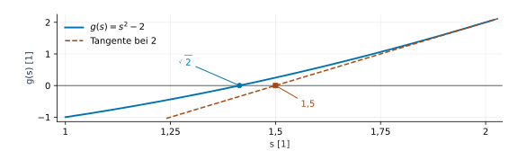

In mehreren Dimensionen wird aus der Division durch $g'$ eine lineare Lösung mit der Jacobi-Matrix. Für eine zeitliche Nullstelle ist zusätzlich die Güte der zugrunde liegenden Bahn entscheidend. Bei einer Berührung können die Vorzeichen an beiden Rändern gleich sein. Die [Ereignisprüfung in Kapitel 5](#v91-ereignisisolation) betrachtet diesen Fall eigens. [Newton-Verfahren, Driscoll und Braun](https://fncbook.com/newton/)

<!-- Buchseite -->

### Warum sich wiederholte Korrekturen einer Lösung nähern können

Ein **Fixpunkt** erfüllt $x^\ast=P(x^\ast)$. Angenommen, $P$ bildet den gewählten Bereich in sich ab und verkleinert Abstände um höchstens den Faktor $0\le q<1$. Für die Iteration $x_{k+1}=P(x_k)$ gilt $\|x_{k+1}-x_k\|\le q\|x_k-x_{k-1}\|$. Für $k\ge1$ ist die Summe aller noch folgenden Änderungen höchstens
$$
\frac{q}{1-q}\|x_k-x_{k-1}\|.
$$
Die Summe folgt aus der geometrischen Reihe $q+q^2+\cdots=q/(1-q)$. Sie zeigt zugleich, dass die Folge **Cauchy** ist. Zwei hinreichend späte Glieder liegen beliebig nah beieinander. In einem vollständigen, abgeschlossenen Arbeitsbereich existiert deshalb ihr Grenzwert. Wegen der Stetigkeit von $P$ ist er ein Fixpunkt. Zwei Fixpunkte müssten ihren gegenseitigen Abstand bei Anwendung von $P$ beibehalten, obwohl $P$ ihn um den Faktor $q$ begrenzt. Das geht nur bei Abstand null.

Für $P(x)=(x+2)/3$ auf $[0,1]$ ist $q=1/3$. Vom Start null ergeben sich $x_1=2/3$ und $x_2=8/9$. Die letzte Änderung beträgt $2/9$. Die obige Schranke liefert $1/9$ für den Abstand zum Fixpunkt eins. In [Kapitel 1](#loesbarkeit) ist ein Iterationsglied bei Picard eine **ganze Kurve**. Der Abstand zweier Kurven ist der größte Zustandsabstand im Zeitintervall. Für jeden Zeitpunkt liegt zunächst eine Cauchy-Folge in $\mathbb R^d$ vor. Dieselbe Cauchy-Schranke gilt über das ganze Zeitintervall. Die Konvergenz ist daher gleichmäßig, und die Grenzkurve ist stetig.

**Wie Störungen der Anfangsdaten wachsen können.** Für eine nichtnegative stetige Abweichung $u(t)$ gelte $u(t)\le a+L\int_0^t u(s)\,\mathrm ds$ mit $a,L\ge0$. Nennen wir die rechte Seite $w(t)$, so gilt $w'=Lu\le Lw$. Damit ist $(e^{-Lt}w)'=e^{-Lt}(w'-Lw)\le0$. Es folgt $u(t)\le w(t)\le ae^{Lt}$. Die Grönwall-Schranke aus Kapitel 1 entsteht also aus einer Integration mit einem geeigneten Faktor.

<!-- Buchseite -->

<a id="g-felder"></a>

## G.7 Felder, Randwerte und schwache Ableitungen

Die Konzentration in einem Rohr hängt vom Ort $x$ und von der Zeit $t$ ab. Wir schreiben $u(t,x)$. Mit $u_t$ betrachten wir die Änderung bei festem Ort. Mit $u_x$ betrachten wir die räumliche Änderung bei fester Zeit. Eine **partielle Differentialgleichung** verknüpft solche Ableitungen. In einem eindimensionalen Diffusionsmodell mit konstantem $D>0$ fließt Stoff nach $j=-D u_x$ in Richtung kleinerer Konzentration.

Für einen Abschnitt $[a,b]$ ohne Quelle gilt
$$
\frac{\mathrm d}{\mathrm dt}\int_a^b u(t,x)\,\mathrm dx
  = j(t,a)-j(t,b) = -\int_a^b j_x(t,x)\,\mathrm dx .
$$
Der linke Rand speist bei positiver Flussrichtung Stoff ein, am rechten Rand verlässt er den Abschnitt. Weil die Bilanz für jeden Abschnitt gelten soll, folgt für glatte Felder $u_t=-j_x=D u_{xx}$. In zwei Raumrichtungen sammelt der Gradient die beiden Steigungen in einem Vektor. Für einen Flussvektor lautet die Divergenz $\partial_x j_1+\partial_y j_2$. Auf einem glatten Feld ist $\Delta u=u_{xx}+u_{yy}$ der Laplace-Operator.

<a id="revision-g-03"></a>

Die Divergenz ist der nach außen gerichtete Nettofluss **je Volumen** im Grenzfall einer schrumpfenden Zelle. In einer eindimensionalen Zelle mit Einheitsquerschnitt und $j(x)=ax$ ist der Nettoabfluss $j(x+\Delta x)-j(x)=a\Delta x$. Erst die Division durch $\Delta x$ ergibt $a$. In einer quellenfreien Stoffbilanz gilt daher $\partial_t u=-\nabla\cdot j$. Positive Divergenz entleert die Zelle. Dieselbe Vorzeichenregel verwenden wir später im Grundwasserleiter.


Der **Anfangswert** bestimmt das Profil im ganzen Raum zur Startzeit. Eine **Dirichlet-Bedingung** legt den Feldwert am Rand fest. Eine **Neumann-Bedingung** legt die Normalenableitung fest, die bei konstantem $D$ zum Normalfluss proportional ist. Ein abgeschlossener Behälter hat am Rand Normalfluss null. Dann ist die Gesamtmenge bei fehlender Quelle konstant. Ein fest auf null gehaltener Rand kann Stoff aufnehmen.

**Brücke zur Diskretisierung.** Für benachbarte Zellen ist der aus der linken Zelle ausfließende Grenzstrom derselbe, der der rechten Zelle zufließt. Beim Addieren beider Zellbilanzen hebt er sich auf. Die [Finite-Volumen-Rechnung](#t1-k7) nutzt diese Aufhebung als Test für die diskrete Gesamtbilanz.

<!-- Buchseite -->

<a id="g-schwach"></a>

### Wie partielle Integration eine Ableitung verschiebt

Betrachten wir die Diffusionsgleichung auf $0\le x\le1$ mit fest auf null gesetzten Randwerten. Wir multiplizieren mit einer glatten Testfunktion $v(x)$, die an den Enden ebenfalls null ist, und integrieren. Partielle Integration liefert
$$
\int_0^1 u_t v\,\mathrm dx
  = D[u_x v]_0^1 - D\int_0^1 u_x v_x\,\mathrm dx
  =-D\int_0^1 u_x v_x\,\mathrm dx .
$$
Damit genügt auf der rechten Seite eine räumliche Ableitung von $u$. Die Bedingung soll für alle zulässigen Testfunktionen gelten. Bei einer hinreichend glatten Lösung dürfen wir zum betrachteten Zeitpunkt $v=u(t,\cdot)$ wählen. Dann gilt
$$
\tfrac12\frac{\mathrm d}{\mathrm dt}\int_0^1 u^2\,\mathrm dx
 =-D\int_0^1 u_x^2\,\mathrm dx\le0 .
$$
Das Integral über die quadrierte Konzentration nimmt in diesem Randproblem ab. Ein berechnetes Feld lässt sich auf diese Eigenschaft prüfen.

Eine **schwache Ableitung** $w$ erfüllt $\int u v'=-\int w v$ für alle glatten Testfunktionen, die im Inneren des Intervalls getragen sind. Das Dreieck $u(x)=2x$ bis $x=1/2$ und $u(x)=2(1-x)$ danach hat an der Spitze keine klassische Ableitung. Bei stückweiser partieller Integration heben sich die Beiträge an der Spitze auf, weil $u$ dort stetig ist. Als schwache Ableitung bleibt stückweise $w=2$ links und $w=-2$ rechts.

Im Raum $L^2(0,L)$ fassen wir Funktionen zusammen, die bis auf eine Menge vom Maß null übereinstimmen. Das Integral ihres quadrierten Betrags kann einen einzelnen geänderten Punkt nicht erkennen. Für eine Saite brauchen wir trotzdem eine eindeutige Bedeutung für „am Ende eingespannt“.

<!-- Buchseite -->

<a id="auflage-k09-03"></a>

### Wie eine Saite zwei eindeutige Randwerte bekommt

Der Raum $H^1(0,L)$ enthält die $L^2$-Klassen mit erster schwacher Ableitung in $L^2$. In einer Raumdimension hat jede solche Klasse einen eindeutigen stetigen, sogar absolut stetigen Vertreter. Für glatte Funktionen setzen wir $\gamma_0 u=(u(0),u(L))$. Aus $u(0)=u(x)-\int_0^x u'(s)\,\mathrm ds$ folgen durch Mitteln über $x$ und die Cauchy-Schwarz-Ungleichung die Schranke
$$
 |u(0)|\le L^{-1/2}\|u\|_{L^2}+\sqrt L\,\|u'\|_{L^2}.
$$
Dieselbe Schranke gilt am rechten Ende. Konvergieren glatte Näherungen in $H^1$, konvergieren also auch ihre beiden Randwerte. Durch Dichte erhalten wir so die stetige Abbildung $\gamma_0:H^1(0,L)\to\mathbb R^2$, die **Spur**. Sie liest die Endwerte des stetigen Vertreters.

Der Raum der beidseitig eingespannten Formen ist $H_0^1(0,L)=\ker\gamma_0=\overline{C_c^\infty(0,L)}^{\,H^1}$. Der Abschluss bedeutet, dass wir diese Formen samt ihrer schwachen Ableitung durch glatte, im Inneren getragene Funktionen annähern können. Das oben berechnete Dreieck hat Spur $(0,0)$. Die Gerade $x/L$ hat Spur $(0,1)$. Beide besitzen endliche Energie, für die fest eingespannte Saite ist allein das Dreieck zulässig. Im schwachen Wärmeproblem verwenden wir Testfunktionen mit Spur null, sodass der Randterm entfällt. [Spursatz und Randbedingungen](https://jschoeberl.github.io/iFEM/sobolevspaces/Traces.html) · [Saitenoperator in Kapitel 9](#t1-k9).


<!-- Buchseite -->

<a id="g-fourier"></a>

## G.8 Fourier-Moden und Projektion auf Felder

Eine fest eingespannte Saite der Länge $L$ hat an beiden Enden Auslenkung null. Die Formen $\sin(k\pi x/L)$ für ganze $k\ge1$ erfüllen diese Randbedingungen. Bei konstanter Wellengeschwindigkeit führt jede Form unter der Wellengleichung ihre eigene Schwingung aus. Um ihre Amplitude aus einem beliebigen Anfangsprofil abzulesen, verwenden wir das Skalarprodukt von Funktionen.

Für reelle Felder ist $\langle u,v\rangle=\int_0^L u(x)v(x)\,\mathrm dx$. Es ist das Gegenstück zur Summe beim Skalarprodukt von Vektoren. Die Norm lautet $\|u\|_2^2=\langle u,u\rangle$. Für die normierten Formen
$$
e_k(x)=\sqrt{2/L}\,\sin(k\pi x/L)
$$
liefert $\langle e_j,e_k\rangle$ eins bei $j=k$ und sonst null. Die Produktformel $2\sin a\sin b=\cos(a-b)-\cos(a+b)$ erklärt das. Jeder Kosinus mit nichtverschwindendem ganzzahligen Vielfachen von $\pi x/L$ integriert sich über $[0,L]$ zu null, denn $\sin(m\pi)=0$ für ganzzahliges $m$. Für gleiche Indizes bleibt der konstante Term.

Der Anteil von $u$ in Richtung $e_k$ ist $a_k=\langle u,e_k\rangle$. Die Näherung $P_Ku=\sum_{k=1}^K a_k e_k$ heißt **orthogonale Projektion**. Der Rest $u-P_Ku$ ist zu jeder behaltenen Mode senkrecht. Beim Quadrieren der Norm fällt der Kreuzterm daher weg
$$
\|u\|_2^2=\|P_Ku\|_2^2+\|u-P_Ku\|_2^2 .
$$
Für $u=e_1+\tfrac12 e_2$ und $K=1$ bleibt ein Fehler mit Norm $1/2$. Seine relative Norm beträgt $1/\sqrt5\approx44{,}7\,\%$. Weitere Stützstellen können die Darstellung von $e_1$ verfeinern. Zur Wiedergabe des fehlenden Anteils braucht die Näherung auch $e_2$. In [Kapitel 9](#t1-k9) ist dieser Unterschied für die geknickte Saitenform messbar.

<!-- Buchseite -->

### Welche Wellen auf demselben Gitter gleich aussehen

<a id="auflage-gl-01"></a>

Für den Abtastversuch in Abb. G.5 wechseln wir von der eingespannten Saite auf ein periodisches Intervall. Wir schließen die Enden mit $u(0)=u(L)$ zusammen. Seine Fourier-Moden durchlaufen auf der Länge $L$ jeweils eine ganze Zahl von Perioden. Für ein periodisches Intervall der Länge $L$ ohne doppelt gespeicherten Endpunkt sind die Knoten $x_j=jL/N$ für $j=0,\dots,N-1$. Die komplexe Welle zur Wellenzahl $k$ hat dort die Werte
$$
w_k(x_j)=e^{2\pi\mathrm i k j/N}.
$$
Ersetzen wir $k$ durch $k+N$, kommt der Faktor $e^{2\pi\mathrm i j}=1$ hinzu. Damit sind die Werte an **allen** Gitterknoten identisch. Dieses Zusammenfallen verschiedener Wellen auf demselben Abtastgitter heißt **Aliasing**. Auf vier Knoten liefern die Sinusmoden zu $k=1$ und $k=5$ beide die Folge $(0,1,0,-1)$.

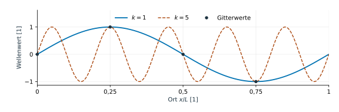

Ein Algorithmus, der nur diese vier Zahlen erhält, kann die beiden Eingabefelder daran nicht unterscheiden. Für die Prüfung eines Feldoperators muss daher klar sein, ob ein feineres Gitter zusätzliche Messwerte liefert oder ob dieselben groben Werte lediglich interpoliert werden. Feste Nullränder lassen sich über die Sinusbasis aus G.8 oder eine ungerade Fortsetzung behandeln. Das [Saitenbeispiel in Kapitel 9](#v91-fno-rand) zeigt die Fortsetzung mit denselben vier Werten.

<!-- Buchseite -->

<a id="g-daten"></a>

## G.9 Messdaten, Mittelwerte und kleinste Quadrate

Fünf Rechenläufe liefern die absoluten Fehler $1,2,2,7,8$ in Mikrometern. Das arithmetische Mittel ist vier. Der **Median** ist die mittlere Zahl der sortierten Folge, hier zwei. Das **quadratische Mittel** der Fehler, häufig RMS genannt, ist
$$
\sqrt{\tfrac15(1^2+2^2+2^2+7^2+8^2)}=\sqrt{24{,}4}\approx4{,}94 .
$$
Ein quadratisches Mittel gewichtet größere Einzelabweichungen stärker. Der Maximalfehler ist acht. Welche Zahl für eine Entscheidung zählt, hängt vom Auftrag ab. In einem Test mit Grenzwert für jeden Lauf wäre das Maximum die passende Prüfgröße.

### Einen unbekannten Koeffizienten bestimmen

Wir wollen aus Messpaaren $(x_i,y_i)$ den Faktor $a$ eines Modells $y\approx a x$ bestimmen. Maß sei die Summe der quadratischen Abweichungen $J(a)=\sum_i(a x_i-y_i)^2$. Ableiten ergibt $J'(a)=2\sum_i x_i(a x_i-y_i)$. Wenn mindestens ein $x_i\ne0$ ist, ist $J''(a)=2\sum_i x_i^2$ positiv. Das einzige Minimum erfüllt
$$
a=\frac{\sum_i x_i y_i}{\sum_i x_i^2}.
$$
Für die Paare $(1,2)$ und $(2,3)$ ergibt sich $a=8/5$. Die Differenzen zwischen Modell und Messung sind $-0{,}4$ und $0{,}2$. Dass ihre gewichtete Summe $1\cdot(-0{,}4)+2\cdot0{,}2$ null ist, prüft die Rechnung. Bei lauter $x_i=0$ kann kein Koeffizient aus diesen Daten bestimmt werden.

In [Kapitel 9](#fno-physik-lernen) übernehmen modale Größen die Rolle der Eingaben und Beschleunigungen die Rolle der Ausgaben. Der gefundene Faktor ist zunächst für die verwendeten Daten begründet. Zur Prüfung einer Vorhersage braucht man eigene Felder oder Messungen, die beim Fit nicht verwendet wurden.

<!-- Buchseite -->

<a id="g-aufgaben"></a>

## Aufgaben zum Selbstversuch

Versuchen Sie zuerst eine Vorhersage auf Papier. Notieren Sie bei jeder Rechnung, welche Größen dimensionslos sind, was die Referenz ist und welche Aussage sich daraus ableiten lässt. Die [Lösungen](#g-loesungen) beginnen auf einer eigenen Seite.

### A · Einen zweiten Fühler skalieren

Ein Fühler hat zu Beginn einen Temperaturüberschuss von $30\,\mathrm K$. Seine Zeitkonstante beträgt vier Sekunden. Nach welcher normierten Zeit liest man bei $t=2\,\mathrm s$ ab? Berechnen Sie aus der Lösung von $u'=-u$ den tatsächlichen Überschuss.

### B · Zwei fast gleiche Gleichungen vergleichen

Setzen Sie im Beispiel aus G.2 $\epsilon=0{,}01$ und erhöhen Sie nur die zweite rechte Seite um $0{,}002$. Bestimmen Sie den neuen Zustand durch Elimination. Wie groß ist die Zustandsänderung in der Maximumsnorm?

### C · Eine Taylor-Näherung beurteilen

Entwickeln Sie $u(s)=e^{-s}$ um $s=0$ und setzen Sie $s=1/2$ ein. Berechnen Sie die lineare und die quadratische Näherung. Prüfen Sie die Abweichung der zweiten gegen die Schranke aus G.3.

### D · Eine schnelle Mode im Sensor finden

Verwenden Sie die Zweikomponentenmatrix aus G.4, aber starten Sie bei $x(0)=(3,1)^\mathsf T$. Drücken Sie den Anfangswert als Kombination der beiden Eigenvektoren aus. Welche Größen sehen ein Summen- und ein Differenzsensor? Würde ein expliziter Euler-Schritt mit $h=1/2$ die schnelle Mode im Betrag verkleinern?

### E · Die Ordnung aus einer Fehlerreihe lesen

Drei Rechnungen am selben Endzeitpunkt ergeben beim Halbieren von $h$ die Fehler $4\cdot10^{-3}$, $10^{-3}$ und $2{,}5\cdot10^{-4}$. Bestimmen Sie die beobachtete Ordnung. Warum ist der relative Fehler mit Referenzwert null an einem anderen Messzeitpunkt ungeeignet?

<!-- Buchseite -->

### F · Eine Nullstelle einklammern

Für $g(s)=s^2-3$ ist $[1,2]$ eine Startklammer. Berechnen Sie die Klammer nach zwei Halbierungen. Bestimmen Sie außerdem einen Newton-Schritt ausgehend vom rechten Rand. Wie können Sie die resultierenden Zahlen prüfen?

### G · Ein Dreieck im Funktionenraum einordnen

Das Dreieck aus G.7 hat an der Spitze keine klassische Ableitung. Bestimmen Sie die stückweise schwache Ableitung und ihre quadratische Norm. Warum ist ihre Existenz für die schwache Diffusionsbilanz ausreichend?

### H · Eine Mode weglassen und Abtastwerte zählen

Das Profil sei $u=e_1+\tfrac34 e_3$ in der normierten Sinusbasis. Berechnen Sie die Projektion auf $e_1$ sowie relativen und absoluten Feldfehler. Welche periodischen Wellen zu $k=1$ und $k=7$ unterscheidet ein Gitter mit sechs gleichmäßig verteilten Knoten?

### I · Einen Faktor aus Messwerten lernen

Passen Sie $y\approx a x$ an die drei Paare $(1,1)$, $(2,3)$ und $(3,4)$ an. Prüfen Sie die gewichtete Summe der Residuen. Welches zusätzliche Experiment wäre für eine Aussage bei $x=10$ erforderlich?

### Rechenlabor · Dieselben Rechnungen im Programm prüfen

`python3 rechenlabor/grundlagen.py` führt die Gegenproben vom Stammordner des Quellenpakets aus. Der Code prüft exakte Brüche, wo es eine rationale Referenz gibt. Für Exponentialwerte, Quadratwurzeln und Wellenwerte verwendet er die jeweilige analytische Formel. Der ausgegebene Endwert beim Fühler, die beobachtete Ordnung und die kleine Gleitkommadifferenz lassen sich mit den Handrechnungen abgleichen.

<!-- Buchseite -->

<a id="g-loesungen"></a>

## Lösungen und Gegenproben

**A · Zeit und Zustand zurückrechnen.** Aus $s=t/\tau$ folgt $s=1/2$. Der Überschuss beträgt $y(t)=30\,\mathrm K\,e^{-1/2}\approx18{,}196\,\mathrm K$. Multipliziert man stattdessen direkt mit $e^{-2}$, hätte man die physikalische Zeit in Sekunden ohne Berücksichtigung der Zeitkonstante verwendet.

**B · Die zweite Gleichung von der ersten trennen.** Der neue Überschuss der zweiten rechten Seite über der ersten ist $0{,}01+0{,}002=0{,}012$. Nach Subtraktion folgt $0{,}01x_2=0{,}012$, also $x_2=1{,}2$. Die erste Gleichung erzwingt $x_1=0{,}8$. Gegenüber $(1,1)^\mathsf T$ beträgt die Änderung in der Maximumsnorm $0{,}2$.

**C · Die ausgelassene Krümmung messen.** Der lineare Wert ist $1-1/2=1/2$, der quadratische $1-1/2+1/8=5/8$. Der exakte Wert $e^{-1/2}\approx0{,}606531$ liegt dazwischen. Die quadratische Näherung liegt darüber und ihr Fehler von ungefähr $0{,}018469$ bleibt unter $(1/2)^3/6=1/48\approx0{,}020833$.

**D · Sensoren und Stabilität getrennt prüfen.** $(3,1)^\mathsf T=2(1,1)^\mathsf T+(1,-1)^\mathsf T$. Die Summe der Komponenten ist $4e^{-t}$, die Differenz $2e^{-5t}$. Euler liefert für die schnelle Mode den Faktor $1-(1/2)5=-1{,}5$. Der Betrag wächst im Schritt, während sich das Vorzeichen ändert. Der Summensensor würde diese Abweichung im exakt entkoppelten Modell verdecken.

**E · Halbierung vergleichen.** Die aufeinanderfolgenden Quotienten sind beide vier. Daraus folgt $p_\mathrm{mess}=\log_2 4=2$. Bei Referenzwert null lässt sich ein absolutes Budget einsetzen, etwa eine vorab gewählte Ortsabweichung. Für ein ganzes Feld kommt die relative Norm mit positiver Referenznorm infrage.

<!-- Buchseite -->

### Lösungen zu Nullstellen, Feldern und Messdaten

**F · Intervall und Tangente.** Die Vorzeichen von $g(1{,}5)$ und $g(1{,}75)$ sind negativ und positiv. Die Klammern lauten $[1{,}5,2]$ und $[1{,}5,1{,}75]$. Der erste Newton-Wert ist $2-(4-3)/4=1{,}75$. Die positive analytische Referenz $\sqrt3\approx1{,}73205$ liegt in der letzten Klammer. Die Schranke für deren Mittelpunkt beträgt $0{,}125$.

**G · Stückweise ableiten.** $w=2$ auf $(0,1/2)$ und $w=-2$ auf $(1/2,1)$. Der einzelne Spitzenpunkt beeinflusst das Integral nicht. Es gilt $\|w\|_2^2=4/2+4/2=4$ und damit $\|w\|_2=2$. In der schwachen Form wird nur diese erste räumliche Ableitung integriert. Für eine zeitabhängige Lösung ist außerdem die Zeitabhängigkeit in der Bilanz zu erfüllen.

**H · Orthogonalität und Alias.** $P_1 u=e_1$ und der Rest ist $\tfrac34 e_3$. Damit beträgt seine Norm $3/4$ und die Referenznorm $\sqrt{1+9/16}=5/4$. Der relative Fehler ist $3/5$. Auf sechs periodischen Knoten unterscheidet sich die Phase der beiden Wellen um $2\pi j$. Ihre Abtastwerte sind gleich.

**I · Die Normalbedingung auswerten.** Der Zähler ist $1+6+12=19$, der Nenner $1+4+9=14$. Für $a=19/14$ ergeben sich die Residuen $5/14,-4/14,1/14$. Ihr mit den Eingaben gewichtetes Skalarprodukt ist $(5-8+3)/14=0$. Eine unabhängige Messung bei $x=10$ prüft die Vorhersage dort. Mehrere Messungen um diesen Wert helfen, Messrauschen und eine Änderung des Zusammenhangs auseinanderzuhalten.

<!-- Buchseite -->

<a id="kapG-schluss"></a>

## Schluss · Was eine Gegenprobe verrät

Der Fühler vom Beginn dieses Teils liefert nach einer Zeitkonstante den Wert $e^{-1}$ seiner normierten Ausgangsanzeige. Wer Sekunden und Millisekunden in verschiedenen Programmteilen mischt, kann daran schon vor der eigentlichen Simulation scheitern. Mit der Skalierung steht fest, welcher Zeitpunkt und welche Größe denselben Versuch beschreiben. Eine Referenz aus dem Modell gibt anschließend eine Zahl vor, die beide Programme treffen müssen.

Nach **einer Sekunde** gilt $s=1/2$ und der Fühler zeigt $20+40e^{-1/2}=44{,}26\,^\circ\mathrm C$. Nach **einer Zeitkonstante** von zwei Sekunden gilt $s=1$ und die Anzeige beträgt $20+40/e=34{,}72\,^\circ\mathrm C$. Mit Millisekunden wird aus dem ersten Quotienten $1000/2000$, also dieselbe Anzeige.


Die Werkzeuge dieses Teils beantworten jeweils eine andere Frage. In einem Gleichungssystem verbindet die Kondition das Residuum mit dem tatsächlichen Fehler. Taylorentwicklung erklärt, was ein einzelner Schritt auslässt. Stabilität bestimmt, wie stark sich derartige Fehler entlang der Bahn auswirken. Bei Feldern machen die schwache Ableitung und die Zerlegung in Fourier-Moden sichtbar, welche Information eine Darstellung beibehält. Auf einem Gitter können verschiedene Wellen an allen gemessenen Knoten gleich aussehen. Ob eine ausgelassene Mode wichtig ist, entscheidet daher die Messaufgabe.

### Aktueller Stand der Forschung

Bei Gleitkommaprogrammen entsteht ein zusätzlicher Fehler dadurch, dass eine Rundung die Seite eines Vergleichs ändern kann. PRECiSA 4.0 analysiert Rundungsfehler und kann zu berechneten Schranken formal prüfbare Zertifikate erzeugen. Die Garantie stützt sich auf das analysierte Programm, seine Rundungsannahmen und die zugelassenen Eingaben. Für die Ereignissuche in diesem Buch ist eine verwandte Prüffrage interessant. An einer Schwelle kann ein sicher gerundeter Zahlenwert immer noch zu einer schlecht aufgelösten Bahn gehören. Eine belastbare Ereignisprüfung muss beide Beiträge an derselben Messgröße zusammenführen. [Rigorous Floating-Point Round-Off Error Analysis in PRECiSA 4.0 (2024)](https://link.springer.com/chapter/10.1007/978-3-031-71177-0_2)

[Zur Einleitung der Grundlagen](#grundlagen) · [Kapitel 1](#kap01-einstieg)

<!-- Buchseite -->

<a id="fb-laborstart"></a>

## Erster Laborversuch mit Bleistift und Python

Für das erste Programm genügt Python 3. Erstellen Sie eine Datei `start.py`, übernehmen Sie die fünf Zeilen und starten Sie sie mit `python start.py` (unter vielen Linux-Installationen `python3 start.py`). Wer auf Papier arbeitet, kann die vier Durchläufe von Hand nebeneinanderschreiben.

### Vorhersagen

Ein normiertes Signal erfüllt $\dot x=-2x,\ x(0)=1$. Wir verwenden vier Euler-Schritte von je $0{,}25\,\mathrm{s}$. Wird $x$ im ersten Schritt halbiert, verdoppelt oder auf null gesetzt? Begründen Sie Ihre Wahl vor dem Start.

```python
x = 1.0
h = 0.25
for k in range(4):
    x = x + h * (-2 * x)
    print(k + 1, x)
```

Die Einrückung gehört zum Programm. Zuerst verwendet die rechte Seite das alte $x$, danach ersetzt die Zuweisung diesen Wert. Der Bildschirm zeigt nach den Schritten $0{,}5;\ 0{,}25;\ 0{,}125;\ 0{,}0625$. Nach insgesamt einer Sekunde beträgt der unabhängige exakte Wert $e^{-2}\approx0{,}135335$. Das Programm hat die vereinbarte Rechenregel richtig ausgeführt und doch eine Abweichung erzeugt.

### Jetzt eine Einstellung ändern

Setzen Sie $h=0{,}125$ und die Schrittzahl auf 8, damit die Endzeit identisch bleibt. Erwartet wird $0{,}75^8\approx0{,}100113$. Die Abweichung zum exakten Endwert sinkt. Würden Sie bei vier Schritten bleiben, verglichen Sie zwei verschiedene Endzeiten.

**Die Versuche starten.** Im entpackten Buchmaterial führt `python3 pruefen.py` die Rechnungen aus. Die folgenden Kapitel nennen die jeweilige Datei. Die in den Quellennachweisen erwähnten historischen Vergleichsläufe lassen sich in der ursprünglichen Projektumgebung wiederholen.

<!-- Buchseite -->

<a id="fb-kap13"></a>

## Wer ruft das Modell auf?

**Lernziel.** Übergeben Sie dieselbe Modellfunktion an mehrere Integratoren. Bei gleichen Daten müssen Unterschiede aus der Rechenregel kommen, nicht aus zwei verschiedenen Heizstabmodellen.

<a id="fb-heizstab-hand"></a>

### Handrechnung am Heizstab

Für Wärmekapazität $C=120\,\mathrm{J/K}$, Heizleistung $10\,\mathrm W$ und Widerstand $R=4\,\mathrm{K/W}$ gilt $\dot\theta=(10-\theta/4)/120=(40-\theta)/480$. Setzen wir $z=40-\theta$, ergibt sich $\dot z=-z/480$ und $z(0)=40\,\mathrm K$. Folglich ist $\theta(t)=40(1-e^{-t/480})\,\mathrm K$. Bei $t=60\,\mathrm s$ speichern wir $C\theta=564{,}015\,\mathrm J$; die momentane Leistung ist $10\,\mathrm W-\theta/R=8{,}82497\,\mathrm W$.

<a id="fb-heizstab-solver"></a>

### Drei Solveraufrufe für dieselbe Bilanz

```python
from argesim_benchmarks.ivp import InitialValueProblem
from argesim_benchmarks.runtime import solve_ivp

def heizstab(t, zustand):
    theta, = zustand
    return ((10.0 - theta / 4.0) / 120.0,)

p = InitialValueProblem(heizstab, 0.0, (0.0,), 60.0)
for methode, opts in (
    ("euler", {"step": 60.0}), ("rk4", {"step": 60.0}),
    ("rk45", {"initial_step": 60.0, "rtol": 1e-8, "atol": 1e-10}),
):
    print(methode, solve_ivp(p, methode, options=opts).final_state[0])
```

Euler ergibt $5{,}000000$, RK4 $4{,}700114$ und RK45 $4{,}700124\,\mathrm K$; exakt sind es $4{,}700123897\,\mathrm K$. Der Callback `heizstab` wird als Funktion übergeben. Das Komma erzeugt ein Tupel mit einer Rate. Bei $40\,\mathrm K$ muss diese Rate null sein.

[Handrechnung](#fb-heizstab-hand) · [Solveraufrufe](#fb-heizstab-solver) · [Archivierter Stabtest, S. 31](https://github.com/5H3LL3H5/argesim-hyperposition-benchmarks/blob/16f0f2528fcf77f16898ecd74ad952be2c09eac2/docs/ARGESIM_SOLVER_STUDY.pdf?raw=true#page=31) · [Aufgaben](#fb-ueb13).

<!-- Buchseite -->

# Kapitel 1 · Dynamische Systeme, Modellierungsformen und Steifigkeit

<a id="kap01-einstieg"></a>

## Einleitung · Was bestimmt den nächsten Zustand?

Ein Sensor am Federwagen liefert zu zwei verschiedenen Zeiten denselben Ort. Beim ersten Durchgang rollt der Wagen nach rechts, beim zweiten nach links. Welche Messung fehlt, wenn wir aus dem aktuellen Wert die nächsten Millisekunden vorhersagen möchten? Und weshalb kann ein Programm mit der richtigen Bewegungsgleichung eine Schwingung ausgeben, die Energie gewinnt?

Wer zum ersten Mal eine Modellfunktion benutzt, kann mit dem [Heizstab in Python](#fb-kap13) beginnen.


Wir behandeln diese Fragen in zwei Schritten. Aus der Kraftbilanz entwickeln wir einen Zustand, dessen Komponenten zusammen die weitere Bewegung bestimmen. Dann halten wir dieselbe Gleichung fest und ändern allein die Rechenregel. Die Energie des ungedämpften Wagens gibt uns dafür eine unabhängige Kontrolle. So können wir eine Abweichung der Rechnung zuordnen, ohne sie vorschnell der Feder oder einem unbekannten Antrieb zuzuschreiben.

Ein Reaktionsmodell mit zwei Speichern führt die Idee weiter. Eine Summenmessung kann bereits stimmen, während eine schnelle Verteilung zwischen den Speichern numerisch in die falsche Richtung läuft. Die Aufgabe am Ende besteht darin, aus Gleichung, Anfangsdaten und Beobachtung eine Gegenprobe zu bauen, die beide Fehler sichtbar macht.

[Zum Schluss dieses Kapitels](#kap01-schluss)

<!-- Buchseite -->

<a id="zustandsraum"></a>

## 1.1 Kontinuierliche Systeme im Zustandsraum

Eine Lichtschranke in der Mitte einer horizontalen Schiene löst zweimal aus, während ein Federwagen hin- und zurückrollt. In beiden Augenblicken steht im Messprotokoll derselbe Ort. Wer daraus vorhersagen möchte, wo der Wagen eine Hundertstelsekunde später sein wird, braucht eine zweite Angabe. Auf der Hinfahrt wächst die Ortskoordinate, auf der Rückfahrt nimmt sie ab. Das Vorzeichen der Geschwindigkeit unterscheidet die beiden Durchgänge.

### Vom Messwert zur Bewegungsgleichung

Wir messen die Auslenkung $q$ von der entspannten Lage der Feder nach rechts. Die Masse $m$ sei konstant. Mit der Federsteifigkeit $k$, der viskosen Dämpfung $c$ und einer bekannten äußeren Kraft $F(t)$ folgt aus der Impulsbilanz

$$
\frac{\mathrm d}{\mathrm dt}(m v)=F(t)-kq-cv,\qquad v=\dot q.
$$

Eine Auslenkung nach rechts spannt die Feder, sodass sie den Wagen nach links zieht. Auch die Dämpfungskraft erhält ihr Vorzeichen aus der Bewegung. Sie entzieht dem Wagen bei beiden Fahrtrichtungen Energie. Mit $q$ in Metern und $v$ in Metern pro Sekunde muss $k$ in $\mathrm{N/m}$ und $c$ in $\mathrm{N\,s/m}$ angegeben werden, damit rechts drei Kräfte in Newton stehen. Weil $m>0$ ist, können wir die Bilanz nach der Beschleunigung auflösen und zusammen mit $\dot q=v$ schreiben.

$$
y=\begin{pmatrix}q\\v\end{pmatrix},\qquad
\dot y=f(t,y)=\begin{pmatrix}v\\[2pt](F(t)-kq-cv)/m\end{pmatrix},\qquad y(t_0)=y_0.
$$

Im Zahlenpaar $y=(q,v)$ steckt gerade die Information, die der Lichtschranke fehlte. Zusammen mit dem bekannten Verlauf der äußeren Kraft bestimmt dieser **Zustand** die weitere Bewegung. Der gemessene Ort ist ein **Ausgang** des Modells. Für jeden denkbaren Zustand gibt das **Vektorfeld** $f$ an, wie schnell sich beide Einträge ändern. Verfolgt man den Wagen, so zeichnet er im Zustandsraum eine **Trajektorie**, deren Tangente in jedem Augenblick der dortigen Änderungsrate entspricht.

Bei zeitlich konstanter Kraft ist das Feld **autonom**. Hängt die Kraft von der Zeit ab, kann derselbe Ort bei derselben Geschwindigkeit zu verschiedenen Beschleunigungen führen. Auch dafür gibt es eine Zustandsbeschreibung. Wir nehmen die Uhr $\tau$ mit $\dot\tau=1$ und $\tau(t_0)=t_0$ hinzu. Im erweiterten Raum ordnet das autonome Feld $(1,f(\tau,y))$ jedem Paar aus Uhrzeit und mechanischem Zustand wieder genau einen Pfeil zu.

<!-- Buchseite -->

### Das Phasenporträt lesen

Für den Versuch lösen wir die Bremse, entfernen den Antrieb und lassen den Wagen bei $q_0=0{,}10\,\mathrm m$ aus der Ruhe los. Die Masse beträgt $1\,\mathrm{kg}$, die Federsteifigkeit $4\,\mathrm{N/m}$. Am Umkehrpunkt hat der Feldpfeil zwei verschiedenartige Komponenten, $\dot q(0)=0\,\mathrm{m/s}$ und $\dot v(0)=-0{,}40\,\mathrm{m/s^2}$. Der Wagen steht dort für einen Augenblick still, während die gespannte Feder bereits seine Geschwindigkeit ändert.

Mit $\omega=\sqrt{k/m}=2\,\mathrm{s}^{-1}$ lösen $q(t)=q_0\cos(\omega t)$ und $v(t)=-\omega q_0\sin(\omega t)$ beide Gleichungen und beide Anfangsbedingungen. Nach $\pi/(2\omega)\approx0{,}785\,\mathrm s$ passiert der Wagen die Lichtschranke mit $-0{,}20\,\mathrm{m/s}$. Dieselbe Position erreicht er nach drei Viertelperioden mit $+0{,}20\,\mathrm{m/s}$.


Die Markierung „Mitte“ liegt in A auf der Ortskurve bei $Q=0$. Zur selben Zeit erreicht die Geschwindigkeitskurve dort $V=-1$. Liest man beide Werte als Koordinatenpaar, erhält man den untersten Punkt von B. Vom rechten Rand bis dorthin bewegt sich der Zustand im Uhrzeigersinn. Die grauen Feldpfeile sind auf gleiche Länge gebracht, sodass ihre Richtung lesbar bleibt.

Woher kommt der Kreis? Für diesen ungedämpften Versuch aus der Ruhe ist $Q=\cos(\omega t)$ und $V=-\sin(\omega t)$. Die Kreisgleichung ist daher genau die Identität $\cos^2(\omega t)+\sin^2(\omega t)=1$. Auf den unskalierten Achsen liest man am Rand $0{,}10\,\mathrm m$ und unten $-0{,}20\,\mathrm{m/s}$ ab. Die Normierung ordnet beiden Ausschlägen den Betrag eins zu.

<!-- Buchseite -->

<a id="wagen-energietest"></a>

### Die Energiebilanz als Test für den Code

Die Feder speichert potenzielle Energie $kq^2/2$, der Wagen kinetische Energie $mv^2/2$. Wir differenzieren ihre Summe entlang der Bahn und setzen erst dann die Kraftbilanz ein.

$$
E=\tfrac12 kq^2+\tfrac12 mv^2,\qquad
\dot E=kqv+mv\dot v=kqv+v(F-kq-cv)=Fv-cv^2.
$$

Die Feder tauscht Energie mit der Masse aus. Die Terme $kqv$ heben sich in der Summe auf. Antrieb und Dämpfung übertragen Leistung über die Systemgrenze. Ohne beides bleibt $E_0=0{,}0200\,\mathrm J$ konstant. In den kanonischen Koordinaten $(q,p)$ mit $p=mv$ ist diese Energie die Hamilton-Funktion $H=p^2/(2m)+kq^2/2$. Die beiden Bewegungsgleichungen lauten dann $\dot q=\partial H/\partial p$ und $\dot p=-\partial H/\partial q$.

<a id="revision-k01-01"></a>

Der gespeicherte zweite Zustand ist $v$. In kanonischen Koordinaten steht dort der Impuls $p=mv$. Bei $m=2\,\mathrm{kg}$ und $v=0{,}3\,\mathrm{m/s}$ sind das $0{,}6\,\mathrm{kg\,m/s}$. Aus $p^2/(2m)=0{,}09\,\mathrm J$ folgt durch Ableiten $\partial H/\partial p=p/m=0{,}3\,\mathrm{m/s}=\dot q$. Für die Rechnung im Programm bleiben wir bei $(q,v)$. Für einen Start im ruhenden Gleichgewicht bleibt auch die Euler-Energie null. Strikt wächst sie beim ungedämpften Wagen für $h\omega\ne0$ und $E_n>0$.


Expliziter Euler folgt für die Dauer $h$ dem Pfeil am alten Zustand. Bei $h=0{,}1\,\mathrm s$ ergeben sich $q_1=q_0+hv_0=0{,}10\,\mathrm m$ und $v_1=v_0-h(k/m)q_0=-0{,}04\,\mathrm{m/s}$. Die Feder ist noch vollständig gespannt und der Wagen hat schon kinetische Energie gewonnen. Wie viel macht das nach zehn Schritten aus?

```python
def wagen_rhs(t, y):
    q, v = y
    return v, -4.0 * q  # k/m = 4 s^-2


def energie(q, v):
    return (4.0 * q * q + v * v) / 2  # Joule bei m = 1 kg


q, v, h = 0.10, 0.0, 0.1
e0 = energie(q, v)
faktor = 1.0 + 4.0 * h * h
tol_joule = 0.5e-6  # halbe Auflösung einer Anzeige in Mikrojoule
for n in range(1, 11):
    dq, dv = wagen_rhs((n - 1) * h, (q, v))
    q, v = q + h * dq, v + h * dv
    e_n = energie(q, v)
    assert abs(e_n - e0 * faktor**n) <= tol_joule
    if n == 1:
        assert abs(e_n - 0.0208) <= tol_joule
        assert e_n - e0 > 0.01 * e0
print(f"Nach 1 s: {e_n:.6f} J, Energiezuwachs {e_n/e0-1:.2%}")
```

Im normierten Phasenporträt folgt der Euler-Schritt der Tangente und endet außerhalb des Energiekreises. In einem Schritt entstehen $0{,}0008\,\mathrm J$, also vier Prozent der Anfangsenergie. Schon dieser Schritt überschreitet ein versuchsweise festgelegtes Erhaltungsbudget von einem Prozent, $0{,}0002\,\mathrm J$. Aufgabe 1 leitet die diskrete Identität $E_{n+1}=(1+h^2\omega^2)E_n$ her. Für die Gegenprobe gegen diese Identität entspricht eine halbe Stelle der Energieanzeige $0{,}5\,\mu\mathrm J$. Der Code prüft so sowohl die Implementierung der Regel als auch deren physikalische Auswirkung.


<!-- Buchseite -->

<a id="loesbarkeit"></a>

## 1.2 Anfangswertprobleme und Solver-Schnittstellen

### Wann bestimmt der Start genau eine Bahn?

[Grundlagen · Fixpunkte und Grönwall](#g-fixpunkte)

<a id="auflage-k01-01"></a>

Für Ort und Geschwindigkeit verwenden wir die positiven Skalen aus [G.2](#g-lineare-algebra). Allgemein sei $D=\operatorname{diag}(1/s_1,\ldots,1/s_d)$, $z=Dy$ und $\widetilde f(t,z)=Df(t,D^{-1}z)$. Dann gilt $z'=\widetilde f(t,z)$. Die Norm $\|u-v\|_D=\|D(u-v)\|_\infty$ misst dimensionslose Abstände. Für ein lineares Feld ist $L=\|DAD^{-1}\|_\infty$ eine Lipschitz-Schranke in dieser Norm. Bei physikalischer Zeit hat $L$ die Einheit $\mathrm{s}^{-1}$, und $hL$ ist dimensionslos. Im folgenden Beweis kann man dieselbe Norm an beiden Seiten wählen.

Zwei Versuche mit derselben Feder, demselben Start und demselben Antrieb sollten dieselbe Bewegung beschreiben. Um diese Erwartung aus der Gleichung zu begründen, vergleichen wir zwei zunächst nur gedachte Bahnen. Wenn sie dicht beieinanderliegen, sollen auch die zugehörigen Feldpfeile kontrolliert voneinander abweichen. Der Satz von **Picard–Lindelöf** formuliert eine hinreichende Bedingung dafür. Wir betrachten das Vorwärtsintervall ab $t_0$ und den Bereich $[t_0,t_0+a]\times\overline B_b(y_0)$ mit $a,b>0$. Die Zustandskoordinaten und ihre Norm legen wir vor der Abschätzung fest. Das Feld $f$ sei stetig, und für jeden gemeinsamen Zeitpunkt sowie alle Zustände $u,v$ im Ball gelte

$$
\|f(t,u)-f(t,v)\|\leq L\|u-v\|.
$$

Eine solche gemeinsame Zahl $L\geq0$ heißt Lipschitz-Konstante im Zustand. Auf dem kompakten Bereich hat $\|f\|$ eine endliche obere Schranke $M$. Wählen wir $0<h\leq a$ so, dass $hM\leq b$ und $hL<1$, besitzt das Anfangswertproblem auf $I=[t_0,t_0+h]$ eine eindeutige Lösung im angegebenen Bereich. Im Beweis beantwortet die erste Ungleichung eine geometrische Frage, die zweite eine Frage über das Zusammenrücken von Kurven. [Vorlesung zum Satz][picard]

**1. Aus jeder Lösung wird eine Integralgleichung.** Integration von $\dot y=f(t,y)$ liefert $y(t)=y_0+\int_{t_0}^{t} f(s,y(s))\,\mathrm ds$. Umgekehrt macht der Hauptsatz der Differential- und Integralrechnung aus jeder stetigen Lösung dieser Gleichung eine differenzierbare Lösung des Anfangswertproblems.

**2. Die neue Bahn bleibt im betrachteten Bereich.** Wir beginnen mit einer stetigen Kurve $u$ und setzen $(Pu)(t)=y_0+\int_{t_0}^{t} f(s,u(s))\,\mathrm ds$. Den Abstand zweier Kurven messen wir durch $\|u-v\|_\infty=\max_{t\in I}\|u(t)-v(t)\|$. Wegen $\|(Pu)(t)-y_0\|\leq hM\leq b$ bleibt auch $Pu$ im abgeschlossenen Zustandsball. Wir können $P$ deshalb erneut auf die entstandene Kurve anwenden.

**3. Die Korrekturen führen zu einem Fixpunkt.** Ziehen wir zwei Integralgleichungen für $Pu$ und $Pv$ voneinander ab, verschwindet der gemeinsame Startwert. Unter dem Integral ist die Differenz der Felder durch $L\|u-v\|_\infty$ beschränkt. Integration über höchstens $h$ liefert $\|Pu-Pv\|_\infty\leq hL\|u-v\|_\infty$. Mit $\rho=hL<1$ sind die aufeinanderfolgenden Korrekturen durch eine geometrische Folge beschränkt. Die iterierten Kurven bilden deshalb eine Cauchy-Folge. Ihr Raum ist als abgeschlossene Teilmenge der stetigen Kurven mit Supremumsnorm vollständig. Ihr Grenzwert $y$ erfüllt wegen der Stetigkeit von $P$ die Gleichung $Py=y$. Zwei Fixpunkte müssten $\|y-z\|_\infty\leq\rho\|y-z\|_\infty$ erfüllen. Bei $\rho<1$ ist das nur für Abstand null möglich.

<a id="revision-k01-02"></a>

Setzen wir $u_{n+1}=Pu_n$ und $\delta_n=\|u_{n+1}-u_n\|_\infty$. Jeder weitere Abstand ist höchstens $\rho=hL<1$ mal so groß wie der letzte. Vom Stand **vor** der nächsten Korrektur aus summiert sich der Rest daher auf höchstens $\delta_n/(1-\rho)$. Bei $\delta_n=0{,}01$ und $\rho=1/2$ sind das $0{,}02$ in skalierten Einheiten. Die Schranke gilt an allen Zeiten zugleich und geht gegen null. Die Kurven sind gleichmäßig Cauchy. Ihre Werte konvergieren in $\mathbb R^d$, der gleichmäßige Grenzwert ist stetig und bleibt im abgeschlossenen Ball. Die Stetigkeit von $P$ überträgt $u_{n+1}=Pu_n$ auf $u=Pu$. Weshalb genügt punktweise Konvergenz allein nicht? Die stetigen Funktionen $t^n$ auf $[0,1]$ konvergieren für $t<1$ gegen null, bei $t=1$ gegen eins. Ihre Grenzfunktion hat einen Sprung.


Die Bedingung $hL<1$ ist eine **hinreichende Schranke für diese Kontraktionsabschätzung**. Bei $hL=1$ erlaubt sie noch kein Urteil über die weitere Existenz. Für $y'=1+y^2$ mit $y(0)=0$ erreicht die Abschätzung auf $|y|\leq1$ diesen Wert schon bei $h=0{,}5$. Die Lösung $\tan t$ lässt sich vorwärts bis an $\pi/2$ fortsetzen, wo sie unbeschränkt wächst. Die Intervalllänge $h$ des Beweises und die Schrittweite eines Zeitintegrators werden nach unterschiedlichen Kriterien gewählt.

<!-- Buchseite -->

### Was misst eine Picard-Iteration?

Ein kleiner Temperaturfühler kühlt in einer Umgebung mit konstanter Temperatur ab. Wir normieren seinen Temperaturüberschuss auf den Anfangswert, sodass $u(0)=1$ und $u'=-\lambda u$ mit $\lambda=2\,\mathrm{s}^{-1}$. Für $I=[0,0{,}1\,\mathrm s]$ und $|u-1|\leq1$ genügen $M=4\,\mathrm{s}^{-1}$ und $L=2\,\mathrm{s}^{-1}$. Die Iterationen bleiben im Ball, weil $hM=0{,}4\leq1$ gilt. Ihr Kontraktionsfaktor ist höchstens $\rho=hL=0{,}2$.

Wir beginnen mit $u_0(t)=1$. Setzen wir diese Kurve ins Integral ein, entsteht eine Gerade. Im nächsten Durchgang integrieren wir die Gerade und erhalten eine Parabel.

$$
u_1(t)=1-\lambda t,\qquad
u_2(t)=1-\lambda t+\frac{(\lambda t)^2}{2}.
$$

Jede Integration hängt an das vorige Polynom genau ein Glied an. Durch Induktion ergibt sich $u_m(t)=\sum_{j=0}^{m}(-\lambda t)^j/j!$. Alle Polynome beschreiben denselben Zeitraum. Am rechten Rand liefern die ersten beiden $0{,}8$ und $0{,}82$, während die exakte Temperatur $e^{-0{,}2}\approx0{,}818731$ beträgt.

**Wann genügt die Näherung?** Unser Ziel ist ein absoluter Fehler von höchstens $10^{-6}$ in der normierten Temperatur. Für das Intervall gibt es zwei voneinander unabhängige Abschätzungen. Die alternierende Reihe hat abnehmende Gliedbeträge, also begrenzt das erste ausgelassene Glied den Fehler. Aus der Kontraktion folgt außerdem eine Abschätzung aus der zuletzt berechneten Änderung. Jede weitere Änderung ist höchstens $\rho$ mal so groß wie die vorherige. Aufsummieren der geometrischen Reihe ergibt

$$
\|u-u_m\|_\infty\leq\frac{(\lambda h)^{m+1}}{(m+1)!},
\qquad
\|u-u_m\|_\infty\leq
\frac{\rho}{1-\rho}\,\|u_m-u_{m-1}\|_\infty\quad(m\geq1).
$$

Hier ist $u_m-u_{m-1}$ gerade das letzte Monom. Sein Betrag wird bei $t=h$ am größten. Diese Eigenschaft erklärt, weshalb der Code für die zweite Schranke den am Intervallende ausgerechneten Term verwenden darf. [Picard-Iteration und Fehlerabschätzung][mcgill]

<!-- Buchseite -->

### Zwei Fehlerschranken im Rechenversuch

Für den vierten und den fünften Durchgang stellen wir dieselbe Frage. Bleibt der absolute Fehler auf dem ganzen Intervall unter dem vereinbarten Budget? Das Skript `picard.py` gibt den Endpunktfehler und beide Schranken aus.

```python
"""Picard-Iteration für eine normierte Temperatur, Zeit in Sekunden."""
from math import exp, factorial


def picard_polynom(t, rate, grad):
    term = wert = 1.0
    for j in range(1, grad + 1):
        term *= -rate * t / j
        wert += term
    return wert, term


h, rate, budget = 0.1, 2.0, 1e-6
rho = h * rate
assert h * 4.0 <= 1.0 and rho < 1.0

for grad in range(1, 6):
    wert, letzter_term = picard_polynom(h, rate, grad)
    fehler = abs(wert - exp(-rho))
    taylor = rho**(grad + 1) / factorial(grad + 1)
    banach = rho / (1.0 - rho) * abs(letzter_term)
    assert fehler <= taylor and fehler <= banach
    if grad < 5:
        assert fehler > budget
    if grad == 5:
        assert max(taylor, banach) < budget
    print(f"m={grad}: u={wert:.9f}, Fehler={fehler:.3e}, "
          f"Taylor<={taylor:.3e}, Banach<={banach:.3e}")
```

Bei $m=4$ liegt schon der Fehler am rechten Rand mit $2{,}580\cdot10^{-6}$ über dem Budget. Bei $m=5$ beträgt er $8{,}641\cdot10^{-8}$. Die geometrische Abschätzung liefert $6{,}667\cdot10^{-7}$, die alternierende Reihe $8{,}889\cdot10^{-8}$. Beide garantieren damit das Ziel für die **ganze Kurve**. Der einzelne Aufruf von `exp` im Programm überprüft den Endpunkt. Die Aussage für alle Zeiten stammt aus der Herleitung.

<!-- Buchseite -->

### Was sich über die Lösung folgern lässt

Ein konvergenter Versuch zeigt, wie eng Modell und Rechnung zusammenhängen. Zwei Gegenbeispiele trennen jetzt die Fragen nach Eindeutigkeit und Fortsetzbarkeit. Für sie verwenden wir dimensionslose Koordinaten.

**Ein Feld mit mehreren Zukünften.** Für $y'=2\sqrt{|y|}$ und $y(0)=0$ ist die dauernde Ruhelage eine Lösung. Für jede beliebige Wartezeit $\tau\geq0$ erhält man eine weitere, wenn man bis $\tau$ in null bleibt und anschließend $y(t)=(t-\tau)^2$ setzt. An der Naht sind Wert und Ableitung beider Stücke null. Rechts davon erfüllen beide Seiten der Differentialgleichung denselben Wert $2(t-\tau)$. Der Differenzenquotient des Feldes zwischen $0$ und $\varepsilon>0$ ist $2/\sqrt{\varepsilon}$ und wächst unbeschränkt. Ein Euler-Programm würde mit exaktem Startwert null in Ruhe bleiben. Das Modell selbst lässt auch den späteren Aufbruch zu.

**Eine eindeutige Lösung mit endlicher Lebensdauer.** Bei $y'=y^2$ und $y(0)=1$ erhält man durch Trennung der Variablen $1/y=1-t$. Die Lösung wächst bei $t\uparrow1$ unbeschränkt. Hier ist das Feld glatt, aber die Bahn verlässt in endlicher Zeit jeden begrenzten Zustandsbereich. Eine lokale Existenzgarantie lässt sich nur so weit fortsetzen, wie die Lösung im Definitionsgebiet kontrolliert bleibt.

**Wie stark wirkt ein Startfehler?** Für zwei Lösungen im gemeinsamen Lipschitz-Bereich liefert die Integralform $e(t)\leq e(t_0)+L\int_{t_0}^t e(s)\,\mathrm ds$ mit $e(t)=\|u(t)-v(t)\|$. Nennen wir die rechte Seite $w(t)$. Dann gelten $e(t)\leq w(t)$ und $w'=Le\leq Lw$. Also ist die Ableitung von $e^{-L(t-t_0)}w(t)$ höchstens null. Mit $w(t_0)=e(t_0)$ folgt $e(t)\leq e(t_0)e^{L(t-t_0)}$. Das ist die hier benötigte Grönwall-Abschätzung. Bei $y'=-2y$ schrumpft der tatsächliche Abstand sogar mit $e^{-2(t-t_0)}$. Die allgemeine Schranke muss auch das ungünstigste zulässige Feld abdecken. Diese Abhängigkeit von den Anfangsdaten ist eine Eigenschaft des mathematischen Problems. Den Fehler eines Rechenverfahrens untersuchen wir gesondert.

<!-- Buchseite -->

<a id="v91-existenz"></a>

### Wann reicht die Existenzgarantie über das ganze Zeitintervall?

Für die lokale Garantie haben wir eine Lipschitz-Konstante im Zustandsball benutzt. Beim Feld $f(y)=y^2$ kann man auf $|y|\le B$ den Wert $2B$ wählen, weil $|u^2-v^2|=|u+v|\,|u-v|$. Mit wachsendem Ball steigt diese Konstante. Für den Startwert eins ist die Lösung $y(t)=1/(1-t)$ auf $0\le t<1$. Sie verlässt jeden endlichen Ball, bevor die Uhr eins erreicht.

Eine **globale** Lipschitz-Bedingung im Zustand erlaubt dagegen eine einzige Konstante $L$ für alle $u,v\in\mathbb R^d$. Sei sie auf einem endlichen Zeitintervall $[t_0,T]$ einheitlich und das Feld dort stetig in der Zeit. Mit $M=\max_{t_0\le t\le T}\|f(t,0)\|$ gilt dann
$$
\|f(t,y)\|\le M+L\|y\| .
$$
Aus der Integralform folgt mit Grönwall
$$
\|y(t)\|\le \bigl(\|y_0\|+M(t-t_0)\bigr)e^{L(t-t_0)} .
$$
Die Bahn bleibt bis $T$ beschränkt. Auf dieser kompakten Zeit-Zustands-Region lässt sich die lokale Lösung bis $T$ fortsetzen. Gelten die Voraussetzungen auf jedem endlichen Zeitintervall, besteht die Lösung für alle endlichen Vorwärtszeiten.

**Selbst prüfen.** Beim quadratischen Feld gilt für $0<h<1-t$ exakt $y(t+h)/y(t)=1/(1-hy(t))$. Bei $t=0{,}9$ und $h=0{,}01$ wächst der Wert bereits um den Faktor $10/9$. Je näher wir an eins herangehen, desto kleiner muss $h$ für denselben relativen Zuwachs werden. Eine Reihe schrumpfender akzeptierter Schritte ist ein Anlass, Modell und Fehlerschätzer mit der analytischen Referenz zu vergleichen. Hier ergibt sich die endliche Existenzzeit direkt aus der Lösung.

<!-- Buchseite -->

### Ordnungsreduktion in beide Richtungen

Die Messung am Wagen liefert eine anschauliche Antwort auf eine technische Frage. Ein Standardintegrator erwartet erste Ableitungen, Newtons Gesetz enthält eine zweite. Jede unabhängige Anfangsangabe erhält deshalb einen Platz im Zustandsvektor. Für den Wagen sind dies Ort und Geschwindigkeit. Bei einer Gleichung höherer Ordnung gilt dasselbe Prinzip.

**Äquivalenzsatz.** Sei $q$ skalar oder vektorwertig und die Gleichung nach ihrer höchsten Ableitung aufgelöst,

$$
 q^{(r)}=G(t,q,\dot q,\ldots,q^{(r-1)}),\qquad
 q^{(\ell)}(t_0)=a_\ell\quad(0\leq\ell<r),\qquad r\geq1.
$$

Bei stetigem $G$ entsprechen die $C^r$-Lösungen dieser Gleichung genau den $C^1$-Lösungen des Systems

$$
 \dot y_j=y_{j+1}\ (1\leq j<r),\qquad
 \dot y_r=G(t,y_1,\ldots,y_r).
$$

Die zugehörigen Anfangswerte lauten

$$
 y_j(t_0)=a_{j-1}\qquad(1\leq j\leq r).
$$

Beim Übergang zum Programm lässt sich die Abbildung der Indizes unmittelbar angeben. $\ell=j-1$ ist die Ableitungsordnung, $j$ die mathematische Nummer des Zustands. Deshalb liegt $y_j=q^{(j-1)}$ in `y[j-1]`. Für $r=3$ enthält `y[0]` den Ort, `y[1]` die Geschwindigkeit und `y[2]` die Beschleunigung. Ist $q$ ein Vektor, ist jedes $y_j$ ein ganzer Block. Der folgende Python-Versuch arbeitet mit skalarem $q$.

**Hinrichtung.** Aus einer gegebenen Lösung setzen wir $y_j=q^{(j-1)}$. Ableiten liefert die ersten $r-1$ Gleichungen. Die letzte folgt, weil die ursprüngliche Gleichung die höchste Ableitung vorgibt. Jede Anfangsbedingung erscheint genau einmal als Eintrag von $y(t_0)$.

**Rückrichtung.** Beginnen wir mit einer $C^1$-Lösung des Systems und setzen $q=y_1$, gilt zunächst $q^{(0)}=y_1$. Gilt bereits $q^{(j-1)}=y_j$ für ein $j<r$, so liefert die nächste Ableitung $q^{(j)}=\dot y_j=y_{j+1}$. Nach $r-1$ solchen Schritten steht $q^{(r-1)}=y_r$ fest, auch für $r=1$, wo die Anfangsidentität schon genügt. Die letzte Systemzeile liefert nun die stetige Ableitung $q^{(r)}=G(t,q,\ldots,q^{(r-1)})$. Die gegebenen Einträge von $y(t_0)$ stellen alle ursprünglichen Anfangswerte wieder her.

Beim Wagen ergibt $m\ddot q+c\dot q+kq=F(t)$ für $m>0$ genau `wagen_rhs` aus dem ersten Versuch, sobald $c=F=0$ und $k/m=4\,\mathrm{s}^{-2}$ eingesetzt sind. Eine höhere Differentialordnung hat sich in mehr Zustandskomponenten verwandelt. Die Genauigkeitsordnung eines später gewählten Integrators bleibt eine eigene Frage.

Die Voraussetzung „aufgelöst“ ist wesentlich. Im Grenzfall $m=0$ und $c>0$ beschreibt die Gleichung nur noch eine Bewegung erster Ordnung. Bei $m=c=0$ gibt sie die algebraische Bindung $kq=F(t)$ vor. Eine Division durch einen verschwindenden Leitkoeffizienten würde frei wählbare Anfangsdaten vortäuschen.

<!-- Buchseite -->

### Woran erkennt man einen verrutschten Index?

Bei einer gleichförmig veränderten Beschleunigung ist der Ruck konstant. Als hergestellte Testbahn wählen wir $q=(1+2\theta-3\theta^2+\theta^3)\,\mathrm m$ mit $\theta=t/(1\,\mathrm s)$. Dreimaliges Ableiten ergibt $q^{(3)}=6\,\mathrm{m/s^3}$. Der Code vergleicht die gesamte zurückgegebene Ableitung mit den analytischen Werten. Ein zweiter Fall verwendet $q^{(3)}=-\beta\dot q$ mit $\beta=4\,\mathrm{s}^{-2}$. Ein versehentlicher Griff auf den Ort oder die Beschleunigung wird dann unmittelbar sichtbar.

```python
"""Aus einer nach der höchsten Ableitung aufgelösten skalaren DGL."""
def reduzieren(hoechste_ableitung):
    def rhs(t, y):
        if not y:
            raise ValueError("Der Zustand benötigt mindestens einen Eintrag.")
        return (*y[1:], hoechste_ableitung(t, *y))
    return rhs


# Ordnung eins und drei. Die Tupel enthalten Zahlenwerte in SI.
abkuehlung = reduzieren(lambda t, q: -2.0 * q)
assert abkuehlung(0.5, (1.5,)) == (-3.0,)

# q(t) = 1 + 2t - 3t² + t³, t als Zahlenwert in Sekunden.
polynom = reduzieren(lambda t, q, v, w: 6.0)
for t in (0.0, 0.5, 1.0):
    q = 1.0 + 2.0*t - 3.0*t*t + t**3
    v = 2.0 - 6.0*t + 3.0*t*t
    w = -6.0 + 6.0*t
    assert polynom(t, (q, v, w)) == (v, w, 6.0)

# Hier hängt die höchste Ableitung vom mittleren Zustand ab.
schwingung = reduzieren(lambda t, q, v, w: -4.0 * v)
assert schwingung(0.0, (1.0, 2.0, -3.0)) == (2.0, -3.0, -8.0)
print("Ordnungen 1 und 3: alle Komponenten an der richtigen Stelle.")
```

Die Stützstellen sind kleine ganz- oder halbzahlige Werte. Alle hier gebildeten Binärbrüche und Zwischenwerte lassen sich in der verwendeten Gleitkommaarithmetik exakt darstellen. Deshalb ist für diesen Indextest die Fehlertoleranz null. Im RC-Kreis werden wir stattdessen zwei voneinander verschiedene physikalische Maßeinheiten benötigen.

<!-- Buchseite -->

### Zwei Verträge mit einem Solver

Eine ideale Spannungsquelle $U$ lädt über den Widerstand $R$ einen Kondensator $C$. Die Kondensatorspannung $u$ kann sich bei endlichem Strom nur stetig ändern. Der Widerstandsstrom $i$ folgt augenblicklich aus der Spannungsbilanz. Aus Ladungserhaltung und Maschenregel ergeben sich $C\dot u=i$ und $u+Ri=U$. Dabei zählt $i$ von der positiven Quellklemme durch $R$ zur oberen Kondensatorplatte. Für die Spannung $u$ vergleichen wir deren Potential mit dem gemeinsamen Rückleiter. Ein Umlauf vom Rückleiter durch die Quelle, den Widerstand und den Kondensator ergibt $+U-Ri-u=0$.


Für $R,C>0$ kann das Modell dem Solver auf zwei Arten begegnen.

<a id="tab-k01-01"></a>

| Aufruf | Erwartete Antwort |
|---|---|
| `rhs(t, y)` | Die Änderungsrate eines vorgeschlagenen Zustands. Nach Elimination des Stroms gilt $\dot u=(U-u)/(RC)$. |
| `res(t, y, yp)` | Die Verletzungen der Gleichungen für einen vorgeschlagenen Zustand und seine Ableitung. Hier gilt $F=(C\dot u-i,\ u+Ri-U)$. Gesucht ist $F=0$. |

Die erste Residualzeile misst Ampere, die zweite Volt. Für eine gemeinsame Fehlernorm braucht jede Zeile eine passende Skala. Die Ableitung $\dot i$ kommt in beiden Gleichungen nicht vor. Bei gegebenem $u$ ist $i$ über die algebraische Zeile bestimmbar, weil deren Ableitung nach $i$ gleich $R\ne0$ ist. Dies ist eine semi-explizite Index-1-DAE. [SciPy][scipy] · [SUNDIALS IDA][ida]

<a id="auflage-k01-02"></a>

Auf jedem glatten Quellenabschnitt ergibt die Maschenregel $\dot i=(\dot U-\dot u)/R$. Für eine konstante Quelle bleibt $\dot i=-\dot u/R$. Nur für diesen differenzierten Ausdruck benötigen wir die Quellenableitung. An einem idealen endlichen Spannungssprung bleibt $u$ bei $R,C>0$ stetig, weil $C\dot u=i$ einen beschränkten Strom integriert. Der Strom darf um $i^+-i^-=(U^+-U^-)/R$ springen. Der Solver beendet den alten Abschnitt, setzt $i^+=(U^+-u^-)/R$ und startet mit $\dot u^+=i^+/C$. Ein Quellensprung von $5$ auf $3\,\mathrm V$ bei $R=1\,\mathrm{k}\Omega$ senkt den Strom augenblicklich um $2\,\mathrm{mA}$.


<!-- Buchseite -->

<a id="v91-massenvertrag"></a>

### Wie die Massenmatrix beide Solver-Verträge verbindet

Mit $y=(u,i)^\mathsf{T}$ lesen wir aus den beiden RC-Gleichungen direkt
$$
M\dot y=f(t,y),\qquad
\begin{pmatrix} C&0\\0&0\end{pmatrix}
\begin{pmatrix}\dot u\\\dot i\end{pmatrix}
=\begin{pmatrix}i\\ U-u-Ri\end{pmatrix}.
$$
Die beiden Zeilen liefern weiterhin Ampere und Volt. Die Nullzeile vor $\dot y$ markiert die augenblickliche Spannungsbindung. Dieselben Daten ergeben den Residualaufruf $F(t,y,\dot y)=M(t,y)\dot y-f(t,y)$. Beim RC-Kreis ist die zweite Komponente damit $u+Ri-U$.

Ist $M(t,y)$ invertierbar, erhält man zu einem vorgeschlagenen Zustand die Rate aus einer linearen Lösung $M\dot y=f$. Eine dichte Inverse braucht man dazu nicht. Die [Wärmeleitung mit finiten Elementen](#v91-masselumping) liefert beispielsweise eine positiv definite Massenmatrix. Sie koppelt zunächst die zeitlichen Ableitungen benachbarter Knoten. Bei singulärem $M$ bestimmen dagegen die Bindungen, welche Startwerte überhaupt zulässig sind. Dafür braucht die Solver-Schnittstelle eine passende Massenmatrix- oder Residualform.

**Gegenprobe.** Setzen wir $u=1\,\mathrm V$, $U=5\,\mathrm V$, $R=1000\,\Omega$ und $C=1\,\mathrm{mF}$ ein. Die zweite Zeile verlangt $i=4\,\mathrm{mA}$. Die erste liefert daraus $\dot u=4\,\mathrm{V/s}$. Welche Zahl für $\dot i$ mit der weiteren Bewegung verträglich ist, ergibt sich erst aus der abgeleiteten Bindung.

<!-- Buchseite -->

### Konsistente Startwerte im RC-Kreis

Die Quelle liefert $5\,\mathrm V$, der Kondensator trägt am Anfang $1\,\mathrm V$. Die verbleibenden $4\,\mathrm V$ fallen am Widerstand ab. Bei $R=1000\,\Omega$ fließen also $4\,\mathrm{mA}$, und $C=1\,\mathrm{mF}$ liefert $\dot u=4\,\mathrm{V/s}$. Für den Test lesen wir Stromdefekte in ganzen Nanoampere und Spannungsdefekte in ganzen Mikrovolt ab. Als numerische Toleranz dient jeweils die halbe Anzeigeeinheit. Wegen $C\dot u=i$ entspricht der Stromtoleranz bei fester Kapazität eine Toleranz von $\mathrm{tol}_i/C$ für die Spannungssteigung.

```python
R, C, U = 1000.0, 0.001, 5.0  # Ohm, Farad, Volt


def rhs_rc(t, y, quelle=U):
    (u,) = y
    return ((quelle - u) / (R * C),)


def res_rc(t, y, yp, quelle=U):
    u, i = y
    du, _ = yp
    return C * du - i, u + R * i - quelle


tol_i, tol_u = 0.5e-9, 0.5e-6  # A bzw. V, halbe Anzeigeeinheit
for quelle, strom, steigung in ((5.0, 0.004, 4.0), (3.0, 0.002, 2.0)):
    (du,) = rhs_rc(0.0, (1.0,), quelle)
    assert abs(du - steigung) <= tol_i / C
    r_i, r_u = res_rc(0.0, (1.0, strom), (du, -du / R), quelle)
    assert abs(r_i) <= tol_i and abs(r_u) <= tol_u

r_i, r_u = res_rc(0.0, (1.0, 0.0), (0.0, 0.0))
assert abs(r_i) <= tol_i and abs(r_u + 4.0) <= tol_u
print(f"Inkonsistenter Start: {r_i:.9f} A, {r_u:.6f} V")

r_i, r_u = res_rc(0.0, (1.0, 0.004), (4.0, -0.004), 3.0)
assert abs(r_i) <= tol_i and abs(r_u - 2.0) <= tol_u
print(f"Alter Strom bei neuer Quelle: {r_i:.9f} A, {r_u:.6f} V")
```

Setzt man beim Start $i=\dot u=0$, verschwindet das Stromresiduum. Der Masche fehlen jedoch vier Volt, denn $u+Ri-U=1+0-5=-4\,\mathrm V$. Die umgekehrte Abweichung lässt sich beim Umschalten beobachten. Springt die Quelle auf $3\,\mathrm V$, ergibt der veraltete Strom $4\,\mathrm{mA}$ einen Defekt von $+2\,\mathrm V$. Die Spannung am Kondensator bleibt stetig, der Strom muss sofort auf $2\,\mathrm{mA}$ wechseln. Die im Programm eingesetzten Ableitungen gelten jeweils einseitig bei konstanter Quellspannung.

<!-- Buchseite -->

<a id="steifigkeit"></a>

## 1.3 Steifigkeit und die Grenzen eines expliziten Schritts

### Was misst ein Sensor für die Gesamtmenge?

In einer gut durchmischten Probe wandeln sich A und B ineinander um. Zu Beginn liegt der gesamte Stoff als A vor. Ein Sensor spricht auf beide Formen gleich an. Wenn B rasch zunimmt, geht dem Sensor genau die Menge an A verloren, die er als B hinzugewinnt. Erst der gemeinsame Verlust beider Formen an ein inaktives Produkt lässt seine Anzeige sinken. Wir möchten wissen, welcher Fehler einem solchen Sensor entgehen kann.

Bei konstantem Volumen und konstanter Temperatur bezeichnen $a$ und $b$ die Konzentrationen in $\mathrm{mmol/L}$. Der Austausch hat in beiden Richtungen dieselbe Ratenkonstante $k$, der Verlust beider Formen dieselbe Ratenkonstante $\gamma$. Der Nettofluss von A nach B ist $J=ka-kb$. Alle Terme in den beiden Bilanzen haben die Einheit $\mathrm{mmol/(L\,s)}$.

$$
 \dot a=-\gamma a-J,\qquad \dot b=-\gamma b+J.
$$

Wir schreiben nun genau die Größen auf, die zwei gedachte Messgeräte ausgeben. Das erste misst die Summe $s=a+b$, das zweite den Überschuss $d=a-b$. Addiert man die Bilanzen, heben sich die beiden Austauschbeiträge auf. Subtrahiert man die zweite von der ersten, erscheint derselbe Fluss zweimal mit negativem Vorzeichen.

$$
\begin{aligned}
 \dot s&=(-\gamma a-J)+(-\gamma b+J)=-\gamma s,\\
 \dot d&=(-\gamma a-J)-(-\gamma b+J)=-\gamma d-2J=-(\gamma+2k)d .
\end{aligned}
$$

Damit ist das System **entkoppelt**. Die gesamte Zukunft jedes der beiden Signale lässt sich aus seinem eigenen Startwert bestimmen. Für $a(0)=c_0=1\,\mathrm{mmol/L}$ und $b(0)=0$ beginnen beide bei $c_0$. Das exponentielle Abklingen liefert die unabhängige Referenz

$$
 s(t)=c_0 e^{-\gamma t},\qquad d(t)=c_0 e^{-(\gamma+2k)t}.
$$

Um die ursprünglichen Konzentrationen zurückzugewinnen, addiert bzw. subtrahiert man die Messsignale ein zweites Mal. Aus $s+d=2a$ und $s-d=2b$ folgen $a=(s+d)/2$ und $b=(s-d)/2$. Weil $0\le d(t)\le s(t)$ gilt, müssen für diese Startwerte beide Konzentrationen nichtnegativ bleiben.

Für $k=499{,}5\,\mathrm{s}^{-1}$ und $\gamma=1\,\mathrm{s}^{-1}$ sind die Zeitkonstanten $1/\gamma=1\,\mathrm s$ und $1/(\gamma+2k)=1\,\mathrm{ms}$. Nach $10\,\mathrm{ms}$ zeigt der erste Sensor noch $99{,}0\,\%$ des Startwerts an, der zweite nur $0{,}00454\,\%$. Obwohl in beiden derselbe Stoff steckt, verlangen die beiden Signale sehr unterschiedliche zeitliche Auflösungen.

<!-- Buchseite -->

<a id="kap01-schrittfolge"></a>

### Welche Abweichung ein Sensor nicht sieht

Nach dem Austausch zwischen den Speichern messen wir $s=a+b$ und $d=a-b$. Die Umkehrung lautet $a=(s+d)/2$ und $b=(s-d)/2$. Das ist mehr als ein Wechsel der Buchstaben. Wenn eine Rechnung im ersten Speicher zu viel und im zweiten um genau denselben Betrag zu wenig Stoff ausweist, heben sich beide Fehler beim Addieren auf.

Nehmen wir für eine Handrechnung Konzentrationen $a=0{,}6$ und $b=0{,}4$ in derselben Einheit an. Dann sind $s=1$ und $d=0{,}2$. Eine Rechnung, die $a=0{,}8$ und $b=0{,}2$ liefert, besteht einen beliebig scharfen Test allein für $s$. Der Austauschfehler wird an $d=0{,}6$ sichtbar. Die beiden Einzelwerte weichen um jeweils $0{,}2$ ab, die Differenz um $0{,}4$. Das Vorzeichen des Fehlers erklärt, warum er in der Summe verschwindet und in der Differenz doppelt erscheint.

Im Reaktionsmodell zerfallen Summe und Differenz nach verschiedenen Raten. Welche Rate den Zeitschritt einschränkt, kann man darum an der zugehörigen einzelnen Testgleichung untersuchen. Im folgenden Abschnitt legen wir fest, wann eine Rechenregel eine solche abklingende Mode verstärkt.

<!-- Buchseite -->

### Dahlquists Testgleichung und die Schrittweitengrenze

Jede unserer beiden Moden erfüllt $u'=\lambda u$ mit negativem reellem $\lambda$. Nach einem Schritt der Länge $h$ multipliziert die exakte Lösung mit $e^{h\lambda}$. Für die hier betrachteten Einschrittverfahren bezeichnen wir den entsprechenden Faktor mit $R(z)$, wobei $z=h\lambda$ dimensionslos ist. Beim expliziten Euler-Verfahren ist $u_{n+1}=u_n+h\lambda u_n$, also $R(z)=1+z$.

Eine Störung der Startgröße wird nach $n$ Schritten mit $R(z)^n$ multipliziert. In der komplexen Ebene ist $|1+z|\leq1$ die abgeschlossene Kreisscheibe um $-1$ mit Radius eins. Auf ihrer Grenze bleibt der Betrag erhalten. Für tatsächliches Abklingen an einem negativen reellen Eigenwert müssen wir in das Innere der Scheibe gelangen. Es gilt

$$
 |1+h\lambda|<1\quad\Longleftrightarrow\quad -2<h\lambda<0
 \quad\Longleftrightarrow\quad 0<h<2/|\lambda|.
$$

Für die schnelle Mode ist $|\lambda|=1000\,\mathrm{s}^{-1}$. Die Grenze liegt bei $2\,\mathrm{ms}$. Aus dem **impliziten Euler-Schritt** $u_{n+1}=u_n+h\lambda u_{n+1}$ folgt dagegen $(1-h\lambda)u_{n+1}=u_n$ und damit $R(z)=1/(1-z)$. Die Tabelle verfolgt eine bereits vorhandene Differenz für genau einen Schritt. [Absolute Stabilität][absstab]

<a id="tab-k01-02"></a>

| Schrittweite | Expliziter Euler | Impliziter Euler | Exakter Faktor |
|---:|---:|---:|---:|
| 0,5 ms | 0,5000 | 0,6667 | 0,606531 |
| 1,0 ms | 0,0000 | 0,5000 | 0,367879 |
| 1,5 ms | −0,5000 | 0,4000 | 0,223130 |
| 2,0 ms | −1,0000 | 0,3333 | 0,135335 |
| 3,0 ms | −2,0000 | 0,2500 | 0,049787 |

Bei $1{,}5\,\mathrm{ms}$ wechselt die Differenz in jedem expliziten Schritt ihr Vorzeichen, während ihr Betrag abnimmt. Ein Vorzeichenwechsel allein beweist daher noch kein Wachstum. Bei $2\,\mathrm{ms}$ wechselt nur das Vorzeichen. Bei $3\,\mathrm{ms}$ verdoppelt sich der Betrag. Der implizite Faktor $0{,}25$ bei dieser letzten Schrittweite dämpft, überschätzt aber den verbleibenden Unterschied nach dem ersten Schritt um etwa das Fünffache.

Hier zeigt sich **Steifigkeit**. Will man nach dem schnellen Ausgleich nur den langsam abfallenden Gesamtbestand verfolgen, kann die für Genauigkeit erwünschte Schrittweite viel größer sein als die für stabiles explizites Rechnen zulässige. Das Verhältnis zweier Zeitkonstanten ist ein Indiz. Entscheidend werden Messgröße, Zeitfenster, Toleranz und die Wirkung von Störungen in der schnell abklingenden Richtung. [Steifigkeit][stiff]

<!-- Buchseite -->

### Wie eine plausible Summe zwei falsche Konzentrationen verdeckt

Welchen Wert meldet jeder Sensor nach einem einzigen Schritt von $h=3\,\mathrm{ms}$? Für die Summe liefert expliziter Euler $s_1/c_0=1-0{,}003=0{,}997$. Der exakte Wert $e^{-0{,}003}\approx0{,}9970045$ liegt weniger als fünf Millionstel darüber. Für die schnelle Differenz wirkt dagegen der Faktor $1-0{,}003\cdot1000=-2$. Sie wechselt das Vorzeichen und verdoppelt ihren Betrag. Schon das Rückrechnen auf die Stoffformen deckt den Fehler auf.

$$
 a_1=\frac{0{,}997-2}{2}c_0=-0{,}5015\,\mathrm{mmol/L},\qquad
 b_1=\frac{0{,}997+2}{2}c_0=1{,}4985\,\mathrm{mmol/L}.
$$


Die explizite Differenz durchläuft bei $9\,\mathrm{ms}$ den Wert $-8c_0$ und erreicht bei $12\,\mathrm{ms}$ bereits $+16c_0$. Neben diesem Ausschlag sehen die exakte und die implizite Kurve fast gleich aus. Unter B kann man nachlesen, wie viel der Unterschied schon bei $3\,\mathrm{ms}$ ausmacht. Der Anfangswert ist physikalisch auf etwa fünf Prozent gesunken, beim impliziten Schritt steht er noch bei einem Viertel. Ob die Abweichung später klein genug ist, entscheidet das Fehlerbudget in Abschnitt 1.4.

<!-- Buchseite -->

### Von der Messaufgabe zum Schaltzeitpunkt in C05

In der symmetrischen Lage $a=b$ ist der Überschuss null. Eine kleine Störung quer zu dieser Lage erfährt im vollständigen Modell weiterhin den Faktor $-2$. Wenn die Aufgabe ausschließlich nach der Summe fragt, erlaubt die hergeleitete Entkopplung eine gezielte Vereinfachung. Wir können $\dot s=-\gamma s$ allein integrieren.

Für die Summe nach einer Sekunde sei ein relativer Fehler von höchstens einem Prozent zulässig. Bei $h=10\,\mathrm{ms}$ sind genau 100 Schritte nötig. Die beiden Endwerte, jeweils bezogen auf $s_0$, betragen

$$
 (1-0{,}01)^{100}\approx0{,}366032,\qquad e^{-1}\approx0{,}367879 .
$$

Der relative Fehler des reduzierten Modells beträgt $0{,}502\,\%$. Dieselbe Schrittweite würde im vollständigen System jede Störung der schnellen Differenz pro Schritt mit $-9$ multiplizieren. Für deren Abklingen braucht expliziter Euler $h<2\,\mathrm{ms}$, bis zu derselben Endzeit also mindestens 501 gleich lange Schritte. Wie genau diese Schritte die anfängliche schnelle Bewegung treffen, bleibt eine eigene Genauigkeitsfrage.

Stellen wir uns jetzt zwei Körper mit gleicher Wärmekapazität vor, die Wärme austauschen und beide gleichmäßig Wärme an die Umgebung abgeben. Für die Temperaturüberschüsse über der Umgebungstemperatur fällt der innere Wärmestrom in der Gesamtbilanz heraus. In der Temperaturdifferenz beschleunigt er den Ausgleich. So lässt sich dieselbe Entkopplung thermisch beobachten. [Thermisches Vergleichsmodell][kapquelle]

**Was davon braucht Kapitel 11?** Im C05-Modell folgt ein Zustand einer langsamer wandernden Vorgabe. Nach einer Umschaltung setzt die schnelle Relaxation erneut ein. Gesucht ist der Zeitpunkt, zu dem die aktive Schaltschwelle in der geforderten Richtung durchlaufen wird. Dazu muss der Solver die Bahn auch **zwischen** Start und Ende treffen. Im Projektversuch bis $3{,}5\,\mathrm s$ werden Zahl und Richtung der drei Schaltungen sowie die Zeitabweichung jeder Schaltung mit einem Budget von $1\,\mathrm{ms}$ geprüft. Der Wärmeaustausch veranschaulicht die Zeitskalen. Die Schaltschwellen und diese Messvorschrift gehören zum C05-Modell. [C05 im Projekt][c05]

<!-- Buchseite -->

<a id="rechenlabor"></a>

## 1.4 Rechenlabor · Die falsche Lösung gezielt entlarven

Beim elastischen zentralen Stoß tauschen zwei gleich schwere C12-Kugeln ihre Geschwindigkeiten. Ihre Impulsbilanz lässt die Kontaktzeit offen. Beim C21-Ball prüfen wir deshalb in Abschnitt 1.4 Zeitpunkt, Rückprallrichtung und Energieverlust getrennt. [C12 und C21 im Projekt][kontakte]


Mit `python3 reaktionen.py` können Sie drei Vorhersagen getrennt überprüfen. Für die Summe und Differenz nach vier Schritten gibt es analytische Endwerte. Die diskreten Gitterwerte folgen außerdem aus den Verstärkungsfaktoren jedes Verfahrens. Schließlich können wir jede schnelle Zwischenbewegung an einem eigenen Budget messen. Der explizite Schritt arbeitet in den ursprünglichen Konzentrationen $a,b$, der implizite löst in $s,d$ und rekonstruiert anschließend $a,b$. Die Referenz stammt aus der exakten Lösung.

```python
from math import exp


C0, K, VERLUST = 1.0, 499.5, 1.0  # mmol/L, 1/s, 1/s
RATE_D = VERLUST + 2.0 * K


def explizit(a, b, h, k, verlust):
    austausch = k * (a - b)
    da = -verlust * a - austausch
    db = -verlust * b + austausch
    return a + h * da, b + h * db


def implizit(a, b, h, k, verlust):
    summe = (a + b) / (1.0 + h * verlust)
    differenz = (a - b) / (1.0 + h * (verlust + 2.0 * k))
    return (summe + differenz) / 2, (summe - differenz) / 2


def versuch(schritt, h, anzahl):
    a, b = C0, 0.0
    for _ in range(anzahl):
        a, b = schritt(a, b, h, K, VERLUST)
    return a + b, a - b


def verlaufsfehler(h, anzahl):
    a, b = C0, 0.0
    maximum = 0.0
    for j in range(1, anzahl + 1):
        a, b = explizit(a, b, h, K, VERLUST)
        fehler = abs((a - b) - C0 * exp(-RATE_D * j * h))
        maximum = max(maximum, fehler)
    return maximum


if __name__ == "__main__":
    h, n = 0.003, 4
    t = n * h
    s_ref = C0 * exp(-VERLUST * t)
    d_ref = C0 * exp(-RATE_D * t)
    se, de = versuch(explizit, h, n)
    si, di = versuch(implizit, h, n)
    print("Verfahren         Summe      Differenz  [mmol/L]")
    for name, s, d in (("exakt", s_ref, d_ref),
                       ("explizit", se, de), ("implizit", si, di)):
        print(f"{name:10} {s:12.9f} {d:14.9f}")

    ablesegrenze = 0.5e-9  # mmol/L, halbe letzte Tabellenstelle
    for j in range(1, n + 1):
        _, d_e = versuch(explizit, h, j)
        _, d_i = versuch(implizit, h, j)
        assert abs(d_e - C0 * (-2)**j) <= ablesegrenze
        assert abs(d_i - C0 * (1/4)**j) <= ablesegrenze
    a1, b1 = explizit(C0, 0.0, h, K, VERLUST)
    assert a1 < 0 < b1
    grenze_s = C0 * n * (h * VERLUST)**2 / 2
    assert abs(se - s_ref) <= grenze_s + ablesegrenze < 2e-5
    budget_d = 1e-3  # mmol/L
    assert abs(de - d_ref) > budget_d and abs(di - d_ref) > budget_d

    s_100 = C0 * (1.0 - 0.01 * VERLUST)**100
    assert abs(s_100 / (C0 * exp(-VERLUST * 1.0)) - 1.0) < 0.01

    # Gleiches Endzeitfenster von 12 ms, zusätzliche Prüfung des Verlaufs.
    _, d_ende = versuch(explizit, 0.001, 12)
    assert abs(d_ende - d_ref) < budget_d
    grob = verlaufsfehler(0.001, 12)
    assert abs(grob - C0 * exp(-1)) <= ablesegrenze
    assert grob > budget_d

    h_fein = 1e-6
    x = RATE_D * h_fein
    fein = verlaufsfehler(h_fein, 12_000)
    assert fein <= C0 * x / (2.0 - x) < budget_d
    print(f"Maximaler Gitterfehler in d [mmol/L]: "
          f"1 ms {grob:.9f}, 1 µs {fein:.9f}")
```

<!-- Buchseite -->

### Das Ergebnis lesen

Nach vier Schritten enden alle Rechnungen zur selben physikalischen Zeit von $12\,\mathrm{ms}$. Die letzte Spalte nennt den absoluten Fehler der schnellen Differenz. Auf der Skala von Abbildung 2B war insbesondere der Unterschied zwischen der exakten und der impliziten Lösung schwer abzulesen.

<a id="tab-k01-03"></a>

| Verfahren | $s$ [mmol/L] | $d$ [mmol/L] | Fehler in $d$ [mmol/L] |
|---|---:|---:|---:|
| Exakt | 0,988071713 | 0,000006144 | 0 |
| Expliziter Euler | 0,988053892 | 16,000000000 | 15,999993856 |
| Impliziter Euler | 0,988089463 | 0,003906250 | 0,003900106 |

### Wie entsteht die Schranke für die Summe?

Schreiben wir $x=h\gamma=0{,}003$. Der Taylorrest der Exponentialfunktion ergibt für $0\le x\le1$ die Ungleichung $0\le e^{-x}-(1-x)\le x^2/2$. Für $u=e^{-x}$ und $v=1-x$ liegen beide Faktoren in $[0,1]$. In $u^n-v^n=(u-v)(u^{n-1}+u^{n-2}v+\cdots+v^{n-1})$ enthält die Klammer $n$ Terme, jeder höchstens eins. Daraus folgt nach vier Schritten

$$
 0\le s(t_n)-s_n\le c_0 n x^2/2 = 1{,}8\cdot10^{-5}\,\mathrm{mmol/L}.
$$

Das vorgegebene Budget für die Summe ist $2\cdot10^{-5}\,\mathrm{mmol/L}$. Der gemessene Fehler von rund $1{,}7821\cdot10^{-5}\,\mathrm{mmol/L}$ erfüllt sogar die mathematische Schranke. Für die schnelle Differenz gilt ein eigenes Budget von $10^{-3}\,\mathrm{mmol/L}$. Beide Euler-Verfahren überschreiten es. Der erfolgreiche Testlauf bestätigt hier, dass der erwartete Genauigkeitsverlust tatsächlich auftritt. Bei der Prüfung der **diskreten** Sollfolgen $(-2)^j c_0$ und $(1/4)^j c_0$ erlaubt der Code eine halbe Einheit der neunten Nachkommastelle. Das ist die Ablesetoleranz der Tabelle. Sie ist um Größenordnungen kleiner als die physikalischen Fehlerbudgets.

<!-- Buchseite -->

### Kann ein richtiger Endwert den schnellen Vorgang verfehlen?

Wählen wir für die schnelle Mode $h=1\,\mathrm{ms}$, so wird der explizite Verstärkungsfaktor $1-1000h$ genau null, wenn $h$ als Zahlenwert in Sekunden eingesetzt wird. Schon am ersten Gitterpunkt meldet das Verfahren vollständigen Ausgleich. In der Probe sind dort aber noch $e^{-1}c_0\approx0{,}367879\,\mathrm{mmol/L}$ messbar. Nach zwölf Millisekunden ist die exakte Differenz auf $e^{-12}c_0\approx0{,}000006144\,\mathrm{mmol/L}$ gefallen. Dieselbe Rechnung besteht am Ende das Budget $10^{-3}\,\mathrm{mmol/L}$ und überschreitet es unterwegs um mehr als das 367-Fache.

**Eine Schrittweite mit Garantie.** Wir fordern das Budget jetzt für jeden Gitterpunkt. Sei $x=h(\gamma+2k)$ und $0<x\leq1$. Mit $u=e^{-x}$, $v=1-x$ gilt $0\leq v\leq u<1$. Im Beweis für die Summe haben wir jeden Term der Differenz zweier Potenzen grob durch eins ersetzt. Hier behalten wir bei jedem Term eine Potenz von $u$. Für beliebiges $n\geq1$ folgt

$$
0\le u^n-v^n=(u-v)\sum_{j=0}^{n-1}u^{n-1-j}v^j
\le \frac{u-v}{1-u}
\le \frac{x^2/2}{x-x^2/2}=\frac{x}{2-x}.
$$

Für die letzte Ungleichung haben wir $e^{-x}\leq 1-x+x^2/2$ zweimal verwendet, einmal im Zähler und einmal im Nenner. Multiplikation mit $c_0$ gibt der Schranke wieder die Einheit einer Konzentration. Bei $h=1\,\mu\mathrm s$ ist $x=0{,}001$. Damit ist der Fehler an jedem Gitterpunkt in exakter Arithmetik auf $0{,}000500251\,\mathrm{mmol/L}$ nach oben beschränkt. Die ausgeführte Rechnung in $a,b$ misst bis $12\,\mathrm{ms}$ ein Maximum von $0{,}000184016\,\mathrm{mmol/L}$ über alle 12 000 Schritte. Für die Aufgabenstellung „schnelle Mode verfolgen“ erfüllen nun Herleitung und Rechnung dasselbe Budget.

<!-- Buchseite -->

### Vom Bilanztest zur ersten Berührung

Eine weitere Messaufgabe aus Kapitel 12 fragt nach einer Zeit. Fällt ein Ball aus $H=1\,\mathrm m$ aus der Ruhe, beschreibt $z(t)=H-gt^2/2$ bei $g=9{,}81\,\mathrm{m/s^2}$ seinen Abstand zum Boden. Wir betrachten nur den ersten Kontakt und verwenden Lehrparameter. Die exakte Bahn zwischen den Zeitpunkten erlaubt uns, den Fehler der Ereignissuche für sich zu untersuchen. In C12 macht erst die Kontaktfolge eine Impulsübertragung nachvollziehbar. Beim C21-Ball verlangt das Stoßgesetz zusätzlich den Wechsel von fallender zu steigender Bewegung. [Kontaktmodelle im Projekt][kontakte]

Zwischen $a=0$ und $b=0{,}5\,\mathrm s$ wechselt $z$ das Vorzeichen. Weil die Höhe für $t>0$ streng fällt, liegt dort genau ein Kontakt. Bei jeder Halbierung behalten wir die Hälfte, deren Randwerte den ersten Kontakt einschließen. Nach $N$ Halbierungen ist die Breite $(b-a)/2^N$. Ihr Mittelpunkt trifft $t_\ast=\sqrt{2H/g}$ bis auf höchstens die halbe Restbreite. Für ein Zeitbudget $\varepsilon_t=1\,\mu\mathrm s$ brauchen wir deshalb

$$
N=\left\lceil\log_2\frac{b-a}{2\varepsilon_t}\right\rceil=18.
$$

Die Richtung ist eine eigene Prüfung, denn Quadrieren löscht das Vorzeichen. Vor dem Stoß ist $v^-=-g t_\ast<0$, nach dem Stoß $v^+=-e v^->0$ mit $e=0{,}8$. Die exakte kinetische Energie unmittelbar danach beträgt $e^2 m gH$. Für einen gemeldeten Kontaktzeitpunkt $\hat t$ im Suchintervall und die Masse $m=1\,\mathrm{kg}$ überträgt sich der Zeitfehler auf die Energie. Wegen $|\hat t^2-t_\ast^2|=|\hat t-t_\ast|(\hat t+t_\ast)\leq2b\varepsilon_t$ gilt

$$
|E^+(\hat t)-e^2 m gH|\leq m e^2 g^2 b\,\varepsilon_t
\approx3{,}08\cdot10^{-5}\,\mathrm J.
$$

<!-- Buchseite -->

### Kontaktzeit, Richtung und Energie im Code

Das Programm `kontakt.py` halbiert das Intervall anhand der Höhe. Die Formel mit der Quadratwurzel dient erst nach der Suche als unabhängige Zeitreferenz.

```python
"""Einzelner freier Fall bis zum ersten Kontakt, alle Zahlen in SI."""
from math import ceil, log2, sqrt


hoehe, g, masse, e = 1.0, 9.81, 1.0, 0.8
rechts_start, zeitbudget = 0.5, 1e-6


def abstand(t):
    return hoehe - g * t*t / 2


links, rechts = 0.0, rechts_start
assert abstand(links) > 0.0 > abstand(rechts)
anzahl = ceil(log2((rechts - links) / (2 * zeitbudget)))
for _ in range(anzahl):
    mitte = (links + rechts) / 2
    if abstand(mitte) > 0.0:
        links = mitte
    else:
        rechts = mitte

t_stoss = (links + rechts) / 2
t_exakt = sqrt(2 * hoehe / g)
assert links <= t_exakt <= rechts
assert abs(t_stoss - t_exakt) <= (rechts - links) / 2 <= zeitbudget
v_minus = -g * t_stoss
v_plus = -e * v_minus
assert v_minus < 0 < v_plus
energie_plus = masse * v_plus**2 / 2
budget_joule = masse * e**2 * g**2 * rechts_start * zeitbudget
assert abs(energie_plus - e**2 * masse * g * hoehe) <= budget_joule
print(f"{anzahl} Halbierungen, Stoß nach {t_stoss:.9f} s, "
      f"Zeitfehler {abs(t_stoss-t_exakt)*1e6:.3f} µs")
```

Die Intervallmitte liefert $0{,}451523781\,\mathrm s$. Der gemessene Zeitfehler von $0{,}140\,\mu\mathrm s$ liegt innerhalb der garantierten halben Restbreite von $0{,}954\,\mu\mathrm s$. Bei einer numerisch interpolierten Flugbahn käme ihr Bahnfehler hinzu. In Kapitel 5 werden wir deshalb fragen, wie genau die Höhe des Balls schon vor der Nullstellensuche bekannt sein muss.

<!-- Buchseite -->

<a id="aufgaben"></a>

## 1.5 Aufgaben zum Selbstversuch

1. **Energie am Federwagen.** Setzen Sie $q_1=q+hv$ und $v_1=v-h\omega^2q$ in die mechanische Energie ein. Um welchen Faktor wächst sie nach einem Schritt und nach einer Sekunde bei $h=0{,}1\,\mathrm s$ und $\omega=2\,\mathrm{s}^{-1}$?
2. **Ein garantiertes Zeitintervall.** In dimensionslosen Einheiten gelte $y'=1+y^2$, $y(0)=0$. Nutzen Sie $|y|\leq1$ und $0\leq t\leq1$. Welche Werte für $M$ und $L$ reichen im Picard-Beweis? Untersuchen Sie $h=0{,}4$ und $h=0{,}5$.
3. **Drei Zustände aus einer Gleichung.** Ein glattes Modell lautet $q^{(3)}=-\beta\dot q$ mit $\beta>0$. Stellen Sie `rhs` auf und bestimmen Sie den ersten Ableitungsvektor für $q_0=1\,\mathrm m$, $v_0=0$ und $\ddot q_0=-2\,\mathrm{m/s^2}$.
4. **Konsistenz am Schaltzeitpunkt.** In der RC-Schaltung springt die Quelle in dem Moment von $5$ auf $3\,\mathrm V$, in dem am Kondensator $1\,\mathrm V$ liegt. Welcher Zustand bleibt stetig? Welchen Strom und welche Spannungssteigung verlangt die Masche unmittelbar danach?
5. **Eine bessere Kontrollgröße.** Aus einem Versuch liegen nach $12\,\mathrm{ms}$ nur $s=0{,}98805\,\mathrm{mmol/L}$ und der Vermerk „erfolgreich“ vor. Welche Behauptung lässt sich prüfen? Wählen Sie für den inneren Stoffaustausch sowohl eine Messgröße als auch die Zeitpunkte ihrer Prüfung.
6. **Ein genauer Stoß zur falschen Zeit.** Bei der Fallhöhe aus dem Labor meldet ein Solver den ersten Bodenkontakt $100\,\mu\mathrm s$ zu spät und wendet dort das korrekte Rückprallgesetz an. Welche Prüfung findet den Fehler sicher? Begründen Sie, weshalb die alleinige Prüfung des Verhältnisses der kinetischen Energien ihn übersehen kann.

<!-- Buchseite -->

### Lösungen und Gegenproben

**1 · Energie.** Mit $k=m\omega^2$ gilt

$$
2E_1/m=(v-h\omega^2 q)^2+\omega^2(q+hv)^2
       =(1+h^2\omega^2)(v^2+\omega^2q^2).
$$

Die beiden gemischten Terme heben sich auf. Pro Schritt wächst die Energie um den Faktor $1{,}04$. Zehn Schritte ergeben $1{,}04^{10}\approx1{,}48024$, also etwa 48 Prozent Zuwachs in einer Sekunde. In der exakten Lösung besitzt der Wagen nach derselben Sekunde weiterhin seine anfänglichen $0{,}0200\,\mathrm J$.

**2 · Zeitintervall.** Im vorgeschriebenen Bereich gilt $|1+y^2|\leq2$. Außerdem ist $|u^2-v^2|=|u+v|\,|u-v|\leq2|u-v|$. Somit reichen $M=L=2$. Bei $h=0{,}4$ gelten $hM=0{,}8\leq1$ und $hL=0{,}8<1$. Bei $h=0{,}5$ bleibt die Abbildung im Ball, die gewählte Kontraktionsabschätzung liefert jedoch nur den Faktor eins. Die explizite Lösung $\tan t$ existiert auf beiden Intervallen. Eine hinreichende Beweisbedingung kann früher enden als die Lösung.

**3 · Ordnungsreduktion.** Mit $y=(q,v,w)$ und $w=\ddot q$ lautet der Callback `return v, w, -beta * v`. Der erste Ableitungsvektor ist $(0,-2,0)$ in m/s, m/s² und m/s³. Aus $q'=v$ und $v'=w$ folgt rückwärts $q'''=w'=-\beta q'$. Die Einheit von $\beta$ ist $\mathrm{s}^{-2}$.

**4 · RC-Schaltung.** Die Kondensatorspannung bleibt bei $1\,\mathrm V$, weil ein endlicher Strom ihre Ladung nicht sprunghaft ändern kann. Rechts des Sprungs verlangt die neue Masche $i^+=(3-1)/1000=2\,\mathrm{mA}$. Damit wird $\dot u^+=i^+/C=2\,\mathrm{V/s}$. Die Ausgangswerte unmittelbar links waren $4\,\mathrm{mA}$ und $4\,\mathrm{V/s}$. Die Integration kann mit der stetigen Spannung und dem neuen Strom am Schaltzeitpunkt wieder ansetzen.

**5 · Messgröße.** Der Wert erlaubt nur einen Vergleich mit dem exakten Gesamtbestand $c_0e^{-0{,}012}$. Die Rundung auf fünf Nachkommastellen lässt bis zu $5\cdot10^{-6}\,\mathrm{mmol/L}$ Spielraum. Für das knappe Summenbudget von $2\cdot10^{-5}\,\mathrm{mmol/L}$ braucht man die zusätzlichen Stellen aus der Tabelle. Für den Stoffaustausch prüfen wir $d=a-b$ mit $10^{-3}\,\mathrm{mmol/L}$ an jedem Gitterpunkt. Bei $h=1\,\mathrm{ms}$ entdeckt schon der erste Wert die vorzeitige Auslöschung der schnellen Mode.

**6 · Kontaktzeit.** Ein Vergleich von $\hat t$ mit $\sqrt{2H/g}$ überschreitet das Zeitbudget von $1\,\mu\mathrm s$ um den Faktor 100. Aus den beiden am selben falschen Zeitpunkt gebildeten Geschwindigkeiten erhält man trotzdem $E^+/E^-=(v^+/v^-)^2=e^2$. Dieses Verhältnis enthält keine unabhängige Uhr. Erst die Kontaktzeitprüfung bindet den Stoß an den Boden.

<!-- Buchseite -->

<a id="kap01-schluss"></a>

## Schluss · Woran wir Modell und Rechnung unterscheiden

Der Ort am Federwagen reicht als Startwert erst zusammen mit der Geschwindigkeit. Beide Größen geben dem Modell an, wie der Wagen im nächsten Augenblick weiterläuft. Sobald die Kraft und die Anfangsdaten festliegen, stellt sich die Frage nach Existenz und Eindeutigkeit der Bahn. Picard–Lindelöf liefert diese Garantie lokal unter den genannten Voraussetzungen. Der Satz gibt damit eine Aussage über das Anfangswertproblem.

Auf derselben Bahnfrage kann ein numerischer Schritt scheitern. Beim ungedämpften Wagen vergrößert Vorwärts-Euler die Energie pro Schritt um den Faktor $1+(h\omega)^2$. In der Reaktion wird bei zu großem Schritt die schnelle Differenzmode verstärkt. Die Summe kann dabei plausibel bleiben. Wer eine Simulation beurteilt, muss deshalb die für die Anwendung wichtige Größe samt Referenz und Toleranz benennen.

Der nächste Abschnitt des Buchs greift die gekrümmte Wagenbahn auf. Eine weitere Steigung innerhalb des Schritts verrät dem Verfahren etwas über die Richtung, in die das Modell den Zustand tatsächlich führt. [Explizite Einschrittverfahren](#kap02-einstieg)

<a id="kap01-forschung"></a>

### Aktueller Stand der Forschung

Strukturerhaltende Zeitintegration fragt, welche Eigenschaften eines Modells sich gezielt in einer Rechenregel abbilden lassen. Blanes, Casas und Murua untersuchen Verfahren, die ein System in leichter lösbare Teilsysteme zerlegen und deren Flüsse zusammensetzen. Ihr Überblick behandelt die dazu nötigen Ordnungsbedingungen und die qualitativen Eigenschaften etwa bei hochfrequenten Schwingungen. Der Energieversuch am Federwagen liefert eine einfache Kontrolle für den Einstieg. Für ein Modell mit Stoß oder Moduswechsel muss zusätzlich geprüft werden, welche Erhaltungsgröße in jeder Phase gilt und wie das physikalische Übergangsgesetz sie ändert. [Splitting methods for differential equations (2024)](https://www.cambridge.org/core/journals/acta-numerica/article/splitting-methods-for-differential-equations/2C1BD434F8D2052E593A755351B3ACA3)

[Zur Einleitung dieses Kapitels](#kap01-einstieg)

<!-- Buchseite -->

# Kapitel 2 · Explizite Einschrittverfahren und Schrittweitensteuerung

<a id="kap02-einstieg"></a>

## Einleitung · Wie viel kann ein Schritt über seinen eigenen Fehler sagen?

Ein abkühlender Fühler fällt anfangs schnell. Später ändert sich seine Anzeige während einer ganzen Sekunde kaum noch. Ein gutes Verfahren soll die frühe Krümmung erfassen und später mit weniger Schritten auskommen. Ein Rechner besitzt aber während eines Versuchs die exakte Kurve im Allgemeinen nicht. Wie kann er dann entscheiden, ob ein vorgeschlagener Schritt zu groß ist?

Wir beginnen mit der Fläche unter der Steigungskurve. An demselben Abkühlmodell lassen sich ein Euler-Schritt, die Mittelpunktregel und ein klassischer RK4-Schritt von Hand vergleichen. Die Stufen sind berechnete Zwischenzustände. Wenn mehrere davon gemeinsam zwei Endwerte liefern, gibt ihre Differenz einen Hinweis auf den lokalen Fehler. Aus diesem Hinweis wählt der Regler das nächste $h$.

Am Ende können wir das Budget eines einzelnen Schritts, den Fehler der gesamten Bahn und die Genauigkeit zwischen den Schrittgrenzen auseinanderhalten. Ein besonderer Abkühlversuch zeigt, wie zwei Näherungen denselben falschen Wert liefern können. Diese Gegenprobe erklärt, weshalb der Solver zusätzlich an einer unabhängigen Beobachtung gemessen wird.

[Zum Schluss dieses Kapitels](#kap02-schluss)

<!-- Buchseite -->

<a id="t1-k2"></a>

## 2.1 Wie viel Bewegung steckt in einer Steigung?

[Grundlagen · Ableitungen, Integrale und Taylorentwicklung](#g-analysis) · [Zum Heizstabversuch](#fb-heizstab-hand)

Ein Temperaturfühler kühlt nach einem Wärmepuls ab. In der ersten Sekunde ändert sich seine Anzeige stark, später können mehrere Sekunden zwischen zwei Messungen liegen. Ein Integrator steht vor derselben Entscheidung. Mit der Anfangssteigung kann er den nächsten Wert sofort vorhersagen. Ob die Steigung bis zum Schrittende passt, lässt sich erst beurteilen, wenn man den Verlauf dazwischen betrachtet.

Sei $y'=f(t,y)$ mit Anfangswert $y_n$ zur Zeit $t_n$. Das Integral der Steigung ist die Zustandsänderung. Für den exakten Startwert gilt

$$
 y(t_n+h)=y(t_n)+\int_{t_n}^{t_n+h} f(s,y(s))\,ds.
$$

Vorwärts-Euler ersetzt die Integrandenfunktion durch ihren linken Randwert. Die explizite Mittelpunktregel geht einen halben Euler-Schritt voraus, ermittelt dort eine zweite Steigung und benutzt sie für das ganze Intervall. Auf einen normierten Speicher mit $y'=-y/(1\,\mathrm s)$, Startwert eins und $h=0{,}5\,\mathrm s$ angewandt, liefert Euler $0{,}5$. Die halbe Vorhersage ist $0{,}75$, der Mittelpunktwert am Ende somit $1-0{,}5\cdot0{,}75=0{,}625$. Der exakte Wert $e^{-0{,}5}\approx0{,}60653$ liegt dazwischen.

Diese Arbeitsweise lässt sich für viele Stufen einheitlich schreiben. $k_i$ ist eine Ableitung und hat die Einheit Zustand pro Zeit. Die Gewichte $a_{ij}$, $b_i$ und $c_i$ sind dimensionslos.

$$
 k_i=f\!\left(t_n+c_i h,\ y_n+h\sum_{j<i}a_{ij}k_j\right),\qquad
 y_{n+1}=y_n+h\sum_i b_i k_i .
$$

In einem Butcher-Tableau stehen die $c_i$ links, die Zeilen von $A=(a_{ij})$ rechts und das Ausgabegewicht $b^\top$ unten. Die strenge untere Dreiecksform macht die Stufen nacheinander auswertbar. Für übliche konsistente Tableaus ist $c_i=\sum_j a_{ij}$. Die Bedingung $\sum b_i=1$ lässt eine konstante Steigung exakt passieren. Entwickelt man das Feld um den Anfangspunkt, muss in zweiter Ordnung zusätzlich $\sum b_i c_i=1/2$ gelten. Die Mittelpunktregel erfüllt beides. [Projektkapitel zur Zeitintegration][t1proj2]

<!-- Buchseite -->

<a id="v91-rk4"></a>

### Vier Steigungen für denselben Abkühlversuch

Am Speicher aus Abschnitt 2.1 bleiben $y_0=1$ und $h=0{,}5\,\mathrm s$ gleich. Das klassische **RK4** bestimmt eine Steigung am Start, zwei an der Halbzeit und eine am Ende. In den beiden Halbzeitstufen wird dieselbe Uhrzeit mit verschiedenen vorhergesagten Zuständen ausgewertet.

$$
\begin{aligned}
k_1 &= f(t_0,y_0)=-1\,\mathrm{s^{-1}},\\
k_2 &= f(t_0+h/2,y_0+hk_1/2)=-0{,}75\,\mathrm{s^{-1}},\\
k_3 &= f(t_0+h/2,y_0+hk_2/2)=-0{,}8125\,\mathrm{s^{-1}},\\
k_4 &= f(t_0+h,y_0+hk_3)=-0{,}59375\,\mathrm{s^{-1}},\\
y_1 &= y_0+\tfrac h6(k_1+2k_2+2k_3+k_4)=0{,}6067708333\ldots .
\end{aligned}
$$

Vorwärts-Euler liefert $0{,}5$, die Mittelpunktregel $0{,}625$. Die exakte Referenz ist $e^{-1/2}\approx0{,}606530660$. Der RK4-Endwert liegt um etwa $2{,}402\cdot10^{-4}$ darüber. Hier ist die letzte Stufe die Steigung bei $0{,}59375$. Der eigentliche Schritt endet bei $0{,}6067708333\ldots$. Für die dichte Ausgabe in [Kapitel 5](#k5-detektion) wird die Steigung deshalb am berechneten Endwert eigens ausgewertet.

**Selbst prüfen.** Welchen Fehler liefert RK4 mit zwei Schritten zu je $0{,}25\,\mathrm s$? Die Rechnung ergibt nach insgesamt $0{,}5\,\mathrm s$ etwa $1{,}217\cdot10^{-5}$. Im Grenzfall kleinerer Schritte sinkt der globale Fehler bei Halbierung von $h$ ungefähr um den Faktor $2^4=16$. Der nächste Abschnitt leitet her, wie aus lokalen Abweichungen ein globaler Fehler wird.

<!-- Buchseite -->

<a id="t1-k2-fehler"></a>

## 2.2 Lokaler Fehler, globaler Fehler und Stabilität

Der lokale Schrittfehler ist hier die Differenz zwischen einem einzelnen numerischen Schritt **ab exaktem Startwert** und der exakten Lösung am Ende. Für ein Verfahren der Ordnung $p$ beträgt er bei genügend glatter Bahn $O(h^{p+1})$. Manche Darstellungen dividieren den lokalen Defekt durch $h$. Die Einheit und der Exponent müssen dann entsprechend angepasst werden.

<a id="revision-k02-01"></a>

Die folgende Rekursion setzt eine Schranke $Ch^{p+1}$ für die **tatsächliche** Abweichung eines Schritts bei exaktem Start voraus. Sie stammt zum Beispiel aus einem Taylorrest mit beschränkten Ableitungen. Im eingebetteten Verfahren sieht der Regler dagegen die Differenz zweier Näherungen. Testen Sie Euler und Heun für $y'=t(1-t)$, $y(0)=0$, mit einem Schritt bis $t=1$. Beide benutzen nur Steigungen von null und liefern null. Das Integral ist $1/2-1/3=1/6$. Bei derselben Schätzung null kann der wahre Fehler also endlich sein.

Was passiert mit dem Fehler des vorhergehenden Schrittes? Wenn die Schrittabbildung $\Psi_h$ in der betrachteten Umgebung einen Verstärkungsfaktor von höchstens $1+Lh$ besitzt und der neue Schrittfehler höchstens $Ch^{p+1}$ beträgt, folgt
$$
 \|e_{n+1}\|\leq(1+Lh)\|e_n\|+Ch^{p+1}.
$$
Für festen Horizont $T=nh$ und exakten Start ergibt die geometrische Summe $\|e_n\|\leq C h^p(e^{LT}-1)/L$. Bei $L=0$ lautet der Grenzwert $CTh^p$. Das erklärt, warum die globale Ordnung um eins kleiner ist als der Exponent des einzelnen Schrittfehlers.

Der Schritt kann dennoch zu groß sein. An $y'=\lambda y$ multipliziert eine RK-Methode den alten Wert mit ihrem Stabilitätspolynom $R(h\lambda)$. Beispielsweise gilt für Euler $R(z)=1+z$. Ein negativ reelles $\lambda$ führt bei $h|\lambda|>2$ zur wachsenden numerischen Schwingung. Die Lösung kann längst nahe null liegen, während der Faktor noch Störungen verstärkt. Am C05-Zweizonenmodell und an den Diffusionsmoden in Kapitel 7 werden wir dieselbe Grenze wiederfinden.

<!-- Buchseite -->

<a id="druck-rk-grenzen"></a>

### Wie weit reicht das Stabilitätsintervall?

Frieren wir eine abklingende Mode $y'=-ay$ mit $a>0$ für einen Schritt der Länge $h>0$ ein. Schreiben wir $x=ah$, dann wird eine Störung nach $n$ gleich langen Schritten mit $R(-x)^n$ multipliziert. Sie bleibt genau für $|R(-x)|\le1$ beschränkt. Wirkliche Dämpfung verlangt $|R(-x)|<1$. Vorwärts-Euler liefert $R(-x)=1-x$, also $0\le x\le2$. Für die schwingende Mode $\lambda=-a+i\omega$ folgt aus $(1-ah)^2+(h\omega)^2\le1$ die Grenze $h\le2a/(a^2+\omega^2)$.

**Vier Stufen.** Setzen wir $f(y)=\lambda y$ in die vier Stufen aus 2.1 ein, erhalten wir $R_4(z)=1+z+z^2/2+z^3/6+z^4/24$. Für $x>0$ ist $R_4(-x)>e^{-x}>0$ nach der Taylorformel mit Restglied. Es genügt deshalb, den Schnitt mit $+1$ zu suchen:
$$
R_4(-x)-1=\frac{x}{24}(x^3-4x^2+12x-24).
$$
Die Ableitung des Klammerausdrucks ist $3x^2-8x+12>0$, sein Wert bei 0 negativ und bei 3 positiv. Seine einzige positive Nullstelle $x_4=2{,}785293563\ldots$ gibt das exakte Intervall $0\le ah\le x_4$ an. Auf der imaginären Achse ergibt das Betragsquadrat $|R_4(i\eta)|^2-1=\eta^6(\eta^2-8)/576$. Für eine ungedämpfte Mode ist RK4 also genau bei $|\omega h|\le2\sqrt2$ betragsstabil.

**Drei Stufen und eine eingebettete Schätzung.** Für den fortgeschriebenen Wert des Bogacki–Shampine-Paares aus 2.3 entfällt der Term $z^4/24$. Das kubische $R_3(-x)$ fällt streng, denn seine Ableitung nach $x$ ist $-[(x-1)^2+1]/2$. Es trifft $-1$, wenn $x^3-3x^2+6x-12=0$, also bei $x=2{,}512745327\ldots$. Bei eingebetteten Verfahren muss man wissen, welcher Wert den nächsten Schritt startet. [Die Rechnung für Dormand–Prince in C05](#druck-dp-grenze) verwendet den Wert fünfter Ordnung. [Driscoll und Braun, Absolute Stability](https://fncbook.com/julia/absstab-diffusion/)

Eine Ordnungsprobe braucht einen festen physikalischen Messzeitpunkt. Für ein glattes Problem im asymptotischen Bereich sollte eine Halbierung von $h$ den führenden globalen Fehler um etwa $2^p$ verringern. Bei einer Messung zwischen Schrittenden kommt der Fehler des Interpolanten hinzu. Bei einem Schaltvorgang endet die glatte Strecke am Ereignis. Ein über die Unstetigkeit gelegtes Fehlerpolynom kann eine scheinbar gute Schätzung liefern und die Schaltung trotzdem zeitlich verfehlen. [Ereignisbehandlung](#k5-detektion)

<!-- Buchseite -->

### Eine Schaltschwelle ohne geschlossene Geschwindigkeitsformel prüfen

Ein Prüfwagen der Masse $1\,\mathrm{kg}$ fährt aus der Ruhe an. Seine Zugkraft steigt mit $1\,\mathrm{N/s}$, der Widerstand beträgt $cv|v|$ mit $c=1\,\mathrm{kg/m}$. Nach einer Sekunde soll eine Freigabe erfolgen, wenn $v>0{,}48\,\mathrm{m/s}$. Ohne Widerstand ergäbe die Dreiecksfläche unter der Beschleunigung $0{,}5\,\mathrm{m/s}$. Die vereinfachte Rechnung würde den Schalter betätigen.

Für die Zahlenwerte in SI und die nichtnegative Fahrt gilt $v'=t-v^2,\ v(0)=0$. Eine unabhängige Referenz gewinnt man mit $v=w'/w$. Denn $v'=w''/w-v^2$ führt auf $w''=t w$, $w(0)=1,\ w'(0)=0$. Für $w(t)=\sum_{k\ge0}a_k t^{3k}$ ergeben sich $a_0=1$ und $a_k=a_{k-1}/[(3k)(3k-1)]$. Schon die ersten beiden Nichtkonstanten $t^3/6$ und $t^6/180$ zeigen die rasche Abnahme. Alle Terme und ihre Ableitungen bei $t=1$ sind positiv.

Seien $W$ und $D$ die bis $k=6$ summierten Werte für $w(1)$ und $w'(1)$. Der erste weggelassene Beitrag ist $a_7$ bzw. $21a_7$. Alle anschließenden Quotienten sind kleiner als $1/2$. Deshalb liegt die wahre Geschwindigkeit im rational berechenbaren Intervall
$$ \frac{D}{W+2a_7}\ \le v(1)\le\ \frac{D+42a_7}{W}.$$
Das Labor prüft seine Breite und beide Enden gegen den berechneten DP5(4)-Wert $0{,}455544526\,\mathrm{m/s}$. Der Schalter bleibt gesperrt. Die Freigabefrage lässt sich hier schon mit einer gröberen Fehlerschranke entscheiden als die Frage nach der neunten Nachkommastelle. Das Projekt benutzt den Prüfwagen auch für einen adaptiven DOP853-Vergleich. [Projektfall Prüfwagen][t1proj2]

<!-- Buchseite -->

<a id="kap02-schrittfolge"></a>

### Was aus zehn kleinen Abweichungen wird

Wir trennen die beiden Ursachen des Endfehlers an einem einfachen Lehrschritt. Eine bereits vorhandene Abweichung schrumpfe pro Schritt auf das $0{,}9$-Fache. Jeder neue Schritt füge höchstens $10^{-4}$ zur Abweichung hinzu. Dazu denken wir an eine abklingende skalare Mode mit einem konstanten Stabilitätsfaktor. Nach einem Schritt aus einem exakten Startwert kann der Fehler $10^{-4}$ betragen. Nach dem zweiten Schritt wirken $0{,}9\cdot10^{-4}$ aus dem alten Fehler und bis zu $10^{-4}$ aus dem neuen.

Die größte Abweichung nach zehn Schritten entsteht, wenn alle Beiträge dasselbe Vorzeichen haben. Die geometrische Summe ergibt dann
$$
|e_{10}|\le 10^{-4}\sum_{j=0}^{9}0{,}9^j
      = 10^{-4}\frac{1-0{,}9^{10}}{1-0{,}9}
      \approx 6{,}51\cdot10^{-4}.
$$
Die gleiche lokale Grenze ergäbe bei Verstärkungsfaktor eins bereits $10^{-3}$. Bei wechselnden Vorzeichen können sich Beiträge teilweise aufheben. Welche Situation vorliegt, hängt von der Bewegung und der Rechenregel ab. Die eingestellte Toleranz wirkt auf den Fehlerschätzer. Für die vorgerechnete Summe benötigen wir zusätzlich die hier angenommene lokale Schranke.

<!-- Buchseite -->

## 2.3 Zwei Antworten aus denselben Stufen

Ein eingebettetes Paar berechnet aus den gleichen $k_i$ zwei Endwerte. Beim Paar nach Bogacki und Shampine haben sie Ordnung drei und zwei. Für autonome wie nichtautonome Probleme lautet sein Tableau

$$
\begin{array}{c|rrrr}
0&0&0&0&0\\ 1/2&1/2&0&0&0\\ 3/4&0&3/4&0&0\\
1&2/9&1/3&4/9&0\\ \hline
b^{[3]}&2/9&1/3&4/9&0\\ b^{[2]}&7/24&1/4&1/3&1/8
\end{array}.
$$

Die vierte Stufe liegt bereits am höherwertigen Endzustand. Solange Modell und Zustand stetig weitergeführt werden, kann ihr Feldwert die erste Ableitung des nächsten Schritts liefern (*first same as last*, FSAL). Nach einem Reset braucht man die Ableitung des neuen Zustands. Im Labor wird sie der Einfachheit halber bei jedem Vorschlag neu ausgewertet.

Ist der Endwert dritter Ordnung hinreichend genauer, dann schätzt $\delta=y^{[3]}-y^{[2]}$ den führenden Fehler des niedrigeren Verfahrens bis aufs Vorzeichen. Die Paardifferenz ist unter den lokalen Glattheitsannahmen typischerweise proportional zu $h^3$. Beim Dormand–Prince-Paar 5(4) benutzt die gleiche Idee sieben Stufen und einen Defekt der Größenordnung $h^5$. Beide vollständigen Koeffizientensätze stehen im Labor. DOP853 verwendet ein eigenes zwölfstufiges Grundverfahren achter Ordnung mit Schätzformeln fünfter und dritter Ordnung sowie eigener dichter Ausgabe. Das erklärt, warum das bloße Austauschen der Schrittweitenpotenz im RK45-Code kein DOP853 ergibt. [Verfahrensbeschreibungen][scipy]

Der Abkühlversuch liefert einen lehrreichen Sonderfall. In der Zeit $s=t/(1\,\mathrm s)$ und mit $z=-h/(1\,\mathrm s)$ folgt aus dem Tableau $R_3(z)=1+z+z^2/2+z^3/6$. Für die Paardifferenz gilt $R_2(z)-R_3(z)=z^3(1+z)/48$. Bei $z=-1$ verschwinden somit die Unterschiede zwischen den *beiden numerischen Ausgaben*. Beide liefern $1/3$, obwohl die exakte Lösung $e^{-1}\approx0{,}367879$ beträgt. Eine bestandene Toleranzprüfung ist eine Entscheidung anhand eines Schätzers. Eine analytische Referenz kann ihr in einem Einzelversuch widersprechen.

<!-- Buchseite -->

## 2.4 Aus einem Fehlermaß wird eine Schrittweite

Ein Temperaturfehler von einem Millikelvin und ein Wegfehler von einem Millimeter lassen sich erst vergleichen, nachdem jede Komponente ihre eigene Skala erhalten hat. Bei positivem $\mathrm{atol}_i$ und relativem Faktor $\mathrm{rtol}$ setzen wir
$$
 s_i=\mathrm{atol}_i+\mathrm{rtol}\max(|y_{n,i}|,|y_{n+1,i}|),\qquad
 E_n=\sqrt{\frac1d\sum_{i=1}^d(\delta_i/s_i)^2}.
$$
$E_n\leq1$ akzeptiert den Schritt im gewichteten quadratischen Mittel. Soll ausnahmslos jede Komponente ihr eigenes Budget einhalten, ist eine Maximumsnorm die entsprechende Modellentscheidung. Der Absolutanteil hält den Nenner bei Nulldurchgängen positiv.

Lokal sei $E\approx Ch^q$. Um $E\approx1$ zu erreichen, liefert Auflösen nach $h$ den I-Vorschlag $h_{\rm neu}=\eta h E_n^{-1/q}$ mit einem Sicherheitsfaktor $\eta<1$. Ein PI-Regler berücksichtigt zusätzlich den letzten akzeptierten Fehler, damit die Vorschläge weniger stark schwanken. Unsere offen gelegte Reglerwahl lautet
$$
 h_{\rm neu}=h\,\mathrm{clip}\!\left(0{,}2,\ 5,\ 
       0{,}9 E_n^{-0{,}7/q} E_{\rm alt}^{0{,}4/q}\right).
$$
Hier bezeichnet $\mathrm{clip}(a,b,x)$ das Begrenzen von $x$ auf $[a,b]$. Bei einem Fehlversuch bleiben Uhr, Zustand und PI-Gedächtnis am alten Wert. Nur $h$ wird verkleinert. Bei verschwindendem Defekt ist das Wachstum auf den Faktor fünf begrenzt. Andere Solver können andere Reglervarianten verwenden.


<!-- Buchseite -->

### Eine Ablehnung ist Teil desselben Schritts

Zur ersten Anfrage des Labors gehören die Uhr $t=0$, $y=1$ und ein Vorschlag von $0{,}8\,\mathrm s$. Die Stufen sind zunächst ein Versuch, den Zustand zu einem künftigen Zeitpunkt vorherzusagen. Sobald der Defekt das Budget überschreitet, stehen aus diesem Versuch zwar Stufen und ein Endwert zur Verfügung. Ein abhängiger Regler oder Datenlogger darf diese Werte aber noch nicht als akzeptierten Zustand behandeln. Derselbe Start muss mit kürzerem $h$ erneut zur Verfügung stehen.

Der Ausschnitt zeigt die Rollen von Speicher, Zeit und Gedächtnis. In der mitgelieferten Funktion prüft die Schleife zusätzlich auf nichtendliche Fehler und stellt sicher, dass der nächste darstellbare Zeitpunkt wirklich größer als $t$ ist.

~~~python
if err <= 1:
    record.append((t, h, y, a, f0, f1))
    factor = 5 if err == 0 else .9*err**(-.7/power)*previous**(.4/power)
    t, y = t+h, a
    previous = max(err, 1e-14)
    h *= min(5, max(.2, factor))
else:
    rejected += 1
    h *= max(.2, min(.9, .9*err**(-1/power)))
~~~

<a id="auflage-k02-01"></a>

**Dichte Ausgabe am Ereignis beenden.** Eine bekannte Lastflanke begrenzt den Zeitschritt auf $t_e$. Einen unbekannten Durchgang lokalisieren wir im bisherigen glatten Modus. Bis $t_e$ bewahren wir $y^-$ und die linksseitige Endsteigung $f^-$. Am Ereignis führen wir den vorgesehenen Reset aus. Für den nächsten Abschnitt berechnen wir $f^+$ aus $y^+$ und dem neuen Modus. Ein Messwert genau bei $t_e$ erhält die angeforderte Seite. Wer ein einziges Hermite-Polynom über die Flanke legt, glättet einen Knick oder einen Zustandssprung. Der FSAL-Speicher muss dann mit der neuen Steigung beginnen. Ein deutlicher Regimewechsel kann zusätzlich eine neue PI-Vorgeschichte rechtfertigen. [Dichte Ausgabe im Labor](#rk-dicht-v916) · [Lastflanken des Krans](#fb-neu14).

<!-- Buchseite -->

<a id="v91-rk-pruefpfad"></a>

### Welche Daten überleben die Schrittprüfung?

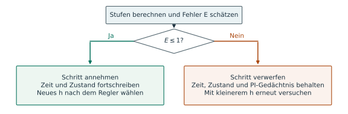

Bei Dormand–Prince 5(4) fällt die letzte der sieben Steigungen mit der ersten Steigung am nächsten angenommenen Start zusammen. Aus dieser **FSAL**-Eigenschaft folgt für $N$ ununterbrochene Schritte ohne Fehlversuch eine Zahl von $1+6N$ anstelle von $7N$ Auswertungen der rechten Seite. Für lange Folgen nähert sich die Ersparnis $1/7\approx14{,}3\,\%$. Startkosten, Fehlversuche, Ereignisse und gegebenenfalls zusätzliche Interpolationsstufen gehören in eine konkrete Aufwandsmessung. Bei einem erneuten Versuch am selben Start kann die alte Startsteigung gültig bleiben. Ausgewertet wird dabei weiterhin mit dem neuen $h$ und mit neuen inneren Stufen.

Eine Lastflanke kann die Steigung am selben Zeitwert ändern. Dann berechnet der erste Schritt des neuen Modus seine Startsteigung aus dem neuen Vektorfeld. Das mitgelieferte PI-Labor wertet die erste Stufe bei jedem Versuch erneut aus. Die Funktionszahlen eines FSAL-fähigen Solvers folgen erst aus der tatsächlich verwendeten Wiederverwendung.

<!-- Buchseite -->

<a id="rk-dicht-v916"></a>

## 2.5 Dichte Ausgabe und Rechenlabor

Wie liest ein Messgerät die Temperatur bei $t_n+h/2$, wenn der Integrator gerade einen ganzen Schritt akzeptiert hat? Aus den beiden Endwerten und ihren Ableitungen konstruiert das Labor das kubische Hermite-Polynom. Mit $\theta=(t-t_n)/h$ gelten die Gewichte $H_{00}=(1+2\theta)(1-\theta)^2$, $H_{01}=\theta^2(3-2\theta)$, $H_{10}=\theta(1-\theta)^2$ und $H_{11}=\theta^2(\theta-1)$. Dabei multiplizieren die Steigungsgewichte $h f_n$ und $h f_{n+1}$. Mit exakten Randdaten ist der maximale Rest bei vier stetigen Ableitungen höchstens $h^4\max|y^{(4)}|/384$. Für das DP-Paar verwendet das Labor denselben Hermite-Versuch als Vergleich. Die verbreitete adaptive RK45-Implementierung verwendet ihren eigenen Interpolanten vierter Potenz. [Dichte Ausgabe und Nullstellensuche](#k5-detektion)

Der Aufruf in Python verwendet Sekunden und einen dimensionslosen Speicherwert. Ein Eintrag enthält Startzeit, Schrittweite, beide Zustände und beide Endableitungen.

~~~python
from rk_adaptiv import BS32, solve
schritte, verworfen = solve(lambda t, y: (-y[0],), (1.,), 1.,
                            .8, BS32, (1e-9,), 1e-6)
endwert = schritte[-1][3][0]
~~~

Bei gleichem Startvorschlag $0{,}8\,\mathrm s$ verwendet BS3(2) 38 akzeptierte und zwei verworfene Schritte, DP5(4) fünf und einen. Ihre Endfehler betragen $3{,}167\cdot10^{-7}$ und $5{,}890\cdot10^{-8}$. Ein eigenständiger Test summiert die lokalen Taylor-Reste. Für BS3(2) genügt $\sum h_n^4/24$ in normierten Zeiteinheiten, weil $|R_3(-h)|\leq1$ auf $0\leq h\leq1$. Für DP ist $R(-h)=T_5(-h)+h^6/600$, wobei $T_5$ das Exponentialpolynom bezeichnet. Taylor und derselbe Verstärkungsvergleich liefern $\sum h_n^6/600$. Die Gleichungen erklären, weshalb der Test eine globale Aussage für diesen Versuch erlaubt.

**Aufgaben.** (1) Bestimmen Sie den Mittelpunkt-Schritt für $h=1/4\,\mathrm s$. (2) Der normalisierte Schätzer von BS3(2) sei acht. Welchen Faktor liefert der I-Vorschlag mit $\eta=0{,}9$? (3) Ein Paar zeigt bei $h=1\,\mathrm s$ Gleichheit beider Antworten. Welche weitere Messung würde Ihren Verdacht prüfen?

**Musterlösungen.** (1) Die Halbzeitprognose ist $0{,}875$, der Endwert $0{,}78125$. (2) $0{,}9\cdot8^{-1/3}=0{,}45$. (3) Zwei Halbschritte und eine analytische Vergleichslösung liefern unabhängige Information. Der Fehler von $1/3$ gegenüber $e^{-1}$ beträgt rund $0{,}03455$.


<!-- Buchseite -->

### Wann eine dichte Ausgabe zwischen den Stützstellen täuscht

Ein dichtes Polynom kann zwischen steigenden Stützstellen lokal fallen. Nehmen wir ein normiertes Intervall $0\le\theta\le1$ mit den Endwerten null und eins sowie den Steigungen vier und vier. Der kubische Hermite-Ansatz ergibt
$$
p(\theta)=4\theta-9\theta^2+6\theta^3 .
$$
Es gilt $p'(\tfrac12)=-\tfrac12$. Mit den Randsteigungen acht und null erhält man sogar $p(\tfrac12)=1{,}5$, obwohl beide Randwerte höchstens eins betragen. Wer Monotonie oder eine physikalische Bandgrenze benötigt, prüft sie für den Interpolanten selbst. Das klassische Runge-Phänomen beschreibt wachsende Randoszillationen bei globaler Interpolation an vielen äquidistanten Stützstellen. Hier reicht bereits ein lokales kubisches Polynom für einen Monotonieverlust.

Ein Solver konstruiert seine dichte Ausgabe aus Daten desselben angenommenen Schritts. SciPy verwendet bei RK45 ein Polynom vierten Grads und bei DOP853 einen Interpolanten, der mit Ordnung sieben genau ist. Diese kontinuierlichen Erweiterungen sind auf das jeweilige RK-Verfahren abgestimmt. Für einen bekannten Sprung beendet man den alten Schritt an der Flanke und beginnt dort mit neuem Feld. Für unbekannte Ereigniszeiten setzt [Abschnitt 5.2](#k5-detektion) den Interpolationsfehler mit der Steilheit der Schaltfunktion in Beziehung. [SciPy, Zeitverfahren und dichte Ausgabe](https://docs.scipy.org/doc/scipy/reference/generated/scipy.integrate.solve_ivp.html)

<!-- Buchseite -->

### Gegenprobe · Was schätzt die Differenz eines eingebetteten Paares?

Ein Messgerät beobachtet den normierten Abklingvorgang $y'=-y$, $y(0)=1$. Für denselben Schritt liefert Euler $y_E=1-h$. Beim expliziten Mittelpunktverfahren beträgt die Steigung zur Halbzeit $-(1-h/2)$. Einsetzen ergibt $y_M=1-h+h^2/2$. Die Differenz $y_M-y_E=h^2/2$ vervierfacht sich, wenn man die Schrittweite verdoppelt. Im Vergleich mit $e^{-h}=1-h+h^2/2-h^3/6+\cdots$ erkennt man, welchen Anteil das Paar misst. Der führende Fehler des Eulerwerts hat Ordnung zwei pro Schritt, der des Mittelpunktwerts Ordnung drei. Für die Steuerung mit genau dieser Paardifferenz folgt deshalb der Exponent $1/2$.

**Kontrollfrage.** Wie groß ist die Differenz bei $h=1/4$ und $h=1/8$ in normierter Zeit? Aus $1/32$ und $1/128$ lässt sich der Faktor vier ohne Gleitkommarundung ablesen. Die Funktion `midpoint()` in `beispiele/gegenproben.py` berechnet beide Stufen unabhängig von der Reihenentwicklung.

<!-- Buchseite -->

<a id="kap02-schluss"></a>

## Schluss · Von der Stufe zum geprüften Schritt

Beim Fühler lohnt sich ein kürzerer Schritt, solange sich die Steigung rasch ändert. Runge–Kutta-Verfahren lesen das Feld an mehreren vorberechneten Zwischenzuständen. Das Tableau erklärt, wie diese Stufen entstehen und was ihr gewichteter Mittelwert zum Endzustand beiträgt. Ein eingebettetes Paar nutzt die vorhandenen Stufen für zwei Ergebnisse. Das skalierte Fehlermaß vergleicht ihre Differenz mit der Toleranz, die für die einzelnen Zustandskomponenten gewählt wurde.

Erst ein angenommener Schritt verschiebt die Uhr und den gültigen Zustand. Bei einem verworfenen Schritt rechnet der Solver vom selben Start mit einem neuen $h$. Auch dichte Ausgabe gehört zu einem angenommenen Schritt. Sie liefert Werte zwischen dessen Grenzen, an denen ein Messgerät abfragt oder ein Ereignis gesucht wird.

Im Abkühlversuch stimmt die Differenz bei einer bestimmten Schrittweite exakt mit null überein, obwohl beide Ergebnisse vom analytischen Wert abweichen. Für die Güte einer Bahn bleibt daher die Gegenprobe an einem festen Messzeitpunkt entscheidend. Bei ausgeprägter Steifigkeit reicht oft auch ein gut arbeitender Fehlerschätzer nicht für wirtschaftliche explizite Schritte. [Implizite Integratoren](#kap03-einstieg)

<a id="kap02-forschung"></a>

### Aktueller Stand der Forschung

Schrittweitenregler und Fehlerschätzer bilden gemeinsam einen Rückkopplungskreis. Ranocha und Giesselmann analysieren dessen Stabilität für explizite Runge–Kutta-Verfahren mit nachträglichen, an Lösungsrekonstruktionen gebundenen Fehlerschätzern. In den untersuchten Kombinationen kann ein einfacher I-Regler zu ungünstigen Schrittfolgen führen. Damit gehört der Regler selbst zum Vergleich zweier Integratoren. Für einen ARGESIM-Versuch wären Endfehler, Zahl der Fehlversuche und die Lage dieser Fehlversuche vor einer Schaltung aussagekräftige gemeinsame Messgrößen. [Stability of step size control based on a posteriori error estimates (2024)](https://openscience.ub.uni-mainz.de/items/56f47020-1d9b-4374-bc65-0f42f1a25c70)

[Zur Einleitung dieses Kapitels](#kap02-einstieg)

<!-- Buchseite -->

# Kapitel 3 · Implizite Integratoren, Radau IIA und BDF

<a id="kap03-einstieg"></a>

## Einleitung · Wann lohnt es sich, den neuen Zustand aus einer Gleichung zu bestimmen?

Ein schneller Fühler erreicht seinen Sollwert fast schlagartig, während der angeschlossene Regler über Sekunden arbeitet. Wir können die ersten Millisekunden fein vermessen oder uns für die anschließende Bewegung interessieren. Eine Rechenregel, die den schnellen Vorgang bei einem größeren Schritt künstlich wieder verstärkt, erschwert beide Vorhaben. Was gewinnt man, wenn die noch unbekannte Steigung am Schrittende in der Gleichung stehen bleibt?

Am skalaren Fühler vergleichen wir, wie viel von einer Störung nach einem großen Schritt erhalten bleibt. Dann schauen wir in den impliziten Schritt hinein. Die gesuchte Größe wird aus einem Residuum bestimmt. Newton verwendet dessen Steigung, und bei mehreren Unbekannten wird daraus ein lineares Gleichungssystem. Radau IIA behandelt die Stufen eines Schritts gemeinsam. BDF nutzt mehrere bekannte Zustände aus der bisherigen Zeitfolge.

Für die Wahl im Rechenlabor zählen am Ende mehr als geringe Residuen. Auch die Bahn zwischen angenommenen Schritten und die Zeit eines Moduswechsels gehören zum Auftrag. Wir werden prüfen, wann der Gewinn an Stabilität die zusätzliche Arbeit für Stufen, Jacobi-Matrizen und lineare Lösungen rechtfertigt.

[Zum Schluss dieses Kapitels](#kap03-schluss)

<!-- Buchseite -->

<a id="k3-stabilitaet"></a>

## 3.1 Wie viel von einer schnellen Störung bleibt übrig?

Der Fühler eines Temperaturreglers reagiert innerhalb einer Millisekunde. Seine Solltemperatur bewegt sich dagegen auf einer Zeitskala von Sekunden. Wer nach zehn Millisekunden auf den Fühler schaut, erwartet, dass eine anfängliche Abweichung fast verschwunden ist. Wer den Ausgleich selbst vermessen will, muss früher hinschauen. Diese beiden Beobachtungsaufgaben stellen unterschiedliche Anforderungen an denselben Integrationsschritt.

Für eine erste Rechnung halten wir den Sollwert fest. Der auf seinen Anfangswert normierte Temperaturüberschuss $d$ erfüllt $d'=-a d$ mit $a=1000\,\mathrm{s}^{-1}$. Während $h=10\,\mathrm{ms}$ vergehen zehn Zeitkonstanten. Deshalb bleibt exakt der Anteil $e^{-10}\approx0{,}0000454$ übrig. Vorwärts-Euler nimmt die Steigung vom Schrittanfang für die gesamte Dauer an. Sein Endwert ist $d_{n+1}=d_n-ha d_n=-9d_n$. Ein Algorithmus, der hier einen Vorzeichenwechsel mit wachsendem Betrag erzeugt, erschwert schon die Beobachtung des langsamen Vorgangs.

**Die Steigung am neuen Zustand.** Rückwärts-Euler setzt $d_{n+1}=d_n-ha d_{n+1}$. Weil die gesuchte Abweichung auch auf der rechten Seite steht, lautet die auszuführende Rechnung $(1+ha)d_{n+1}=d_n$. Die Trapezregel mittelt alte und neue Steigung. Sie liefert $(1+ha/2)d_{n+1}=(1-ha/2)d_n$. In beiden Fällen müssen wir den Endwert aus einer Gleichung bestimmen. Bei der Trapezregel kann ein Rest mit umgekehrtem Vorzeichen zurückbleiben.

Für das Testproblem $d'=\lambda d$ bezeichnet $z=h\lambda$ die dimensionslose Schrittweite und $R(z)=d_{n+1}/d_n$ den Verstärkungsfaktor bei $d_n\ne0$. Die drei Regeln haben die Faktoren

$$
R_{\mathrm V}(z)=1+z,\qquad R_{\mathrm R}(z)=\frac1{1-z},\qquad
R_{\mathrm T}(z)=\frac{1+z/2}{1-z/2}.
$$

Für $\lambda=-a+i\omega$ dämpft $a$ die Schwingung, während $\omega$ ihre Phase dreht. Eine Störung nimmt in einem numerischen Schritt im Betrag ab, wenn $|R(z)|<1$. Bei $|R(z)|=1$ bleibt ihr Betrag erhalten. Mit diesen beiden Aussagen lässt sich Abbildung 3.1 lesen. [Stabilitätsgebiete][k3fnc]

<!-- Buchseite -->

### A-Stabilität, L-Stabilität und ein Vorzeichenwechsel

Die Bedingung $|1+z|\leq1$ beschreibt das Innere einschließlich Rand des Kreises um $-1$. Für Rückwärts-Euler ergibt sich $|1-z|\geq1$, also der Bereich außerhalb des offenen Kreises um $+1$. Er enthält die ganze linke Halbebene. Ein Einschrittverfahren heißt **A-stabil**, wenn seine Stabilitätsfunktion dort einschließlich der imaginären Achse definiert ist und $|R(z)|\leq1$ gilt. Für die Trapezregel folgt dies direkt aus $|1-z/2|^2-|1+z/2|^2=-2\operatorname{Re}z\geq0$.

![Abbildung 3.1. A zeigt die Stabilitätsgrenzen beider Euler-Verfahren in dimensionslosen Koordinaten. Links der gepunkteten imaginären Achse dämpft die exakte Lösung. Vorwärts-Euler ist im linken Kreis stabil. Die rote Strecke markiert das reelle Intervall $[-2,0]$ mit $R(-1)=0$. Rückwärts-Euler ist außerhalb des rechten Kreises stabil. B verfolgt nach jedem Schritt den normierten Rest bei $z=-100$. Der Vorzeichenwechsel der Trapezregel ist auch nach fünf Schritten sichtbar. Quadrate markieren die Rückwärts-Euler-Werte.](abbildungen/k3_stabilitaet.svg)

Was bei sehr schneller Dämpfung geschieht, beantwortet eine zweite Frage. Ein A-stabiles Einschrittverfahren heißt **L-stabil**, wenn zusätzlich $R(z)\to0$ für $|z|\to\infty$ in der linken Halbebene. Rückwärts-Euler erfüllt diese Bedingung. Die Trapezregel strebt dagegen auf der negativen reellen Achse gegen $-1$. Bei $z=-100$ bleiben nach zwei Schritten $(49/51)^2\approx0{,}9231$ der anfänglichen Abweichung, bei Rückwärts-Euler $(1/101)^2\approx0{,}0000980$. Für ein Messziel von einem Prozent Restabweichung nach einem Schritt genügen hier die $1/101$ von Rückwärts-Euler. In der Anfangsschicht kann selbst dieser gedämpfte Schritt zu ungenau sein.

<!-- Buchseite -->

### Die Stabilitätsfaktoren nachrechnen

`stabilitaet.py` prüft die dimensionslosen Verstärkungsfaktoren gegen Brüche, die sich von Hand berechnen lassen. Der Radau-Faktor wird in Abschnitt 3.3 aus den gekoppelten Stufen hergeleitet. Die halbe letzte Stelle bezieht sich auf die Ausgabe mit neun Nachkommastellen. Das Einprozentziel bezieht sich dagegen auf die physikalische Restabweichung.

```python
"""Stabilitätsfaktoren für eine normierte Abweichung."""
from cmath import exp as cexp
from math import exp


def radau_faktor(z):
    zaehler = 1 + z * (2/5 + z/20)
    nenner = 1 + z * (-3/5 + z * (3/20 - z/60))
    return zaehler / nenner


def rueckwaerts(z):
    return 1 / (1 - z)


def trapez(z):
    return (1 + z/2) / (1 - z/2)


if __name__ == "__main__":
    aufloesung = 0.5e-9  # halbe letzte Stelle der Faktorentabelle
    for z in (-10.0, -100.0):
        print(f"{z:5.0f} {exp(z):.9f} {rueckwaerts(z):.9f} "
              f"{trapez(z):.9f} {radau_faktor(z):.9f}")
    assert abs(radau_faktor(-10) - 3/58) <= aufloesung
    assert abs(trapez(-100) + 49/51) <= aufloesung
    # Physikalisches Ziel: Rest nach einem groben Schritt unter 1 %.
    assert exp(-100) < 0.01
    assert abs(rueckwaerts(-100)) < 0.01 < abs(trapez(-100))
    z = -1 + 2j
    assert abs(cexp(z)) < 1 < abs(1 + z)
    assert max(abs(rueckwaerts(z)), abs(trapez(z)),
               abs(radau_faktor(z))) < 1
```

**Wenn mehrere Zustände zusammenwirken.** Für $y'=My$ lautet die Fortschrittsmatrix $R(hM)$. Ihre Eigenwerte beschreiben das langfristige Abklingen, wenn ihr Spektralradius strikt kleiner als eins ist. Trotzdem kann ein Fehler vorübergehend wachsen. Die Matrix $B=\bigl(\begin{smallmatrix}1/2&4\\0&1/2\end{smallmatrix}\bigr)$ bildet $(0,1)$ auf $(4,1/2)$ ab, obwohl beide Eigenwerte $1/2$ sind. Im Nebendiagonaleintrag von $B^n$ steht $4n(1/2)^{n-1}$, der erst mit wachsendem $n$ verschwindet. Bei so gekoppelten, nichtnormalen Systemen lohnt neben der Eigenwertanalyse ein Blick auf den tatsächlichen Fehlerverlauf.

<!-- Buchseite -->

<a id="k3-newton"></a>

## 3.2 Welche Gleichung löst Newton in einem Zeitschritt?

[Grundlagen · Lineare Gleichungen und Residuen](#g-lineare-algebra)

Nach dem Abschalten einer Quelle nehme die normierte Konzentration $y$ mit einer Rate proportional zu $y^2$ ab. Wir messen Zeit in Einheiten der charakteristischen Reaktionszeit. Das dimensionslose Anfangswertproblem lautet $y'=-y^2$, $y(0)=1$. Durch Trennung der Variablen erhält man $1/y=1+t$. Für diese Modellgleichung lässt sich deshalb unabhängig prüfen, wie viel Fehler beim Zeitschritt und wie viel beim Lösen seiner Gleichung entsteht.

Bei $h=0{,}1$ verlangt Rückwärts-Euler $Y=1-hY^2$. Wir suchen die physikalische, positive Nullstelle des **Residuums** $G(Y)=Y+hY^2-1$. Eine Näherung $Y_k$ lässt im Allgemeinen einen Rest $G(Y_k)$ stehen. Ersetzen wir die gekrümmte Funktion in ihrer Umgebung durch die Tangente, so soll deren Nullstelle die nächste Näherung liefern. Daher gelten

$$
G(Y_k)+G'(Y_k)\,\delta_k=0,\qquad Y_{k+1}=Y_k+\delta_k.
$$

Beim Start $Y_0=1$ erhält man $G(Y_0)=0{,}1$, $G'(Y_0)=1{,}2$ und damit $Y_1=1-0{,}1/1{,}2=0{,}9166667$. Der neue Defekt beträgt noch rund $6{,}94\cdot10^{-4}$. Wie viel sagt das über die gesuchte Konzentration aus? Zwischen nichtnegativem Iterierten und positiver Nullstelle $Y_*$ gilt $G'(Y)=1+2hY\geq1$. Nach dem Mittelwertsatz folgt daher $|Y-Y_*|\leq|G(Y)|$. Nur für diesen Bereich und diese Skalierung begrenzt der absolute Defekt den algebraischen Zustandsfehler auf so einfache Weise.

Die auf Auslöschung unempfindliche Wurzelformel liefert $Y_*=2/(1+\sqrt{1+4h})\approx0{,}9160797831$. Der exakte **ODE-Wert** bei $t=0{,}1$ ist $1/1{,}1\approx0{,}9090909091$. Damit verbleiben rund $0{,}006988874$ zeitlicher Diskretisierungsfehler, selbst wenn das innere Lösen die Wurzel beliebig genau trifft. Das Labor setzt für das algebraische Problem ein Budget von $10^{-10}$ und prüft getrennt, ob ein Ziel von $10^{-3}$ für die Zeitlösung erreicht wird.

<!-- Buchseite -->

<a id="kap03-schrittfolge"></a>

### Warum ein genauer Newton-Schritt noch einen Zeitfehler zulässt

Das Abklingen $y'=-y^2$ beginnt bei $y(0)=1$. Ein Rückwärts-Euler-Schritt der Länge eins verlangt $G(Y)=Y+Y^2-1=0$. Setzen wir den Näherungswert $\widehat Y=0{,}62$ ein, so ist $G(\widehat Y)=0{,}0044$. Auf der nichtnegativen Achse gilt $G'(Y)=1+2Y\ge1$. Nach dem Mittelwertsatz kann der Zustandsfehler innerhalb dieses algebraischen Schritts daher höchstens $0{,}0044$ betragen. Das exakte Ergebnis des Schritts ist $(\sqrt5-1)/2\approx0{,}618034$.

Die kontinuierliche Gleichung besitzt dagegen die Lösung $y(t)=1/(1+t)$. Man kontrolliert sie durch Ableitung und Startwert. Am selben Endzeitpunkt $t=1$ beträgt der Referenzwert $0{,}5$. Würden wir das Residuum bis zur Gleitkommagrenze verkleinern, bliebe die Abweichung der Rückwärts-Euler-Regel von dieser Referenz bei etwa $0{,}118$. Die beiden Kontrollen antworten auf verschiedene Fragen. Die Newton-Rechnung prüft die Lösung der Schrittgleichung. Das Zeitfehlerbudget prüft, ob diese Gleichung den Verlauf des Modells für die Messaufgabe ausreichend annähert.

<!-- Buchseite -->

### Wann lohnt sich eine neue Jacobi-Matrix?

Für ein System $y'=f(t,y)$ lautet das Residuum von Rückwärts-Euler $G(Y)=Y-y_n-hf(t_{n+1},Y)$. Mit der Jacobi-Matrix $J=\partial f/\partial y$ ist die Newton-Matrix $M=I-hJ$. Ein volles Newton-Verfahren bildet $M$ bei den aktuellen Iterierten. Beim **modifizierten Newton-Verfahren** frieren wir $J$ beispielsweise am Prädiktor ein. So kann eine Faktorisierung für mehrere Korrekturen reichen. Ob die eingesparte Arbeit die zusätzliche Iteration aufwiegt, hängt von der Größe und Struktur des Systems ab.

Bei einer LU-Zerlegung mit Zeilenvertauschungen gilt $PM=LU$. Für jede neue rechte Seite $b=-G(Y_k)$ lösen wir erst $Lw=Pb$ durch Vorwärtseinsetzen, dann $U\delta=w$ durch Rückwärtseinsetzen. Nur eine identische Matrix erlaubt die Wiederverwendung als **exakte** lineare Lösung. Eine Änderung von $h$, der BDF-Koeffizienten oder von $J$ kann die Matrix verändern. Eine ältere Matrix kann weiterhin eine Näherung für eine modifizierte Newton-Iteration sein. Dann muss der Solver deren Konvergenz überwachen.

Wie erkennt man eine falsche Ableitung? Für eine prüfbare Richtung $v$ lässt sich $Jv$ mit $[f(t,Y+\varepsilon v)-f(t,Y-\varepsilon v)]/(2\varepsilon)$ vergleichen. Bei glattem Feld fällt der Taylorfehler quadratisch mit $\varepsilon$, während die Auslöschung im Zähler mit kleiner werdendem $\varepsilon$ an Gewicht gewinnt. Ein Vergleich bei mehreren Störungen in skalierten Zustandskoordinaten trennt beide Effekte. Bei schlecht konditioniertem $M$ kann ein kleiner Defekt mit einem großen Zustandsfehler zusammengehen. Die Verstärkung hängt lokal von $\|M^{-1}\|$ ab.

**Welche Iteration hat versagt?** In einem adaptiven Integrator werden Korrektur und Defekt in passenden Skalen beurteilt. Stagniert das innere Lösen, kann der Solver $J$ erneuern oder denselben Zeitschritt mit kleinerem $h$ erneut versuchen. Erst nach bestandener algebraischer Prüfung und äußerer Fehlerkontrolle darf er Zeitpunkt und Historie fortschreiben. Im kleinen Labor erzwingt ein eigener Versuch eine erschöpfte Iterationsgrenze. So bleibt ein Fehlschlag vom berechneten Schrittwert unterscheidbar.

<!-- Buchseite -->

### Welche Kosten beim Aufbau der Jacobi-Matrix entstehen

Stellen wir uns einen Wärmeleiter mit $d$ Gitterwerten vor. Ein dichter Vorwärtsdifferenzen-Ansatz bildet die Spalte $j$ als
$$
J_{:j}\approx\frac{f(t,y+\delta_j e_j)-f(t,y)}{\delta_j}.
$$
Die Basis $f(t,y)$ wird einmal berechnet oder aus dem laufenden Newton-Schritt übernommen. Für $d$ Spalten folgen $d$ zusätzliche Funktionsaufrufe. Liefert ein Aufruf alle $d$ Komponenten in $O(d)$ Arbeit, kostet der dichte Aufbau insgesamt $O(d^2)$ skalare Arbeit und Speicherplätze. Das Faktorisieren einer dichten Newton-Matrix ist ein eigener Aufwand.

Beim eindimensionalen Wärmegitter hängt jede Rate nur vom Knoten selbst und von seinen nächsten Nachbarn ab. Bei einer **analytischen Jacobi-Matrix** lassen sich die drei Diagonalen unmittelbar anschreiben. Mit bekanntem Besetzungsmuster lassen sich Differenzenstörungen gruppieren. In diesem Beispiel überlappen die Zeilen von Spalten im Abstand drei nicht. Je ein Aufruf pro Gruppe der Indizes modulo drei liefert damit die Spalten aus drei zusätzlichen Auswertungen. Eine Band- oder Sparse-Faktorisierung verwendet die Struktur auch beim Lösen.

**Automatische Differentiation** führt die Ableitungsrechnung durch dieselben Programmoperationen wie $f$. Eine Dualzahl trägt neben dem Wert eine Richtungsableitung. Mit geeigneten Startvektoren entstehen Spalten oder gezielt Produkte $Jv$. Auch hier bestimmt die Zahl der Richtungen den Aufwand. An einer diskreten Verzweigung gilt die Rechnung für den gerade aktiven glatten Modellzweig. Ein korrekter Musterwechsel und ein passend skalierter Differenzenschritt bleiben Gegenstand eigener Tests. [SciPy BDF und Jacobi-Struktur](https://docs.scipy.org/doc/scipy/reference/generated/scipy.integrate.BDF.html)

<!-- Buchseite -->

### Die Rechnung mit frischer und eingefrorener Steigung

Das Programm `newton.py` zählt berechnete Korrekturen und neu gebildete skalare Matrizen. Die Formel für $G'$ und das gemeinsame Budget bleiben in beiden Läufen gleich.

```python
"""Rückwärts-Euler für y'=-y², alle Größen normiert."""
from math import sqrt


def loese(h, y, budget, eingefroren=False):
    if min(h, y, budget) <= 0:
        raise ValueError("Positive Versuchsdaten erforderlich")
    wert = y
    matrix = None
    matrizen = korrekturen = 0
    while True:
        defekt = wert + h * wert**2 - y
        if wert >= 0 and abs(defekt) <= budget:
            return wert, defekt, korrekturen, matrizen
        if korrekturen == 40:
            raise ArithmeticError("Newton-Ziel verfehlt")
        if matrix is None or not eingefroren:
            matrix = 1 + 2*h*wert
            matrizen += 1
        wert -= defekt / matrix
        korrekturen += 1


if __name__ == "__main__":
    h, y, budget = 0.1, 1.0, 1e-10
    wurzel = 2*y / (1 + sqrt(1 + 4*h*y))
    ode = y / (1 + h*y)
    for fest in (False, True):
        wert, defekt, n, m = loese(h, y, budget, fest)
        assert abs(wert - wurzel) <= budget
        assert abs(wert - ode) > 1e-3
        assert (n, m) == ((5, 1) if fest else (3, 3))
        print(f"Fest={fest!s:5s}  Y={wert:.12f}  |G|={abs(defekt):.2e}  "
              f"Korrekturen={n}  Matrizen={m}")
    try:
        loese(10.0, 1.0, 1e-14, True)
    except ArithmeticError:
        print("Erschöpftes Iterationsbudget für h=10 erkannt.")
    else:
        raise AssertionError("Fehlschlag der festen Iteration erwartet")
```

Bei $h=0{,}1$ benötigt volles Newton drei Korrekturen und drei Matrizen. Mit der festen Steigung $1{,}2$ genügen fünf Korrekturen und eine Matrix. Beide Ergebnisse liegen innerhalb des hergeleiteten algebraischen Budgets. Der äußere Fehler übersteigt in beiden Fällen $10^{-3}$. Ein noch engerer Newton-Abbruch würde hier zusätzliche Arbeit in dieselbe Zeitformel stecken.

<!-- Buchseite -->

<a id="k3-radau"></a>

## 3.3 Wie drei gekoppelte Stufen eine Radau-Kurve bestimmen

Eine Messung nur am rechten Ende eines langen Schritts lässt den Verlauf im Inneren offen. Wir suchen deshalb ein Polynom $p(\theta)$ vom Grad höchstens drei, mit der normierten Schrittkoordinate $\theta=(t-t_n)/h$ von null bis eins und $p(0)=y_n$. Seine physikalische Steigung soll an drei ausgewählten Punkten die Modellgleichung erfüllen. Schreiben wir $Y_i=p(c_i)$ und $K_i=f(t_n+c_i h,Y_i)$, dann ist $p'(c_i)=hK_i$, denn nach $\theta$ zu differenzieren bringt den Faktor $h$ mit.

<a id="revision-k03-01"></a>

### Aus zwei Steigungen ein Stufenpolynom gewinnen

An den normierten Zeiten $s=0$ und $s=1$ kennen wir $K_1$ und $K_2$. Die Gerade $(1-s)K_1+sK_2$ trifft beide Werte. Ihr Integral von null bis $\theta$ ist $(\theta-\theta^2/2)K_1+(\theta^2/2)K_2$. Bei $\theta=1$ erhalten beide Steigungen das Gewicht $1/2$. Aus drei Knoten wird eine Parabel. Ihr Integral bis zum jeweiligen Stufenknoten liefert genau eine Zeile des Radau-Tableaus.

Die Ableitung von $p$ ist höchstens quadratisch. Ihre drei Stützwerte bestimmen sie vollständig. Sei $\ell_j(s)=\prod_{k\ne j}(s-c_k)/(c_j-c_k)$ das Polynom, das am $j$-ten Knoten eins und an den anderen null ist. Integration der interpolierten Steigung vom linken Rand liefert für jeden Zwischenzeitpunkt

$$
p(\theta)=y_n+h\sum_{j=1}^3 K_j\int_0^\theta\ell_j(s)\,\mathrm ds.
$$

**Woher kommen die Knoten?** Wir verwenden die [Quadraturregel aus G.3](#auflage-gl-04). Der rechte Rand soll dazugehören, also $c_3=1$. Die drei Punkte sollen außerdem eine Quadratur bis Grad vier ermöglichen. Wir schreiben das Knotenpolynom als $w(s)=(s-1)(s^2+u s+v)$. Weil es an allen Stützstellen verschwindet, müssen für exakte Integration von $w$ und $sw$ die Integrale $\int_0^1w(s)\,\mathrm ds$ und $\int_0^1 s w(s)\,\mathrm ds$ verschwinden. Ausmultiplizieren und Integrieren ergeben die beiden linearen Gleichungen $2u+6v=-1$ und $5u+10v=-3$. Ihre Lösung ist $u=-4/5$, $v=1/10$. Die inneren Knoten sind somit

$$
c_1=(4-\sqrt6)/10,\qquad c_2=(4+\sqrt6)/10.
$$

Jedes Polynom vom Grad höchstens vier lässt sich durch $w$ teilen. Der Quotient hat höchstens Grad eins. Sein Produkt mit $w$ hat nach der Konstruktion Integral null. Der Rest ist höchstens quadratisch und wird durch die Lagrange-Interpolation exakt erfasst. So erreicht die Drei-Punkt-Quadratur Grad vier. Für **Kollokationsverfahren** liefert der zugehörige Ordnungssatz an diesen Knoten die klassische globale Ordnung fünf bei hinreichend glatten ODEs. Das ist eine Aussage zum Schrittendwert bei Verfeinerung einer festen glatten Aufgabe. Bei steifen Grenzübergängen kann Ordnungsreduktion auftreten. [Kollokation und Ordnung][k3koll]

Die Stufenordnung ist drei. Für die Genauigkeit einer Messung zwischen den Schrittenden zählt die verwendete Kurve. Der [Halbschrittversuch mit $y'=t^3$](#auflage-k03-01) rechnet den Unterschied aus.


<!-- Buchseite -->

### Das Tableau und der Nachweis der L-Stabilität

Setzt man $\theta=c_i$ in die Integralform ein, erhält man $a_{ij}=\int_0^{c_i}\ell_j(s)\,\mathrm ds$. Bei $\theta=1$ erhält man $b_j=\int_0^1\ell_j(s)\,\mathrm ds$. Die drei Stufengleichungen lauten $Y_i=y_n+h\sum_j a_{ij}K_j$. Ihre rechten Seiten hängen von allen drei Stufen ab. Mit $r=\sqrt6$ ergeben die Integrale das Tableau

$$
\begin{array}{c|ccc}
(4-r)/10&(88-7r)/360&(296-169r)/1800&(-2+3r)/225\\
(4+r)/10&(296+169r)/1800&(88+7r)/360&(-2-3r)/225\\
1&(16-r)/36&(16+r)/36&1/9\\ \hline
 &(16-r)/36&(16+r)/36&1/9
\end{array}
$$

Die letzte Zeile von $A$ stimmt mit $b^\mathsf T$ überein. Daher ist $y_{n+1}=Y_3$. Diese Eigenschaft heißt **stiff accuracy**. Eine an der Endstufe bis zur Lösertoleranz erfüllte algebraische Bindung geht bei einer geeigneten DAE-Formulierung unmittelbar in den Endwert ein. Die Wahl eines Knotens am rechten Rand allein würde für ein beliebiges RK-Tableau noch keine Gleichheit der Gewichte erzwingen. SciPys `Radau` erwartet eine explizite ODE-Rechte-Seite. Ein allgemeines Residuum $F(t,y,\dot y)=0$ benötigt eine passende DAE-Schnittstelle und konsistente Startdaten. [Radau-Schnittstelle][k3scir] · [Residualsolver IDA][ida]

Für $y'=\lambda y$ folgt $(I-zA)Y=\mathbf1 y_n$ und damit $R(z)=1+zb^\mathsf T(I-zA)^{-1}\mathbf1=N(z)/D(z)$ mit

$$
 N=1+2z/5+z^2/20,\qquad D=1-3z/5+3z^2/20-z^3/60.
$$

Für $x=-\operatorname{Re}z\geq0$ und $w=|z|^2$ ergibt Ausmultiplizieren

$$
3600(|D|^2-|N|^2)
=w^3+18xw^2+144x(x+3)w+480x(x^2+3x+15).
$$

Außer bei $z=0$ ist die rechte Seite positiv, am Ursprung gilt $D=N=1$. Somit hat $R$ links keinen Pol und dort Betrag höchstens eins. Der um eins höhere Nennergrad liefert zusätzlich $R(z)\to0$ für $|z|\to\infty$. Beides zusammen beweist L-Stabilität. Für $z=-10$ ergibt sich trotzdem $R=3/58\approx0{,}05172$, während die tatsächliche Abweichung nur $e^{-10}$ beträgt.

<!-- Buchseite -->

### Wo die Ersatzkurve die Differentialgleichung trifft

Für den einzelnen Schritt aus dem Temperaturversuch zeigt Abbildung 3.2 die ganze Ersatzkurve. Um ihre Steigung zu prüfen, stellen wir die normierte Differentialgleichung als $p'(\theta)+10p(\theta)=0$ dar. Die exakte Kurve erfüllt sie überall. Beim kubischen Polynom verlangen wir die Gleichheit an den drei Radau-Knoten.


Die zweite Stufe liegt bei $6{,}4495\,\mathrm{ms}$ und liefert $Y_2\approx-0{,}06074$. Die exakte Temperaturabweichung ist zu jedem Zeitpunkt positiv. Am rechten Rand bleibt mit $3/58$ wieder ein positiver Wert zurück. Hier sieht man getrennt, was die Endstufe, die Stufensteigungen und die Genauigkeitsforderung über die Anfangsschicht aussagen.

Für $y'=\lambda y+g(t)$ genügt eine lineare Lösung mit drei Unbekannten. Die rechte Seite der $i$-ten Stufengleichung ist $y_n+h\sum_j a_{ij}g(t_n+c_jh)$ nach Übertragen der unbekannten Anteile in die Matrix $I-h\lambda A$. Bei einem nichtlinearen System mit $d$ Komponenten umfasst die blockweise Newton-Matrix dagegen $3d$ Zeilen. Ihr Block $(i,j)$ lautet $\delta_{ij}I-h a_{ij}J_j$ mit $J_j=\partial f/\partial y(t_n+c_jh,Y_j)$. Das folgende Labor implementiert den skalaren affinen Fall vollständig, einschließlich der drei gekoppelten Stufen.

<!-- Buchseite -->

### Radau im Code · Faktorisierung und Dreieckslösung

Die drei aufeinanderfolgenden Listings ergeben zusammen `radau_iia.py`. Die Matrix enthält nach der Elimination die Einträge von $U$ auf und über der Diagonale und die Multiplikatoren von $L$ darunter. Die Diagonale von $L$ besteht implizit aus Einsen. Bei einer Zeilenvertauschung wandern die bereits gespeicherten Multiplikatoren mit.

```python
"""Dreistufiger Radau-Schritt für y'=lam*y+g(t), skalare affine ODE."""
from math import exp, sqrt


r = sqrt(6.0)
C = ((4-r)/10, (4+r)/10, 1.0)
B = ((16-r)/36, (16+r)/36, 1/9)
A = (((88-7*r)/360, (296-169*r)/1800, (-2+3*r)/225),
     ((296+169*r)/1800, (88+7*r)/360, (-2-3*r)/225),
     B)


def faktorisiere(matrix):
    lu = [list(zeile) for zeile in matrix]
    n = len(lu)
    reihenfolge = list(range(n))
    for k in range(n):
        p = max(range(k, n), key=lambda i: abs(lu[i][k]))
        if lu[p][k] == 0:
            raise ArithmeticError("Singuläre Stufenmatrix")
        lu[k], lu[p] = lu[p], lu[k]
        reihenfolge[k], reihenfolge[p] = reihenfolge[p], reihenfolge[k]
        for i in range(k+1, n):
            lu[i][k] /= lu[k][k]
            for j in range(k+1, n):
                lu[i][j] -= lu[i][k] * lu[k][j]
    return lu, reihenfolge


def einsetzloesen(faktoren, rechte_seite):
    lu, reihenfolge = faktoren
    x = [rechte_seite[i] for i in reihenfolge]
    for i in range(len(x)):
        x[i] -= sum(lu[i][j]*x[j] for j in range(i))
    for i in reversed(range(len(x))):
        rest = sum(lu[i][j]*x[j] for j in range(i+1, len(x)))
        x[i] = (x[i] - rest) / lu[i][i]
    return x
```

<!-- Buchseite -->

### Radau im Code · Stufen bilden und Integrale prüfen

Bei fester Methode hängt die Matrix in diesem Labor ausschließlich vom Produkt $z=h\lambda$ ab. Nur wenn dieses Produkt gleich bleibt, löst die gespeicherte Faktorisierung die neue Gleichung. Die Anregung $g(t)$ und der Startwert erscheinen auf der rechten Seite. Die drei Stufen werden bei jedem Schritt neu bestimmt.

```python
class RadauLinear:
    def __init__(self):
        self.produkt = None
        self.faktoren = None
        self.zerlegungen = 0

    def stufen(self, t, y, h, lam, quelle):
        z = h * lam
        if z != self.produkt:
            matrix = [[float(i == j) - z*A[i][j] for j in range(3)]
                      for i in range(3)]
            self.faktoren = faktorisiere(matrix)
            self.produkt = z
            self.zerlegungen += 1
        g = [quelle(t + c*h) for c in C]
        rhs = [y + h*sum(a*g_j for a, g_j in zip(zeile, g))
               for zeile in A]
        return einsetzloesen(self.faktoren, rhs)


if __name__ == "__main__":
    tol = 0.5e-12  # halbe Stelle bei zwölf Nachkommastellen
    for m in range(5):
        assert abs(sum(b*c**m for b, c in zip(B, C))-1/(m+1)) <= tol
    for zeile, c_i in zip(A, C):
        for m in range(3):
            moment = sum(a*c**m for a, c in zip(zeile, C))
            assert abs(moment - c_i**(m+1)/(m+1)) <= tol
```

Die Momententests prüfen zwei verschiedene Integrale. Die Gewichte $b_j$ integrieren Monome bis Grad vier auf $[0,1]$. Jede Zeile von $A$ integriert Monome bis Grad zwei auf $[0,c_i]$, weil die interpolierte Steigung quadratisch ist. Die Ableseauflösung im Test ist eine halbe Einheit der zwölften Nachkommastelle.

<a id="revision-k03-02"></a>

<a id="auflage-k03-01"></a>

**Wo gilt welche Ordnung?** Das dreistufige Radau IIA hat Stufenordnung drei. Bei exaktem Start beträgt der Fehler einer inneren Stufe im Allgemeinen $O(h^4)$. Für eine feste hinreichend glatte, reguläre ODE hat der Schrittendwert lokalen Fehler $O(h^6)$ und über ein festes Zeitintervall globalen Fehler $O(h^5)$. Für die hier verwendete kubische Kollokationskurve kann im Schrittinneren bereits ein Term der Größe $h^4$ bleiben.

Das zeigt $y'=t^3$, $y(0)=0$ am halben ersten Schritt. Die Differenz zwischen kubischer Steigung und ihrer quadratischen Interpolation ist auf der Einheitsskala das Knotenpolynom $w(s)=(s-1)(s^2-4s/5+1/10)$. Der exakte Wert übersteigt die Kollokationskurve bei $\theta=1/2$ um $h^4\int_0^{1/2}w(s)\,\mathrm ds=h^4/320$. Am rechten Ende ist $\int_0^1w(s)\,\mathrm ds=0$. Eine Halbierung von $h$ teilt den Innenfehler dieses Versuchs durch 16. Bei steifen oder algebraischen Aufgaben sind die Regularität und die verwendete dichte Ausgabe gesondert zu prüfen.


<!-- Buchseite -->

### Radau im Code · Endstufe und beobachtete Ordnung

```python
    # Ein unabhängiger Test erzwingt eine Zeilenvertauschung.
    faktoren = faktorisiere([[0.0, 2.0], [1.0, 1.0]])
    assert einsetzloesen(faktoren, [4.0, 3.0]) == [1.0, 2.0]
    solver = RadauLinear()
    for h in (0.01, 0.01, 0.005):
        stufen = solver.stufen(0.0, 1.0, h, -1000.0, lambda t: 0.0)
        ende = 1 - 1000*h*sum(b*y for b, y in zip(B, stufen))
        assert abs(stufen[-1] - ende) <= tol
        if h == 0.01:
            assert abs(ende - 3/58) <= tol
    assert solver.zerlegungen == 2

    fehler = []
    for n in (4, 8, 16):
        y = 1.0
        for j in range(n):
            y = solver.stufen(j/n, y, 1/n, -2.0, lambda t: 0.0)[-1]
        fehler.append(abs(y - exp(-2)))
    print("Endfehler für n=4,8,16:", *(f"{e:.3e}" for e in fehler))
    print("Fehlerquotienten:", *(f"{a/b:.3f}"
                                for a, b in zip(fehler, fehler[1:])))
    # Für die gewählten drei Gitter: der aus R exakt bestimmbare Fehler.
    for n, gemessen in zip((4, 8, 16), fehler):
        z = -2/n
        p = 1 + 2*z/5 + z*z/20
        q = 1 - 3*z/5 + 3*z*z/20 - z**3/60
        assert abs(gemessen - abs((p/q)**n-exp(-2))) <= tol
```

Das Labor erzwingt zunächst eine Zeilenvertauschung und prüft den Endwert gegen die gewichtete Summe aller Steigungen. Bei der Schrittfolge $0{,}01$, $0{,}01$, $0{,}005\,\mathrm s$ mit unveränderter Rate entstehen zwei Faktorisierungen. Zur Ordnungsprüfung wechseln wir auf die glatte Aufgabe $y'=-2y$, $y(0)=1$ in normierten Einheiten und rechnen bis $t=1$. Bei 4, 8 und 16 Schritten beträgt der Endfehler $1{,}091\cdot10^{-6}$, $3{,}527\cdot10^{-8}$ und $1{,}124\cdot10^{-9}$. Die Fehlerquotienten $30{,}923$ und $31{,}389$ nähern sich dem erwarteten Wert $2^5=32$. Die unabhängige Sollrechnung nutzt $R(-2/n)^n$ und $e^{-2}$. Drei Verfeinerungen illustrieren den Ordnungssatz an dieser Aufgabe.

<!-- Buchseite -->

<a id="k3-bdf"></a>

## 3.4 Was frühere Zustände über die heutige Steigung aussagen

Ein Datenlogger liefert drei Konzentrationen zu gleich weit auseinanderliegenden Zeiten. Wie würden wir die Steigung am jüngsten Zeitpunkt schätzen? Legen wir eine Parabel durch die drei Messwerte und differenzieren sie dort. Im Integrator ist der jüngste Wert noch unbekannt. Wir verlangen, dass die so berechnete Steigung am neuen Zeitpunkt die Modellgleichung erfüllt. Das ist der Ausgangspunkt der **Backward Differentiation Formulas**.

Sei $s=(t-t_{n+1})/h$. Die drei Stützstellen des Polynoms sind $0,-1,-2$. Die zugehörigen Lagrange-Polynome lauten $(s+1)(s+2)/2$, $-s(s+2)$ und $s(s+1)/2$. Bei $s=0$ ergeben ihre Ableitungen $3/2,-2,1/2$. Wegen $\mathrm ds/\mathrm dt=1/h$ folgt

$$
\frac{3y_{n+1}-4y_n+y_{n-1}}{2h}=f(t_{n+1},y_{n+1}).
$$

Für Ordnung $k$ interpolieren wir $k+1$ Werte und schreiben $\sum_{j=0}^k\alpha_j y_{n+1-j}=h f_{n+1}$. Die erste Zahl jeder Tabellenzeile multipliziert den **gesuchten** Zustand. Der Teiler gilt für sämtliche Einträge derselben Zeile. Die Tabelle setzt konstante Schrittweite voraus. [BDF-Koeffizienten][k3mit]

<a id="tab-k03-01"></a>

| Ordnung | Zähler der Gewichte vom neuen zum ältesten Zustand | Teiler |
|---:|---|---:|
| 1 | 1, −1 | 1 |
| 2 | 3, −4, 1 | 2 |
| 3 | 11, −18, 9, −2 | 6 |
| 4 | 25, −48, 36, −16, 3 | 12 |
| 5 | 137, −300, 300, −200, 75, −12 | 60 |
| 6 | 147, −360, 450, −400, 225, −72, 10 | 60 |

Für eine Konstante ergibt jede Zeilensumme null. Eine Gerade mit Steigung eins liefert nach Division durch $h$ genau eins. Für die skalare affine Gleichung $y'=\lambda y+g(t)$ entsteht bei BDF2 eine einzige lineare Gleichung für $y_{n+1}$. Der Preis für dieses kleinere Gleichungssystem ist die benötigte Vorgeschichte.

<!-- Buchseite -->

### Stabilität, wechselnde Schritte und die Wahl der Ordnung

Bei $y'=\lambda y$ genügt für BDF2 ein Faktor $R(z)$ allein nicht. Zwei Startwerte wirken durch die Rekursion $(3-2z)y_{n+1}-4y_n+y_{n-1}=0$. Setzen wir $y_n=\xi^n$, erhalten wir $(3-2z)\xi^2-4\xi+1=0$. Für $z=0$ sind die Wurzeln $1$ und $1/3$. Die konstante Lösung bleibt erhalten, die zweite, rein numerische Komponente klingt ab. **Nullstabilität** verlangt bei $z=0$ Wurzeln vom Betrag höchstens eins und Einfachheit aller Wurzeln auf dem Einheitskreis.

Wann kann für ein anderes $z$ eine Wurzel den Einheitskreis überqueren? Einsetzen von $\xi=e^{i\varphi}$ gibt $z=(3-4e^{-i\varphi}+e^{-2i\varphi})/2$ und $\operatorname{Re}z=(1-\cos\varphi)^2\geq0$. Für sehr negatives reelles $z$ haben beide Wurzeln kleinen Betrag. Da sie in der offenen linken Halbebene keinen Einheitskreisübergang haben und $3-2z$ dort nie null wird, ist die ganze Halbebene stabil. Der Rand folgt durch Stetigkeit und die Wurzelprüfung bei $z=0$. BDF1 und BDF2 sind A-stabil. BDF3 bis BDF6 besitzen engere Stabilitätssektoren um die negative reelle Achse. Bei $A(\alpha)$-Stabilität umfasst das Stabilitätsgebiet den Sektor $|\arg(-z)|\leq\alpha$ mit $0<\alpha\leq\pi/2$ und den Ursprung. Die klassischen Verfahren ab BDF7 scheitern auf äquidistanten Gittern an der Nullstabilität. Die zweite Dahlquist-Barriere begrenzt die Ordnung A-stabiler konvergenter linearer Mehrschrittverfahren auf zwei. [Mehrschrittstabilität][k3rwth] · [Dahlquist und steife Verfahren][k3hw]

Ändert sich die Schrittweite, liegen die früheren Werte nicht mehr bei $-1,-2$. Mit $r=h/h_{\rm alt}$ stehen die normierten Knoten bei $0,-1,-1-1/r$. Erneutes Differenzieren der Lagrange-Polynome ergibt

$$
\alpha_0=\frac{1+2r}{1+r},\quad \alpha_1=-(1+r),\quad
\alpha_2=\frac{r^2}{1+r}.
$$

Bei $r=1$ erhält man die konstante Formel zurück. Für eine glatte Strecke kann ein adaptiver Solver Fehler und Aufwand für benachbarte zulässige Ordnungen schätzen. Größere Ordnung braucht passende Startwerte und genügend glatte Historie. Eine geänderte Schrittweite ändert die Gewichte und meist auch die Newton-Matrix $\alpha_0I-hJ$. Die Stabilitätsaussage für konstante Schritte überträgt sich nicht ohne weitere Bedingungen auf beliebige Schrittfolgen. SciPys BDF verwendet Ordnungen eins bis fünf, eine quasi-konstante Schrittstrategie und modifizierte Differenzenformeln (NDF). [SciPy BDF][k3scib]

<!-- Buchseite -->

### Warum Abklingen und Schwingen unterschiedliche Prüfungen brauchen

Eine schnelle Reaktion besitzt im skalaren Test $\lambda=-a<0$. Eine ungedämpfte lineare Schwingung führt auf $\lambda=\pm\mathrm i\omega$. In beiden Fällen ist $z=h\lambda$ die dimensionslose Prüfgröße der Methode.

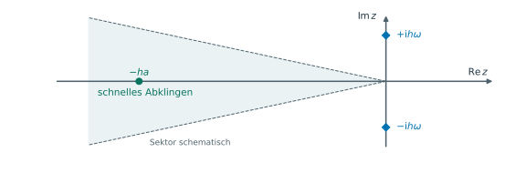

Für BDF1 an einer ungedämpften Mode gilt $|R(\mathrm i\omega h)|=1/\sqrt{1+(\omega h)^2}$. Bei $\omega h=1$ sinkt die Amplitude pro Schritt auf $1/\sqrt2$ ihres vorherigen Werts. Die exakte Mode behält den Betrag eins. Auch bei A-Stabilität sind daher die Amplitude und die Phase gesondert zu messen. Für BDF höherer Ordnung ist zusätzlich zu prüfen, ob alle Rekursionswurzeln für die gewählten Eigenwerte im jeweiligen Stabilitätsgebiet liegen. Für lange konservative Rechnungen bietet sich als Vergleich ein strukturerhaltendes Verfahren wie [Störmer–Verlet an der Saite](#fb-cpverlet) an. [BDF-Stabilität][k3rwth]

<!-- Buchseite -->

### Wie ein adaptiver Schritt angenommen wird

Für eine Komponente wählen wir die Skala $s_i=\mathrm{atol}_i+\mathrm{rtol}\max(|y_{n,i}|,|y_{n+1,i}|)$ mit positiver absoluter Toleranz. Ein mögliches Akzeptanzmaß für den geschätzten lokalen Zustandsfehler $e_i$ ist $E=\max_i|e_i|/s_i$. Ist $E>1$, verwirft der Solver den Versuch und verwendet beim kleineren Schritt wieder die zuletzt angenommene Historie. Für $E>0$ liefert das lokale Modell $|e_i|\propto h^{k+1}$ bei Ordnung $k$ den Vorschlag $h_{\rm neu}=\eta h E^{-1/(k+1)}$ mit Sicherheitsfaktor $0<\eta<1$. Praktische Regler begrenzen die Änderung und verwenden bei $E=0$ eine begrenzte Vergrößerung. Ein Ordnungswechsel benötigt genügend gültige alte Werte und ein neues Fehlermodell. Dies beschreibt eine mögliche Steuerung. Die dokumentierten Produktionssolver besitzen eigene Normen und Regler. [SciPy BDF][k3scib]

### Nach einem Stoß gehört der alte Geschwindigkeitswert zu einer anderen Bahn

Beim C21-Ball springt die Geschwindigkeit nach $v^+=-e v^-$, während der Ort stetig bleibt. Nach dem ersten Kontakt werde der Ball mit konstanter Schwerkraft $g$ weitergerechnet. Ein Schritt der Länge $h$ auf der neuen Flugbahn müsste $v(h)=v^+-gh$ liefern. Wenn der Solver seine Historie über den Stoß hinweg behält, bricht eine Voraussetzung der Interpolation zusammen. Wie groß ist der Fehler?

Einen Schritt **vor** dem Stoß war die Geschwindigkeit $v_{-h}=v^-+gh$. Verwendet BDF2 diesen Wert zusammen mit $v^+$, folgt $3v_1=4v^+-v_{-h}-2gh$. Einsetzen und Vergleich mit dem korrekten Wert ergeben

$$
v_1-(v^+-gh)=\frac{v^+-v^-}{3}.
$$

Bei $v^-=-2\,\mathrm{m/s}$ und $e=0{,}75$ hat der Sprung die Größe $3{,}5\,\mathrm{m/s}$. Der erste falsche Wert liegt somit um $1{,}1666667\,\mathrm{m/s}$ zu hoch. Das Verkleinern von $h$ beseitigt diesen Fehler nicht. Ein Neustart setzt dagegen $v^+$ als einzigen gültigen Startwert. Ein Schritt mit BDF1 liefert bei konstanter Beschleunigung genau $v^+-gh$. Anschließend stehen zwei Werte derselben Flugbahn für BDF2 bereit. Dasselbe gilt bei einem Sprung in der rechten Seite mit stetigem Zustand. Beim beschriebenen Neustart steht anfangs ein gültiger Startwert zur Verfügung. BDF beginnt dann mit Ordnung eins. Eine reine Abfrage der dichten Ausgabe erhält dagegen die bisherige Historie. Den Vertrag am Übergang beschreibt Kapitel 5. Bei glatter allgemeiner ODE liefert ein einzelner Rückwärts-Euler-Start aus exaktem Anfangswert einen Startfehler von Ordnung $h^2$, passend zur globalen Ordnung von BDF2.

Beim elastischen zentralen Stoß zweier gleich schwerer C12-Kugeln wird entsprechend die Geschwindigkeit jeder betroffenen Kugel beim Kontakt neu zugeordnet. Neben der Impulsbilanz zählen der gemeinsame Kontaktzeitpunkt und die nach dem Stoß aktiven Bewegungsabschnitte. Der Versuch zum C21-Ball isoliert einen einzelnen Reset mit Lehrparametern. Die Ereignisfolgen der Benchmarks werden in Kapitel 12 behandelt. [C12 und C21 im Projekt][kontakte]

<!-- Buchseite -->

### Die Historie im Python-Test

`bdf.py` vergleicht die variable BDF2-Formel mit einer quadratischen Testbahn auf ungleich langen Schritten. Danach berechnet es den ersten Schritt nach dem Stoß zweimal. Die Referenzen sind die analytische Fluggeschwindigkeit und der hergeleitete Sprungfehler. Für deren Ausgabe wird intern auf eine halbe Einheit der zwölften Nachkommastelle geprüft, in den jeweiligen Einheiten der Testaufgabe.

```python
"""BDF1 und variable BDF2 für skalare affine Gleichungen."""


def euler_rueck(y, h, lam, g_ende):
    return (y + h*g_ende) / (1.0 - h*lam)


def bdf2(y, y_alt, h, h_alt, lam, g_ende):
    if min(h, h_alt) <= 0:
        raise ValueError("Beide Schrittweiten müssen positiv sein")
    r = h / h_alt
    a0 = (1 + 2*r) / (1 + r)
    a2 = r*r / (1 + r)
    return ((1+r)*y - a2*y_alt + h*g_ende) / (a0 - h*lam)


if __name__ == "__main__":
    tol = 0.5e-12  # halbe Stelle der auf zwölf Stellen geprüften Größe
    for h in (0.0625, 0.25, 0.5):
        t, h_alt = 1.0, 0.25
        # y(t)=t², y'=2t. Der quadratische Interpolant trifft die Bahn.
        ende = bdf2(t*t, (t-h_alt)**2, h, h_alt, 0, 2*(t+h))
        assert abs(ende - (t+h)**2) <= tol

    g, v_minus, e = 9.81, -2.0, 0.75  # m/s², m/s, dimensionslos
    v_plus = -e * v_minus
    for h in (0.1, 0.05, 0.025):
        alt = v_minus + g*h
        exakt = v_plus - g*h
        falsch = bdf2(v_plus, alt, h, h, 0.0, -g)
        neu = euler_rueck(v_plus, h, 0.0, -g)
        sollfehler = (v_plus - v_minus) / 3
        assert abs((falsch-exakt)-sollfehler) <= tol
        assert abs(neu-exakt) <= tol
        v2 = bdf2(neu, v_plus, h, h, 0.0, -g)
        assert abs(v2 - (v_plus-2*g*h)) <= tol
        print(f"h={h:.3f} s  mit alter Historie {falsch-exakt:.9f} m/s"
              f"  nach Neustart {abs(neu-exakt):.9f} m/s")
```

<!-- Buchseite -->

<a id="k3-labor"></a>

## 3.5 Ein Folgeregler mit einem gemeinsamen Messgitter

Die Sollgröße des Reglers wandert jetzt als $r(t)=\cos(\omega t)$, $\omega=1\,\mathrm{s}^{-1}$. Der normierte Ausgang wird durch Vorsteuerung und Rückkopplung geführt. Es gilt $y'=r'(t)+a(r(t)-y)$ mit $a=1000\,\mathrm{s}^{-1}$ und $y(0)=0$. Der Folgefehler $y-r$ erfüllt $(y-r)'=-a(y-r)$ mit Startwert $-1$. Damit steht $y(t)=\cos(\omega t)-e^{-at}$ als Referenz fest. Der Test fragt nach der Anfangsschicht bis $T=20\,\mathrm{ms}$.

Der Prüfstand misst auf 2001 äquidistanten Zeiten von 0 bis 20 ms, unabhängig von der Solver-Schrittweite. Als Budget dient $10^{-4}$ der normierten Ausgangsgröße. Bei Radau verwenden wir im Schritt die integrierte Lagrange-Kurve. Bei BDF2 interpolieren wir quadratisch durch die drei zugehörigen Schrittwerte, beim BDF1-Start linear. An Schrittenden lesen wir die Zustände direkt ab. Jede Tabellenzelle ist das Maximum des absoluten Fehlers in der genannten Menge von Zeitpunkten.

<a id="tab-k03-02"></a>

| Schrittweite [ms] | Radau, Schrittenden | Radau, Messgitter | BDF, Messgitter |
|---:|---:|---:|---:|
| 10 | $5{,}168\cdot10^{-2}$ | $1{,}517\cdot10^{-1}$ | $6{,}911\cdot10^{-1}$ |
| 1 | $4{,}509\cdot10^{-5}$ | $5{,}791\cdot10^{-4}$ | $1{,}534\cdot10^{-1}$ |
| 0,1 | $5{,}025\cdot10^{-10}$ | $9{,}889\cdot10^{-8}$ | $5{,}184\cdot10^{-3}$ |
| 0,01 | $1{,}10\cdot10^{-14}$ | $1{,}10\cdot10^{-14}$ | $7{,}032\cdot10^{-5}$ |

Bei $h=1\,\mathrm{ms}$ erfüllt jeder Radau-Endwert das Budget. Die interpolierte Lösung überschreitet es auf dem Messgitter um fast das Sechsfache. Erst bei $0{,}1\,\mathrm{ms}$ besteht der Radau-Lauf auch diese Prüfung. Bei $0{,}01\,\mathrm{ms}$ trifft jeder Schritt genau einen Messabstand. Der dort ausgewiesene Radau-Fehler liegt nahe der Gleitkommaauflösung dieser Rechnung. Ein gemessenes Maximum auf 2001 Zeiten ist eine Stichprobe. Eine Garantie für das gesamte kontinuierliche Intervall würde eine weitere Abschätzung benötigen.

<!-- Buchseite -->

### Zwischen Schrittenden auswerten

Die folgenden beiden Listings ergeben `folgeregler.py`. Das Skript lädt `bdf.py` und `radau_iia.py` aus demselben Ordner. Alle drei Dateien verwenden nur Python und seine Standardbibliothek.

```python
"""Steifer Folgeregler. Beide Zeitlösungen auf denselben 2001 Messzeiten."""
from math import cos, exp, sin
from bdf import bdf2, euler_rueck
from radau_iia import C, RadauLinear


RATE, T, INTERVALLE = 1000.0, 0.02, 2000  # 1/s, s, Anzahl


def quelle(t):
    return RATE*cos(t) - sin(t)


def integriert(theta):
    gewichte = []
    for j, c in enumerate(C):
        p, q = [v for k, v in enumerate(C) if k != j]
        integral = theta * (theta**2/3 - (p+q)*theta/2 + p*q)
        gewichte.append(integral / ((c-p)*(c-q)))
    return gewichte


def vergleich(n):
    if n <= 0 or INTERVALLE % n:
        raise ValueError("Schrittzahl muss das gemeinsame Messgitter teilen")
    h, teilung = T/n, INTERVALLE//n
    radau = RadauLinear()
    y_r = y_b = alt = 0.0
    knoten_r = fehler_r = fehler_b = 0.0
    for j in range(n):
        t = j*h
        stufen = radau.stufen(t, y_r, h, -RATE, quelle)
        r_neu = stufen[-1]
        k = [-RATE*y + quelle(t+c*h) for c, y in zip(C, stufen)]
        if j == 0:
            b_neu = euler_rueck(y_b, h, -RATE, quelle(t+h))
        else:
            b_neu = bdf2(y_b, alt, h, h, -RATE, quelle(t+h))
```

Zu jedem Radau-Knoten $c_j$ heißen die beiden anderen Knoten $p,q$. Das Integral der Basisfunktion bis $\theta$ ist $[\theta^3/3-(p+q)\theta^2/2+pq\theta]/[(c_j-p)(c_j-q)]$. Für die quadratische BDF-Interpolation mit $\theta=(t-t_n)/h$ addieren wir zur Verbindungsgeraden die Korrektur $\theta(\theta-1)(y_{n-1}-2y_n+y_{n+1})/2$. Sie verschwindet an beiden aktuellen Schrittenden und stellt den älteren Wert bei $\theta=-1$ wieder her.

<!-- Buchseite -->

### Das Fehlerbudget an identischen Messzeiten prüfen

```python
        for m in range(1, teilung+1):
            theta = m/teilung
            zeit = T * (j*teilung+m) / INTERVALLE
            exakt = cos(zeit) - exp(-RATE*zeit)
            if m == teilung:
                pr, pb = r_neu, b_neu
                knoten_r = max(knoten_r, abs(pr-exakt))
            else:
                pr = y_r + h*sum(w*f for w, f in zip(integriert(theta), k))
                pb = y_b + theta*(b_neu-y_b)
                if j > 0:
                    pb += theta*(theta-1)*(alt-2*y_b+b_neu)/2
            fehler_r = max(fehler_r, abs(pr-exakt))
            fehler_b = max(fehler_b, abs(pb-exakt))
        y_r, alt, y_b = r_neu, y_b, b_neu
    return knoten_r, fehler_r, fehler_b, radau.zerlegungen


if __name__ == "__main__":
    budget = 1e-4
    for n in (2, 20, 200, 2000):
        ek, er, eb, lu = vergleich(n)
        assert lu == 1 and ek <= er
        assert (ek <= budget) == (n >= 20)
        assert (er <= budget) == (n >= 200)
        assert (eb <= budget) == (n >= 2000)
        print(f"{n:4d}  {20000/n:6.0f} µs  {ek:.6e}  {er:.6e}  {eb:.6e}")
```

Für jede feste Schrittweite benötigt das affine Radau-Labor eine Faktorisierung, unabhängig von der Zahl der Schritte. Der Zeitfehler misst etwas anderes als diese Einsparung. Die Aussage über das Budget gilt für die hier verwendeten Parameter, den Starter und die angegebene dichte Ausgabe.

<!-- Buchseite -->

### Was die archivierten Solverläufe messen

Die Projektquelle untersucht denselben Folgeregler über **zwei Sekunden** mit adaptiven Solvern. Sie verwendet 501 logarithmische Zeiten von $10^{-7}$ bis $0{,}03\,\mathrm s$, 2001 äquidistante Zeiten bis $2\,\mathrm s$ und den Startzeitpunkt in der Vereinigungsmenge. In jedem Lauf gilt $\mathrm{atol}=\mathrm{rtol}/100$. Radau und BDF erhalten die analytische Jacobi-Matrix $[-1000]$. Die folgenden Zahlen sind die archivierten Ergebnisse aus dem angegebenen Projektstand mit SciPy 1.17.0 und NumPy 2.3.5. [Projektversuch und Zählweise][k3projekt]

<a id="tab-k03-03"></a>

| Verfahren | rtol | Schritte | Auswertungen von $f$ | LU | Messfehler |
|---|---:|---:|---:|---:|---:|
| RK45 | $10^{-3}$ | 610 | 4226 | 0 | $1{,}19\cdot10^{-3}$ |
| RK45 | $10^{-6}$ | 731 | 4394 | 0 | $7{,}31\cdot10^{-7}$ |
| Radau | $10^{-3}$ | 14 | 100 | 28 | $2{,}02\cdot10^{-3}$ |
| Radau | $10^{-6}$ | 56 | 410 | 50 | $2{,}12\cdot10^{-5}$ |
| BDF | $10^{-3}$ | 56 | 144 | 19 | $5{,}40\cdot10^{-4}$ |
| BDF | $10^{-6}$ | 125 | 256 | 28 | $1{,}07\cdot10^{-6}$ |

Beim Ziel von $10^{-4}$ bestehen die drei Läufe mit der feineren Toleranz auf dem gemeinsamen Messraster, nicht mit einer nachgewiesenen Schranke zwischen dessen Punkten. Die festen Schritte oben unterscheiden ihrerseits Schrittenden vom Messraster; keine dieser Stichproben liefert ein Kontinuumsmaximum. Radau kommt dort mit 56 angenommenen Schritten aus, BDF benötigt 125. Zugleich hat BDF mit 256 Auswertungen von $f$ und 28 Zerlegungen in diesen beiden Kostenmaßen die kleineren Zahlen. Wie viel Zeit eine Zerlegung tatsächlich kostet, hängt von Matrixgröße, Besetzungsmuster und Implementierung ab. Die vier festen Schrittweiten des neuen Labors wurden auf dem kürzeren Zeitfenster neu gerechnet. Seine Tabelle beantwortet die Frage nach der Genauigkeit innerhalb der Anfangsschicht.

**Zwei weitere Bauformen.** Bei ESDIRK ist die erste Stufe explizit, die weiteren impliziten Stufen einer Stufe nach der anderen lösbar. Ihr gemeinsamer Diagonalkoeffizient $\gamma$ erlaubt bei festgehaltenem $J$ dieselbe Matrix $I-h\gamma J$. Ein Rosenbrock–Euler-Schritt für ein autonomes System löst $(I-hJ_n)k=f(y_n)$ und setzt $y_{n+1}=y_n+hk$. Er entspricht einer einzigen Linearisierung des impliziten Euler-Schritts am alten Zustand. Für affine autonome Gleichungen trifft er dessen diskreten Wert. [Verfahrensvergleich im Projekt][k3projekt]

<!-- Buchseite -->

<a id="k3-c05"></a>

## 3.6 Welche Zeit muss der Solver beim Umschalten treffen?

Im kurzen C05-Projektversuch ändern sich die Modellparameter an zwei gerichteten Schwellen. Innerhalb eines Modus gelten $y_1'=a(y_2+c_2-y_1)$ und $y_2'=b(c_4-y_2)$ mit $a=2{,}7\cdot10^6\,\mathrm{s}^{-1}$, $b=3{,}5651205\,\mathrm{s}^{-1}$ und dem Start $(4{,}2,0{,}3)$. Im ersten Modus sind $(c_2,c_4)=(0{,}4,5{,}5)$. Beim Anstieg von $y_1$ auf $5{,}8$ wechselt das Paar auf $(-0{,}3,2{,}73)$. Beim Absinken auf $2{,}5$ kehrt das System zurück. Beide Zustände bleiben beim Schalten stetig. Die künftig gültigen Steigungen gehören zur neuen Phase. [C05 im Projekt][c05]


Für die lokale Zeit $s$ ab Phasenbeginn ist $y_2=c_4+D e^{-bs}$ mit $D=y_{2,0}-c_4$. Einsetzen in die erste Gleichung legt den Ansatz $y_1=c_2+c_4+K e^{-bs}+H e^{-as}$ nahe. Koeffizientenvergleich liefert $(a-b)K=aD$ und $H=y_{1,0}-c_2-c_4-K$. Vor jeder Umschaltung lassen sich diese Kurven bis zur Nullstelle der aktiven Schaltfunktion auswerten. Am Schaltpunkt übernehmen wir den gesamten Zustand und starten mit dem neuen Parameterpaar.

<!-- Buchseite -->

### Die Referenzschaltungen lokalisieren

`c05.py` verwendet in jeder Phase die soeben hergeleitete Lösung. Die Ableitung von $y_1$ ist eine Summe aus zwei Exponentialtermen mit verschiedenen reellen Raten. Sie hat hier höchstens eine Nullstelle. Zu Phasenbeginn liegt $y_1$ auf der noch nicht überschrittenen Seite der aktiven Schwelle, sein langfristiger Grenzwert auf der anderen. Für diese Modellparameter ist nur ein Durchgang in der gesuchten Richtung möglich. Deshalb genügt die Prüfung am Ende des verbleibenden Zeitfensters, um eine solche Nullstelle in der Phase einzuklammern.

```python
"""Kurzes C05-Fenster: Referenz aus exakten Phasen und Bisektion."""
from math import exp


A, B = 2.7e6, 3.5651205  # Raten in 1/s
MODEN = ((0.4, 5.5, 5.8, 1), (-0.3, 2.73, 2.5, -1))


def phase(dt, start, c2, c4):
    y1, y2 = start
    d = y2 - c4
    k = A*d / (A-B)
    langsam = exp(-B*dt)
    schnell = exp(-A*dt)
    return (c2+c4 + k*langsam + (y1-c2-c4-k)*schnell,
            c4 + d*langsam)


def schaltfolge(ende=3.5):
    t, zustand, modus = 0.0, (4.2, 0.3), 0
    ereignisse = []
    while t < ende:
        c2, c4, schwelle, richtung = MODEN[modus]
        rest = ende - t
        ziel = phase(rest, zustand, c2, c4)
        if richtung*(ziel[0]-schwelle) < 0:
            return ereignisse, ziel
```

<!-- Buchseite -->

### Was die drei Ereignisse belegen

```python
        links, rechts = 0.0, rest
        while rechts-links > 2e-10:
            mitte = (links+rechts)/2
            y1, _ = phase(mitte, zustand, c2, c4)
            if richtung*(y1-schwelle) >= 0:
                rechts = mitte
            else:
                links = mitte
        dt = (links+rechts)/2
        zustand = phase(dt, zustand, c2, c4)
        t += dt
        ereignisse.append((t, richtung))
        modus = 1-modus
    return ereignisse, zustand


if __name__ == "__main__":
    folge, ende = schaltfolge()
    soll = (1.108306, 2.129685, 3.054153)  # Projektwerte in s
    assert [r for _, r in folge] == [1, -1, 1]
    for (t, richtung), t_ref in zip(folge, soll):
        assert abs(t-t_ref) <= 0.5e-6 + 1e-9 < 1e-3
        print(f"{richtung:+d} bei {t:.9f} s")
    assert max(abs(ende[0]-2.97475519), abs(ende[1]-3.27475448)) < 1e-5
    print(f"Endzustand ({ende[0]:.8f}, {ende[1]:.8f})")
```

Die Neurechnung liefert $1{,}108306168\,\mathrm s$ aufwärts, $2{,}129685355\,\mathrm s$ abwärts und $3{,}054152907\,\mathrm s$ aufwärts. Bei $3{,}5\,\mathrm s$ beträgt der Zustand $(2{,}97475519,3{,}27475448)$. Die Bisektion endet bei einer Breite von höchstens $2\cdot10^{-10}\,\mathrm s$ je lokaler Klammer. Die Archivzeiten wurden auf sechs Nachkommastellen ausgegeben. Im Code stammen $0{,}5\,\mu\mathrm s$ aus deren Rundungsauflösung. Für die numerische Lokalisierung und die Weitergabe des Startwertes ist zusätzlich $1\,\mathrm{ns}$ als Vergleichsreserve vorgesehen. Die gesonderte Budgetprüfung des Projektversuchs erlaubt $1\,\mathrm{ms}$ je richtig zugeordnetem Ereignis. Im engeren Vergleich nutzen wir für die Endkomponenten das Lehrbudget $10^{-5}$. [C05-Referenzfenster][c05]

Ein expliziter Euler-Schritt auf der schnellen linearen Mode müsste für echtes Abklingen $h<2/a\approx0{,}741\,\mu\mathrm s$ einhalten. Ein L-stabiles Verfahren kann lange ruhige Phasen mit größeren Schritten überbrücken. Ob es die Schaltzeit sicher trifft, hängt zusätzlich von seiner Bahnannäherung und dem Ereignissucher ab. Eine BDF-Historie mit alten Steigungen kann nach dem Moduswechsel unbrauchbar werden. Bei einem C21-Geschwindigkeitssprung ließ sich der daraus entstehende Fehler sogar unabhängig von der Schrittweite angeben.

<!-- Buchseite -->

<a id="k3-aufgaben"></a>

## 3.7 Aufgaben zum Selbstversuch

1. **Rückstand nach dem Abschalten.** Eine normierte Anfangsabweichung soll nach einem Schritt auf höchstens ein Prozent sinken. Berechnen Sie für $z=-100$ die Beträge von Rückwärts-Euler, Trapezregel und Radau IIA. Welche Verfahren erfüllen dieses konkrete Ziel? Was sagt das über ihre L-Stabilität aus?
2. **Zwei Newton-Verfahren.** Für $h=y_n=1$ lautet die Gleichung $G(Y)=Y^2+Y-1=0$. Beginnen Sie mit $Y_0=1$. Berechnen Sie zwei Korrekturen, einmal mit aktueller und einmal mit eingefrorener Ableitung. Prüfen Sie beide zweiten Näherungen gegen die positive Wurzel.
3. **Die letzte Stufe.** Begründen Sie $Y_3=y_{n+1}$ aus dem Tableau. Ein Kollege behauptet, dann müsse auch das ganze Polynom zwischen Schrittanfang und -ende die Differentialgleichung erfüllen. Widerlegen Sie dies an Abbildung 3.2 mit einem Zeitpunkt außerhalb der drei Knoten.
4. **Ein ungleichmäßiges Gitter.** Der letzte Schritt war $0{,}25\,\mathrm s$ lang, der nächste soll $0{,}5\,\mathrm s$ dauern. Bestimmen Sie alle drei BDF2-Gewichte. Prüfen Sie die Formel mit $y(t)=t^2$ als Zahlenwert in normierten Koordinaten an den Zeiten $0{,}75$, $1$ und $1{,}5$.
5. **Ein Bilanzfehler nach dem Stoß.** Der Ball trifft mit $-2\,\mathrm{m/s}$ auf und springt mit $e=0{,}75$ zurück. Würde eine Halbierung von $h$ den Fehler einer unbereinigten BDF2-Geschwindigkeit unter $0{,}1\,\mathrm{m/s}$ senken? Geben Sie den ersten korrekten Schritt für $h=0{,}05\,\mathrm s$ an.
6. **Ein bestandener Endwert.** Die Spezifikation des Folgereglers verlangt $10^{-4}$ an den 2001 Messzeiten. Eine Implementierung meldet bei $h=1\,\mathrm{ms}$ „bestanden“ und zeigt den maximalen Radau-Endwertfehler aus der Tabelle. Benennen Sie die fehlende Messung. Übertragen Sie die Frage auf das kurze C05-Fenster.

<!-- Buchseite -->

### Musterlösungen und Gegenproben

**1 · Dämpfung.** Rückwärts-Euler hat Betrag $1/101\approx0{,}009901$, die Trapezregel $49/51\approx0{,}960784$ und Radau IIA etwa $0{,}025291$. Bei diesem endlichen $z$ erfüllt allein Rückwärts-Euler das Einprozentziel. Sowohl Rückwärts-Euler als auch Radau sind L-stabil. Der Grenzwert für $|z|\to\infty$ schreibt bei $z=-100$ keinen gemeinsamen Dämpfungsfaktor vor.

**2 · Iteration.** Zunächst ergibt $G(1)=1$, $G'(1)=3$ den Wert $Y_1=2/3$ und $G(Y_1)=1/9$. Das volle Newton-Verfahren verwendet dann $G'(2/3)=7/3$ und erhält $2/3-1/21=13/21\approx0{,}619048$. Das modifizierte Verfahren verwendet erneut 3 und erhält $2/3-1/27=17/27\approx0{,}629630$. Die positive Nullstelle ist $(\sqrt5-1)/2\approx0{,}618034$. Mit der frischen Ableitung ist nach der zweiten Korrektur die kleinere Abweichung erreicht.

**3 · Stufe und Kurve.** Es gilt $a_{3j}=b_j$ für jedes $j$. Die Formel für $Y_3$ und diejenige für $y_{n+1}$ enthalten daher dieselben Summanden. Bei $t=5\,\mathrm{ms}$, also $\theta=1/2$, beträgt der kubische Wert im Temperaturversuch etwa $-0{,}120690$, die exakte Lösung dagegen $e^{-5}\approx0{,}006738$. Direktes Einsetzen in den Defekt ergibt dort ebenfalls einen von null verschiedenen Wert.

**4 · Gewichte.** Mit $r=2$ werden die Gewichte $5/3,-3,4/3$. Für die drei Werte $2{,}25$, $1$ und $0{,}5625$ in rückwärts laufender Reihenfolge ist ihre gewichtete Summe $1{,}5$. Nach Division durch $0{,}5$ erhalten wir die exakte Steigung $2\cdot1{,}5=3$.

**5 · Neustart.** Die unbereinigte Historie erzeugt unabhängig von $h$ den Fehler $(1{,}5+2)/3=1{,}166667\,\mathrm{m/s}$. Nach dem Neustart liefert BDF1 für $h=0{,}05\,\mathrm s$ den korrekten Wert $1{,}5-9{,}81\cdot0{,}05=1{,}0095\,\mathrm{m/s}$.

**6 · Messaufgabe.** Auf dem festgelegten Messgitter beträgt der Radau-Fehler rund $5{,}791\cdot10^{-4}$. Gefehlt hatte die Auswertung der kubischen Kurve zwischen den Schrittenden. Bei C05 müssen die drei Ereignisse mit Richtung und Zeitpunkt zur Referenz passen, zusätzlich zu den beiden Endwerten. Beim Übergang zu Kapitel 4 stellt sich eine verwandte Frage am selben Zeitpunkt. Erfüllen Zustand und Ableitung gemeinsam auch die algebraischen Bindungen?

<!-- Buchseite -->

<a id="kap03-schluss"></a>

## Schluss · Vom stabilen Schritt zur genauen Messung

Das Fühlerbeispiel zeigt, warum ein steifes Abklingen ein eigenes Kriterium braucht. Ein expliziter Schritt kann die schnelle Komponente verstärken, obwohl das Modell sie dämpft. Rückwärts-Euler und Radau IIA sind L-stabil. Bei einer stark abklingenden Mode geht ihr Verstärkungsfaktor gegen null. Das gibt dem langsamen Verlauf Raum. Für die Messung der schnellen Übergangsphase brauchen wir weiterhin eine passende Schrittweite und eine Referenz.

Im Rechenkern bezahlen wir die Stabilität mit Gleichungslösungen. Newton korrigiert das Residuum, Radau bestimmt gekoppelte Stufen, BDF verwendet eine Vorgeschichte. Eine dichte Ausgabe stellt die Bahn auf einem davon unabhängigen Messgitter bereit. Der Wechsel im C05-Versuch zeigt, weshalb BDF bei einem neuen Bewegungsgesetz eine neue gültige Historie braucht. Schaltzeit und Endwerte entscheiden darüber, ob ein konkreter Lauf für den vereinbarten Auftrag ausreicht.

Die nächste Frage betrifft Zustände, die nur zusammen mit einer algebraischen Bindung zulässig sind. Ein Solver muss in diesem Fall auch die Randlage und die Ableitung auf Konsistenz prüfen. [Differential-algebraische Gleichungen](#kap04-einstieg)

<a id="kap03-forschung"></a>

### Aktueller Stand der Forschung

Für große räumlich diskrete Modelle steckt ein erheblicher Teil der Arbeit in der linearen Lösung der Stufengleichungen. Henríquez, Lee und Rhebergen untersuchen in einem Vorabdruck vom November 2026 unterschiedlich gewichtete Radau-IIA-Stufen für zeitabhängige Stokes-Gleichungen. Ihr Ergebnis betrifft die Eigenschaften des vorkonditionierten Linearsystems. Zweidimensionale und dreidimensionale Beispiele prüfen den Ansatz. Im C05-Labor ist der Zustand nur zweidimensional und die Verteilung der Arbeit eine andere. Für eine Erweiterung auf gekoppelte Gittermodelle wäre offen, wie sich Stufenkosten, Newton-Korrekturen und die Genauigkeit am nächsten Ereignis gemeinsam verändern. [Henríquez, Lee und Rhebergen, Vorabdruck (2026)](https://arxiv.org/abs/2611.08429)

Die theoretische Aussage betrifft insbesondere die Äquivalenz der Wertebereiche der vorkonditionierten Systeme. Aus diesen Abschätzungen folgt noch keine Aussage über die C05-Schaltzeit.


[Zur Einleitung dieses Kapitels](#kap03-einstieg)

<!-- Buchseite -->

# Kapitel 4 · Differential-algebraische Gleichungen und Zwangsbedingungen

<a id="kap04-einstieg"></a>

## Einleitung · Welche Startwerte sind überhaupt möglich?

Ein Pendel hängt an einem starren Faden. Wir können der Masse eine Anfangsgeschwindigkeit geben, aber nur tangential zum Kreis, wenn der Faden im Modell gespannt bleiben soll. Ein Programm kann leicht einen Ortsvektor und eine Geschwindigkeit einlesen, die einzeln vernünftig aussehen und sich gegenseitig widersprechen. Welche Bedingungen muss es prüfen, bevor es den ersten Schritt berechnet?

Im RC-Kreis sehen wir zunächst eine Bindung, die sich direkt nach dem Strom auflösen lässt. Beim Pendel bestimmt der Ort allein die noch zulässigen Geschwindigkeiten. Erst wenn wir die Längenbedingung differenzieren, wird der Zusammenhang mit der Beschleunigung und der Zwangskraft sichtbar. Wir folgen dieser Kette bis zur Form, die ein Residualsolver oder ein Projektionsverfahren tatsächlich bearbeitet.

Die praktische Probe wird sowohl den Abstand zum Drehpunkt als auch die Geschwindigkeit in radialer Richtung kontrollieren. Damit können wir beurteilen, was eine Projektion am Ort repariert und welche Teile der Bewegung eine weitere Gleichung verlangen.

[Zum Schluss dieses Kapitels](#kap04-schluss)

<!-- Buchseite -->

<a id="t1-k4"></a>

## 4.1 Welche Anfangswerte dürfen wir einstellen?

[Grundlagen · Partielle Ableitungen und Kettenregel](#g-mehrere-eingaben)

An einem RC-Prüfstand liegen eine Quelle mit $6\,\mathrm V$, ein Widerstand mit $3\,\mathrm{k}\Omega$ und ein Kondensator mit $2\,\mathrm{mF}$ in Reihe. Der Kondensator ist auf $3\,\mathrm V$ geladen. Eine zweite Person möchte den Strom auf $2\,\mathrm{mA}$ einstellen. Dafür müsste bereits am Widerstand die volle Quellenspannung abfallen. Das Problem entsteht vor dem ersten Rechenschritt.

Bei positiver Stromrichtung von der Quelle zum Kondensator lauten die beiden Gleichungen
$$ C\dot u-i=0,\qquad u+Ri-U_s=0.$$
Die erste speichert Ladung, die zweite muss in jedem Augenblick gelten. Aus der frei vorgegebenen Anfangsspannung folgen $i_0=(6-3)/3000=1\,\mathrm{mA}$ und $\dot u_0=i_0/C=0{,}5\,\mathrm{V/s}$. Das Modell ist in der Form $\dot x=f(t,x,z),\ 0=g(t,x,z)$ **semi-explizit**. Ist die partielle Jacobi-Matrix $g_z$ invertierbar, so bestimmt die Bindung nach dem Satz über implizite Funktionen lokal $z$ aus $t,x$. Eine einmalige Differentiation liefert $\dot z=-g_z^{-1}(g_t+g_x f)$. Unter diesen Bedingungen hat diese Form Differentiationsindex eins.

<a id="revision-k04-01"></a>

Der Satz über implizite Funktionen beginnt an einem **konsistenten** Punkt $(t_0,x_0,z_0)$ mit $g(t_0,x_0,z_0)=0$. Ist $g$ in seiner Umgebung stetig differenzierbar und $g_z$ dort am Basispunkt invertierbar, dann bestimmt die Gleichung in einer Umgebung genau einen differenzierbaren Ast $z=\varphi(t,x)$. Im RC-Kreis ist $g_i=R\ne0$. Bei $z^2-x=0$ liegen über $x=1$ zwei zulässige Punkte. In der Nähe von $(1,1)$ ist $g_z=2$ und die Vorgeschichte wählt den positiven Ast. Am Ursprung ist $g_z=0$ und dieser Schluss entfällt.


Für größere Netze muss $z$ nicht symbolisch eliminiert werden. Man kann die Speicher- und Kopplungsgleichungen in einem Residuum $F(t,y,\dot y)$ sammeln und pro Zeitschritt gemeinsam lösen. Ein Prüfer misst seine Komponenten in verschiedenen Einheiten. $C\dot u-i$ trägt Ampere, $u+Ri-U_s$ Volt. Jede Komponente benötigt daher eine eigene Skala. Ein Anfangspaar $(y,\dot y)$ heißt konsistent, wenn das Residuum und die für das Modell geltenden versteckten Bedingungen erfüllt sind. [RC-Schaltung](#loesbarkeit) · [Projektkapitel zu DAEs][t1proj4]

<!-- Buchseite -->

## 4.2 Welche Gleichung löst ein impliziter Integrator?

Für Rückwärts-Euler ersetzen wir $\dot y$ am Schrittende durch $(Y-y_n)/h$. Damit entsteht das gewöhnliche Nullstellenproblem $G(Y)=F(t_n+h,Y,(Y-y_n)/h)=0$. In einer Newton-Iteration gilt die Kettenregel
$$ G_Y=F_y+\frac1h F_{\dot y},\qquad G_Y\,\Delta Y=-G(Y).$$
Bei einer BDF-Formel steht anstelle von $1/h$ der zur aktuellen Mehrschrittformel gehörende Koeffizient. Das Vorzeichen ergibt sich aus der Definition von $F$. Wer nur $F_y$ an die lineare Lösung übergibt, lässt die Speicherwirkung aus der Newton-Korrektur heraus.

Für einen zweiten RC-Versuch wählen wir $U_s=5\,\mathrm V$, $R=2000\,\Omega$, $C=1\,\mathrm{mF}$ und $u_n=0$. Bei $h=0{,}1\,\mathrm s$ lauten die beiden Gleichungen $C(U-u_n)/h=I$ und $U+RI=U_s$. Setzen wir $U=u_n+hI/C$ in die Maschengleichung ein, folgt
$$ I=\frac{U_s-u_n}{R+h/C},\qquad U=u_n+hI/C .$$
Die Zahlenwerte $I=2{,}380952381\,\mathrm{mA}$ und $U=0{,}238095238\,\mathrm V$ kann man an beiden Residuen prüfen. Der alternative Weg eliminiert zuerst $I$ aus dem kontinuierlichen Modell und integriert die resultierende ODE implizit. In diesem linearen Beispiel entsteht algebraisch derselbe Endwert.

IDA arbeitet mit der Residualform und BDF-Schritten. Konsistente Startwerte und skalierte Newton- und Fehlertests gehören zum Verfahren. Radau-Kollokation kann geeignete DAE-Formulierungen ebenfalls behandeln, wenn die Implementation die entsprechende Massenmatrix oder ein Residuum unterstützt. Die gewöhnliche ODE-Schnittstelle eines Radau-Solvers nimmt nicht automatisch ein beliebiges $F(t,y,\dot y)$ entgegen. Ein höherindiziertes Modell verlangt zusätzliche Struktur, Indexreduktion oder einen hierzu passenden DAE-Solver. [IDA-Mathematik][ida] · [Radau und BDF](#k3-bdf)

<!-- Buchseite -->

### Ein nichtlinearer Bindungsast mit zwei Kandidaten

Im nächsten Lehrmodell sind die Größen dimensionslos. Es gilt $y'=z$ und $0=z^2+y-1$. Anfangs sei $y=0,\ z=1$. Die algebraische Gleichung allein ließe zu diesem Zeitpunkt auch $z=-1$ zu. Der konsistente Start und die Fortsetzung des bisherigen Asts legen fest, welche Nullstelle physikalisch gemeint ist. Auf dem positiven Ast erhält man durch Differenzieren $2z\dot z+\dot y=0$, also $\dot z=-1/2$, solange $z>0$. Damit sind $z(t)=1-t/2$ und $y(t)=1-z(t)^2$ bis zur Faltstelle explizit bekannt.

Im impliziten Euler-Schritt gelten $Y=y_n+hZ$ und $Z^2+Y-1=0$. Einsetzen liefert $H(Z)=Z^2+hZ+y_n-1=0$. Newton korrigiert $Z$ um $-H(Z)/(2Z+h)$. Das Labor startet am bisherigen positiven $z$ und prüft das Ergebnis sowohl am ursprünglichen Residuum als auch an der unabhängig rationalisierten Wurzel
$$ Z=\frac{2(1-y_n)}{h+\sqrt{h^2+4(1-y_n)}}.$$
Für $h=0{,}5$ entstehen $Y=0{,}390388203$ und $Z=0{,}780776406$. Rundungsgenau erfüllte algebraische Bedingungen sind mit einem endlichen Zeitfehler vereinbar. Die exakte Bahn hat zur selben Zeit $z=0{,}75$ und $y=0{,}4375$.

Wenn $z$ gegen null geht, wird $g_z=2z$ singulär. Die lokale Eliminierung von $z$ als glatte Funktion von $y$ ist dann nicht mehr gerechtfertigt. Für ein technisch bestimmtes Bauteil an einer Kennlinienfalte braucht man zusätzlich eine Astwahl oder ein physikalisches Umschaltgesetz. Eine kleinere absolute Newton-Toleranz entscheidet an sich nicht, welcher Betriebszustand gemeint ist. Diese Unterscheidung ist für Schaltkreise im C21-Vergleich ebenso wichtig wie ein kleines Residuum. [Stiftpendel und Diodenkennlinie][t1proj13]

<!-- Buchseite -->

<a id="v91-dae-start"></a>

### Den richtigen Bindungsast am Start berechnen

Im vorigen Modell gilt beim Start mit festem $y_0=0$ die algebraische Bedingung $g(z)=z^2-1=0$. Die Vorgabe sei der positive Ast. Starten wir den Newton-Versuch bei $z=0{,}25$, so beträgt das Residuum $-0{,}9375$. Der volle Korrekturschritt führt nach $z=2{,}125$ mit Residuum $3{,}515625$. Eine Halbierung der Korrektur führt stattdessen nach $z=1{,}1875$ mit Residuum $0{,}41015625$. Die Dämpfung wählt einen Schritt, der den skalierten Defekt senkt. Am erreichten positiven Ast gilt $z=1$ und die Differentialgleichung liefert $y'_0=1$.

`IDACalcIC` kann für unterstützte Index-1-Probleme die algebraischen Startwerte und die Differentialableitungen bei vorgegebenen Differentialzuständen berechnen. Die IDA-Initialisierung verwendet dafür ein Newton-Verfahren mit Line Search. Die Wahl des Modellasts beginnt mit den vorgegebenen Variablen und einem geeigneten Startwert. Prüfen Sie anschließend das Residuum des Startpaars und die beabsichtigte Astbedingung. [SUNDIALS, konsistente Initialisierung][ida]

### Was ein Besetzungsmuster über den Index verrät

Betrachten wir $\dot x=z_1$ mit den algebraischen Zeilen $x+z_1+z_2=0$ und $z_1+z_2=0$. Ein reines Besetzungsmuster lässt beide algebraischen Variablen in beiden Zeilen zu. Die tatsächliche Jacobi-Matrix dieser Zeilen nach $(z_1,z_2)$ hat Rang eins. Durch Subtraktion erhält man $x=0$, durch Differenzieren $z_1=\dot x=0$. Erst damit folgt auch $z_2=0$. Eine strukturelle Analyse nach Pantelides liefert Kandidaten für die Indexreduktion. Für die berechneten Gleichungen muss man den tatsächlichen Rang im vorgesehenen Arbeitsbereich prüfen.

<!-- Buchseite -->

### Wenn eine schnelle Gleichung zur Bindung wird

Ein Sensor relaxiere in der normierten Zeit $s=t/(1\,\mathrm s)$ nach $\epsilon z'=1-z$ gegen den Sollwert eins. Seine Anzeige treibe eine zweite Größe $u'=-u+z$ an. Anfangs seien beide null. Für jedes $\epsilon>0$ sind zwei Anfangswerte zulässig. Setzen wir $\epsilon=0$, ergibt sich die algebraische Bedingung $z=1$. Der Startwert $z=0$ des schnellen Modells ist in der Grenzbeschreibung inkonsistent.

Das Beispiel erlaubt eine saubere Vergleichsrechnung. Aus der ersten Gleichung folgt $z_\epsilon(s)=1-e^{-s/\epsilon}$. Wir setzen dies in die zweite Gleichung ein und multiplizieren sie mit $e^s$. Integration von $0$ bis $s$ liefert für $0<\epsilon<1$
$$
 u_\epsilon(s)=1-e^{-s}
       -\frac{e^{-s}-e^{-s/\epsilon}}{1/\epsilon-1},\qquad
 u_*(s)=1-e^{-s}.
$$
Die DAE-Grenzlösung $u_*$ folgt aus $z=1$. Der Unterschied in der langsameren Anzeige ist für alle $s\ge0$ höchstens $\epsilon/(1-\epsilon)$. Die schnelle Größe hat unmittelbar bei $s=0$ dagegen den vollen Unterschied eins. Eine algebraische Gleichung entfernt die Anfangsschicht aus dem Modell. Ob dieser Informationsverlust tragbar ist, hängt davon ab, ob wir $u$ nach einer Sekunde oder den ersten Anstieg von $z$ beobachten wollen.

Eine reguläre, sehr steife Massenmatrix und eine singuläre Matrix können einander numerisch ähnlich aussehen. Die Konsequenzen für die zulässigen Anfangsdaten sind verschieden. Beim Aufbau eines Residualsolvers ist es deshalb sinnvoll, zunächst die algebraischen Modellgleichungen, dann die konsistenten Anfangswerte und erst danach die Toleranzen für das Zeitverfahren festzulegen. Das Labor misst beide Anzeigen bei zwei getrennten kleinen $\epsilon$ auch anhand der integrierten Defektgleichung.

<!-- Buchseite -->

## 4.3 Warum das kartesische Pendel Index drei besitzt

Ein starrer masseloser Stab hält eine Masse $m$ im Abstand $\ell$ vom Aufhängepunkt. In kartesischen Koordinaten kann sich ein gewöhnliches Integrationsverfahren zunächst in jede Richtung bewegen. Die unbekannte Stabkraft nimmt genau die radiale Bewegung weg. Mit Ortsvektor $q$, Geschwindigkeit $v$, Schwerebeschleunigung $a$ und Multiplikator $\lambda$ schreiben wir
$$
 \dot q=v,\qquad m\dot v=ma-\lambda q,\qquad
 0=\tfrac12(q^\top q-\ell^2).
$$
Mit dieser Wahl hat $\lambda$ die Einheit $\mathrm{N/m}$. Die radiale Kraft hat Betrag $|\lambda|\ell$. Eine Winkelkoordinate könnte die Bindung von Anfang an einbauen. Die kartesische Beschreibung ist besonders aufschlussreich, wenn sich die Bindung wie beim Stiftpendel ändert.

Einmal differenzieren liefert $q^\top v=0$. Die Anfangsgeschwindigkeit muss also tangential sein. Beim zweiten Differenzieren erhalten wir $v^\top v+q^\top a-(\lambda/m)\ell^2=0$ und damit den zulässigen Multiplikator. Eine dritte Differentiation liefert $\dot\lambda$, sofern die Anregung differenzierbar ist. In dieser üblichen Form erster Ordnung mit Ortsbindung spricht man vom Differentiationsindex drei. „Zweimal bis zur Kraft“ und „dreimal bis zu einer ODE für alle Unbekannten“ beantworten verschiedene Fragen.

Integriert man nur die differenzierte Beschleunigungsbedingung, werden Verstöße gegen $q^\top q=\ell^2$ und $q^\top v=0$ nicht von selbst zurückgeführt. Bei der Baumgarte-Stabilisierung ersetzt man $\ddot g=0$ durch $\ddot g+2\alpha\dot g+\beta^2g=0$. Für positive Parameter mit Einheit $\mathrm{s^{-1}}$ klingt der lineare Bindungsfehler ab. Große Parameter führen zugleich kurze numerische Zeitskalen ein. Eine Projektion korrigiert einen berechneten Ort auf den Kreis und entfernt die radiale Geschwindigkeitskomponente. Liegt der Ort bereits auf dem Kreis, kann sich die Geschwindigkeit dennoch radial bewegen. Das Laborskript prüft beide Bedingungen getrennt.

<a id="revision-k04-02"></a>

**Eine Abklingzeit wählen.** Soll sich ein Bindungsfehler innerhalb einer vorgegebenen Zeit $T_B$ abbauen, setzen wir $\beta=1/T_B$ und $\alpha=\zeta/T_B$. Für $T_B=0{,}1\,\mathrm s$ und $\zeta=1$ besitzt der Fehleroszillator die doppelte Nullstelle $-10\,\mathrm{s^{-1}}$. Mit $g'(0)=0$ gilt $g(t)=g(0)(1+t/T_B)e^{-t/T_B}$, bei $t=T_B$ bleibt $2/e$ des Anfangsfehlers. Halbieren Sie nun den Integrationsschritt bei **gleicher Rückführung** und vergleichen Sie $g(T_B)$. Erst danach lässt sich beurteilen, ob die Zeitregel die gewählte Dämpfung auflöst.

<a id="auflage-k04-01"></a>

**Wie schnell darf die Rückführung sein?** Die Fehlergleichung besitzt die Eigenwerte $\lambda_\pm=-\alpha\pm\sqrt{\alpha^2-\beta^2}$. Bei kritischer Dämpfung ist $\alpha=\beta=1/T_B$ mit einer physikalisch gewählten Zeit $T_B$. Dann hat allein die Fehlerdynamik den doppelten Eigenwert $-1/T_B$. Ein kleineres $T_B$ beschleunigt die Rückführung und kann dem Gesamtsystem eine kurze Zeitskala hinzufügen. Bei $x=h/T_B$ dämpft Vorwärts-Euler den Fehlerblock für $0<x<2$, klassisches RK4 für $0<x<x_4$ mit $x_4=2{,}785293563\ldots$ aus [Abschnitt 2.2](#druck-rk-grenzen).

Warum steht hier eine strikte Grenze? In den Koordinaten $(g,T_B\dot g)$ lautet die dimensionslose Fehlermatrix $B=-I+N$ mit $N=\left(\begin{smallmatrix}1&1\\-1&-1\end{smallmatrix}\right)$ und $N^2=0$. Für jedes RK-Polynom gilt $R(xB)=R(-x)I+xR'(-x)N$. Am rechten Rand bleibt bei beiden Verfahren ein Jordan-Anteil, der unter Wiederholung linear wächst. Im Inneren klingt auch dieser Anteil ab. Bei $h=T_B$ ist der RK4-Eigenfaktor $R_4(-1)=3/8$. Für $\dot g(0)=0$ bleibt nach einem RK4-Schritt tatsächlich $17g(0)/24$, analytisch $2g(0)/e$. Damit lassen sich Stabilität und Zeitfehler getrennt prüfen.


<!-- Buchseite -->

<a id="kap04-schrittfolge"></a>

### Warum ein Punkt auf dem Kreis weiter nach außen laufen kann

Am Zeitpunkt null liege die Masse bei $q=(1,0)\,\mathrm m$ auf einem Kreis mit Radius eins. Sie bewege sich mit $v=(0,2)\,\mathrm{m/s}$ entlang der Tangente. Beide Anfangswerte erfüllen die Orts- und Geschwindigkeitsbindung. Halten wir die Geschwindigkeit für einen Schritt von $0{,}1\,\mathrm s$ fest, erhalten wir jedoch den Punkt $(1,0{,}2)\,\mathrm m$. Sein Abstand vom Ursprung ist $\sqrt{1{,}04}\,\mathrm m\approx1{,}0198\,\mathrm m$. Der freie Tangentenschritt schneidet die gekrümmte Bahn nicht am richtigen Ort.

Wir können den benötigten radialen Anteil der Beschleunigung schon am Start ausrechnen. Aus $q^\mathsf Tq=1\,\mathrm{m^2}$ folgt zuerst $q^\mathsf Tv=0$. Die Ableitung der letzten Gleichung liefert
$$
v^\mathsf Tv+q^\mathsf T\dot v=0.
$$
Damit ist $\dot v_x=-4\,\mathrm{m/s^2}$ erforderlich. Die Zwangskraft wirkt in diesem Augenblick nach innen. Die Geschwindigkeit bleibt tangential, weil sich die Richtung der Tangente mit dem Ort dreht. Für einen Rechenschritt erklärt das, warum man die Position auf die neue Kreisstelle bringen und die Geschwindigkeit an deren neuer Tangente prüfen muss.

Wählen Sie erst die gewünschte Erholungszeit und halbieren Sie dann $h$ bei gleichem $T_B$. Wer $T_B=h$ nach jedem adaptiven Schritt neu setzt, ändert zugleich die Rückführung. Benötigt das Pendel am Ausgabezeitpunkt Ort und Geschwindigkeit auf der Bindung, prüft [RATTLE in 4.4](#rattle-kreis-druck) diese beiden Bedingungen direkt. [Baumgarte, 1972](https://doi.org/10.1016/0045-7825(72)90018-7)

<!-- Buchseite -->

## 4.4 RATTLE am Kreis mit zwei geometrischen Korrekturen

Wir beginnen mit einem zulässigen $(q_n,v_n)$. Ein halber Kraftschritt und ein freier Ortsschritt ergeben den Kandidaten $a_*=q_n+h v_n+h^2 a/2$. Der Multiplikator des ersten Teilschritts kann diesen Ort nur entlang der alten Normalen $q_n$ verschieben. Es genügt daher, die Gerade durch $a_*$ in dieser Richtung mit dem Kreis zu schneiden.

Mit $n=q_n/\ell$ und $b=a_*-(n^\top a_*)n$ bleibt der quer zur alten Normalen gelegene Anteil $b$ erhalten. Die lokale, stetig am alten Ort anschließende Lösung ist
$$ q_{n+1}=b+n\sqrt{\ell^2-b^\top b}.$$
Die negative Wurzel liegt auf der anderen Kreisseite. Ein nichtpositiver Radikand zeigt, dass der gewählte lokale Schritt verkleinert werden muss. Nun folgt die Zwischen­geschwindigkeit $(q_{n+1}-q_n)/h$. Nach dem zweiten halben Kraftschritt sei der Kandidat $w$. Die zweite Zwangskraft steht auf dem neuen Kreis senkrecht und liefert
$$ v_{n+1}=w-q_{n+1}\frac{q_{n+1}^\top w}{q_{n+1}^\top q_{n+1}}.$$
<a id="rattle-kreis-druck"></a>

Damit sind Ort und Geschwindigkeit gemeinsam an die Bindung angepasst. Der erste halbe Kraftschritt gehört zur Ortskorrektur auf den Kreis. Nach dem zweiten halben Kraftschritt muss die Geschwindigkeit im Tangentialraum des neuen Orts liegen. Die beiden Bedingungen erklären die getrennten Korrekturen. Dies ist die Kreis-Spezialisierung von RATTLE. In Systemen mit mehreren Bindungen entstehen gekoppelte Multiplikatorgleichungen. [Andersen, RATTLE][t1rattle]


<!-- Buchseite -->

## 4.5 Rechenlabor, Bindungswechsel und Aufgaben

Im kraftfreien Kontrollversuch beträgt die Länge einen Meter und der Geschwindigkeitsbetrag einen Meter pro Sekunde. Während jedes RATTLE-Schritts ist die tangentiale Strecke im alten Tangentenraum $h|v|$. Geometrisch gilt $\ell\sin(\Delta\varphi)=h|v|$. Die zweite Projektion erhält bei diesem gleichförmigen Rotor den Tangentialbetrag. Nach $n$ Schritten lautet die Phase deshalb $n\arcsin(h|v|/\ell)$, die exakte Phase ist $nh|v|/\ell$. Auf dem Kreis zu bleiben beweist also noch keine richtige Phase.

~~~python
from dae_pendel import rattle
q, v = (1., 0.), (0., 1.)
for schritt in range(10):
    q, v = rattle(q, v, .1, acc=(0., 0.))
~~~

Das Labor prüft an jedem Schritt Länge und Tangentialität. Bei $h=0{,}1\,\mathrm s$ liegt die Phase nach einer Sekunde um $0{,}00167421\,\mathrm{rad}$ voraus, bei $0{,}05\,\mathrm s$ um $0{,}00041714\,\mathrm{rad}$. Für $z=h|v|/\ell<1$ begrenzt Integration von $1/\sqrt{1-z^2}-1$ den Unterschied $\arcsin z-z$ durch $z^3/[6(1-z^2)^{3/2}]$. Diese Schranke, multipliziert mit $n$, bestimmt den Fehlertest. Für den gravitationsbelasteten Schritt gibt es zusätzlich eine Vorwärts-Rückwärts-Probe.

Beim ARGESIM-Stiftpendel C07 kann ein Kontakt den Drehpunkt ändern. Zur Ereigniszeit müssen der Ort kontinuierlich anschließen und die neue zulässige Geschwindigkeit sowie eine etwaige Impulsänderung aus dem jeweiligen Kontaktgesetz folgen. Erst danach passen die neuen algebraischen Anfangswerte und die Neustartableitung. Eine bloße Änderung von $\ell$ in einem laufenden Mehrschrittsolver enthält diese Übergangsrechnung nicht. [Ereignissteuerung](#k5-saltation) · [Projektkapitel C07/C21][t1proj13]

**Aufgaben.** (1) Welche Spannung erlaubt im ersten Prüfstand einen Anfangsstrom von $2\,\mathrm{mA}$? (2) Am Punkt $q=(1,0)\,\mathrm m$ beträgt eine vorgeschlagene Geschwindigkeit $(0{,}02,1)\,\mathrm{m/s}$. Projizieren Sie sie. (3) Welche Schrittweite erreicht beim kraftfreien Rotor mit $\ell=|v|=1$ die Grenze des lokalen Wurzelasts?

**Musterlösungen.** (1) Aus der Masche folgt $u_0=6-3000\cdot0{,}002=0\,\mathrm V$. (2) Die radiale Komponente beträgt $0{,}02\,\mathrm{m/s}$, die Projektion ergibt $(0,1)\,\mathrm{m/s}$. (3) Bei $h=1\,\mathrm s$ wird der Radikand null. Die zwei Schnittpunkte fallen zusammen. Für die lokal eindeutige Fortsetzung wählt man $h<1\,\mathrm s$.


<!-- Buchseite -->

### Gegenprobe · Was die Bindung über die Beschleunigung verrät

Beim Durchgang durch den tiefsten Punkt eines Pendels messen wir $q=(0,-\ell)$ und $v=(w,0)$. Die Geschwindigkeit ist tangential. Ob die Bindung im nächsten Augenblick hält, entscheidet sich an der Beschleunigung $a$. Zweimaliges Differenzieren von $q\cdot q=\ell^2$ ergibt zunächst $q\cdot v=0$ und anschließend $v\cdot v+q\cdot a=0$. Am Tiefpunkt folgt daraus $a_y=w^2/\ell$. Bei $\ell=1\,\mathrm m$ und $w=0{,}6\,\mathrm{m/s}$ sind nach oben $0{,}36\,\mathrm{m/s^2}$ erforderlich. Die dazu nötige Fadenspannung muss zugleich die Gewichtskraft tragen.

**Kontrollfrage.** Was meldet der Beschleunigungsdefekt, wenn der Solver nur die Schwerkraft $a_y=-9{,}81\,\mathrm{m/s^2}$ einsetzt? Er beträgt $0{,}36+9{,}81=10{,}17\,\mathrm{m^2/s^2}$, obwohl Lage und Geschwindigkeit zum Start beide Bindungen erfüllen. `pendulum()` in `beispiele/gegenproben.py` prüft beide Beschleunigungen. Dasselbe Diagnoseprinzip wird in Kapitel 13 nach dem Wechsel des Drehpunkts gebraucht.

<!-- Buchseite -->

<a id="atlas-bindung"></a>

## 4.6 · Was die Rückprojektion einer Kreisbahn erhält

Eine Markierung rotiert auf einem Kreis mit Radius 1 m und Winkelgeschwindigkeit 1 pro Sekunde. Nach dem ersten Euler-Schritt steht sie ein kleines Stück außerhalb des Kreises. Wird sie auf den Kreis zurückgezogen, stimmt der Radius wieder. Erreicht sie auch zum richtigen Zeitpunkt den höchsten Punkt? Legen Sie vor der Rechnung fest, ob Ihr Messgerät die Länge oder den Winkel prüfen soll.

Für $z=x+iy$ und $\dot z=iz$ multipliziert Euler bei Schrittweite $h$ die Koordinate mit $1+ih$. Ihr Betrag wächst in jedem Schritt um den Faktor $\sqrt{1+h^2}$. Die radiale Projektion dividiert genau durch diesen Faktor. Der Winkelschritt bleibt $\arctan h$, während die Bewegungsgleichung den Winkel $h$ vorschreibt. Bei $h=0{,}08$ s ist der Unterschied in einem einzelnen Schritt im Bild kaum zu sehen. Nach vielen Umdrehungen lässt er sich messen.

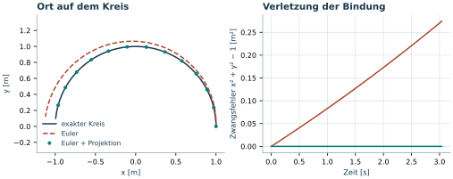

Für das kartesische Pendel folgt daraus eine praktische Prüfung. Neben der Bindungslänge protokollieren wir den Winkel oder die Durchgangszeit. RATTLE verwendet außerdem den Tangentialzwang der Geschwindigkeit. Die gezeigte radiale Korrektur isoliert den Ortsteil dieses Problems.

<!-- Buchseite -->

<a id="kap04-schluss"></a>

## Schluss · Zulässigkeit gilt für Ort, Geschwindigkeit und Beschleunigung

Der RC-Kreis zeigt, wie sich eine gespeicherte Größe und eine augenblickliche Bindung ergänzen. Ist die Kondensatorspannung gewählt, bestimmt die Maschengleichung den Strom und damit die Spannungsableitung. Gibt es lokal keine reguläre Auflösung der algebraischen Gleichung, braucht der Modellierer zusätzliche Struktur oder eine begründete Astwahl.

Beim kartesischen Pendel ist die Prüfung mehrstufig. Der Abstand zum Drehpunkt legt den Kreis fest. Die Ableitung der Längenbedingung verlangt eine tangentiale Geschwindigkeit. Bei der nächsten Ableitung tritt die Zwangskraft auf. RATTLE setzt den Ort auf die zulässige Bahn und richtet die Geschwindigkeit an ihrer neuen Tangente aus. Eine kleine Abweichung bei der Länge kann gleichzeitig mit einer merklichen Abweichung der Phase auftreten. Für die Abnahme kontrollieren wir deshalb die Bindungen und den Verlauf.

Am Stiftpendel ändert sich die wirksame Bindung während der Rechnung. Welcher Zeitpunkt zu welchem Modell gehört, führt weiter zu den Ereignissen. [Hybride Systeme](#kap05-einstieg)

<a id="kap04-forschung"></a>

### Aktueller Stand der Forschung

Automatische Indexreduktion verwendet unter anderem das Besetzungsmuster eines Gleichungssystems. Ein Muster allein kann algebraische Abhängigkeiten übersehen. Oki und Song schlagen eine symbolische Matrixdarstellung vor, die Beziehungen zwischen Einträgen besser erfasst als die von ihnen verglichene Näherung. Die Arbeit untersucht die Regularisierung von Systemen mit singulärer Jacobi-Matrix. Die daraus gewonnene Formulierung muss in einem hybriden Modell nach jedem Strukturwechsel erneut zur vorgesehenen Phase passen. Ein anspruchsvoller Test wäre der Vergleich der abgeleiteten Bindungen vor und nach einem Stiftkontakt bei leicht variierten Anfangswerten. [Oki und Song, Vorabdruck zur strukturellen Vorverarbeitung (2024)](https://arxiv.org/abs/2403.10260)

[Zur Einleitung dieses Kapitels](#kap04-einstieg)

<!-- Buchseite -->

# Kapitel 5 · Hybride Systeme, Diskontinuitäten und Ereignissteuerung

<a id="kap05-einstieg"></a>

## Einleitung · Wie findet man den Augenblick, an dem ein anderes Gesetz gilt?

Eine Kamera nimmt einen Ball beim Fallen auf. Auf einem Bild ist er noch über dem Boden. Auf dem nächsten befindet er sich auf dem Rückweg. Der entscheidende Augenblick liegt dazwischen. Wer nur die Höhe am Bildrand betrachtet, kann den Stoß übersehen. Für die anschließende Bewegung muss das Programm dennoch wissen, wann der Ball auftraf und mit welcher Geschwindigkeit er wieder abfliegt.

Eine ähnliche Frage stellt sich bei einem Schalter. Links und rechts des Ereignisses kann eine andere rechte Seite gelten. Wir beginnen mit dem Wächter, der das Ereignis beschreibt, und mit der Richtung, aus der er null werden darf. Dann nutzen wir eine Zwischenwertkurve, um den Zeitpunkt zu lokalisieren. Vor Ort setzt das Übergangsgesetz den neuen Zustand. Erst danach rechnet man mit der neuen Phase weiter.

Am Ende verfolgen wir auch zwei beinahe gleiche Bewegungen, die ihren Stoß zu verschiedenen Zeiten erleben. So wird sichtbar, wann ein kleiner Zustandsfehler zu einer großen Zeitabweichung führen kann und weshalb ein Protokoll mehr als eine Zahl für den Endzustand braucht.

[Zum Schluss dieses Kapitels](#kap05-schluss)

<!-- Buchseite -->

<a id="k5-ereignisse"></a>

## 5.1 Wann ändert sich das Bewegungsgesetz?

Ein Ball fällt aus zwei Metern Höhe auf einen starren Boden. Filmen wir den Stoß, so liegt die letzte Aufnahme vor dem Kontakt etwas über dem Boden. Die nächste zeigt den Ball vielleicht schon auf dem Rückweg. Aus zwei positiven Höhen allein könnten wir folgern, der Ball habe den Boden überhaupt nicht berührt. Für die Bewegung macht dieser unsichtbare Augenblick einen Unterschied von mehr als elf Metern pro Sekunde. So groß ist der Geschwindigkeitssprung bei der Rückprallzahl $e=0{,}85$ in unserem Versuch.

Um den Stoß auszurechnen, brauchen wir zwei Gesetze. Im Flug bestimmt die Schwerkraft, wie sich die Geschwindigkeit ändert. Am Boden bestimmt ein Stoßgesetz, welche Geschwindigkeit der nächste Flug erbt. Beide Beschreibungen treffen sich bei derselben Höhe und zur selben Zeit. Die links- und rechtsseitigen Geschwindigkeiten dürfen dort verschieden sein.

Eine vergleichbare Frage stellt sich bei einem Thermostat. Zeigt das Thermometer $20\,^\circ\mathrm C$, kann die Heizung laufen oder ruhen. Wer den Raum von $19\,^\circ\mathrm C$ aus erwärmt, hat eine andere Vorgeschichte als jemand, der ihn von $21\,^\circ\mathrm C$ aus abkühlen lässt. Die Temperatur allein bestimmt die nächste Ableitung deshalb nicht. Der **Zustand des Schalters** gehört zum Modell. In der Sprache eines hybriden Systems heißt er *Modus*.

Wir schreiben den kontinuierlichen Zustand als $x$ und seinen Modus als $\sigma$. Im Inneren eines Modus gilt $\dot x=f_\sigma(t,x)$. Für lokale Existenz und Eindeutigkeit genügen unter den üblichen Voraussetzungen Stetigkeit in der Zeit und lokale Lipschitz-Stetigkeit im Zustand. Ein stetig differenzierbares Feld erfüllt die benötigte lokale Bedingung im Zustand. Beim Übergang ergänzen wir die ODE um einen **Wächter** $g(t,x)$, seine zulässige Durchtrittsrichtung, den Zielmodus und die **Resetabbildung** $R(t,x)$. Der Zustandsraum kann zusätzlich einen zulässigen Bereich haben, beim Ball etwa $q\geq0$. [Projektkapitel zu hybriden Systemen][k5projekt]

<!-- Buchseite -->

### Was weiß der Integrator vor dem Schritt?

Ein **Zeitereignis** steht im Kalender des Modells. In der C13-Projektstudie wechselt die Last am Kran bei $4\,\mathrm s$ von null auf $-800\,\mathrm N$ und bei $7\,\mathrm s$ wieder auf null. Wagenposition und Geschwindigkeit bleiben beim Lastwechsel stetig. Die folgende Bewegung muss jedoch mit der neuen Kraft beginnen. Bei vorgeschlagenem Endpunkt $t_n+h$ und nächster Pulsflanke $\tau$ integriert der Solver bis $\min(t_n+h,\tau)$. Er verwendet im ganzen Teilstück das bisherige Feld, auch für die linksseitige Endableitung. Erst dann schaltet er die Last um. Ein periodischer Regler kann seine Termine als $t_0+kT$ aus dem ganzzahligen Taktindex erzeugen. Der Index bleibt auch dann eindeutig, wenn die absolute Uhr zwei Termine gleich rundet. [C13-Projektversuch][k5kran]

<a id="revision-k05-01"></a>

Bei $t_0=2^{30}\,\mathrm s$ beträgt der Abstand zur nächsten größeren binary64-Zahl $2^{-22}\,\mathrm s$. Wählen wir $T=2^{-24}\,\mathrm s$, runden sogar $k=0,1,2$ auf denselben absoluten Wert. Beim dritten dieser Termine entscheidet die Rundung zur geraden Mantisse. Ein Vergleich gleicher Gleitkommawerte würde drei verschiedene Takte zusammenwerfen. Der Kalender behält deshalb den ganzzahligen Index; innerhalb der Phase übergibt er dem Integrator die relative Zeit $kT$. Im Beispiel verarbeitet er drei Termine einzeln und integriert zweimal über $T$. Ereignisse am tatsächlich gleichen Takt sammelt er, verarbeitet ihre festgelegte Reihenfolge einmal und integriert zwischen ihnen über kein Zeitintervall. Die [Gegenprobe im Rechenlabor](#revision-q-01) prüft beide Situationen.


Eine Kontrolle gelingt ohne Kranmodell. Das Integral der Eingangskraft steigt im Betrag um $800\,\mathrm N\cdot3\,\mathrm s=2400\,\mathrm{N\,s}$. Ein Programm, das $-2400\,\mathrm{N\,s}$ bei $7\,\mathrm s$ erreicht und bei $15\,\mathrm s$ denselben Wert hat, verarbeitet Dauer und Vorzeichen des Pulses richtig. Ob die Last am Seil richtig schwingt, prüft anschließend das vollständige C13-Modell. Im Rechenlabor beträgt ein Schrittvorschlag sogar zehn Sekunden. Beide Flanken bleiben sichtbar.

Bei einem **Zustandsereignis** liefert der Kalender keinen Termin. Am Boden lautet der Wächter $g=q$. Für einen Aufprall muss die Höhe null sein und die Vertikalgeschwindigkeit nach unten zeigen. Bei einer idealisierten Schwellwertdiode kann ein Spannungswächter das Einschalten auslösen. Beim Abschalten kann je nach Diodenmodell ein Stromwächter maßgeblich sein. Bei einem Pendelanschlag entscheidet neben dem Winkel die Richtung der Annäherung. In jedem Beispiel bestimmt der aktive Modus, welche Bedingung gerade geprüft wird.

**Gegenprobe am Thermostat.** Die Heizung schalte bei fallenden $19\,^\circ\mathrm C$ ein und bei steigenden $21\,^\circ\mathrm C$ aus. Mit $+1\,\mathrm{K/min}$ im Heizmodus und $-0{,}5\,\mathrm{K/min}$ im Kühlmodus dauern die Wege durch dasselbe Band zwei und vier Minuten. Nach sechs Minuten wiederholen sich Temperatur *und* Modus. Ein einzelner Test auf „Temperatur gleich 20“ kann diese Schaltfolge nicht rekonstruieren. Das Zweizonenmodell C05 erweitert dieselbe Überlegung auf gekoppelte Zustände und unterschiedliche Zeitskalen. [C05 im Lehrbuch](#k3-c05)

<!-- Buchseite -->

<a id="k5-detektion"></a>

## 5.2 Einen Übergang innerhalb des Schritts finden

[Grundlagen · Nullstellen und Intervallhalbierung](#g-fixpunkte)

Was sagt ein Integrationsschritt über die Zeit zwischen seinen Endpunkten aus? Für die Fortsetzung im bisherigen Modus betrachten wir die skalare Funktion $\phi(t)=g(t,x(t))$. Sind beide Endwerte ungleich null und haben verschiedene Vorzeichen, liefert der Zwischenwertsatz bei stetiger $\phi$ mindestens eine innere Nullstelle. Die Behauptung „genau eine“ braucht eine weitere Begründung. Ein Treffer genau am rechten Rand gehört zum aktuellen Schritt. Der linke Rand gehört nach einem bereits verarbeiteten Ereignis zum vorangegangenen Abschnitt.

Setzen wir $s=t/(1\,\mathrm s)$ und $g=(s-0{,}25)(s-0{,}75)$. Bei $t=0$ und $t=1\,\mathrm s$ lesen wir jeweils $3/16$, in der Mitte $-1/16$. Wer nur am Ende prüft, übersieht Eintritt und Austritt. Beim Wächter $(s-0{,}5)^2$ verschwindet der Wert ebenfalls in der Mitte. Dort berührt die Kurve die Schwelle, ohne die Seite zu wechseln. Eine Berührung kann physikalisch bedeutend sein. Dafür braucht das Modell eine eigene Regel.


Die Zeitpunkte zur Unterteilung liefert hier die Algebra. Bei einem beliebigen glatten Wächter können zwischen endlich vielen Proben weitere Nullstellen liegen. Ein kleineres $h_{\max}$ garantiert die Erkennung erst zusammen mit Modellwissen, etwa einem Mindestabstand der Durchgänge oder nachgewiesenen Monotonieintervallen. [Ereignisdetektion in kontinuierlichen Solvern][k5events]

<!-- Buchseite -->

### Aus einem Schritt wird eine auswertbare Bahn

In Kapitel 3 lieferte ein Kollokationspolynom Zwischenwerte. Für den klassischen RK4-Schritt bauen wir hier eine dichte Ausgabe selbst. Sie soll an beiden Enden den berechneten Zustand *und* die zum aktiven Modus passende Steigung treffen. Es gibt vier Bedingungen, also genügen vier Koeffizienten. Mit $s=(t-t_n)/h$, $y_0=x_n$, $y_1=x_{n+1}$ und $f_i=f_\sigma(t_{n+i},y_i)$ lautet der kubische Hermite-Ansatz

$$
\begin{aligned}
p(t)={}&(1+2s)(1-s)^2y_0+s(1-s)^2h f_0\\
       &+s^2(3-2s)y_1+s^2(s-1)h f_1 .
\end{aligned}
$$

Setzen Sie $s=0$ und $s=1$ ein. Dann bleiben abwechselnd $y_0$ und $y_1$ übrig. Beim Ableiten nach $t$ entsteht der Faktor $1/h$. Er hebt das $h$ vor den Steigungen auf. Für eine Höhenkomponente in Metern besitzen deshalb alle vier Summanden die Einheit Meter.

Der klassische RK4-Schritt wertet seine letzte Stufe bei $y_0+hk_3$ aus. Sein tatsächlicher Endzustand ist eine gewichtete Summe aller vier Stufen. Deshalb berechnet unser Labor $f_1$ am tatsächlichen Endzustand eigens. Danach lässt sich $\phi_h(t)=g(t,p(t))$ beliebig oft ohne zusätzliche Auswertung des Vektorfeldes abfragen. Eine provisorische Fortsetzung des alten Modus über einen Stoß hinweg dient dem Einklammern. Der für die Suche benutzte rechte Endzustand wird beim Treffer verworfen. Das setzt voraus, dass sich das alte Feld für den Suchschritt sinnvoll fortsetzen lässt. Endet sein Definitionsbereich am Wächter, muss der Integrator den Schritt schon vorher begrenzen.

Für exakte Randwerte und eine viermal stetig differenzierbare skalare Bahn folgt aus der Hermite-Restgliedformel

$$
|x(t)-p(t)|\leq\frac{\max|x^{(4)}|}{4!}
       (t-t_n)^2(t-t_{n+1})^2
 \leq\frac{\max|x^{(4)}|}{384}\,h^4 .
$$

Der zweite Schritt nutzt $s(1-s)\leq1/4$. Bei berechneten Randwerten kommen deren Zustands- und Steigungsfehler hinzu. Im freien Fall ist die Höhe quadratisch und die Geschwindigkeit linear. RK4 und die kubische Hermite-Ausgabe reproduzieren beide in exakter Arithmetik. Gerade deshalb eignet sich der Ball, um Fehler der **Ereignislogik** getrennt zu beobachten.

<!-- Buchseite -->

<a id="v91-ereignisisolation"></a>

### Zwei Durchgänge innerhalb eines angenommenen Schritts isolieren

Der Test in `beispiele/detektion.py` arbeitet mit dem dimensionslosen Lehrpolynom $g_h(t)=(t-\tfrac14)(t-\tfrac34)=t^2-t+\tfrac{3}{16}$ auf $[0,1]$. Beide Randwerte sind positiv. Aus den Koeffizienten berechnet der Test die einzige innere stationäre Stelle $t_m=1/2$. Dort ist der Wert $-1/16$. Der Detektor erhält dadurch zwei monotone Teilintervalle, je eines für den fallenden und den steigenden Durchgang.

```python
from detektion import quadratic_turning_times
from ereignis import first_crossing

g = lambda t: t*t - t + 3/16
breaks = quadratic_turning_times(1, -1, 0, 1)
fallend = first_crossing(g, 0, 1, -1, 1e-12, breaks)
steigend = first_crossing(g, 0, 1, +1, 1e-12, breaks)
```

Für einen allgemeinen glatten Wächter kann man Teilintervalle mit einer Schranke $|g'_h|\le L$ prüfen. Sei $m$ die Mitte von $[a,b]$. Aus $|g_h(m)|>L(b-a)/2$ folgt, dass $g_h$ dort sein Vorzeichen behält. Scheitert der Test, kann man weiter unterteilen oder eine Monotonieschranke für den Rest suchen. Ein verbleibendes unsicheres Intervall gehört ins Diagnoseprotokoll. Eine Berührung am Extremum hat auf beiden Seiten dasselbe Vorzeichen und braucht einen eigenen Kontaktwächter. B.3 behandelt zusätzlich, wie ein Fehler der dichten Ausgabe in die Prüfung eingeht.

<!-- Buchseite -->

### Was bedeutet eine Zeittoleranz von einer Pikosekunde?

Sei $t_h$ die isolierte Nullstelle von $\phi_h$ und $t_*$ die zugehörige Nullstelle der exakten Funktion $\phi$. Für eine transversale, monotone Passage gelte in einer gemeinsamen Umgebung $|\phi'(t)|\geq m>0$. Die vollständige Ableitung entlang der einlaufenden Bahn ist

$$
\phi'(t)=g_t(t,x(t))+\nabla_x g(t,x(t))^\top f^-(t,x(t)).
$$

Am interpolierten Treffer ist $\phi_h(t_h)=0$. Weicht die ausgewertete Wächterfunktion höchstens um $\eta$ von $\phi$ ab, gilt daher $|\phi(t_h)|\leq\eta$. Nach dem Mittelwertsatz braucht eine Kurve mit Steigung von mindestens $m$ für diese Wertänderung höchstens $\eta/m$ Zeit. Liefert Brent einen Zeitpunkt $\hat t$ höchstens $\varepsilon_B$ neben $t_h$, ergibt die Dreiecksungleichung

$$
|\hat t-t_*|\leq \varepsilon_B+\frac{\eta}{m},\qquad
\eta\leq L_g\|p-x\|_\infty+\varepsilon_g .
$$

$L_g$ begrenzt die Zustandsabhängigkeit des Wächters, $\varepsilon_g$ seinen Auswertungsfehler. Beim Höhenwächter besitzt $\eta$ die Einheit Meter und $m$ die Einheit Meter pro Sekunde. Ein Höhenversatz von $0{,}1\,\mathrm{mm}$ verschiebt einen geradlinigen Durchgang mit $2\,\mathrm{m/s}$ um $50\,\text{µs}$. Bei $0{,}02\,\mathrm{m/s}$ sind es bereits $5\,\mathrm{ms}$. Beide Rechnungen erlauben dieselbe beliebig enge Nullstellenklammer.

Bei einer tangentialen Berührung verschwindet die Durchtrittsrate. Zum Quadrat $g=(s-s_*)^2$ addieren wir eine kleine Konstante. Mit $+\eta$ entfällt der Treffer, mit $-\eta$ entstehen zwei Treffer bei $s_*\pm\sqrt{\eta}$. Eine Anforderung an die Zahl der Dezimalstellen der Ereigniszeit verliert hier ihren Sinn, solange offen ist, ob es überhaupt einen Übergang gibt.

**Rechenversuch zu Abbildung 5.1 B.** In der dimensionslosen Zeit $s=t/(1\,\mathrm s)$ wachse $y$ nach $dy/ds=y$, $y(0)=1$. Die Schwelle $y=2$ fällt auf $t_*=\ln(2)\,\mathrm s$. Bei Schritten von $0{,}5\,\mathrm s$ beträgt der Zeitfehler $393{,}4\,\text{µs}$. Bei $0{,}0625\,\mathrm s$ sinkt er auf $0{,}0876\,\text{µs}$. In beiden Fällen ist $\varepsilon_B=2\cdot10^{-14}\,\mathrm s$. Das Labor leitet für jede Schrittweite eine eigene Schranke her. [Rechenlabor](#k5-labor)

<!-- Buchseite -->

### Wie Brent die Klammer schließt

Wir kennen zwei Zeiten $a$ und $b$, an denen die Wächterwerte verschiedene Vorzeichen haben. Die einfachste Frage lautet: Auf welcher Seite der Mitte liegt der Treffer? Sie kostet eine Auswertung und halbiert die Klammer. Bei einer Anfangsbreite $w$ liegt die Mitte nach $k$ Halbierungen höchstens $w/2^{k+1}$ von einer eingeschlossenen Nullstelle entfernt. Die Steigung des Wächters muss der Algorithmus dafür nicht kennen.

Eine Sekante durch zwei Funktionswerte liefert häufig einen besseren Vorschlag. Mit drei verschiedenen Werten lässt sich die *inverse* Beziehung interpolieren. Wir behandeln die Zeit als Funktion des Wächterwerts, legen eine Parabel durch drei Paare $(\phi_i,t_i)$ und werten sie bei $\phi=0$ aus. Gerät ein Vorschlag zu nahe an das ungünstige Ende oder verkürzt er die bisherigen Suchschritte zu wenig, kehrt Brent zur Bisektion zurück. Nach jeder Auswertung ersetzen wir den Rand mit demselben Vorzeichen. So bleibt die Nullstelle eingeschlossen. Als Treffer gilt die gerundete Mitte erst, wenn beide Randabstände höchstens der Zeittoleranz entsprechen. Fehlt andernfalls eine darstellbare innere Zeit, meldet das Labor die Vorzeichenklammer mit `time_resolution` statt eines Treffpunkts. [Brents Originalarbeit][k5brent]

Im Programm enthält die Klammer stets die Nullstelle des **ausgewerteten** Wächters. Ein rechnerischer Funktionswert null beendet die Suche unmittelbar. Andernfalls beendet sie eine Breite von höchstens $2\varepsilon_B$ und liefert die Mitte. Beim Vergleich zweier Vorzeichen verwendet der Code getrennte Vergleiche, denn das Produkt zweier kleiner Werte könnte bereits zu null unterlaufen. Kann die Maschinenarithmetik das Intervall vor Erreichen der gewünschten Auflösung nicht weiter teilen, meldet das Labor diesen Fall.

Die Suche beantwortet erst die zweite von zwei Fragen. Zuerst muss der Solver das passende Intervall **isolieren**. Für den Flug ab Boden mit Aufwärtsgeschwindigkeit $u$ liegt der Scheitel $u/g_0$ Sekunden nach dem Start. Vorher steigt die Höhe, nachher fällt sie. Teilen wir einen langen Vorschlag am Scheitel, besitzt die fallende Hälfte ein positives linkes Ende, selbst wenn die Höhe am eigentlichen Start exakt null war. Eine einzige Vorzeichenprüfung über den ganzen Vorschlag würde genau diesen Rückflug übersehen.

Das Labor verwendet die Konvention $(t_n,t_{n+1}]$. Ein gerichteter Abstieg erfüllt auf einem isolierenden Teilintervall $g_\ell>0,\ g_r\leq0$. Am Treffer prüfen wir zusätzlich die negative Geschwindigkeit. Ein Anfangszustand unmittelbar am Boden wird einmal nach der Anfangsregel behandelt. Bei $v<0$ stößt der Ball sofort, bei $v>0$ hebt er ab und bei $v=0$ ruht er unter der betrachteten Gewichtslast. Ein künstlicher Sprung um eine kleine Zeit nach vorne könnte den nächsten kurzen Flug bereits vollständig übergehen.

<!-- Buchseite -->

<a id="k5-saltation"></a>

## 5.3 Was springt am Stoß?

Am starren Boden bleibt die Position stetig. Für die Geschwindigkeit liefert der Rückprallkoeffizient $0\leq e\leq1$ die Regel $v^+=-e v^-$. Die hochgestellten Zeichen bezeichnen die beiden Grenzwerte zur **selben** Zeit. Ein Ereignisprotokoll speichert daher sinnvollerweise Zeit, einlaufenden Zustand, auslaufenden Zustand und Zielmodus. Aus einem Ausgabepunkt pro Zeitstempel allein lässt sich der Geschwindigkeitssprung später kaum rekonstruieren.

Nun lassen wir einen zweiten Ball aus einer geringfügig größeren Höhe fallen. Wenn der erste auftrifft, fliegt der zweite noch abwärts. Beide erfahren dieselbe Resetvorschrift, aber zu verschiedenen Zeiten. Wer untersuchen will, wie sich ein Höhenfehler auf eine spätere Messung auswirkt, muss diesen Zeitversatz mitrechnen. Dafür dient die **Saltationsmatrix** $S$.

Sei $\delta x^-$ die kleine Störung der fortgesetzten einlaufenden Bahn zur nominellen Trefferzeit $t_*$. Der gestörte Treffer liege bei $t_*+\delta\tau$. Wir entwickeln die Wächtergleichung bis zur ersten Ordnung. Mit $n=\nabla_x g(t_*,x^-)$ und $d=g_t+n^\top f^-$ ergibt sich

$$
0=n^\top\delta x^-+d\,\delta\tau,\qquad
\delta\tau=-\frac{n^\top\delta x^-}{d}.
$$

Bis zum verschobenen Treffer bewegt sich die Störung auf der alten Bahn um $f^-\delta\tau$ weiter. Der Reset überträgt diese Zustandsänderung mit $D_xR$ und seine eigene Zeitabhängigkeit mit $R_t$. Für den Vergleich bei gemeinsamer Uhrzeit transportieren wir anschließend auf der neuen Bahn um $-f^+\delta\tau$ zurück. Zusammengenommen folgt

$$
\begin{aligned}
\delta x^+&=D_xR\,\delta x^-+
       (D_xR\,f^-+R_t-f^+)\delta\tau ,\\
S&=D_xR+
  \frac{(f^+-D_xR\,f^- - R_t)n^\top}{g_t+n^\top f^-}.
\end{aligned}
$$

Alle Größen gelten am nominellen Ereignis. $f^-$ wird in $x^-$, $f^+$ im zurückgesetzten $x^+=R(t_*,x^-)$ ausgewertet. Die Formel setzt differenzierbare einseitige Felder, Wächter und Reset, einen isolierten transversalen Durchgang ($d\ne0$) und lokal dieselbe Ereignisfolge voraus. Für den unveränderten Zustand $R(t,x)=x$ ergibt sich der Spezialfall $S=I+(f^+-f^-)n^\top/d$. [Kong und Mitautoren][k5salt]

<!-- Buchseite -->

<a id="kap05-schrittfolge"></a>

### Wie ein Zeitvorsprung am Wechsel den Fehler verändert

Betrachten wir eine Bewegung in einer Raumrichtung. Vor dem Durchgang bei $x=0$ sei die Geschwindigkeit konstant $v^-=2\,\mathrm{m/s}$, danach $v^+=1\,\mathrm{m/s}$. Die Position selbst springt am Durchgang nicht. Geben wir der zweiten Bahn links der Schwelle einen Vorsprung von $2\,\mathrm{mm}$, so erreicht sie dieselbe Schwelle $1\,\mathrm{ms}$ früher.

Vergleichen wir beide Bahnen erst zu einer Zeit, zu der beide den Wechsel bereits hinter sich haben, so stammen ihre unterschiedlichen Wege aus dieser Millisekunde. In der neuen Phase legt die frühere Bahn in derselben Zeit nur $1\,\mathrm{mm}$ zurück. Die Abweichung bei gleicher Uhrzeit ist daher halb so groß wie vor dem Wechsel. Allgemein ergibt sich in diesem Lehrmodell der Faktor $v^+/v^-$.

Das Übergangsgesetz für die Position ist hier die Identität. Der Verstärkungsfaktor entsteht trotzdem, weil wir zwei Bahnen mit verschiedenen Ereigniszeiten zu derselben Beobachtungszeit vergleichen. Die Saltationsmatrix verallgemeinert genau diesen Zeitanteil zusammen mit der Ableitung eines Resets.

<!-- Buchseite -->

### Zwei Bälle vor derselben Uhr

Beim Ball schreiben wir $x=(q,v)^\top$ und $g=q$. Eine glatte Fortsetzung des Resets in die Umgebung der Kontaktfläche lautet $R(q,v)=(q,-ev)^\top$. Auf dem Boden ist die erste Komponente damit null. Die Normale ist $n=(1,0)^\top$, die Durchtrittsrate $v^-<0$. Die Beschleunigung $-g_0$ gilt für beide freien Flüge. Daraus folgen

$$
D_xR=\begin{pmatrix}1&0\\0&-e\end{pmatrix},\quad
f^-=\binom{v^-}{-g_0},\quad f^+=\binom{-e v^-}{-g_0},
\qquad
S=\begin{pmatrix}
-e&0\\ -(1+e)g_0/v^-&-e
\end{pmatrix}.
$$

Das Vorzeichen oben links lässt sich aus der Zeichnung verstehen. Ein etwas höherer Ball trifft später auf. Nach beiden Stößen war der früher aufgetroffene Ball bereits länger auf dem Weg nach oben. Die Ableitung unten links hat die Einheit $\mathrm{s}^{-1}$. Ein Höhenfehler verändert also auch die nach dem Stoß gemessene Geschwindigkeit. Für sehr kleine Anfluggeschwindigkeit wächst dieser Eintrag betragsmäßig.


Die gezeichnete Höhendifferenz von $0{,}25\,\mathrm m$ macht den zeitlichen Versatz sichtbar. Für die Ableitungsprüfung verwendet das Labor eine viel kleinere, symmetrische Höhenänderung. Die glatte Fortsetzung von $R$ dient nur zum Ableiten. Wählt man für seine erste Komponente überall null, ändert sich $D_xR$, der Zeitkorrekturterm ändert sich passend mit, und dieselbe Matrix $S$ entsteht.

<!-- Buchseite -->

### Den Reset am Messgerät prüfen

Ein Sensor vergleiche beide Bahnen bei $T=0{,}8\,\mathrm s$. Der erste freie Flug endet bei $\tau=\sqrt{2H/g_0}$. Eine kleine Störung der Starthöhe gelangt mit der linearen Flussabbildung zuerst bis zur nominellen Stoßzeit, mit $S$ über den Stoß und mit dem Fluss des nächsten Abschnitts bis $T$. Da die Beschleunigung konstant ist, lautet der Fluss für Störungen über eine Dauer $a$

$$
F(a)=\begin{pmatrix}1&a\\0&1\end{pmatrix},\qquad
\binom{\partial_H q(T)}{\partial_H v(T)}
=F(T-\tau)\, S\, F(\tau)\binom{1}{0}.
$$

Bei $H=2\,\mathrm m$ und $e=0{,}85$ folgen rund $-0{,}382252$ und $2{,}897185\,\mathrm{s^{-1}}$. Eine unabhängige Rechnung lässt zwei freie Fallbahnen bei $H+\delta$ und $H-\delta$ starten, stößt jede zu ihrer *eigenen* Zeit und dividiert die Differenz bei $T$ durch $2\delta$. Das Labor vergleicht beide Komponenten. Liegt das Messfenster noch vor dem späteren Stoß, vergleicht man verschiedene Modi und die hier verwendete Ableitung gilt für dieses Fenster nicht.

Auch die beiden Zeitglieder der allgemeinen Formel lassen sich separat prüfen. Ein Schlitten mit $x'=3\,\mathrm{m/s}$ erreicht die bewegte Schwelle $x=b+ut$, $b=1\,\mathrm m$, $u=1\,\mathrm{m/s}$. Beim Treffer setzt die gedachte Messschaltung $x^+=x^-/2+\beta t$ mit $\beta=1\,\mathrm{m/s}$. Danach gilt $x'=-1\,\mathrm{m/s}$. Der nominelle Start $x_0=0$ trifft bei $0{,}5\,\mathrm s$. In SI-Zahlenwerten ist die Sensitivität

$$
S=\tfrac12+\frac{-1-\tfrac12\,3-1}{3-1}=-1{,}25 .
$$

Hier sind $g_t=-u$ und $R_t=\beta$ beide wirksam. Das Programm löst die beiden linearen Flüge und den Reset direkt. Die Endposition bei $0{,}75\,\mathrm s$ hängt affin vom Anfangswert ab. Ein zentraler Differenzenquotient mit binär exakt darstellbaren Daten muss deshalb genau $-1{,}25$ ergeben.

Bei einer periodischen Folge multipliziert man solche Übergangsmatrizen in zeitlicher Reihenfolge mit den glatten Flussableitungen. Für eine Poincaré-Abbildung kommt die Rückkehrbedingung auf den gewählten Schnitt hinzu. Beim streifenden Kontakt oder einer Änderung der Reihenfolge mehrerer Stöße kann bereits die dafür vorausgesetzte Differenzierbarkeit verloren gehen. [Herleitung und Voraussetzungen][k5salt]

<!-- Buchseite -->

<a id="k5-zeno"></a>

## 5.4 Chattering, Gleiten und die Häufung von Stößen

Ein Regler schaltet an einer Grenze immer wieder hin und her. Bevor wir seine Schrittweite begrenzen, untersuchen wir die beiden Felder an der Grenze. Auf der Seite $g<0$ gelte $f_-$, auf der Seite $g>0$ gelte $f_+$. Die Größen $a_\pm=g_t+n^\top f_\pm$ geben die einseitigen Änderungsraten des Wächters an. Bei $a_->0$ und $a_+<0$ treiben beide Felder zur Fläche. Ein Programm, das beim kleinsten Überschreiten sofort das Feld tauscht, kann eine immer feinere Folge rascher Schaltungen erzeugen. Dieses **Chattering** ist eine Beobachtung am Schaltsignal. Ob ein Gleitmodell, ein reales Hystereseband oder ein anderes Kontaktgesetz angemessen ist, entscheidet die Physik.

Für eine glatte einzelne Fläche und strikt einwärts gerichtete Felder beschreibt der Filippov-Ansatz eine attraktive **Gleitbewegung**. Wir wählen ein Gewicht $\alpha$ so, dass die Bewegung den Wächterwert beibehält. Aus $0=(1-\alpha)a_-+\alpha a_+$ folgen

$$
\alpha=\frac{a_-}{a_--a_+},\qquad
f_{\rm gl}=(1-\alpha) f_-+\alpha f_+ .
$$

<a id="auflage-k05-01"></a>

Nehmen wir zwei Koordinaten in Metern und die Fläche $x=0$. Links davon sei das Geschwindigkeitsfeld $(2,1)\,\mathrm{m/s}$, rechts $(-1,4)\,\mathrm{m/s}$. Mit $\alpha=2/3$ ergibt sich $f_{\rm gl}=(0,3)\,\mathrm{m/s}$. In Normalenrichtung steht das System, während es sich in drei Sekunden um neun Meter entlang der Fläche bewegt. [Gleiten nach Filippov][k5fil]

Für die Implementierung können wir die Gewichte auch nach ihren Seiten benennen. Hier sind $w_-=1-\alpha=1/3$ und $w_+=\alpha=2/3$. Die Probe $w_-a_-+w_+a_+=0$ kontrolliert Betrag und Vorzeichen. Bei verschwindendem Nenner oder verlorenem Einwärtszeichen muss der Solver die Wächterlage neu klassifizieren.


Wie nah kommt ein realer Schalter mit Hysterese an diese Rechnung? Er behalte sein aktuelles Feld bis zur gegenüberliegenden Schwelle bei $\pm\delta$ bei. Die zwei Wege haben je $2\delta$ Länge, die Geschwindigkeitsbeträge normal zur Fläche sind $2$ und $1\,\mathrm{m/s}$. Für $\delta=1/16\,\mathrm m$ dauert eine vollständige Periode $3/16\,\mathrm s$. Starten wir bei $-\delta$ in Richtung $+\delta$ und zählen die Übergänge auf $(0,3\,\mathrm s]$, so ergeben sich 32 Schaltungen. Beim halbierten Band sind es 64. Die tangentiale Verschiebung über drei Sekunden bleibt neun Meter. Ein kleineres Band vervielfacht hier die Arbeit, obwohl die gesuchte mittlere Bewegung bereits feststeht.

<!-- Buchseite -->

### Wie die Felder eine Bewegung entlang der Fläche bestimmen

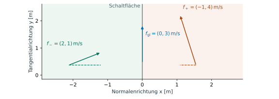

Für das Beispiel des vorigen Abschnitts sind die Normalanteile $2$ und $-1$ in $\mathrm{m/s}$. Im Gemisch mit Anteil $\alpha$ des rechten Felds gilt $2(1-\alpha)-\alpha=0$, also $\alpha=2/3$. Der Tangentialanteil beträgt $(1-\alpha)\cdot1+\alpha\cdot4=3\,\mathrm{m/s}$. Eine wechselnde Folge seitlicher Mini-Schritte kann diese Bewegung nur approximieren. Das Gleitmodell legt sie direkt auf der Fläche fest. Ist eines der Felder tangential oder weisen die Felder von der Fläche fort, ändert sich die Auswahlregel. Das Vorzeichen der beiden Normalanteile gehört somit zur Modellprüfung.

**Neustart am Übergang.** Sobald ein Reset den Zustand ändert oder die rechte Seite am Übergang springt, beginnt ein neuer glatter Abschnitt. Ein Mehrschrittverfahren baut seine Historie aus der neuen Phase auf. Bleibt bei einer reinen Messabfrage die Gleichung unverändert, kann es die bisherige Historie weiterverwenden. [Der Sprungfehler von BDF2](#k3-bdf) lässt sich am Ball mit einem einzigen Schritt ausrechnen.

<!-- Buchseite -->

### Wie viel Bewegung bleibt nach dem letzten berechneten Stoß?

Ein Ball verlasse den Boden mit der Aufwärtsgeschwindigkeit $u>0$. Die Höhe nach der Flugzeit $s$ ist $q(s)=us-g_0s^2/2$. Neben der bekannten Startnull bei $s=0$ besitzt sie die positive Nullstelle $2u/g_0$. Die Geschwindigkeit unmittelbar vor dem nächsten Stoß ist $-u$, die neue Aufwärtsgeschwindigkeit $eu$. Bei $0<e<1$ bilden die anschließenden Flugdauern eine geometrische Reihe. Vom aktuellen Abflug aus summieren sie sich zu

$$
T_{\rm rest}(u)=\frac{2u}{g_0}\,(1+e+e^2+\dots)
               =\frac{2u}{g_0(1-e)} .
$$

Für einen Start **aus der Ruhe in der Höhe $H$** müssen wir zuerst fallen. Der erste Treffer liegt bei $\tau_1=\sqrt{2H/g_0}$ und liefert $u_1=e g_0\tau_1$. Damit gilt ab dem ursprünglichen Versuchsbeginn

$$
T_\infty=\tau_1+T_{\rm rest}(u_1)
        =\tau_1\,\frac{1+e}{1-e}.
$$

Diese endliche Häufungszeit unendlich vieler Übergänge heißt **Zeno-Zeit**. Ein Ereigniszähler kann sie für $0<e<1$ durch einzelnes Weiterzählen nie erreichen. Bei $e=1$ bleiben die Flüge gleich lang. Bei $e=0$ gibt es einen einzigen vollständig plastischen Stoß. Für einen ruhenden starren Boden ohne abhebende äußere Last ergänzen wir einen Kontaktmodus $q=v=0$. Die Normalkraft gleicht dann die Gewichtskraft aus. Eine bewegte Unterlage oder zeitabhängige äußere Last verlangt eine eigene Kontakt- und Ablöseregel. [C21 und seine Kontaktmodelle][k5c21]

Im Labor erlauben wir einen vorgezogenen Wechsel in diesen Ruhemodus. Drei beobachtbare Größen begrenzen den Fehler. Nach dem Abflug ist die größte ausgelassene Höhe $u^2/(2g_0)$, der größte Geschwindigkeitsbetrag $u$ und die verbleibende Flugzeit $T_{\rm rest}(u)$. Bei zulässigen Fehlern $\varepsilon_q$, $\varepsilon_v$, $\varepsilon_t$ folgt die Schaltschwelle

$$
u\leq \min\!\left(\sqrt{2g_0\varepsilon_q},\
           \varepsilon_v,\ \frac{g_0(1-e)\varepsilon_t}{2}\right).
$$

Alle drei Einträge haben die Einheit $\mathrm{m/s}$. Der Zeitpunkt der frühen Ruheschaltung und die analytische Häufungszeit sind zwei verschiedene Messgrößen. Das Protokoll speichert die zwischen ihnen verbleibende Zeit.

<!-- Buchseite -->

### Vom Fallversuch zum Benchmark C21

Unser Ball startet bei $H=2\,\mathrm m$, $e=0{,}85$ und $g_0=9{,}81\,\mathrm{m/s^2}$. In den ersten drei Sekunden finden drei getrennte Stöße statt. Für den Langlauf wählen wir $\varepsilon_q=1\,\text{µm}$, $\varepsilon_v=0{,}01\,\mathrm{m/s}$ und $\varepsilon_t=1\,\mathrm{ms}$. Die strengste Bedingung kommt aus der Restzeit und lautet $u\leq0{,}00073575\,\mathrm{m/s}$.


Die 56. Reflexion löst bei $7{,}874510851\,\mathrm s$ den vorgezogenen Ruhemodus aus. Der nächste freie Flug hätte höchstens $2{,}489\cdot10^{-8}\,\mathrm m$ Höhe erreicht. Für *alle* ausgelassenen Flüge zusammen bleiben rund $0{,}949717\,\mathrm{ms}$. Addiert man diese Zeit zur Ruheschaltung, erhält man die analytische Häufungszeit $7{,}875460567\,\mathrm s$ innerhalb des Prüfbudgets. Bei Ausgabe auf neun Nachkommastellen können gerundete Summanden um eine letzte Stelle von der gerundeten Summe abweichen.

Im **C21-Projektfall** betragen die Starthöhe $10\,\mathrm m$ und die Rückprallzahl $0{,}9$. Die ersten Treffer liegen bei $1{,}427843123\,\mathrm s$ und $3{,}997960744\,\mathrm s$. Für den ruhenden Boden ergibt sich $T_\infty=19\tau_1\approx27{,}13\,\mathrm s$. Das Labor prüft diese zwei Kontakte mit eigenem Parametersatz. Der vollständige Benchmark behandelt weitere Aufgaben. Die Ereigniszeiten des kürzeren Lehrversuchs stehen getrennt im Rechenprotokoll. [Projektkapitel C12/C21][k5kontakte]

<!-- Buchseite -->

<a id="k5-labor"></a>

## 5.5 Rechenlabor · Einen Stoß verarbeiten

Was muss im Integrator in welcher Reihenfolge geschehen? Der Ball liefert einen besonders strengen Versuch. Der Modellzustand liegt nach **jedem** Aufprall genau auf dem Wächter. Beginnt der nächste Vorschlag dort und endet unter dem Boden, ist das Produkt der Wächterwerte null. Ein Test auf ein strikt negatives Produkt übersieht den gesamten Rückflug. Ein ungerichteter Test auf ein Produkt kleiner oder gleich null kann hingegen den gerade verarbeiteten Stoß immer wieder auslösen.

Der folgende Ausschnitt zeigt die entscheidenden Zeilen aus `ball.py`. Die dichte Ausgabe gehört zum aktuellen glatten Flug. Der Scheitel teilt diesen Flug in höchstens zwei monotone Stücke. Die lokale Variable `hit` enthält entweder die Zeit des ersten fallenden Durchgangs oder `None`.

```python
stop = min(end, t + step)
y1, dense = rk4_dense(rhs, t, (q, v), stop)
cuts = (t + v/g,) if v > 0 else ()
hit = first_crossing(lambda s: dense(s)[0], t, stop, -1, xtol,
                     cuts, rate=lambda s: dense(s)[1])
```

Liegt ein Treffer vor, wertet das Programm $v^-$ auf derselben dichten Bahn aus. Es protokolliert $t_*$, $v^-$ und $u=-e v^-$, setzt die Höhe auf null und startet in Flug oder Ruhe. Der Zeitpunkt steigt bei jedem weiteren Flug streng an. Eine erzwungene positive Mindesthöhe würde künstliche Energie einführen. Beim rechtsseitigen Neustart sind die alte Interpolation und frühere Ableitungen verbraucht. Ein Mehrschrittverfahren wie BDF baut seine Historie für den neuen Modus wieder auf. Bei einer DAE muss der zurückgesetzte Zustand auch die neuen algebraischen Bedingungen erfüllen. [BDF und Neustart](#k3-bdf)

Das Labor besteht aus fünf Python-Dateien. `ereignis.py` enthält RK4, Hermite, gerichtete Suche und Brent–Dekker. `detektion.py`, `saltation.py`, `ball.py` und `schalten.py` sind ausführbare Versuche. Entpacken Sie das Quellenpaket und wechseln Sie in den Ordner `beispiele`. Dort laufen zum Beispiel die folgenden drei Befehle mit Python ab Version 3.10. Das vierte Experiment startet mit `python3 schalten.py`. Die Prüfungen verwenden reguläre Python-Aufrufe mit aktivierten Assertions.

```sh
python3 detektion.py
python3 saltation.py
python3 ball.py
```

<!-- Buchseite -->

### Einen Flug aus dem Rechenkern zusammensetzen

Die folgenden Zeilen können direkt aus dem Ordner `beispiele` als Python-Programm ausgeführt werden. Wir lassen den Ball schon am Boden mit $1\,\mathrm{m/s}$ starten und geben dem Solver $1{,}25\,\mathrm s$ für seinen ersten Vorschlag. Der Endpunkt der *ungestörten Fortsetzung* liegt unter dem Boden. Wo beginnt der nächste physikalische Flug?

```python
from ereignis import first_crossing, rk4_dense
from math import ulp

g0, e = 2.0, 0.5
def flug(t, x):
    return (x[1], -g0)

x1, p = rk4_dense(flug, 0.0, (0.0, 1.0), 1.25)
assert x1 == (-0.3125, -1.5)
treffer = first_crossing(lambda t: p(t)[0], 0.0, 1.25, -1,
                         2e-14, cuts=(0.5,), rate=lambda t: p(t)[1])
assert abs(treffer - 1.0) <= 2e-14
v_minus = p(treffer)[1]
v_plus = -e * v_minus
assert abs(v_plus - 0.5) <= e*g0*2e-14 + 4*ulp(0.5)
```

Beachten Sie, welcher Wert in den Reset eingeht. Am vorgeschlagenen Schrittende trägt `x1` die Geschwindigkeit $-1{,}5\,\mathrm{m/s}$. Wer diese Geschwindigkeit spiegelt, startet mit $0{,}75\,\mathrm{m/s}$. Am tatsächlichen Stoß bewegt sich der Ball jedoch mit $-1\,\mathrm{m/s}$, und sein nächster Flug beginnt mit $0{,}5\,\mathrm{m/s}$. Der falsche Reset würde seine Gipfelhöhe um den Faktor $(0{,}75/0{,}5)^2=2{,}25$ vergrößern. Die Toleranz im letzten Test setzt die Zeitunsicherheit über $e g_0$ in eine Geschwindigkeitsunsicherheit um und reserviert vier Einheiten der letzten Binärstelle bei der Referenzgeschwindigkeit $0{,}5\,\mathrm{m/s}$ für die Auswertung des Interpolanten.

Die Funktion `simulate` übernimmt genau diese Arbeit für jeden weiteren Flug. Ihr Rückgabewert enthält den Endzustand, alle Stoßzeiten mit den beiden Geschwindigkeiten und gegebenenfalls das Ruheprotokoll. Ein Messgerät, das nur am Ende des Versuches abliest, und ein Messgerät, das den Geschwindigkeitssprung benötigt, können so dieselbe Integration verwenden.

<!-- Buchseite -->

### Ein Protokoll, an dem sich der Solver widerlegen lässt

Für die Referenzrechnung zählen wir den ersten Stoß als $k=1$. Vor dem $k$-ten Kontakt ist der Geschwindigkeitsbetrag $g_0\tau_1 e^{k-1}$, und bis dorthin sind $k-1$ Rückflüge vergangen. Das ergibt Referenzen, die ohne RK-Stufen, Interpolation oder Nullstellensuche auskommen.

$$
t_k=\tau_1\left(1+2\sum_{j=1}^{k-1}e^j\right),\qquad
v_k^-=-g_0\tau_1e^{k-1},\qquad v_k^+=-ev_k^- .
$$

<a id="tab-k05-01"></a>

| Kontakt $k$ | Zeit [s] | $v^-$ [m/s] | $v^+$ [m/s] |
|---:|---:|---:|---:|
| 1 | 0,638550857 | −6,264183905 | 5,324556320 |
| 2 | 1,724087313 | −5,324556320 | 4,525872872 |
| 3 | 2,646793301 | −4,525872872 | 3,846991941 |

Die Zeitwerte im Kurzlauf müssen auf $1\,\mathrm{ns}$ mit der geschlossenen Lösung übereinstimmen. Ein Fehler $\delta t$ verändert im freien Fall die Geschwindigkeit um $g_0\delta t$. Für ein Flugintervall können beide Endpunkte um je $1\,\mathrm{ns}$ verschoben sein. Das Labor verwendet beim $k$-ten Treffer konservativ $2k g_0\cdot1\,\mathrm{ns}$ als Geschwindigkeitsbudget. Der Resetfaktor $e\leq1$ verstärkt die einlaufende Geschwindigkeitsabweichung nicht. Im langen Versuch rechnen wir bis zehn Sekunden mit einem einzigen nominellen Schrittvorschlag von zehn Sekunden. Jeder gefundene Stoß unterbricht ihn. Nach 56 Stößen erreicht das Modell den vereinbarten Ruhemodus und liefert am Ende $(q,v)=(0,0)$.

Zwei Randfälle sind binär exakt prüfbar. Mit $g_0=2\,\mathrm{m/s^2}$, $H=1\,\mathrm m$, $e=1$ und Schritten von einer Sekunde fallen die Treffer genau auf $1$ und $3\,\mathrm s$. Beginnt der Ball bei $q=0$ und $v=1\,\mathrm{m/s}$, ist nach einer Sekunde ein ganzer Flug abgeschlossen. Der Detektor muss den rechten Rand zählen und den Abflug am linken Rand auslassen. Für einen plastischen Stoß im Anfangszustand prüft das Labor eigens den Zeitpunkt null.

<!-- Buchseite -->

### Woher die Grenzen der numerischen Prüfungen kommen

Im Wachstumsversuch aus 5.2 hat RK4 den Schrittfaktor $P_4(h)=\sum_{j=0}^4 h^j/j!$. In dieser Herleitung ist $h$ die Schrittweite in der dimensionslosen Zeit $s$. Das Taylor-Restglied liefert $0\leq\exp(h)-P_4(h)\leq\exp(h)h^5/120$. Schreiben wir die Differenz der $n$-ten Potenzen als Summe von $n$ Produkten, sind diese wegen $0<P_4(h)\leq\exp(h)$ durch $n\exp(nh)h^5/120$ begrenzt. Für $nh\leq1$ folgt der Gitterfehler $E_{\rm grid}\leq\exp(1)h^4/120$.

Weil die Ableitung gleich dem Zustand ist, besitzen hier auch die Randsteigungen dieses Fehlerbudget. Die beiden Hermite-Gewichte der Zustände sind positiv oder null und summieren sich zu eins. Die Beträge der Steigungsgewichte summieren sich zu $hs(1-s)\leq h/4$, wobei $s$ in diesem Ausdruck die lokale Koordinate zwischen den Schrittenden bezeichnet. Zusammen mit dem Interpolationsrest aus 5.2 ergibt sich

$$
E_{\rm dicht}\leq(1+h/4)E_{\rm grid}+\exp(1)h^4/384.
$$

Wegen $dy/ds\geq1$ ist dieselbe Zahl eine obere Schranke für den Fehler des normierten Trefferzeitpunkts. Umgerechnet in Sekunden kommen die Brent-Toleranz und eine Reserve für endlich genaue Arithmetik hinzu. Für die kleinen Rechnungen auf $[0,1]$ reserviert das Labor $128(n+1)$ Einheiten der letzten Binärstelle auf der konservativen Werteskala vier. Der dominierende Anteil des Budgets kommt bei allen vier gezeigten Schrittweiten aus der Herleitung.

Auch der Ableitungstest in 5.3 hat eine eigene Fehlerrechnung. Setzen wir $w(H)=\sqrt{2g_0H}$, so gilt im ersten Rückflug $v(T)=(1+e)w(H)-g_0T$ und $q(T)=(1+e)Tw(H)-g_0T^2/2-(1+2e)H$. Bei einem zentralen Differenzenquotienten ist der Abschneidefehler höchstens $\delta^2\max|F'''|/6$. Für $w$ gilt $w'''=3g_0^3/(2g_0H)^{5/2}$. Das Maximum über $[H-\delta,H+\delta]$ liegt links. Das Labor setzt den passenden Faktor $1+e$ oder $(1+e)T$ davor und ergänzt für die Subtraktion zweier Gleitkommawerte eine Rundungsreserve proportional zu $1/\delta$. Ein beliebig kleines $\delta$ macht die Messung deshalb nicht beliebig genau.

Ein mathematisches Fehlerbudget braucht immer eine Bezugsgröße. Hier sind das je nach Versuch die Ereigniszeit in Sekunden, die Geschwindigkeit in $\mathrm{m/s}$ oder die Ableitung einer gemessenen Größe nach der Starthöhe. Eine gemeinsame absolute Toleranz für alle drei hätte keine einheitliche physikalische Bedeutung.

<!-- Buchseite -->

<a id="k5-benchmarks"></a>

## 5.6 Vom Einzelereignis zur Stoßkette

Bei C12 genügt es nicht, ein einzelnes Ereignis genau zu lokalisieren. Mehrere Kugelpaare kommen als Nächstes für einen Stoß infrage. Im kräftefreien eindimensionalen Modell ist der lichte Abstand benachbarter Kugeln ein geeigneter Wächter. Für Kugelmitten $x_i,x_j$ und Radien $r_i,r_j$ lautet er $g_{ij}=x_j-x_i-r_i-r_j$. Er nimmt mit $v_j-v_i$ zu oder ab. Nur bei sich schließendem Spalt und zulässiger Kontaktlage steht ein künftiger Stoß bevor. [Benchmark C12][k5c12]

Im Lehrfall beträgt der freie Abstand $0{,}60\,\mathrm m$. Die linke Kugel läuft mit $0{,}80\,\mathrm{m/s}$, die rechte mit $0{,}20\,\mathrm{m/s}$. Nach genau einer Sekunde ist der Abstand aufgebraucht. Bei einem zentralen elastischen Einzelkontakt gleicher Massen tauschen die Kugeln die Geschwindigkeiten. Für je $1\,\mathrm{kg}$ bleiben Impuls $1\,\mathrm{kg\,m/s}$ und Energie $0{,}34\,\mathrm J$ erhalten. Dieselben zwei Bilanzen würden auch einen wirkungslosen Reset durchlassen. Deshalb prüft `schalten.py` zusätzlich die Geschwindigkeiten beider Kugeln und das positive Vorzeichen des neuen Abstandsanstiegs.

Ein Solver für die Kette bestimmt in der glatten Phase für **alle aktiven Paare** den jeweils ersten isolierten Kandidaten. Der früheste Kandidat oder eine frühere feste Kalendergrenze beendet die Phase. Nach dem Reset verwerfen wir alle späteren Kandidaten des alten Flusses und prüfen die nun aktiven Wächter neu. Unterscheiden sich zwei Treffer um weniger als die mit ihren Fehlerbudgets belegbare Zeitauflösung, ist ihre Reihenfolge numerisch unentschieden. Für unabhängige Ereignisse kann das Modell eine Reihenfolge vereinbaren. Bei gekoppelten Mehrfachkontakten muss es angeben, welche gemeinsame Impuls- oder Kontaktregel gilt. Nacheinander ausgeführte Paarstöße können unterschiedliche Ergebnisse liefern.

Dasselbe Problem stellt sich, wenn ein Regler genau beim Kontakt abtastet. Misst er $v^-$ oder $v^+$? Hier braucht der Modellvertrag eine Ereignisreihenfolge bei derselben physikalischen Zeit. Bei einer endlichen Folge sofortiger Änderungen sind zusätzliche diskrete Teilschritte möglich, ohne die Simulationsuhr vorzurücken. Können diese Teilschritte unbegrenzt weitere auslösen, ist eine Fortschrittsdiagnose nötig. Das Balllabor hat einen einzelnen Bodenwächter, der Pulsversuch einen festen Kalender und der C12-Einzelversuch ein Paar. Ihre kleinen Protokolle machen die Verträge sichtbar, die in Kapitel 12 gemeinsam benötigt werden. [Projektuntersuchung C12/C21][k5kontakte]

### Warum auch eine QSS-Prognose nach dem Schalten verfällt

Ein quantisierter Solver aus Kapitel 6 plant den nächsten internen Übergang aus seiner aktuellen Steigung. Nehmen wir eine dimensionslose Zustandskomponente $x=0{,}25$ bei einer unteren Quantisierungsmarke null und einer oberen Marke eins. Bei $\dot x=1\,\mathrm{s}^{-1}$ bleiben $0{,}75\,\mathrm s$ bis zur Marke. Ein äußeres Schaltsignal verdoppelt in diesem Augenblick die Steigung. Der Zustand ist stetig, die alte Terminvorhersage ist bereits falsch. Für denselben Restweg bleiben nur $0{,}375\,\mathrm s$. Diese beiden binär darstellbaren Zeiten vergleicht das Labor exakt. Beim Übergang von einem glatten Fluss zum nächsten müssen auch vorgemerkte interne Ereignisse aus der neuen Dynamik berechnet werden. [Projektkapitel zu hybriden Systemen][k5projekt]

<!-- Buchseite -->

<a id="k5-aufgaben"></a>

## 5.7 Übungen und Musterlösungen

**1 · Einen verlorenen Flug finden.** Ein Ball startet am Boden mit $u=1\,\mathrm{m/s}$ unter $g_0=2\,\mathrm{m/s^2}$. Ein Solver schlägt einen Schritt von $1{,}25\,\mathrm s$ vor. Welche Werte sieht ein Produktwächter an den Enden? Welche Teilklammer findet den Stoß? Welche Geschwindigkeit protokollieren Sie vor dem Reset?

**2 · Ein Zeitbudget in ein Höhenbudget übersetzen.** Ein Ventil durchläuft eine feste Schwelle mit mindestens $0{,}5\,\mathrm{m/s}$. Die gesuchte Schaltzeit darf um höchstens $10\,\text{µs}$ abweichen. Für die Nullstellensuche sind $2\,\text{µs}$ vorgesehen. Welcher maximale Fehler steht für die gesamte Wächterauswertung in Metern zur Verfügung?

**3 · Den Zeitversatz am Reset erkennen.** Für den Schlitten aus 5.3 werde der Anfangswert um $0{,}01\,\mathrm m$ erhöht. Wann trifft er die bewegte Schwelle? Um wie viele Meter ändert sich die Position beim gleichen Beobachtungszeitpunkt $T=0{,}75\,\mathrm s$?

**4 · Eine Zeno-Regel beurteilen.** Ein Programm geht bei $u=0{,}01\,\mathrm{m/s}$ in den Ruhemodus. Verwenden Sie $g_0=9{,}81\,\mathrm{m/s^2}$, $e=0{,}85$. Kann es $1\,\text{µm}$ Höhe und $1\,\mathrm{ms}$ Restzeit versprechen?

### Musterlösungen

**Zu 1.** In SI-Zahlenwerten ist $q(t)=t-t^2$. Es gilt $q(0)=0$ und $q(1{,}25)=-0{,}3125\,\mathrm m$. Das Produkt ist null. Am Scheitel bei $0{,}5\,\mathrm s$ beträgt die Höhe $0{,}25\,\mathrm m$. Auf $[0{,}5,1{,}25]\,\mathrm s$ liegt genau der fallende Treffer bei $1\,\mathrm s$. Seine Geschwindigkeit ist $-1\,\mathrm{m/s}$.

**Zu 2.** Für den Bahn- und Auswertungsfehler stehen $8\,\text{µs}$ zur Verfügung. Multipliziert mit $0{,}5\,\mathrm{m/s}$ ergibt das $4\,\text{µm}$. Diese Schranke setzt die angegebene Mindestgeschwindigkeit während der gesamten lokalen Passage voraus.

**Zu 3.** Die Relativgeschwindigkeit beträgt $2\,\mathrm{m/s}$. Der Vorsprung von einem Zentimeter zieht den Treffer um $0{,}005\,\mathrm s$ auf $0{,}495\,\mathrm s$ vor. Mit der hier exakt affinen Abbildung gilt $\Delta x(T)=-1{,}25\cdot0{,}01\,\mathrm m=-0{,}0125\,\mathrm m$.

**Zu 4.** Die erste mögliche Gipfelhöhe beträgt $u^2/(2g_0)\approx5{,}10\,\text{µm}$. Die gesamte Restzeit ist $2u/[g_0(1-e)]\approx13{,}59\,\mathrm{ms}$. Beide Budgets werden überschritten. Für diese Anforderung setzt 5.4 die aus der Restzeit folgende strengere Geschwindigkeitsschwelle an.

<!-- Buchseite -->

<a id="atlas-essverlauf"></a>

## 5.8 · Fünf gleichzeitige Anforderungen im Ereigniskalender

Fünf Personen werden gleichzeitig hungrig. Zwischen je zwei Nachbarn liegt ein Stäbchen. Stellen Sie sich zunächst vor, jede Person dürfe eines davon aufheben und behalten, bis das zweite frei wird. Welche abgeschlossene Mahlzeit würden Sie im Protokoll zuerst erwarten?

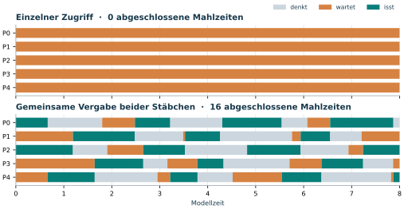

Im oberen Lauf nehmen alle ihr linkes Stäbchen. Beim zweiten Zugriff wartet jede Person auf ihren Nachbarn. Der Kalender enthält anschließend kein Ereignis mehr, das ein Stäbchen freigeben könnte. Die orange Fläche bezeichnet diesen fortbestehenden Wartezustand. Im unteren Lauf vergibt der Scheduler die beiden benötigten Stäbchen gemeinsam. Grün kennzeichnet das Essen. Nach dem Ende einer Mahlzeit bekommen wartende Nachbarn erneut Gelegenheit zum Zugriff. In acht Modellzeiteinheiten enden so 16 Mahlzeiten. Vier entfallen auf Platz P0 und je drei auf P1 bis P4.

Beide Spuren beginnen mit fünf gleichzeitig hungrigen Personen und verwenden Startwert 21 für den Zufallsgenerator. Die [Belegungs- und Wartepfeile](#atlas-kreis) erklären den Stillstand. C10 ergänzt eine eigene [Prioritätsregel für gleichzeitige Anforderungen](#atlas-konflikt). Für eine Aussage über langfristige Fairness wären mehrere unabhängige Läufe und längere Beobachtungszeiten nötig.

<!-- Buchseite -->

<a id="kap05-schluss"></a>

## Schluss · Ereigniszeit, Übergang und Neubeginn gehören zusammen

Am Ball beantworten wir die Frage der Einleitung mit einer Höhe und der passenden Durchtrittsrichtung. Eine Nullstelle auf der dichten Ausgabe markiert den Zeitpunkt. Zur Prüfung gehören die Güte dieser Ausgabe und die Steigung des Wächters am Durchgang. Zwei positive Randwerte können mehrere innere Durchgänge oder eine Berührung verdecken. Die Suche muss daher zu der Geometrie des Wächters passen.

Nach dem Treffer rechnet der Solver den Reset aus. Die neue Phase beginnt am Ereignis mit dem dort geltenden Feld. Ein Mehrschrittverfahren übernimmt nur Werte aus einer passenden Historie. Im Stoßprotokoll wird erkennbar, ob ein Fehler am Zeitpunkt, an der Aufprallgeschwindigkeit oder an der Rückprallregel entstand. Auch die Differenz zweier naher Bahnen enthält den Zeitversatz. Bei Zeno-Häufung muss der Modellierer schließlich festlegen, wie die Bewegung über die Grenzzeit hinaus beschrieben wird.

Die nächste Methode benutzt Ereignisse zusätzlich für den Rechenplan. Eine Zustandsmeldung wird dann ausgelöst, sobald eine Komponente ihr Band erreicht. [Zustandsquantisierte Simulation](#kap06-einstieg)

<a id="kap05-forschung"></a>

### Aktueller Stand der Forschung

Kong und Mitautoren erläutern Saltationsmatrizen für die lineare Störungsfortpflanzung an hybriden Übergängen. Der zusätzliche Term berücksichtigt, dass gestörte Bahnen den Übergang zu anderen Zeiten erreichen. Das Verfahren setzt für den betrachteten Typ des Übergangs eine transversale Passage voraus. Bei einer streifenden Berührung oder bei einer geänderten Reihenfolge mehrerer Kontakte kann schon die Folge der Phasen wechseln. Ein geeigneter Test für das Ball- oder Kontaktmodell variiert daher die Anfangsdaten und kontrolliert zuerst, ob derselbe Ereignistyp und dieselbe Reihenfolge vorliegen. [Kong u. a., Saltation Matrices (2024)](https://doi.org/10.1109/JPROC.2024.3440211)

[Zur Einleitung dieses Kapitels](#kap05-einstieg)

<!-- Buchseite -->

# Kapitel 6 · Zustandsquantisierte Simulation und DEVS

<a id="kap06-einstieg"></a>

## Einleitung · Wann muss sich eine Zustandsgröße wieder melden?

In einem Heiznetz steigt die Temperatur nahe der Quelle rasch, in einem entfernten Speicher ändert sie sich zunächst kaum. Ein gemeinsamer Zeitschritt lässt beide Komponenten gleich oft rechnen. Denkbar wäre auch, jede Komponente erst dann eine neue Zahl melden zu lassen, wenn sich ihr Zustand ausreichend geändert hat. Doch wer bestimmt den nächsten Meldetermin, wenn in der Zwischenzeit ein Nachbar seinen Wert ändert?

Wir verfolgen einen einzelnen Speicher von Hand. Der interne Zustand bewegt sich kontinuierlich, die nach außen gemeldete Näherung bleibt zunächst konstant. Aus dem Abstand beider Größen ergibt sich ein Termin. Bei höheren Verfahren wird eine Gerade oder ein Polynom gemeldet. Dann muss das Programm die erste zulässige Nullstelle eines Polynoms bestimmen und den Kalender nach Eingang einer fremden Meldung ändern.

Zum Schluss prüfen wir, wofür das Quantum als Toleranz taugt, wie aus einer lokalen Schwelle ein Bahnfehler entstehen kann und warum ein steifer Rückkopplungskreis auch bei nur wenigen Zuständen viel Ereignisarbeit erzeugen kann.

[Zum Schluss dieses Kapitels](#kap06-schluss)

<!-- Buchseite -->

<a id="t1-k6"></a>

## 6.1 Ein Speicher meldet sich selbst

In einem Heiznetz reagiert ein kleiner Fühler auf die geringste Änderung, während sich in einem großen Speicher über Sekunden kaum etwas tut. Bei einer gemeinsamen Zeitschrittweite werden beide Zustände immer wieder zusammen ausgewertet. Könnte sich stattdessen jeder Speicher selbst melden, sobald seine Änderung groß genug wird? Dann braucht das Modell außer dem fortlaufenden Zustand ein Signal, das seine Nachbarn zuletzt empfangen haben.

Quantized-State-System-Verfahren führen eine kontinuierliche Näherung $x$ und eine quantisierte Meldung $q$. Für eine autonome ODE wird $x'=f(q)$ integriert. Bei QSS1 bleibt jede Komponente $q_i$ bis zur nächsten Meldung derselben Komponente konstant. Erreicht $|x_i-q_i|$ ihr Quantum $\Delta_i$, wird der gemeldete Wert aktualisiert. Ein externer Eingriff kann die Steigung bereits vorher ändern. Die Trajektorie läuft zwischen den Ereignissen in kontinuierlicher Zeit weiter.

Ein normierter Speicher entlade sich mit $y'=-y/(1\,\mathrm s)$, $x(0)=q(0)=1$ und $\Delta=1/4$. Zuerst fällt $x$ mit einer Einheit pro Sekunde. Bei $t=1/4\,\mathrm s$ meldet er $q=3/4$. Für das nächste Viertel des Zustands benötigt er nun $1/3\,\mathrm s$. Der zweite Zeitpunkt ist $7/12\,\mathrm s$. Wir haben zwei ungleiche Zeitabstände aus derselben räumlichen Genauigkeitsvorgabe berechnet. Bei unveränderter Steigung null liegt kein interner Termin an.

Bei mehreren Größen trägt $\Delta_i$ die Einheit der Komponente, etwa Kelvin für einen Speicher und Ampere für einen Zweigstrom. Eine mögliche Regel lautet $\Delta_i=\max(\Delta_{\min,i},r_i|q_i|)$. Der relative Anteil steuert große Werte, der positive Boden hält das Band nahe null offen. Ein solches veränderliches Band muss bei jeder Prognose ausdrücklich berücksichtigt werden. Die folgenden Beweise verwenden ein festes oberes Fehlerband. [Kofman, QSS2][qss2] · [Projektkapitel QSS][t1proj6]

<!-- Buchseite -->

## 6.2 Was der Ereigniskalender wissen muss

Im DEVS-Formalismus besitzt ein atomarer Baustein einen Zustand $s$, Eingangs- und Ausgangsports, eine Zeitfortschrittsfunktion $ta(s)$, eine Ausgabefunktion $\lambda(s)$ sowie interne und externe Übergänge. Ein Quantisierer kann dem Koordinator seine nächste Fälligkeit melden. Erreicht die Uhr diesen Zeitpunkt, werden zunächst die fälligen Ausgaben bestimmt. Erst nach ihrer gemeinsamen Zustellung aktualisieren die betroffenen Bausteine ihre internen Zustände. Für zeitgleiche interne und externe Ereignisse braucht das gekoppelte Modell eine definierte konfluente Übergangsregel.

Bei konstanter Steigung $v_i\ne0$ im aktuellen QSS1-Abschnitt lautet die Prognose
$$
 t_i=t+\frac{q_i+\operatorname{sgn}(v_i)\Delta_i-x_i(t)}{v_i}.
$$
Sie verliert ihre Gültigkeit, wenn eine Nachbarmeldung $v_i$ ändert. Im Labor trägt jeder Kalendereintrag neben Zeit und Komponentennummer die Version seiner Prognose. Eine neue Prognose erhöht die Version. Ein alter Eintrag darf im Heap bleiben, wird beim Herausnehmen aber verworfen. Betroffen sind außer den fälligen Quantisierern genau die Gleichungen $j$, deren rechte Seite eine geänderte Meldung verwendet.

Zwei identische entladende Speicher mit demselben Quantum erreichen ihre Grenze hier zu exakt derselben darstellbaren Zeit. Das Labor sammelt beide Ausgaben, bevor es die neuen Steigungen ausrechnet. Eine Umkehr der Prioritäten bei identischer Zeit muss das gleiche Protokoll liefern. Physikalisch verschiedene, nur numerisch nahe Zeiten künstlich zusammenzulegen, wäre eine zusätzliche Modellentscheidung. Ein Stoß in C12 kann selbst dann ein externes Ereignis auslösen, wenn gerade kein Quantisierer seine Grenze erreicht. Alte Kalendertermine sind nach einem solchen Reset ebenso ungültig wie der dichte Interpolant des ODE-Solvers aus Kapitel 5. [Ereignisfolge und Neuplanung](#k5-benchmarks)

Die tatsächliche Arbeit setzt sich aus Wurzelsuche, Aktualisierung abhängiger Komponenten und Kalenderverwaltung zusammen. Bei einem Heap kostet Einfügen oder Entfernen typischerweise $O(\log M)$ bei $M$ gespeicherten Einträgen. In einem dicht gekoppelten System kann eine einzelne Meldung trotzdem den größten Teil des Modells betreffen. Die Kosten hängen deshalb vom Abhängigkeitsgraphen und vom gewählten Quantum ab.

<!-- Buchseite -->

<a id="kap06-schrittfolge"></a>

### Wie ein Nachbar eine bereits geplante Meldung verschiebt

Ein Speicher beginne bei $x=q=1$ und nehme zunächst mit einer Einheit pro Sekunde ab. Er meldet, wenn sein Zustand um $\Delta=1/2$ vom letzten gesendeten Wert abweicht. Der Kalender enthält darum zunächst den Termin $t=1/2\,\mathrm s$. Bei $t=1/4\,\mathrm s$ trifft eine Nachbarmeldung ein. Sie halbiert den Betrag der Steigung.

Für die neue Prognose rechnen wir zuerst bis zur Ankunft mit der alten Rate. Der Zustand beträgt dann $3/4$. Bis zur Schwelle $1/2$ fehlt noch ein Viertel. Mit der neuen Rate $-1/2\,\mathrm{s^{-1}}$ vergeht dafür eine weitere halbe Sekunde. Der richtige Termin lautet somit $t=3/4\,\mathrm s$.

Würde der Kalender den alten Eintrag bei $1/2\,\mathrm s$ ausführen, stünde der Zustand dort noch bei $5/8$. Die Meldung käme zu früh. Eine neue Versionsnummer für die Prognose macht den Unterschied im Programm sichtbar. Der alte Eintrag darf im Heap stehen bleiben. Beim Auslesen erkennt ihn der Solver an der veralteten Version und löst keinen Übergang aus. So bleibt die chronologische Verarbeitung korrekt, obwohl noch ein ungültiger Termin gespeichert ist.

<a id="auflage-k06-01"></a>

**Kalenderregel für interne QSS-Termine.** Ein Heap-Eintrag speichert Zeit, Knoten und Version der Prognose. Der Versionszähler steigt auch dann, wenn die neue Prognose unendlich ist. Damit lässt sich ein alter Termin ohne Suche im Heap streichen.

~~~python
def kalender(d, t0, schnitt, fortschreiben, ausgabe, uebernehmen, deps):
    heap, version = [], [0] * d
    def plane(i, t):
        version[i] += 1
        s = schnitt(i, t)
        if s < inf:
            heappush(heap, (s, i, version[i]))

    for i in range(d):
        plane(i, t0)
    while heap:
        t = heap[0][0]
        faellig = set()
        while heap and heap[0][0] == t:
            _, i, v = heappop(heap)
            if v == version[i]:
                faellig.add(i)
        if faellig:
            betroffen = faellig.union(*(deps(i) for i in faellig))
            fortschreiben(t, betroffen)
            post = {i: ausgabe(i) for i in sorted(faellig)}
            uebernehmen(t, post, betroffen)
            for j in sorted(betroffen):
                plane(j, t)
~~~

`heappush` und `heappop` stammen aus `heapq`, `inf` aus `math`. Zuerst laufen die betroffenen Zustände bis $t$ mit den bisherigen Raten. `ausgabe` liest die Quantisierermeldung jedes fälligen Knotens aus diesem gemeinsamen Vorzustand. Bei QSS1 ist das der erreichte neue Schwellenwert. Erst `uebernehmen` stellt alle Meldungen zusammen zu und aktualisiert die Raten. Auch der auslösende Knoten braucht einen neuen Termin. Im Beispiel verfällt $(1/2,i,1)$, gültig bleibt $(3/4,i,2)$. Für eine gleichzeitige externe Meldung legt das Modell zusätzlich den gemeinsamen internen und externen Übergang fest.


<!-- Buchseite -->

### Zwei Meldungen zur selben Zeit, ein gemeinsamer Empfänger

Zwei Geber steigen in normierter Zeit mit konstanter Steigung eins. Ein dritter Speicher integriert die Differenz ihrer Meldungen. Es gelten $\dot x_1=\dot x_2=1$, $\dot x_3=q_1-q_2$ und zu Beginn $x=q=0$. Geben wir beiden Gebern dasselbe Quantum $1/4$, so sind sie bei einer Viertelsekunde gleichzeitig fällig. Vor dem Übergang ist der Eingang des dritten Speichers null. Nach dem Übergang ist er wiederum null.

Nehmen wir versuchsweise an, ein Programm übermittle die erste Meldung und rücke daraufhin den dritten Speicher bereits in der Zeit vor, bevor es die zweite Meldung verarbeitet. Für dieses künstliche Teilintervall würde der Empfänger eine Steigung von $1/4$ sehen. Eine vertauschte Reihenfolge ergäbe $-1/4$. Die Abweichung hätte keinen Ursprung im physikalischen Modell. Der Koordinator berechnet deshalb beide Ausgaben bei derselben Modellzeit, aktualisiert beide Meldungen und plant den Empfänger einmal neu. Zwischen den beiden Meldungen vergeht keine kontinuierliche Zeit.

Die unmittelbare Gegenprobe lautet $x(1)=(1,1,0)$. Sie ist in binärer Arithmetik exakt, weil die vier Termine bei $1/4$, $1/2$, $3/4$ und eins liegen. Das Prüfprogramm läuft zusätzlich mit umgekehrter Tie-Break-Priorität. Der Zustand und die protokollierten Fälligkeitsmengen müssen identisch sein. In einem Modell mit nichtkommutierenden diskreten Resets braucht die konfluente Übergangsfunktion hingegen ausdrücklich eine physikalisch begründete Reihenfolge.

Bei QSS2 muss nach einer externen Meldung auch das Zeitpolynom an die neue lokale Zeit verschoben werden. Für $q(s)=q_0+q_1s$ zum Beispiel wird am neuen Ursprung $s_0$ der konstante Term $q_0+q_1s_0$. Die Steigung bleibt $q_1$, bis eine neue Meldung sie ändert. Beim quadratischen Polynom ändert sich zusätzlich der lineare Koeffizient. Ein vergessener Ursprungswechsel kann den nächsten Quantisierungszeitpunkt verschieben, obwohl alle gespeicherten Werte im alten Koordinatensystem richtig waren. [DEVS- und QSS-Rechenbeispiele][t1proj6]

<!-- Buchseite -->

## 6.3 Höhere Ordnung und die nächste positive Wurzel

QSS2 gibt eine Gerade als Meldung aus, QSS3 eine Parabel und QSS4 ein kubisches Polynom. Der integrierte Zustand hat auf dem entsprechenden lokalen Taylor-Abschnitt einen Grad mehr. Für die nächste Meldung untersucht man $x_i(s)-q_i(s)-\Delta_i$ und $x_i(s)-q_i(s)+\Delta_i$, wobei $s$ die seit der letzten Aktualisierung vergangene Zeit ist. Gesucht ist die früheste zulässige positive Grenze. Rein komplexe Wurzeln, die bereits verarbeitete Startnull und Wurzeln außerhalb eines durch äußere Ereignisse begrenzten Abschnitts sind eigene Fälle. Eine fast verschwindende Restgröße am Extremum erfordert eine Wurzelzählung. [Berührung und Fasttreffer](#qss-kontakt-nachweis).

Am skalaren linearen Speicher $x'=-a q$ lässt sich die Konstruktion bis Ordnung vier ausrechnen. Bei einem eigenen Ereignis werde $q=x_k$ neu aufgebaut. Das Taylorpolynom $T_{p-1}(z)=\sum_{j=0}^{p-1}z^j/j!$ liefert die Meldung $q(s)=x_k T_{p-1}(-as)$. Integration gibt $x(s)=x_kT_p(-as)$. Ihre Differenz enthält nur den letzten Term. Daraus folgt der nächste Zeitabstand
$$
 s_*=\frac1a\left(\frac{p!\Delta}{|x_k|}\right)^{1/p}.
$$
Bei $p=2$ entsteht die Quadratwurzel, weil die Steigungen von Meldung und Zustand am Anfang übereinstimmen. Im nichtlinearen Mehrkomponentenfall müssen die benötigten lokalen Koeffizienten aus dem Modell bestimmt und nach äußeren Meldungen neu berechnet werden.

Für $a=1\,\mathrm{s^{-1}}$, Startwert eins, eine Sekunde Simulationszeit und $\Delta=0{,}002$ benötigt der skalare Laborversuch 316, 12, 3 und 2 interne Meldungen für $p=1,2,3,4$. Die Endfehler betragen $6{,}312\cdot10^{-4}$, $4{,}060\cdot10^{-4}$, $2{,}992\cdot10^{-4}$ und $2{,}941\cdot10^{-4}$. Ein höherer Grad macht Ereignisse in diesem glatten Sonderfall seltener. Er erhöht zugleich die Arbeit einer Prognose, besonders bei wechselnden Eingängen. [Überblick über QSS-Methoden][t1qreview]

<!-- Buchseite -->

<a id="v91-qss2"></a>

### Den ersten QSS2-Termin von Hand bestimmen

[Grundlagen · Gleitkommaarithmetik und Auslöschung](#g-fehler)

Wir nehmen den Speicher aus Abschnitt 6.1 mit $x(0)=q(0)=1$, $\Delta=1/4$ und schreiben die seit dem Start verstrichene Zeit als Sekundenwert $s$. QSS2 meldet hier $q(s)=1-s$. Die Bewegung rechnet mit $x'=-q$ und liefert $x(s)=1-s+s^2/2$. Deshalb gilt
$$
x(s)-q(s)=s^2/2,\qquad s_*=\sqrt{1/2}=0{,}70710678\ldots .
$$
Bis dahin bleibt der Abstand im Band. Zum Meldetermin ist $q\approx0{,}292893$ und $x\approx0{,}542893$. Die Differenz beträgt genau ein Viertel. Der nächste Abschnitt beginnt mit einem neuen Meldepolynom. Eine frühere Nachbarmeldung erzwingt eine neue Prognose. [Kofman: Originalarbeit zur QSS2-Terminbestimmung](https://doi.org/10.1177/0037549702078002206).

In einem gekoppelten QSS2-Abschnitt können die Koeffizienten von $x-q\mp\Delta$ zu $As^2+Bs+C=0$ führen. Auch $B$ ist eine **Differenz** von Steigungen. Wenn $\sqrt{B^2-4AC}$ im Betrag nahe an $|B|$ liegt, kann die Subtraktion in der üblichen Wurzelformel die kleine Nullstelle auslöschen. Für zwei verschiedene reelle Wurzeln und $A\ne0$ bildet man
$$
w=-\tfrac12\bigl(B+\operatorname{copysign}(\sqrt{B^2-4AC},B)\bigr),
\qquad s_1=w/A,\qquad s_2=C/w .
$$
Hier wird die kleine Nullstelle über das Wurzelprodukt berechnet. Lineare und doppelte Fälle behandelt `rechenlabor/auditproben.py` gesondert. Der Testfall $10^{-12}s^2+s-10^{-12}=0$ liefert mit der direkten Subtraktion null, mit dem Wurzelprodukt dagegen einen positiven Termin nahe $10^{-12}$. Bei der Auswahl zählen Endlichkeit, die früheste zulässige positive Wurzel, das Ende des gültigen Prognoseabschnitts und die Zeitauflösung.

<!-- Buchseite -->

## 6.4 Vom Quantenband zum Fehler der gesamten Bahn

Die Meldung darf um höchstens $\Delta$ vom fortlaufenden Zustand abweichen. Weshalb darf man daraus beim stabilen Speicher etwas über den Fehler gegenüber der *exakten* Lösung folgern? Schreiben wir $e=x-y$ und $\delta=q-x$. Für $y'=-ay$ gilt $e'=-ae-a\delta$. Multiplikation mit $e^{at}$, Integration und anschließende Betragsbildung liefern
$$
 |e(t)|\leq e^{-at}|e(0)|+\Delta(1-e^{-at}).
$$
Die Dämpfung begrenzt den Beitrag auch lange zurückliegender Meldungen. Für gekoppelte lineare Systeme mit Matrix $A$ gilt $e'=Ae+A\delta$. Falls in derselben Norm $\|\exp(At)\|\leq M e^{-\gamma t}$ mit $\gamma>0$, folgt durch Variation der Konstanten
$$
 \|e(t)\|\leq M e^{-\gamma t}\|e(0)\|+
   \frac{M\|A\|\Delta}{\gamma}(1-e^{-\gamma t}).
$$
Vorausgesetzt sind ein durchgehend eingehaltenes Band und die hier betrachtete glatte Dynamik. Ein Reset benötigt eine eigene Abschätzung. Ohne exponentielle Dämpfung trägt der Beweis die zeitunabhängige Schranke nicht.


<!-- Buchseite -->

## 6.5 Steife Rückkopplung, LIQSS und Blockkopplung

Nehmen wir eine Komponente mit $\dot x=-a(q-q_*)$, $a>0$. Liegt das Gleichgewicht $q_*$ zwischen den zur Wahl stehenden Meldungen, können die beiden resultierenden Steigungen in entgegengesetzte Richtungen zeigen. Bei großem $a$ durchläuft die numerische Bahn das Band sehr schnell und meldet immer wieder, obwohl die physikalische Bewegung schon fast zur Ruhe gekommen ist. Mehr Ereignisse können hier gerade das Symptom eines ungeeigneten expliziten Quantisierers sein.

Linearly Implicit QSS (LIQSS) nutzt lokale Information über die Selbstkopplung. Für $x'_i\simeq a_{ii}q_i+b_i$ ist $q_*=-b_i/a_{ii}$ bei $a_{ii}<0$ das attraktive lokale Gleichgewicht. Fällt es in das zulässige Band, kann eine geeignete Meldung die Steigung bis auf null verringern. Liegt es außerhalb, bestimmen Band und Richtung den nächsten Kandidaten. Änderungen der Nachbarn verschieben $b_i$; auch eine zuvor ruhige Komponente muss dann neu prognostizieren. Eine sichere Diagonalnäherung bei zwei stark gekoppelten Komponenten lässt sich aus der Betrachtung eines einzelnen Eigenwerts nicht ableiten.

Erweiterte Varianten wie eLIQSS nutzen die Lage des Startpolynoms im zulässigen Band, um die vorhergesagte Zeit bis zur nächsten Meldung zu vergrößern. In der Projektvariante LIQSS–BDF behandelt ein quantisierter Teil die schwach gekoppelten Komponenten, während ein steifer Block implizit mit BDF fortschreitet. An der Blockgrenze müssen Zeitstempel, Austauschwerte und Ereignisse zusammenpassen. Ein fehlgeschlagener gemeinsamer Schritt verwirft die provisorischen Zustände beider Seiten. Beim C05-Vergleich zählt deshalb neben den internen Meldungen auch die Arbeit zur Erkennung der Schalter. [Methoden und Projektvarianten][t1proj6] · [C05 und die Umschaltzeit](#k3-c05)

<!-- Buchseite -->

### Quanten am Messauftrag ausrichten

Eine gebräuchliche Wahl für ein neues Prognoseintervall ist
$$
\Delta_i=\max\bigl(\Delta_{\min,i},r_i |x_i(t_k)|\bigr).
$$
$\Delta_{\min,i}$ trägt die Einheit des Zustands, $r_i$ ist dimensionslos. Der Wert wird bei der Aktualisierung aus dem momentanen Zustand bestimmt und für die folgende Prognose festgehalten. Bei $r_i=10^{-3}$ und einem Mindestquantum von $0{,}02\,\mathrm K$ entstehen für Temperaturüberschüsse $40\,\mathrm K$ und $5\,\mathrm K$ die Quanten $0{,}04\,\mathrm K$ und $0{,}02\,\mathrm K$. Die absolute Untergrenze hält das Band auch nahe null offen.

Ein Quantenband begrenzt zunächst den Abstand zwischen Zustand und Meldung. Das Fehlerbudget am Sensor wird mit einer Referenz oder mit der Schranke aus Abschnitt 6.4 geprüft. Verkleinern Sie die Quanten und protokollieren Sie gemeinsam Bahnfehler, physikalische Schaltungen und interne Meldungen. Damit wird sichtbar, welche Komponente den Rechenaufwand und welche die geforderte Messgenauigkeit bestimmt.

In einem dünn gekoppelten Netz mit 10 000 Komponenten können bei einem Ereignis etwa fünf Raten zu aktualisieren sein. Der Quotient $10\,000/5=2000$ vergleicht die Zahl dieser Aktualisierungen mit einem vollständigen synchronen Durchlauf. Für Laufzeit und Gesamtarbeit zählen zusätzlich die Häufigkeit der Meldungen, die Nachbarschaftsgröße, die Kalenderarbeit und die Effizienz des Vergleichssolvers. [Originalarbeit zu QSS2](https://doi.org/10.1177/0037549702078002206)

<!-- Buchseite -->

### Eine steife Komponente am Gleichgewicht prüfen

Stellen wir uns eine schnelle Rückführung mit $x'=1000(0{,}03-q)\,\mathrm{s^{-1}}$ für einen dimensionslosen Speicher vor. Starten $x=q=0$ bei $\Delta=0{,}1$, so beträgt die erste Steigung $30\,\mathrm{s^{-1}}$. Nach $0{,}1/30\,\mathrm s$ erreicht die Bahn die obere Meldung $q=0{,}1$. Nun beträgt die Steigung $-70\,\mathrm{s^{-1}}$. Bereits $0{,}1/70\,\mathrm s$ später ist derselbe Zustand wie zu Beginn erreicht. Der analoge Speicher ist in dieser Zeit ohne Überschwingen in Richtung $0{,}03$ gelaufen.

Die lokal implizite Gleichgewichtsidee kann in dieser speziellen Lage den zulässigen Wert $q=0{,}03$ wählen. Dann gilt $x'=0$, während der Abstand zwischen Meldung und Zustand nur $0{,}03<\Delta$ beträgt. Die exakte physikalische Bahn $0{,}03(1-e^{-1000t})$ hat weiterhin eine Übergangsschicht. Sie wird bei dieser Wahl des Quantums absichtlich nur innerhalb des Fehlerbands aufgelöst. Wer den schnellen Anstieg selbst untersuchen will, muss das Quantum verkleinern. Die Rechnung isoliert die Rolle der lokalen Gleichgewichtswahl. Ein allgemeiner LIQSS-Quantisierer muss auch Bandgrenzen, Prognosepolynome und externe Nachrichten behandeln.

Für die Auswertung eines QSS-Laufs sind daher außer dem Endwert mehrere Zahlen wichtig. Wie viele physikalische Ereignisse wurden in der richtigen Reihenfolge erkannt? Wie viele interne Meldungen hat die schnelle lokale Rückführung erzeugt? Wieviel Arbeit verursachten verworfene Prognosen und gekoppelte Korrekturen? In C05 sind eine richtige Grenzzyklusperiode und ein wirtschaftlicher Umgang mit schnellen Moden getrennte Messfragen. [C05 im Projekt][c05]

**Rechenlabor und Aufgaben.** Der Aufruf unten verwendet zwei gekoppelte Speicher. Ihre Referenz ist $(e^{-t},e^{-t}-e^{-2t})$ in normierter Zeit. (1) Bestimmen Sie $\|A\|_\infty$. (2) Wann meldet ein einzelner Speicher für $\Delta=1/4$ zum zweiten Mal? (3) Was passiert, wenn die externe Änderung einer Steigung vor einem schon eingeplanten Termin liegt?

~~~python
from qss_devs import qss1
A = ((-1., 0.), (1., -2.))
ende, meldungen, veraltet = qss1(A, (1., 0.), 1/16, 2.)
~~~

**Musterlösungen.** (1) Die größte absolute Zeilensumme ist drei. Die Zeilensummen der nichtnegativen Matrix $\exp(At)$ sind beide $e^{-t}$. Somit gelten $M=\gamma=1$ in normierter Zeit und das Labor prüft $3\Delta(1-e^{-t})$. (2) Nach $1/4+1/3=7/12\,\mathrm s$. (3) Die Prognose erhält eine neue Version. Im gekoppelten Versuch mit $\Delta=1/16$ werden bei 19 aktiven Zeitpunkten zehn veraltete Einträge erkannt.

<a id="revision-k06-01"></a>

Warum der Vorfaktor hier eins ist, sieht man an $A(1,1)^\mathsf T=-(1,1)^\mathsf T$. Für $t\ge0$ hat $e^{At}$ die beiden Zeilen $(e^{-t},0)$ und $(e^{-t}-e^{-2t},e^{-2t})$. Alle Einträge sind nichtnegativ. Beide absoluten Zeilensummen sind deshalb $e^{-t}$. Genau diese Zahl ist die induzierte Maximumsnorm. Ein negatives Eigenwertmaximum allein liefert bei einer beliebigen Kopplungsmatrix diesen Vorfaktor noch nicht.


<!-- Buchseite -->

### Gegenprobe · Warum der zweite QSS-Termin später kommt

Ein normierter Speicher startet bei $x=q=1$ und entlädt sich nach $x'=-q$. Zwischen zwei Meldungen bleibt der ausgegebene Wert $q$ konstant. Beim Quantum $\Delta=1/4$ erreicht die Bahn $x=3/4$ daher nach $1/4$ Zeiteinheiten. Mit der neuen Meldung $q=3/4$ fällt die Steigung im Betrag. Für das nächste Viertel braucht die Bahn $(1/4)/(3/4)=1/3$. Der zweite Termin liegt bei $7/12$. Wer beide Meldungen im Voraus im festen Abstand $1/4$ plant, verlegt den zweiten Termin um $1/12$ nach vorn.

**Kontrollfrage.** Welchen Eintrag muss ein Ereigniskalender erneuern, wenn ein Nachbar den Wert der Steigung schon vor dem geplanten Termin ändert? Zunächst wird der kontinuierliche Zustand mit der bisher gültigen Steigung bis zum Änderungszeitpunkt fortgeschrieben. Dann werden Restabstand und nächste Zeit mit der neuen Steigung bestimmt. Die alte Vorhersage verliert ihre Gültigkeit. `qss()` in `beispiele/gegenproben.py` liefert die beiden exakten Termine. Das gekoppelte Labor in Abschnitt 6.2 prüft die Behandlung überholter Kalendereinträge.

<!-- Buchseite -->

<a id="atlas-quantum"></a>

## 6.6 · Die Abstände zweier Quantisierungsereignisse vorhersagen

Ein Speicher beginnt bei $x(0)=1$ und entlädt sich nach $\dot x=-x$. Die Zeitkonstante ist eine Einheit. Bei QSS1 geht der letzte gemeldete Wert $q$ in die rechte Seite ein. Bis zur nächsten Meldung ist die Steigung also konstant. Die Linie fällt um genau ein Quantum $\Delta=0{,}1$. Wie lange braucht sie dafür, wenn gerade $q=1$ gemeldet wurde? Und wie lange bei $q=0{,}2$?

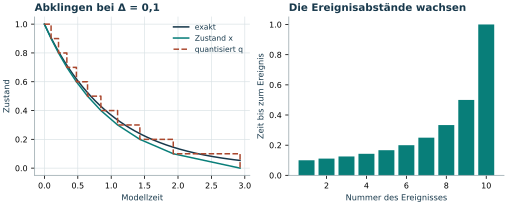

Aus $q\,\Delta t=\Delta$ folgen die Abstände $0{,}1$ und $0{,}5$. Die Balken rechts zeigen die tatsächlich konstruierten Intervalle. Auf der letzten Strecke gilt $q=0{,}1$, der Abstand beträgt eine ganze Zeiteinheit. Mit der Meldung $q=0$ endet die Bewegung des quantisierten Modells. Die Exponentiallösung klingt weiter ab. Wer eine sehr kleine Restladung bestimmen will, muss deshalb vor der Rechnung ein dazu passendes absolutes Quantum festlegen.

<!-- Buchseite -->

<a id="qss-kalenderordnung"></a>

## Wie eine verlorene Nullstelle die Methodenwahl verändert

Ein Ereignis ist ein Zeitpunkt, an dem der Abstand zwischen dem fortgeschriebenen Zustand $x$ und seiner Meldung $q$ eine der beiden Grenzen $\pm\Delta$ erreicht. Für $x'=-q$, $x(0)=q(0)=1$ und ein am Start abgestimmtes Polynom der Ordnung $p$ gilt auf dem ersten Segment $|x(s)-q(s)|=s^p/p!$. Der erste Termin ist somit $s_*=(p!\Delta)^{1/p}$. Bei $\Delta=0{,}01$ ergibt das für QSS1 bis QSS4 nacheinander $0{,}01$, $0{,}1414$, $0{,}3915$ und $0{,}6999$. Der größere erste Schritt entsteht aus der zusätzlichen Übereinstimmung von Ableitungen. Im gekoppelten System kann ein Nachbar seinen Termin vorziehen.

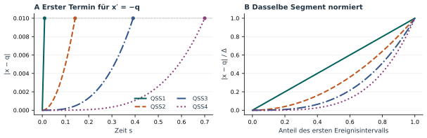

**Eine Gegenprobe aus der Kavität.** Für die früheste betroffene Zelle folgt beim Start von QSS4 näherungsweise $331313052{,}57\,s^4=0{,}001$. Die positive vierte Wurzel beträgt $0{,}00131808$. Ein Termin bei $0{,}0337085$ würde in dieser Zelle bereits rund 428 000 Quanten zulassen. Beide Seiten der Gleichung müssen am Kandidaten in physikalischer Zeit ausgewertet werden. Bei winzigen Koeffizienten schützt ein gemeinsamer Zweierfaktor die Auswertung vor Unterlauf. Für $2^{-1074}(s-1)(s-2)$ liegen die Nullstellen bei eins und zwei. Eine Auswertung ohne Skalierung meldete das Extremum $s=1{,}5$ als ersten Termin. Bleiben nach der Skalierung subnormale Koeffizienten übrig, prüft der Solver die Vorzeichen in exakter Bruchrechnung. QSS3 trifft am selben Anfangszustand seine erste Grenze schon bei $0{,}00065912$. Das Labor prüft die Wurzeln, die akzeptierten Segmentpolynome und das Geschwindigkeitsfeld gegen eine unabhängige Integration. [Kofman, Darstellung des QSS-Verfahrens dritter Ordnung](https://usuarios.fceia.unr.edu.ar/~kofman/files/lsd0502.pdf).

<!-- Buchseite -->

<a id="qss-zellwahl"></a>

## Wo liegt der an die Nachbarn gemeldete Wert?

Bei CQSS1 zerlegen wir die Zustandsachse in Zellen der Breite $\Delta$. Für $x$ in der Zelle $[k\Delta,(k+1)\Delta)$ melden wir ihren Mittelpunkt $(k+1/2)\Delta$. Abbildung 6.4A lässt den Zustand gleichförmig durch die Zellen laufen. Der Zustand ist am Zellenrand stetig, während die Meldung springt. Für einen Start genau auf einem Rand wird die Auswahl der Seite wichtig. Zeigen die beiden Felder wiederholt auf denselben Rand zurück, kann die Implementierung einen Wechsel ohne Zeitfortschritt diagnostizieren.

Bei BQSS1 beurteilt der Solver die Bewegung mit einem vorausgewählten Gitterwert. Ein Beispiel ist $x'=-10x$ mit $x(0)=0{,}1$ und $\Delta=0{,}2$. Das Gitter ist am Startwert verankert. Der untere Kandidat bei $-0{,}1$ erzeugt eine positive Rate. Sie weist vom ausgewählten unteren Ziel weg. Die Implementierung hält die Komponente, bis eine neue Kopplung die Entscheidung ändert. Der analytische Zustand klingt inzwischen ab. Ein solches Halten kann den Fehler am Ausgang also sichtbar machen.

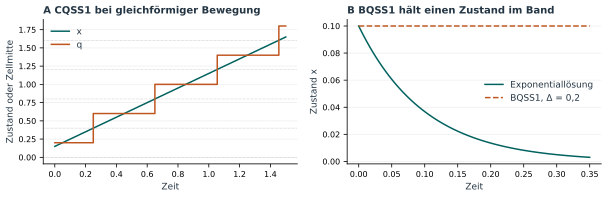

**Zwei fast gleichzeitige Termine prüfen.** Für $x'_1=10^{12}$, $x'_2=0{,}5\cdot10^{12}$ und $\Delta=1$ liegen die ersten Grenzen bei $10^{-12}$ und $2\cdot10^{-12}$. Zur Zwischenzeit $1{,}5\cdot10^{-12}$ lautet der Zustand $(1{,}5;0{,}75)$. Beim Zusammenlegen nahe beieinanderliegender Termine muss auch der räumliche Abstand zur eigenen Zellgrenze mit Rundung verträglich sein. Sonst kann eine zweite Komponente vorzeitig an die Grenze springen. [Migoni, Kofman und Cellier, BQSS und CQSS](https://doi.org/10.1177/0037549711403645).

<!-- Buchseite -->

<a id="qss-implizite-familien"></a>

## Selbstkopplung, Paarupdate und steifer Teilvektor

Bei LIQSS schreiben wir die lokale Gleichung einer Komponente als $x'_i=a_{ii}q_i+b_i$. Für konstantes $b_i$ ergibt sich die Ruhelage aus $a_{ii}q_i+b_i=0$. Bei höherer Ordnung tragen auch die Änderungen des Eingangs zum lokalen Modell bei. LIQSS1, LIQSS2 und LIQSS3 melden konstante, lineare und quadratische Polynome. Wenn zwei Komponenten ihre Ableitungen gegenseitig stark verändern, kann mLIQSS sie gemeinsam behandeln. Ein Paar hat bei Ordnung $p$ insgesamt $2p$ unbekannte Meldekoeffizienten. Das erklärt die Dimensionen zwei, vier und sechs der lokalen Gleichungssysteme. Die Paarbehandlung wird durch die Kopplungsprüfung ausgelöst. Deshalb können LIQSS und mLIQSS in einem Versuch deckungsgleiche Kurven liefern.


Für die Rechnung gilt $x'_1=-x_1-x_2+0{,}2$, $x'_2=x_1-x_2+1{,}2$, $x(0)=(-4,4)$ und $\Delta=0{,}05$. Mit Matrix $A$ und konstanter rechter Seite $b$ berechnet man die Vergleichsbahn als $x_*+\exp(tA)(x(0)-x_*)$, $x_*=-A^{-1}b$. LIQSS–BDF übergibt hier die zweite Komponente an den BDF-Teil. Beide Teilmodelle tauschen über das Makrointervall lineare Verläufe aus. Größe und Wahl der Partition gehören daher zur Verfahrensangabe. Die veröffentlichte mLIQSS-Arbeit entwickelt erste und zweite Ordnung. Die dritte Ordnung ist die im Labor geprüfte Erweiterung des Paarupdates. [Primärarbeit zum modifizierten LIQSS](https://doi.org/10.1177/0037549718766689).

<!-- Buchseite -->

<a id="qss-formpolynome"></a>

## Wie eLIQSS und CheQSS das Fehlerband nutzen

Sei $s=(t-t_k)/H$ der bereits durchlaufene Anteil eines Segments. Wir betrachten eine zulässige Form mit positiver Orientierung. eLIQSS beschreibt den normierten Defekt durch $(2s-1)^p$. Bei CheQSS übernimmt das Tschebyscheff-Polynom $T_p(2s-1)$ diese Aufgabe. Bei Ordnung eins fallen beide Formen zusammen. Bei Ordnung zwei durchläuft die Tschebyscheff-Form die entgegengesetzte Bandgrenze bereits in der Mitte. Ein Umkehrpunkt im Band gehört hier zur entworfenen Form. Bei äußerer Änderung eines Nachbarn muss der Solver das Segment neu aufbauen.


Der Versuch beantwortet eine eng umgrenzte Frage. Die Kurven zeigen, wie zwei verschiedene Meldepolynome ein vorgegebenes lokales Band ausschöpfen. Die tatsächliche Dauer $H$ hängt von der lokalen Dynamik und der Selbstkopplung ab. Für den Fehler der vollständigen Bahn brauchen wir zusätzlich eine Aussage über die Fortpflanzung lokaler Störungen. Im Labor bezeichnet `eqss1–3` jeweils denselben Einstieg wie `eliqss1–3`. Ein Alias liefert keine zusätzliche unabhängige Messung. [Bergonzi, Fernandez und Kofman, online 2026](https://doi.org/10.1007/s40314-026-03858-3).

<!-- Buchseite -->

<a id="qss-gruppen-log"></a>

## Relative Quanten und ein gemeinsamer Kalendertermin

Ein Zustand sinkt von acht auf eins. Ein festes Quantum von eins entspricht anfänglich einem Achtel des Betrags, am Ende dem gesamten Betrag. Für QSS1 und QSS2 kann das Labor bei jedem Neuansatz die Schwelle $\Delta_i=\max(\Delta_{i,\min},r_i|x_i(t_k)|)$ wählen, wobei der Bezugswert im Solver beim Neuansatz am entsprechenden Zustandswert verankert wird. Mit $r=0{,}25$ und Untergrenze eins beginnt der Versuch bei zwei. Sobald der Bezugsbetrag vier unterschreitet, bleibt das Quantum eins. Dies erklärt die Änderung der Ereignisabstände bei kleiner Amplitude.


Die Gruppenkavität verwendet eine zweite, davon unabhängige Wahl. Sie führt alle Zellen auf denselben neuen Zeitpunkt, sobald eine Komponente ihre Schranke erreicht. Ein schneller und ein achtmal langsamerer linearer Defekt ergeben am ersten Gruppentermin die Werte $\Delta$ und $\Delta/8$. Eine quadratische lokale Entwicklung ändert die Berührungszeit, während das Minimum über die Zellen als Entscheidung bestehen bleibt. Die Gruppenimplementierung besitzt eine eigene Ereignissuche. Vier kleine Gittergegenproben prüfen sie mit DOP853 und zwei Quanten je Ordnung.

<!-- Buchseite -->

<a id="qss-kontakt-nachweis"></a>

## Berührt die Bahn den Rand des Quantenbands?

Zwei fast gleiche Verläufe können verschiedene Meldungen auslösen. Schreiben wir den Abstand zu einer Bandkante als $p(s)=(s-1)^2+\eta$. Für $\eta=2^{-52}$ bleibt selbst das Minimum positiv. Bei $\eta=0$ berührt die Bahn den Rand bei $s=1$. Für $\eta=-2^{-52}$ liegen die Durchtritte bei $1\pm2^{-26}$. Ein fester Restfehlertest am Minimum kann diese drei Fälle verwechseln.

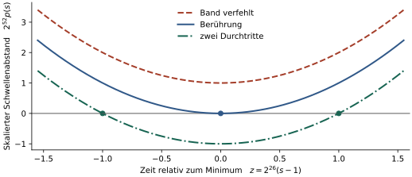

QSS2 verwendet den schnellen Vorzeichentest nur, wenn alle ursprünglich von null verschiedenen Koeffizienten nach der Skalierung und ihre nichttrivialen Diskriminantenterme im normalen Binär64-Bereich bleiben. Wird ein solcher Wert subnormal oder zu null gerundet, bestimmt der exakte Pfad das Vorzeichen aus den ursprünglichen gespeicherten Binärkoeffizienten. Der gemeinsame Isolator für höhere Ordnungen zählt in mehrdeutigen Fällen die verschiedenen reellen Wurzeln mit einer exakten Sturm-Folge des quadratfreien Polynoms. Die Zahl im Intervall $(a,b]$ ist die Differenz der Vorzeichenwechsel an beiden Enden. Durch Halbieren isolieren wir den ersten positiven Termin. Die Zeittoleranz begrenzt die Intervallbreite.

Welche Gleichung wurde dem Kalender übergeben? Das exakte Polynom $1000s^3-1100s^2+320s-28$ berührt bei $s=1/5$ und kreuzt bei $7/10$. Rundet man seine durch 1000 geteilten Koeffizienten einzeln auf Binär64, verschwindet die Doppelwurzel. Der früheste Termin dieser Eingabe liegt dann nahe $0{,}7$. Das Zertifikat bezieht sich auf das gespeicherte Segment. Für eine Aussage über die ursprüngliche Differentialgleichung kommt der Fehler der Taylor-Koeffizienten hinzu.

<!-- Buchseite -->

<a id="cp2-voll-gruppe"></a>

## Eine ganze Wirbelverteilung als QSS-Gruppe

Beim Öffnen des Deckels ändern sich zuerst die wandnahen Zellen. Im Wirbelmodell benötigt aber jede neue Geschwindigkeit die Lösung eines Poisson-Problems über das gesamte Quadrat. Eine einzelne Zustandsmeldung kann deshalb viele neue Vorhersagen auslösen. Für diesen Fall vergleichen wir zwei Kalender. Der erste vergibt je Gitterzelle einen Termin. Der zweite setzt einen gemeinsamen Termin auf den ersten Schwellenübertritt irgendeiner Zelle.

Schreiben wir die Wirbelgleichung als $z'=F(z)$ und setzen wir am Gruppenereignis $q=z_k$. Bei QSS1 bleibt $q$ bis zur nächsten Meldung konstant. Daher gilt $z(t_k+s)=z_k+sF(z_k)$. Zum Ereignis kommt es nach $s=\Delta/\|F(z_k)\|_\infty$. Verschwindet das ganze Vektorfeld, kann die Gruppe bis zum nächsten äußeren Ereignis warten. Bei QSS2 meldet sie die Gerade $q(t_k+s)=z_k+sF(z_k)$. Weil unser Raumoperator höchstens quadratisch ist, lässt sich $F(q)$ auf diesem Abschnitt genau integrieren. Der Kalender wählt die erste positive Zeit, zu der eine Komponente den Abstand $\Delta$ erreicht.

**Selbst prüfen.** Für $\Delta=0{,}001$ betragen die größten Änderungsraten zweier Zellen $0{,}25$ und $2$ pro konvektiver Zeiteinheit. Wann wird die Gruppe neu gemeldet? Nach $0{,}0005$ Zeiteinheiten hat die zweite Zelle das Quantum erreicht. Die erste hat sich erst um $0{,}000125$ geändert und wird trotzdem neu gemeldet. Diese Mehrarbeit spart bei globaler Kopplung Einzeltermine. Ob sie sich lohnt, entscheiden Laufzeit und Bahnfehler in der [Vollgitterstudie](#cp2-voll-vertrag).

<!-- Buchseite -->

<a id="pdes-grundbegriffe"></a>

## 6.7 Vom seriellen Ereignis zur parallelen Simulation

Im Grundwassermodell steigt nahe dem Brunnen die Konzentration. Eine weit entfernte Zelle hat seit Stunden keinen neuen Wert gemeldet. Ein serieller QSS-Solver kann trotzdem nur einen Übergang nach dem anderen bearbeiten. Könnten zwei Rechenkerne verschiedene Teile des Aquifers gleichzeitig fortschreiben? Das geht, solange die Rechnung rechts keine Meldung von links verpasst, die dort den nächsten Übergang ändern würde. Diese Abhängigkeit ist die Leitfrage der **parallelen diskreten Ereignissimulation** (PDES).

Ein **logischer Prozess** (*logical process*, LP) besitzt einen Teil des Modellzustands, lokale Ereignistermine und eine lokale Simulationsuhr. Eine **Partitionierung** ordnet jede Modellkomponente genau einem LP zu. Benötigt ein anderer LP den neuen quantisierten Wert, erhält er eine Nachricht mit dem Zeitstempel des Übergangs. Im Grundwasserbeispiel sind das Zellen an der Grenze zweier Teilgebiete. Ein Linux-Prozess kann mehrere LPs ausführen. In den folgenden MPI-Versuchen übernimmt jeder MPI-Rang genau einen LP. Beim OpenMP-Vergleich teilen sich mehrere Threads den Adressraum eines Linux-Prozesses.

Die **Granularität** lässt sich am Rechner beobachten. Wie viel lokale Arbeit erledigt ein LP zwischen zwei Abstimmungen? Bearbeitet er fünf Ereignisse in zehn Mikrosekunden und kostet die Abstimmung ebenfalls zehn Mikrosekunden, entfällt bereits die Hälfte der Zeit auf die Abstimmung. Bearbeitet er in derselben Zeitspanne der Modelluhr fünfzig derartige Ereignisse, verteilt sich derselbe Aufwand auf mehr Arbeit. Eine feinere räumliche Aufteilung kann zugleich die Zahl der Grenzmeldungen erhöhen. Die beiden Partitionskarten dieses Kapitels zeigen, weshalb die Aktivität der Grenzzellen stärker ins Gewicht fallen kann als ihre Anzahl.

Ein **konservatives Verfahren** bestätigt einen Übergang erst, wenn keine frühere Eingangsnachricht mehr eintreffen kann. Ein **optimistisches Verfahren** berechnet ihn vorläufig. Kommt eine frühere Nachricht, stellt der LP seinen gesicherten Zustand wieder her und spielt die betroffenen Ereignisse erneut ab. In Time Warp können bereits versandte Wirkungen durch Antinachrichten zurückgenommen werden. Unser C19R-Versuch sichert begrenzte Zeitfenster und ersetzt überholte Nachrichtenfolgen. Die folgenden Beispiele machen den Preis beider Entscheidungen messbar. [Fujimoto, Einführung in PDES](https://doi.org/10.1145/76738.76741) · [Jefferson, Virtual Time](https://doi.org/10.1145/3916.3988)

<!-- Buchseite -->

<a id="pdes-amdahl"></a>

### Zwei Uhren und Amdahls Gesetz

Eine Modelluhr kann in einer Sekunde Wandzeit zehn simulierte Tage durchlaufen. Der **Speedup** fragt nach einer anderen Größe. Für dieselbe Aufgabe, dieselbe Endzeit und dieselben Ausgaben seien $T_1$ und $T_p$ die gemessenen Wandzeiten mit einem und mit $p$ Arbeitern. Dann sind $S_p=T_1/T_p$ der Speedup, $E_p=S_p/p$ die parallele Effizienz und $T_1-T_p$ die eingesparte Wandzeit. Einen Quotienten aus der AB2-Zeit und der QSS-Zeit bezeichnen wir als Verfahrensvergleich. Für den parallelen Speedup eines Solvers brauchen wir seine eigene serielle Basis.

Denken wir uns die serielle Arbeit in zwei Anteile zerlegt. Der Anteil $f$ benötigt weiterhin $fT_1$ Sekunden. Der übrige Anteil verteilt sich im Idealfall gleichmäßig und beansprucht $(1-f)T_1/p$. Daraus folgt Amdahls Gesetz für eine feste Problemgröße,

$$S_p^{\mathrm{ideal}}=\frac{1}{f+(1-f)/p}.$$

Bei $f=0{,}1$ ergeben acht Arbeiter höchstens Faktor $4{,}71$. Selbst mit beliebig vielen Arbeitern nähert sich der Faktor zehn. In einer Messung kommen Nachrichten, Speicherzugriffe, ungleiche Last und Wartezeiten hinzu. Rechnet man aus einem gemessenen $S_p$ einen effektiven seriellen Anteil zurück, gehen auch diese Kosten ein. [Amdahl, Originalarbeit](https://www-inst.eecs.berkeley.edu/~n252/paper/Amdahl.pdf)

**Zeitversatz (Lag).** Liegen zwei lokale virtuelle Uhren bei 80 und 120 simulierten Sekunden, ist ihr momentaner Abstand 40 simulierte Sekunden. Für mehrere LPs ist die Spannweite $\max_i t_i-\min_i t_i$. Dieser Abstand sagt für sich allein nichts über die Wartezeit an einer Rechnerbarriere aus. Auch der Zeitpunkt des letzten lokalen Ereignisses kann weit zurückliegen, obwohl die Uhr eines inaktiven LP bereits bis zur gemeinsamen Freigabe vorgerückt ist.

**Rechenprobe mit der Kavität.** Ein MPI-Prozess benötigt für den kompletten D2Q9-Lauf 49,39 s, acht Prozesse benötigen 19,35 s. Daraus ergeben sich $S_8=2{,}55$, $E_8=31{,}9\,\%$ und eine Zeitersparnis von 30,04 s. Umgekehrt wäre die Beschleunigung einer Kalenderoperation, die 0,04 % der seriellen CPU-Zeit ausmacht, selbst bei verschwindenden Kosten auf $1/(1-0{,}0004)\approx1{,}0004$ begrenzt. Dieser letzte Grenzwert betrifft ausschließlich das gemessene Anlaufprofil.

<!-- Buchseite -->

<a id="pdes-vorausschau"></a>

### Wie weit darf ein Nachbar schon rechnen?

Zwei Prozesse berechnen zwei Hälften eines Grundwassergebiets. Im linken Teilgebiet erreicht eine Zelle ihre nächste Konzentrationsschwelle nach 80 simulierten Sekunden. Im rechten Teilgebiet wäre das nächste lokale Ereignis erst nach 120 Sekunden fällig. Darf der rechte Prozess 120 Sekunden vorlaufen? Dafür müssen wir wissen, ob er vor diesem Termin einen neuen Zufluss von links erhält.

Der **Scheduler** entscheidet, welcher Übergang ausgeführt wird. Im **Ereigniskalender** (*future event list*) stehen die derzeit vorhergesagten Termine. Der **Lookahead** beschreibt, wie weit ein Prozess die nächste mögliche Ausgabe an einen Nachbarn sicher ausschließen kann. Ein Kalendereintrag kann sich durch eine noch ausstehende Eingabe verschieben.

Für den konservativen C19R-Versuch starten alle Prozesse zum bestätigten Zeitpunkt $t$ mit zugestellten Grenzmeldungen. Jeder berechnet probeweise mit unveränderten Nachbardaten, wann er zuerst einen Wert über seine Grenze senden würde. Heiße dieser Zeitpunkt $e_p$. Das gemeinsame Minimum $e=\min_p e_p$ ist sicher. Eine frühere eingehende Meldung müsste von einem Prozess stammen, der bereits vor $e$ etwas ausgibt. Bis zur ersten solchen Ausgabe haben jedoch alle dieselben Eingaben wie im Probelauf. Am rechten Ende werden alle gleichzeitigen Meldungen zusammengeführt. Ein vorgesehener Ausgabe- oder Quelltermin kann den Schritt zusätzlich begrenzen.

Nehmen wir an, die erste **grenzüberschreitende** Meldung liegt links bei 80 und rechts bei 120 Sekunden. Konservativ verarbeiten beide bis 80. Ein optimistischer Prozess kann bis 120 vorausrechnen, seinen Ausgangszustand sichern und nach Eintreffen der früheren Nachricht ab der Sicherung neu rechnen. Dieses Zurücksetzen heißt **Rollback**. Der Aufwand hängt davon ab, wie viele lokale Ereignisse dabei erneut ausgeführt werden.

**Rechenprobe.** In C19R wurden bei acht Prozessen 65 292 Ereignisse mit 11 556 konservativen Freigaben bestätigt. Pro Freigabe fallen zusammen $65\,292/11\,556=5{,}65$ Ereignisse an. Drei Wiederholungen in [PDES_Partitionierung_Messpaket.zip](https://github.com/5H3LL3H5/argesim-hyperposition-benchmarks/blob/3a8f97f861ac77903289316947adb1e7ddf62433/docs/lehrbuch/gesamtausgabe/rechenlabor/pdes_partitionierung/PDES_Partitionierung_Messpaket.zip), Datei `c19_paired.jsonl`, ergeben mediane Kernzeiten von 31,7 ms mit einem und 353,9 ms mit acht Prozessen. Damit ist $S_8=0{,}090$ bezogen auf den Ein-Prozess-Lauf dieser Serie. Es gab null Rollbacks.

<!-- Buchseite -->

<a id="pdes-schnitt"></a>

### Wo zieht man die Partitionsgrenze?

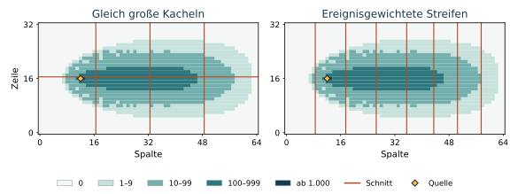

Bei einem regelmäßigen Gitter kann man zunächst die geschnittenen Nachbarschaftskanten zählen. Im linken Bild schneiden die acht Kacheln 164 Kanten, im rechten schneiden die Streifen sogar 231. Trotzdem sinkt die Zahl der bestätigten Grenzmeldungen **von 31 848 auf 14 609**. Ein Schnitt durch eine häufig quantisierende Zelle erzeugt bei jeder neuen Meldung Arbeit. Ein Schnitt durch eine ruhende Zelle trägt während dieser Ruhephase nichts zum Datenverkehr bei.

Für einen vertikalen Schnitt zwischen Spalten $c-1$ und $c$ summieren wir die gemessenen Ereigniszahlen beider Spalten. Horizontale Schnitte behandeln wir ebenso. Für vier oder acht Prozesse wurden alle durchgehenden rechtwinkligen Schnitte betrachtet, deren Bandbreite je Achse zwischen den nach außen gerundeten Grenzen von 90 und 110 Prozent der gleichmäßigen Breite liegt. Unter den 2 832 zulässigen Achterkarten minimierten im Nennfall dieselben Streifen die Zahl der Exporte und maximierten den mittleren sicheren Fortschritt. Dieser wuchs von 32,03 auf 74,77 simulierte Sekunden. Bei einer spekulativen Fensterweite von 6 750 s sank die Zahl zurückgesetzter lokaler Fenster von 5 803 auf 2 988.

**Übung mit Lösung.** Beim Doppelpuls und vier Prozessen erhält Karte A 16 350 bestätigte Exporte und 52,82 s mittleren sicheren Fortschritt. Karte B liefert 16 516 Exporte und 67,79 s. Welche Karte wählen Sie für möglichst wenige übertragene Zustände? A. Für möglichst große konservative Schritte? B. Im optimistischen Betrieb wurden für A 1 774 und für B 2 681 Fenster zurückgesetzt. Das Quellprofil, das Protokoll und die Zielgröße bestimmen gemeinsam, was „optimal“ bedeutet. Beide Rechnungen reproduzieren das serielle Ergebnis. Das physikalische Feldbudget der unabhängigen Green-Referenz verfehlen bei diesem Quantum beide Quellprofile.

Die [Kavität in Kapitel 16](#pdes-kavitaet) hat eine andere Kopplung. Dort verändert eine einzelne Wirbelstärke über die Poisson-Gleichung die rekonstruierte Strömung im ganzen Gebiet.

<!-- Buchseite -->

<a id="pdes-lp-messung"></a>

### Was acht logische Prozesse im Grundwasser tatsächlich leisten

In zehn simulierten Tagen bestätigt das nominale C19R-Modell 65 292 QSS1-Ereignisse. Wir teilen die Domäne in ereignisgewichtete Streifen und führen jeden LP in einem eigenen MPI-Prozess aus. Die zweite Serie ([Skalierung_Messdaten.zip](https://github.com/5H3LL3H5/argesim-hyperposition-benchmarks/blob/3a8f97f861ac77903289316947adb1e7ddf62433/docs/lehrbuch/gesamtausgabe/rechenlabor/pdes_partitionierung/Skalierung_Messdaten.zip), `c19-scaling.jsonl`) enthält fünf Wiederholungen je Konfiguration in ausgeloster Reihenfolge. Die Tabelle zeigt mediane Kernzeiten; jeder Speedup verwendet die Ein-Prozess-Zeit derselben Serie und desselben Protokolls. Beide Protokolle reproduzieren die acht Feldausgaben, die Ereigniszähler und die Ereignisprüfsummen jeder Zelle.

| LPs | konservativ (ms) | $S_p$ | optimistisch (ms) | $S_p$ | Rollbacks¹ |
| --- | ---: | ---: | ---: | ---: | ---: |
| 1 | 37,6 | 1,00 | 26,2 | 1,00 | 0 |
| 2 | 64,2 | 0,59 | 131,1 | 0,20 | 700 |
| 4 | 100,0 | 0,38 | 221,0 | 0,12 | 1479 |
| 8 | 383,7 | 0,10 | 501,3 | 0,05 | 2284 |

¹ Zurückgesetzte lokale Fenster des optimistischen Laufs. Konservativ gab es bei jeder Prozesszahl null Rollbacks.

Im konservativen Versuch sinkt der mittlere sichere Fortschritt von 340,83 simulierten Sekunden bei zwei LPs auf 74,77 bei acht LPs. Jeder zusätzliche Schnitt kann die Zeit bis zur ersten möglichen Grenzmeldung verkürzen. Der Vergleich in der Partitionskarte stellt eine andere Frage. Dort bleibt die Zahl der LPs bei acht, während die Schnittlinien verlegt werden. So können Gewichtung und zusätzliche Partitionen entgegengesetzte Wirkungen haben.

Der optimistische Versuch lässt unabhängig von der LP-Zahl dieselbe Spekulationsweite von 13 500 simulierten Sekunden zu. Mit acht LPs werden 2 284 lokale Fenster zurückgesetzt. Die Zahl hängt von der Fenstergröße ab. Die zuvor untersuchte Karte mit 2 988 Rücksetzungen verwendete ein Fenster von 6 750 Sekunden. Die verworfene Arbeit pro Fenster und die Zahl der Übertragungen entscheiden mit über die Laufzeit.

Am letzten gemeinsamen Ausgabepunkt stehen die bestätigten LP-Uhren bei 864 000 s. Der Zeitversatz dieser Uhren beträgt null. Liest man dagegen nur den Zeitstempel der letzten eigenen Zellmeldung jedes LP aus der seriellen Ereignisspur, liegen der früheste und der späteste bei acht Streifen 22 218,91 simulierte Sekunden auseinander. Eine ruhende Zelle kann also einen alten Meldestempel tragen und trotzdem bis zur aktuellen Ausgabe korrekt berechnet sein.

**Übung mit Lösung.** Warum unterscheiden sich die beiden seriellen Zeiten, obwohl die acht Felder identisch sind? Beim konservativen und beim optimistischen Programm unterscheiden sich Fenstergrenzen und Verwaltungsoperationen schon mit einem LP. Für den Speedup wird die Zeit des jeweiligen Ein-LP-Programms durch die Zeit desselben Programms mit mehreren LPs geteilt. Im Anwendungsbetrieb kommt der Programmstart hinzu. Für acht LPs betrugen die medianen Gesamtzeiten 0,651 s und 0,773 s.

<!-- Buchseite -->

<a id="kap06-schluss"></a>

## Schluss · Zustandsschwelle, Kalender und Bahnfehler

Der Speicher meldet erneut, sobald seine laufende Näherung das eigene Quantenband verlässt. Eine Nachbarmeldung kann vorher die Steigung ändern. Dann rechnet der Solver den Zustand zunächst mit der alten Rate bis zu dieser Uhrzeit fort und bestimmt erst danach den neuen Termin. Die Version des Kalendereintrags schützt vor einer Berechnung mit überholter Rate. Für gleichzeitige Eingänge braucht die Kopplung außerdem eine festgelegte Übergangsregel.

QSS höherer Ordnung verändert das zwischen zwei Meldungen verwendete Polynom. Bei einer steifen Rückkopplung bleibt die Frage, wie oft das Band erreicht wird. LIQSS und die hier besprochenen Erweiterungen suchen dazu lokale implizite oder partitionierte Schritte. Einen Lauf vergleichen wir am globalen Bahnfehler oder am Schaltzeitpunkt. Das gewählte Quantum beschreibt zunächst den Abstand zwischen Zustand und Meldung. Wie weit dieser Abstand den gemessenen Fehler beeinflusst, hängt auch vom Modell ab.

**Eine andere Laufzeit, eine andere Grenze.** In den ersten vier simulierten Sekunden der Saite senkte eine an die Ereignisdichte angepasste Aufteilung auf vier Prozesse die Zahl der Grenzmeldungen von 8 381 auf 1 773 (79 %). Über die vollen 30 Sekunden verteilt sich die Welle weiter. In der seriellen Ereignisspur ergeben gleich breite Abschnitte 5 531 225 Grenzübertritte, die für diese Spur günstigsten zulässigen Schnitte 5 379 607. Übrig bleiben 2,74 % Einsparung. Diese zweite Messung zählt Übertritte aus der vollständigen Spur. Eine parallele Gesamtlaufzeit wurde dafür nicht erhoben.

In einem räumlich diskreten Modell bestimmt die Nachbarschaft des Gitters, welche Komponenten voneinander abhängen. Wir werden an der Wärmeleitung sehen, wie feinere Nachbarschaften zugleich die Zeitskalen verändern. [Räumliche Diskretisierung](#kap07-einstieg)

<a id="kap06-forschung"></a>

### Aktueller Stand der Forschung

Das 2025 vorgestellte Julia-Paket QuantizedSystemSolver implementiert zustandsquantisierte Verfahren für Systeme von ODEs mit Unstetigkeiten. Damit lassen sich jüngere Implementierungen und die im Buch benutzten Prototypen mit denselben Beobachtungstests vergleichen. Die offene Frage für unser Heiznetz betrifft den Aufwand bei vergleichbarer Qualität. Bei einem dünn gekoppelten größeren Modell könnte man dazu die Zahl geänderter Nachbarn, interne Meldungen und Laufzeit gemeinsam erfassen. Für das steife Schaltmodell C05 muss zusätzlich die richtige Folge der physikalischen Schaltungen feststehen. Erst diese Paarung macht einen Geschwindigkeitsvergleich aussagekräftig. [Elbellili u. a., QuantizedSystemSolver (2025)](https://joss.theoj.org/papers/10.21105/joss.07434)

[Zur Einleitung dieses Kapitels](#kap06-einstieg)

<!-- Buchseite -->

# Kapitel 7 · Räumliche Diskretisierung und Linienmethode

<a id="kap07-einstieg"></a>

## Einleitung · Warum ändert ein feinmaschiges Gitter auch die Zeitrechnung?

Ein heißes Ende und ein kaltes Ende erzeugen in einem Metallstab eine Temperaturverteilung. Drei Thermometer verraten mehr darüber als eines. Setzen wir die Messstellen enger, gewinnen wir räumliche Auflösung. Aber wir nehmen auch Temperaturunterschiede zwischen näheren Nachbarn wahr. Warum kann genau diese Verbesserung den zulässigen Zeitschritt eines expliziten Simulators verkleinern?

Wir beginnen mit einer Bilanz über ein Stück des Stabs. Danach verfolgen wir drei Arten, aus dem Feld endlich viele Unbekannte zu machen. Finite Differenzen nähern die Ableitungen an Stützstellen an. Finite Volumen rechnen mit Flüssen über Zellflächen. Finite Elemente nutzen eine integrierte Gleichung und Funktionen, die das Feld zwischen Knoten darstellen. Die Zeitrechnung beginnt jeweils erst, wenn das räumliche System und der Rand bekannt sind.

Zum Schluss lässt sich eine Verfeinerung so planen, dass eine beobachtete Änderung entweder der Raum- oder der Zeitrechnung zugeschrieben werden kann. Eine wandernde Front zeigt, warum dabei auch die Masse oder die Höhe eines Profils zu prüfen ist.

[Zum Schluss dieses Kapitels](#kap07-schluss)

<!-- Buchseite -->

<a id="t1-k7"></a>

## 7.1 Wie aus einem Feld ein Anfangswertproblem wird

Ein Ende eines Metallstabs liegt an einem kühlen Körper. In der Mitte erwärmt eine Heizfolie den Stab. Ein einzelnes Thermometer genügt zur Beschreibung erst dann, wenn die räumlichen Unterschiede für die Messaufgabe vernachlässigbar sind. Andernfalls hängt die Temperatur sowohl vom Ort als auch von der Zeit ab. Stellen wir mehrere Thermometer entlang des Stabs auf, entsteht die Idee der Linienmethode. Jeder Ort erhält eine eigene Unbekannte, deren Ableitung aus einer räumlichen Bilanz folgt.

Ein Segment der Länge $\Delta x$ besitzt bei Querschnitt $A$ die Wärmekapazität $\rho c_p A\Delta x$. Wärme strömt mit dem Leitungsfluss $-kA T_x$ durch seine Randflächen. Aus Speicherrate gleich Zufluss minus Abfluss folgt für konstante Materialwerte ohne innere Quelle
$$ \rho c_p A\,T_t=(kA T_x)_x,\qquad T_t=\alpha T_{xx},\qquad \alpha=k/(\rho c_p).$$
Die Wärmeleitfähigkeit $k$ trägt $\mathrm{W/(m\,K)}$, die Temperaturleitfähigkeit $\alpha$ die Einheit $\mathrm{m^2/s}$. Eine fest vorgegebene Temperatur ist eine Dirichlet-Bedingung, ein gegebener Fluss eine Neumann-Bedingung. Beim Wärmeübergang an eine Umgebung verknüpft eine Robin-Bedingung Temperatur und Fluss. Welche Messgröße wir am Rand kennen, ändert die letzte Zeile des diskreten Modells.

Die Linienmethode legt zuerst die Ortsdiskretisierung fest. Auf dem gleichmäßigen Gitter $x_j=j\Delta x$ erhält der Innenpunkt die Gleichung
$$ \dot T_j=\alpha\frac{T_{j-1}-2T_j+T_{j+1}}{\Delta x^2}.$$
Es ist noch keine Zeitschrittweite gewählt. Bei vorgegebenen Randtemperaturen sind nur die inneren Werte dynamische Unbekannte. Bei masselosen Knoten oder unmittelbar angeschlossenen algebraischen Netzen kann statt einer ODE eine DAE entstehen. Ein Zeitintegrator aus Kapitel 2 oder 3 darf erst gewählt werden, nachdem diese Struktur bekannt ist. [Projektkapitel zur Linienmethode][t1proj7]

<!-- Buchseite -->

### Welchen Rand braucht welche Gleichung?

Die Wärmeleitung ist parabolisch. Ein Temperaturunterschied an einem Ort beeinflusst mathematisch sofort das gesamte verbundene Gebiet, hohe räumliche Frequenzen werden besonders schnell geglättet. Die Advektionsgleichung $u_t+a u_x=0$ ist dagegen hyperbolisch. Bei $a>0$ treffen Informationen am linken Rand ein und verlassen das Gebiet rechts. Zwei unabhängig vorgeschriebene Werte an Ein- und Ausstrom können ein solches Problem überbestimmen. Eine Wellengleichung benötigt wegen der zweiten Zeitableitung sowohl eine Anfangsauslenkung als auch eine Anfangsgeschwindigkeit. Bei einer stationären elliptischen Aufgabe wie $-\Delta T=s$ gibt es keine Anfangsdaten in der Zeit. Das gesamte Randwertproblem bestimmt das Feld.

Auch ein einziger falsch behandelter Randknoten ändert den Modelltyp. Betrachten wir die letzte thermische Speicherzelle mit Temperatur $T_N$. Von ihr führt ein Leitweg der Länge $d$ und des Querschnitts $A$ zu einer masselosen Oberfläche mit Temperatur $T_b$. Die Oberfläche gibt Wärme durch den Leitwert $G$ an eine Umgebung $T_a$ ab. Da sie keine Energie speichert, gilt zu jedem Zeitpunkt
$$ K(T_N-T_b)=G(T_b-T_a),\qquad K=kA/d.$$
Für $K,G>0$ liefert dies $T_b=(K T_N+G T_a)/(K+G)$ und den Wärmestrom $Q=(T_N-T_a)/(1/K+1/G)$. Man kann diesen Ausdruck in die letzte Zellgleichung einsetzen oder $T_b$ mit der algebraischen Gleichung im Modell behalten. Eine frei erfundene kleine Wärmekapazität macht aus dieser Bedingung eine zusätzliche, eventuell sehr schnelle Dynamik.

Als Zahlenversuch seien $K=2\,\mathrm{W/K}$, $G=1\,\mathrm{W/K}$, $T_N=19\,^\circ\mathrm C$ und $T_a=10\,^\circ\mathrm C$. Die Oberflächentemperatur ist $16\,^\circ\mathrm C$. Beide Randgesetze liefern $6\,\mathrm W$, die die letzte Zelle verlassen. Das Vorzeichen dieses Flusses taucht mit umgekehrtem Vorzeichen in der Umgebungsbilanz auf. [Randmodell und Linienmethode][t1proj7]

<!-- Buchseite -->

## 7.2 Warum das feinere Gitter kleinere explizite Schritte verlangt

<a id="revision-k07-02"></a>

<a id="auflage-k07-01"></a>

Die festen Randwerte lassen $w_j=\sin(j\theta)$ mit $\theta=m\pi/N$ zu. Die Additionstheoreme ergeben $w_{j-1}+w_{j+1}=2\cos(\theta)w_j$. Zieht man $2w_j$ ab, bleibt $-4\sin^2(\theta/2)w_j$. Der Stencil verändert somit nur die Amplitude dieser Mode.

In der Finite-Differenzen-Formel heben sich bei Taylor-Entwicklung die ungeraden Ableitungen auf. Für glattes $T$ bleiben $T_{xx}$ und als führender Fehler $\Delta x^2 T^{(4)}/12$. Doch der Gewinn an Ortsgenauigkeit verändert das Spektrum der diskreten Gleichung. Auf einem Intervall der Länge $L$ mit homogenen Dirichlet-Rändern besitzen die diskreten Sinusmoden $\sin(jm\pi/N)$ für $N=L/\Delta x$ die Eigenwerte
$$ \lambda_m=-\frac{4\alpha}{\Delta x^2}\sin^2\!\frac{m\pi}{2N},\qquad 1\le m<N.$$
Die langsamste Mode nähert sich $-\alpha\pi^2/L^2$. Der Betrag der schnellsten wächst wie $4\alpha/\Delta x^2$. Eine glatte Anfangstemperatur kann fast nur die erste Mode enthalten. Rundungsreste oder Randänderungen können die schnellen Moden dennoch anregen.

Mit Vorwärts-Euler wird die neue Temperatur zu $rT_{j-1}+(1-2r)T_j+rT_{j+1}$, $r=\alpha h/\Delta x^2$. Für $0\le r\le1/2$ sind die Gewichte nichtnegativ und summieren sich zu eins. Ein anfängliches Minimum kann bei passenden Randwerten deshalb nicht unterschritten werden. Dieselbe Schranke ergibt sich auf dem periodischen Gitter aus der höchsten Fourier-Mode. Auf endlichen Dirichlet-Gittern ist $r\le1/2$ eine einfache einheitliche hinreichende Stabilitätsgrenze.

<a id="druck-waerme"></a>

Die diskrete Sinusbasis ist orthogonal. Die diskrete $L^2$-Norm aller Störungen wächst daher in einem Euler-Schritt genau dann nicht, wenn **jeder** Faktor $|1-4r\sin^2(m\pi/(2N))|\le1$ bleibt. Auf dem endlichen Dirichlet-Gitter ist $m=N-1$ maßgeblich. Wegen $\sin((N-1)\pi/(2N))=\cos(\pi/(2N))$ ergibt sich $0\le r\le[2\cos^2(\pi/(2N))]^{-1}$. Bei $N=4$ ist die Grenze $2/(2+\sqrt2)\approx0{,}586$. Schon für $r>1/2$ wird das zentrale Euler-Gewicht negativ. Die modale Norm kann also noch sinken, während ein Zellwert das bisherige Minimum unterschreitet. Auf dem periodischen Gitter mit gerader Knotenzahl erreicht die alternierende Mode die Grenze $r=1/2$ genau.


Bei halbiertem $\Delta x$ verlangt diese explizite Regel für denselben Zeitraum viermal so viele Schritte. In $d$ Raumdimensionen wächst außerdem die Knotenzahl ungefähr um $2^d$. Der Gesamtaufwand eines expliziten lokalen Stencils steigt bei isotroper Verfeinerung daher näherungsweise um $4\cdot2^d$. Implizite Methoden vermeiden die explizite Diffusionsgrenze, bezahlen dafür pro Schritt eine gekoppelte lineare oder nichtlineare Lösung. Zeitgenauigkeit und Auflösung der Anfangsschicht bleiben eigenständige Anforderungen. [Diffusionsstabilität][t1diff]

<!-- Buchseite -->

<a id="kap07-schrittfolge"></a>

### Was mit einem gezackten Temperaturprofil im nächsten Schritt passiert

Für eine isolierte Probe betrachten wir eine gerade Zahl von Gitterpunkten auf einem periodischen Stab. Der kleine Temperaturausschlag wechselt von einem Gitterpunkt zum nächsten zwischen $+1$ und $-1$. Einen Punkt mit $+1$ umgeben also zwei Werte $-1$. Die rechte Seite der zentralen Differenz ist dort proportional zu $-1-2\cdot1-1=-4$. Am nächsten Punkt entsteht genau der entgegengesetzte Beitrag.

Mit Vorwärts-Euler wird das gesamte Muster pro Zeitschritt daher mit $1-4r$ multipliziert, wobei $r=\alpha h/\Delta x^2$ ist. Bei $r=0{,}4$ lautet der Faktor $-0{,}6$. Die Zacken werden kleiner, wechseln aber von Punkt zu Punkt das Vorzeichen gegenüber dem vorherigen Schritt. Bei $r=0{,}6$ ist der Faktor $-1{,}4$ und das Muster wächst. Die zeitkontinuierliche Gleichung auf demselben Gitter dämpft diese Mode mit $e^{-4r}$ pro Schrittzeit. Die Verstärkung ist also ein Fehler der Zeitintegration.

Halbieren wir $\Delta x$ bei festem $h$, vervierfacht sich $r$. Ein Gitterwechsel kann dadurch eine bis dahin stabile Rechnung in eine instabile verwandeln. Für die nächste Untersuchung gibt es zwei Regler. Wir ändern jeweils nur die Zahl der Gitterpunkte oder die Zeitschrittweite und lesen das Ergebnis am selben Ort und zur selben Zeit aus.

<!-- Buchseite -->

## 7.3 Raum- und Zeitfehler getrennt messen

Eine durchgerechnete Kontrollaufgabe trennt die beiden Fehlerquellen. Wir wählen $L=1\,\mathrm m$, $\alpha=1\,\mathrm{m^2/s}$ und eine normierte Temperaturabweichung $T(x,0)=\sin(\pi x/L)$ mit Nullwerten an beiden Enden. Die exakte Amplitude bei $t$ ist $e^{-\alpha(\pi/L)^2 t}$. Auf dem Gitter ist dieselbe Sinusform Eigenvektor. Bei exakter Zeitintegration wäre ihre Amplitude $e^{\lambda_1 t}$, mit Euler ist sie $(1+h\lambda_1)^n$.

Damit stehen drei voneinander unterscheidbare Antworten am selben Ort und Zeitpunkt fest. Die Differenz zwischen Kontinuum und zeitexakter Gitterlösung misst den Raumfehler. Der Vergleich zwischen zeitexakter Gitterlösung und Euler isoliert den Zeitfehler. Eine einzige Differenz gegenüber dem Kontinuum kann sogar klein sein, weil sich beide Beiträge teilweise aufheben.

Bei $t=1/32\,\mathrm s$ und $r=1/4$ ergeben acht Intervalle einen Raumfehler von $2{,}90245\cdot10^{-3}$ und einen Zeitfehler von $4{,}37196\cdot10^{-3}$. Bei 32 Intervallen sind es $1{,}81943\cdot10^{-4}$ und $2{,}72985\cdot10^{-4}$. Die Zahl der Schritte steigt dabei von acht auf 128. Aus $\sin^2z\ge z^2-z^4/3$ folgt im Versuch die obere Schranke $t\pi^4/(12N^2)$ für den Raumfehler. Der Zeitfehler ist höchstens $n(h\lambda_1)^2/2$, weil sich die stabilen Schrittfaktoren im Betrag höchstens eins verhalten.


<!-- Buchseite -->

## 7.4 Warum bei einer wandernden Front der Grenzfluss zählt

Ein gelöster Stoff ströme mit konstanter positiver Geschwindigkeit $a$. Ohne Quellen und Diffusion gilt $u_t+(au)_x=0$. Die Lösung ist die verschobene Anfangsverteilung $u(x,t)=u_0(x-at)$. Ein Teilchen behält seinen Wert auf der Charakteristik $x=x_0+at$. Bei Konzentrationssprüngen ist es zweckmäßig, unmittelbar die Stoffmenge jeder Zelle zu bilanzieren. Für die Zellmittel gilt
$$ U_j^{n+1}=U_j^n-\frac{h}{\Delta x}\bigl(F_{j+1/2}-F_{j-1/2}\bigr).$$
Benutzen Nachbarzellen denselben Grenzfluss, heben sich alle internen Flüsse in der Gesamtbilanz auf. Bei periodischen Rändern bleibt so die Gesamtmasse erhalten. Bei offenen Rändern entspricht ihre Änderung der Summe der äußeren Zu- und Abflüsse.

Der einfache Upwind-Fluss $F_{j+1/2}=aU_j$ greift für $a>0$ auf die stromaufwärts liegende Zelle zu. Bei $C=ah/\Delta x\in[0,1]$ ist der neue Wert eine konvexe Kombination. Das unterdrückt neue Extrema, verbreitert aber die Front. Für höhere Genauigkeit rekonstruieren wir in jeder Zelle eine Steigung. Der Minmod-Limiter liefert bei entgegengesetzten Vorzeichen der benachbarten Differenzen null und ansonsten die kleinere Differenz im Betrag mit gemeinsamem Vorzeichen. Für diese lineare Advektion lautet die zur halben Zeit vorausgesagte rechte Spur $U_j+\tfrac12(1-C)\sigma_j$ mit der limitierten Zelldifferenz $\sigma_j$.

Das Labor verwendet diese Spur im gemeinsamen Fluss und prüft nach jedem Schritt Masse, Minimum, Maximum und $TV(U)=\sum_j|U_j-U_{j-1}|$. TVD (*total variation diminishing*) ist eine Eigenschaft des vollständigen Zeitschritts unter seinen Voraussetzungen. Aus Massenerhaltung allein folgt sie nicht. Bei $C=1$ verschiebt das Verfahren die Zellmittel exakt um eine Zelle. Für den C19R-Grundwassertransport kommen räumlich variierende Flüsse, Randdaten und Dispersion hinzu. Eine räumlich verbreiterte Front kann auch dann auftreten, wenn der Zeitschrittintegrator im semidiskreten Problem sehr genau rechnet. [Advektion und Charakteristiken][t1adv] · [Projektfall C19R][t1proj15]

<!-- Buchseite -->

<a id="v91-cfl"></a>

### Deckt das Gitter den Ursprung einer Information ab?

Für die lineare Advektion $u_t+a u_x=0$ mit konstantem $a>0$ ist der Wert bei $(x_i,t_n+h)$ gleich dem Wert bei $(x_i-ah,t_n)$. Die Charakteristik führt also zu einem Fußpunkt links vom neuen Gitterwert. Ein expliziter Upwind-Schritt mit den beiden Knoten $x_{i-1},x_i$ bildet
$$
u_i^{n+1}=(1-\sigma)u_i^n+\sigma u_{i-1}^n,\qquad
\sigma=ah/\Delta x .
$$
Für $0\le\sigma\le1$ sind die Gewichte nichtnegativ. Der physikalische Fußpunkt liegt im vom numerischen Schritt verwendeten Intervall. Bei $\sigma>1$ liegt er weiter links. Ein Gitterwert, den die Transportgleichung dort braucht, kann durch den gegebenen Stencil innerhalb eines Schritts nicht wirken. Für $a<0$ spiegelt man das Argument und verwendet $|a|h/\Delta x$.

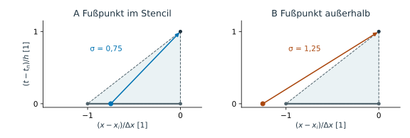

<a id="druck-upwind"></a>

Dieselbe Grenze lässt sich als Verstärkungsfaktor lesen. Für die periodische Mode $u_j=e^{\mathrm i j\theta}$ ist $G=1-\sigma+\sigma e^{-\mathrm i\theta}$. Damit gilt $|G|^2=1-4\sigma(1-\sigma)\sin^2(\theta/2)$. Für $0\le\sigma\le1$ wächst keine Mode. Für $\sigma>1$ wächst jede Mode mit $\sin(\theta/2)\ne0$. Die alternierende Mode hat bei $\sigma=1{,}25$ den Faktor $-1{,}5$. Dieses Argument bezieht sich auf den gezeigten expliziten Upwind-Schritt. [Clawpack, Advektion und Charakteristiken][t1adv]

<!-- Buchseite -->

### Transport und Diffusion in derselben Zelle

Ein Stoff kann zugleich mit dem Wasser fließen und sich durch Dispersion verteilen. Für konstantes $a>0$ und $\kappa>0$ lautet das einfache Modell $u_t+a u_x=\kappa u_{xx}$. Eine explizite Kombination aus Upwind-Fluss und zentraler Diffusion liefert
$$ U_j^{n+1}=(C+r)U_{j-1}^n+(1-C-2r)U_j^n+rU_{j+1}^n,\qquad
 C=ah/\Delta x,\quad r=\kappa h/\Delta x^2.$$
Beide Beiträge sind konservativ. Damit der neue Zellwert eine konvexe Kombination bleibt, müssen sie sich jedoch das gleiche Schrittbudget teilen. Es gilt $C+2r\le1$. Getrennte Prüfungen von $C\le1$ und $r\le1/2$ reichen hier nicht aus.

Setzen wir $a=0{,}2\,\mathrm{m/s}$, $\kappa=0{,}002\,\mathrm{m^2/s}$, $\Delta x=0{,}1\,\mathrm m$ und $h=0{,}2\,\mathrm s$. Dann ist $C=0{,}4,\ r=0{,}04$, und das Gewicht der mittleren Zelle beträgt $0{,}52$. Bei halbiertem Gitterabstand und gleicher Zeitstufe steigt $C+2r$ auf $1{,}12$. Eine einzelne positive Konzentrationsspitze zwischen zwei Nullzellen bekommt nun ein negatives Zentralgewicht. Die Gesamtmasse kann dabei weiterhin genau stimmen.

Die Zell-Péclet-Zahl $a\Delta x/\kappa$ beträgt im ersten Versuch zehn. Bei einer groben, rein zentrierten stationären Raumapproximation können für Werte über zwei Nachbarkoeffizienten ihr Vorzeichen wechseln. Upwind reagiert robuster, bringt aber numerische Verbreiterung ein. Eine IMEX-Variante behandelt die Diffusion implizit und die Advektion explizit. Sie löst in jedem Schritt ein gekoppeltes Diffusionssystem, während die explizite Transportgrenze wirksam bleibt. Für C19R sind daher Durchbruchszeit, Referenz-Konzentration und räumliche Frontbreite aussagekräftiger als die Schrittzahl allein. [Projektstudie C19R][t1proj15]

<!-- Buchseite -->

## 7.5 Finite Elemente und die schwache Wärmebilanz

[Grundlagen · Schwache Ableitung und partielle Integration](#g-schwach)

Ein unregelmäßiger Körper lässt sich häufig einfacher aus Elementen als aus einem regelmäßigen Differenzenstern zusammensetzen. Wir prüfen die Wärmebilanz des Stabs gegen eine Testfunktion $v(x)$. Sei $\theta=T-T_a$ die Temperaturdifferenz zur Umgebung, $G$ ein Wärmeleitwert am rechten Ende, das linke Ende isoliert und $s$ eine verteilte Leistung pro Länge. Multiplizieren der Wärmegleichung mit $v$ und partielle Integration ergeben
$$
 \int_0^L \rho c_p A\,v\dot\theta\,dx+
 \int_0^L kA\,v'\theta'\,dx+
 G v(L)\theta(L)=\int_0^L v s\,dx .
$$
Der Randterm trägt das Vorzeichen der Wärmeabgabe. Die Formulierung benötigt nur erste Raumableitungen der Ansatz- und Testfunktionen. Wählen wir $\theta_h=\sum_j U_j\phi_j$ mit stückweise linearen Hutfunktionen und testen nacheinander mit jedem $\phi_i$, entsteht $M\dot U+KU=b$.

<a id="revision-k07-01"></a>

In der Zellkoordinate $s=x/\ell$ lauten die linke und rechte Hutfunktion $1-s$ und $s$. Der erste Kopplungseintrag enthält $\ell\int_0^1(1-s)s\,ds=\ell(1/2-1/3)=\ell/6$. Rechnen Sie die linke Diagonale selbst nach. Das Quadrat der linken Hutfunktion integriert sich zu $\ell/3$. Multiplikation mit $\rho c_p A$ ergibt in beiden Fällen eine Wärmekapazität in $\mathrm{J/K}$.

Für eine Zelle der Länge $\ell$ lauten die beiden lokalen Matrizen
$$
 M_e=\frac{\rho c_p A\ell}{6}\begin{pmatrix}2&1\\1&2\end{pmatrix},\qquad
 K_e=\frac{kA}{\ell}\begin{pmatrix}1&-1\\-1&1\end{pmatrix}.
$$
Die Zahlen zwei und eins in $M_e$ stammen aus den Integralen der Produkte der beiden linearen Basisfunktionen. Benachbarte Elemente addieren ihre Beiträge an gemeinsamen Knoten. Der Leitwert $G$ ergänzt auf dem rechten Rand die Diagonale von $K$. Für eine konstante Temperatur ergeben die Zeilensummen der reinen Leitmatrix null. Die Summe aller Einträge von $M_e$ ist die Wärmekapazität des Elements. Beide Identitäten eignen sich als Implementierungstest. [Schwache Form der Wärmegleichung][t1fem]

Finite Differenzen sind besonders direkt auf einem regelmäßigen glatten Gitter. Finite Volumen bieten eine explizite Flussbilanz für Zellmittel. Finite Elemente verbinden Geometrie, Material und Randterme über lokale Integrale. Bei periodischen glatten Problemen kann eine Fourier-Basis viele räumliche Genauigkeitsordnungen gewinnen. Ein Knick verteilt dagegen Energie über viele Moden. In Kapitel 9 werden wir genau diesen Effekt beim Lernen eines Feldoperators messen.

<!-- Buchseite -->

<a id="v91-masselumping"></a>

### Warum auch ein expliziter FEM-Schritt eine lineare Lösung brauchen kann

Sei $M\dot T=b-KT$ die räumlich diskrete Wärmebilanz. Vorwärts-Euler kennt $T_n$ bereits. Für seine Steigung löst er $Md_n=b_n-KT_n$ und setzt $T_{n+1}=T_n+h d_n$. Das Zeitverfahren ist explizit. Die konsistente Massenmatrix koppelt dennoch die gesuchten Änderungsraten. Eine feste Faktorisierung lässt sich für viele Schritte wiederverwenden.

Bei **Mass-Lumping** durch Zeilensummen ersetzt man $M$ durch $M_L=\operatorname{diag}(M\mathbf1)$. Sind die Diagonaleinträge positiv, genügt pro Rate eine Division. Ein lineares Zweiknotenelement mit normiertem Speicherinhalt besitzt $M_e=\tfrac16\left(\begin{smallmatrix}2&1\\1&2\end{smallmatrix}\right)$. Für die rechte Seite $(1,0)^\mathsf T$ liefert die konsistente Massenmatrix $(4,-2)^\mathsf T$ und die Zeilensummenmatrix $(2,0)^\mathsf T$. Für einen konstanten Ratenvektor gilt $M_L\mathbf1=M\mathbf1$. Die örtliche Reaktion ändert sich. Deshalb sind Raumordnung, Stabilitätsgrenze und die Behandlung von Randknoten nach der Umstellung zu prüfen.

<a id="tab-k07-01"></a>

| Raumverfahren | Typische Stärke | Eigene Prüfaufgabe |
|---|---|---|
| Finite Differenzen | Kurze Stencils auf regelmäßigen Gittern | Randstencils und räumliche Ordnung prüfen. |
| Finite Volumen | Die gemeinsame Flussbilanz koppelt Nachbarzellen. | Flusswahl, Randbilanz und Begrenztheit prüfen. |
| Finite Elemente | Die schwache Form passt zu flexiblen Netzen und natürlichen Flussrändern. | Raumdiskretisierung, Massenmatrix und Randterme prüfen. |

[Mass-Lumping für finite Elemente, FEniCS-Rechenbeispiel](https://comet-fenics.readthedocs.io/en/latest/demo/tips_and_tricks/mass_lumping.html)

<!-- Buchseite -->

## 7.6 Rechenlabor und Aufgaben

Im Skript gibt die Funktion für den Wärmeversuch sowohl die exakte Kontinuumsantwort als auch die zeitexakte Lösung des gewählten Ortsgitters aus. Der folgende kurze Versuch isoliert die beiden Fehler auf 16 Intervallen. Der andere Programmzweig transportiert eine Konzentrationsfront zunächst 80 Schritte weit und vergleicht sie nach genau einem Umlauf auf dem periodischen Gitter.

~~~python
from linienmethode import heat
wert, gitterexakt, kontinuum, eigenwert, h, n = heat(16)
raum = abs(gitterexakt - kontinuum)
zeit = abs(wert - gitterexakt)
~~~

Mit Minmod, 40 Zellen und $C=0{,}5$ ergibt der Transportversuch nach einem Umlauf die Summe der Zellmittel 12 und die Gesamtvariation $1{,}944260$. Das anfängliche Rechteck hat Höhe eins und Gesamtvariation zwei. Eine schmalere Front und dieselbe Gesamtmasse sind unterschiedliche Prüfgrößen. Im Wärmeversuch ist die Halbierung der Schrittweite bei festem Ortsgitter eine zeitliche Verfeinerung. Die Verfeinerung des Ortsgitters bei unverändertem $r$ ändert dagegen beide Diskretisierungen zugleich.

**Aufgaben.** (1) Drei benachbarte Stabtemperaturen seien $10,16,14\,^\circ\mathrm C$. Berechnen Sie die neue mittlere Temperatur für $r=0{,}2$. (2) Halbieren Sie $\Delta x$ bei unverändertem $h$. Was geschieht mit dem einmaligen Profil $0,10,0$? (3) Ein Entwickler kopiert vor einem Zeitschritt jede Konzentration in den Nachbarn. Für welche Geschwindigkeit, Orientierung und Courant-Zahl ist das eine exakte periodische Advektionsrechnung? (4) Prüfen Sie für vier Intervalle, $\Delta x=1$ und $\alpha=1$ in normierten Einheiten die Sinusmode $m=2$ direkt am Dreipunktstencil.

**Musterlösungen.** (1) $16+0{,}2(10-32+14)=14{,}4\,^\circ\mathrm C$. (2) $r$ steigt auf $0{,}8$, also ergibt die mittlere Zelle $10-16=-6$. Das diskrete Minimum ist verletzt. Ein Viertel der alten Schrittweite stellt den ursprünglichen Faktor wieder her. (3) Für $a>0$, Kopie von $j$ nach $j+1$ und $C=1$. Bei negativem $a$ kehrt sich die Richtung um. Beim 2D-Gittergas des folgenden Kapitels geht jede Population genau einen solchen Gitterweg in ihrer eigenen Richtung. (4) Mit den Nullrändern lautet die Folge $(0,1,0,-1,0)$. Die drei inneren zweiten Differenzen sind $(-2,0,2)$. Der Eigenwert ist $-2$, wie $-4\sin^2(2\pi/8)$ verlangt.


<!-- Buchseite -->

### Gegenprobe · Wie eine Zellgrenze in der Gesamtbilanz verschwindet

Eine Stoffmenge verlässt links ihre Zelle und gelangt durch dieselbe Fläche in die rechte Zelle. Schreibt man $M_j$ für die Zellmasse und $F_{j+1/2}$ für den nach rechts positiven Massenstrom, dann gilt ohne Quelle $\dot M_j=F_{j-1/2}-F_{j+1/2}$. Beim Summieren taucht jeder innere Fluss einmal mit jedem Vorzeichen auf. Es bleibt $\sum_j\dot M_j=F_{1/2}-F_{N+1/2}$. Diese Rechnung erklärt, weshalb die Implementierung für jede innere Fläche einen gemeinsamen Fluss benötigt.

**Kontrollfrage.** Vier Zellen sind außen geschlossen. Die drei inneren Flüsse betragen $0{,}75$, $0{,}25$ und $0{,}50\,\mathrm{kg/s}$. Die vier Änderungsraten lauten $-0{,}75$, $0{,}50$, $-0{,}25$ und $0{,}50\,\mathrm{kg/s}$. Erhält allein die zweite Zelle $0{,}01\,\mathrm{kg/s}$ zusätzlich, zeigt das Gesamtinventar genau diesen Defekt. Die Funktion `finite_volumes()` in `beispiele/gegenproben.py` prüft beide Bilanzen. In Kapitel 15 kommt zur Randbilanz der tatsächlich eingebrachte Quellstrom hinzu.

<!-- Buchseite -->

<a id="cp2-voll-raum"></a>

## Wo sich beim Wirbeltransport die Gitterzellen koppeln

Für einen Strömungsvergleich brauchen beide Zeitintegratoren dieselben räumlichen Gleichungen. Wir wählen $h=1/256$, die skalierte Wirbelstärke $z=h\omega$ und die Stromfunktion $-\Delta_h\psi=z/h$. Aus $u=D_y\psi$ und $v=-D_x\psi$ folgen auf den inneren Knoten
$$z' = \mathrm{Re}^{-1}\Delta_h z-uD_xz-vD_yz.$$
Die Differenzen sind zentriert. Die Werte von $\psi$ auf dem Rand sind null. An der Deckelwand liefert die einseitige Taylorentwicklung mit vorgeschriebener Tangentialgeschwindigkeit die Thom-Bedingung $z_{\rm Wand}=-2\psi_{\rm innen}/h-2$ für $U=1$. An den ruhenden Wänden entfällt der letzte Term. Die beiden Geschwindigkeitskomponenten sind damit über eine elliptische Gleichung gekoppelt.

Ein Sinustransform löst das diskrete Poisson-Problem an jedem nötigen Zeitpunkt. Der klassische Kontrolllauf benutzt Adams–Bashforth zweiter Ordnung und einen Euler-Start. Seine Schrittweite entspricht zwei D2Q9-Takten. Ein zweiter Lauf verwendet vier Takte. Ihr Abstand schätzt die Empfindlichkeit gegenüber der Zeitschrittweite. Der Vergleich mit D2Q9 umfasst zusätzlich die kinetische Modellierung und die Wandbehandlung. Das Beispiel in [Kapitel 16](#cp2-voll-vertrag) weist beide Abstände aus.

<!-- Buchseite -->

<a id="kap07-schluss"></a>

## Schluss · Vom lokalen Fluss zum gekoppelten Zeitproblem

Die Wärmestabfrage führt von einem räumlichen Fluss zu gekoppelten Gleichungen für die inneren Knoten. Die Randbedingung setzt dabei fest, welche Größen vorgegeben sind und welche aus dem Modell folgen. Feinere Gitter erfassen kürzere räumliche Wellen. Bei der Wärmeleitung werden diese Moden besonders schnell gedämpft. Ein expliziter Integrator kann nur mit genügend kleinem Schritt dieselbe Richtung der Änderung zuverlässig wiedergeben.

Bei endlichen Volumen macht die Addition benachbarter Bilanzen sichtbar, welche Ströme sich im Inneren aufheben. Bei finiten Elementen führt die schwache Form zur Massen- und Steifigkeitsmatrix. Eine diagonale Massenmatrix verändert die Arbeit im expliziten Schritt. Sie ändert zugleich das räumliche Problem, dessen Genauigkeit wir prüfen. Der faire Vergleich der Rechnungen hält Rand, Geometrie und Beobachtung fest und variiert Raum und Zeit getrennt.

Das folgende Kapitel betrachtet eine andere räumliche Beschreibung. Es transportiert diskrete Geschwindigkeitsanteile und gewinnt die makroskopischen Größen aus ihren Summen. [Lattice-Boltzmann-Methode](#kap08-einstieg)

<a id="kap07-forschung"></a>

### Aktueller Stand der Forschung

Bei Strömungs- und Transportproblemen ist hohe Ordnung allein als Abnahmekriterium zu schwach. Eine räumliche Näherung soll auch unzulässige Werte wie negative Dichten vermeiden. Gassner diskutiert 2026 für hochordentliche Discontinuous-Galerkin-Verfahren Ansätze, die auf Teilzellen mit einer robusten Finite-Volumen-Rechnung gekoppelt werden. Die Erweiterung auf adaptive Gitter muss auch beim Übertragen zwischen feinen und groben Bereichen zulässige Werte erhalten. Für das Vorgehen im Buch ist das ein Beispiel dafür, Randfluss, Gittertransfer und den verwendeten Zeitschritt gemeinsam zu prüfen. Beim Brunnenversuch bleiben Gesamtmasse und Konzentration an der Messstelle getrennte Kontrollen. [Gassner, Tagungsbeitrag HYP 2026 zur Begrenzung auf Teilzellen](https://www.hyp2026.uni-stuttgart.de/wp-content/uploads/2026/05/HYP2026_Gassner.pdf)

[Zur Einleitung dieses Kapitels](#kap07-einstieg)

<!-- Buchseite -->

# Kapitel 8 · Mesoskopische Strömungssimulation mit der Lattice-Boltzmann-Methode

<a id="kap08-einstieg"></a>

## Einleitung · Wie entsteht aus neun Richtungen ein Strömungsfeld?

Wenn der Deckel einer flachen Wanne nach rechts läuft, bewegt er zunächst die Flüssigkeit in seiner Nähe. Die seitliche Wand lässt das Wasser dort nicht weiterfließen. Nach einiger Zeit schließt sich eine Rückströmung. Zur Prüfung hilft es, die Bewegung an mehreren Stellen im Inneren zu sehen. Wie kommt ein Gitterverfahren zu einem solchen Feld, wenn es an jedem Knoten zunächst nur neun Zahlen speichert?

Jede der Zahlen beschreibt Masse, die an diesem Knoten einer diskreten Geschwindigkeit zugeordnet ist. Wir gewinnen Dichte und Impuls aus den Summen dieser Anteile. Ein lokaler Kollisionsschritt ordnet die Populationen um. Danach wandert jede von ihnen zu ihrem Nachbarknoten. Mit diesem Ablauf können wir Schritt für Schritt verfolgen, an welcher Stelle eine Wand in die Rechnung eingreift und warum ein Fehler an der Wand das ganze Profil beeinflusst.

Für den Vergleich rechnen wir die Maße des Versuchs auf Gittereinheiten um. An Kanal und Kavität kontrollieren wir getrennt, ob die Randgeschwindigkeit stimmt, ob die Masse erhalten bleibt und ob die Bewegung im Innenraum zur Referenz passt.

[Zum Schluss dieses Kapitels](#kap08-schluss)

<!-- Buchseite -->

<a id="t1-k8"></a>

## 8.1 Was bewegt sich unter einem gleitenden Deckel?

Eine quadratische Wanne ist mit ruhender Flüssigkeit gefüllt. Ihr Deckel gleitet nach rechts. Zuerst folgt ihm eine dünne Schicht. Weiter unten setzt sich die Flüssigkeit verzögert in Bewegung. Da sie an der rechten Wand nicht weiterfließen kann, entsteht eine Rückströmung. Mit einem einzelnen Geschwindigkeitswert am Deckel lässt sich dieser Vorgang kaum prüfen. Wir werden die Wandgeschwindigkeit, das Profil im Inneren und die Massenbilanz unabhängig messen.

Drei Beschreibungen sind denkbar. In der Molekulardynamik trägt jedes Molekül seinen Ort und Impuls. Schon ein Kubikmillimeter Wasser enthält bei rund $1\,\mathrm{g/cm^3}$ etwa $3{,}3\cdot10^{19}$ Moleküle. Die Kontinuumsmechanik beschreibt stattdessen Felder wie Dichte und Geschwindigkeit. In einer inkompressiblen Projektionsmethode stellt eine globale Druckkorrektur die diskrete Divergenzfreiheit her. Dazwischen liegt die kinetische Beschreibung. Am selben Ort darf Masse gleichzeitig in verschiedene Richtungen unterwegs sein. Die **Verteilung** dieser Masse über Geschwindigkeiten ist die Unbekannte.

Sei $f(x,\xi,t)$ die Massendichte im Phasenraum. Dann sind $\rho=\int f\,d\xi$ und $\rho u=\int \xi f\,d\xi$. Diese Normierung bestimmt die Einheit von $f$. Teilt man lokal durch $\rho$, erhält man eine Wahrscheinlichkeitsdichte der Geschwindigkeit. Für eine äußere Beschleunigung $a$ lautet die kinetische Gleichung
$$ \partial_t f+\xi\cdot\nabla_x f+a\cdot\nabla_\xi f=\Omega(f).$$
Die linke Seite transportiert Masse im Orts- und Geschwindigkeitsraum. Rechts verteilen Stöße Masse zwischen Geschwindigkeiten um. Integriert man über $\xi$, ergibt sich unter geeigneter Abnahme im Unendlichen und bei massenerhaltenden Stößen die Kontinuitätsgleichung $\partial_t\rho+\nabla\cdot(\rho u)=0$. Die erste Geschwindigkeitsgewichtung führt zur Impulsbilanz. So entstehen makroskopische Gesetze als Momente der kinetischen Beschreibung.

Bei Bhatnagar, Gross und Krook wird der Stoßterm durch $\Omega=-(f-f^{\rm eq})/\tau_{\rm kin}$ modelliert. In einer räumlich homogenen Zelle bei festem Gleichgewicht klingt die Störung exponentiell ab. Das kontinuierliche Gleichgewicht in $D$ Dimensionen lautet $\rho(2\pi RT)^{-D/2}\exp[-|\xi-u|^2/(2RT)]$ mit spezifischer Gaskonstante $R$. Dichte und Geschwindigkeit im Gleichgewicht stammen aus dem aktuellen $f$. Der gesamte BGK-Operator ist dadurch im Allgemeinen nichtlinear. Im Folgenden verwenden wir ein kraftfreies isothermes Gittermodell, in dem kein eigenständiges Temperaturfeld fortgeschrieben wird. [BGK-Originalarbeit][t1bgk] · [LBM-Grundlagen][t1lbm]

<!-- Buchseite -->

## 8.2 Neun Zahlen pro Zelle

In zwei Raumdimensionen benutzt D2Q9 neun Geschwindigkeiten. Wir zählen gegen den Uhrzeigersinn. Kanal null ruht, 1 bis 4 bezeichnen Ost, Nord, West und Süd, 5 bis 8 Nordost, Nordwest, Südwest und Südost. Ein Gitterpfeil $e_i$ hat ganzzahlige Komponenten. Die zugehörige physikalische Geschwindigkeit ist $c_i=(\Delta x/\Delta t)e_i$. Ein diagonaler Kanal ist um den Faktor $\sqrt{2}$ schneller als ein achsenparalleler und erreicht so in derselben Zeit den diagonalen Nachbarn.

Die Gewichte sind $w_0=4/9$, $w_{1,\ldots,4}=1/9$ und $w_{5,\ldots,8}=1/36$. Ihre Summe ist eins. Gegensinnige Richtungen heben sich für das erste Moment auf. Für die quadratische $x$-Komponente liefern zwei Achsrichtungen und vier Diagonalen zusammen $2/9+4/36=1/3$. Für die Mischkomponente $xy$ heben sich die entgegengesetzten Vorzeichen auf. Daraus folgen $\sum_i w_i c_{i\alpha}c_{i\beta}=c_s^2\delta_{\alpha\beta}$ und $c_s^2=(\Delta x/\Delta t)^2/3$. Der Wert ist die Schallgeschwindigkeit **dieses Gittermodells** im Quadrat.


Symmetrie lässt alle ungeraden gewichteten Momente bis zur hier benötigten Ordnung verschwinden. In Gittereinheiten gilt außerdem $\sum w_i e_{ix}^4=1/3$ und $\sum w_i e_{ix}^2e_{iy}^2=1/9$. Das Verhältnis drei zu eins ist die vierte isotrope Momentenbedingung. Sie wird gebraucht, um den korrekten Impulsfluss aus dem diskreten Gleichgewicht zu erhalten. Ein nur optisch symmetrischer Geschwindigkeitsstern würde dafür noch nicht genügen. [Qian, d’Humières und Lallemand][t1d2q9]

<!-- Buchseite -->

<a id="kap08-schrittfolge"></a>

### Zwei Zahlen mit derselben Summe können verschiedene Strömungen erzeugen

Wir verwenden Gittereinheiten mit einer Geschwindigkeitseinheit pro Schritt und Gitterabstand. In einem Knoten seien die nach Osten und Westen gerichteten Anteile $f_1=0{,}12$ und $f_3=0{,}08$. Die übrigen Populationen haben zusammen die Dichte $0{,}8$ und liefern in der Horizontalen gleich viel Impuls nach links und rechts. Damit ist $\rho=1$. Der horizontale Impuls des Knotens beträgt
$$
\rho u_x = 1\cdot0{,}12-1\cdot0{,}08=0{,}04.
$$
Bei je $0{,}10$ in den beiden Richtungen wäre dieselbe Gesamtmasse gespeichert. Der horizontale Impuls wäre dann null. Ein Dichtemesswert allein reicht also zur Beschreibung des Fluidzustands nicht aus.

Beim Kollisionsschritt werden mehrere Populationen auf einmal verändert. Das diskrete Gleichgewicht wird gerade so aufgebaut, dass die Summe und das erste Geschwindigkeitsmoment zur alten Dichte und Geschwindigkeit passen. Am selben Knoten bleibt deshalb auch die Differenz der gesamten horizontalen Impulsanteile erhalten. Beim anschließenden Transport treffen dagegen Populationen aus verschiedenen Nachbarorten am Knoten ein. Die lokale Dichte und der lokale Impuls können sich ändern. Diese beiden Schritte erklären, wie aus lokalen Regeln ein räumliches Feld entsteht.

<!-- Buchseite -->

### Vom Gleichgewicht zum messbaren Impuls

Wir entwickeln die verschobene Maxwell-Verteilung bis zur zweiten Ordnung in $|u|/c_s$ und benutzen für die Geschwindigkeitsintegrale die D2Q9-Gewichte. Die Population $f_i$ trägt die Teilmassendichte der Richtung $i$. Ihr lokaler Gleichgewichtswert lautet
$$ f_i^{\rm eq}=w_i\rho\left[1+\frac{c_i\cdot u}{c_s^2}
 +\frac{(c_i\cdot u)^2}{2c_s^4}-\frac{u\cdot u}{2c_s^2}\right].$$
Die makroskopischen Größen folgen im kraftfreien Modell aus $\rho=\sum_i f_i$, $\rho u=\sum_i c_i f_i$. Zur Kontrolle summieren wir die vier Terme des Gleichgewichts. Der lineare Term verschwindet paarweise. Der quadratische Beitrag beträgt $\rho|u|^2/(2c_s^2)$ und hebt den letzten Term auf. Beim ersten Moment bleibt gerade $\rho u$ stehen. Für den Gleichgewichts-Impulsfluss liefern die Momente vierter Ordnung
$$
 \sum_i c_{i\alpha}c_{i\beta} f_i^{\rm eq}
    =\rho c_s^2\delta_{\alpha\beta}+\rho u_\alpha u_\beta .
$$
Der isotrope Teil gibt $p=c_s^2\rho$. Oft ist nur die Schwankung $p'=c_s^2(\rho-\rho_0)$ interessant. In einer klassischen inkompressiblen Rechnung wirkt der Druck als Lagrange-Multiplikator einer Zwangsbedingung. Die isotherme LBM lässt dagegen kleine Dichteschwankungen zu.

**Eine Zelle von Hand.** Für $\rho=1$, $u=(0{,}1,0)$ und $c_s^2=1/3$ in Gittereinheiten ergeben sich $f_E^{\rm eq}=1{,}33/9$ und $f_W^{\rm eq}=0{,}73/9$. Das Achsenpaar liefert also nur $0{,}60/9$ zum geforderten Impuls $0{,}1$. Die restlichen $0{,}03333\ldots$ kommen von den Diagonalen. Wer beim Berechnen von $u_x$ nur die Ost- und Westkanäle berücksichtigt, unterschätzt schon diese gleichförmige Strömung um ein Drittel.

<a id="auflage-k08-01"></a>

Druckstörungen können sich hier als Schallwellen ausbreiten. Für die Annäherung an inkompressible Strömung soll die Gitter-Mach-Zahl $\mathrm{Ma}=U/c_s$ klein sein. $\mathrm{Ma}<0{,}1$ ist ein gebräuchlicher Startwert für die Parameterwahl. Beim CP2-Deckel mit $U=0{,}1$ und $c_s=1/\sqrt3$ erhält man bereits $\mathrm{Ma}=0{,}173$ in Gittereinheiten. Bei gleicher Reynolds-Zahl lässt sich $U/c_s$ durch geeignete Gitter- und Zeitskalierung ändern. Eine einzige Mach-Grenze garantiert weder die Genauigkeit noch die Stabilität sämtlicher Randmodelle. Für eine typische schwach kompressible, glatte Niedrig-Mach-Strömung ist $\delta\rho/\rho_0$ von der Größenordnung $\mathrm{Ma}^2$. Ausmaß und örtliche Verteilung muss der Lauf selbst zeigen.

<!-- Buchseite -->

## 8.3 Kollision und Streaming haben verschiedene Bilanzen

An einem Knoten lesen wir die neun Populationen, bilden ihre Momente und relaxieren sie gegen das zugehörige Gleichgewicht. Wir schreiben $\tau_L$ für den dimensionslosen Relaxationsparameter des diskreten Schritts und $\omega=1/\tau_L$. Dann gilt
$$ f_i^*(x)=f_i(x)-\omega\bigl(f_i(x)-f_i^{\rm eq}(x)\bigr),\qquad
 f_i(x+c_i\Delta t,t+\Delta t)=f_i^*(x,t).$$
Die erste Gleichung benötigt Daten eines einzigen Knotens. Da die Gleichgewichtswerte dieselben ersten beiden Momente besitzen, sind $\sum_i(f_i^*-f_i)$ und $\sum_i c_i(f_i^*-f_i)$ dort exakt null, bis auf Rundung. Nichtgleichgewichtsanteile können dabei stark abnehmen. Bei $1<\omega<2$ wechseln sie während der Kollision sogar das Vorzeichen.

Die zweite Gleichung verschiebt gerichtete Werte. Ein Überschuss im Ostkanal erreicht nach einem Schritt die rechte Nachbarzelle. Die Masse der Ausgangszelle kann sinken, während ihre Nachbarzelle gewinnt. Auf einem periodischen Gitter ist die Verschiebung für jede Richtung eine Permutation, also bleiben Gesamtmasse und Gesamtimpuls erhalten. An einer Wand ändert der Impulsaustausch diese Bilanz. Um die reine Verschiebung zu prüfen, benutzt das Labor einen periodischen Block mit einer einzelnen gestörten Zelle.

Im Programm liest die Kollision aus dem alten Feld. Die Übergabetabelle nennt für jeden auslaufenden Kanal Zielzelle und Zielrichtung. Erst nach Fertigstellung aller Eingänge ersetzt das neue Feld den alten Puffer. Ein bloßes Tauschen zweier Zeiger führt die räumlichen Verschiebungen nicht aus. Spezialisierte Speicherlayouts können sie effizient darstellen. Wer das alte Feld ungeschützt während der Schleife überschreibt, transportiert manche Populationen noch im selben Schritt ein zweites Mal.

Für die diskreten Gittergeschwindigkeiten trifft die Transportcharakteristik den Nachbarknoten exakt. Eine zusätzliche räumliche Interpolation ist dadurch entbehrlich. Das gekoppelte BGK-Verfahren besitzt weiterhin Diskretisierungsfehler, akustische Moden, Stabilitäts- und Auflösungsgrenzen. Auf mehreren Prozessoren benötigen die Randknoten fremder Teilgebiete Nachbardaten. Günstig ist das feste Kommunikationsmuster. Ob eine konkrete Implementierung schneller ist, hängt unter anderem vom Speicherverkehr pro Knoten ab. [Projektkapitel LBM][t1proj8]

<!-- Buchseite -->

### Eine Population im Speicher verfolgen

Liegt die aktuelle Zelle in der letzten Spalte, darf ihr Ostkanal in der geschlossenen Kavität nicht an der linken Wand auftauchen. Wir berechnen deshalb für jeden gerichteten Link nur einmal, wohin er führt. Im Inneren lautet sein Eintrag „Nachbar, gleiche Richtung, Korrektur null“. Auf einem reflektierenden Link lautet er „eigene Zelle, Gegenrichtung, Wandkorrektur“. Ein fehlender Eintrag kennzeichnet eine am horizontalen Zou–He-Rand anschließend zu rekonstruierende Population.

Der vollständige Fortschritt eines Schritts steht unten als Methode der Laborklasse. Die Reihenfolge erklärt, weshalb die zurückgegebenen Geschwindigkeiten tatsächlich zur angeforderten Iteration gehören. Die Methode zur Feldausgabe berechnet die Momente aus dem aktuellen Puffer. Die Ausgabe setzt keinen Deckelwert nachträglich in ein bereits berechnetes Geschwindigkeitsfeld ein.

~~~python
def step(self):
    new = [[0.]*9 for _ in self.f]
    for f, links in zip(self.f, self.links):
        for val, link in zip(collide(f, self.omega), links):
            if link is not None:
                j, k, correction = link
                new[j][k] = val + correction
    if self.boundary == "zouhe":
        for f in new[:self.nx]:
            horizontal_wall(f, False, 0.)
        for f in new[-self.nx:]:
            horizontal_wall(f, True, self.lid)
    self.f = new
~~~

Eine globale Massenprobe auf dem Torus kann versehentlich richtig ausfallen, wenn ein geschlossen gedachter Behälter durch zyklische Array-Verschiebung periodisch geworden ist. Deshalb erhält die Wand einen eigenen Linktest. Der Ostkanal des letzten Knotens muss im Westkanal desselben Knotens ankommen. Der periodische Kontrollfall muss ihn dagegen im Ostkanal der ersten Spalte **derselben** Gitterzeile abliefern. Dieser einzelne Versuch trennt die beiden geometrischen Verträge, bevor die Strömung ausgewertet wird.

<!-- Buchseite -->

### Warum die Viskosität eine halbe Zeiteinheit enthält

<a id="revision-k08-01"></a>

Folgen wir einer Population auf ihrer geraden Teilchenspur. Mit $F(s)=f_i(t+s,x+s c_i)$ ist $F'(0)=(\partial_t+c_i\cdot\nabla)f_i=D_i f_i$. Noch einmal entlang derselben Spur ableiten ergibt bei konstantem $c_i$ und glattem Feld
$$F''(0)=\partial_{tt} f_i+2(c_i\cdot\nabla)\partial_t f_i+(c_i\cdot\nabla)^2 f_i.$$
Die gewöhnliche Taylorformel aus G.3 liefert $F(\Delta t)-F(0)=\Delta t D_i f_i+\tfrac12\Delta t^2D_i^2 f_i+O(\Delta t^3)$. Genau dieser zweite Term tritt im folgenden Abgleich mit der Relaxation wieder auf.

Die Beziehung zwischen Modellparameter und Stoffwert folgt aus einer Taylor-Entwicklung des **diskreten** Transports. In Gittereinheiten sei $D_i=\partial_t+c_i\cdot\nabla$. Wir entwickeln den linken Unterschied der Transportgleichung als $D_i f_i+\tfrac12D_i^2 f_i+\cdots$. Um in der Chapman–Enskog-Rechnung Ordnungen zu sammeln, verwenden wir einen dimensionslosen Skalenparameter $\epsilon$, $f_i=f_i^{(0)}+\epsilon f_i^{(1)}+\cdots$, $\partial_t=\epsilon\partial_{t_1}+\epsilon^2\partial_{t_2}$ und $\nabla=\epsilon\nabla_1$. $\epsilon$ misst die Trennung von kinetischer und makroskopischer Skala. Eine Zeiteinheit in Sekunden kann diese Rolle allein nicht spielen.

In nullter Ordnung ist $f_i^{(0)}=f_i^{\rm eq}$. In erster Ordnung gilt $f_i^{(1)}=-\tau_LD_{1i}f_i^{(0)}$, $D_{1i}=\partial_{t_1}+c_i\cdot\nabla_1$. Summation und Impulsgewichtung liefern die Kontinuitäts- und Euler-Bilanz aus den Gleichgewichtsmomenten. Die nächste Ordnung enthält
$$
 \partial_{t_2} f_i^{(0)}+D_{1i} f_i^{(1)}
 +\tfrac12D_{1i}^2 f_i^{(0)}=-f_i^{(2)}/\tau_L .
$$
Einsetzen der ersten Ordnung fasst die beiden letzten Terme links zu $(1-1/(2\tau_L))D_{1i}f_i^{(1)}$ zusammen. Im Impulsmoment ergibt sich mit der Isotropie des Gitters in der Scherkomponente ein Fluss proportional zum symmetrischen Geschwindigkeitsgradienten. Aus $\tau_L(1-1/(2\tau_L))$ stammt der Faktor $\tau_L-1/2$. Mit den Längs- und Zeitmaßen folgt die kinematische Viskosität
$$
 \nu_L=\tfrac13(\tau_L-\tfrac12),\qquad
 \nu=\frac{\Delta x^2}{3\Delta t}(\tau_L-\tfrac12)
     =c_s^2(\tau_L\Delta t-\Delta t/2).
$$
Die dimensionale Relaxationsgröße im diskreten Schema ist $\tau_L\Delta t$. Die effektive makroskopische Viskosität enthält die Taylor-Korrektur durch den diskreten Transport.

Bei kleiner Mach-Zahl, aufgelöster Skalentrennung, geeignet vorbereiteter Dichte und glatten Feldern ergeben sich in führender inkompressibler Ordnung $\nabla\cdot u=0$ und $\partial_tu+(u\cdot\nabla)u=-\nabla p'/\rho_0+\nu\Delta u$. Das ist eine Grenzaussage. $\tau_L>1/2$ sichert eine positive Viskosität. Stabilität eines beliebigen Gitters, einer starken Störung oder eines konkreten Randes folgt daraus nicht. [Herleitung und Anwendungsgrenzen][t1lbm]

<!-- Buchseite -->

### Die Viskosität mit einer Scherwelle messen

Ein lineares stationäres Couette-Profil kontrolliert Haftung und Richtung des Wandimpulses. Seine Form $u_x/U=y/H$ ist jedoch für jede positive konstante Viskosität dieselbe. Um die Abbildung von $\tau_L$ auf $\nu_L$ zu prüfen, brauchen wir eine zweite Messung, die von der Viskosität abhängt.

Auf einem periodischen Streifen beginnen wir mit $u_x(y,0)=A\sin(ky)$ und $u_y=0$, $k=2\pi/N$ in Gittereinheiten. Die nichtlineare Advektion verschwindet für dieses Profil. Die Kontinuumsgleichung reduziert sich auf Diffusion, also gilt $A(t)=A(0)e^{-\nu_L k^2t}$. Aus zwei späten Fourieramplituden erhalten wir den Messwert
$$ \nu_{\rm mess}=-\frac{\log[A(t_2)/A(t_1)]}{k^2(t_2-t_1)}.$$
Ein früher kinetischer Einschwingvorgang wird durch die Wahl von $t_1=N^2/8$ und $t_2=N^2/4$ weitgehend ausgeblendet. Beide Beobachtungszeiten entsprechen bei Gitterverfeinerung denselben normierten Diffusionszeiten.

Die Prüfung kommt zusätzlich an das **diskrete** Modell heran. Man fasse die horizontalen Impulse nach vertikaler Bewegung in drei Gruppen zusammen. In Gittereinheiten bilden $f_1-f_3$, $f_5-f_6$ und $f_8-f_7$ die ruhende, nord- und südwärts laufende Gruppe. Im Gleichgewicht tragen sie die Anteile $(2/3,1/6,1/6)$ des Gesamtimpulses. Für eine einzelne Fouriermode führt Streaming lediglich zu den Phasen $1,e^{-ik},e^{ik}$. Das Labor aktualisiert diese drei komplexen Zahlen unabhängig vom Ortsgitter und prüft die gemessene Amplitude gegen ihre Summe.

Bei $\tau_L=0{,}8$ beträgt die Sollviskosität $0{,}1$. Auf 16 Punkten messen wir $0{,}10083287$, auf 32 Punkten $0{,}10020626$. Der relative Unterschied fällt von $0{,}833\,\%$ auf $0{,}206\,\%$. So lassen sich ein Fehler des Transportcodes und die endliche hydrodynamische Gitterapproximation anhand zweier verschiedener Referenzen unterscheiden.

<!-- Buchseite -->

<a id="v91-lbmeinheiten"></a>

### Wasser im Labor auf das D2Q9-Gitter bringen

[Grundlagen · Skalierung und Rückrechnung](#g-skalen)

Ein Wasserbeispiel verwendet als gerundeten Lehrwert $\nu=10^{-6}\,\mathrm{m^2/s}$. Die Kavität sei $H=10\,\mathrm{mm}$ hoch. Gesucht ist eine Skalierung für $\mathrm{Re}=100$.

1. **Länge und Geschwindigkeit festlegen.** Aus $\mathrm{Re}=UH/\nu$ folgt $U=0{,}01\,\mathrm{m/s}$. Bei 100 Intervallen über $H$ ist $\Delta x=10^{-4}\,\mathrm m$. Die effektive Zahl der Intervalle hängt von der Lage der Wand im verwendeten Randmodell ab.
2. **Gittertempo wählen.** Wir setzen $U_L=0{,}05$ Gitterabstände pro Schritt. Mit $U_L=U\Delta t/\Delta x$ erhält man $\Delta t=5\cdot10^{-4}\,\mathrm s$. Die Schallgeschwindigkeit des D2Q9-Gleichgewichts beträgt $c_{s,L}=1/\sqrt3$. Das mit der Deckelgeschwindigkeit gebildete Verhältnis ist $\mathrm{Ma}=U_L/c_{s,L}\approx0{,}0866$.
3. **Viskosität und Relaxation umrechnen.** $\nu_L=\nu\Delta t/\Delta x^2=0{,}05$ ergibt $\tau_L=\tfrac12+3\nu_L=0{,}65$ in Zeitschritten. Gegenprobe in Gittereinheiten ist $U_L\cdot100/\nu_L=100$.

Die D2Q9-BGK-Rechnung ist für diesen Einsatz schwach kompressibel. In der Niedrig-Mach-Skalierung gut vorbereiteter Strömung liegen relative Dichteänderungen durch den dynamischen Druck in der Größenordnung $\mathrm{Ma}^2$. Ein Zielwert nahe oder unter $0{,}1$ für die größte relevante lokale Geschwindigkeit ist eine praktische Orientierung. Randmodell, Relaxation, Auflösung und die zulässige Dichteänderung entscheiden über den konkreten Lauf.

Für die Rückrechnung erhält man $u=u_L\,\Delta x/\Delta t$. Mit dimensionsloser Referenzdichte eins und physikalischer Dichte $\rho_\mathrm{ref}$ folgt für einen Druckunterschied
$$
p-p_\mathrm{ref}=\rho_\mathrm{ref}(\Delta x/\Delta t)^2
 c_{s,L}^{\,2}(\rho_L-1).
$$
Die Labordiagnose misst die größte Geschwindigkeit und die Dichteabweichung im Feld. [LBM-Skalierung und schwache Kompressibilität](https://publications.rwth-aachen.de/record/688936/files/688936.pdf)

<!-- Buchseite -->

## 8.4 Was der Wandknoten nach dem Streaming wissen kann

Eine Haftwand schreibt die makroskopische Geschwindigkeit vor. Gespeichert sind aber Populationen. Zwei gebräuchliche Ränder liegen sogar an verschiedenen geometrischen Stellen. Bei **Halfway-Bounce-Back** liegt die Wand in der Mitte eines Gitterlinks. Für einen zur Wand auslaufenden Kanal $i$ wird dessen postkollisioneller Wert zur entgegengesetzten Richtung am selben Fluidknoten zurückgeschrieben. In Gittereinheiten mit Referenzdichte $\rho_0$ lautet die hier verwendete bewegte Variante
$$
 f_{\bar i}(x,t+1)=f_i^*(x,t)-\frac{2w_i\rho_0}{c_s^2}e_i\cdot u_w .
$$
Für eine ruhende Wand ist die Korrektur null. Bei einer nach rechts laufenden oberen Wand wird der nach links zurückkehrende Anteil eines Nordost-Links kleiner. Sein Partner liefert netto positiven Tangentialimpuls. Bei dieser Variante wird die Haftgeschwindigkeit auf dem halben Link vorgeschrieben; der letzte Fluidknoten kann sich von ihr unterscheiden.

Bei **Zou–He** liegt der obere Geschwindigkeitsrand auf einer Knotenreihe. Nach dem Streaming fehlen die Eingänge $f_4,f_7,f_8$. Für $u_y=0$, $u_x=U$ muss ihre Summe $f_2+f_5+f_6$ betragen. Daraus folgt die Dichte, bevor eine der drei Zahlen geraten werden müsste. Die zusätzliche Schließung des normalen Nichtgleichgewichtsanteils liefert $f_4=f_2$. Die restliche Summe und die geforderte $x$-Impulsdichte liefern in Gittereinheiten
$$
\begin{aligned}
 \rho&=f_0+f_1+f_3+2(f_2+f_5+f_6),\\
 f_7&=f_5+(f_1-f_3)/2-\rho U/2,\qquad
 f_8=f_6+(f_3-f_1)/2+\rho U/2 .
\end{aligned}
$$
Durch Einsetzen lässt sich nachprüfen, dass $\sum_i e_{iy}f_i=0$ und $\sum_i e_{ix}f_i=\rho U$ gelten. Diese Rekonstruktion liest die **bereits eingeströmten bekannten** Werte am neuen Zeitpunkt. Ein Austauschen dreier Kanäle vor einem anschließenden zyklischen Array-Shift setzt andere Daten an andere Orte. [Zou und He][t1zou]

Im Quadrat des Labors liegen die Seitenwände auf halben Links. Sind Boden und Deckel ebenfalls Halfway-Ränder, genügen $N$ Reihen für die lichte Höhe $N$. Für zwei horizontale Zou–He-Ränder braucht dieselbe Höhe $N+1$ Reihen. Das Programm behandelt einen über die horizontale Grenze laufenden Ecklink zuerst nach der horizontalen Regel. Eine einzelne mathematische Ecke, an der bewegter Deckel und ruhende Seite zusammentreffen, hat keinen einheitlichen Tangentialwert. Die vereinbarte Eckbehandlung gehört deshalb zur Reproduzierbarkeit eines Profils.

<!-- Buchseite -->

## 8.5 Rechenlabor · Eine Wand prüfen, dann den Wirbel

Im Prüfkanal läuft nur die obere Platte. Die Seitenrichtung ist periodisch, am Boden haftet das Fluid. Für die stationäre Couette-Strömung gilt aus $\nu u_{yy}=0$ und den beiden Wandgeschwindigkeiten das lineare Profil $u_x/U=y/H$. Der Versuch verwendet acht Gitterintervalle, $U=0{,}04$ und $\nu_L=0{,}1$. Nach 704 Schritten aus der Ruhe ist das maximale Profilresiduum $1{,}12\cdot10^{-5}$ in Einheiten des Deckeltempos. Für das eingeschaltete Kontinuumsproblem tragen die verbliebenen Sinusmoden zusammen höchstens $2e^{-a}/[\pi(1-e^{-3a})]$ mit $a=\pi^2\nu_L t/H^2$ bei. Im Test addiert sich diese Restschwingung zum vorgegebenen räumlichen Fehlerbudget von $10^{-3}$.

Für die geschlossene Kavität wählen wir $N=48$, $U=0{,}05$ und $\mathrm{Re}=UL/\nu=100$. Es folgen $\nu_L=0{,}024$, $\tau_L=0{,}572$ und $\mathrm{Ma}\approx0{,}087$. Der Prüflauf protokolliert den vollen Zustand **nach** dem 500. Schritt. Der Wert im geometrischen Zentrum ist das symmetrische Mittel der benachbarten Knoten, falls das Zentrum zwischen ihnen liegt.


~~~python
from lbm_d2q9 import cavity, center
box, felder = cavity(n=48, steps=500, U=.05, Re=100.,
                     boundary="zouhe")
u_mitte = center(box, felder[500])
~~~

<!-- Buchseite -->

## 8.6 Methodenvergleich, CP2 und Aufgaben

<a id="tab-k08-01"></a>

| Frage | Inkompressible Projektionsmethode | Isothermes D2Q9-BGK |
|---|---|---|
| Wie entsteht der Druck? | Eine globale elliptische Gleichung stellt die diskrete Divergenzbedingung her. Gut geeignete Mehrgitterlöser können annähernd lineare Arbeit erreichen. | Der Druck folgt lokal aus der Dichte. Akustische Störungen breiten sich mit endlicher Gittergeschwindigkeit aus. |
| Was kostet ein Schritt? | Flüsse, Drucklösung, Randbehandlung und Kommunikation hängen vom Raumverfahren ab. | Lokale Kollision, Nachbartransport, Wandrekonstruktion und Speicherverkehr bestimmen die Kosten. |
| Wo liegen die Grenzen? | Transportdiskretisierung, Lösertoleranz, Geometriemodell und Netz bestimmen den Fehler. | Mach-Zahl, Relaxation, Auflösung und Lage gekrümmter oder bewegter Wände sind gemeinsam zu prüfen. |

Im eigenen Lauf liegt $u_x/U$ im Zentrum für Halfway bei $-0{,}06694$, für Zou–He bei $-0{,}06809$. Gegenüber Schritt 475 verändert sich das gesamte Geschwindigkeitsfeld relativ in der diskreten $L^2$-Norm noch um $5{,}93\,\%$ bzw. $5{,}03\,\%$. Ein stabiler stationärer Wirbel ist damit nach 500 Schritten nicht belegt. Die relative Änderung der Gesamtmasse beträgt beim geschlossenen Halfway-Gitter $4{,}62\cdot10^{-14}$ und bei der knotengestützten Rekonstruktion $9{,}97\cdot10^{-6}$. Das Labor prüft bei letzterer insbesondere die tatsächlich rekonstruierten Randmomente. Für eine stationäre Referenz wären zusätzlich ein zeitliches Konvergenzkriterium und ein Gittervergleich erforderlich.

Der archivierte CP2-Lauf verwendet Vollweg-Reflexion an ruhenden Wänden und schreibt am Deckel Gleichgewichtspopulationen vor. Der kurze Projekt-Lehrversuch mit $17\times17$ und 16 Iterationen misst einen Anlauf. Die CP2-Originalvorgabe von $257\times257$ und 350 000 Iterationen ist ein anderer Vergleich. Randverfahren, Geometrie, Reynolds-Zahl und Beobachtungszeit gehören zu den Daten, die ein neuronaler Operator in Kapitel 9 für einen aussagekräftigen Vergleich ebenfalls benötigt. [Projektstand CP2][t1proj16]

**Aufgaben.** (1) Welche Geschwindigkeit hat Kanal 5 bei $\Delta x=1\,\mathrm{mm}$, $\Delta t=1\,\mathrm{ms}$? (2) Am oberen Rand seien vor der Rekonstruktion alle bekannten Werte die Ruhegewichte bei Dichte eins. Berechnen Sie $f_7,f_8$ für $U=0{,}02$. (3) Halbieren Sie bei fester physikalischer Viskosität und festem $\tau_L$ die Gitterweite. Wie ändert sich $\Delta t$?

**Musterlösungen.** (1) Die Komponenten sind beide $1\,\mathrm{m/s}$, der Betrag $\sqrt2\,\mathrm{m/s}$. (2) $\rho=1$, $f_7=1/36-0{,}01$, $f_8=1/36+0{,}01$. Ihre Differenz liefert den angeforderten Tangentialimpuls. (3) Wegen $\nu\propto\Delta x^2/\Delta t$ wird die Zeitstufe geviertelt. Der exakte Gittertransport hebt diese Skalierungsbeziehung nicht auf.

<!-- Buchseite -->

<a id="atlas-strom"></a>

## 8.7 · Wo im Wirbel eine gelernte Korrektur fehlt

Eine Deckelbewegung schleppt Flüssigkeit mit. Auch dort, wo die Geschwindigkeit klein ist, verrät die Richtung der Stromlinien die Umwälzung. Zeichnen Sie vor dem Blick auf das Fehlerfeld ein, wo ein Surrogat Schwierigkeiten haben könnte. Liegt der größte Fehler in der Wirbelmitte oder an einer Wand?

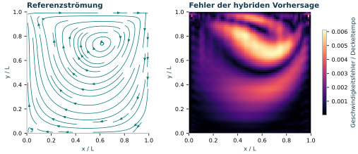

Links ist das Geschwindigkeitsfeld der D2Q9-Rechnung dargestellt. Rechts steht für dieselben Knoten der Betrag der Differenz zwischen Referenz und affinem Grundfeld mit Fourier-Korrektur und Projektion. Beide Geschwindigkeiten sind durch das nominelle Deckeltempo geteilt. Im dargestellten Prüfbeispiel beträgt der relative Fehler über das ganze Feld rund 0,93 Prozent. Die Farbkarte macht sichtbar, in welchen Regionen ein lokaler Sensor das Modell strenger prüfen würde. Der Vergleich mit den Profilen von Ghia und der Test mit geändertem Deckelantrieb folgen in Kapitel 16.

<!-- Buchseite -->

<a id="cp2-voll-takte"></a>

## Vom Gittertakt zur physikalischen Vergleichszeit

Der Deckel fährt im ARGESIM-Fall pro Gittertakt ein Zehntel Gitterweite. Für die Seitenlänge braucht er auf 257 Knoten daher 2560 Takte. Ein Messwert nach 256 Takten beschreibt $tU/L=0{,}1$. Der verlangte Endzustand nach 350 000 Takten gehört zu $tU/L=136{,}71875$. Diese Umrechnung legt auch fest, bis wann ein QSS-Kalender laufen und wann ein trainierter Operator sein Feld ausgeben muss.

Lässt sich dieselbe Rechenvorschrift kontinuierlich lesen? Bezeichne $G(f)$ die D2Q9-Abbildung aus Kollision und Transport aller Populationen. Für die Hilfsgleichung $\dot f=(G(f)-f)/\Delta t$ ergibt ein Euler-Schritt der Länge $\Delta t$ genau $G(f)$. Die kontinuierliche Lösung dieser Hilfsgleichung hat im Allgemeinen andere Zwischen- und Endwerte. Das Rechenlabor führt diese Gegenprobe auf allen 594 441 Populationen für einen, zwei und vier Gittertakte aus. Wer dieselbe makroskopische Strömung mit Wirbelvariablen berechnet, vergleicht deshalb zwei Diskretisierungen anhand von Geschwindigkeit und Mittellinien.

Die [Vollgitterrechnung](#cp2-voll-vertrag) zeigt den Betrag $|u|/U$ im Endzustand, den Vergleich des seriellen mit dem parallelen Lauf und die regionale Verteilung der Abweichung zur Wirbelrechnung. Im Populationsversuch stimmen vier Euler-Takte bis auf $2{,}6\cdot 10^{-15}U$ mit der direkten Gitterabbildung überein. Die eng integrierte Hilfsgleichung weicht schon nach einem Takt im inneren Feld um 13,12 % ab.

<!-- Buchseite -->

<a id="kap08-schluss"></a>

## Schluss · Warum Wandwerte und Innenfeld getrennte Belege sind

Die neun Populationen enthalten unterschiedliche Geschwindigkeiten am selben Ort. Ihre Summe liefert die Dichte. Das erste Moment liefert den Impuls. Die kraftfreie BGK-Kollision erhält diese beiden Größen lokal. Beim Streaming bewegen sich die Populationen auf dem Gitter. Die Wandregel füllt die fehlenden Eingänge. Am bewegten Deckel überträgt sie dadurch auch Impuls an die Flüssigkeit. Ein vorgegebener Wert an der Wand kann deshalb korrekt sein, ohne dass das darunter entstehende Profil stimmt.

Das Kanalbeispiel liefert eine Vergleichsgröße für die Wandbehandlung. Die Kavität ergänzt sie um ein räumliches Innenfeld. Für beide legen wir Geschwindigkeit, Viskosität und Relaxationszeit über eine konsistente Skalierung fest. Bei der Interpretation der Ergebnisse müssen Reynolds-Zahl, Mach-Zahl, Gitter und Randregel zusammen genannt werden.

Die Frage, ob man ein Feld schneller vorhersagen kann, führt nun zu lernenden Operatoren. Für deren Prüfung gilt weiterhin, dass das Modell an unabhängigen Messgrößen im Inneren beurteilt wird. [Scientific Machine Learning](#kap09-einstieg)

<a id="kap08-forschung"></a>

### Aktueller Stand der Forschung

Eine systematische Übersicht von 2026 ordnet kompressible Lattice-Boltzmann-Verfahren nach den untersuchten Strömungsbereichen und Modellentscheidungen. Sie betrachtet unter anderem Kollisionsmodelle und die angegebenen Mach- und Reynolds-Zahlen. Für die isotherme D2Q9-Kavität im Buch bleibt die kleine Mach-Zahl eine Voraussetzung der hier verwendeten Näherung. Eine sinnvolle Anschlussstudie würde zwei Randbehandlungen bei abgestimmter Reynolds-Zahl und festen Beobachtungszeiten untersuchen. Erst eine Gitter- und Mach-Zahl-Variation kann zeigen, welcher Teil einer Profilabweichung vom Rand und welcher von der schwach kompressiblen Modellierung stammt. [A systematic review of Lattice Boltzmann techniques for compressible flow modelling (2026)](https://doi.org/10.1080/19942060.2026.2647567)

Die zitierte Arbeit bündelt publizierte Ergebnisse aus kompressiblen Strömungen. Die Referenzen für den isothermen Anlauf im vorliegenden Kapitel sind die ausgewiesenen D2Q9-Gitterläufe und die separat herangezogenen Profilwerte.


[Zur Einleitung dieses Kapitels](#kap08-einstieg)

<!-- Buchseite -->

# Kapitel 9 · Scientific Machine Learning und Operator Learning

<a id="kap09-einstieg"></a>

## Einleitung · Was muss ein lernender Feldoperator von einer Saite wissen?

Eine Saite wird zuerst in der Mitte gezupft. Das anschließende Profil lässt sich berechnen oder aus vielen früheren Beobachtungen lernen. Dann verschiebt sich der Zupfpunkt. Die Anfangsform ist anders, die Wellengleichung gilt weiterhin. Welche Information braucht ein trainiertes Modell, damit es die verschobene Welle am richtigen Ort und zur richtigen Zeit vorhersagt?

Wir unterscheiden das Lernen einer einzelnen Lösung von der Aufgabe, den ganzen Zusammenhang zwischen Anfangsfeld und Ausgabefeld zu erfassen. An einer einzelnen Sinusmode sehen wir zunächst, was die Diskretisierung einer Welle mit Randbedingungen bedeutet. Dann verfolgen wir, wie Fourier-Gewichte mehrere Moden verbinden und was bei einer anderen Gitterweite überprüft werden muss.

Der Saitenversuch stellt am Ende drei Fragen an das Netz. Welche Information liefern die Trainingsdaten? Welche liefert ein bekannter Wellenschritt? Und an welcher Abweichung erkennt man, dass eine gelernte Korrektur wirklich etwas über die Physik hinaus beiträgt?

Diese Fragen begleiten uns von der [Wahl des Physik-Layers](#cp2-operator-lernregel) zu [zehn ARGESIM-Teilaufgaben](#no-auswertung). Dort lesen wir jeweils den Eingang, die Referenz und das beobachtete Ergebnis zusammen. Der [projizierte Physik-Residual-Operator](#pr-verfahren) führt vom Abnahmetest ohne bekannte Referenz zum [trainierten Aktionsoperator und zum prüfbaren Fehlernachweis](#op-entscheidung).

[Methodenwahl für neuronale Operatoren](#no-auswahl-neuraloperator) · [Zum Schluss dieses Kapitels](#kap09-schluss) · [Sieben Kerne auf allen 28 Messaufgaben](#atlas-sieben) · [Fünf Räuber-Beute-Paare](#cp1b-bahn)

<!-- Buchseite -->

<a id="t1-k9"></a>

## 9.1 Eine Saite, viele mögliche Anfangsformen

[Grundlagen · Fourier-Moden und Projektion](#g-fourier)

Wir zupfen eine fest eingespannte Saite einmal in der Mitte und einmal ein Stück weiter links. Länge, Material und Beobachtungszeit stimmen überein. Die zwei Messbilder unterscheiden sich, obwohl dieselbe Differentialgleichung gilt. Wer nur das erste Bild approximieren will, lernt eine Funktion von Ort und Zeit. Wer auch das zweite Bild aus dessen Anfangsprofil vorhersagen will, braucht als Eingabe eine ganze Funktion.

Für $u_{tt}=c^2u_{xx}$ auf $[0,L]$, feste Enden $u(0,t)=u(L,t)=0$ und Anfangsdaten $u(x,0)=a(x)$, $u_t(x,0)=b(x)$ ordnet der Lösungsoperator $\mathcal G_T$ dem Paar $(a,b)$ das Feld $u(\cdot,T)$ zu. Ein einzelner Punktsensor bei $L/2$ unterscheidet $a_0(x)$ nicht von $a_0(x)+A\sin(2\pi x/L)$, solange beide mit derselben Anfangsgeschwindigkeit starten: Die zweite Mode bleibt in der Mitte null. Bei $L/4$ beträgt der Unterschied zum Start dagegen $A$. Eine geeignete Energieklasse ist $a\in H_0^1(0,L)$ und $b\in L^2(0,L)$. Die [Spur aus G.7](#auflage-k09-03) verlangt $\gamma_0 a=(0,0)$ für die Anfangsform. Die Anfangsgeschwindigkeit $b$ geht im Energieraum über ihr Quadratintegral ein. Eine fest gewählte Zeit $T$ gehört hier zur Aufgabenstellung. Für unser Labor gilt $b=0$. Zwei Saiten mit derselben Form und verschiedenen Anfangsgeschwindigkeiten hätten sonst denselben Netzeingang und verschiedene richtige Antworten. Dasselbe Problem stellt sich bei der Kavität, wenn Deckeltempo, Viskosität oder vergangene Anregung für die Ausgabefelder relevant sind und am Eingang fehlen.

Ein klassischer PINN (*physics-informed neural network*) stellt für eine konkrete Aufgabe $u_\theta(x,t)$ dar. Neben Anfangs- und Randwerten bestraft die Verlustfunktion beispielsweise das Residuum $u_{\theta,tt}-c^2u_{\theta,xx}$ an Kollokationspunkten. Ein kleines mittleres Residuum an diesen Punkten allein garantiert keinen kleinen Feldfehler überall. Die Gewichtung der Terme, die Abdeckung des Gebiets und die Stabilität des zugrundeliegenden Problems spielen mit. Parametrisierte PINNs können mehrere Problemfälle gemeinsam lernen. Ob ein neuer Fall ein erneutes Training braucht, hängt von Eingaben und Trainingsbereich ab. [Raissi, Perdikaris und Karniadakis][t1pinn]

Ein neuronaler Operator wird typischerweise auf Paaren von Eingabefunktionen und zugehörigen Lösungsfeldern trainiert. Bei DeepONet verarbeitet ein Zweig die beobachteten Werte der Eingangsfunktion, ein zweiter die Ausgabekoordinate. Ein FNO koppelt räumliche Werte unter anderem über Fourier-Moden. In beiden Fällen bestimmt die Verteilung der Trainingsfunktionen, welche Verallgemeinerung plausibel ist. Eine Behauptung über alle denkbaren Anfangsfelder wäre stärker als jeder endliche Testsatz. [DeepONet: Lu et al. (2021)](https://doi.org/10.1038/s42256-021-00302-5) · [Theorie neuronaler Operatoren][t1neural] · [Projektkapitel zu lernenden Verfahren][t1proj9]

<!-- Buchseite -->

<a id="v91-fno-rand"></a>

### Eine einzelne Saitenmode und ihr Rand

Für feste Enden wählen wir die Anfangsform $a(x)=\sin(\pi x/L)$ und lassen die Saite aus der Ruhe los. Die drei Abtastwerte bei $0,L/2,L$ lauten $0,1,0$. Wir spiegeln das Profil ungerade am Rand und wiederholen es mit Periode $2L$. Die vier Werte einer Periode ohne doppelten Endpunkt sind $(0,1,0,-1)$. Die diskrete Fourier-Transformation mit Vorzeichen $-2\pi\mathrm i kj/N$ liefert $(0,-2\mathrm i,0,2\mathrm i)$. Das Paar repräsentiert dieselbe Sinusmode in entgegengesetzten Frequenzen.

Mit $u(x,t)=q(t)\sin(\pi x/L)$ liefert die Wellengleichung $q''+(\pi c/L)^2q=0$. Bei Anfangsruhe ergibt sich der Faktor $\cos(\pi c t/L)$. Mit $c=1\,\mathrm{m/s}$ und $L=1\,\mathrm m$ hat die Saite nach $0{,}25\,\mathrm s$ in der Mitte den Wert $\cos(\pi/4)\approx0{,}7071$. Die Enden bleiben null. Ein spektraler Operator, der nur diese Mode behält, muss hier einen einzigen reellen Faktor bestimmen. Die folgende Schicht verallgemeinert diese Idee auf mehrere Moden und Kanäle.

Eine FFT kann jede endliche Folge verarbeiten. Die mit der Standard-FFT gebildete **zirkuläre Faltung** behandelt Randnachbarn als periodisch. Bei einer periodischen Fortsetzung mit Sprung können abgeschnittene Fourier-Reihen am Rand Gibbs-Oszillationen zeigen. Bei festen Nullrändern ist die Sinusbasis beziehungsweise die ungerade Fortsetzung natürlich. Bei inhomogenen Dirichlet-Werten kann man zuerst eine Funktion mit den vorgegebenen Randwerten abziehen und sie am Ende wieder addieren. Padding schafft Abstand zum künstlichen Periodenrand. Die Erfüllung der physikalischen Randwerte prüft man gesondert oder erzwingt sie durch eine geeignete Basis. [Fourier Neural Operators und höhere Frequenzen](https://neuraloperator.github.io/dev/theory_guide/fno.html)

<!-- Buchseite -->

## 9.2 Wie eine Fourier-Schicht Informationen durch den Raum trägt

Auf einem periodischen Gebiet definieren wir eine Faltung $(\mathcal K v)(x)=\int\kappa(x-y)v(y)\,dy$. Liegt beispielsweise ein warmer Streifen an einer anderen Stelle, verschiebt sich die Antwort derselben translationsinvarianten Faltung entsprechend mit. Im Frequenzraum wird diese räumliche Kopplung zu einer Multiplikation. Für mehrere Kanäle ist das Gewicht je Wellenzahl $k$ eine komplexe Matrix $R_k$ mit Ausgangskanal als Zeile und Eingangskanal als Spalte.

Ein FNO hebt zunächst die Eingabekanäle punktweise mit $P$ in einen internen Zustandsraum. Eine Folge von Schichten aktualisiert diese Features. Zum Schluss bildet $Q$ die Features punktweise auf die gesuchten Feldgrößen ab. Eine verbreitete Form ist
$$
 v_0(x)=P(a(x)),\qquad
 v_{\ell+1}(x)=\sigma\!\left(b_\ell+W_\ell v_\ell(x)+
          \mathcal F^{-1}(R_{\ell,k}\widehat v_{\ell,k})(x)\right),\qquad
 u_\theta(x)=Q(v_m(x)).
$$
Die Summe über die Eingangskanäle geschieht für jedes $k$ getrennt. Die Rücktransformation koppelt dagegen jeden Ausgabepunkt mit dem ganzen periodischen Gebiet. $W_\ell$ ist eine eigene lokale Kanalabbildung. Sie erlaubt auch dann noch Ortsinformation, wenn der Spektralzweig nur wenige Moden hält. Ein Bias ist der additive Term $b_\ell$.

Für ein periodisches Gitter $x_j=jL/N$ ohne doppelt gespeicherten Endpunkt verwendet das Labor
$$
 \widehat v_k=\sum_{j=0}^{N-1}v_j e^{-2\pi i k j/N},
 \qquad v_j=N^{-1}\sum_{k=0}^{N-1}\widehat v_k e^{2\pi i k j/N}.
$$
Bei reellen Feldern ist $\widehat v_{N-k}=\overline{\widehat v_k}$. Der Nullmodus ist reell, bei geradem $N$ auch der Nyquist-Modus. Das Labor benutzt gepaarte Moden bis $K\leq\lfloor(N-1)/2\rfloor$ und behandelt den Nullmodus gesondert. Ein Bibliothekscode mit reeller FFT muss beim Rückweg die tatsächlich gewünschte Länge mitführen, insbesondere bei ungeradem $N$. Unterauflösung darf nicht unbemerkt die Tensorachsen oder die physikalisch gehaltenen Wellenzahlen verändern. [Li und Mitautoren, FNO][t1fourier]

<!-- Buchseite -->

### Was beim Abschneiden von Moden erhalten bleibt

Auf einer Länge $L$ bezeichnet der ganzzahlige Index $k$ die physikalische Wellenzahl $2\pi k/L$. Wird nur $N$ verändert, kann derselbe gelernte Matrixeintrag bei gleichem $L$, derselben Normierung und derselben Randkonvention wiederverwendet werden. Ändert sich $L$, beschreibt der Index eine andere Wellenlänge. Ein Training auf periodischen Feldern stellt außerdem noch keine Dirichlet-Bedingung an einer Wand her.

Sei $P_K$ die orthogonale Projektion auf die behaltenen Moden. In einer orthonormalen Fourierbasis gibt Parseval eine direkte Fehlerrechnung:
$$
 \|v-P_Kv\|_{L^2}^2=\sum_{|k|>K}|\widehat v_k|^2.
$$
Für ein glattes Feld kann der Rest klein sein. Ein scharfer Knick verteilt messbare Energie jenseits einer kleinen Modenzahl. Eine beschränkte Spektralschicht filtert nur ihren eigenen Pfad. Der lokale Anteil $Wv$ kann hohe Frequenzen weitergeben, und eine punktweise Nichtlinearität kann neue erzeugen. Schon $\cos^2(5x)=[1+\cos(10x)]/2$ verdoppelt die Wellenzahl. Auf einem zu groben Gitter erscheint eine solche Frequenz unter einem falschen Index (*Aliasing*). Weder Glattheit der gesamten Ausgabe noch physikalisch sinnvolle Entrauschung folgen allgemein aus der Trunkierung.

Auch eine periodische DFT und die festen Enden einer Saite lassen sich zusammenbringen. Wir setzen ein Profil auf $[0,L]$ ungerade fort und erhalten eine $2L$-periodische Funktion. Spiegelung und Vorzeichen erzwingen die Nullen an beiden Enden. Jeder Sinus $\sin(k\pi x/L)$ ist so eine passende Eigenfunktion. Auf $N$ Intervallen mit $N+1$ Stützstellen besitzt die diskrete ungerade Fortsetzung genau $2N$ Werte, weil die beiden Randpunkte nur einmal eingehen. Für die gewählte unnormierte Vorwärtstransformation ist der diskrete Sinuskoeffizient $a_k=-\operatorname{Im}(\widehat a_k)/N$.

Für eine Kavität sind Richtung und Lage jeder Wand physikalisch relevant. Eine unbedachte periodische Fortsetzung würde gegenüberliegende Wände zu Nachbarn machen. Mögliche Modellierungen verwenden Koordinaten, Randmasken, eine zur Geometrie passende Basis oder eine explizite Randprojektion. Eine nachträglich korrekt gesetzte Deckelzeile darf im Test einen Fehler des inneren Strömungsfelds nicht verdecken. [Kavitätsvergleich im Projekt][t1proj16]

<!-- Buchseite -->

## 9.3 Was ein feineres Gitter tatsächlich nachweist

Ein Netz kann auf 33 Knoten trainiert und auf 257 Knoten ausgewertet werden. Ob diese *Zero-Shot*-Auswertung einen Gewinn bringt, hängt zunächst von der Eingabe ab. Liegt die neue Anfangsfunktion als fein aufgelöste Messung oder analytische Funktion vor? Oder stehen lediglich die alten 33 Zahlen zur Verfügung? Interpolation dieser Zahlen kann eine am groben Gitter unsichtbare Welle nicht rekonstruieren.

Ein Gegenbeispiel ist $a(x)=\sin(32\pi x/L)$. An allen Punkten $x_j=jL/32$ ist es null. Zwischen den Punkten erreicht der Betrag eins. Jedes deterministische Modell mit nur den groben Messwerten erhält für $a$ und die Nullfunktion dieselbe Eingabe. Für einen Beobachtungszeitpunkt mit $\cos(32\pi cT/L)\ne0$ sind ihre richtigen Saitenfelder verschieden. Selbst bei einer *wirklich* fein gemessenen Eingabe kann ein Modell, das nur die ersten acht Sinusmoden benutzt, diese Schwingung über seinen Spektralpfad nicht ausgeben.

Ein aussagekräftiger Test hält die physikalische Funktion, Länge, Randbedingungen, Normierung, Beobachtungszeit und Gewichte fest. Er wertet jede kontinuierlich gegebene Testfunktion auf jedem Gitter neu aus und vergleicht sie dort mit einer unabhängigen Referenz. Bei verschwindendem Referenzfeld verwenden wir den absoluten RMS-Fehler. Andernfalls berichten wir auch
$$ E_{\rm rel}=
 \frac{\bigl(\sum_j w_j|u_j-u_j^{\rm ref}|^2\bigr)^{1/2}}
      {\bigl(\sum_j w_j|u_j^{\rm ref}|^2\bigr)^{1/2}} .$$
Die Gewichte repräsentieren die Quadratur. Im gleichmäßigen Laborgitter sind die hier berücksichtigten Endwerte null. Der gemeinsame konstante Gewichtsfaktor kürzt sich. Bei nichtuniformem Gitter oder einer Flächenmaske würde eine ungewichtete Mittelung andere Gebiete anders gewichten.

Vollständig faltende CNNs können ebenfalls unterschiedlich große Tensoren verarbeiten. Ein fester Kernel mit drei Gitterpunkten deckt bei physikalischer Verfeinerung jedoch ein anderes Intervall ab. Bei einem neutralen Vergleich interessieren die physikalische Reichweite, die Gitterdarstellung der Eingänge sowie der gemessene Fehler. Dass eine Software einen Tensor der richtigen Form zurückgibt, prüft lediglich die Schnittstelle. [FNO-Originalarbeit][t1fourier] · [Auflösungsversuche im Projekt][t1proj16]

<!-- Buchseite -->

## 9.4 Rechenlabor · Einen Operator lernen und widerlegen

Zuerst untersuchen wir die Saite mit $L=1\,\mathrm m$, $c=1\,\mathrm{m/s}$, $T=0{,}19\,\mathrm s$ und verschwindender Anfangsgeschwindigkeit. Aus der Wellengleichung folgt für die Amplitude jeder Sinusmode $b_k(T)=a_k\cos(k\pi cT/L)$. Das liefert sowohl Trainingspaare als auch eine Referenz für einen Versuch, in dem dem Lernalgorithmus die Faktoren zunächst unbekannt sind. Wir behalten $K=8$ Moden und lernen pro Mode eine reelle Zahl $r_k$. Differenziert man die quadratische Verlustfunktion $\sum_s(r_k a_{s,k}-b_{s,k})^2$, erhält man
$$ r_k=\frac{\sum_s a_{s,k}b_{s,k}}{\sum_s a_{s,k}^2}.$$
Der Nenner muss positiv sein. Eine in allen Trainingsfeldern fehlende Mode hat kein identifizierbares Gewicht. Das ist hier eine lineare Spezialisierung eines spektralen Operators. Eine nichtlineare gelernte Schicht prüfen wir anschließend in einem eigenen Versuch.

Zwölf Trainingsprofile mit unabhängig gezogenen Amplituden auf 32 Intervallen regen die acht Moden an. Dieselben Gewichte verarbeiten anschließend ein neues glattes Feld und ein dreieckiges Zupfprofil mit Spitze bei $0{,}37L$. Das Dreieck stammt aus einer anderen Profilfamilie. Seine exakte Referenz ist mit ungerader periodischer Fortsetzung $\widetilde a$ die d’Alembert-Lösung $[\widetilde a(x-cT)+\widetilde a(x+cT)]/2$.


Auf dem glatten Testfeld liegen die relativen Abweichungen bei ungefähr $6\cdot10^{-16}$. Am Dreieck betragen sie $1{,}7057\,\%$, $1{,}6578\,\%$ und $1{,}6541\,\%$. Das feinere Gitter verbessert die Diskretisierung der acht Eingangskoeffizienten. Die fehlenden höheren Koeffizienten bleiben als Modellfehler bestehen.

<!-- Buchseite -->

### Ein nichtlinearer Fourier-Operator mit echtem Training

Kann dieselbe Implementierung auch komplexe Gewichte, lokale Kopplung und eine nichtlineare Ausgabe **lernen**? Wir stellen dafür einen Operator her, dessen richtige Antwort unabhängig im Ortsraum berechnet werden kann. Auf dem periodischen Einheitsintervall sei
$$
 G(a)(x)=\tanh\!\left(0{,}1+0{,}35a(x)
       +\int_0^1\kappa(x-y)a(y)\,dy\right),
$$
mit $\kappa(s)=0{,}8\cos(2\pi s)+0{,}3\sin(2\pi s)-0{,}4\cos(4\pi s)$. Der Sinusanteil verändert die Phase. Er deckt deshalb ein falsches Vorzeichen in der imaginären Fourier-Gewichtung auf. Trainingsziel und Testreferenz werden durch direkte periodische Summation im Ortsraum erzeugt. Die Vorhersage verwendet stattdessen die Spektralschicht.

Mit einem Eingangskanal, einem Ausgangskanal und identischem Lifting und Auslesen bleiben sieben lernbare reelle Parameter. Sie beschreiben Bias, lokalen Faktor, Nullmodus und je zwei Zahlen für $R_1,R_2$. Für die komplexe Mode repräsentieren die beiden reellen Merkmale die Beiträge von Real- und Imaginärteil nach der inversen Transformation. Aus den Merkmalen $z$ und Parametern $\theta$ folgt $\hat y=\tanh(\theta^\top z)$. Der Gradient der halben quadratischen Einzelabweichung ist $(\hat y-y)(1-\hat y^2)z$. Das Labor startet bei null und führt 650 deterministische Gradientenupdates an zehn Feldern auf 24 Punkten aus.

Die unabhängige analytische Koeffizientenfolge lautet $(0{,}1,0{,}35,0,0{,}4,-0{,}15,-0{,}2,0)$. Wegen $|\tanh'|\leq1$ ist der RMS-Ausgabefehler höchstens $\|\theta-\theta_*\|_2$ mal der quadratisch gemittelten Merkmalsnorm, ergänzt um die Rundungsreserve. Auf einem unbenutzten Profil misst das Labor auf 24 und 96 Punkten jeweils etwa $1{,}84\cdot10^{-10}$ RMS bei einem Parameterbudget von $1{,}98\cdot10^{-9}$ oder weniger. Dieses Ergebnis gehört zum hergestellten Operator. Die lineare Saitenrechnung besitzt ihre eigenen Daten und Fehler.

~~~python
from fourier_operator import string_run, train_nonlinear
gewichte, analytisch, tests = string_run()
parameter = train_nonlinear()
~~~

Die mitgelieferte allgemeine Schicht verarbeitet mehrere Ein- und Ausgangskanäle und lässt sich mit einer punktweisen Aktivierung stapeln. Der Versuch trainiert bewusst den kleinsten nichtlinearen Fall, in dem sich alle Gewichte und ihre Wirkung nachrechnen lassen. Bildet man einen Mehrschritt-Rollout, kommt die Fehlerfortpflanzung von Aufruf zu Aufruf hinzu. Eine direkte Vorhersage zu einem festen $T$ misst eine andere Aufgabe.

<!-- Buchseite -->

### Eine Spektralschicht mit einem prüfbaren Vorzeichen

Die Achsen des Gewichts $R[k][o][i]$ stehen für Mode, Ausgangskanal und Eingangskanal. Für jeden Wert $k$ wird über die Eingangskanäle summiert. Erst danach wird das konjugierte Gegenstück an die Position $N-k$ gesetzt. Es entsteht eine reelle Ausgabe, obwohl die trainierbaren Gewichte komplex sind. Der folgende Kern zeigt die Operation für einen beliebigen Ausgangskanal $o$.

~~~python
bins = [0j] * n
for k, weights in enumerate(R):
    z = sum(w * xs[k] for w, xs in zip(weights[o], spectra,
                                        strict=True))
    bins[k] = z.real if k == 0 else z
    if k:
        bins[-k] = z.conjugate()
nonlocal_part = fft(bins, inverse=True)
~~~

Mit einem Eingang $a(x)=\cos(2\pi x/L)$ und einem rein imaginären Gewicht $R_1=i$ entsteht unter unserer Vorwärtskonvention im Ortsraum $-\sin(2\pi x/L)$. Ein Test nur mit reellen Gewichten oder konstanten Feldern könnte ein vertauschtes Vorzeichen beim konjugierten Partner übersehen. Ein eigener Test mit zwei konstanten Eingangskanälen kontrolliert dagegen die Kanalachsen und das Zusammenspiel von lokalem Pfad, Nullmode und Bias. Im Saitenversuch prüft das Labor zusätzlich den geraden und ungeraden Gitterfall beim Hin- und Rücktransformieren.

Die Lehrimplementation verwendet eine radixbasierte FFT für geeignete Längen und eine direkte DFT für ungerade Teilprobleme. Für große Produktionsrechnungen sind optimierte gebündelte FFTs und ein automatisches Differenzieren naheliegende Implementierungen. Im Lehrversuch können wir Vorzeichen, Normierung und die tatsächlich gelernten Parameter ohne solche Bibliotheken prüfen. Eine Vorhersage entsteht erst aus Gewichten, die zum Problem und zu den Randbedingungen gehören.

<!-- Buchseite -->

### Woher ein Feldfehler kommen kann

Der direkte Vergleich zweier Feldkurven erklärt einen Fehler noch nicht. Für die lineare Saite lässt er sich nach Ursachen aufteilen. Sei $P_K$ die Projektion auf die ersten $K$ Sinusmoden, $P_{N,K}$ ihre Schätzung aus $N+1$ Abtastwerten, $G$ der exakte Propagator und $G_\theta$ die gelernte Matrix auf dem modalen Unterraum. Dann gilt durch Addieren und Subtrahieren zweier Zwischenwerte
$$
\begin{aligned}
G a-G_\theta P_{N,K}a={}& G(I-P_K)a\\
 &+(G-G_\theta)P_K a\\
 &+G_\theta(P_K-P_{N,K})a .
\end{aligned}
$$
Der erste Term misst die abgeschnittenen Inhalte der Eingangsfunktion. Der zweite misst fehlerhafte Gewichte auf vorhandenen Moden. Der dritte bezeichnet den Fehler bei der Bestimmung dieser Koeffizienten aus endlich vielen Punkten. Die Dreiecksungleichung macht daraus ein Fehlerbudget. Bei der Saite ohne Anfangsgeschwindigkeit hat $G$ in der hier verwendeten $L^2$-Modennorm höchstens Norm eins, da jeder exakte Faktor ein Kosinus ist. Bei einem allgemeinen nichtlinearen Operator muss dessen Stabilität gesondert untersucht werden.

Beim glatten Testprofil verschwindet der erste Term, und die trainierten Moden sind auf dem groben Gitter bereits auflösbar. Beim Dreieck wird der dritte Term beim Verfeinern kleiner. Sein bloßes Verschwinden könnte die abgeschnittenen Moden noch nicht ersetzen. Ein Vergleich mit **analytisch gesetzten** Gewichten derselben Bandbreite trennt den Nutzen des Trainings vom Nutzen der physikalisch passend gewählten Sinusbasis.

Im Projektvergleich auf 501 Punkten wächst die Aussagekraft durch eine zweite Beobachtungszeit. Für die mittig gezupfte Saite beträgt der relative Feldfehler des ursprünglichen FNO nach acht Sekunden $0{,}8816\,\%$, beim nachtrainierten FNO $0{,}6218\,\%$ und bei der modalen Schicht $0{,}01416\,\%$. Nach fünf Sekunden sind es $3{,}0009\,\%$, $2{,}1815\,\%$ und $0{,}04303\,\%$. Diese Zahlen beziehen sich auf dasselbe Zupfprofil des Projekts. Der kleine Standardbibliotheksversuch dieses Kapitels verwendet einen anderen Zeithorizont. Wie sich der Einfluss der Physik am selben Netz prüfen lässt, zeigt [der Saitenversuch in Abschnitt 9.6](#fno-physik-lernen). [Daten und Kontrollschicht im Projekt][t1proj16]

<!-- Buchseite -->

## 9.5 Wann sich Lernen gegenüber einer Referenzrechnung lohnt

<a id="tab-k09-01"></a>

| Kriterium | Klassische Diskretisierung | PINN oder gelernter Operator |
|---|---|---|
| Neue Eingaben | Anfangs- und Randdaten einsetzen und integrieren. | Fallbezogener PINN passt eine Lösungsfunktion an. Ein trainierter Operator wertet unterstützte Eingabefelder direkt aus. |
| Physikalische Prüfung | Konvergenz, Invarianten, Residuen und unabhängige Referenz. | Dieselben Feld- und Bilanztests sowie Prüfprofile außerhalb der Trainingsfamilie. |
| Rechenaufwand | Gitter, Schrittzahl, Solver und Hardware bestimmen die Laufzeit. | Datenerzeugung, Training und Inferenz getrennt messen. Batchgröße, Gitter, Genauigkeit und Hardware gehören zur Angabe. |

Für $m$ Anfragen seien $C_{\rm daten}+C_{\rm train}$ die einmaligen Kosten, $C_{\rm ref}$ und $C_{\rm inf}$ die Kosten pro Anfrage bei vergleichbarer Genauigkeit. Erst wenn $C_{\rm inf}<C_{\rm ref}$ und $m>(C_{\rm daten}+C_{\rm train})/(C_{\rm ref}-C_{\rm inf})$ ist, rechnet sich das Training rein zeitlich. Die Zahl „Millisekunden“ ist ohne Messumgebung, Datenübertragung und Feldgröße keine belastbare Eigenschaft der Methode. Ein klassischer Solver löst die gewählte Diskretisierung seinerseits mit endlichem Fehler.

**Anschluss an CP2.** Im archivierten Versuch für die mittig gezupfte Saite auf 501 Punkten bei $5\,\mathrm s$ liegt das ursprüngliche FNO bei $3{,}0009\,\%$ relativem Feldfehler. Die modale Variante erreicht $0{,}04303\,\%$. Eine analytisch besetzte Kontrollschicht erreicht denselben gerundeten Wert. Für die Kavität müssen Innenraum und erzwungene Deckelzeile getrennt ausgewertet werden. Diese Projektwerte stammen aus der veröffentlichten Untersuchung. Das hier nachrechenbare Labor benutzt andere Felder, Zeiten und Gewichte. [Projektuntersuchung CP2][t1proj16]

**Aufgaben.** (1) Ein Trainingssatz enthält nie Mode fünf. Was bestimmt dann deren Kleinste-Quadrate-Gewicht? (2) Geben Sie eine räumliche Information an, die zwischen zwei groben Abtastpunkten unsichtbar bleiben kann. (3) Ein Ziel ist zum Messzeitpunkt identisch null. Welchen Fehler berichten Sie? (4) Warum lernt ein FNO mit acht Moden am glatten Saitenfall wesentlich genauer als am Dreieck?

**Musterlösungen.** (1) Der Trainingsverlust ist unabhängig von diesem Gewicht; zusätzliche Anregung oder eine Modellannahme wird benötigt. (2) Auf $jL/32$ verschwindet die Sinusmode 32 an allen Abtastpunkten. (3) Den absoluten RMS, gegebenenfalls zusätzlich relativ zu einer vorab vereinbarten physikalischen Skala. (4) Das glatte Testfeld liegt vollständig im identifizierten Unterraum. Die fehlenden Dreiecksmoden tragen auch auf 257 Punkten noch zum Referenzfeld bei.

<!-- Buchseite -->

<a id="kap09-schrittfolge"></a>

### Warum eine kleine Änderung der Geschwindigkeit die Nullstelle verschiebt

Wir wählen auf einer Saite mit festen Enden die reine Anfangsauslenkung $a\sin(\pi x/L)$ und lassen sie aus der Ruhe los. Die Form bleibt im Verlauf dieselbe. Ihre Amplitude wird mit $\cos(\pi c t/L)$ multipliziert. Bei der Phase $5\pi/2$ verschwindet die gesamte Auslenkung. Die Saite bewegt sich trotzdem, denn die zeitliche Ableitung des Kosinus ist dort von null verschieden.

Schätzt ein Modell die Wellengeschwindigkeit um ein Prozent zu hoch, dann berechnet es für denselben Zeitpunkt die Phase $5\pi/2+\pi/40$. Seine Auslenkung beträgt etwa $-0{,}07846$ der ursprünglichen Modenamplitude. Der relative Feldfehler gegen das gerade verschwindende Referenzfeld ist an diesem Zeitpunkt nicht definiert. Die absolute Feldnorm oder eine Normierung mit einer fest vorgegebenen Startamplitude macht den Fehler sichtbar. So lässt sich die Abweichung auch bei einer verschwindenden Referenz bestimmen.

Für einen Vergleich über längere Zeit kann man außerdem verfolgen, wann die erste Nullstelle oder das nächste Maximum erreicht wird. Diese Phasenprobe erklärt, warum das richtige Randprofil und ein einzelner guter Feldwert noch keine Aussage über die gelernte Wellengeschwindigkeit über viele Schwingungen liefern.

<!-- Buchseite -->

<a id="fno-physik-lernen"></a>

## 9.6 Wie ein FNO die Wellengeschwindigkeit lernt

Zupfen wir eine Saite erst in der Mitte und dann nahe am Steg, hören wir zwei verschiedene Klänge. Die zweite Zupfstelle regt die Obertöne anders an. Bei gleicher Saite und Spannung breiten sich kleine Auslenkungen im idealen Modell mit derselben Geschwindigkeit aus. Genau diese Gemeinsamkeit kann einem Fourier Neural Operator beim Lernen helfen. Sie bedeutet, dass eine gut gemessene tiefe Mode auch etwas über eine schwach gemessene hohe Mode verrät.

Wir untersuchen eine an beiden Enden befestigte Saite der Länge $L=1\,\mathrm m$. Für die kleinen Auslenkungen des Modells gilt $u_{tt}=s\,u_{xx}$ mit $s=c^2>0$. Bei konstanter Zugkraft $F$ und Linienmassendichte $\mu$ liefert die Kräftebilanz $s=F/\mu$. Aus der Wellenbewegung lässt sich ihr Verhältnis bestimmen. Um Zugkraft und Massendichte einzeln zu identifizieren, wäre eine weitere Messgröße nötig. Wir behandeln das Wellengesetz zunächst als Hypothese. Acht synthetische Kalibrierversuche entscheiden zwischen drei vorgegebenen Modengesetzen und liefern danach dessen Koeffizienten. Anschließend vergleichen wir zwei Arten, die Information zu nutzen. Im ersten Versuch koppelt sie die Gewichte eines linearen spektralen Operators. Im zweiten lenkt sie das Training eines nichtlinearen FNO durch einen zusätzlichen Fehlerterm. Beide Male entscheidet ein zurückgehaltenes Feld über die Genauigkeit.

Die feste Aufhängung legt die räumlichen Moden $\sin(\kappa_k x)$ mit $\kappa_k=k\pi/L$ nahe. Setzen wir $u(x,t)=b_k(t)\sin(\kappa_k x)$ in die Wellengleichung ein, liefert die zweite Ortsableitung den Faktor $-\kappa_k^2$. Damit gilt $\ddot b_k=-s\kappa_k^2b_k$. Bei anfänglicher Ruhe entwickelt sich eine gemessene Auslenkung $a_k$ zu
$$
 b_k(t)=a_k\cos(\kappa_k\sqrt{s}\,t).
$$
Die Eigenfrequenz steigt proportional zu $k$. Die zugrunde liegende Geschwindigkeit ist für alle Moden gleich. Bei einer Saite mit deutlicher Biegesteifigkeit wäre dieser letzte Schluss zu prüfen. [Stehende Wellen und Eigenmoden][p9welle]

<!-- Buchseite -->

### Welche Bewegungsgleichung stützen die Messwerte?

Angenommen, das Messgerät liefert nur Modennummer, Auslenkung und Beschleunigung. Können wir aus diesen Zahlen erkennen, ob das Wellengesetz zur Saite passt? Bei gleicher Amplitude würde eine Verdopplung der Modennummer die rückstellende Beschleunigung nach dem Wellengesetz vervierfachen. Zwei andere mögliche Zusammenhänge ließen sie unverändert oder um den Faktor 16 wachsen. Ein einziger sauberer Grundton könnte alle drei Fälle erklären. Erst mehrere Wellenlängen machen die Frage entscheidbar.

Wir vergleichen deshalb drei Kandidaten für die negative Beschleunigung $y=-\ddot b$ bei gemessener Auslenkung $a$. Alle besitzen genau einen freien Koeffizienten
$$
 y=\gamma_p(\kappa_k L)^p a,\qquad p\in\{0,2,4\}.
$$
Die Klammer ist dimensionslos. Damit hat $\gamma_p$ in jedem Kandidaten die Einheit $\mathrm{s}^{-2}$, und alle Vorhersagen lassen sich in $\mathrm{m/s^2}$ vergleichen. Beim Exponenten null erfahren alle Moden dieselbe Rückstellbeschleunigung pro Auslenkung. Beim Exponenten zwei ist $\omega_k^2$ proportional zum Quadrat der Wellenzahl. Beim Exponenten vier wächst die Rückstellwirkung bei kurzen Wellen noch stärker.

Für jeden Kandidaten verwenden wir die **ungeraden** Moden zum Anpassen der einzigen Steigung. Dazu setzen wir $d=(\kappa_k L)^p a$ und minimieren $\sum(y-\gamma_p d)^2$ über diese Messungen. Die Lösung ist $\hat\gamma_p=\sum dy/\sum d^2$. Dann frieren wir die drei Steigungen ein und vergleichen auf den **geraden** Moden den quadratisch gemittelten Beschleunigungsfehler. Kein Messwert einer geraden Mode war an der Anpassung ihrer Steigung beteiligt.

Im Median über fünf Rauschfolgen erhalten wir **1,62874**, **0,11403** und **1,72070 $\mathrm{m/s^2}$** für die Exponenten 0, 2 und 4. Der quadratische Ansatz gewinnt bei jeder Rauschfolge. Sein Fehler liegt nahe am RMS des simulierten gleichverteilten Sensorrauschens von $0{,}20/\sqrt{3}\approx0{,}1155\,\mathrm{m/s^2}$. Eine Gegenprobe erzeugt rauschfreie Messungen mit jedem der drei Exponenten. Das Auswahlverfahren findet jedes Mal den erzeugenden Kandidaten wieder.

Damit stützen die Daten innerhalb dieser drei Hypothesen die Beziehung $\omega_k^2=\hat\gamma_2(\kappa_kL)^2$. Daraus folgt $c=L\sqrt{\hat\gamma_2}$. Für die endgültige Kalibrierung stehen nun alle 16 Moden zur Verfügung. Das spätere Dreieck und die sechs Testfelder des FNO bleiben sowohl bei der Modellwahl als auch bei der Kalibrierung außen vor.

<!-- Buchseite -->

### Aus Krümmung und Beschleunigung einen Wellenparameter bestimmen

Zu Beginn des Versuchs $\ell$ messen wir die Auslenkungsamplitude $a_{\ell k}$ und die modale Beschleunigung $\ddot b_{\ell k}(0)$. Die beiden Zahlen $z_{\ell k}=\kappa_k^2a_{\ell k}$ und $y_{\ell k}=-\ddot b_{\ell k}(0)$ sollten auf einer Geraden $y=sz$ liegen. Dabei hat $z$ die Einheit $\mathrm{m}^{-1}$ und $y$ die Einheit $\mathrm{m/s^2}$. Die Steigung hat also tatsächlich die Einheit einer Geschwindigkeit zum Quadrat. Im Labor sind die Auslenkungen exakt bekannt. Nur die Beschleunigung trägt einen beschränkten Messfehler.

Eine erste Auswertung passt für jede der 16 Moden eine eigene Steigung $\hat s_k$ an. Eine zweite legt eine einzige Gerade durch alle Beobachtungen. Für beide minimieren wir quadrierte Beschleunigungsfehler. Ableiten nach der jeweiligen Steigung und Nullsetzen ergibt
$$
 \hat s_k=\frac{\sum_\ell z_{\ell k}y_{\ell k}}{\sum_\ell z_{\ell k}^2},
 \qquad
 \hat s=\frac{\sum_{\ell,k}z_{\ell k}y_{\ell k}}{\sum_{\ell,k}z_{\ell k}^2},
 \qquad \hat c=\sqrt{\hat s}.
$$
Der gemeinsame Wert ist das mit der Summe der quadrierten Krümmungsamplituden $\sum_\ell z_{\ell k}^2$ gewichtete Mittel der einzelnen Steigungen. Eine schwach angeregte Mode kann allein stark schwanken. Ihr kleines Gewicht begrenzt ihren Einfluss auf $\hat c$. Fehlt die Anregung einer Mode ganz, ist $\hat s_k$ unbestimmt. Das gemeinsame Modell darf sie dennoch vorhersagen, soweit man seine Dispersionsbeziehung akzeptiert.

Für die acht Profile fallen die zufällig vorzeichenbehafteten Amplituden wie $k^{-3}$. Jeder modale Beschleunigungsmesswert erhält einen gleichverteilten Fehler im Intervall $\pm0{,}20\,\mathrm{m/s^2}$. Bei exakt bekannten Eingängen und $|e_{\ell k}|\leq\epsilon_a$ liefert Einsetzen von $y=sz+e$ die deterministische Schranke
$$ |\hat s-s|\leq\epsilon_a\frac{\sum_{\ell,k}|z_{\ell k}|}{\sum_{\ell,k}z_{\ell k}^2} .$$
Sie beträgt hier $0{,}05734\,\mathrm{m^2/s^2}$. Bei fünf vorgegebenen Rauschfolgen liegen die geschätzten Geschwindigkeiten zwischen $1{,}24443$ und $1{,}25067\,\mathrm{m/s}$. Nur der Datengenerator und die spätere Gegenprobe kennen den Sollwert $1{,}25\,\mathrm{m/s}$. Wären auch die gemessenen Krümmungen unsicher, müsste man Fehler auf beiden Achsen berücksichtigen.

<!-- Buchseite -->

### Ein Knick verrät, was die gelernte Physik verbessert

Für den Blindversuch zupfen wir die Saite bei $0{,}37L$ auf eine dreieckige Anfangsform und lassen sie aus der Ruhe los. Kein solches Profil wurde zur Kalibrierung verwendet. Beide spektralen Schichten erhalten dieselben 16 Sinuskoeffizienten. Die erste setzt im Kosinus für jede Mode ihre eigene Geschwindigkeit ein. Die zweite benutzt überall $\hat c$. Eine dritte Rechnung verwendet den bekannten Sollwert $c$ bei derselben Bandbreite. Alle drei vergleichen wir mit der d’Alembert-Lösung im Ortsraum. Dafür verschieben wir die ungerade fortgesetzte Anfangsform um $ct$ nach links und rechts und mitteln beide Werte. [d’Alembert-Referenz für feste Enden][p9dalembert]

<a id="tab-k09-02"></a>

| Zeit in s | 16 freie Steigungen | Gemeinsame Steigung | 16 Moden mit bekanntem $c$ |
|---:|---:|---:|---:|
| $0{,}19$ | $0{,}8448\,\%$ | $0{,}7053\,\%$ | $0{,}7039\,\%$ |
| $0{,}83$ | $1{,}2507\,\%$ | $0{,}4763\,\%$ | $0{,}4733\,\%$ |

Die Einträge sind relative räumliche $L^2$-Fehler auf 257 Punkten, als Median über fünf Rauschfolgen. Die rechte Spalte verwendet bei jeder Wiederholung denselben Sollwert. Nach $0{,}83\,\mathrm s$ liegt das gemeinsame Modell bereits nahe an dieser Kontrolle. Selbst bei exakt bekannter Geschwindigkeit bleibt der Knick mit 16 Moden nur angenähert. Der Unterschied zur Acht-Moden-Rechnung in Abschnitt 9.4 umfasst auch eine andere Bandbreite, Geschwindigkeit und Trainingsaufgabe. Den Beitrag der Physik messen wir innerhalb einer Tabellenzeile.

Warum reagiert das Feld auf geringfügig falsche Geschwindigkeiten? Aus dem Mittelwertsatz folgt
$$
 |\cos(\kappa_k\hat c\,t)-\cos(\kappa_k c\,t)|
 \leq \kappa_k t\,|\hat c-c|.
$$
Mit Wellenzahl und Beobachtungszeit wächst der mögliche Phasenfehler. Das Programm gewichtet diese Schranke mit den gemessenen Modenamplituden und addiert den separat gemessenen Fehler der 16-Moden-Kontrolle. Damit besitzt auch die Feldprüfung ein aus der Physik abgeleitetes Budget.

<!-- Buchseite -->

### Dasselbe nichtlineare Netz mit einem zusätzlichen Physikterm trainieren

Die bisherige Rechnung schreibt die Zeitentwicklung im Aufbau der spektralen Schicht vor. Jetzt behalten wir beim Vergleich den gesamten Netzaufbau bei. Ein kleiner FNO soll für ein normiertes Anfangsfeld $a$ die Auslenkung $h=0{,}025\,\mathrm s$ nach dem Loslassen liefern. Als Auslenkungseinheit verwenden wir $1\,\mathrm m$. Das Netz übernimmt die Anfangsform und lernt eine Korrektur
$$
 G_\theta(a)(x)=a(x)+\tanh\!\left(w\,a(x)+
       \sum_{k=1}^{6}r_k a_k\sin(\kappa_k x)\right).
$$
Das ist eine einzelne nichtlineare Fourier-Schicht mit einem lokalen Gewicht $w$, sechs reellen Spektralgewichten $r_k$ und einer direkten Verbindung vom Eingang zum Ausgang. Alle sieben Gewichte werden trainiert. Die ungerade Fortsetzung erhält die festen Enden. Bei Gewichten null gibt das Netz zunächst die Anfangsform zurück.

Welche zusätzliche Information liefert eine Anfangsform, deren spätere Auslenkung niemand gemessen hat? Anfangsruhe bedeutet $u_t(x,0)=0$. Die Wellengleichung liefert $u_{tt}(x,0)=s\,a_{xx}(x)$. Für eine glatte Anfangsform ergibt die Zeitsymmetrie beim Loslassen
$$
 u(x,h)=a(x)+\tfrac12 h^2s\,a_{xx}(x)+O(h^4).
$$
Auf einem glatten Hügel ist $a_{xx}<0$. Der Hügel muss sich anfangs absenken. Für jedes zusätzliche glatte Startprofil $b$ berechnen wir daher seine Krümmung und den Prüfwert $P_{\hat s,h}(b)=b+\tfrac12h^2\hat s\,b_{xx}$. Seine Berechnung benötigt keine bekannte Lösung zum Zeitpunkt $h$.

Seien $D$ die gemessenen Profile mit späterem Feld $y$ und $C$ die zusätzlichen Startprofile. Die eckigen Mittelklammern mitteln jeweils über die Innenknoten und Profile der eigenen Gruppe. Mit normierten Auslenkungen erhalten wir zwei direkt vergleichbare Fehlerterme
$$
 J_\lambda(\theta)=\tfrac12\langle|G_\theta(a)-y|^2\rangle_D+
             \tfrac{\lambda}{2}\langle|G_\theta(b)-P_{\hat s,h}(b)|^2\rangle_C .
$$
Die zweite Differenz ist das mit $h^2/2$ skalierte Residuum der Wellengleichung bei zentrischer Zeitableitung und Anfangsruhe. So lässt sich das Prinzip physikinformierter neuronaler Operatoren am einzelnen Zeitschritt überprüfen. [Li und Mitautoren zu Daten- und Gleichungsresiduen][p9pino]

<!-- Buchseite -->

### Welche Fehler auf neuen Feldern übrig bleiben

Alle Trainingsläufe beginnen mit denselben Gewichten null und verwenden denselben gedämpften Gauß–Newton-Algorithmus. Vier glatte Startprofile liefern Auslenkungsdaten auf 33 Knoten mit Messrauschen von höchstens $0{,}015$ in der Auslenkungseinheit. Acht weitere glatte Profile sind auf 65 Knoten gegeben. Sie regen höhere Moden stärker an und liefern nur Anfangswerte für den Physikterm. In der ersten Variante gilt $\lambda=0$, in der zweiten $\lambda=1$. Ein dritter Lauf verwendet dieselben Zusatzprofile und $\lambda=1$, setzt aber absichtlich $2\hat c$ ein. Bei verdoppelter Geschwindigkeit vervierfacht sich die vorhergesagte Anfangsbeschleunigung.


Am Testzeitpunkt $h$ wird jedes neue Feld auf 129 Punkten mit der d’Alembert-Lösung verglichen. Wir mitteln die sechs relativen Feldfehler je Rauschfolge und berichten den Median dieser fünf Mittelwerte. Er beträgt **3,3120 %** beim reinen Datentraining, **0,2589 %** mit gelernter Geschwindigkeit im Physikterm und **11,1243 %** mit verdoppelter Geschwindigkeit. Mit der passenden Physik wird der Fehler in jeder der fünf gepaarten Wiederholungen kleiner. Ein separat geprüfter Dreieckszupf erreicht in derselben Reihenfolge **1,1528 %**, **0,9847 %** und **2,8395 %**. Der Vorteil fällt am Knick geringer aus. Zum Training des Krümmungsresiduums wurden ausschließlich glatte Eingaben verwendet.

<!-- Buchseite -->

### Fehlerbudget, Rechenprobe und Anschluss an CP2

An einer glatten Sinusmode ist der exakte Schrittfaktor $\cos z$ mit $z=h c\kappa_k$. Für jedes reelle $z$ gilt $|\cos z-(1-z^2/2)|\leq |z|^4/24$. Unser Physikziel enthält daher selbst einen Zeitfehler. Mit räumlicher $L^2$-Norm, einem hinreichend glatten Profil und aufgelösten Sinusmoden ergeben Einfügen des Prüfwerts und die Dreiecksungleichung
$$
\begin{aligned}
 \|G_\theta(a)-u(h)\| \leq {}&
 \|G_\theta(a)-P_{\hat s,h}(a)\|\\
 &+\tfrac12h^2|\hat s-s|\|a_{xx}\|
   +\tfrac1{24}(hc)^4\|a_{xxxx}\| .
\end{aligned}
$$
Der erste Summand ist ein verbleibender Netzfehler gegenüber dem Physikziel, der zweite misst die Unsicherheit der Kalibrierung, der dritte den Fehler der Taylor-Näherung. Bei einem idealen Dreieck hat die vierte Ableitung keine endliche $L^2$-Norm. Deshalb verwenden wir dort die unabhängige Feldreferenz. Das Programm prüft die Schranke an allen sechs glatten Testfeldern und vergleicht die eingesetzten FFT-Gewichte mit einer unabhängigen Auswertung im Ortsraum.

Die vollständige Gegenprobe läuft aus dem entpackten Quellenpaket mit `python3 beispiele/fno_physik.py`. Die Auswertung protokolliert jede der fünf Rauschfolgen. Zum Nachrechnen einer einzelnen Kalibrierung bei festem Messfehler genügen im Ordner der Beispiele diese Zeilen.

~~~python
from math import sqrt
from fno_physik import calibration, fit_acceleration
messung = calibration(seed=11, speed=1.25, noise=0.20)
fit = fit_acceleration(messung, noise_bound=0.20)
print(f"{sqrt(fit.shared):.7f} m/s")  # 1.2477721 m/s
~~~

**Einordnung in CP2.** Im archivierten CP2-Saitentest auf 501 Knoten bei $5\,\mathrm s$ erreicht das ursprüngliche FNO $3{,}0009\,\%$, dasselbe Netz nach zusätzlichem Training $2{,}1815\,\%$ und die lineare modale Variante $0{,}04303\,\%$ relativen Feldfehler. Die analytisch besetzte Schicht derselben Bandbreite erreicht denselben gerundeten Wert. Der neue Lehrversuch isoliert die Kalibrierung und das Hinzufügen eines Physikresiduums bei festem Netz. Seine Prozentwerte beziehen sich auf die hier definierte Saite und die angegebenen Messzeiten. [Archivierter Architekturvergleich][t1proj16]

**Aufgabe.** Warum hilft eine stärkere Gewichtung der Physik bei falsch kalibriertem $c$ wenig? **Lösung.** Sie bindet das Netz näher an eine falsche Anfangsbeschleunigung. Bei längeren Vorhersagen kann zusätzlich der Phasenfehler wachsen. Für einen Mehrschrittbetrieb müssten auch zeitliche Stabilität und Fehlerfortpflanzung geprüft werden. [Abschnitt 9.7](#fno-physiklayer) verfolgt dazu Ort und Geschwindigkeit durch mehrere Wellenschritte.

<!-- Buchseite -->

<a id="fno-physiklayer"></a>

## 9.7 Was bringt ein Physik-Layer im FNO?

In Abschnitt 9.6 hat die Physik dem Netz beim Training gesagt, in welche Richtung sich die Saite bewegen sollte. Nehmen wir jetzt zwei benachbarte Auslenkungen am Anfang einer Welle. Nach kurzer Zeit ist die Welle weitergelaufen. Wenn wir schon wissen, wie weit sie sich bewegt, können wir diesen Teil der Vorhersage direkt berechnen. Der lernbaren Schicht bleibt die Frage, welche Abweichung die Messdaten über den berechneten Schritt hinaus rechtfertigen.

Ein **Physik-Layer** ist hier eine Rechenschicht, die bei jeder Auswertung ein Bewegungsgesetz anwendet. Für die Saite übernehmen wir die in Abschnitt 9.6 aus verrauschten Beschleunigungen geschätzte Geschwindigkeit $\hat c$. Bei festen Enden, konstanter Spannung, fehlender Dämpfung und anfänglicher Ruhe bewirkt der Schritt von $0$ nach $h$ für jede Sinusmode mit Wellenzahl $\kappa_k=k\pi/L$
$$
  a_k\longmapsto r_k a_k,\qquad r_k=\cos(\kappa_k\hat c\,h).
$$
Das Eingangsfeld besteht aus $N+1$ Stützstellen einschließlich der festen Enden. Die ungerade Fortsetzung liefert daraus $N-1$ unabhängige Sinuskoeffizienten. Multiplizieren wir sie mit ihren Faktoren und transformieren zurück, erhalten wir das Feld $P_{\hat c,h,N}a$. Die Zeitentwicklung jeder dargestellten Mode ist für das angesetzte Modell exakt. Die Unsicherheit von $\hat c$ und der Fehler der räumlichen Darstellung gehen weiterhin in die Vorhersage ein. [Eigenmoden der Saite][p9welle]

Im bisherigen FNO aus 9.6 ist der Basisterm einfach die Anfangsform $a$. Wir ersetzen ihn durch den Wellenschritt und erhalten den hybriden Operator
$$
 H_\theta(a)=P_{\hat c,h,N}a+\tanh\!\left(w a+
            \sum_{k=1}^6 \theta_k a_k\sin(\kappa_k x)\right).
$$
Der Korrekturzweig hat dasselbe lokale Gewicht und dieselben sechs lernbaren Fourier-Gewichte wie zuvor. Bei Gewichten null liefert das Netz bereits die physikalische Prognose. Dieser Nullfall lässt sich als eigenständige Kontrollrechnung ausführen. Der Vergleich nach dem Training zeigt, was die zusätzliche Korrektur auf unbekannten Feldern beiträgt. Solche Zerlegungen in bekannte Dynamik und gelernte Ergänzung werden auch bei Modellen mit unvollständig bekannter Physik untersucht. [Yin und Mitautoren][plyhybrid]

<!-- Buchseite -->

### Ein Vergleich mit denselben Trainings- und Testfeldern

Wir frieren Versuchsdauer, Kalibrierung und Datenteilung aus 9.6 ein. Die Vorhersagezeit beträgt $h=0{,}025\,\mathrm s$. Vier gemessene Start-Ziel-Paare liefern verrauschte Auslenkungen. Acht zusätzliche glatte Startfelder liefern das Krümmungsresiduum. Sowohl der bisherige FNO mit Physikterm als auch der hybride FNO verwenden dasselbe Trainingsziel mit $\lambda=1$, denselben Optimierer und sieben anfangs verschwindende lernbare Gewichte. Das Startfeld der Vorhersage ergibt sich jeweils aus dem gewählten Basisterm. Der reine Physik-Layer verwendet die kalibrierte Geschwindigkeit unmittelbar.

<a id="tab-k09-03"></a>

| Vorhersage nach 25 ms | Sechs glatte Felder | Dreieckszupf |
|:---|---:|---:|
| FNO mit reinem Datentraining | 3,3120 % | 1,1528 % |
| FNO mit Physikterm aus 9.6 | 0,2589 % | 0,9847 % |
| Physik-Layer mit sechs Fourier-Gewichten und einem lokalen Faktor | 0,00397 % | 0,9898 % |
| Physik-Layer für alle aufgelösten Moden | **0,00397 %** | **0,00153 %** |
| Derselbe vollständige Layer mit trainierter FNO-Korrektur | 0,2589 % | 0,1100 % |

Alle Werte sind relative räumliche $L^2$-Fehler auf 129 Punkten gegenüber der d’Alembert-Lösung. Für die glatten Felder mitteln wir zuerst sechs Testfehler. Jede Spalte zeigt anschließend den Median über dieselben fünf Rauschfolgen.

Die dritte Zeile kontrolliert die räumliche Bandbreite. Sie verwendet für die Moden eins bis sechs die physikalischen Faktoren $r_k$ und für alle höheren Moden den gemeinsamen Faktor $r_7$. Das entspricht der räumlichen Darstellung $r_7a+\sum_{k=1}^6(r_k-r_7)a_k\sin(\kappa_k x)$. Die glatten Testfelder enthalten höchstens Mode sieben. Am Knick gewinnt die dritte Zeile dagegen kaum etwas. Für das gute Dreiecksergebnis des vollständigen Layers müssen auch die höheren Moden mit ihrer jeweils eigenen Phase laufen.

Der hybride FNO verbessert das Dreieck gegenüber dem bisherigen FNO deutlich. Auf den glatten Feldern bleiben beide bei gerundet 0,2589 %. Der reine, vollständig aufgelöste Layer ist hier genauer als beide. Die Korrektur wurde mit verrauschten Zielwerten und einer Physikvorgabe endlicher Taylor-Ordnung trainiert. Das Experiment belegt auf diesen Daten keinen zusätzlichen Gewinn der Korrektur gegenüber der physikalischen Vorhersage allein.

<!-- Buchseite -->

### Warum das besonders gute Dreiecksergebnis eine Gitterprobe braucht

Bei wahrer Geschwindigkeit $c=1{,}25\,\mathrm{m/s}$ legt die Welle in 25 ms genau $0{,}03125\,\mathrm m$ zurück. Auf 128 Intervallen der Länge $L=1\,\mathrm m$ sind das genau vier Zellen. Die d’Alembert-Lösung mittelt die beiden ungerade fortgesetzten Anfangswerte, die vier Knoten links und rechts liegen. Diese Werte sind gespeichert. Bei bekanntem $c$ liefert der vollständige diskrete Layer hier selbst für ein geknicktes Profil die Referenz an den Knoten bis auf Rundung.

Bei 112 Intervallen liegt jeder Fußpunkt einer Charakteristik dagegen **zwischen** zwei Knoten. Der Layer verwendet dort die trigonometrische Interpolation des abgetasteten Dreiecks. Dessen Knick ist zwischen den Stützstellen nur näherungsweise dargestellt. Deshalb wiederholen wir den Test bei gleicher Zeit, gleichem kontinuierlichem Zupfprofil und eingefrorenen Gewichten.


Auf **113 Knoten** mit einem Weg von 3,5 Zellen beträgt der Fehler beim bisherigen FNO **0,9935 %**, beim vollständigen Physik-Layer **0,05947 %** und beim Layer mit Netzkorrektur **0,1205 %**. Auch zwischen den Knoten verbessert die eingebettete Physik das Ergebnis. Der kleine Wert von 0,00153 % auf 129 Punkten ist dennoch keine gitterunabhängige Genauigkeitsangabe. Auf 241 Knoten mit einem Weg von 7,5 Zellen erreicht der reine Layer 0,01220 %. Eine Kontrollrechnung mit bekanntem $c$ erreicht auf den beiden Gittern mit halbzelligem Weg 0,05946 % beziehungsweise 0,01220 %. Damit lässt sich die räumliche Darstellung hier als verbleibende Fehlerquelle erkennen.

<!-- Buchseite -->

### Bei mehreren Schritten gehört die Geschwindigkeit zum Zustand

Eine Verschiebung um vier Zellen lässt sich wiederholen. Schwieriger wird die Frage, welchen Zustand der zweite Aufruf erhält. Der bisherige Kosinusfaktor beschreibt einen Start **aus der Ruhe**. Nach dem ersten Schritt hat die schwingende Saite im Allgemeinen Geschwindigkeit. Pro Mode führen wir deshalb Auslenkung $q$ und Geschwindigkeit $v$ gemeinsam fort. Für $\omega=\kappa_k\hat c$, $C=\cos(\omega h)$ und $S=\sin(\omega h)$ gilt
$$
 \begin{pmatrix}q^+\\ v^+\end{pmatrix}
 =
 \begin{pmatrix} C&S/\omega\\-\omega S&C\end{pmatrix}
 \begin{pmatrix}q\\v\end{pmatrix}.
$$
In den Koordinaten $(q,v/\omega)$ ist das eine Drehung. Daher bleibt die modale Energie $(v^2+\omega^2q^2)/2$ für das angenommene Modell in exakter Arithmetik erhalten. Das Labor prüft diese Eigenschaft, die festen Enden und die Übereinstimmung zweier aufeinanderfolgender Schritte mit einem doppelt so langen Schritt. Ein Modell mit falsch geschätztem $\omega$ kann seine eigene Energie ebenfalls erhalten. Die richtige Phase verlangt weiterhin eine unabhängige Referenz.

**Eine falsche Fortsetzung liefert sogar das falsche Vorzeichen.** Wir lassen die dritte Mode mit $q_0=1$, $v_0=0$ und bekanntem $c$ los. Nach 32 Schritten zu je 25 ms beträgt die Phasendrehung $3\pi$. Der fortgeführte Zustand liefert $q=-1$. Wer jedes Mal nur die Auslenkung übergibt und die Geschwindigkeit auf null setzt, erhält $\cos(\omega h)^{32}=+0{,}24452$. Die beiden Bahnen sind in Abbildung 9.3 A zu sehen. Beim hybriden Netz der vorigen Tabelle wurde die Auslenkung nach einem Schritt geprüft. Für einen Einsatz über viele Schritte müsste sein Korrekturzweig auch eine konsistente Geschwindigkeit liefern.

Die Schnittstelle des vollständigen Gitterschritts lässt sich im entpackten Ordner der Beispiele direkt ausführen. Sie gibt beide Kanäle am neuen Zeitpunkt zurück.

~~~python
from fourier_operator import synthesis
from fno_physiklayer import physics_step
q = synthesis([0.0, 0.0, 1.0], 128)
v = [0.0] * len(q)
for _ in range(32):
    q, v = physics_step(q, v, speed=1.25, h=0.025)
print(f"{q[64]:.6f}")  # 1.000000 am Mittelpunkt
~~~

Am Mittelpunkt ist die dritte räumliche Sinusmode $-1$. Aus der Modenamplitude $-1$ wird dort folglich eine positive Auslenkung. Der Wert im Code und die Kurve in A prüfen dieselbe Bewegung an verschiedenen Stellen der Rechnung.

<!-- Buchseite -->

### Wann ein gelernter Prädiktor einem klassischen Solver helfen kann

Ein trainierter Prädiktor kann eine Startschätzung für die unbekannte Lösung eines impliziten Schritts liefern. Für eine räumlich diskrete Gleichung $M\dot y=f(t,y)$ mit festem $M$ ist das Rückwärts-Euler-Residuum
$$
G(Y)=M(Y-y_n)-h f(t_{n+1},Y).
$$
Das Netz schlägt $Y^{(0)}$ vor. Der klassische Solver berechnet eine Newton-Korrektur aus $G_Y(Y^{(j)})\,\delta=-G(Y^{(j)})$ und prüft nach jeder Korrektur den skalierten Defekt. Mit einem zweiten Startwert, etwa $Y^{(0)}=y_n$, lässt sich der Aufwand bei derselben Abnahmebedingung vergleichen. Liegt ein Kandidat außerhalb der Modellgrenzen oder verfehlt die Korrektur ihr Budget, braucht der Solver einen anderen Start oder Schritt.

Erhaltung hängt vom diskreten Verfahren und von den geprüften Bilanzgrößen ab. Bei einem konservativen Raumoperator kontrolliert eine Summenbilanz den globalen Stofffehler. Bei einer konservativen Welle gehören Energie und Phase zu getrennten Prüfungen. Ein kleines Newton-Residuum allein liefert keine Energieerhaltung für ein beliebiges Verfahren.

Beim Saitenversuch in Abschnitt 9.7 führt der Physik-Layer die aufgelösten Moden bereits mit dem Wellengesetz fort. Eine gelernte Zusatzkorrektur muss ihren Nutzen am reinen Layer zeigen. Für neue Wellengeschwindigkeiten, andere Randbedingungen oder einen unbekannten Verlustmechanismus braucht man eigene Testfälle. Der Aufwand einer Newton-Korrektur an einem impliziten Modell ist eine andere Messaufgabe als die Feldfehler-Messung der CP2-Saite.

<!-- Buchseite -->

### Wenn der Saite ein physikalischer Effekt fehlt

Eine reale Saite kann nachschwingen und dabei Energie verlieren. Dafür erstellen wir einen eigenen synthetischen Versuch mit linearer Dämpfung. Jede Mode gehorcht jetzt $\ddot q+2\beta\dot q+\omega^2q=0$. Die Wellengeschwindigkeit wird wie zuvor geschätzt. Die Dämpfung $\beta$ lässt sich aus der Beschleunigung beim Loslassen aus der Ruhe allein nicht identifizieren, denn in diesem Augenblick verschwindet $2\beta\dot q$. Wir brauchen Messungen an einer bewegten Saite.

Wir vergleichen daher je zwei modale Beschleunigungen $a_+$ und $a_-$ bei gleichem $q$ und bei entgegengesetzten Geschwindigkeiten $+v$ und $-v$. In der Differenz fällt die Federkraft heraus. Es bleibt $a_--a_+=4\beta v$. Für 20 synthetische Messpaare liefert die Ausgleichsrechnung
$$
 \hat\beta=\frac{\sum v(a_--a_+)}{4\sum v^2},\qquad
 |\hat\beta-\beta|\leq
       \frac{\epsilon_a\sum |v|}{2\sum v^2}.
$$
Die Schranke gilt, wenn jede einzelne Beschleunigung um höchstens $\epsilon_a$ gestört und die Geschwindigkeit bekannt ist. Bei $\epsilon_a=0{,}02\,\mathrm{m/s^2}$ beträgt sie $0{,}02152\,\mathrm{s}^{-1}$, aufgerundet. Die fünf Fits liegen zwischen $0{,}59563$ und $0{,}60192\,\mathrm{s}^{-1}$ bei einem Sollwert von $0{,}60\,\mathrm{s}^{-1}$.

Für $\beta<\omega$ setzt der Layer $\Omega=\sqrt{\omega^2-\beta^2}$. Bei Anfangsruhe wird aus dem früheren Kosinus der Faktor $e^{-\beta h}[\cos(\Omega h)+(\beta/\Omega)\sin(\Omega h)]$. Die zweite Größe im Zustand ist weiterhin die zeitliche Ableitung der Auslenkung. Im Programm sind auch der kritische und der überdämpfte Fall definiert. Die Testreferenz entsteht unabhängig durch Summation der Matrixexponentialreihe in kurzen Teilintervallen. [Gedämpfter Oszillator, MIT][plydamp]

Nach $0{,}8\,\mathrm s$ beträgt der mediane relative Feldfehler auf sechs glatten Testprofilen **62,1529 %** für den verlustfreien Layer und **0,1778 %** für den Layer mit geschätzter Dämpfung. Beide verwenden denselben Geschwindigkeitsschätzwert je Lauf. Der zweite erhält zusätzlich die 20 Dämpfungsmesspaare. Die Zahlen gehören zu diesem eigenen gedämpften Modell. Das frühere CP2-Archiv und der Vergleich nach 25 ms untersuchen eine ungedämpfte Saite.

**Rechenprobe.** Im entpackten Paket führt das Laborprogramm `python3 beispiele/fno_physiklayer.py` den Vergleich aller Varianten aus. **Aufgabe.** Was würde aus den Dämpfungsmessungen, wenn man ausschließlich Umkehrpunkte der Schwingung erfasst? **Lösung.** Dann wäre $v=0$. Die Beschleunigung bestimmt dort die Rückstellkraft, und der Nenner für den Dämpfungsfit verschwindet. Bereits Messpaare bei gleicher Auslenkung und zuverlässig messbarem $|v|>0$ liefern die fehlende Information.

Damit verfügt Teil I für jeden Ansatz über eine beobachtbare Zielgröße. In Teil II werden etwa Umschaltzeit, Zwangsfehler, Frontlage oder Feldnorm am jeweils definierten Benchmark gemessen.

<!-- Buchseite -->

<a id="cp2-operator-grundlagen"></a>

## 9.8 · Welcher Kern passt zum Phänomen?

Stellen Sie sich zwei Signale vor. Eine Saite trägt eine wandernde Spitze. Ein angestoßener Speicher klingt ab und kehrt danach nicht zu seinem Anfang zurück. Die Fourier-Koeffizienten einer periodisch fortgesetzten Folge beschreiben beide Signale, doch die Fortsetzung legt das Ende unmittelbar neben den Anfang. Ein Verfahren, das eine abklingende Vorgeschichte auswertet, kann diese Verbindung von vornherein vermeiden. Eine Ortszerlegung in kurze Intervalle kann den Knick dort behandeln, wo er liegt.

Für den Vergleich setzen wir bei jedem Verfahren denselben physikalischen Ausdruck $v_{\mathrm{phys}}$ an und lernen eine vektorwertige Korrektur $v_{\mathrm{corr}}$ aus Daten.

$$
\widehat v=v_{\mathrm{phys}}+v_{\mathrm{corr}},\qquad
v_{\mathrm{corr}}=\sum_{j=1}^m W_j\,\Phi_j(a).
$$

$\Phi_j(a)$ ist ein aus dem Eingang berechnetes Feld. $W_j$ mischt seine Kanäle mit gelernten Gewichten. In dieser Lehrausführung teilen sich benachbarte Moden ein Gewicht je Band. Damit können wir die Wirkung der Transformationen bei gleicher Zahl von Korrekturkoeffizienten beobachten. Die Aufsätze verwenden je nach Architektur weitere Schichten und andere Parametrisierungen.

### Fourier und Laplace

Die Fourier-Variante analysiert den aktuellen Ortszustand mit einer FFT. Drei Bänder reichen im Labor bis zur Mode 32. In jedem Band multipliziert die Schicht die Fourier-Koeffizienten, bevor sie wieder in den Ortsraum wechselt. Eine scharfe Grenze im Frequenzraum kann im Ortsraum ein lang reichendes Überschwingen erzeugen.

Die Laplace-Variante liest dagegen eine kausale Folge aus. Zu einem Pol $p$ mit $\operatorname{Re}p<0$ gehört der Kern $e^{pt}$ für $t\geq0$. Ein konjugiertes Paar liefert zwei reelle Kanäle. Mit normierter Zeit $s\in[0,1]$ verwendet das Labor

$$
z_p=\int_0^1 e^{p(1-s)}h(s)\,ds,\qquad p=-2+5i .
$$

Die Trapezregel summiert nur die bis zum Ausgabezeitpunkt verfügbaren Werte. Die Mischung von Real- und Imaginärteil entspricht gelernten Residuen bei festem Polpaar. Das veröffentlichte LNO passt auch Pole an. Bei einem ungedämpften Oszillator liegen die Modellpole auf der imaginären Achse. Ein ausschließlich abklingender Kern kann diese Dynamik über lange Zeit nicht aus sich heraus tragen. Dafür bleibt in unserem Versuch der exakte freie Wellenschritt zuständig.

[Cao, Goswami und Karniadakis · LNO](https://arxiv.org/abs/2303.10528) · [LNO-Referenzcode](https://github.com/qianyingcao/Laplace-Neural-Operator)

<!-- Buchseite -->

## 9.9 · Lokale Details und der Einfluss der Ränder

### Wavelets und Wavelet–Laplace

Aus zwei benachbarten Zahlen $a,b$ erhält die Haar-Transformation einen Mittelwertkanal und einen Differenzkanal. In orthonormaler Skalierung lauten sie $(a+b)/\sqrt{2}$ und $(a-b)/\sqrt{2}$. Bei einem Knick fallen die großen Differenzen in denjenigen Blöcken an, die ihn tatsächlich schneiden. Auf dem Quadrat liefert die getrennte Transformation in zwei Richtungen Annäherung und drei Detailbänder. Behalten wir alle Haar-Details, lässt sich die diskrete Eingabe rekonstruieren. Unterdrücken wir Details, wird die Spitze verändert. Ob dabei Wellen oder Stufen entstehen, hängt von der Basis, der Randbehandlung und der gelernten Mischung ab.

Im WNO-Labor rekonstruieren drei Gruppen von Haar-Bändern Ortsfelder. Bei ungerader Knotenzahl wird bis zum nächsten vollständigen Block ergänzt und nach der Rekonstruktion abgeschnitten. Das publizierte WLNO ergänzt den Laplace-Kern durch einen parallelen Haar-Zweig mit gelernter Gewichtung. Hier verbinden wir die beiden Ideen, indem wir die Laplace-Auslese einer bekannten Zeithistorie in ausgewählte räumliche Haar-Bänder einspeisen. Der Mischschritt lernt daraufhin, wie viel Detail und wie viel zeitliche Vorgeschichte die Korrektur braucht.

[Tripura und Chakraborty · WNO](https://arxiv.org/abs/2205.02191) · [WNO-Referenzcode](https://github.com/TapasTripura/Wavelet-Neural-Operator-for-pdes) · [Abid, Sojitra und San · WLNO](https://arxiv.org/abs/2605.24658)

### Toeplitz- und Hankel-Kerne

An einem festen Ende wird eine ankommende Auslenkung mit umgekehrtem Vorzeichen gespiegelt. Nehmen wir einen geraden, translationsinvarianten Kern $k$ und wenden ihn auf eine ungerade Fortsetzung an. Das Integral über die positive Hälfte enthält dann zwei Beiträge,

$$
(\mathcal K f)(x)=\int_0^L \bigl[k(x-y)-k(x+y)\bigr]f(y)\,dy.
$$

Der erste Term hängt von der Differenz ab und ist vom Toeplitz-Typ. Der zweite hängt von der Summe ab und ist vom Hankel-Typ. Die Laborvariante nutzt drei diskrete Green-Filter mit ungerader Spiegelung. In einer Dimension lässt sich der reflektierte Anteil eines exponentiellen Kerns auf einem Intervall durch separierbare Exponentialterme darstellen. Die allgemeine HNO-Arbeit leitet die Randanteile für eine Klasse linearer Randwertprobleme her und enthält weitere Formen für dynamische Systeme. Ein anderer Randtyp benötigt seine eigene Fortsetzung oder passende Randkorrektur. [Barman und Ray · HNO, Preprint 2026](https://arxiv.org/abs/2611.13989) · [HNO-Referenzcode](https://github.com/BiswanathB/Hankel-Neural-Operator-)

<!-- Buchseite -->

## 9.10 · Richtung im Radon-Raum, Größe im Mellin-Raum

<a id="auflage-k09-01"></a>

**Was der 1D-Radon-Kern im Saitenversuch liest.** Wählen wir den Mittelpunkt des Intervalls als Koordinatenursprung. Für die beiden Normalen $+1$ und $-1$ besteht die Menge der Orte mit $\theta x=s$ jeweils aus einem Punkt. Die orientierten Eingaben sind also $f(s)$ und $f(-s)$. Auf $[0,L]$ entspricht die Spiegelung $x\mapsto L-x$. Erst im Quadrat besteht eine solche Menge aus einer Geraden innerhalb des Gebiets. Die Acht-Winkel-Projektionen werden im Burgers- und im Kavitätsversuch geprüft.

Ein Wirbel, eine Scherschicht und eine schräge Sprungfront haben verschiedene Richtungen. Eine Radon-Projektion addiert die Werte entlang einer Geraden. Für den Normalenvektor $n_\theta=(\cos\theta,\sin\theta)$ ist der Abstand der Geraden vom Ursprung $s$. Das Signal $\mathcal Rf(\theta,s)$ heißt Sinogramm, wenn wir es für viele Winkel nebeneinander schreiben. Ein Filter im Abstand $s$ und die Rückprojektion bilden daraus wieder ein Feld. Im kontinuierlichen FBP-Verfahren ist der Rampenfaktor im Fourier-Raum proportional zu $|\sigma|$. Im Labor sind es acht Winkel mit drei gelernten Winkelgruppen. Die Interpolation, das endliche Winkelraster und die abgeschnittene Rampe beeinflussen die Ausgabe.

[Lu u. a. · RNO, NeurIPS 2025](https://proceedings.neurips.cc/paper_files/paper/2025/file/e66233a208ef32f56df6312263239fa0-Paper-Conference.pdf) · [RNO-Referenzcode](https://github.com/wenbin-lu/Radon-Neural-Operator)


Die Mellin-Transformation wechselt von der Entfernung $r>0$ zur logarithmischen Entfernung $\rho=\log r$. Durch $dr=r\,d\rho$ wird die Mellin-Transformation auf einer Vertikalen der komplexen Ebene zu einer Fourier-Transformation einer gewichteten Funktion von $\rho$. Skalieren wir $r$ um $a>0$, so verschiebt sich $\rho$ um $\log a$. In zwei Dimensionen legen wir das Feld auf ein Gitter aus $\rho$ und Winkel, filtern dort die Fourier-Moden und interpolieren zurück. Auf der Saite behandeln wir die beiden Seiten des Mittelpunkts getrennt. Die kleinste auflösbare Entfernung, die Interpolation und die Endränder begrenzen die Rechnung.

Ein einfacher Maßstabstest nimmt einen glatten Ring, vergrößert ihn um den Faktor $1{,}19$ und überprüft seine Rückrekonstruktion. Beim Wechsel der Reynolds-Zahl bleibt die Geometrie der Kavität zwar gleich, doch das Verhältnis von Trägheit und Viskosität ändert sich. Beim Wechsel des Gitters ändert sich die diskrete Darstellung. Beides erfordert eine eigene Prüfung, auch wenn die Transformation gut mit reiner Skalierung umgehen kann. [Alvez-Canepa, Furtlehner und Landes · Fourier–Mellin, 2026](https://arxiv.org/abs/2601.14810)

<!-- Buchseite -->

<a id="cp2-operator-lernregel"></a>

## 9.11 · Die Physik im Grundfeld und im Fehlermaß

Vor der Rechnung sagen wir voraus, wo das gelernte Feld überhaupt etwas beitragen kann. Bei der idealen Saite liefert die d’Alembert-Formel mit den richtigen Parametern jede Auslenkung. Die physikalisch richtige Korrektur ist null. Ergänzen wir eine kleine Biegesteifigkeit, laufen kurze Wellen schneller. Nun hat die Korrektur einen messbaren Auftrag. Bei der Kavität liefert die affine Antwort auf Deckelprofil und Reynolds-Zahl das Grundfeld. Das Netz passt anschließend nur die Differenz an den beiden Geschwindigkeitskomponenten an.

Wir messen die Größe der Differenz und zusätzlich den Defekt der Feldgleichung. Für Trainingsfall $i$ repräsentiert $\mathcal D_h$ die verwendete diskrete Gleichung.

$$
J_{\lambda}=\operatorname{MSE}(\widehat v,v_{\mathrm{ref}})
   +\lambda\,\operatorname{MSE}(\mathcal D_h\widehat v,0).
$$

Bei der Saite bewertet $\mathcal D_h$ die zentralen Differenzen auf glatten Trainingsformen. Wir skalieren den Defekt mit $(L/c)^2$ und wählen $\lambda=5\cdot10^{-7}$. Bei der Kavität bewertet der zweite Term mit $\lambda=0{,}006$ die dimensionslose Divergenz im Innenfeld. Ein kleines Volumen kann genau dann Masse anhäufen, wenn seine Flüsse aus dem Gleichgewicht geraten. Die Laborschicht ist linear in den Mischgewichten. Die Normalgleichungen entstehen aus der Summe der beiden quadratischen Fehler. Die zusätzlich gemessene Saite mit $\lambda=0$ prüft den Beitrag des Physikterms.

**Vorhersage vor dem Lauf.** Spiegeln Sie eine asymmetrische Anfangsauslenkung um die Saitenmitte. Welche Auslenkungen müssen zu jeder Zeit übereinstimmen? Unter identischen Endbedingungen vertauscht die Spiegelung lediglich die beiden laufenden Wellen. Eine Differenz kann daher auf die Abtastung oder auf die Korrekturschicht zurückgehen. Anschließend ersetzen Sie das exakte Grundfeld durch eine abgeschnittene Rekonstruktion und vergleichen die Nähe des Knicks.

[Kapitel 16 · Saiten- und Kavitätsversuche](#cp2-operator-saite) · [Anhang C · Trainingsdaten, Zeiten und Kalibrierung](#cp2-operator-code)

<!-- Buchseite -->

<a id="no-auswertung"></a>

## 9.12 · Wie wir einen gelernten Operator prüfen

Bei der gezupften Saite ist die Eingabe ein Anfangsprofil. Bei einem Kran kann es eine Reihe bereits vergangener Kraftwerte sein. Bevor wir eine Transformation wählen, legen wir fest, welche Information an der Schnittstelle wirklich vorliegt und was zu welchem Zeitpunkt vorhergesagt werden soll. Diese Entscheidung bestimmt, ob ein korrekt geformtes Feld, ein richtiger Schaltzeitpunkt oder eine passende Zeitfolge den Versuch erfüllt.

### Welchen Anteil muss das Modell lernen?

Bezeichne $a$ die verfügbare Eingabe, $B(a)$ das Grundmodell und $Q^*(a)$ die unabhängige Referenz. Ein hybrider Operator approximiert die Differenz. Seine Ausgabe ist $\widehat Q(a)=B(a)+R_\theta(a)$. Aus den Trainingsfällen bestimmen wir die Gewichte $\theta$. Dann wenden wir dieselbe Rechnung auf zurückgehaltene Fälle an. Die Referenz für diese Fälle benötigen wir zur Bewertung. Sie gehört nicht zur Vorhersage. Wo ein Versuch zusätzliche Referenzfelder zur Kalibrierung einsetzt, werden diese Felder und die danach bewerteten Profile getrennt ausgewiesen.

### Woran erkennen wir einen bestandenen Fall?

Für jede Prüfgröße $j$ bezeichnen $e_j$ ihre gemessene Abweichung und $b_j>0$ das vorher festgelegte Budget in denselben Einheiten. Das Maximum $S=\max_j(e_j/b_j)$ zeigt die am stärksten beanspruchte Toleranz. Die numerischen Budgets gelten gemeinsam und sind bei $S\le1$ erfüllt. Eine vorgeschriebene Ereignisfolge oder eine Nichtnegativitätsbedingung prüft das Labor zusätzlich. Bei einer Messreihe ohne vereinbartes Budget, wie in C18, berichten wir stattdessen den gemessenen Fehler auf der Prüfkurve. [Kapitel 10 · Fehlerbudgets und Ereignisprüfung](#fb-neu10)

Die Studie verwendet zehn ARGESIM-Teilaufgaben, für die im Buch bereits ein FNO-Lauf dokumentiert ist. Innerhalb einer Aufgabe vergleichen wir auf denselben Trainings- und Prüffällen die sieben Lehrimplementierungen FNO, LNO, WNO, HNO, RNO, WLNO und FMNO. So kommen 70 Kombinationen zusammen. Die Schritt- und Feldrechnungen, das Grundmodell ohne Korrektur und die gezielten Gegenproben zeigen, wo eine Differenz entsteht. Eine Quote wie acht von acht gilt für den geprüften Ausschnitt und seine Budgets. [Anhang D · Versuchsaufbau und Messmatrix](#no-gesamtvergleich)

<!-- Buchseite -->

<a id="no-ereignisse"></a>

## 9.13 · Vorhersagen im Schalt- und Regelkreis

Ein kleiner Fehler im Zustand kann eine Schaltung vorziehen oder verzögern. Danach entwickelt sich die Bahn bereits unter einem anderen Gesetz. In den folgenden Versuchen vergleichen wir daher auch den Übergang selbst. Eine zweite Rechnung mit geändertem Grundschritt oder klassischer Fortsetzung hilft, den Beitrag der Korrektur zu beurteilen.

### C05 · Der Zeitpunkt einer Hystereseschaltung

Im langsamen Abschnitt haben die kurzen Beobachtungsfenster dieselbe exponentielle Form und unterscheiden sich durch einen Skalar. Die Trainingsmatrix hat Rang eins. Jede der sieben Transformationen identifiziert denselben Verzögerungskoeffizienten. Er liefert einen Vorschlag für die nächste Schaltzeit. Die analytische Prüfung akzeptiert einen gerichteten Durchgang oder übergibt die Suche an die klassische Rechnung. So bestehen alle sieben Varianten acht von acht Fällen. Das Ergebnis betrifft die Vorhersage mit Schaltprüfung. Die Trainingsdaten geben hier nur eine Richtung vor, in der sich die Transformationen vergleichen lassen. [Kapitel 11 · Hysterese und schnelle Relaxation](#kap11-einstieg) · [Versuch und Referenz](#fno-transfer-c05)

### C07 · Das Pendel am Stift

Für einen kurzen Schritt auf dem aktiven Kreisbogen sagt der Operator Winkel und Winkelgeschwindigkeit voraus. Die Kontaktprüfung und der vorgeschriebene Zustandswechsel am Stift bleiben Teile der klassischen Rechnung. Auf der Mittelpunktsbasis bestehen alle sieben Korrekturen zwölf von zwölf Bahnprüfungen. Mit Euler als Grundschritt sind es je nach Familie null bis drei. Beim Wechsel der Basis wird der Korrekturzweig jeweils neu angepasst. Die Gegenprobe zeigt, wie stark die Qualität der ganzen Bahn von der glatten Fortsetzung zwischen den Kontakten abhängt. [Kapitel 13 · Pendel und Bindung](#kap13-einstieg) · [Versuch und Referenz](#fno-transfer-c07)

### C09 · Zwei Tanks mit abgetastetem Regler

Während eines Takts erhält der Operator den aktuellen Tankzustand und die vorberechnete Bahn mit der anliegenden Pumpenspannung. Der neue Füllstand wirkt erst über die nächste Abtastung auf den Regler. Im Rollout zählen darum Pegel und Spannung an den Takten. Pro Variante werden 134 der insgesamt 160 Taktfortsetzungen mit der gelernten Korrektur ausgeführt. Für 26 Takte übernimmt der klassische Solver. Alle zehn geschlossenen Prüfläufe bestehen je Variante, einschließlich der Fälle mit der vorgegebenen Störung. [Kapitel 14 · Abtastung und Lastpulse](#kap14-einstieg) · [Versuch und Referenz](#fno-transfer-tanks)

<!-- Buchseite -->

<a id="no-vorgeschichte"></a>

## 9.14 · Wie viel Vorgeschichte lässt sich darstellen?

Die Antwort des linearen Krans in C13 und des linearen Kompartimentmodells in C15 hängt von vergangenen Eingaben ab. Denken Sie an einen einzelnen kurzen Puls. Die gesuchte Impulsantwort $k_j$ gibt an, welchen Anteil dieses Signal $j$ Abtastschritte später noch an einem Ausgabekanal hat. Für mehrere Eingaben addieren wir diese Beiträge. Schreibt man $y_{\mathrm{phys},n}$ für die bekannte Entwicklung aus dem Anfangszustand, ergibt sich

$$
\widehat y_n=y_{\mathrm{phys},n}+\sum_{j=0}^{n}k_j a_{n-j}.
$$

Die Summe reicht nur bis zur Gegenwart. Als Gegenprobe ändern wir den Eingang ab der Mitte der Folge. Die ausgegebenen Werte davor müssen gleich bleiben.

### C13 und C15 · Was die Bandmerkmale vom Puls behalten

Wir beschreiben pro Ausgabekanal den Vektor der zeitlichen Gewichte als $k=\Phi w$. Die Spalten von $\Phi$ sind die aus der gewählten Transformation abgelesenen Merkmale. Ist der Rang von $\Phi$ kleiner als die Anzahl der Zeitschritte, sind manche Impulsantworten mit diesen Merkmalen unerreichbar. Mehr Trainingsbeispiele ändern den Spaltenraum nicht. Welche fehlenden Anteile bei einem neuen Puls ins Gewicht fallen, zeigt erst der Fehler in der Zeitfolge.

Bei vollständiger Auslese der Bänder bestehen FNO, LNO, WNO, RNO und WLNO alle acht Lastverläufe des linearen C13-Kranmodells. Bei C15 bestehen LNO, WNO, RNO und WLNO alle sechs Fälle mit vorgegebenen Dosierverläufen und festen Modellkonstanten. Selbst bei vollständiger Auslese erhält die hier verwendete Fourier-Variante für C15 nur 65 Richtungen in einem Raum mit 480 Zeitgewichten. Der frühere Fourier-Lauf mit frei bestimmbaren Zeitgewichten besteht dort alle sechs Fälle. Der Unterschied lässt sich so am Faltungskern untersuchen. [Zeitreihenversuche](#fno-transfer-zeit) · [Messmatrix](#no-vergleichsmatrix)

### C18 · Kraft aus der beobachteten Verdickung

Jede Kraftschätzung erhält die letzten 64 Verdickungswerte einschließlich des aktuellen. Trainiert wird auf einer rekonstruierten Veröffentlichungskurve, geprüft auf einer zweiten. Im gemeinsamen Vergleich erreicht FMNO direkt einen RMSE von 0,04567. FNO erreicht als Korrektur zum linearen autoregressiven Modell mit Eingang (ARX) einen RMSE von 0,04266. Das neu angepasste ARX allein liegt bei 0,11732. Die Änderung der zweiten Eingangshälfte lässt die frühere Vorhersage unverändert. Diese Zahlen beschreiben eine einzelne Prüfkurve. [C18 · Herkunft der Daten und Referenzmodelle](#fno-c18-modell)

<!-- Buchseite -->

<a id="no-felder"></a>

## 9.15 · Was an einem Feld einzeln geprüft wird

Ein Feld besteht aus vielen Werten. Ein relativer Feldfehler und ein einzelner Beobachtungspunkt gewichten die Abweichungen verschieden. Ein Erhaltungssatz prüft wieder eine andere Größe. Deshalb halten wir in jedem Feldversuch fest, welche Werte für den Auftrag zählen.

**C19R · Quellverlauf und Brunnen.** Aus der Quellgeschichte sagen wir das Konzentrationsfeld auf $65\times33$ Zellen voraus. Jede Variante korrigiert eine Finite-Volumen-Rechnung. Eine Projektion beschränkt das Feld auf nichtnegative Werte und stellt die aus den Trainingsläufen bestimmte Restmasse ein. Die Budgets betragen je 1 % für Feld und Brunnen und 0,1 % für die auf die Eintragsmasse bezogene Massenabweichung. Alle sieben Korrekturen verfehlen in allen acht Versuchen mindestens ein Budget. Der frühere volle Fourier-Lauf und der vorberechnete Green-Operator bestehen alle acht. [Kapitel 15 · Transportmodell](#kap15-einstieg) · [Anhang C · Referenzwerte](#fno-c19r-messung)

<a id="revision-k09-04"></a>

<a id="auflage-k09-02"></a>

Die sieben Korrekturen wurden mit 80 Trainingsquellen und acht neuen Verläufen geprüft. Das günstigste Gruppenmaximum ist $S=15{,}12$. Die acht gespeicherten Quellantworten haben bei jedem Kern Rang acht. Der Rang 65 von 480 in C15 gehört zu einem anderen Modell. [Voller Operator in C.2](#fno-c19r-messung) · [Sieben Korrekturen in D.18](#baender-abnahme).

Auf einem Gitter schreibt die volle Fourier-Faltung jede Antwort als Summe von Moden. Beschränken wir den Frequenzindex auf ein Band $B$, werden die Fourier-Koeffizienten außerhalb von $B$ auf null gesetzt. Parseval liefert bei orthonormaler Transformation für den verworfenen Anteil die quadrierte Feldnorm $\sum_{k\notin B}|\widehat u_k|^2$. Acht unterschiedliche Quellen können auch dann acht unabhängige Antwortfelder erzeugen, wenn jedes Feld am Brunnen zu breit ist. In der Fourier-Kontrollreihe besteht das volle Band alle acht Fälle mit maximalem $S=0{,}729$. Die Aussage über die anderen sechs Kerne bleibt an ihre gemessenen Felder gebunden. [Bandbreiten und Ränge in Anhang D](#bandbreite-kontrolle).


**CP1/C · Eine Saite mit bewegtem Rand.** Das Grundmodell verwendet 200 Raumintervalle. Wir interpolieren sein Ergebnis auf das Referenzgitter mit 800 Intervallen und passen dort eine Korrektur an. Die Korrekturen verfehlen in jedem der acht Fälle das gemeinsame Ziel aus 1 % Feldfehler und 1 mm an den fünf Beobachtungspunkten. Bei einer zusätzlichen Frequenz von 2,6 rad/s beträgt der relative Projektionsfehler bereits im Eingang rund 97 %. Ein Test der Randdarstellung zeigt, wie viel vom neuen Signal der Operator erhält. [CP1/C · Randanregung und Beobachtungspunkte](#fno-transfer-saite)

**CP2/2 · Die Deckel-Kavität.** Für zwei Deckelprofile rechnen wir bei $\mathrm{Re}=100$ je ein D2Q9-Referenzfeld auf einem $421\times421$-Gitter. Der Vergleich erfasst das ganze Geschwindigkeitsfeld, das Band unter dem Deckel und den diskreten Flussdefekt. Für das nominelle Profil kommen die Ghia-Mittellinien hinzu. Sechs Hybride und das affine Grundfeld bestehen beide Fälle direkt. Beim Radon-Hybrid genügt ein weiteres Referenzfeld mit anschließender Flussprojektion für zwei bestandene Fälle. [Kapitel 16 · Kavitätsvergleich](#cp2-operator-kavitaet)

**CP2/3 · Die gezupfte Saite.** Mit dem exakten d’Alembert-Grundfeld erfüllen alle Varianten das 1-%-Budget auf 501 Knoten für fünf Profile bei 5 und 8 Sekunden. Eine Zusatzrechnung mit Biegesteifigkeit macht einen Beitrag der Korrektur messbar. Der maximale Feldfehler des idealen Grundmodells liegt dann bei rund 1,77 %. Je nach Korrektur liegt er zwischen 0,55 und 0,86 %. [Kapitel 16 · Saitenvergleich](#cp2-operator-saite)

<!-- Buchseite -->

<a id="no-gegenprobe"></a>

## 9.16 · Wie eine Gegenprobe zur Entscheidung führt

### Eine gerechnete Auswertung für den Doppelpuls

Nehmen Sie im Grundwasserversuch den Quellverlauf mit zwei Pulsen. Die Laplace-Korrektur hat nach der Projektion einen relativen Feldfehler von 15,12 % und einen relativen Brunnenfehler von 9,32 %. Die Massenabweichung beträgt, bezogen auf die insgesamt eingetragene Masse, rund $1{,}32\cdot10^{-15}$. Mit gerundeten Zählern ergibt sich

$$
 S=\max\!\left(
 \frac{0{,}15123}{0{,}01},\,
 \frac{0{,}09317}{0{,}01},\,
 \frac{1{,}32\cdot10^{-15}}{0{,}001}
 \right)\approx15{,}12.
$$

Die Restmasse stimmt bis auf numerische Rundung und die Konzentration bleibt nichtnegativ. Die Abweichung im Feld ergibt den größten Quotienten. Daran erkennen wir auch, was die Projektion tatsächlich verbessert. Sie richtet das Integral des Feldes aus. Dieselbe Gesamtmenge kann räumlich unterschiedlich verteilt sein. Schon zwei gleich große Zellen zeigen das. Die Feldpaare $(2,0)$ und $(1,1)$ haben dieselbe Summe. Ein Brunnen in der zweiten Zelle würde dennoch verschiedene Konzentrationen liefern. [Anhang D · Abnahmepunkte und Einzelfehler](#no-gesamt-labor)

### Den geeigneten Vergleich wählen

Bei der idealen Saite wählen wir das exakte Grundmodell als Kontrolle, bei der dispersiven Saite messen wir die Verbesserung gegenüber diesem Grundmodell. Beim Pendel ändern wir den Grundschritt und kontrollieren dieselben Kontakte. Bei einer neuen Randanregung prüfen wir vorab, ob die Eingabedarstellung die neue Frequenz abbildet. Jede dieser Rechnungen ändert gezielt einen Teil der Vorhersage. So können wir ein Ergebnis auf einen beobachteten Fehler zurückführen.

Erst wenn zwei Varianten denselben Auftrag erfüllen, lohnt der Aufwandsvergleich. Für $N$ gleichartige Abfragen vergleichen wir Vorbereitung und Prognosen $T_A+N t_O$ mit $N t_S$ für die klassische Rechnung. Zum Aufwand des hybriden Verfahrens gehören dabei auch die benötigten Grundrechnungen, Schaltprüfungen und Kalibrierfelder. Die Wahl von $t_S$ hängt von der Aufgabe ab. Für die ideale Saite ist der analytische Wellenschritt eine andere Vergleichsbasis als ein Zeitintegrator. [Anhang C · Gemessene Aufwände und Kalibrierung](#cp2-operator-amort) · [Anhang D · Alle Messergebnisse](#no-vergleichsmatrix)

<!-- Buchseite -->

<a id="pr-verfahren"></a>

## 9.17 · Vom Feldvorschlag zur verantwortbaren Vorhersage

Stellen Sie sich einen Brunnen vor, an dem wir die Konzentration auf ein Prozent genau kennen müssen. Das vorhergesagte Feld ist überall positiv. Auch stimmt die Stoffmenge bis auf die letzte ausgegebene Stelle. Trotzdem kann die Konzentrationsfront gerade vor oder schon hinter dem Brunnen liegen. Welche Rechnung oder Beobachtung würde zwischen diesen Möglichkeiten entscheiden?

Wir nennen das Verfahren **konform projizierter Physik-Residual-Operator mit kausaler Zustandskontrolle und A-posteriori-Fehlerabnahme**. Konform heißt hier, dass die Ausgabe die festgelegten diskreten Nebenbedingungen erfüllt. Vier Arbeitsschritte führen zur Entscheidung des Solvers.

1. **Physikalisches Grundmodell auswerten.** Ein bekannter Wellenschritt, eine Impulsantwort oder eine lineare Sensitivität liefert den Anteil der Lösung, den wir unmittelbar berechnen können. Zu einem vorgeschriebenen bewegten Rand gehört dessen Zeitverlauf.
2. **Verbleibende Dynamik schätzen.** Der lernende Teil erhält die zulässigen Eingaben und liefert eine Korrektur. Bei einer Fortsetzung von $t_n$ nach $t_{n+1}$ darf er nur die bis zum Ausgabetermin bekannten Daten verwenden. Vorausschau auf eine vorgegebene Steuerung wäre eigens als Eingabe zu vereinbaren.
3. **Zulässigen Zustand herstellen.** Grundfeld und Korrektur ergeben einen Vorschlag. Die diskreten Gleichungen für Rand, Fluss oder Bindung bestimmen, wie er auf die Menge zulässiger Zustände zurückgeführt wird.
4. **Über die Ausgabe entscheiden.** Eine überprüfte Fehlerschranke muss die verlangte Zielgröße und gegebenenfalls das nächste Ereignis abdecken. Bei zu großer Unsicherheit über die Eingabe kommt eine Messung infrage. Bei zu großem Rechenfehler kommt eine klassische Fortsetzung infrage. Erst ein geprüfter Schritt verändert Zustand, Uhr und Historie.

Die additive Darstellung $\tilde u=P_h(a)+R_\theta(a)$ beschreibt zunächst einen Physikpfad und ein gelerntes Residuum. Von Operator-Splitting sprechen wir, wenn getrennte Teilflüsse mit einer festgelegten Zeitfolge komponiert werden. Im Folgenden legen wir zu jeder Verbesserung offen, welcher dieser Bausteine sie tatsächlich bewirkt. [Vergleich der zehn Buchaufgaben](#no-auswertung)

<!-- Buchseite -->

<a id="pr-kern"></a>

## 9.18 · Welcher Zustand und welcher Kern zur Physik passen

Eine gespannte Saite kann an derselben Stelle dieselbe Auslenkung haben und sich einmal nach oben, ein andermal nach unten bewegen. Für die Fortsetzung einer ungedämpften Mode gehört daher ihre Geschwindigkeit $p$ zum Zustand. Mit $c_0=\cos(\omega h)$ und $s_0=\sin(\omega h)$ gilt bei fester Frequenz und ohne äußere Anregung

$$
(q^+,p^+)=(c_0q+s_0p/\omega,\;-\omega s_0q+c_0p).
$$

Durch Einsetzen bleibt $(p^2+\omega^2 q^2)/2$ erhalten. Der oft verwendete Ausdruck $q^+=q\cos(\omega h)$ beschreibt den Start aus der Ruhe. Randarbeit, Dämpfung und eine hinzugefügte Korrektur verändern die Energiebilanz und gehören in die Prüfung. Eine Sinusbasis oder ungerade Fortsetzung setzt feste Enden auf natürliche Weise um. Auch ein Fourier-Verfahren kann diese Randdarstellung nutzen.

**Ein Rand trägt Information.** Bei ungerader Spiegelung erscheint im Integralkern neben einer direkten Ausbreitung etwa $k(x-y)-k(x+y)$, auf einem endlichen Intervall mit den jeweils nötigen weiteren Spiegelbildern. Barman und Ray leiten für eine Klasse linearer Randwertprobleme mit konstanten Koeffizienten eine Toeplitz-Struktur und einen Hankel-artigen Randanteil endlichen Rangs her. Vor dem Transfer auf eine andere Gleichung sind deren Voraussetzungen und Randbedingungen zu prüfen. [Hankel Neural Operator, Vorabdruck 2026](https://arxiv.org/abs/2611.13989)

**Eine Zeitreihe trägt Vorgeschichte.** Beim diskreten Zustandsmodell $x_{n+1}=Ax_n+Bu_n$ macht die zeitlich gerichtete Rekursion die Ausgabe kausal. $\rho(A)<1$ sichert bei festem $A$ asymptotisches Abklingen der homogenen Lösung. Überschwingen ist dabei möglich. Für Positivität bei beliebigen nichtnegativen Zuständen und Eingängen liefern eintragsweise nichtnegative Matrizen eine eigene Bedingung. [Laplace Neural Operator](https://arxiv.org/abs/2303.10528)

**Ein Knick trägt kurze Wellen.** Bei einer Dreiecksauslenkung fallen die Sinuskoeffizienten wie $O(k^{-2})$. Die Quadratwurzel des ausgelassenen Quadratsummenrests ist damit $O(K^{-3/2})$. Haar-Bänder lokalisieren Änderungen und können Feinheit am Knick konzentrieren. Ihre Genauigkeit hängt von Lage, Auflösung und Rekonstruktion ab. Für eine Sprungfront sind zusätzlich Schrankentreue und bei Erhaltungsgleichungen der diskrete Fluss zu prüfen. [Wavelet Neural Operator](https://arxiv.org/abs/2205.02191)

<!-- Buchseite -->

<a id="pr-studie"></a>

## 9.19 · Welche Änderung den gemessenen Gewinn erklärt

Die Begleitstudie zur Revision v9.8 verändert in vier Modellen jeweils die Darstellung der Eingabe oder der Dynamik. Ihr Rechenlabor ist im Quellenpaket dieser Ausgabe enthalten. Die Zahlen lassen sich nur dann auf ein neues Problem beziehen, wenn die zugehörige Zielgröße, Vergleichsrechnung und Auflösung mitgenannt werden.

<a id="tab-k09-04"></a>

| Studienversuch | Messung | Ursache und Geltungsbereich |
|---|---|---|
| CP1/C, bewegter Rand | 703,8 auf 0,495 mm maximaler Sensorfehler bei 2,6 rad/s | Direkte Randzeitreihe mit 0,03125 s Abtastabstand, fünf Sensoren, gleiches Raumgitter. |
| CP2/3, dispersive Saite | 1,77 auf 0,030 % maximaler Feldfehler | Vier synthetische Modalmesswerte bestimmen die Biegesteifigkeit. Fünf Zupfprofile, 501 Knoten, 5 und 8 s. |
| C19R, Endfeld und Brunnen | Maximalscore 15,12 beim besten kompakten Buchmodell, unter $10^{-8}$ beim positiven Antwortkern mit eigener Punktausgabe | Acht Buchfälle, 80 synthetische Trainingsverläufe. Volle Fourier-Faltung und Green-Rechnung bestanden zuvor mit 0,729. |
| C15, zwei Kompartimente | 6/6 Buchfälle und 16/16 neue Pulsfolgen bestanden | Sechs Koeffizienten aus zwölf Trainingsfolgen mit bekannten Zuständen, feste Modellraten. |

Bei CP1/C verliert die Projektion der neuen Anregung auf sechs Trainingsfrequenzen bereits 97,02 % im relativen Eingangsfehler. Der physikalische Schritt integriert die stückweise lineare Randzeitreihe modal. Bei doppelt so großem Abtastabstand steigt der neue Sensorfehler auf 2,123 mm. Bei CP2/3 stammt der Gewinn aus $\omega_k^2=c^2 k^2+\gamma k^4$ mit angepasstem $\gamma$. Die sieben früheren gelernten Korrekturen erreichten etwa 0,55 bis 0,86 %.

Im C19R-Endzeitmodell sind die Anteile in jeder Zelle nichtnegativ. Der verbleibende Anteil liegt außerhalb des Beobachtungsfensters. Eine zeitliche Transportrechnung kann stattdessen gegenläufige Flüsse zwischen Nachbarzellen paaren und die ausgehende Menge durch den verfügbaren Bestand beschränken. So bleiben Bilanz und Positivität bei passenden Randflüssen erhalten. [FluxNet, ICML 2026](https://proceedings.mlr.press/v306/lan26c.html)

Für die Kavität liefert das Buch eine ergänzende Gegenprobe auf $17\times17$ Zellen nach 16 Schritten. Über dieselben 24 Testfelder sinkt der mittlere relative Fehler des Geschwindigkeitsbetrags von 11,976 % beim früheren FNO auf 0,1299 % beim affinen Modell. Mit zusätzlicher FNO-Korrektur beträgt er beim dokumentierten Seed 0,05074 %. Die getrennten Werte machen den Beitrag beider Bausteine messbar. [Kavitätsversuch in Kapitel 16](#fb-fnokav)

<!-- Buchseite -->

<a id="pr-projektion"></a>

## 9.20 · Wand und Fluss gemeinsam erfüllen

<a id="druck-wandgleichung"></a>

In einer Deckel-Kavität treibt die obere Wand das Fluid an, durch die Wände soll keine Flüssigkeit austreten. Wir schreiben die diskrete Divergenz und die vorgeschriebenen Wandwerte als $A v=d$ mit $A=(D_h^\top,B_h^\top)^\top$ und $d=(0,g_h)^\top$. Eine positiv definite Matrix $M$ legt die Gewichtung des Abstands fest. Ist das System verträglich, erhält man den eindeutigen nächstgelegenen Zustand durch

$$
u^\star=\tilde u-M^{-1}A^\top(AM^{-1}A^\top)^\dagger(A\tilde u-d).
$$

Die Formel folgt, wenn man die Ableitung nach $u$ in den Lagrange-Gleichungen null setzt und den Multiplikator aus der Nebenbedingung bestimmt. Die Pseudoinverse berücksichtigt abhängige Zeilen. Ein zulässiges Feld wird auf sich selbst abgebildet. Bei bewegten Randdaten ist ein zum neuen Zeitpunkt passendes Grundfeld nötig. Die Arbeit von Zhou, Xian und Yang verbindet für inkompressible Strömungen eine tangentiale Korrektur mit der Rückführung auf die vom Solver vorgegebene zulässige Menge. [PCM-NO, Vorabdruck vom 15. November 2026](https://arxiv.org/abs/2611.19753)

### Eine Ecke kann die ganze Gleichung unlösbar machen

Unsere Gegenprobe verwendet Zellmittelpunkte auf $65\times65$ Zellen. Der normale Fluss an der Außenfläche ist vorgeschrieben. Innenflächen verwenden das Mittel beider angrenzenden Zellen. Für die Tangentialgeschwindigkeit an einer Wand liegt eine lineare Extrapolation $1{,}5u_1-0{,}5u_2$ nahe. Setzen wir sie auch direkt neben der oberen Ecke auf beiden angrenzenden Wänden durch, widersprechen sich Gleichungen dieser Diskretisierung. Das Labor gibt einen ganzzahligen Vektor $w$ an. Für den in Zellweiten skalierten Flussoperator gilt exakt $A^\top w=0$, aber $w^\top d=6$. Eine gemeinsame Lösung würde $0=6$ verlangen.

Im zweiten Versuch bekommt jede Wand an ihren beiden ecknächsten Flächen einen Außenwert $u_{\rm außen}=2g-u_{\rm innen}$. Der Mittelwert am Wandort ist dann genau $g$. Die übrigen Tangentialwerte werden weiterhin extrapoliert. So ist eindeutig festgelegt, wo welche Wandbedingung wirkt. Ihr Fehler lässt sich getrennt vom Geschwindigkeitsfehler im Innenfeld messen.

<!-- Buchseite -->

<a id="pr-kavitaet"></a>

## 9.21 · Die Projektion am Kavitätsfeld prüfen

Wir vergleichen das affine Feld, alle sieben gespeicherten Operatorkorrekturen und zur Kontrolle das D2Q9-Feld selbst. Alle stammen vom gleichen nominalen Lauf mit $\mathrm{Re}=100$ auf $65^2$ Zellen. Der erste Versuch belässt das Feld wie geliefert. Der zweite projiziert den Fluss. Der dritte verwendet Fluss und Wand gemeinsam mit der Eckregel aus Abschnitt 9.20. Als Abstandsmaß dient die euklidische Norm auf dem gleichförmigen Gitter. Die Fourier-Basis koppelt weit entfernte Gitterpunkte. Die vorgeschriebenen Wandgeschwindigkeiten gehen erst durch einen passenden Ansatz oder eine Randgleichung in die Ausgabe ein.

<a id="auflage-k09-04"></a>

**Wo tritt der Wandfehler auf?** Wir lesen die extrapolierte Tangentialgeschwindigkeit an den Wandflächen und teilen die Abweichung vom Sollwert durch das Deckeltempo $U$. Das Rohfeld aus affinem Modell und Fourier-Korrektur erreicht $0{,}22449$ an der rechten, ruhenden Wand bei $y/L=63{,}5/65$. Nach alleiniger Flussprojektion liegt das Maximum an derselben Stelle bei $0{,}37603$. Am Boden bleibt das Rohmaximum bei $0{,}00049444$. Erst die gemeinsame Projektion auf die hier gewählten Wand- und Flussgleichungen bringt das Wandmaximum auf rund $4{,}4\cdot10^{-16}$. Acht ecknahe Flächen erhalten den Sollwert durch die Geisterzellenregel aus 9.20. Ein Ansatz $v=v_0+Nz$ mit $B_hv_0=g_h$ und $B_hN=0$ erfüllt die Wandwerte bereits konstruktiv.

<a id="druck-wandbild"></a>


Für die Fourier-Variante steigt der relative Innenfeldfehler von 1,173 % über 2,024 % auf 2,151 %. Gleichzeitig sinkt der größte diskrete Divergenzbetrag bei gemeinsamer Projektion auf weniger als $5\cdot10^{-13}$ und der größte Defekt der extrapolierten Wandwerte auf weniger als $10^{-14}$ in den gewählten Einheiten. Im ursprünglichen Buchscore gehen der Innenfeldfehler, die RMS-Divergenz im Kern und die Ghia-Profile gemeinsam ein. Dieser Score sinkt von 0,737 auf 0,717. Eine Verbesserung des schlechtesten budgetbezogenen Teilwerts kann also mit einem größeren Fehler einer einzelnen Zielgröße einhergehen. Die $0{,}05074\,\%$ im [17²-Anlauf](#fb-kavitaet-korrektur916) sind ein Mittel über die **Betragsfelder** von 24 Testfällen nach 16 Schritten. Abb. 9.4 links misst dagegen den **Vektorfehler im Kern** eines nominalen 65²-Feldes.

Auch das D2Q9-Referenzfeld verschiebt sich bei derselben gemeinsamen Projektion um 1,894 % im Kernbereich. Das schwach kompressible LBM-Feld und die hier gewählte diskrete Inkompressibilität stellen verschiedene physikalisch-numerische Aufträge. Die Wandregel ist eine Lehrdiskretisierung für das ausgegebene Geschwindigkeitsfeld. Populationsdichten und deren Positivität wären beim Weiterrechnen mit D2Q9 eigens zu kontrollieren. [Ghia-Vergleich in Kapitel 16](#cp2-operator-kavitaet)

<!-- Buchseite -->

<a id="pr-abnahme"></a>

## 9.22 · Einen Fehler ohne Referenzlösung abschätzen

Im Benchmark kennen wir die Referenzausgabe $Q_j^\star$. Im laufenden Solver muss die Annahme bereits vor ihrer Berechnung entscheidbar sein. Dazu braucht jede geforderte Ausgabe einen berechenbaren oberen Fehlerwert $\eta_j$. Der Schritt darf angenommen werden, wenn $\max_j\eta_j/b_j\le1$ und die verlangten Ereignisse sowie Nebenbedingungen gesichert sind. Der spätere Vergleich mit $Q_j^\star$ prüft die Schranke unabhängig. Für Aussagen zur kontinuierlichen Physik müssen zusätzlich der Raum-, Zeit- und gegebenenfalls Modellfehler gegenüber dieser Zielgröße eingeschlossen werden.

Warum genügt ein kleines Residuum allein so selten? Nehmen wir $K=\operatorname{diag}(1,10^{-6})$, $f=0$ und den Vorschlag $(0,1)$. Sein Gleichungsdefekt hat Norm $10^{-6}$, der Fehler in der zweiten Komponente beträgt eins. Bei $K u=f$ und $Q(u)=\ell^\top u$ liefert die Lösung von $K^\top z=\ell$ die exakte Identität

$$
Q(u)-Q(\tilde u)=z^\top(f-K\tilde u).
$$

<a id="revision-k09-02"></a>

Hier bezeichnet $\sigma_{\min}(K)$ die kleinste Verstärkung der **Gleichungsmatrix**. Wir brauchen eine nach unten gesicherte Zahl $\beta\le\sigma_{\min}(K)$, um aus einem Residuum eine obere Fehlerschranke zu gewinnen. Rechnen Sie die Richtungen der Diagonalmatrix aus [G.2](#revision-g-02) nach. Die späteren $s_j(D)$ gehören zur zentrierten **Trainingsdatenmatrix** der Bahnen und bestimmen, wie viel ihrer quadrierten Amplitude bei einer Projektion übrig bleibt.

Der [duale Operator des Rechenlabors](#op-nachweis) liefert neben dem Feld einen Näherungswert $\hat z$ für dieses duale Problem zu lernen. Mit $r=f-K\tilde u$ und einer gesicherten unteren Schranke $\beta>0$ für den kleinsten Singulärwert von $K$ gilt in der euklidischen Norm
$$
|Q(u)-Q(\tilde u)|\le |\hat z^\top r|+
 \|r\|_2\,\|\ell-K^\top\hat z\|_2/\beta.
$$
Denn $z-\hat z=K^{-\top}(\ell-K^\top\hat z)$. Damit kann der Solver den vorgeschlagenen Fehlernachweis selbst prüfen. Für nichtlineare Modelle treten zusätzliche Stabilitäts- und Restglieder auf. Qiu, Dahmen und Chen konstruieren Normen mit nachgewiesener Residuum-Fehler-Äquivalenz für stationäre Diffusion und lineare Elastizität. Hsiang, George und Anandkumar untersuchen im Vorabdruck garantierte Schranken über ganze Funktionen. [Qiu, Dahmen und Chen (2026)](https://doi.org/10.1016/j.cma.2026.119228) · [Hsiang, George und Anandkumar (2026)](https://arxiv.org/abs/2611.09038)

### Wenn das Ergebnis eine Ereigniszeit ist

Für eine bereits isolierte, eindeutige Nullstelle von $g(t,u(t))$ liefert eine Schranke $\eta_g$ für den Funktionsfehler bei der vorgeschlagenen Nullstelle eine Zeitschranke $\eta_g/\gamma$, sofern $|\mathrm d g/\mathrm dt|\ge\gamma>0$ auf der ganzen betreffenden Klammer gilt. Ereignisidentität, Richtung und die Abwesenheit eines früheren Durchgangs brauchen eigene Prüfungen. Bei Streifkontakt kann $\gamma$ verschwinden. Dann muss der Solver das Intervall weiter untersuchen. Beim Rückgriff auf eine klassische Fortsetzung beginnt er am letzten akzeptierten Zustand, beachtet Reset und Modus und prüft das Budget erneut. [Ereignisse und Neustart in Kapitel 5](#kap05-einstieg)

<!-- Buchseite -->

<a id="pr-c15"></a>

## 9.23 · C15 mit kausaler Korrektur und Schrittprüfung

Wir führen im Zweikompartimentmodell die ausgeschiedene Menge als dritte Komponente mit. Dadurch ist die zugeführte Gesamtmenge im Zustand sichtbar. Für einen während des Schritts konstanten Eingang $u$ gilt $x'=Gx+e_1u$. Die Matrix $G$ hat nichtnegative Nebendiagonalen und Spaltensumme null. Somit ist $e^{tG}$ für $t\ge0$ nichtnegativ mit Spaltensumme eins. Ein Fehler in der 1-Norm wird durch den exakten homogenen Schritt höchstens unverändert weitergetragen.

Der Vorschlag beginnt mit einem Euler-Schritt bei den aktuellen Modellraten. Die im C15-Versuch identifizierte lineare Rekursion liefert die Restkorrektur zum nominalen Euler-Schritt. Dann projizieren wir auf nichtnegative Mengen mit der richtigen Summe. Für diese Prüfung gilt das strengere Budget $\|e\|_1\le2{,}5$ Mengeneinheiten. Es deckt zugleich das Buchbudget von 2,5 für jede der beiden einzeln beobachteten Mengen ab.

Für den aktuellen numerischen Startwert $x$ sei $T_m$ das Taylorpolynom der Ordnung $m$ der lokalen Lösung. Für den projizierten Vorschlag $v$ liefert die Taylorformel mit Integralrest eine berechenbare Schranke

$$
\eta_{\rm lokal}=\|v-T_m\|_1+
 \frac{h^{m+1}}{(m+1)!}\,\|G^m(Gx+e_1u)\|_1.
$$

Im Restintegral steht vor der letzten Ableitung der kontraktive Operator $e^{sG}$. Daher genügt die gezeigte Norm der Ableitung am Schrittanfang. Mit $E_0=0$ folgt $E_{n+1}=E_n+\eta_{\rm lokal}$ als globale obere Fehlergrenze. Das Restbudget wird auf die verbleibenden Schritte verteilt. Wir prüfen den gelernten Vorschlag mit $m=4$. Bei Überschreitung wird der Schritt mit $m=8$ klassisch gerechnet, auf dieselbe zulässige Menge projiziert und erneut geprüft. Das Labor berechnet die Schranke rational einschließlich des Abstands nach dem Runden und Projizieren. Die unabhängige Matrixexponentiallösung wird erst nach den Entscheidungen ausgewertet.

In sechs nominalen Läufen mit jeweils 480 Schritten werden alle 2 880 Vorschläge akzeptiert. Verschieben wir an einem Takt sieben Mengeneinheiten von der ersten in die zweite Komponente, bleiben Summe und Positivität erfüllt. In allen sechs Läufen erkennt die Fehlerprüfung diesen Schritt. Bei verdreifachter Austauschrate übernimmt die klassische Rechnung 2 872 von 2 880 Schritten. Der größte beobachtete 1-Norm-Fehler beträgt dann 2,335, die größte berechnete Schranke 2,458. Die ungeprüfte Variante erreicht 59,61 Fehler allein in einer Komponente.

<!-- Buchseite -->

<a id="pr-brunnen"></a>

## 9.24 · C19R mit unsicherer Messung und sicherer Ausgabe

Am Brunnen kommt eine weitere Fehlerursache hinzu. Wir kennen den zeitlichen Verlauf der Quelle nur über einen Massenzähler. Ein genauerer Transportalgorithmus kann eine fehlende Ablesung erst ersetzen, wenn sämtliche noch möglichen Verläufe nahezu dieselbe Konzentration liefern.

Wir verwenden das Grundwassermodell aus Kapitel 17 mit 21,6 g Gesamtmasse. Hier sind zwei Pulsformen zugelassen. Der Anteil $a\in[0,1]$ tritt in den ersten vier 90-Minuten-Intervallen ein, der Rest in den letzten vier. Dazwischen ruht die Quelle. Für den Brunnenwert gilt $Q(a)=aK_{\rm früh}+(1-a)K_{\rm spät}$. Beide Punktgewichte sind durch die gerichtete Green-Quadratur eingeschlossen. An Tag 4 darf ein grobes Gerät den bis dahin freigesetzten Anteil mit einer absoluten Abweichung von höchstens 0,08 messen. An Tag 4,5 ist eine zweite Messung mit Fehler höchstens 0,006 möglich. Die Angaben beziehen sich jeweils auf die gesamte Masse.

Aus einem Messwert $z$ mit Schranke $\epsilon$ folgt $a\in[z-\epsilon,z+\epsilon]\cap[0,1]$. Weitere Messungen beschränken dieselbe Menge durch Schnittbildung. Einsetzen der beiden Randwerte und der eingeschlossenen Gewichte liefert $0<L\le Q\le U$. Der kleinste garantierbare relative Fehlerradius **für dieses Intervall** beträgt $(U-L)/(U+L)$. Ein konkreter Vorschlag $p$ wird an beiden Enden mit seinem eigenen Worst-Case-Fehler geprüft.

Solange das Intervall zu breit ist, liest der Algorithmus das nächste erlaubte Gerät. Sobald es eng genug ist, prüft er eine günstige Rechteckquadratur. Reicht diese für ein Prozent, liefert er ihren Wert. Andernfalls berechnet er $2LU/(L+U)$ als robuste Punktausgabe. Sind die Geräte erschöpft und bleibt der Fehler offen, meldet er die fehlende Genauigkeit. Eine Referenz wird für keine dieser Entscheidungen gebraucht.

Eine zu breite äußere Schranke kann auch vom Schätzverfahren herrühren. Für einen Unmöglichkeitsnachweis konstruiert das Labor deshalb zusätzlich zwei tatsächlich zulässige Quellverläufe an den Enden des Parameterintervalls. Selbst unter den günstigsten zulässigen Quadraturwerten müssen ihre Konzentrationen zu weit auseinanderliegen. Damit lässt sich ein fehlender Messwert von einer zu groben Rechnung unterscheiden. [Allgemeiner C19R-Quellenraum in Kapitel 17](#mp-c19)

<!-- Buchseite -->

<a id="pr-messversuch"></a>

## 9.25 · Welche Entscheidung der andere Brunnen verlangt

Verschieben wir den Brunnen um 25 cm, bleiben Quelle und Messgeräte identisch. Die beiden Pulse haben aber neue Transportgewichte. Das genaue Zeitmuster der Freisetzung kann am neuen Ort viel stärker auf die Konzentration wirken.

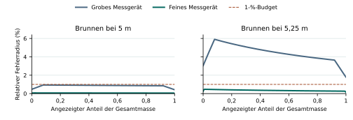

Für jeden der beiden Brunnen werten wir 33 Mischungen der Pulse und je drei Fehlerwerte pro Gerät aus. Das ergibt 297 mögliche Verläufe der Messung je Ort. Mehrere Verläufe haben bis zur ersten Entscheidung dieselbe Ablesung. Die Fehlerwerte sind feste Prüfpunkte am Mittelpunkt und an den Rändern der angegebenen Fehlerintervalle.

Bei **5 m** genügt die grobe Ablesung in allen 297 Verläufen. Drei Rechteckvorhersagen werden angenommen, in 294 Fällen wird der Brunnenwert aus den eingeschlossenen Green-Gewichten bestimmt. Bei **5,25 m** braucht der Algorithmus in 288 von 297 Verläufen zusätzlich das feinere Gerät. Für alle 288 belegt das zulässige Pulspaar, dass nach der ersten Ablesung das Ein-Prozent-Budget grundsätzlich unerreichbar war. Insgesamt werden dort 29 Rechteckvorhersagen angenommen und 268 Werte aus dem abgesicherten Intervall ausgegeben. Der größte beobachtete Fehler bleibt an beiden Orten unter 0,94 %. Die unabhängige Punktquadratur wurde allein für diese Nachprüfung verwendet.

Die garantierte Abnahme folgt für jede kompatible Pulsaufteilung und jeden innerhalb der angenommenen Gerätegrenzen liegenden Fehler aus dem Intervalltest. Die Häufigkeiten gelten für den beschriebenen Prüfsatz. Zusätzliche Quellformen, Modellfehler im Grundwasserleiter oder ein systematisch falsch kalibrierter Zähler erfordern eine entsprechend erweiterte Unsicherheitsmenge.

<!-- Buchseite -->

<a id="pr-forschung"></a>

## 9.26 · Was sich amortisiert und welche Frage offenbleibt

Für die Wirtschaftlichkeit zählt die Zeit bis zu einer angenommenen Ausgabe. Seien $T_A$ die einmaligen Kosten zusätzlicher Daten, Kalibrierungen und Trainingsläufe, $t_H$ die mittleren Kosten der gesamten hybriden Anfrage und $t_S$ die des passenden klassischen Vergleichs. Zu $t_H$ gehören auch Projektion, Prüfung, ausgelöste Messungen und klassische Fortsetzungen. Bei $t_H<t_S$ entsteht ein Kostenvorteil für $N>T_A/(t_S-t_H)$. Für einen festen Technikaufwand und variable Messkosten müssen beide Seiten zuerst dieselbe Kosteneinheit erhalten.

Im nominalen C15-Lauf haben wir einen Auftrag mit 480 Schritten nach einem Warmlauf fünfmal auf der CPU gemessen. Der Median beträgt für den hybriden Lauf 74,49 ms und für die klassische Taylorrechnung mit demselben globalen Fehlervertrag 51,83 ms. Beide verwenden dieselbe rationale Fehlerprüfung und Projektion. Die vorberechnete Matrixexponentialabbildung in Gleitkommaarithmetik braucht 1,30 ms. Im direkten Vergleich der beiden abgesicherten Verfahren würde hier bereits die einzelne Anfrage beim Hybrid länger dauern. Die Zahl der Trainingsbeispiele allein erlaubt somit keine Amortisationsaussage.

### Eine prüfbare Forschungsidee

Was wäre, wenn ein Operator vor allem die nächste **Handlung** lernt? Seine Auswahl könnte lauten, einen Sensor abzufragen, einen weiteren physikalischen Modus auszuwerten oder im letzten sicheren Zustand zur klassischen Rechnung zurückzukehren. Die endgültige Freigabe behielte die unabhängig ausgewertete Fehlerschranke. Im Brunnenversuch hat ein zusätzlicher Messwert eine nachweisbare Wirkung. Im C15-Versuch trägt der Gleichungsdefekt die Entscheidung. Bei der Kavität benötigt schon die Auswahl der zulässigen Projektion eine Verträglichkeitsprüfung.

Für den Vergleich trainieren wir an bekannten Fällen und prüfen danach zurückgehaltene Pulse, Betriebspunkte und Gitter. Vergleichswerte liefern die feste Reihenfolge, der beste feste Messplan aus Kapitel 17 und eine durchgehend abgesicherte klassische Rechnung. Gezählt werden falsche Freigaben, offene Aufträge, Ablesungen und die vollständigen Kosten je erfülltem Auftrag. Ein Vorteil läge vor, wenn bei denselben garantierten Budgets die Gesamtkosten sinken. Zielgerichtete Versuchsplanung und zertifizierte Operatoren liefern Vorarbeiten. Die [folgenden Versuche](#op-entscheidung) setzen die Auswahlregel um und verfolgen jede Freigabe. [Zielgerichtete Versuchsplanung](https://arxiv.org/abs/1802.06517) · [Rechenlabor zur Messplanung](#mp-labor)

<!-- Buchseite -->

<a id="op-entscheidung"></a>

## 9.27 · Ein Operator wählt die nächste Handlung

Ein Techniker liest am Brunnenzähler die Hälfte der eingespeisten Masse ab. Lohnt es sich, den Transport genauer zu berechnen, oder muss er auf die zweite Ablesung warten? Bei der Saite stellt sich eine verwandte Frage. Der grobe Rechenschritt hat eine Spitze schlecht getroffen. Liegt der Sensor weit genug entfernt, kann sein Wert trotzdem ausreichend genau sein. Beide Fragen lassen sich jetzt im Rechenlabor stellen, bevor die Referenzlösung bekannt ist.

Der erste Operator ordnet den **beobachtbaren Zustand** einer Auswahl von Handlungen zu. Beim Brunnen kennt er den Ort, das mit den bisherigen Messungen verträgliche Intervall, das Budget und die bereits ausgeführten Rechnungen. Er schätzt für jede verfügbare Handlung die noch zu erwartenden Kosten bis zur Freigabe. Die Schätzung entsteht aus räumlich lokalisierten Gaußfunktionen im Merkmalsraum und einem durch kleinste Quadrate angepassten Ausgang. Beim Training darf das Labor die möglichen Fortsetzungen einer Messreihe durchspielen. Beim Einsatz erhält es die spätere Ablesung erst, wenn es den Sensor abfragt.

Die Fehlerprüfung hat eine andere Eingabe als dieses Netz. Sie erhält den ausgegebenen Wert und die mathematisch gesicherte Spanne der Referenz. Ist die Spanne bereits eng, kann sie einen preiswerten Vorschlag freigeben. Werden noch zulässige Quellen unterschieden, die zu weit auseinanderliegende Werte erzeugen, hilft eine zusätzliche Ablesung. Lassen sich nach der letzten erlaubten Ablesung die geforderten Grenzen nicht zeigen, endet der Auftrag offen.

Der zweite Operator lernt, **welche Gleichungsfehler den Sensor erreichen**. Er schlägt hierfür ein Feld des adjungierten Problems vor. Die folgenden Seiten entwickeln dessen Prüfung an der Saite. Hier werden beide Verfahren zusammen verwendet. Das eine Modell schlägt den Fehlernachweis vor, das andere wählt nach einem erfolglosen ersten Versuch zwischen Verfeinerung und klassischer Rechnung. [Fehler ohne Referenz abschätzen](#pr-abnahme)

<!-- Buchseite -->

<a id="op-brunnen"></a>

## 9.28 · Der Brunnen fordert eine zweite Messung an

Wie unterschiedlich derselbe Algorithmus entscheiden kann, zeigt der Ort bei 5,275 m. Das grobe Gerät meldet einen Anteil von 0,5. Der Rechenweg kennt die zweite Anzeige noch nicht und fordert sie an. Meldet auch das feinere Gerät 0,5, genügt anschließend die Mittelpunktsquadratur. Die ausgegebene Konzentration beträgt rund 1 989,56 mg/m³. Der relative Fehler ist nach oben durch 0,572 % beschränkt. Die Mischung der beiden Quellpulse bleibt dabei unbekannt.

Die Freigabe verwendet die positiven Grenzen $L$ und $U$ aus [Abschnitt 9.24](#pr-brunnen). Der kleinste für dieses Intervall garantierbare relative Radius ist $(U-L)/(U+L)$. Liegt er über dem Budget, können weder die billigere Quadratur noch der robuste Mittelpunkt diesen Intervalltest bestehen. Dann fragt der Planer das nächste Gerät ab. Liegt der Radius im Budget, stehen die billigere Mittelpunktsquadratur und die robuste Ausgabe $2LU/(L+U)$ zur Wahl. Bei den festgelegten Preisen kostet diese garantierte Ausgabe bereits weniger als die zusätzliche Messung. In diesem Fall wählt das Netz zwischen den beiden Rechnungen.

Das Training verwendet 1 008 Konstellationen an sieben Brunnenorten. Geprüft wurde an sechs zurückgehaltenen Orten mit jeweils neun anderen Pulsmischungen und je drei Fehlerwerten für jedes Gerät. Das ergibt 486 Aufträge. Alle Ausgaben der gelernten Regel bestehen den Ein-Prozent-Vertrag. In 399 Aufträgen wird die zweite Ablesung benötigt. Der größte nachträglich beobachtete relative Fehler beträgt weniger als ein Prozent.

Die Kosten erklären, wie viel das Lernen hier beiträgt. Die auf den Trainingsdaten ausgewählte feste Reihenfolge braucht durchschnittlich 19,78 Aktionseinheiten. Die gelernte Wahl mit Intervallprüfung erreicht 17,66 Einheiten, die direkte Intervallregel mit bevorzugter Verfeinerung 17,32. Ein Netz ohne Ausschluss aussichtsloser Handlungen braucht 23,02. Die unabhängige Fehlerprüfung gilt in allen vier Versuchen. Geändert wird die Reihenfolge, in der die Rechnung Geld oder Zeit kosten würde. [Vergleichsversuche und Kosten](#op-bilanz)

<!-- Buchseite -->

<a id="op-zeuge"></a>

## 9.29 · An der Saite lernen, wo ein Fehler ankommt

Für einen Sensor an der Saite genügt eine einzelne Ablesung der Auslenkung. Das ganze Feld in derselben Genauigkeit zu verlangen, kann zu viel Rechenarbeit auslösen. Wir beginnen mit dem Newmark-Schritt mit mittlerer Beschleunigung und festen Enden. Auf den inneren Gitterknoten sei $L$ die Matrix mit Diagonale 2 und Nebendiagonalen $-1$. Aus $u^+=u+h\dot u+h^2(\ddot u+\ddot u^+)/4$ und der räumlich diskreten Wellengleichung folgt

$$
K u^+=f,\qquad K=I+\mu L,\qquad
f=(I-\mu L)u+h\dot u,\qquad \mu=\left(\frac{ch}{2\Delta x}\right)^2.
$$

Die gewünschte Ausgabe ist $Q=\ell^\top u^+$. Der Vektor $\ell$ kann einen einzelnen Knoten auswählen oder drei benachbarte Knoten mit den Gewichten $1/4,1/2,1/4$ mitteln. Unser dualer Operator bildet die **ganze Messfunktion** $\ell$ auf einen Vorschlag $\hat z$ für $K^\top z=\ell$ ab. Bei einer anderen Sensorposition wird eine andere rechte Seite eingesetzt. [Newmark-Verfahren](https://opensees.github.io/OpenSeesDocumentation/user/manual/analysis/integrator/Newmark.html)

Wie lässt sich dieses Feld auf anderen Gittern auswerten? Der Operator $S=I-L/2$ mittelt die beiden Nachbarwerte mit festen Nullrändern. Beginnend mit $b_0=\ell$ und $b_1=S\ell$ erzeugt $b_{j+1}=2Sb_j-b_{j-1}$ zunehmend weit reichende Filter. Ein linearer Fit bestimmt die Gewichte aus 56 exakt formulierten, numerisch nachgerechneten adjungierten Trainingsaufgaben. Sie verteilen sich auf sieben Werte von $\mu$, zwei Gitter mit 31 und 63 Innenknoten und vier Sensorlagen. Zwischen den Stützstellen interpolieren wir die Gewichte in $\log\mu$. Außerhalb bleibt der nächste Randwert stehen.

In der ersten Näherung stehen sechs Feldmoden und ein Filter dritten Grades zur Verfügung. Eine Verfeinerung verwendet 18 Feldmoden und Grad 16. Eine unabhängige Bandlösung kann übernehmen. Die ausgegebene Fehlergrenze gilt für die diskrete Sensorauslenkung nach diesem einen Schritt. Die Frage nach dem gesamten Feld der Saite nach fünf oder acht Sekunden wird im [CP2-Kapitel](#cp2-operator-code) gesondert untersucht.

<!-- Buchseite -->

<a id="op-nachweis"></a>

## 9.30 · Einen vorgeschlagenen Fehlernachweis überprüfen

Der Prüfer erhält das vorgeschlagene Feld $v$ und den dualen Vorschlag $\hat z$. Er berechnet den Felddefekt $r=f-Kv$ und den dualen Defekt $d=\ell-K^\top\hat z$. Nun korrigieren wir unmittelbar die **Sensorausgabe**. Der unbekannte Rest lässt sich ohne Referenz einschließen,

$$
q=\ell^\top v+\hat z^\top r,\qquad
Q-q=d^\top K^{-1}r,\qquad
|Q-q|\le \|d\|_1\,\|r\|_\infty.
$$

Für die letzte Ungleichung genügt das diskrete Maximumprinzip. Wählen Sie eine Komponente, an der $|w_i|=\|w\|_\infty$ ist. Der Betrag von $(Kw)_i$ ist mindestens $(1+2\mu)|w_i|-\mu(|w_{i-1}|+|w_{i+1}|)\ge |w_i|$. An einem Ende tritt für den fehlenden Nachbarn null ein. Damit gilt $\|K^{-1}r\|_\infty\le\|r\|_\infty$. Der Nachweis deckt jeden eingesetzten Vektor $\hat z$ ab.

**Eine Rechnung auf zwei Knoten.** Wählen wir $\mu=1$, $f=(1,0)$ und den zweiten Knoten als Sensor. Aus $3u_1-u_2=1$ und $-u_1+3u_2=0$ folgt $Q=1/8$. Der Vorschlag $v=(1/3,0)$ meldet am Sensor zunächst null. Mit $\hat z=(1/8,1/3)$ ergeben sich $r=(0,1/3)$ und $d=(-1/24,1/8)$. Die Korrektur meldet $q=1/9$ mit Radius $1/18$. Ein absolutes Budget von 0,06 ist damit vor der Vergleichsrechnung erfüllt. Zur Kontrolle beträgt der tatsächliche Fehler $1/72$.

Im Labor werden Feld und Zeuge nach ihrem Vorschlag auf ein Gitter mit Schritt $10^{-9}$ gerundet. Die feste rechte Seite wird aus den quantisierten Anfangsdaten exakt gebildet. Der Prüfer rechnet anschließend mit ganzen Zahlen beliebiger Länge und liefert Wert und Radius als Brüche. Eine zweite Implementierung in C++20 mit GMP ergibt für 481 Eingaben genau dieselben Brüche. Der Vergleich enthält alle 480 Saitenanfragen der regulären und verschärften Prüfung sowie einen Fall mit über 50 Dezimalstellen. [Rechenlabor und Einzelfall](#op-labor)

<!-- Buchseite -->

<a id="op-bilanz"></a>

## 9.31 · Welcher Teil der Methode den Aufwand senkt

Im Saitentest bleiben die Gewichte nach dem Training fest. Die 432 Aufträge enthalten neue Zupf- und Sensorpositionen, sechs neue Werte von $\mu$ und Gitter mit 81, 161 und 501 Knoten einschließlich der Enden. Je nach Auftrag gelten 1 % oder 0,2 % der normierten Anfangsamplitude als absolutes Fehlerbudget. Die Prüfung umfasst ruhende und bewegte Anfangszustände. Die Referenz wird nach der Entscheidung durch vollständige Sinusdiagonalisierung ausgewertet.

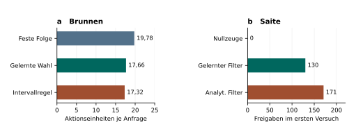

Mit dem Nullvektor als Zeugen besteht keiner der ersten Feldvorschläge. Der gelernte Zeuge sichert die unveränderte Sensorausgabe bereits in 57 Fällen ab. Mit der dualen Ausgabekorrektur steigen die sofortigen Freigaben auf 130. Über den ganzen Lauf wird bei der festen Reihenfolge die Bandlösung mit gelerntem Zeugen noch 106-mal, mit Nullzeugen 420-mal benötigt. Alle 432 Aufträge enden innerhalb des Budgets.

Bei konstanter Wellengeschwindigkeit lässt sich eine starke Kontrolle angeben. Für $s=\sqrt{1+4\mu}$ und $\rho=2\mu/(1+2\mu+s)$ liefert die erzeugende Funktion der Chebyshev-Polynome die Gewichte $1/s$ und $2\rho^j/s$ für $j\ge1$. Bei identischen Filtergraden besteht dieser analytische Zeuge 171 erste Versuche. Er benötigt insgesamt nur 33 Bandlösungen. Die Gegenprobe trennt die Wirkung einer dualen Prüfung von der Frage, wie die Filtergewichte bestimmt wurden. [Erzeugende Funktion, NIST DLMF, Gl. 18.12.7](https://dlmf.nist.gov/18.12.E7)

<!-- Buchseite -->

<a id="op-labor"></a>

## 9.32 · Laufzeit, offene Ausgaben und eigene Versuche

Das Kostenmodell bewertet den ersten Saitenversuch mit drei, eine Verfeinerung mit sechs und die Bandlösung mit zwölf Einheiten. Unter dieser Annahme braucht die gelernte Auswahl im regulären Test im Mittel 10,00 Einheiten, die beste beim Training gewählte feste Folge 10,14. Die CPU-Messung beantwortet eine andere Frage. Sie umfasst Auswertung des Netzes, Prüfung und sämtliche ausgeführten Ersatzrechnungen. Auf derselben Auswahl von 26 Saitenanfragen beträgt der Median je Anfrage **1,985 ms** für den Hybrid und **0,567 ms** für die abgesicherte direkte Bandlösung. Bei 29 Brunnenanfragen sind es **0,219 ms** und **0,083 ms**. Die simulierte Ablesung verursacht hier keine Wartezeit. Datenaufbereitung, Training beider Methoden und Auswahl der festen Vergleichsfolgen brauchten zusammen rund 4,05 s auf einer CPU. Für die gemessenen Latenzen ergibt sich gegenüber dem direkten klassischen Verfahren kein Amortisationspunkt.

Im verschärften Brunnenversuch erhöht sich die Unsicherheit des zweiten Geräts von 0,006 auf 0,04 der eingespeisten Masse. Zugleich liegen beide Orte außerhalb des Trainingsbereichs. Jetzt sind nur 41 der 162 Aufträge freigabefähig. Für jeden der **121 offenen Aufträge** findet der Prüfer zwei mit denselben Ablesungen verträgliche Pulsverläufe, deren Brunnenwerte zu weit auseinanderliegen. Auf der Saite erhalten alle 48 verschärften Aufträge mit $\mu=24$ oder 48 eine Freigabe über die klassische Bandlösung. Jeder Rückgriff ist im Einzelprotokoll sichtbar.

**Selbst nachrechnen.** Das Rechenlabor enthält die trainierten Gewichte, die getrennten Trainings- und Prüfprogramme und beide Prüfer. Im Ordner `entscheidung` lässt `labor.py brunnen` die beiden Ablesungen einzeln eingeben. Mit `labor.py saite` kann man Gitter, Zupfstelle, Sensorort und Budget ändern. Wer die Fälle aus Abschnitt 9.28 und den 501-Knoten-Versuch mit eigenen Parametern wiederholen möchte, findet die vollständigen Aufrufe in der zugehörigen README. Die Eigenschaftstests enthalten einen verfälschten Zeugen, einen widersprüchlichen Sensor und eine bewusst zu enge Fehlervorgabe. Eine offene Forschungsfrage ist, ob der gelernte Zeuge bei räumlich variablen Koeffizienten die Gesamtkosten gegenüber einem neu angepassten klassischen Filter senkt. [Zurück zum mathematischen Nachweis](#op-nachweis)

<!-- Buchseite -->

<a id="atlas-raum"></a>

## 9.33 · Die Reichweite eines gelernten Fehlernachweises sehen

Stellen Sie an einem einzigen Punkt der Saite einen Wegaufnehmer auf. Verschiebt ein Fehler zwei Knoten weiter rechts auch dessen Anzeige? Für einen diskreten Newmark-Schritt beantwortet die Gleichung $K^Tz=\ell$ diese Frage. Der Vektor $\ell$ trägt nur am Sensor eine Eins. Die Bandlösung $z$ verteilt dieses Anliegen auf benachbarte Knoten.

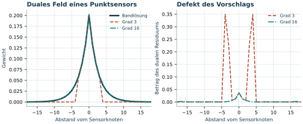

Jede Stufe des gelernten Polynomfilters erreicht höchstens einen weiteren Nachbarn. Bei Grad drei endet der Vorschlag daher nach drei Knoten. Auf der rechten Seite erkennt man die Spur der abgeschnittenen Fortsetzung im dualen Defekt $\ell-K^T\hat z$. Der längere Filter kann diesen Defekt verringern. Für die Fehlergrenze zählen anschließend auch das primale Residuum und die Stabilität des Systems. Allein die Ähnlichkeit der beiden Kurven entscheidet noch keine Sensorfreigabe.

Bei einem Ereigniskalender suchen wir eine andere Art von Zeugen. Zwei Eingabefolgen mit denselben Sensorcodes und verschiedenen Konfliktgewinnern genügen bereits, um eine eindeutige Entscheidung zu widerlegen. [Kapitel 17](#atlas-vertrag) leitet diese Prüfung für alle Messaufgaben her.

<!-- Buchseite -->

<a id="atlas-sieben"></a>

## 9.34 · Sieben Kerne auf demselben Messauftrag

Ein Speicher meldet Spannungen, eine Fabrik Stückzahlen und der Philosophen-Scheduler Besitzstände. Um sieben Transformationskerne an allen Fällen zu vergleichen, stellen wir ihnen eine gemeinsame, eng umrissene Aufgabe. Sie sehen die quantisierten Messkanäle in vorgegebener Reihenfolge und sagen ausgewählte Zielgrößen sowie gegebenenfalls ein Ereignislabel voraus. Ein solches Label kann etwa angeben, **wer** ein bestimmtes Stäbchen erhält.

<a id="revision-k09-01"></a>

**Drei Fragen an dieselbe Modellfamilie.** Im Messkatalog führt ein quantisierter Frühkanal zu einem skalaren Ziel, hier $z_2(10)$. Die offizielle CP1/B-Aufgabe betrachtet den nominellen Start, zehn Endwerte bei $t=100$ und einen Parallelvergleich. Unsere dynamische Lehrvariante erhält zwei Anfangspopulationen und gibt für 401 Zeiten **alle zehn Populationen** aus, insgesamt 4 010 Werte bis $t=100$ in Modellzeiteinheiten. DOP853 liefert die Referenz. Der Prüfer bildet das Maximum aus vier Fehlerquotienten. Die Budgets sind 1 % für die relative Bahnabweichung, 0,10 für die größte absolute Komponentenabweichung unterwegs, 0,02 für die zehn Endwerte und 0,06 für $z_2(10)$. Wer nur den Sensor benötigt, kann den Katalog wählen. Wer die ganze Bahn braucht und den Ersatz außerhalb des geprüften Bereichs antrifft, kann auf die klassische Integration zurückgreifen. Die Bestehenszahlen unten bewerten die **ungesicherten Kandidaten vor einem solchen Rückgriff**.


Die Kanalwerte werden ausschließlich mit den jeweiligen Trainingsdaten zentriert und skaliert. Jeder liegt auf einem eigenen von 33 Indexplätzen. Die übrigen Plätze sind null. Bei Ereignisprotokollen ist dieser Index eine Reihenfolge von Kanälen. Zwischen zwei solchen Indizes kann eine physikalische Zeit oder Entfernung fehlen. Eine vollständige CFD-Lösung oder ein automatisch entdecktes Ereignismodell lässt sich aus dieser Darstellung nicht ableiten.

Alle sieben Varianten nutzen das Transformationslabor aus Kapitel 9. Aus drei Bändern werden an acht vorgesehenen Positionen Koeffizienten ausgelesen. Ein Netz mit sechs verborgenen Einheiten lernt daraus die Zielwerte. Bei der eindimensionalen Radon-Variante sind die Richtungen durch die beiden Orientierungen der Achse repräsentiert. Die zweidimensionale Kavität hat dagegen echte Projektionswinkel. Zu den genauen Auslesepositionen, Polpaaren, Reflexions- und Waveletfiltern gehören die Definitionen in `fenster.py` und `hybrid_operator.py`.

<a id="revision-k09-03"></a>

In den beiden dynamischen Siebenervergleichen ist auch die Kavität ein **Zeitversuch**. Die Richtungsmerkmale mitteln das Signal in symmetrischen Fenstern der Breiten 1, 5 und 13. Ein Einzelimpuls wird beim ersten Fenster unverändert und bei den größeren Fenstern über Nachbarn verteilt. Im [räumlichen Feldversuch](#raumkerne-vergleich) arbeiten wir dagegen mit Projektionen über acht Winkel und einer gefilterten Rückprojektion. Den Kleinstversuch mit dem Impuls und die gemessenen Ränge finden Sie [bei Abb. 16.12](#revision-k16-03).


Für jede endliche Aufgabe halten wir in drei Durchgängen unterschiedliche Szenarien zurück. Jeder der 352 Fälle liefert genau eine Vorhersage je Familie. Bei C19R stehen 240 separat erzeugte Kalibrierquellen 5 101 Prüfraten gegenüber. Ein Vorschlag zählt als roher Treffer, wenn alle Zahlen und das Ereignislabel für den tatsächlich gerechneten Fall stimmen. Eine direkte Freigabe verlangt mehr: Das Budget muss für alle mit den Ablesungen verträglichen Lösungen gelten. [Die Abbildung](#atlas-kerne) macht den Unterschied zur Rückfallrechnung sichtbar.

<!-- Buchseite -->

<a id="atlas-kerne"></a>

## 9.35 · Wo ein Netzvorschlag eine direkte Freigabe erhält

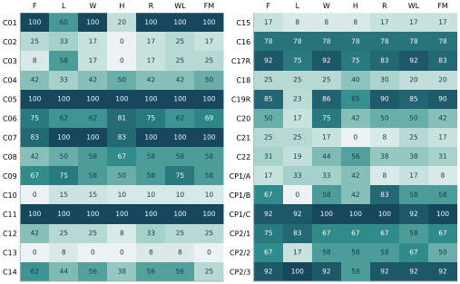

**Leseprobe.** Jede Zahl ist der gerundete Prozentsatz direkt zertifizierter Vorschläge innerhalb einer Aufgabe. Eine Null besagt, dass der Prüfer jedes Mal auf die zulässigen Vergleichswerte zurückgriff. Die Schranke bezieht sich bei C19R auf kontinuierlich veränderliche Quellen. Bei den übrigen Aufgaben gelten die [Voraussetzungen des Referenzkatalogs](#atlas-vertrag). Jede Zelle hat dieselbe Farbeinteilung von 0 bis 100 Prozent. Die Nenner unterscheiden sich: 9 bis 20 Fälle in den endlichen Reihen, 5 101 bei C19R.

F steht für Fourier, L für Laplace, W für Wavelet, H für Hankel, R für Radon, WL für Wavelet–Laplace und FM für Fourier–Mellin. Zu jedem Prozentwert gehören Zähler, Nenner, Rohfehler und Einzelläufe im Rechenlabor. So lässt sich etwa nachprüfen, ob eine einzelne andere Vorhersage die Rangfolge zweier Familien bereits vertauscht.

<!-- Buchseite -->

<a id="atlas-ertrag"></a>

## 9.36 · Was vom Vorsprung eines Kerns übrig bleibt

Die beiden linken Spalten zählen einzelne Prüfaufträge aus den 27 endlichen Katalogen. Die beiden rechten Spalten zählen Quellen am Brunnen. Ein Gesamtmittel über alle Spalten würde überwiegend die Grundwasseraufgabe gewichten.

<a id="tab-k09-05"></a>

| Transformationskern | Roh (352) | Direkt (352) | Roh (5 101) | Direkt (5 101) |
| --- | ---: | ---: | ---: | ---: |
| Fourier | 187 | 186 | 4781 | 4314 |
| Laplace | 171 | 168 | 1838 | 1195 |
| Wavelet | 191 | 190 | 4822 | 4410 |
| Hankel | 164 | 162 | 4281 | 3296 |
| Radon | 189 | 189 | 4920 | 4603 |
| Wavelet–Laplace | 189 | 188 | 4811 | 4325 |
| Fourier–Mellin | 177 | 176 | 4893 | 4584 |

Im endlichen Teil liefert Wavelet 190 direkt freigegebene Vorschläge, Fourier 186 und die eindimensionale Radon-Variante 189. Diese Unterschiede betreffen wenige Fälle. Bei den 5 101 Quellen liegt die Radon-Variante mit 4 603 direkten Freigaben vor Fourier mit 4 314. Allein die Veränderung der Aufgabe verändert also die Reihenfolge. Nach der geprüften Ersatzrechnung halten alle sieben Varianten in jeder der 28 Aufgaben das jeweilige Budget ein.

Der Hauptvergleich begrenzt L-BFGS-B auf 200 Iterationen je Start und verwendet zwei Starts. Bei 375 der 574 ausgewählten Anpassungen endete die Optimierung am Iterationslimit. Eine Gegenprobe mit 800 Iterationen über alle sieben Kerne bei C04, C19R und CP2/3 zeigt, wie sich die Entscheidung verschiebt. Bei C19R steigt Fourier von 4 314 auf 4 388 direkte Freigaben, Wavelet sinkt von 4 410 auf 4 172. Längeres Training verbessert den zurückgehaltenen Fall also nicht zwangsläufig.

Die kleine Stichprobe je endlicher Aufgabe, die feste Auslese und die Kalibrierung am Messkanal begrenzen die Aussage. Ein Wechsel der Sensoranordnung, des Betriebspunkts oder der Verteilung zufälliger Abläufe verlangt eine neue Prüfung. Der [Vergleich am physikalischen Feld](#atlas-strom) stellt eine andere Frage als die Schätzung eines Zielwertes aus einem Log. Die [Aufwandsbilanz des Aktionsnetzes](#atlas-kosten) zählt außerdem, wie viele Ablesungen für die Entscheidung überhaupt nötig waren.

<!-- Buchseite -->

<a id="cp1b-bahn"></a>

## 9.37 · Wie lernt man eine Räuber-Beute-Bahn?

Beginnen alle Populationen mit dem Wert eins, erreicht die erste Beutepopulation bald ein Maximum. Die Räuber folgen mit Verzögerung. In CP1/B beeinflussen vier weitere Paare diesen Verlauf. Eine Vorhersage für den letzten Räuber nach zehn Zeiteinheiten kann richtig sein, selbst wenn die erste Beutespitze falsch liegt. Wir erweitern deshalb die [Messaufgabe aus dem Katalog](#atlas-sieben) auf alle zehn Populationen und lesen ihre Verläufe bis $t=100$ an 401 Zeitpunkten ab. Die zehn veröffentlichten Endwerte erlauben eine unabhängige Kontrolle des nominellen Starts. [ARGESIM, CP1, Aufgabe B](https://www.sne-journal.org/fileadmin/user_upload_sne/benchmarks/CP/CP1-definition.pdf)

Zwei Zahlen beschreiben hier eine Familie von Anfangszuständen. Wir wählen die erste Beute $v_1(0)$ zwischen 0,8 und 1,25 und den letzten Räuber $z_2(0)$ zwischen 0,9 und 1,1. Die übrigen acht Startgrößen bleiben bei eins. Aus 64 Referenzbahnen mit DOP853 bilden wir für jede Art $i$ die logarithmische Änderung $r_i(t)=\log(X_i(t)/X_i(0))$. Eine Verdopplung und eine Halbierung erhalten damit denselben Betrag bei entgegengesetztem Vorzeichen.

Die Singulärwertzerlegung findet Zeitverläufe, die viele dieser Änderungen gemeinsam beschreiben. Diese datenabhängige Basis heißt *Proper Orthogonal Decomposition* (POD). Für den Startvektor $p$ liefert ein Netz aus gaußförmigen radialen Basisfunktionen die Gewichte $a_j(p)$. Die Rücktransformation lautet

In der Notation aus [G.2](#revision-g-02) sind dies $s_j(D)$. Die abgeschnittene Summe $\sum_{j>r}s_j(D)^2$ ist die quadrierte Frobenius-Abweichung der optimalen Rang-$r$-Näherung der Trainingsdaten. Für eine unbekannte Bahn wird der Fehler eigens ausgewertet.


$$
\widehat X_i(t;p)=X_i(0;p)\exp\!\left(\bar r_i(t)+\sum_{j=1}^r a_j(p)\,\phi_{ji}(t)\right).
$$

Bei $t=0$ setzen wir den Exponenten auf null. So trifft die Ausgabe den Anfangszustand genau und beschreibt positive Populationsgrößen. Rang und Breite der Gaußfunktionen wählen wir an 16 gesonderten Validierungsbahnen. Die Wahl fällt auf 32 Moden. Eine affine Vergleichsrechnung nutzt genau diese Moden und passt ihre Gewichte linear mit konstantem Glied an. Auf welchem Teil der Bahn erwarten Sie den größten Unterschied?

<!-- Buchseite -->

<a id="cp1b-gegenprobe"></a>

## 9.38 · Was ein richtiger Endwert übersehen kann


Der späte Endwert liegt nach mehreren gedämpften Schwingungen. Ein kleiner Phasenfehler kann längst abgeklungen sein. Wir verlangen deshalb gleichzeitig höchstens 1 % relativen Fehler über die ganze abgetastete Bahn, 0,10 Einheiten an jeder einzelnen Probe, 0,02 an jedem Endwert und 0,06 beim bisherigen Sensor $z_2(10)$. Der Referenzlauf mit DOP853 und die unabhängige Integration mit Radau unterscheiden sich beim nominellen Start um höchstens $6{,}8\cdot10^{-10}$. Die größte Abweichung eines DOP853-Endwerts von der veröffentlichten Tabelle beträgt $9{,}7\cdot10^{-8}$.

**Lesen Sie die Spitze in Teilbild C ab.** Der zurückgehaltene Start $v_1(0)=0{,}807393$, $z_2(0)=1{,}075915$ besteht beim affinen Modell den Endwerttest mit maximal $0{,}006578$ und den Sensortest mit $0{,}002531$. Der relative Bahnfehler beträgt $0{,}55034\,\%$. Bei $t=15{,}5$ stehen für $v_2$ jedoch $6{,}35586$ aus DOP853 und $6{,}68025$ aus der affinen Näherung. Die Differenz $0{,}32439$ ergibt $S=3{,}244$ und verwirft dieselbe Bahn. Es handelt sich um gedämpfte Schwingungen. Aus dem Befund folgt kein Grenzzyklus.


Im Trainingsbereich bestehen 16 von 16 zurückgehaltenen Startpaaren mit dem RBF-POD-Operator. Der größte relative Bahnfehler beträgt rund 0,00051 %. Die affine Kontrolle besteht zwei Fälle. Auch der gesonderte nominelle Start besteht mit dem RBF-POD-Operator. Bei allen acht Startpaaren außerhalb des Bereichs verfehlen beide Modelle mindestens ein Budget. Die Abbildung zeigt den Grund an einem Beispiel. Einzelne Spitzen überschreiten das lokale Budget, obwohl der spätere Verlauf wieder nahe an der Referenz liegt.

Das direkte RBF-Modell sagt Koeffizienten von 32 POD-Formen voraus. Der gesonderte Vergleich der sieben Zeitkerne korrigiert eine affine POD-Prognose mit je 96 festen nichtlinearen Merkmalen und einer aus drei Ridge-Parametern gewählten Regression. Bei 64 Trainings-, 16 Validierungs- und 16 inneren Teststarts bestehen alle sieben die 16 Innenstarts und den zusätzlichen Nominalstart. Keiner besteht einen der acht Außenstarts. Die 56 einzelnen Außen-Scores liegen zwischen 3,84 und 45,48. Die sieben in Abb. 16.12 gezeichneten Gruppenmaxima liegen zwischen 21,17 und 45,48.


Eine vollständige Bahn mit 4 010 Werten kostete im CPU-Median 87,7 ms mit DOP853 und 0,110 ms mit dem trainierten RBF-POD-Operator. Erzeugung der Trainings- und Validierungsdaten und Anpassung kosteten zusammen 7,33 s. Unter diesen Messbedingungen ist der Aufwand ab 84 vergleichbaren Anfragen gedeckt. Für neue Startbereiche bleibt die klassische Rechnung die geprüfte Referenz.

<!-- Buchseite -->

<a id="cp2-voll-lernen"></a>

## Kann ein Zeitkern den langen Kavitätsversuch vorhersagen?

Die Fragestellung verändert sich, wenn der Deckel während einer ganzen Überfahrt und darüber hinaus mit konstanter Geschwindigkeit fährt. Wir geben dem Modell die Reynolds-Zahl, die Ausgabezeit und die bis dahin gefahrene Deckelgeschichte in 64 Zeitfenstern. Seine Zielgröße ist das Feld beider Geschwindigkeitskomponenten auf $257^2$ Knoten. Acht andere Reynolds-Zahlen liefern die Trainingsfelder, zwei weitere die Validierungsfelder. Der offizielle Wert 1000 bleibt bis zur Prüfung zurückgestellt. Zusätzlich fehlen drei der sieben Prüfzeiten bei sämtlichen Trainingsläufen.

Jeder der sieben Zeitkerne erzeugt 24 feste Merkmale. Das trainierte Modell kombiniert die Merkmale mit der Reynolds-Zahl, 96 festen nichtlinearen Neuronen und einer durch regularisierte Regression bestimmten Ausgabeschicht. Das Ergebnis sind die Koeffizienten von 24 räumlichen POD-Moden. Bei der direkten Vorhersage beschreiben sie das Geschwindigkeitsfeld. In der zweiten Variante beschreiben sie die Differenz zwischen dem feinen Feld und einer bilinear übertragenen Rechnung auf $65^2$ Knoten. Deren Zeit gehört zur Anfrage. Die räumlichen Moden und alle Lernparameter sind vor dem offiziellen Test festgelegt.

Eine lineare und eine quadratische Interpolation in der Reynolds-Zahl erhalten dieselben Arten von gespeicherten Feldern. Bei unbekannter Ausgabezeit interpolieren sie auch in der Zeit. Ihre Fehler und die Hintergrundkosten stehen [neben denen der sieben Kerne](#cp2-voll-netze). Ein neuer, zeitlich wechselnder Deckelantrieb wäre eine andere Testaufgabe. Für diese Eingänge gelten die gesonderten Profilversuche dieses Kapitels.

Im Zeittransfertest verfehlen alle sieben direkten Modelle und alle sieben Korrekturen mindestens ein Budget. Die Hankel-Korrektur erreicht am einzelnen Endzeitpunkt 0,125 %, über die ganze Prüfung 3,63 %. Zusätzlich rechnen wir auf demselben Gitter eine echte räumliche Fourier-Schicht. Neun nichtlineare Eingangskanäle werden zweidimensional transformiert. Pro Wellenzahl mischt eine gelernte komplexe Matrix die Kanäle. Die Rücktransformation liefert beide Geschwindigkeitskomponenten. Bei je 16 Wellenzahlen oberhalb der Nullmode erreichen direkte und grobgitterkorrigierte Variante maximal 77,61 % und 24,85 % Feldfehler. Damit lässt sich die räumliche Fourier-Faltung mit der zeitlichen Merkmalsauslese getrennt beurteilen.

<!-- Buchseite -->

<a id="no-auswahl-neuraloperator"></a>

## 9.39 · Wie wählt man einen neuronalen Operator?

**Ein Gedankenversuch.** Eine Kavität enthält einen großen Wirbel und eine dünne Scherschicht am bewegten Deckel. Beim ersten Versuch wollen wir das gesamte Feld auf einem Rechteckgitter. Beim zweiten benötigen wir nur drei neue Messorte. Beim dritten verändern wir die Wandform. Die Physik bleibt ähnlich, doch Ein- und Ausgabe ändern sich. Deshalb gibt es keinen insgesamt besten Operator.

**Erste Frage: Wo liegen die Daten?** Ein **FNO** mischt räumliche Moden global und ist unser Ausgangspunkt für regelmäßige Gitter. **FNOGNO** verarbeitet ein regelmäßiges Eingangsgitter und fragt das Ergebnis an frei gelegenen Punkten ab. Dafür prüfen wir in der Kavität unbekannte Sondenorte gegen den einfachen Vergleich »FNO plus Interpolation«. **GINO** verarbeitet auch unregelmäßige Eingaben oder Geometrien. Es verdient erst bei tatsächlich variierenden Netzen und unveränderten physikalischen Vergleichsgrößen einen Versuch. **SFNO** nutzt Kugelflächenfunktionen. Eine rechteckige CP2-Kavität ist dafür kein sinnvoller Prüfstand.

**Zweite Frage: Wo steckt die Schwierigkeit im Feld?** **TFNO** zerlegt die spektralen Gewichte in Tucker-Faktoren: weniger Gewichte, aber nicht notwendig weniger Laufzeit. **UNO** verarbeitet grobe und feine Auflösungen, um ausgedehnte und kleine Strukturen zu verbinden. **LocalNO** ergänzt globale Fourier-Schichten um lokale Differential- und Integralkerne. Für UNO und LocalNO ist die Kavität geeignet, sofern das Referenzgitter die Scherschicht auflöst: neben dem Innenfeld die wandnahe Abweichung und beide Geschwindigkeitskomponenten messen, nicht nur den Geschwindigkeitsbetrag. Das kurze $17\times17$-Feld allein beantwortet diese Frage nicht.

**Vor dem Rechnen:** Eine Sonde wird näher an die Wand verschoben. Welche Änderung ist nötig: eine neue Geometrie, ein anderer Abfrageort oder ein genauerer Feldoperator? Der Messort ändert die Abfrage, nicht die Geometrie; ob zusätzliche lokale Auflösung hilft, entscheidet der Fehler am neuen Ort.

[Offizielle Modell-API](https://neuraloperator.github.io/dev/modules/api.html) · [Unsere Kerne und Schichten](#no-eigene-kerne) · [Zwei gekoppelte Felder](#no-codano).

<!-- Buchseite -->

<a id="no-eigene-kerne"></a>

## 9.40 · Architektur, Kern und Physik sind drei Entscheidungen

**Dritte Frage: Was soll das Ergebnis außer einem Feld liefern?** **CoDA-NO** behandelt vollständige physikalische Variablen als Attention-Einheiten. Die folgende Gegenprobe prüft, ob das Modell eine Kopplung wirklich trifft. **UQNO** ergänzt ein trainiertes Modell durch kalibrierte Fehlerbänder. Ein sinnvoller Anschluss ist C19R: Bänder an getrennten Szenarien kalibrieren, auf neuen Quellenfällen Abdeckung und Breite gemeinsam messen. Ein Band aus Stichproben ersetzt weder ein berechnetes Fehlerzertifikat noch eine Garantie bei veränderter Eingabeverteilung.

**Welche Darstellung gibt der Physik eine Stimme?**

- **Fourier und Sinusmoden:** globale Wellenformen; Sinusmoden erfüllen feste Enden. Prüfstein: neues Anfangsprofil und feineres Gitter separat testen.
- **Laplace:** kausale Zeitkerne für Abklingen, Verzögerung und Nachlauf. Prüfstein: einen Puls auswerten, nicht nur seinen Endwert.
- **Haar-Wavelets und Wavelet–Laplace:** lokale Ortsdetails, mit Laplace zusätzlich Vorgeschichte. Prüfstein: Fehlergröße und Fehlerort am Saitenknick.
- **Hankel/Toeplitz:** direkte und gespiegelte Beiträge. Prüfstein: Rand und Innenfeld getrennt messen.
- **Radon und Mellin:** Richtungen bzw. geometrische Skalierung. Prüfstein: schräge Fronten drehen und einen Ring skalieren. Eine andere Reynolds-Zahl ist keine reine Skalierung.

Die sieben gemessenen Varianten sind kontrolliert vereinfachte **Kerne**, keine vollständigen Nachbauten der zugehörigen Forschungsmodelle. Ein Physik-Layer ist eine zusätzliche Entscheidung: Direkte Vorhersage, analytisches Grundfeld plus gelernte Korrektur und nachträgliche Projektion sind verschiedene Varianten. PINNs lösen häufig eine konkrete Gleichung per Residuum; DeepONet lernt eine Abbildung von Sensorwerten zu Abfragen. Diese Einteilung verhindert, dass wir Modellklassen mit Randbedingungen, Fehlermaßen oder Basissolvern verwechseln.

[Herleitungen der Kerne](#cp2-operator-grundlagen) · [Gemessener Siebenervergleich](#atlas-sieben) · [Physik-Korrektur](#cp2-operator-lernregel).

<!-- Buchseite -->

<a id="no-codano"></a>

## 9.41 · CoDA-NO: Zwei Felder lernen gemeinsam

Sobald zwei Temperaturfelder Wärme austauschen, reicht ein einzelnes Temperaturprofil nicht mehr aus, um seine Zukunft zu bestimmen. CoDA-NO behandelt jedes physikalische Feld als eigene Informationseinheit: Die Attention gewichtet Beiträge der anderen Felder, während Operatoren die räumliche Verarbeitung übernehmen. Ein FNO mit zwei Eingangskanälen kann die Felder ebenfalls mischen. Die Frage ist deshalb nicht, ob nur CoDA-NO Kopplung lernen kann, sondern welchen Unterschied sein Aufbau im Versuch macht. [Rahman et al., NeurIPS 2024](https://proceedings.neurips.cc/paper_files/paper/2024/hash/bc75fa9843a7905bbed9d83895a88f7f-Abstract-Conference.html) untersuchen auch Vortraining und Übertragung auf andere PDE-Systeme. Unser Lehrversuch prüft beides nicht.

**Die Gegenprobe.** Zwei dimensionslose Felder auf dem Einheitsquadrat diffundieren und tauschen Wärme aus. Der gemeinsame Randwert ist null:
$$u_t=0.03\Delta u+1.25(v-u),\qquad
  v_t=0.06\Delta v+1.25(u-v).$$
Für das Sinusprodukt mit Indizes $k,l$ gilt $-\Delta\phi_{kl}=\mu\phi_{kl}$ mit $\mu=\pi^2(k^2+l^2)$. Die beiden Koeffizienten erfüllen damit ein lineares Zweier-System. Seine Matrix hat Diagonaleinträge $-0.03\mu-1.25$ und $-0.06\mu-1.25$ sowie Nebendiagonaleinträge $1.25$. Die Matrixexponentialfunktion liefert für jede Mode die Referenz bei $t=0.4$.

**Woran sieht man gelernte Kopplung?** Wir halten $u(0)$ fest und ändern nur $v(0)$: von null zum ersten Sinusprodukt. Die Modelle müssen nicht nur die Felder, sondern auch die dadurch verursachte Änderung in $u(0.4)$ treffen. Den Nullrand erzwingen wir für beide mit derselben Projektion. Er beweist keine gelernte Kopplung. Im [Rechenlabor](rechenlabor/codano/README.md) liegen Rezept, Trainingscode und Messdaten; das Testgitter mit $25\times25$ Punkten ist feiner als das Trainingsgitter mit $13\times13$ Punkten.

<!-- Buchseite -->

<a id="no-codano-ergebnis"></a>

## 9.42 · Was der Mehrfeldversuch tatsächlich zeigt

Beide Modelle sahen 96 Trainings- und 24 Validierungsfelder; wir prüften 32 neue Felder. Gleiche Epochenzahl (40), drei gepaarte Starts, ein CPU-Thread. Auf dem feineren Gitter ergeben sich die folgenden Mittelwerte:

- **Feldfehler $u$ und $v$:** FNO 2,96 % und 2,97 %, CoDA-NO 59,50 % und 70,48 %.
- **Fehler der Kopplungsantwort:** FNO 4,19 %, CoDA-NO 132,04 %.
- **Reelle Parameter und Trainingszeit (Median):** FNO 10 914 und 8,60 s; CoDA-NO 1 051 und 69,06 s.

**Lesart.** In diesem kleinen Versuch ist der FNO klar besser. CoDA-NO ist hier viel schmaler; die Tabelle vergleicht zwei konkrete Konfigurationen und isoliert nicht den Einfluss der Attention. Ein reiner Null-Prädiktor für die Änderung hätte 100 % Fehler. CoDA-NO verfehlt selbst diese einfache Marke in allen drei Starts. Beide Modelle treffen den vorgegebenen Randwert exakt: Null am Rand ist also kein Beleg dafür, dass die Kopplung gelernt wurde. Für die Frage, ob Attention bei gleichem Modellbudget oder mit Vortraining hilft, wäre ein eigener Versuch nötig.

**Kontrolle am anderen Beispiel.** An der CP2-Saite spart TFNO bei identischem Daten- und Epochenbudget 63 % der Parameter. Über drei gepaarte Starts auf 501 Punkten sinkt der mittlere Fehler an ungesehenen Zupfstellen von 2,11 % auf 2,01 %, der größte Ortsfehler steigt aber von 1,96 mm auf 2,21 mm. Das Modell trainiert in dieser Probe nicht schneller. Welche Variante Sie wählen, hängt davon ab, ob der mittlere Feldfehler, der Fehler am Knick oder der Speicherbedarf zählt.

[Messwerte und Quelltext](rechenlabor/codano/README.md) · [Zur Methodenwahl](#no-auswahl-neuraloperator).

<!-- Buchseite -->

<a id="no-vergleich-budget"></a>

## 9.43 · Was bleibt bei ähnlicher Modellgröße?

Der erste Versuch verglich unterschiedliche Modellgrößen. Jetzt verkleinern wir FNO und ergänzen UNO: Die Zahl reeller Parameter weicht um weniger als 2 % ab. FNO und UNO nutzen gleich viele Spektralgewichte; UNO verarbeitet das Feld dazwischen auf halber Gitterauflösung. Alle drei Modelle sehen dieselben Daten und benötigen je 40 Epochen. Auswahl der Gewichte auf dem Validierungssatz, drei gepaarte Starts. Wir berichten Mittelwerte auf dem feineren Testgitter sowie Medianzeiten auf einem CPU-Thread. Für CoDA-NO verwenden wir dieselben drei Läufe wie im ersten Versuch:

- **FNO (schmal)** (1034 Parameter): Felder 32,69 % / 46,00 %; Kopplungsfehler 38,11 %; Training 4,66 s.
- **UNO** (1034 Parameter): Felder 30,34 % / 44,38 %; Kopplungsfehler 38,05 %; Training 5,30 s.
- **CoDA-NO** (1051 Parameter): Felder 59,50 % / 70,48 %; Kopplungsfehler 132,04 %; Training 69,06 s.

**Lesart.** FNO und UNO liegen bei der Kopplungsantwort praktisch gleichauf. Der Vorsprung von UNO beträgt nur 0,06 Prozentpunkte. Beide verfehlen die exakte Antwort noch deutlich. Ähnliche Parameterzahl bedeutet weder gleiche Rechenzeit noch gleiche Repräsentation. Die Messung prüft die drei konkreten Konfigurationen, nicht den isolierten Effekt von Attention, und nicht dieselbe Trainingsdauer. Auch die Zahl der Fourier-Moden ist zwischen den Architekturtypen nicht identisch. Der exakte modale Löser liefert hier die Referenz; für genau diese bekannte lineare Aufgabe braucht man kein Netz.

**Nicht quer über Aufgaben ranken.** Unsere [sieben Kerne](#atlas-ertrag) lösen im Messkatalog eine andere Aufgabe: verlässliche Einzelfreigaben. Wavelet erreicht 190 von 352 direkten Freigaben im endlichen Katalog. Bei C19R liegen Radon und Fourier–Mellin mit 4 603 und 4 584 von 5 101 vor Wavelet mit 4 410. Zähler, Nenner und identische Testbedingungen machen den Vergleich innerhalb der Aufgabe fair. Daraus folgt keine Rangliste gegen die Feldfehler oben.

[Alle Einzelmessungen und Wiederholung](rechenlabor/codano/README.md).

<!-- Buchseite -->

<a id="kap09-schluss"></a>

## Schluss · Was sich aus Daten, Physik und Gegenproben ableiten lässt

Ein lernender Saitenoperator benötigt den Zustand, der die spätere Bewegung bestimmt. Beginnen alle Lehrversuche aus der Ruhe, reicht dafür die Anfangsform. Für eine allgemeine Fortsetzung gehört auch die Geschwindigkeit zum Zustand. Der Physik-Layer führt beide Größen mit dem Wellengesetz weiter. Das Saitenbeispiel zeigt, wie eine so eingebaute Rechnung den Fehler verringern kann und wie man den Zusatzbeitrag eines trainierten Netzes gegen den Physik-Layer allein misst.

Eine Auswertung auf mehr Knoten beweist zunächst, dass sich das Verfahren auf diesem Gitter ausführen lässt. Für eine Genauigkeitsaussage braucht man dort eine unabhängige Referenz. Besonders aufschlussreich sind verschobene oder geknickte Anfangsformen, weil ihre räumliche Information anders verteilt ist als die der glatten Trainingsdaten. Bei schwacher Referenzauslenkung helfen ein absolutes Budget und die Phase der Welle.

Die zehn Aufgaben konkretisieren die Anfangsfrage. Bei Schaltmodellen prüfen wir den Übergang und seine Fortsetzung. Bei Zeitreihen prüfen wir, welche Vorgeschichte der Operator darstellen kann. Bei einem Feld prüfen wir die räumliche Verteilung, den Abnahmepunkt und die Bilanz getrennt. Der dispersive Saitenversuch zeigt eine messbare Verbesserung gegenüber dem idealen Grundfeld. Die Kavität zeigt, weshalb ein Vergleich mit dem Grundfeld allein zur Bewertung dazugehört. [Auswertung der zehn Aufgaben](#no-auswertung) · [Messmatrix](#no-vergleichsmatrix)

Wand und Bilanz können auch bei einem ungenauen Feld stimmen. Die [Schrittprüfung](#pr-c15) und der [Brunnenwert](#pr-brunnen) prüfen das Budget. Beim [Saitensensor](#op-bilanz) begrenzt ein duales Feld den Fehler. Bei [CP1/B](#cp1b-gegenprobe) zählt auch die frühe Spitze. Kapitel 10 führt diese Prüfaufträge zusammen. [ARGESIM-Benchmark-Framework](#fb-neu10)

<a id="kap09-forschung"></a>

### Aktueller Stand der Forschung

Berner und Mitautoren beschreiben 2026, wie sich Komponenten neuronaler Netze so formulieren lassen, dass sie zunächst auf Funktionenräumen definiert sind und erst anschließend diskret ausgewertet werden. Diese Sicht trennt Eigenschaften des Operators von Entscheidungen über Auswertungsgitter und numerische Darstellung. Die Begleitstudie prüft die angepasste Phase an verschobenen Knicken und auf weiteren Gittern. Der [gemessene Vergleich](#op-labor) zeigt die Kosten der gelernten Wahl. Offen bleibt, wie sie sich bei räumlich variablen Koeffizienten entwickeln. Der analytische Wellenschritt auf demselben Gitter liefert dabei eine Kontrolle. So lässt sich unterscheiden, ob ein Gewinn von mehr Feldinformation oder von der Modellstruktur stammt. [Berner u. a., Principled approaches for extending neural architectures to function spaces for operator learning (2026)](https://www.nature.com/articles/s42256-026-01267-z)

Ein aktueller Ansatz leitet für bestimmte Variationsprobleme eine berechenbare Fehlerabschätzung aus einer geeigneten Residualnorm ab. Welche Stabilitätskonstante und welcher Lösungsraum die Aussage tragen, hängt von der Gleichung ab. Eine andere Forschungsrichtung kalibriert räumliche Vorhersagebänder probabilistisch. Die [Messkataloge](#atlas-vertrag) verwenden einen endlichen, vollständig bekannten Bezugsbereich. [Variationsbasierter Fehlernachweis](https://arxiv.org/abs/2512.21319) · [Statistische Vorhersagebänder](https://arxiv.org/abs/2608.28515).

[Zur Einleitung dieses Kapitels](#kap09-einstieg)

<!-- Buchseite -->

<a id="fb-neu10"></a>

# Kapitel 10 · Das ARGESIM-Benchmark-Framework und seine Methodik

<a id="kap10-einstieg"></a>

## Einleitung · Wann haben zwei Solver dieselbe Aufgabe gelöst?

Zwei Programme simulieren dieselbe Kugelreihe. Am Ende bewegt sich die letzte Kugel mit derselben Geschwindigkeit. Wer wissen will, wann ein Sensor auf den ersten Kontakt reagieren musste, braucht eine weitere Information. Eines der Programme kann den Kontakt zu spät ausgelöst haben und trotzdem am Ende dieselbe Geschwindigkeit melden. Welcher Lauf hat also den Auftrag erfüllt?

Damit sich das entscheiden lässt, halten wir für beide Programme Anfangslage, freie Bewegung und Stoßgesetz fest. Ein Beobachter liest dieselben Größen aus. Im elastischen Lehrfenster sind das drei Kontaktzeiten und vier Endgeschwindigkeiten. Die Kontakte brauchen eine Identität, weil der Vergleich sonst eine richtige Uhrzeit dem falschen Kugelpaar zuordnen könnte. Jede Messgröße erhält eine Referenz und ein Budget in ihrer eigenen Einheit. Für getrennte Zweierkontakte liefert die analytische Flugbahn eine Referenz für diese Uhrzeiten.

Die vollständige ARGESIM-Aufgabe umfasst darüber hinaus auch unelastische und stochastische Versuche. Wenn wir mit einem kleineren Fenster beginnen, ist sein Umfang Teil des Ergebnisses. Das Kapitel zeigt, wie aus solchen Festlegungen eine reproduzierbare Abnahme entsteht und welche Diagnose bei einer fehlenden Schaltung, einem verspäteten Kontakt oder einer zu großen Endabweichung jeweils hilft.

[Zum Schluss dieses Kapitels](#kap10-schluss)

<!-- Buchseite -->

<a id="fb-abs10-1"></a>

## 10.1 · Phänomen und Prüfaufgabe

### 10.1.1  Aus der Leitfrage wird eine beobachtbare Größe

Ein Prüfstand braucht dieselbe Aufgabe für jede Kandidatin. Die offizielle ARGESIM-Definition bestimmt Modell, Parameter und Aufgaben. Die Projektstudie kann ein kleineres Problemfenster wählen, etwa vier gleiche Kugeln statt einer vollständigen stochastischen Stoßkette. Dann muss das Ergebnis gerade dieses Fenster nennen.

### 10.1.2  Systemdarstellung und Referenz

Ein Eingang, ein Modell und ein Beobachter bilden den Versuch. Der Beobachter kann einen Zustand, eine Schaltzeit, ein Profil oder eine Verteilung liefern. Ein algebraischer Erhaltungssatz prüft eine andere Eigenschaft als eine unabhängig hergeleitete Lösung. Hängt eine Referenz von derselben rechten Seite ab, belegt Übereinstimmung in erster Linie die Integration dieser Gleichung.

<a id="fb-abs10-2"></a>

## 10.2 · Toleranzvertrag, Modellhärte und Methodenvergleich

### 10.2.1  Härtefälle vor dem Lauf festhalten

Ein Stoß verlangt gerichtete Wächter, eine algebraische Falte eine Astprüfung, ein Feld mehrere Gitter. Bei Zustandsgrößen unterschiedlicher Größenordnung erhalten Strom, Weg und Zeit jeweils eine eigene Einheit und ein eigenes positives Budget. Fehlende Ereignisse lassen sich auch bei kleinem Endfehler feststellen.

### 10.2.2  Vom Solverparameter zur unabhängigen Zielgröße

Die Integratortoleranzen $\mathrm{rtol},\mathrm{atol}$ steuern lokale Fehlerschätzer, das Quantum $\Delta_i$ den Abstand im Zustandsraum. Der äußere Akzeptanztest lautet $S=\max_j |Q_j-Q_j^*|/b_j$ mit $b_j>0$. Eine um zwei Millisekunden verspätete Kollision bei einem erlaubten Fehler von einer Millisekunde liefert $S=2$. Vor dem Zahlenvergleich müssen Anzahl und Zuordnung der Ereignisse stimmen. Ein ausgefallener Lauf erhält einen eigenen Status.

<a id="auflage-k10-01"></a>

**Ein Budget am Nulldurchgang.** Beträgt der Sollwert einer Auslenkung null, vereinbaren wir beispielsweise $b_j=\mathrm{atol}_j+\mathrm{rtol}_j|Q_j^*|$, mit $\mathrm{atol}_j>0$ in derselben Einheit wie $Q_j$ und dimensionslosem $\mathrm{rtol}_j\ge0$. Bei $Q_j^*=0$, $\mathrm{atol}_j=0{,}2\,\mathrm{mm}$ und einer Abweichung von $0{,}3\,\mathrm{mm}$ folgt $S_j=1{,}5$. Ein vorab festes positives Absolutbudget genügt ebenfalls. Für eine garantiert positive Referenzskala kann ein reines Relativbudget sinnvoll sein. Vor der Auswertung muss jedes verwendete $b_j$ endlich und positiv sein.


<a id="fb-abs10-3"></a>

## 10.3 · Aufgaben ausführen und Ergebnisse diagnostizieren

### 10.3.1  Pflichtaufgaben, Versuchsfenster und Abnahme

Im Repository registriert `argesim_benchmarks` die ausführbaren Teilaufgaben. Mit `python -m argesim_benchmarks run C05 validate` prüfen Sie die Schaltreferenz. Der Vergleich auf 3,5 Sekunden hat eigene Beobachtungen und Budgets. Die Zielerfüllung bei $S\le1$ gilt für die benannten Messungen und Einstellungen. Eine allgemeine Auszeichnung des Solvers folgt daraus nicht.

### 10.3.2  Diagnoseprotokoll

Zum Auftrag gehören Modellrevision, Einheiten, Parameter und Anfangswerte. Regeln für gleichzeitige Ereignisse stehen ebenfalls vor dem Lauf fest. Im Protokoll stehen danach die Zahl der akzeptierten und verworfenen Schritte, die Funktionsaufrufe und die tatsächlich gelieferte Ereignisfolge. Referenz und Rohfehler erklären den Score. Ein Lauf mit Zeitüberschreitung erhält einen Status. Für den Aufwand dokumentieren wir Wandzeit, Streuung und Rechner, damit der Vergleich nachvollziehbar bleibt.

<a id="v91-abnahme"></a>

### Was der Akzeptanzvertrag für jede Messgröße garantiert

Seien nach korrekter Zuordnung alle $Q_j$ und $Q_j^*$ endlich und alle Budgets $b_j$ positiv. Dann gilt
$$
S\le1
\quad\Longleftrightarrow\quad
|Q_j-Q_j^*|\le b_j\quad\text{für jedes }j.
$$
Aus der Schranke für das Maximum folgt jede Einzelschranke. Sind alle Einzelquotienten höchstens eins, gilt das auch für ihr Maximum. So lässt sich mit einer dimensionslosen Zahl über gleichzeitig verlangte technische Toleranzen entscheiden.

Ein Lehrvertrag fordere eine Schaltzeit bis auf $2\,\mathrm{ms}$, eine Fadenlänge bis auf $0{,}1\,\mathrm{mm}$ und eine Spannung bis auf $4\,\mathrm{mV}$. Abweichungen von $1{,}5\,\mathrm{ms}$, $0{,}08\,\mathrm{mm}$ und $5\,\mathrm{mV}$ entsprechen den Beiträgen $0{,}75$, $0{,}8$ und $1{,}25$. Das Spannungsbudget entscheidet für diesen Datensatz. Temperatur, Ort und Zeit bleiben in den Rohdaten in ihren eigenen Einheiten nachvollziehbar.

Zum Auftrag können außerdem die richtigen Ereigniskennungen, Reihenfolge, ein zulässiger Endstatus oder ein gefordertes Intervall gehören. Diese Bedingungen prüft man zusätzlich zu den numerischen Toleranzen. Die Solverparameter `rtol` und `atol` dienen der internen Schrittsteuerung. Die äußeren Budgets stehen in der Prüfspezifikation.

<!-- Buchseite -->


<a id="revision-k10-01"></a>

### Welche Modellfunktion gehört in diesen Abnahmetest?

Der Integrator fragt die aktuelle Rate ab. Beim Heizstab übergibt er dafür die Zeit und einen Temperaturüberschuss. Die Funktion liefert $\dot\theta=(10-\theta/4)/120$ in Kelvin pro Sekunde zurück. Bei $40\,\mathrm K$ muss sie null ergeben. Diese Probe gilt für jeden Integrator, dem wir dieselbe Funktion übergeben. Den vollständigen Aufruf können Sie im [vorangestellten Solverversuch](#fb-heizstab-solver) ausführen. Für den Kugelversuch reicht die Probe der Modellfunktion allein noch nicht. Erst die geordnete Liste der berührenden Paare bestimmt, welche gemessenen Zeiten im Abnahmetest miteinander verglichen werden dürfen.


<!-- Buchseite -->

<a id="kap10-schrittfolge"></a>

### Wie Sekunden und Meter pro Sekunde in denselben Test eingehen

Ein Lehrversuch vereinbare für einen bezeichneten Kontakt die Referenzzeit $1\,\mathrm s$ mit einer Toleranz von $1\,\mathrm{ms}$. Für die letzte Kugel werde am Ende $1\,\mathrm{m/s}$ mit einem Budget von $0{,}01\,\mathrm{m/s}$ verlangt. Ein Programm meldet den richtigen Kontakt bei $1{,}0008\,\mathrm s$ und die Endgeschwindigkeit $1{,}005\,\mathrm{m/s}$.

Der Zeitfehler von $0{,}8\,\mathrm{ms}$ verbraucht $0{,}8$ des Zeitbudgets. Der Geschwindigkeitsfehler von $0{,}005\,\mathrm{m/s}$ verbraucht $0{,}5$ des Geschwindigkeitsbudgets. Der Score ist $S=\max(0{,}8;0{,}5)=0{,}8$. Beide Beiträge liegen höchstens bei eins. Der Kontakt beansprucht den größeren Teil seines Budgets und eignet sich daher als erste Messgröße für eine Verbesserung. Bei einem anderen Kontakt in der Ergebnisliste würden wir zuerst die falsche Identität protokollieren. Die Differenz zweier Zeitstempel hätte in diesem Fall keine eindeutige Bedeutung.

Das Beispiel trennt auch die Aufgabe vom Regler des Solvers. Wir können die interne Toleranz verkleinern und denselben Auftrag erneut prüfen. Die äußeren Budgets ändern sich dadurch nicht. So lässt sich erkennen, ob mehr Rechenarbeit gerade die für uns relevante Messgröße verbessert.

<!-- Buchseite -->

<a id="fb-labjournal"></a>

## Laborjournal · Zwei Einstellungen fair vergleichen

Stellen Sie sich vor, eine andere Laborgruppe soll Ihre Wahl morgen aus denselben Angaben nachrechnen. Welche Zeile dürfte in Ihrem Protokoll keinesfalls fehlen? Das Beispiel legt vor dem Vergleich den Auftrag für das Stiftpendel fest.

<a id="tab-k10-01"></a>

| Eintrag | Beispiel C07 A(i) |
| --- | --- |
| Frage und Einheit | Zu welchen Zeiten in Sekunden berührt oder verlässt der Faden den Stift bis $t=10\,\mathrm{s}$? |
| Formulierung | Nichtlineare Winkel-ODE pro Modus, Übergang mit konstanter gerichteter Bahngeschwindigkeit. |
| Referenz und Ziel | Publikation Tabelle 3, Spalte F. Genau acht gerichtete Übergänge, jeder höchstens $1\,\mathrm{ms}$ vom publizierten Wert entfernt. |
| Konfiguration | Verfahrensname, Version, Toleranzen, Startwerte, Einheiten, Schrittobergrenze und Behandlung der Nullstelle. |
| Gegenversuch | Zweites Verfahren und unabhängiger Grenzwert. Ein erzwungener falscher Reset muss als Fehler sichtbar werden. |
| Ergebnis | Größte absolute Abweichung $0{,}611\,\mathrm{ms}$. Der achte Übergang bestimmt den Wert. |

### Eine Gegenprobe wirklich ausrechnen

Ohne Umrechnung bliebe die Winkelgeschwindigkeit bei $-1{,}248739\,\mathrm{rad/s}$. Die neue Bahngeschwindigkeit wäre $0{,}3\omega^+=-0{,}374622\,\mathrm{m/s}$. Die vorgeschriebene Bahngeschwindigkeit ist $-1{,}248739\,\mathrm{m/s}$. Damit verliert das fehlerhafte Modell am Übergang $1-0{,}3^2=91\,\%$ der kinetischen Energie. Schon eine einzige Übergangsprüfung entlarvt den falschen Reset.

### Welche Art von Evidenz liegt vor?

Eine analytische Lösung prüft ausgewählte Gleichungen des Modells. Ein zweiter Integrator mit derselben rechten Seite prüft insbesondere deren numerische Behandlung. Ein Publikationsvergleich prüft zusätzlich, ob zwei Implementierungen denselben Versuch reproduzieren. Zur Vorhersage an realen Anlagen braucht man außerdem Messdaten mit Einheiten, Unsicherheiten und dokumentiertem Aufbau.

[Zeittabelle des Laborversuchs](#fb-c07labor) · [ARGESIM, Aufgaben und Lösungen](https://www.argesim.org/benchmarks).

<a id="fb-rechnen"></a>

## Rechenpraktikum mit und ohne Projektcode

Die grundlegenden Handrechnungen laufen mit Python und der Standardbibliothek. Für [die Messplanung](#mp-labor) kommen NumPy und SciPy hinzu. [Historisches Versuchsverzeichnis](https://github.com/5H3LL3H5/argesim-hyperposition-benchmarks/tree/16f0f2528fcf77f16898ecd74ad952be2c09eac2/docs/lehrbuch/studienbuch/material)

### Eine Gitterzeile nur mit der Standardbibliothek

Für eine einzelne Sinusmode genügt die folgende, vollständige Rechnung. Sie reproduziert die Zeile $N=16$ für dieses Stabmodell, weil der mittlere Knoten den Wert eins in der Anfangsmode besitzt.

```python
from math import exp, pi, sin

N, steps, end = 16, 64, 0.1
lam = -4 * N**2 * sin(pi / (2 * N))**2
pde = exp(-pi**2 * end)
mol = exp(lam * end)
euler = (1 + end * lam / steps)**steps
print(abs(mol-pde), abs(euler-mol), abs(euler-pde))
```

Erwartet werden gerundet $0{,}00118216,\ 0{,}00284553,\ 0{,}00166337$. Das historische Skript rechnet zusätzlich auf allen Innenknoten, ohne die modale Formel im Zeitschritt zu verwenden.

### Die ARGESIM-Studie wiederholen

Im verlinkten Publikationsstand erzeugen diese Aufrufe aus dem Stammverzeichnis zwei neue Ergebnistabellen.

```text
python benchmarks/benchmark_solver_extension.py --output acht.csv
python benchmarks/benchmark_solver_selection.py \
    --profile rk23 --output rk.csv
```

Beide Versuchsreihen verwenden dieselbe Definition des Scores. Das Manifest nennt CPU, Versionen, Seed und Wiederholungen. Prüfen Sie zuerst Ereignisse, Fehlerstatus und Zähler. Lokale Laufzeiten streuen.

[Publikationsstand 1824c91041](https://github.com/5H3LL3H5/argesim-hyperposition-benchmarks/tree/1824c9104152674b82de6cd84d53b0b4f68dca37) · [Acht-Fälle-Protokoll](https://github.com/5H3LL3H5/argesim-hyperposition-benchmarks/blob/1824c9104152674b82de6cd84d53b0b4f68dca37/benchmarks/benchmark_solver_extension.py) · [Auswahlprotokoll](https://github.com/5H3LL3H5/argesim-hyperposition-benchmarks/blob/1824c9104152674b82de6cd84d53b0b4f68dca37/benchmarks/benchmark_solver_selection.py).

<a id="fb-pruefung10"></a>

## Aus Rohgrößen eine überprüfbare Entscheidung gewinnen

Der Prüfstand beobachtet zwei unterschiedliche Uhren. Die erste läuft in der simulierten Anlage und bestimmt, wann ein Kontakt eintritt. Die zweite misst, wie lange der Computer für den Versuch braucht. Ein später Kontakt in der Modellzeit kann auch auf einem schnellen Rechner falsch sein. Welche Information muss man aufbewahren, damit ein anderer den Versuch nachprüfen kann?

Beginnen wir mit dem C12-Fenster aus Kapitel 12. Die Referenz besteht in dieser Reihenfolge aus drei Kontaktzeiten $1,2,3\,\mathrm{s}$ und vier Endgeschwindigkeiten $0,0,0,1\,\mathrm{m/s}$. Jedes Zeitbudget beträgt $0{,}001\,\mathrm{s}$, jedes Geschwindigkeitsbudget $0{,}001\,\mathrm{m/s}$. Spielen wir als Gegenprobe nur den dritten Kontakt um $0{,}0012\,\mathrm{s}$ zu spät ein. Nach Division durch das zugehörige Budget ist sein Beitrag $1{,}2$. Alle anderen Beiträge verschwinden. Das Maximum $S=1{,}2$ verwirft diesen konstruierten Lauf. Entfernen wir dagegen den mittleren Kontakt, fehlt die Zuordnung. Die noch vorhandenen Zeitwerte gehören jetzt zu anderen Paaren.

```text
wenn Lauf abgebrochen: Grund und letzte Modellzeit sichern
sonst wenn Kontaktkennungen ungleich Referenz: Ereignisfehler
sonst:
    fuer jede verlangte Messgroesse j:
        pruefe endlichen Wert, passende Einheit und Budget > 0
        e[j] = abs(Messwert[j] - Referenz[j]) / Budget[j]
    speichere max(e), Index des Maximums und alle Einzelwerte
```

**Für die eigene Versuchsakte.** Halten Sie zusätzlich Modellversion, Startdaten, Reihenfolge der Ereignisse, Rechner, gezählten Arbeitsumfang und Wiederholungen fest. Die Grenzwerte und dieser Maximalscore gehören zur Vergleichsstudie im Buch. Maßgeblich für die offiziellen Aufgaben bleiben die jeweiligen ARGESIM-Definitionen. Im entpackten Labor führt `python kapitelvergleich.py` die 17 Gegenproben des Buchs aus.

[Ausführbares Protokoll mit acht Fällen](https://github.com/5H3LL3H5/argesim-hyperposition-benchmarks/blob/16f0f2528fcf77f16898ecd74ad952be2c09eac2/benchmarks/benchmark_solver_extension.py) · [Aufgaben der Kugelreihe](#fb-refC12).

<!-- Buchseite -->

## Rechenprobe · Drei richtige Kontakte, ein verspäteter Stoß

Die Kugeln treffen in der richtigen Reihenfolge aufeinander. Die Referenzzeiten sind 1, 2 und 3 Sekunden. Als dritte Zeit liefert der Solver 3,0012 Sekunden. Bei einem Millisekundenbudget wächst allein dieser Beitrag auf $0{,}0012/0{,}001=1{,}2$. Eine Viertelung des internen Solverparameters würde erst dann etwas am Befund ändern, wenn der erneute Lauf eine hinreichend genaue Kontaktzeit liefert.

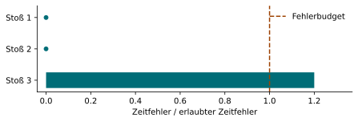

**Aufgabe.** Die zweite und dritte Kontaktkennung werden vertauscht. Alle drei Zeiten bleiben gleich. Wie ändert sich die Auswertung?

**Musterlösung.** Zuerst vergleicht der Beobachter die geordnete Kontaktfolge. Die Zuordnung des zweiten und dritten Referenzwerts wäre nach der Vertauschung falsch. Der Beobachter meldet die Abweichung mit beiden Kennungen. Ein Maximum über die drei Zeitdifferenzen hätte hier keine physikalische Bedeutung. Die Funktion `benchmark()` in `rechenlabor/kapitelvergleich.py` prüft beide Fälle.

<!-- Buchseite -->

<a id="bild-abnahme"></a>

## Vom Ereignisprotokoll zum Budgetentscheid

Ein Kugelstoß kann auf die Mikrosekunde genau am erwarteten Zeitpunkt liegen und trotzdem die falschen Kugeln betreffen. Würde man nur die Zeiten subtrahieren, bekäme diese Rechnung den Score null. Deshalb vergleichen wir zuerst die Identität und Reihenfolge der verlangten Beobachtungen. Erst für ein vollständiges Protokoll ist die Frage sinnvoll, wie weit sein Messwert vom Sollwert entfernt liegt.

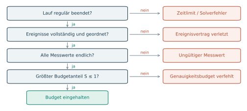

Für eine Sollzeit von $1{,}000\,\mathrm s$ und ein Budget von $0{,}002\,\mathrm s$ beansprucht der richtige Kontakt bei $1{,}001\,\mathrm s$ die Hälfte seines Budgets. Der Quotient ist $0{,}5$. Sind alle übrigen Quotienten höchstens ebenso groß, wird der Lauf angenommen. Fehlt derselbe Kontakt ganz, bleibt sein Zeitfehler undefiniert. Diese Unterscheidung bestimmt, welche Punkte später im Aufwand-Genauigkeits-Diagramm erscheinen.

<!-- Buchseite -->

<a id="druck-beleglegende"></a>

## Leseschlüssel · Beweis, Gegenprobe oder historische Messung?

**Beweis.** Die Aussage folgt aus Voraussetzungen. Stehen dort feste Enden oder ein einfacher Nulldurchgang, gilt das Ergebnis nicht automatisch für freie Enden oder eine Mehrfachnullstelle. Ein Beispiel kann den Beweis illustrieren, aber nicht ersetzen.

**Numerische Gegenprobe.** Wir nennen Eingaben, Referenz, Raster oder Zeitpunkte und Fehlermaß. Eine eingehaltene Fehlerschranke auf 500 Stützstellen ist zunächst nur ein Befund für diese 500 Stellen. Für eine Schranke zwischen den Stellen brauchen wir ein zusätzliches Argument.

**Historische Messung.** Eine Zahl aus einem Archiv gehört zu genau dieser Revision, Konfiguration und Messumgebung. Vergleichen wir Laufzeiten, müssen Aufgabe und Arbeitsumfang zusammenpassen. Eine neue Wiederholung steht separat und überschreibt den Archivwert nicht.

**Einmal an C05 anwenden:** Das Euler-Schrittlimit für die schnelle lineare Mode ist eine hergeleitete Aussage. Die drei Schaltzeitfehler von Radau und BDF sind gemessene Ergebnisse auf einem begrenzten Versuch. Die ursprüngliche Acht-Fälle-Matrix bleibt mit ihrer eigenen Revision und ihrem eigenen Budget dokumentiert.

<!-- Buchseite -->

<a id="kap10-schluss"></a>

## Schluss · Ein Auftrag gilt erst mit Beobachtung und Referenz

Die Kugelreihe braucht eine Kontaktzeit zusätzlich zur Endgeschwindigkeit. Beide Programme lösen dieselbe Aufgabe, wenn Modell, Beobachter und Kriterien übereinstimmen. Die Ereignisse müssen vollständig sein und zu den richtigen Kugelpaaren gehören. Erst dann kann man für jede numerische Größe den Fehler durch ihr Budget teilen. Der größte Anteil benennt die Messgröße, die dem Grenzwert am nächsten kommt.

Bei einer Abweichung bleibt das Ergebnis als Diagnose nutzbar. Eine zu späte Schaltung verlangt eine andere Gegenprobe als ein falsch zugeordnetes Ereignis. Ein abgebrochener Lauf muss als solcher erkennbar sein. Der Aufwand wird bei gleicher geforderter Qualität und vergleichbaren Laufbedingungen ausgewertet. Dazu gehören Modell- und Programmstand, Referenz, Budgets sowie der Status jedes Laufs.

Im folgenden Versuch werden die Beobachtungen einer Hystereseschaltung einzeln festgelegt. Wir werden sehen, warum ein richtiger Endwert zu wenig über die schnelle Phase nach der Schaltung aussagt. [C05](#fb-neu11)

<a id="kap10-forschung"></a>

### Aktueller Stand der Forschung

Ein 2026 publizierter Rahmen zur Reproduzierbarkeit rechnergestützter Experimente fasst Abläufe und die zugehörigen Informationen so, dass ein Versuch aus mehreren wissenschaftlichen Bereichen erneut ausgeführt werden kann. Für Solverberichte ist daran eine Trennung besonders wertvoll. Die technische Wiederholung eines Ablaufs prüft, ob sich Daten und Ausführung rekonstruieren lassen. Eine unabhängige Gegenrechnung prüft zusätzlich die numerische Aussage. Im Kugelversuch könnte eine zweite Implementierung denselben Ablauf zunächst ausführen und dann die Kontaktzeiten aus den analytischen Abständen neu bestimmen. Beide Prüfungen gehören mit ihrer jeweiligen Referenz ins Ergebnis. [A framework for supporting the reproducibility of computational experiments in multiple scientific domains (2026)](https://doi.org/10.1016/j.future.2025.107924)

[Zur Einleitung dieses Kapitels](#kap10-einstieg)

<!-- Buchseite -->

<a id="fb-neu11"></a>

# Kapitel 11 · C05 – Zwei Zustände, Hysterese und schnelle Relaxation

<a id="kap11-einstieg"></a>

## Einleitung · Welche Uhr verrät, ob ein schneller Schalter richtig gerechnet wurde?

Die Anzeige eines Reglers folgt einer langsam wandernden Sollgröße. Nach einem Wechsel liegt ihr neuer Sollwert plötzlich an einer anderen Stelle. Die Anzeige reagiert für einen kurzen Augenblick besonders schnell. Wer erst am Ende der Rechnung hinsieht, bemerkt diesen Augenblick kaum. Die nächste Schaltung hängt aber von der kontinuierlichen Bewegung bis zu einer Schwelle ab. Lässt sich die kurze Phase wirtschaftlich berechnen und der kommende Wechsel trotzdem genau treffen?

Das Wärmebild aus Kapitel 1 hilft beim Verständnis der beiden Zeitskalen. C05 selbst definiert ein mathematisches Zweizustandsmodell. Der zweite Zustand läuft innerhalb eines Modus exponentiell auf einen festen Sollwert zu. Der erste Zustand folgt ihm mit einem größeren Koeffizienten und einem modusabhängigen Versatz. Beim Durchgang durch die obere Schwelle wechselt die Regel, und erst an der unteren Schwelle gilt wieder die erste Regel. Dieser Unterschied heißt Hysterese.

Wir lösen die Phasen nacheinander analytisch und verwenden die Durchgangszeiten als Referenz. Das kurze Studienfenster von $3{,}5\,\mathrm s$ verlangt drei gerichtete Wechsel mit je $1\,\mathrm{ms}$ Zeitbudget und zwei Endwerte mit je $0{,}006$ Budget. Für die Diagnose reichen diese Endwerte allein nicht aus. Auf beiden Seiten eines Wechsels speichern wir auch den Modus und den Zustand. So können wir getrennt untersuchen, ob ein Integrator die schnelle Bewegung dämpft und ob er tatsächlich den richtigen Wächter zur richtigen Zeit erreicht.

[Übung: Stabilität, Schaltzeit und Aufwand](#druck-c05-entscheidung) · [Zum Schluss dieses Kapitels](#kap11-schluss)

<!-- Buchseite -->

<a id="fb-kap8"></a>

## C05 · Wie klein ist ein schneller Vorgang?

**Lernziel.** Sie können im ARGESIM-Fall C05 die schnelle Zeitkonstante abschätzen, eine explizite Schrittweite beurteilen und Schaltzeit und Endzustand getrennt prüfen.

Eine Kurve auf dem Bildschirm umfasst mehrere Sekunden. Für ein schnell abklingendes Detail nennt das Modell eine Rate von $a=2{,}7\cdot10^6\,\mathrm{s^{-1}}$. Könnte ein Rechenschritt von einer Mikrosekunde schon zu groß sein? Für diese Vorrechnung betrachten wir eine einzelne Abweichung $z$ mit $\dot z=-az$.

### Ein überschaubares Experiment vor dem Benchmark

Starten wir mit $z_0=1$, ergibt Euler $z_1=1-ah$. Bei $h=1\,\mu\mathrm s$ ist $ah=2{,}7$. Also springt die Rechnung auf $-1{,}7$. Eine zweite Anwendung liefert $+2{,}89$. Der Betrag wächst, obwohl die exakte Abweichung $e^{-at}$ ständig abnimmt. Nach der ersten Mikrosekunde beträgt sie nur rund $0{,}0672$.

### Was diese Probe für die Solverwahl liefert

Probieren Sie $0{,}25\,\mu\mathrm s$. Der Faktor wird $0{,}325$. Die Abweichung fällt jetzt. Der Unterschied zur exakten Kurve bleibt eine eigene Frage. Für $a>0$ ist $|1-ah|<1$ genau bei $0<h<2/a$ erfüllt. Das erklärt die Kosten kleiner expliziter Schritte über mehrere Sekunden.

**Ihr Laborauftrag.** Prüfen Sie beim vollständigen Zweizustandsmodell zuerst Anzahl und Richtung der Schaltvorgänge. Vergleichen Sie danach jeden Zeitpunkt mit der Referenz und erst dann die beiden Endwerte. Ein Foto des Endzustands allein dokumentiert keinen einzigen Schaltzeitpunkt.

Die Parameter und Schaltregeln des offiziellen Modells folgen auf der nächsten Seite. Die skalare Abklingrechnung hier isoliert einen Teil der Dynamik.

**Kernweg**  [Gleichungen und Schalter](#fb-arg)  **Vertiefung**  [Exakte Phasen beweisen](#fb-schluss8) [Selbst prüfen](#fb-ueb8).

<a id="fb-arg"></a>

## C05 · Zwei Zeitskalen und drei Schaltungen

**Erst schätzen.** Wie schnell klingt eine Störung mit der Rate $2{,}7\cdot10^6\,\mathrm{s^{-1}}$ um den Faktor $e$ ab?

Nun gilt das vollständige C05-Modell. Es ist durch Gleichungen vorgegeben. Die schnelle Größe $y_1$ läuft dem momentanen Ziel $y_2+c_2$ nach, die langsamere Größe $y_2$ dem Ziel $c_4$. Mit den Raten $a,b$ ergeben sich die beiden Bilanzen

$$
\dot y_1=a(y_2+c_2-y_1),\qquad \dot y_2=b(c_4-y_2)
$$

Die Raten sind $a=2{,}7\cdot10^6\,\mathrm{s^{-1}}$ und $b=3{,}5651205\,\mathrm{s^{-1}}$, der Start ist $(4{,}2;\,0{,}3)$. Zuerst gilt $(c_2,c_4)=(0{,}4;\,5{,}5)$. Steigt $y_1$ auf $5{,}8$, wird $(-0{,}3;\,2{,}73)$ aktiv. Beim Absinken auf $2{,}5$ wird zurückgeschaltet. Beide Zustände sind beim Umschalten stetig, ihre Ableitungen können springen.

### Referenz innerhalb einer Phase

Seien $(y_{10},y_{20})$ der Phasenstart und $s$ die lokale Zeit. Für $d=y_{20}-c_4,\ B=ad/(a-b)$ gilt durch Lösung der zweiten Gleichung und Einsetzen in die erste

$$
y_2=c_4+d e^{-bs},\qquad
 y_1=c_4+c_2+B e^{-bs}+(y_{10}-c_4-c_2-B)e^{-as}.
$$

Eine Nullstellensuche auf der jeweiligen exakten Phase liefert bis $3{,}5\,\mathrm{s}$ die Schaltzeiten $1{,}108306$, $2{,}129685$ und $3{,}054153\,\mathrm{s}$. Die Anfangsschicht hat die Zeitkonstante $1/a=0{,}37037\,\mu\mathrm s$.

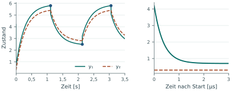

[Offizielle Aufgabe C05](https://www.argesim.org/benchmarks/c05) · [Phasenmodell](https://github.com/5H3LL3H5/argesim-hyperposition-benchmarks/blob/1824c9104152674b82de6cd84d53b0b4f68dca37/argesim_benchmarks/models/c05_two_state.py) · Schaltzeiten aus `c05_schaltungen` nachgerechnet.

<a id="fb-c05labor"></a>

## Labor C05 · Zwei Solver unter derselben Schaltregel

### Auftrag und Versuchsaufbau

Berechnen Sie für das [Zweizustandsmodell](#fb-arg) alle Schaltzeiten bis $3{,}5\,\mathrm{s}$ und den Endzustand. Verwenden Sie für diesen Lehrversuch die Schranken $10\,\mu\mathrm s$ je Ereignis und $10^{-5}$ je Zustandskomponente. Diese Grenzwerte sind enger als die des späteren Projektvergleichs. Halten Sie den jeweiligen Modus bis zum gerichteten Übergang fest, lokalisieren Sie die Nullstelle, schalten Sie um und starten Sie den Solver beim gefundenen Zeitpunkt neu. Ein Restart verwirft die Schrittgeschichte des bisherigen Modus.

Radau IIA und BDF erhalten hier $\mathrm{rtol}=10^{-8}$, $\mathrm{atol}=10^{-10}$, $h_\mathrm{max}=0{,}2\,\mathrm{s}$ sowie die gleiche exakte Jacobi-Matrix $J=\left(\begin{smallmatrix}-a&a\\0&-b\end{smallmatrix}\right)$. Als dritte, unabhängige Rechnung dienen die analytischen Phasen mit skalarem Nullstellensucher. Diese liefert $y(3{,}5)=(2{,}97475519,3{,}27475448)^\mathsf T$.

<a id="revision-k11-01"></a>

**Studie und Ziel.** Diese Tabelle gehört zum dreifachen Referenzvergleich über $3{,}5\,\mathrm s$ mit $10\,\mu\mathrm s$ Zeitbudget und $10^{-5}$ Endwertbudget. In der getrennten Acht-Fälle-Reihe versagen im C05-Fenster 54 QSS-Einstellungen und drei klassische Einstellungen, also 0 von 57. In der Steifigkeitsstudie mit 138 Gesamtkonfigurationen sind weitere Kandidaten zugelassen. Radau erreicht bei relativer Toleranz $10^{-3}$ den Score 0,4168 gegenüber der analytischen Phasenlösung. Dort gelten $1\,\mathrm{ms}$ je Schaltzeit und 0,006 je Endzustand. Erst Kandidaten und Vertrag zusammen erklären die unterschiedlichen Entscheidungen.

<a id="tab-k11-01"></a>

| Verfahren | $f$-Aufrufe | LU | max. Zeitfehler | max. Endfehler |
| --- | --- | --- | --- | --- |
| Radau IIA | 5 029 | 256 | $0{,}0152\,\mu\mathrm s$ | $2{,}95\cdot10^{-8}$ |
| BDF | 1 690 | 169 | $1{,}13\,\mu\mathrm s$ | $2{,}33\cdot10^{-6}$ |

Beide Verfahren liefern alle drei Übergänge und erfüllen beide Ziele. Am Zeitfehler ist Radau hier genauer. BDF benötigt weniger Funktionsauswertungen und Faktorisierungen. Bei einer verschärften Zeitgrenze von $1\,\mu\mathrm s$ qualifiziert sich in diesen Einstellungen allein Radau. So entscheidet ein geänderter Auftrag bei denselben Rohdaten anders.

### Gegenversuch

Verwenden Sie gedanklich Vorwärts Euler. Für die schnelle reelle Mode verlangt $|1-ha|\le1$ bereits $h\le 2/a=0{,}740740\ldots\,\mu\mathrm s$. Selbst an der Stabilitätsgrenze bräuchte ein gleichmäßiges Gitter über 3,5 Sekunden mindestens 4 725 000 Schritte. Bei $0{,}740\,\mu\mathrm s$ ist $R=-0{,}998$, bei $0{,}741\,\mu\mathrm s$ schon $R=-1{,}0007$. Für eine stabile Proberechnung eignet sich von diesen Werten nur der erste. Die Rechnung erklärt, warum ein naiver expliziter Vergleich hier teuer ist.

Neu gerechnet mit `python labor.py c05`, SciPy 1.17.0. [Referenz für die Modellparameter](https://github.com/5H3LL3H5/argesim-hyperposition-benchmarks/blob/1824c9104152674b82de6cd84d53b0b4f68dca37/argesim_benchmarks/models/c05_two_state.py).

### Was ein explizites Schrittlimit über den Aufwand verrät

Die analytische Lehrprobe kann neben Euler auch Dormand–Prince 5(4) beurteilen. Für die schnelle C05-Mode gilt $\lambda=-a$. Setzen wir $z=-ah$ in das Stabilitätspolynom der akzeptierten Formel ein, erhalten wir
$$
R(z)=1+z+\tfrac12z^2+\tfrac16z^3+\tfrac1{24}z^4+
\tfrac1{120}z^5+\tfrac1{600}z^6 .
$$
<a id="druck-dp-grenze"></a>

Warum endet das Intervall gerade hier? Für $x=ah>0$ ist $R(-x)$ größer als $e^{-x}$, denn es ist das Taylorpolynom sechsten Grades für $e^{-x}$ plus $x^6/3600$. Es genügt daher, $R(-x)=1$ zu lösen. Nach Ausklammern von $x/600$ bleibt
$$p(x)=x^5-5x^4+25x^3-100x^2+300x-600.$$
Es gilt $p(0)<0$, $p(4)>0$ und $p'(x)=5(x^2-2x)^2+55x^2-200x+300>0$. Das letzte Quadratpolynom hat negative Diskriminante. Die einzige positive Nullstelle $x_5=3{,}306567893\ldots$ liefert also genau $0\le ah\le x_5$. Bei $a=2{,}7\cdot10^6\,\mathrm{s^{-1}}$ folgt $h\le1{,}22465\,\mu\mathrm s$, also mindestens 2 857 949 gleich große Schritte über $3{,}5\,\mathrm s$. Das Labor gewinnt das Polynom unabhängig aus dem Stufentableau. [Dormand und Prince, 1980](https://doi.org/10.1016/0771-050X%2880%2990013-3)

**Zur Auswertung im Labor.** Die feste Schrittzahl ist eine Stabilitätsrechnung für eine skalare Mode. Ein adaptiver RK45-Lauf wählt seine Schritte anhand des tatsächlichen Zustands, seines Fehlerschätzers und der Ereignisbehandlung. Seine verworfenen Versuche sind eine eigene Messgröße. Die Tabelle oben dokumentiert für Radau IIA und BDF die gemessenen Aufrufe der rechten Seite, die LU-Zerlegungen und die Zeitfehler. Zählt man bei einem weiteren Solver auch Lösungsversuche und Ereignisaufrufe, lassen sich diese Arbeitsgrößen bei demselben Auftrag vergleichen.

<!-- Buchseite -->

<a id="kap11-schrittfolge"></a>

### Was fünf schnelle Zeitkonstanten für die langsame Phase bedeuten

In der analytischen Phasenlösung fällt ein Anteil mit der Rate $a=2{,}7\cdot10^6\,\mathrm{s^{-1}}$, der andere mit $b\approx3{,}565\,\mathrm{s^{-1}}$. Nach der Zeit $5/a\approx1{,}85\,\mu\mathrm s$ hat sich der schnelle Anteil mit $e^{-5}\approx0{,}00674$ multipliziert. Von seiner ursprünglichen Amplitude sind also weniger als ein Prozent übrig. Für den langsamen Anteil ist in derselben Zeit der Exponent nur $5b/a\approx6{,}6\cdot10^{-6}$. Seine Amplitude hat sich kaum verändert.

Die Rechnung erklärt, was ein impliziter Solver gewinnen kann. Wenn der Auftrag nur den weiteren langsamen Verlauf verlangt, sollte die schnelle Mode nach einigen ihrer Zeitkonstanten numerisch nicht erneut wachsen. Wer dagegen die Form der ersten Übergangsschicht selbst messen will, braucht in genau diesem Abschnitt genügend Ausgabepunkte und eine Fehlerkontrolle. Jeder Moduswechsel kann erneut einen schnellen Anteil anregen, weil sich die rechte Seite ändert.

Das Ereignisbudget prüft eine weitere Eigenschaft. Die Schaltung findet dort statt, wo die Phasenlösung ihre Schwelle erreicht. Ein Solver kann die Anfangsschicht gut dämpfen und die Schwelle mit einer zu groben Zwischenwertkurve trotzdem zu spät finden. Darum bleiben die Phase und die Uhrzeit getrennte Prüfgrößen.

<!-- Buchseite -->

<a id="fb-pruefung11"></a>

## C05 · Welche Messgröße den Vergleich entscheidet

Der Regler schaltet dreimal. Eine Berechnung kann jeden Schaltaugenblick fast genau treffen und am Ende trotzdem den schlechteren Zustandswert liefern. Das wird sichtbar, wenn man die Zeitfehler und die Endzustandsfehler vor dem Maximum getrennt normiert. Wir verwenden hier ausdrücklich die engen Grenzen des C05-Lehrversuchs [Labor C05 · Zwei Solver unter derselben Schaltregel](#fb-c05labor).

Dort betragen die Budgets $10\,\mu\mathrm{s}$ je Schaltung und $10^{-5}$ je Zustandskomponente. Für Radau ergeben die größten Abweichungen $0{,}0152\,\mu\mathrm{s}/(10\,\mu\mathrm{s})=0{,}00152$ und $2{,}95\cdot10^{-8}/10^{-5}=0{,}00295$. Für BDF erhält man $1{,}13/10=0{,}113$ sowie $2{,}33\cdot10^{-6}/10^{-5}=0{,}233$. Mit den gedruckten, gerundeten Werten ist also $S_{\rm Radau}\approx0{,}00295$ und $S_{\rm BDF}\approx0{,}233$. In beiden Fällen stammt das Maximum aus dem Endzustand. BDF benötigt im selben Versuch 169 LU-Zerlegungen, Radau 256. Genauigkeit und Faktorisierungsaufwand beantworten verschiedene Fragen.

Die ursprüngliche Matrix verwendet andere Budgets und andere Verfahrenseinstellungen. Dort meldet etwa QSS2 mit Quantenfaktor $10^{-3}$ einen Timeout. Für diesen Eintrag fehlt der vollständige Beobachtungsvektor. Eine freie Zahl wie „unendlicher Fehler“ würde eine nicht gemessene Größe vortäuschen. Die Standardaufgabe mit fünf Wechseln und der D-Versuch mit 62 Wechseln besitzen wiederum einen anderen Beobachtungshorizont.

**Erster Schritt bei abweichendem Befund.** Vergleichen Sie den aktiven Schalter, den Zeitpunkt seiner Aktivierung und die gerichtete Schwellenüberschreitung mit der analytischen Lösung des aktuellen Modus. Erst wenn alle drei Ereignisse zugeordnet sind, haben die zwei Endwertfehler dieselbe physikalische Bedeutung.

[Fehler und Aufwandszähler](#fb-c05labor) · [ARGESIM-Aufgaben](#fb-refC05) · [Ursprüngliches Raster](https://github.com/5H3LL3H5/argesim-hyperposition-benchmarks/blob/16f0f2528fcf77f16898ecd74ad952be2c09eac2/docs/evidence/qss-extension.csv).

<a id="fb-ueb8"></a>

## Selbst prüfen · Zeitbudgets bei C05

**Merksatz.** Im C05-Versuch können schnelle Abweichungen längst abgeklungen sein, während ein expliziter Integrator für ihre numerische Stabilität weiterhin kleine Schritte benötigt.

### A · Eine Zeitskala erkennen

Für eine vereinfachte Abklingprobe sei $a=4\cdot10^5\,\mathrm{s^{-1}}$ und $\dot z=-az,\ z(0)=1$. Wie viele Mikrosekunden dauert es bis auf $1/e$, wie lange bis auf ein Prozent? Schreiben Sie erst die Gleichung für den Restanteil und dann den Zahlenwert.

### B · Einen vermeintlich sicheren Schritt prüfen

Für dieselbe Probe behauptet jemand, bei $h=5\,\mu\mathrm s$ bilde Euler das Abklingen gut ab, weil sein Zustandsbetrag begrenzt bleibt. Prüfen Sie die ersten drei Schritte. Untersuchen Sie anschließend $h=2{,}5\,\mu\mathrm s$. Welches Verhalten zeigt diese Rechnung nach nur einem Schritt im Vergleich zum exakten Rest?

### C · Einen Auftrag für Prüfdaten auswerten

Für einen Lehrvergleich seien alle drei Ereignisse richtig geordnet und beide Endzustände hinreichend genau. Bei Einstellung A betragen die absoluten Zeitfehler $0{,}3;\ 0{,}7;\ 0{,}9\,\mu\mathrm s$, bei B $0{,}2;\ 1{,}4;\ 0{,}4\,\mu\mathrm s$. A benötigt 200, B 120 Auswertungen derselben rechten Seite. Welche Einstellungen erfüllen eine Grenze von $1\,\mu\mathrm s$ je Ereignis? Wie verändert eine Grenze von $2\,\mu\mathrm s$ die Wahl, wenn nur diese Auswertungen gezählt werden? Dies sind Übungsdaten.

**Hinweis.** Bei einer Grenze pro Ereignis ist der größte Einzelwert entscheidend. Rechnen Sie Mikrosekunden vor dem Einsetzen in $1-ah$ in Sekunden um.

[Lösungswege A, B und C](#fb-loesweg8) · [Zum Kapitelauftakt](#fb-kap8).

<a id="fb-loesweg8"></a>

## Lösungswege · Zeitbudgets bei C05

### A · Beide Restanteile berechnen

Mit $z=e^{-at}$ gehört zum Restanteil $1/e$ die Zeit $t=1/a=2{,}5\,\mu\mathrm s$. Für $z=0{,}01$ gilt $-at=\ln(0{,}01)$. Damit ist $t=\ln(100)/a\approx11{,}51\,\mu\mathrm s$. Eine Zeitkonstante senkt die Störung also noch lange nicht auf ein Prozent.

### B · Begrenzte Schwingung und richtiges Abklingen

Für $5\,\mu\mathrm s$ ist der Euler-Faktor $1-2=-1$. Aus $1$ entstehen $-1,1,-1$. Der Betrag bleibt konstant, die exakte Lösung fällt. Für $2{,}5\,\mu\mathrm s$ ist der Faktor null. Nun verschwindet die numerische Störung schon im ersten Schritt vollständig. Exakt bleibt $e^{-1}\approx0{,}3679$. Auch diese andere stabile Wahl erzeugt hier einen großen Fehler.

### C · Erst die Schwelle prüfen, dann zählen

Die größten absoluten Zeitfehler sind $0{,}9$ und $1{,}4\,\mu\mathrm s$. Bei $1\,\mu\mathrm s$ erfüllt nur A den gesamten Auftrag. Bei $2\,\mu\mathrm s$ erfüllen ihn beide. B braucht in den vorgegebenen Daten 80 Auswertungen weniger. Das sind bezogen auf A $80/200=40\,\%$ weniger Auswertungen. Ob die Wanduhr ebenfalls 40 Prozent weniger anzeigt, wurde in dieser Übung nicht gemessen.

**Bezug zum eigentlichen Labor.** Auch dort gibt es eine analytische Referenz innerhalb jeder Phase. Setzen Sie die Zeitmessung des Ereignisses an der verfeinerten Nullstelle an. Der nächste Ausgabepunkt eines Zeitrasters kann deutlich später liegen.

[Noch einmal selbst rechnen](#fb-ueb8) · [Forschungsstand und Beweisfragen](#fb-schluss8).

<a id="fb-schluss8"></a>

## Eine Schaltzeit ist eine eigene Messgröße

### Welche Frage die analytische Phase beantwortet

C05 gehört zu den frühen ARGESIM-Vergleichen für zustandsabhängiges Schalten. Die neuere Theorie hybrider Sensitivitäten erklärt, warum eine kleine Abweichung in einem kontinuierlichen Zustand den Zeitpunkt eines Wechsels verschieben kann. Untersuchungen zu adaptiven Reglern erklären außerdem, warum Schrittfolgen und Arbeitsaufwand vom implementierten Regler abhängen. Beide Fragen betreffen den vorliegenden Versuch.

### Beweis · Exakte Phasen trotz steifer Mode

In einem festen Modus ist $y_2-c_4=d e^{-bs}$. Die erste Gleichung hat die Form $\dot y_1+ay_1=a(c_4+c_2+d e^{-bs})$. Der Ansatz $A+B e^{-bs}+C e^{-as}$ liefert durch Koeffizientenvergleich $A=c_4+c_2,\ (a-b)B=ad$. Aus dem Anfangswert folgt $C=y_{10}-A-B$. Damit ist die [C05 · Zwei Zeitskalen und drei Schaltungen](#fb-arg) verwendete Phasenreferenz für $a\ne b$ bewiesen. Bei $a=b$ benötigt der Resonanzterm stattdessen einen Faktor $s e^{-as}$.

### Ergebnis der Nachuntersuchung

Für beide um bis zu $0{,}005$ veränderten Schaltschwellen lassen sich die ersten vier Übergänge per Intervallarithmetik einklammern. Drei davon liegen sicher innerhalb des Lehrversuchs von $3{,}5\,\mathrm{s}$.

[Nachweis und Ergebnis](#fb-befundereignis) · [ARGESIM C05](https://www.argesim.org/benchmarks/c05) · [Kong u. a., Sensitivität an Ereignissen](https://arxiv.org/abs/2306.06862) · [Ranocha und Giesselmann, adaptive Schrittweitenkontrolle](https://doi.org/10.1007/s44207-024-00001-0).

**Gegenprobe im Rechenlabor.** Bei genau drei richtigen Schaltungen vergleicht `rechenlabor/kapitelvergleich.py` Radau und BDF mit denselben äußeren Budgets. Bei einem Zeitbudget von zehn Mikrosekunden trägt ein Fehler von 1,13 Mikrosekunden den Anteil 0,113 zum Maximalscore bei. Rechnen Sie anschließend den Anteil des Endwertes aus der Tabelle aus. Die Rangfolge der Zeitfehler beantwortet erst eine Hälfte der Frage.

<!-- Buchseite -->

<a id="bild-c05"></a>

## Wo in der Hystereseschleife steckt die Steifigkeit?

Verfolgen Sie die Bahn vom Stern aus. Auf der horizontalen Achse steht der langsamere Zustand $y_2$, auf der vertikalen der Schaltzustand $y_1$. Am oberen Schwellwert $5{,}8$ ändert der Regler das Vektorfeld. Beide Zustände behalten im Umschaltaugenblick ihren Wert. Kurz danach ändert sich $y_1$ so rasch, dass dieser Teil der Bahn im Phasenporträt beinahe senkrecht erscheint.


Die drei Referenzschaltungen liegen bei 1,108306 s, 2,129685 s und 3,054153 s. Die Vergrößerung erklärt, warum ein Integrator auf der Sekundenskala zugleich eine Mikrosekundenschicht auflösen muss. Am Ende dieser Schicht liegt die Bahn bereits nahe am langsamen Ast. Die zeitlich geordnete Spur zeigt, in welcher Richtung der Regler die Schleife durchläuft. Ein Beweis für die Existenz oder Stabilität eines asymptotischen Grenzzyklus verlangt zusätzliche Argumente.

<!-- Buchseite -->

<a id="druck-c05-entscheidung"></a>

## Übung · Welcher Aufwand lohnt sich bei C05?

**Auftrag.** Bis 3,5 s müssen alle drei gerichteten Schaltungen in der richtigen Reihenfolge und beide Endwerte getroffen werden. Das Endwertbudget je Komponente ist $10^{-5}$. Vergleichen Sie ein Zeitbudget von 10 µs mit einem von 1 µs. Für die schnellste lineare Mode gilt $\lambda=-2{,}7\cdot10^6\,\mathrm{s^{-1}}$. Die [Messung im selben Versuch](#tab-k11-01) liefert für Radau 0,0152 µs Zeitfehler, 5 029 Aufrufe der rechten Seite und 256 LU-Zerlegungen; für BDF 1,13 µs, 1 690 Aufrufe und 169 Zerlegungen. Beide Endwertfehler liegen im Budget.

**1. Erst die Stabilität.** Sind 0,740 µs und 0,741 µs für Vorwärts Euler auf der schnellen Mode zulässig? Wie viele gleich große Schritte verlangt das Stabilitätslimit mindestens?

**2. Dann die Entscheidung.** Welchen gemessenen Lauf wählen Sie unter jedem Zeitbudget? Was lässt sich aus den Arbeitszählern sagen, und was nicht?

**Lösung.** Der Euler-Faktor ist $R=1+h\lambda$. Die beiden Werte sind −0,998 und −1,0007. Nur der erste liegt im Stabilitätsintervall; am Grenzwert $h=2/|\lambda|$ ergeben sich mindestens $\lceil3{,}5/h\rceil=4\,725\,000$ Schritte. Das sagt nichts darüber aus, wie genau der Kalendereintrag einer Schaltung ist.

Bei 10 µs bestehen beide Läufe. BDF braucht in diesem Versuch weniger Aufrufe und LU-Zerlegungen. Bei 1 µs besteht nur Radau; die niedrigeren Zähler retten BDF dann nicht. Zähler sind keine Wandzeit: Eine LU-Zerlegung hat andere Kosten als ein Aufruf der rechten Seite, und der Ereignissucher kann zusätzliche Arbeit verursachen. Eine zusätzliche oder falsch zugeordnete Schaltung würde beide Zeitvergleiche ungültig machen.

<!-- Buchseite -->

<a id="kap11-schluss"></a>

## Schluss · Die schnelle Phase erklärt den Aufwand, die Schaltzeit entscheidet

Der Zeitpunkt der nächsten Schaltung wird durch den gerichteten Durchgang der ersten Zustandsgröße bestimmt. Die unterschiedlichen Zeitskalen erklären, weshalb eine explizite Festschrittrechnung sehr viele Schritte benötigen kann, obwohl die schnelle Komponente bald abklingt. Diese Stabilitätsrechnung sagt etwas über gewählte Schrittweiten. Wie viel Arbeit ein adaptiver Lauf tatsächlich leistet, entscheidet sein protokollierter Verlauf mit Ereignissuche.

Im kurzen Matrixfenster bestand keine der ursprünglichen 57 Einstellungen. Die spätere Auswahlstudie mit ereignisbewusstem Radau und BDF untersucht zusätzliche Kandidaten. Welche Rechnung geeignet ist, lässt sich hier anhand der analytischen Phasen und der drei zugeordneten Übergänge prüfen. Ein Zeitlimit ist eine Information über einen Versuch. Es begründet für sich allein weder die Genauigkeit der bis dahin berechneten Größen noch eine allgemeine Aussage über andere Einstellungen desselben Solvers.

In der Kugelreihe verändert der Wechsel nicht nur das nachfolgende Feld. Beim Stoß werden auch Geschwindigkeiten neu zugeordnet. Das nächste Kapitel führt die Prüfung darum vom einzelnen Zeitpunkt zur ganzen Ereignisfolge. [C12 und C21-Ball](#fb-neu12)

Der Vergleich im Anhang erprobt eine Fourier-Schicht für die Zeit eines Schaltvorgangs und prüft den Kandidaten am vollständigen Phasenfluss. [Anhang D](#fno-transfer-c05)

<a id="kap11-forschung"></a>

### Aktueller Stand der Forschung

Lopez und Maset untersuchen die Ereignissuche bei diskontinuierlichen differential-algebraischen Gleichungen. Sie ändern die unabhängige Zeitvariable so, dass der Ereigniszeitpunkt im transformierten Problem vorab festliegt. Die Arbeit zeigt einen Weg für Fälle, in denen eine Stufenauswertung jenseits der Grenzfläche problematisch wäre. C05 ist in seinen Phasen eine gewöhnliche Differentialgleichung und besitzt hier eine eigene geschlossene Referenz. Mit ihr ließe sich gezielt prüfen, ab welcher Schwellensteilheit eine alternative Lokalisierung Vorteile hat. Dafür müsste man Zahl und Identität der Schaltungen, Zeitabweichung und Zusatzarbeit mit derselben Abnahme messen. [Lopez und Maset, Time Reparametrization and Event Location (2024)](https://doi.org/10.1007/s10915-024-02546-w)

[Zur Einleitung dieses Kapitels](#kap11-einstieg)

<!-- Buchseite -->

<a id="fb-neu12"></a>

# Kapitel 12 · C12 und C21 – Stöße, Kontakte und Zeno-Kollaps

<a id="kap12-einstieg"></a>

## Einleitung · Was erzählt die Reihenfolge der Stöße, die der Endzustand verschweigt?

Eine Kugel trifft auf eine Reihe ruhender Kugeln. Am Ende rollt die letzte davon. Um zu erklären, wie der Impuls dorthin kam, müssen wir wissen, welche Paare nacheinander in Kontakt waren. Bei einem fallenden Ball zeigt sich ein zweiter Grund, genau auf die Uhr zu schauen. Nach einem Rückprall folgt der nächste schneller. Die Flugzeiten können sich zu einer endlichen Grenzzeit summieren.

Wir behandeln den Flug und den Kontakt als zwei verschiedene Rechenaufgaben. Zwischen getrennten Stößen sind die geraden Bahnen der Kugeln leicht zu berechnen. Beim elastischen, zentralen Stoß zweier gleicher Massen tauschen sich ihre Geschwindigkeiten aus. Danach ändern sich die Kandidaten für die nächsten Kontakte. Für den freien Fall wirkt dagegen eine konstante Beschleunigung. Erst das Übergangsgesetz am Boden bestimmt die Geschwindigkeit des nächsten Flugs.

Die offizielle C12-Aufgabe umfasst unter anderem auch inverse und stochastische Untersuchungen. Hier prüfen wir zunächst das elastische Fenster mit Kontakten bei 1, 2 und 3 Sekunden und Endwerten bei 4 Sekunden. Im C21-Ballfenster liegen die beiden geforderten gerichteten Stöße vor Sekunde fünf. Das Zeitbudget beträgt jeweils eine Millisekunde. Aus diesen festgelegten Versuchen lernen wir, welche Kontaktinformationen ein Simulator für einen nachvollziehbaren Verlauf aufzeichnen muss.

[Zum Schluss dieses Kapitels](#kap12-schluss)

<!-- Buchseite -->

<a id="fb-kap9"></a>

## C12 · Wann stoßen die Kugeln zusammen?

**Lernziel.** Sie können den nächsten isolierten Kontakt ausrechnen, die beiden Geschwindigkeiten aktualisieren und eine Simulation mit Impuls, Energie und Ereignisfolge prüfen.

Zwei gleich schwere Kugeln rollen auf einer Geraden nach rechts. Der freie Spalt zwischen ihren Oberflächen beträgt $0{,}60\,\mathrm{m}$. Links läuft die Kugel mit $0{,}80\,\mathrm{m/s}$, rechts mit $0{,}20\,\mathrm{m/s}$. Zu welchem Zeitpunkt müssen Sie die freie Bewegung unterbrechen?

### Zuerst die Geometrie, dann der Stoß

Jede Sekunde holt die linke Kugel $0{,}80-0{,}20=0{,}60\,\mathrm{m}$ auf. Im kräftefreien Modell verschwindet der Spalt nach einer Sekunde. Bei einem zentralen, ideal elastischen Einzelstoß gleicher Massen tauschen die Kugeln ihre Geschwindigkeiten. Unmittelbar danach nimmt der Spalt um $0{,}60\,\mathrm{m}$ pro Sekunde zu.

<a id="auflage-k12-01"></a>

**Gültigkeitsbereich des Stoßgesetzes.** Im gerechneten C12-Fenster aktualisieren wir die Geschwindigkeiten im Kontaktaugenblick mit Stoßzahl eins. Kontaktkraft, Eindringtiefe und Kontaktdauer gehören zu einem anderen Modell. Für zwei elastische Kugeln liefert ein Hertzscher Kontakt bei kleiner Eindringtiefe $\delta>0$ die Normalkraft $F=K\delta^{3/2}$. Die lokale Tangentensteifigkeit bei einer Vorlast $\delta_0>0$ ist $(3/2)K\sqrt{\delta_0}$. Eine lineare Feder mit diesem Wert beschreibt kleine Änderungen um diese Vorlast. Ein zusätzlicher Dämpfer bräuchte eine eigene Verlustannahme. [C12, offizielle Definition](https://www.sne-journal.org/benchmarks/c12/definition/comparison-12-collision-processes-in-rows-of-spheres-definition).


### Wie prüft man eine vermeintliche Lösung?

Für $m=1\,\mathrm{kg}$ pro Kugel ist der Gesamtimpuls vor und nach dem Tausch $1{,}00\,\mathrm{kg\,m/s}$. Die kinetische Energie beträgt jeweils $(0{,}8^2+0{,}2^2)/2=0{,}34\,\mathrm{J}$. Würde ein Programm die beiden Geschwindigkeiten unverändert lassen, stimmten diese Summen ebenfalls. Dann würden die Kugeln ab dem Kontakt ineinander laufen.

**Jetzt Sie.** Prüfen Sie deshalb auch das Vorzeichen der relativen Geschwindigkeit nach dem Kontakt. Bei einem schon wachsenden Spalt gibt es in dieser freien Phase keinen zukünftigen Stoß desselben Paars. Wie unterscheiden Sie diesen Fall von einer Kollision genau jetzt?

Im ARGESIM-Fall C12 konkurrieren mehrere Paare um das nächste Ereignis. Beim rückprallenden Ball aus C21 kommt noch die Frage hinzu, wie viele Einzelereignisse in eine endliche Zeit passen.

**Kernweg**  [Kontaktzeiten](#fb-c12labor)  **Vertiefung**  [Mehrfachkontakt und Grenzzeit](#fb-schluss9) [Selbst prüfen](#fb-ueb9).

<a id="fb-c12labor"></a>

## Labor C12 · Ein Ereignis aus Abständen ausrechnen

Zur Handrechnung setzen wir jede Masse der reduzierten A2-Aufgabe auf $1\,\mathrm{kg}$. Um unmittelbar mit den freien Spalten zu rechnen, ziehen Sie von jeder Mittelpunktkoordinate die bis dorthin aufsummierten Kugeldurchmesser ab. In diesen verkürzten Koordinaten $X_i$ bedeutet Gleichheit benachbarter Werte Kontakt. Die Startabstände von einem Meter werden zu $X(0)=(0,1,2,3)\,\mathrm{m}$.

### Vom Modell zum Ereigniskalender

Der freie Spalt eines Paares beträgt $g_i=X_{i+1}-X_i$. Es schließt sich mit der Rate $w_i=v_i-v_{i+1}$. Zwischen Stößen bleiben die Geschwindigkeiten konstant, also $g_i(t+\tau)=g_i(t)-w_i\tau$. Nur für $w_i>0$ liegt ein künftiger schließender Kontakt bei $\tau_i=g_i/w_i\ge0$. Der kleinste solche Wert bestimmt den nächsten Übergang. Ohne schließendes Paar folgt freier Flug bis zum Ende.

Zu Beginn hat nur das erste Paar $w_1=1\,\mathrm{m/s}$. Nach einer Sekunde stößt es. Nach dem Geschwindigkeitstausch bewegt sich Kugel 2 mit $1\,\mathrm{m/s}$ auf Kugel 3 zu. Der nächste und übernächste Kontakt folgen je eine Sekunde später. Bei $3{,}5\,\mathrm{s}$ ergibt sich

$$
X=(1,2,3,3{,}5)\,\mathrm{m},\qquad v=(0,0,0,1)\,\mathrm{m/s}.
$$

Für jede Zeile müssen Gesamtimpuls $1\,\mathrm{kg\,m/s}$, kinetische Energie $0{,}5\,\mathrm{J}$ und nichtnegative Spalte erhalten bleiben.

### Wo ein scheinbar guter Test versagt

Gibt ein fehlerhafter Simulator nach dem ersten Stoß weiterhin $v=(1,0,0,0)$ aus, bleiben Gesamtimpuls und Energie ebenfalls richtig. Der Spalt des ersten Paares würde danach negativ. Prüfen Sie deshalb zusätzlich, dass der getroffene Kontakt unmittelbar nach dem Reset öffnet, und protokollieren Sie die Paarindizes.

**Eigener Versuch.** Vergrößern Sie nur den dritten Anfangsspalt von $1$ auf $1{,}2\,\mathrm{m}$. Der dritte Stoß verschiebt sich auf $3{,}2\,\mathrm{s}$. Die ersten beiden Zeiten und sämtliche Geschwindigkeitswechsel bleiben unter diesen Annahmen gleich.

Ereigniskalender `python labor.py c12` · [ARGESIM C12, Aufgabenfamilie](https://www.argesim.org/benchmarks/c12).

<a id="fb-kugeln"></a>

## C12 · Stöße in einer Kugelreihe

**Erst schätzen.** Eine Kugel trifft zentral und ideal elastisch eine ruhende, gleich schwere Kugel. Welche bewegt sich danach?

Die reduzierte C12-Aufgabe enthält vier gleich schwere Kugeln mit je $1\,\mathrm{m}$ freiem Abstand. Nur Kugel 1 bewegt sich anfangs nach rechts mit $1\,\mathrm{m/s}$. Reibung und äußere Kräfte fehlen. Prüfen Sie nun, warum bei einem zentralen, vollkommen elastischen Einzelstoß gleicher Massen genau die im ersten Beispiel verwendete Tauschregel gilt.

### Die Resetregel aus Erhaltungsgrößen gewinnen

Seien $u,v$ die Geschwindigkeiten unmittelbar vor und $u',v'$ nach dem Stoß. Für gleiche Massen führen Impuls und kinetische Energie auf

$$
u+v=u'+v',\qquad u^2+v^2=u'^2+v'^2 .
$$

Daraus folgt $uv=u'v'$. Also haben $u',v'$ dieselbe Summe und dasselbe Produkt wie $u,v$ und sind die beiden Wurzeln desselben quadratischen Polynoms. Bei Annäherung wählt die elastische Stoßregel den trennenden Zweig $u'=v,\ v'=u$.

<a id="tab-k12-01"></a>

| Zeit | Kontakt | Geschwindigkeiten danach [m/s] |
| --- | --- | --- |
| $0\,\mathrm{s}$ | Start | $(1,0,0,0)$ |
| $1\,\mathrm{s}$ | Kugel 1 / Kugel 2 | $(0,1,0,0)$ |
| $2\,\mathrm{s}$ | Kugel 2 / Kugel 3 | $(0,0,1,0)$ |
| $3\,\mathrm{s}$ | Kugel 3 / Kugel 4 | $(0,0,0,1)$ |

Die drei Oberflächenspalte $g_j$ erfüllen in der Flugphase $\dot g_j=v_{j+1}-v_j$. Damit sind sie stückweise linear. Ein gerichteter Wächter findet $g_j=0$ bei schließendem Spalt. Nach dem Reset muss eine erneute Auslösung auf derselben Fläche zur Bewegung passen.

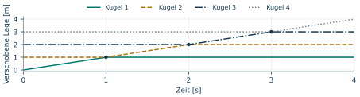

<a id="revision-k12-01"></a>

Beim ersten Kontakt stehen die tatsächlichen Mittelpunkte bei $x_1=1\,\mathrm m$ und $x_2=2\,\mathrm m$. Zwischen ihnen liegt genau ein Kugeldurchmesser $d=1\,\mathrm m$. Für Teilbild und Rechnung mit verschobenen Koordinaten verwenden wir $\xi_j=x_j-(j-1)d$. Dann sind $\xi_1=1\,\mathrm m$ und $\xi_2=1\,\mathrm m$. Der Schnitt der beiden gezeichneten Linien bezeichnet dasselbe Ereignis wie ein Meter Mittelpunktabstand im Bild der tatsächlichen Lagen.


**Warum QSS2 hier passt.** Lineare Position und konstante Geschwindigkeit beschreiben jeden freien Abschnitt genau. Jeder Kontakt löst einen Neustart aus. Für nachgiebige Kugeln mit schnellen Kontaktmoden wäre ein neuer Vergleich nötig.

[Offizielle Aufgabe C12](https://www.argesim.org/benchmarks/c12) · [Definition der reduzierten A2-Aufgabe und ihrer Zielgrößen](https://github.com/5H3LL3H5/argesim-hyperposition-benchmarks/blob/1824c9104152674b82de6cd84d53b0b4f68dca37/benchmarks/benchmark_solver_extension.py).

<a id="fb-ball"></a>

## Wann trifft der Ball zum zweiten Mal auf?

Die C21-Teilaufgabe beginnt mit einem Ball in $H=10\,\mathrm{m}$ Höhe und $v_0=0$. Zwischen Kontakten wirkt die Schwerkraft. Daraus folgt $\dot y=v,\ \dot v=-g,\ g=9{,}81\,\mathrm{m/s^2}$. Der Boden ist starr. Beim Erreichen von $y=0$ mit $v^-<0$ setzt das Modell $y^+=0,\ v^+=-e\,v^-$ mit $e=0{,}9$. Masse und Luftwiderstand werden für diese Fallaufgabe nicht benötigt.

Integration liefert $y=H-gt^2/2$. Beim ersten Stoß ist $t_1=\sqrt{2H/g}=1{,}427843\,\mathrm{s}$. Danach gilt mit $s=t-t_1$ die Parabel $y=e g t_1s-gs^2/2$. Ihre nächste positive Nullstelle liegt bei $s=2et_1$. Damit ist $t_2=(1+2e)t_1=3{,}997961\,\mathrm{s}$.

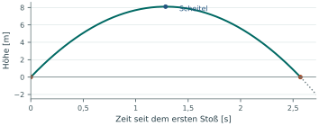

### Warum der Detektor zur Solverwahl gehört

Startet ein Schritt auf der Resetfläche, kann die Flugbahn innerhalb desselben großen Schritts aufsteigen und nochmals aufschlagen. Ein Test nur auf unterschiedliche Vorzeichen an den Endpunkten kann dieses Ereignis übersehen. Die archivierte Projektfassung zerlegt bei Koordinatenwächtern den kubischen Hermite-Interpolanten an inneren Extrema und sucht gerichtete Nullstellen auf den Teilintervallen.

Im historischen Lauf `8332be4d` fehlte der zweite Stoß bei QSS3 und QSS4 auf allen drei Quantenstufen. Die Wiederholung des C21-Fensters mit zwei analytischen Aufprallzeiten erfüllt das Budget für 6 der sechs QSS3/4-Einstellungen. Eine unabhängige Gegenprobe mit längerem Zeitlimit enthält die Einzelwerte beider Solverstände.

Den Stand des ursprünglichen Ereignistreibers dokumentieren die [Regressionstests](https://github.com/5H3LL3H5/argesim-hyperposition-benchmarks/blob/1824c9104152674b82de6cd84d53b0b4f68dca37/tests/test_hybrid_runtime.py). Die aktuelle Wiederholung steht im Rechenlabor unter `qss_pruefung/messung/`.

<a id="kap12-schrittfolge"></a>

### Warum nach einem Stoß auch ein Nachbarpaar neu gerechnet wird

Für ein Gedankenexperiment nehmen wir drei gleich schwere Kugeln mit den Geschwindigkeiten $(1,0,0)$ in derselben Einheit. Kugel 1 nähert sich Kugel 2 von links. Nach ihrem isolierten elastischen Kontakt stehen die Geschwindigkeiten bei $(0,1,0)$. Jetzt bewegt sich Kugel 2 auf Kugel 3 zu. Ein vorher geplanter Kontakttermin für dieses zweite Paar kann sich damit ändern. War die alte Relativgeschwindigkeit null, gab es vorher womöglich gar keinen solchen Termin.

Sind die beiden Kontakte gut getrennt, kann das Programm den ersten ausführen und dann mit dem neuen Zustand den nächsten bestimmen. Für bereits aneinanderliegende Kugeln zeigt dieselbe Rechnung einen Grenzfall. Würde das Programm Paar 2 und 3 vor Paar 1 und 2 prüfen, wären beide zunächst unbewegt. Unmittelbar nach dem ersten Stoß hat sich diese Beurteilung geändert. Die Reihenfolge im Kalender für gleichzeitige Einträge entscheidet damit noch nicht, wie ein physikalischer Mehrfachkontakt zu modellieren ist.

Das Ereignisprotokoll speichert deshalb Paar, Zeitpunkt und gerichtete Relativgeschwindigkeit. Die Endgeschwindigkeit der letzten Kugel lässt sich erst mit diesen Zahlen auf die tatsächlich gerechnete Folge zurückführen.

<!-- Buchseite -->

<a id="fb-pruefung12"></a>

## C12 und C21 · Ein Stoßzähler braucht einen Namen

Zwischen zwei elastischen Stößen bewegen sich die Kugeln geradlinig. In diesem C12-Fenster meldet QSS2 mit Quantenfaktor 0,001 0 interne Updates und 36 Auswertungen der rechten Seite. RK45 benötigt 148 Aufrufe. Die beiden Scores betragen 0 und 0. Die physikalischen Kontakte bearbeitet der Ereignistreiber.

Warum ist das möglich? Die drei Spaltweiten ändern sich in jeder Flugphase linear. Mit Spalt $d>0$ und konstanter schließender Relativgeschwindigkeit $\dot d<0$ folgt aus $0=d+\dot d\,\Delta t$ der nächste Termin $\Delta t=-d/\dot d$. Beim Stoß zweier gleicher Massen werden im elastischen Fall die Geschwindigkeiten getauscht. Der Ereignistreiber setzt diesen Reset um und startet die nächste Flugphase. Angenommene Quantisiererupdates, physikalische Kontakte und Funktionsaufrufe sind somit drei getrennte Zähler.

Beim freien C21-Ball ist die Höhe zwischen zwei Stößen quadratisch. Nach dem Rückprall muss der Detektor die ausgehende Nullstelle bei Flugbeginn von der kommenden abwärts gerichteten Nullstelle unterscheiden. Die ursprüngliche Matrix verlangt zwei Stöße vor fünf Sekunden mit jeweils einer Millisekunde Budget. Der Zeno-Grenzwert betrifft die unendliche Fortsetzung des idealisierten Rückprallmodells.

**Gegenprobe.** Vertauschen Sie bei C12 im Ereignisprotokoll die Kennungen des ersten und zweiten Kontakts und behalten Sie alle Zeitstempel. Ein reiner Zeitvergleich gibt weiter null aus. Der richtige Test verwirft die Zuordnung bereits vor der Scoreberechnung.

[Variation der Stoßzahl und inverse Aufgabe](#fb-refC12) · [Weitere Kontaktmodelle](#fb-refC21) · [Gemessene Arbeitszähler](https://github.com/5H3LL3H5/argesim-hyperposition-benchmarks/blob/16f0f2528fcf77f16898ecd74ad952be2c09eac2/docs/evidence/qss-extension.csv).

<a id="fb-ueb9"></a>

## Selbst prüfen · Zeitpunkt und Stoßregel

**Merksatz.** Zuerst wird bis zum frühesten zulässigen Kontakt fortgerechnet. Danach ändern sich die Geschwindigkeiten und sämtliche möglichen Folgezeiten müssen zur neuen Lage passen.

### A · Die Ereignisliste für drei Kugeln aufbauen

Verwenden Sie um die Durchmesser verkürzte Koordinaten, in denen gleiche Nachbarkoordinaten Kontakt bedeuten. Drei gleich schwere Kugeln starten bei $X=(0;\,0{,}4;\,1{,}1)\,\mathrm{m}$ und $v=(1;\,0;\,0)\,\mathrm{m/s}$. Jeder isolierte Stoß ist ideal elastisch. Notieren Sie beide ersten Kontaktzeiten, die jeweils beteiligten Kugeln und die Geschwindigkeiten unmittelbar danach.

### B · Eine unzureichende Prüfung widerlegen

Ein Simulator lässt alle Kugeln kräftefrei durchlaufen und speichert bloß Gesamtimpuls und Gesamtenergie. Können beide Prüfwerte für das Experiment A stimmen? Finden Sie einen Zeitpunkt und ein Paar, an dem eine geometrische Prüfung den Fehler sicher entdeckt.

### C · Auf einen anderen Stoß übertragen

Zwei gleich schwere Kugeln von je $1\,\mathrm{kg}$ treffen zentral aufeinander. Vorher sind die Geschwindigkeiten $1$ und $0\,\mathrm{m/s}$. Der Stoß sei jetzt teilweise elastisch, mit Rückprallzahl $e=0{,}5$. Nach dem Stoß gilt $v'_2-v'_1=e(v_1-v_2)$. Berechnen Sie beide Geschwindigkeiten und die verlorene kinetische Energie unter der Annahme, dass kein äußerer Impuls wirkt.

**Hinweis.** Bei A bewegt sich nach dem ersten Stoß nur die mittlere Kugel. Bei C brauchen Sie die Impulsgleichung und genau eine Gleichung für die relative Geschwindigkeit.

[Lösungswege A, B und C](#fb-loesweg9) · [Zum Kapitelauftakt](#fb-kap9).

<a id="fb-loesweg9"></a>

## Lösungswege · Zeitpunkt und Stoßregel

### A · Die freie Bewegung nach jedem Stoß neu starten

Der erste Spalt beträgt $0{,}4\,\mathrm{m}$, die Annäherungsgeschwindigkeit $1\,\mathrm{m/s}$. Bei $t=0{,}4\,\mathrm{s}$ stoßen Kugel 1 und 2. Danach ist $v=(0,1,0)$. Kugel 2 muss noch $1{,}1-0{,}4=0{,}7\,\mathrm{m}$ überwinden. Bei $t=1{,}1\,\mathrm{s}$ stößt sie auf Kugel 3. Es folgt $v=(0,0,1)$. Die $0{,}7$ ist eine Dauer ab dem ersten Stoß, keine absolute Uhrzeit.

### B · Eine Prüfung über die Geometrie ergänzen

Beim fehlerhaften Durchlaufen behält jede Kugel ihre Geschwindigkeit. Die Summen für Gesamtimpuls und Energie bleiben dadurch unverändert. Zur Zeit $0{,}5\,\mathrm{s}$ hätte der Simulator jedoch $X_1=0{,}5$ und $X_2=0{,}4\,\mathrm{m}$. Der Spalt $X_2-X_1=-0{,}1\,\mathrm{m}$ widerspricht der Reihenfolge und dem undurchdringlichen Kontaktmodell.

### C · Zwei lineare Gleichungen reichen hier aus

Impulserhaltung verlangt $v'_1+v'_2=1$, das Rückprallgesetz $v'_2-v'_1=0{,}5$, jeweils für die Zahlenwerte in $\mathrm{m/s}$. Addition liefert $v'_2=0{,}75$ und danach $v'_1=0{,}25$. Die kinetische Energie sinkt von $0{,}5\,\mathrm{J}$ auf $(0{,}25^2+0{,}75^2)/2=0{,}3125\,\mathrm{J}$. Der Verlust beträgt $0{,}1875\,\mathrm{J}$.

**Welcher Nachweis passt?** Ein Test auf exakte Energieerhaltung wäre bei C das falsche Kriterium. Prüfen Sie die vorhergesagte Energiedifferenz und den erhaltenen Impuls. Für gleichzeitige Mehrfachstöße ist zudem eine gemeinsame Kontaktregel nötig.

[Noch einmal selbst rechnen](#fb-ueb9) · [Forschungsstand und Beweisfragen](#fb-schluss9).

<a id="fb-schluss9"></a>

## Einzelstoß, Mehrfachkontakt und Zeno-Zeit

### Modellannahmen der getrennten Kontakte

Der folgende Beweis benutzt den einzelnen Bodenkontakt mit festem Rückprallfaktor. Die isolierten Zweierkontakte der Kugelreihe beruhen auf einer anderen Annahme. Sobald mehrere Kontakte gleichzeitig wirken, muss die Modellierung die gemeinsame Wechselwirkung angeben. Für den Ball können wir die Folgen des hier gewählten Gesetzes bereits aus der Dauer des ersten Flugs ableiten.

### Beweis · Unendlich viele Stöße in endlicher Zeit

Beim idealen C21-Ball mit Rückprallfaktor $0<e<1$ ist die Dauer nach dem ersten Stoß bis zum zweiten $2et_1$. Nach jedem Stoß wird die Geschwindigkeit erneut mit $e$ multipliziert. Die folgenden Flugdauern lauten daher $2e^2t_1,2e^3t_1,\dots$. Die geometrische Reihe konvergiert und ergibt

$$
T_*=t_1+\frac{2et_1}{1-e}.
$$

Für $H=10\,\mathrm m$ und $g=9{,}81\,\mathrm{m/s^2}$ erhalten wir $t_1=\sqrt{20/9{,}81}\,\mathrm s\approx1{,}427843\,\mathrm s$. Bei $e=0{,}9$ dauert der erste Rückflug rund $2{,}570118\,\mathrm s$. Die Summe aller Rückflüge beträgt $2e t_1/(1-e)=18t_1$. Zusammen mit dem ersten Fall ergibt sich $T_*=19t_1\approx27{,}129019\,\mathrm s$. Das Zusammenlaufen unendlich vieler diskreter Ereignisse in endlicher Zeit heißt *Zeno-Verhalten*. Die ersten zwei Stöße im kurzen Benchmarkfenster lassen sich unabhängig davon exakt prüfen.

### Ergebnis der Nachuntersuchung

Nach einem Stoß mit Aufwärtsgeschwindigkeit $v^+$ beträgt die verbleibende Folge der Flugzeiten insgesamt $2v^+/[g(1-e)]$. Die maximale Höhe der restlichen Flüge ist $(v^+)^2/(2g)$. Beide Werte erlauben einen budgetierten Übergang zum ruhenden Kontakt. Ein Simulator kann die Häufungszeit auch analytisch behandeln. Für die physikalische Fortsetzung ab dieser Zeit muss das Modell einen Kontaktzustand festlegen.

[Nachweis und Ergebnis](#fb-befundereignis) · [Halm und Posa (2024), Set-valued rigid-body dynamics for simultaneous, inelastic, frictional impacts](https://doi.org/10.1177/02783649241236860) · [ARGESIM C21](https://www.argesim.org/benchmarks/c21).

**Gegenprobe im Rechenlabor.** In `beispiele/kontakt.py` wird der Stoßoperator aus Kapitel 5 auf gerichteten Kontakt geprüft. In `rechenlabor/kapitelvergleich.py` werden die Kennungen der Kugelpaare und ihre Zeitfehler getrennt geprüft. Der Übergang zum liegenden Ball in `beispiele/ball.py` hat eine weitere Voraussetzung. Erst das Budget für die verbleibende Flugzeit begründet die Fortsetzung in Ruhe. Die Zählung von C12-Kontakten allein kann dieses Kriterium nicht liefern.

<!-- Buchseite -->

<a id="bild-c12"></a>

## Wie der Impuls durch vier Kugeln läuft

Bei einem elastischen zentralen Stoß gleich schwerer Kugeln werden die Geschwindigkeiten getauscht. Legen Sie vor dem Lesen ein Lineal an die Bahn der ersten Kugel. Die Steigung ist bis zur ersten Sekunde eins. Welche Bahn muss anschließend dieselbe Steigung haben, wenn während des Kontakts Impuls und kinetische Energie erhalten bleiben?


Bei 1 s haben die benachbarten Mittelpunkte noch einen Meter Abstand. Ihre Oberflächen berühren sich. Bei 2 s und 3 s wiederholt sich die Übergabe am nächsten Paar. Abbildung 12.1 zog von jedem Mittelpunkt die vorangehenden Kugeldurchmesser ab. Dort treffen sich die Kurven im Stoß, während hier die endliche Kugelgröße sichtbar bleibt. Beide Darstellungen ergeben dieselbe Kontaktfolge.

<!-- Buchseite -->

<a id="kap12-schluss"></a>

## Schluss · Der Stoß ist ein Übergang mit Identität und Uhrzeit

In der Kugelreihe erklärt der Austausch bei getrennten Zweierkontakten, wie der Impuls nach rechts gelangt. Nach einem Stoß wird der Kalender für die betroffenen Paare mit den neuen Geschwindigkeiten berechnet. Die Endwerte können stimmen, obwohl sich der Simulator bei einem Kontakt verspätet hat. Ein Protokoll der gerichteten Kontakte prüft daher einen anderen Teil der Bewegung als Impuls- oder Energiebilanzen.

Beim Ball sind die freien Flüge analytisch berechenbar. Ein konstanter Rückprallfaktor $0<e<1$ verkürzt die folgenden Flugzeiten geometrisch. Die Summe liefert eine endliche Häufungszeit. Für eine Fortsetzung wählen wir eine Regel, die zum Modell passt, und prüfen die verbleibende Zeit und Höhe gegen das Budget. Ein kurzes Fenster mit zwei Stößen beantwortet zunächst nur die dafür festgelegte Frage.

Im nächsten Kapitel bestimmt der Wechsel zusätzlich, welche geometrische oder algebraische Bindung gelten soll. Damit bekommt der Zustand unmittelbar am Übergang eine weitere Zulässigkeitsprüfung. [C07 und C21-Diode](#fb-neu13)

<a id="kap12-forschung"></a>

### Aktueller Stand der Forschung

Halm und Posa entwickeln für simultane, unelastische und reibungsbehaftete Starrkörperstöße ein mengenwertiges Modell. Unter ihren Annahmen kann dieselbe Ausgangslage mehrere modellierte Resultate zulassen. Für unser elastisches C12-Fenster mit isolierten Zweierkontakten arbeiten wir mit einem engeren Stoßgesetz. Die Arbeit erklärt, warum diese einfache Folge bei gleichzeitigem Kontakt nicht ohne Begründung übernommen werden darf. Ein Erweiterungsversuch könnte Kontaktabstände und Reibung so verändern, dass sich Ereignisse annähern. Dann wäre zu prüfen, ob ein Ergebnis allein vom Modell herrührt oder sich mit der künstlichen Reihenfolge der Einträge ändert. [Halm und Posa, Set-valued rigid-body dynamics for simultaneous, inelastic, frictional impacts (2024)](https://doi.org/10.1177/02783649241236860)

[Zur Einleitung dieses Kapitels](#kap12-einstieg)

<!-- Buchseite -->

<a id="fb-neu13"></a>

# Kapitel 13 · C07 und C21 – Stiftpendel, Diodenkennlinie und DAEs

<a id="kap13-einstieg"></a>

## Einleitung · Welche Größe bleibt gültig, wenn eine Bindung wechselt?

Ein Pendelfaden legt sich an einen Stift. Vorher war seine ganze Länge in Bewegung, danach schwingt die Masse auf einem kleineren Kreis. Ihre Geschwindigkeit entlang der gemeinsamen Tangente kann dabei stetig sein. Der Winkel ändert sich nun schneller, weil derselbe Weg auf einem kürzeren Kreisbogen einem größeren Winkel entspricht. Wie prüfen wir, ob ein Solver den richtigen Zustand für den neuen Kreis übernommen hat?

Die Diodenschaltung stellt eine verwandte Frage mit anderen Größen. Hier wollen wir wissen, ob sich an einem gegebenen Arbeitspunkt die Diodenspannung eindeutig und mit vernünftiger Empfindlichkeit aus der Bindung ergibt. Zwei Formulierungen können in einem regulären Bereich denselben Verlauf beschreiben. In der Nähe einer Falte kann eine Inversion jedoch auf einen falsch gewählten Ast führen. Darum beobachten wir auch, welche Lösung der Solver im Inneren verwendet.

Für das Pendel vergleichen wir Winkelgleichung und kartesische Bewegung. Der Matrixfall prüft die ersten zwei Sekunden des Teilfalls A(i) mit Ereignisbudgets von einer Millisekunde. Der zusätzliche Diodenversuch dokumentiert auf $0{,}5\,\mathrm{ms}$ insgesamt 149 Schaltungen und betrachtet die Residualform im Vergleich mit expliziten Reduktionen. Beide Nachweise brauchen Angaben unmittelbar am Wechsel. Dazu gehören Bindungsfehler und die Zustandsgröße, deren Stetigkeit oder Sprung das konkrete Modell vorschreibt.

[Zum Schluss dieses Kapitels](#kap13-schluss)

<!-- Buchseite -->

<a id="fb-kap10"></a>

## C07 · Was springt am Stift?

**Lernziel.** Sie können am C07-Stift vorhersagen, welche Größen stetig bleiben, die neue Winkelgeschwindigkeit berechnen und in C21 eine algebraische Bindung auf ihren Lösungszweig prüfen.

Der Faden eines Pendels trifft einen Stift. Der wirksame Radius fällt von $1\,\mathrm{m}$ auf $0{,}30\,\mathrm{m}$. Am Kontakt beträgt die Winkelgeschwindigkeit $-0{,}60\,\mathrm{rad/s}$. Erhält das Modell beim Wechsel die Winkelgeschwindigkeit oder die tangentiale Geschwindigkeit der Masse? Entscheiden Sie vor der Rechnung.

### Die Masse von außen beobachten

Unmittelbar vor dem Kontakt beträgt die gerichtete Tangentialgeschwindigkeit $v^-=\ell\omega^-=-0{,}60\,\mathrm{m/s}$. Beim idealisierten C07-Wechsel sind die Tangenten gleichgerichtet und diese Geschwindigkeit bleibt erhalten. Für den kürzeren Radius braucht man deshalb $\omega^+=v^-/\ell_s=-2{,}00\,\mathrm{rad/s}$. Ein kleinerer Kreis verlangt bei gleichem Tempo mehr Winkel pro Sekunde.

<a id="auflage-k13-01"></a>

**Welche Stoßannahme steckt darin?** Im C07-Modell liegen alter Drehpunkt, Stift und Masse beim Kontakt auf einer Geraden. Die bisherige Geschwindigkeit ist daher bereits tangential zum neuen Kreis. Für eine ideale, augenblicklich auferlegte Bindung mit Einheitsnormaler $n$ lautet die impulsive Normalprojektion $v^+=v^--(n^\mathsf T v^-)n$. Der mögliche Verlust ist $E^-_{\rm kin}-E^+_{\rm kin}=m(n^\mathsf T v^-)^2/2$. In der C07-Geometrie verschwindet dieser Term. Der Solver überträgt die gerichtete Bahngeschwindigkeit und berechnet die neue Winkelgeschwindigkeit aus $v_{\rm tan}/L_+$. Ein schräg zur neuen Tangente gestraffter Faden hätte einen anderen Reset. [C07, F. Breitenecker, SNE 1993](https://www.sne-journal.org/benchmarks/c07/definition/comparison-7-constrained-pendulum-definition).


### Eine falsche Übergangsregel widerlegen

Ließe man $\omega$ unverändert, fiele $|v|$ auf $0{,}18\,\mathrm{m/s}$. Die kinetische Energie wäre nur noch $(0{,}18/0{,}60)^2=9\,\%$ ihres vorherigen Wertes. Ein solcher Verlust gehört nicht zum vereinbarten Übergang. Diese Rechnung prüft den einzelnen Wechsel. Die Dämpfung während des anschließenden Schwingens wirkt über ein Zeitintervall.

**Ihr Laborauftrag.** Notieren Sie vor einer Simulation die Position, die gerichtete Tangentialgeschwindigkeit und die Winkelgeschwindigkeit am Kontakt. Prüfen Sie anschließend den Ereigniszeitpunkt separat. Eine korrekte Sprungregel kann am falschen Zeitpunkt ausgeführt worden sein.

Für die Diode am Ende des Kapitels wird dieselbe Gewohnheit wichtig. Vor dem nächsten Schritt ist zu entscheiden, welcher durch die Gleichungen zugelassene Zustand tatsächlich zur bisherigen Bahn gehört.

**Kernweg**  [Geometrie des Stifts](#fb-praxisdae)  **Vertiefung**  [Kartesische Bindung](#fb-c07kart) [Selbst prüfen](#fb-ueb10).

<a id="fb-praxisdae"></a>

## C07 · Das Pendel trifft einen Stift

**Erst schätzen.** Der Stift verkürzt den Pendelfaden von $1$ auf $0{,}3\,\mathrm{m}$. Was geschieht mit der Winkelgeschwindigkeit?

Skizzieren Sie bei C07 die Lage der Masse kurz vor dem Stift und im Augenblick des Kontakts. Ab dort dreht sich der untere Teil des Fadens um den Stift. Das Ereignis ändert damit den Drehpunkt und die Gleichungen für die weitere Bewegung. Wir legen Kräfte, Vorzeichen und Bedingung für den Wechsel fest, bevor wir den Solver starten.

### Systemgrenze und Kräfte

Der Massenpunkt $m=1{,}02\,\mathrm{kg}$ hängt am masselosen und undehnbaren Faden. Im langen Modus gilt $\ell=1\,\mathrm{m}$, im kurzen $\ell_s=0{,}3\,\mathrm{m}$. Der Stift liegt $0{,}7\,\mathrm{m}$ unterhalb des oberen Drehpunkts entlang der Geraden mit Winkel $\varphi_p=-\pi/12$ gegen die abwärts gerichtete Vertikale. Positive Winkel zeigen auf eine festgelegte Seite. Die Gewichtskraft zeigt nach unten. Auf die Tangente projiziert ergibt sie $-mg\sin\varphi$, in radialer Richtung nach außen $mg\cos\varphi$. Der Widerstand ist tangential. Mit $g=9{,}81\,\mathrm{m/s^2}$, $d=0{,}2\,\mathrm{kg/s}$ und aktueller Länge $L$ lautet die Tangentialbilanz

$$
mL\ddot\varphi=-mg\sin\varphi-dL\dot\varphi .
$$

Die Fadenspannung wirkt radial nach innen. Im ruhenden Tiefpunkt gilt $\ddot\varphi=0$, und die Spannung gleicht $mg$ aus. In jedem festen Modus ist $x=(\varphi,\omega)^\mathsf T$ mit $\dot\varphi=\omega,\ \dot\omega=-(g/L)\sin\varphi-(d/m)\omega$ eine explizite ODE erster Ordnung. Start für Aufgabe A(i) ist $(\pi/6,0)$, Laufzeit $10\,\mathrm{s}$.

### Was geschieht am Stift?

Der Wächter lautet $\varphi-\varphi_p=0$. Fallender Winkel im langen Modus führt zum Kontakt. Steigender Winkel im kurzen Modus führt zur Ablösung. Beim Wechsel ist die Position stetig und die gerichtete Tangentialgeschwindigkeit bleibt im Benchmark erhalten. Da dort beide Tangentialrichtungen zusammenfallen, folgt

$$
L^- \omega^-=L^+\omega^+,\qquad
 \omega^+=\frac{L^-}{L^+}\,\omega^- .
$$

Die Geschwindigkeit auf der Bahn bleibt beim Kontakt stetig. Die neue Länge verändert ihren Zahlenwert in Winkelkoordinaten. Der Sprung von $\omega$ gehört deshalb zum Modell.

[Originalaufgabe C07](https://www.argesim.org/benchmarks/c07) · [Parameter und Übergänge in der Projektfassung](https://github.com/5H3LL3H5/argesim-hyperposition-benchmarks/blob/1824c9104152674b82de6cd84d53b0b4f68dca37/argesim_benchmarks/models/c07_constrained_pendulum.py).

<a id="fb-c07labor"></a>

## Labor C07 · Acht Ereigniszeiten nachmessen

Halten Sie $L$ während jeder Integration fest. Stoppen Sie am gerichteten Wächter, rechnen Sie $\omega$ um und setzen Sie bei derselben Zeit mit der anderen Länge fort. Wir verwenden DOP853, ein explizites Runge–Kutta-Verfahren achter Ordnung, mit $\mathrm{rtol}=10^{-11}$, $\mathrm{atol}=10^{-13}$ und $h_\mathrm{max}=0{,}05\,\mathrm{s}$. Die veröffentlichte MATLAB-Spalte F liefert eine unabhängige numerische Vergleichsreihe. Zeiten in Sekunden, Differenzen gerundet in Millisekunden.

<a id="tab-k13-01"></a>

| Nr. | Übergang | Lehrversuch | Veröffentlichung F | Differenz [ms] |
| --- | --- | --- | --- | --- |
| 1 | Kontakt | 0,703459 | 0,703427 | +0,032 |
| 2 | Ablösung | 1,151780 | 1,151778 | +0,002 |
| 3 | Kontakt | 2,590418 | 2,590338 | +0,080 |
| 4 | Ablösung | 2,990529 | 2,990403 | +0,126 |
| 5 | Kontakt | 4,542741 | 4,542705 | +0,036 |
| 6 | Ablösung | 4,867488 | 4,867492 | −0,004 |
| 7 | Kontakt | 6,648707 | 6,648731 | −0,024 |
| 8 | Ablösung | 6,720384 | 6,720995 | −0,611 |

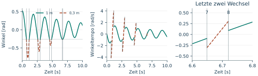

Alle acht Unterschiede bleiben unter $1\,\mathrm{ms}$. Ein zweiter Lauf mit RK45, $\mathrm{rtol}=10^{-8}$, $\mathrm{atol}=10^{-10}$ und gleichem Schrittmaximum unterscheidet sich hier von DOP853 in den Ereigniszeiten um höchstens $9{,}43\cdot10^{-8}\,\mathrm{s}$. Die größere Abweichung zur Publikation bleibt als eigener Befund stehen. Ein Vergleich zweier numerischer Kurven ergibt keine exakte physikalische Zeit.

Eigenes Labor `python labor.py c07` · [Grujic u. a., SNE 31(4), Tabelle 3, Spalte F](https://doi.org/10.11128/sne.31.bne07.10589).

<a id="fb-c07modell"></a>

## C07 · Reicht die Linearisierung für die Schaltzeit?

Eine Steuerung soll jede Berührung und Ablösung des Fadens auf $10\,\mathrm{ms}$ genau vorhersagen. Das ist ein hier gewähltes Lehrziel. Als Referenz verwenden wir die geprüfte nichtlineare Modellrechnung [Labor C07 · Acht Ereigniszeiten nachmessen](#fb-c07labor). Der Startwinkel ist $30^\circ$. Dämpfung, Stiftwinkel, Längen und Übergangsregel bleiben in beiden Rechnungen gleich. Nur das rücktreibende Glied wechselt von $\sin\varphi$ zu $\varphi$.

### Was sich zwischen zwei Kontakten analytisch lösen lässt

Im linearen Modell ist in jeder Phase $L$ fest. Schreiben wir $\alpha=d/(2m)$, $\beta=\sqrt{g/L-\alpha^2}$ und $s$ für die seit dem letzten Wechsel verstrichene Zeit, so gilt für Phasenanfangswerte $\varphi_i,\omega_i$

$$
\varphi(s)=e^{-\alpha s}\!\left[\varphi_i\cos(\beta s)+
 \frac{\omega_i+\alpha\varphi_i}{\beta}\sin(\beta s)\right].
$$

Wir suchen die nächste gerichtete Nullstelle von $\varphi(s)-\varphi_p$ zwischen zwei benachbarten Extremstellen oder Phasengrenzen. Am Treffer berechnen wir die neue Winkelgeschwindigkeit und setzen die Phasenformel neu an.

<a id="tab-k13-02"></a>

| Nr. | Übergang | Linear [s] | Nichtlinear [s] | Vorlauf linear [ms] |
| --- | --- | --- | --- | --- |
| 1 | Kontakt | 0,692023 | 0,703459 | 11,44 |
| 2 | Ablösung | 1,120545 | 1,151780 | 31,23 |
| 3 | Kontakt | 2,540860 | 2,590418 | 49,56 |
| 4 | Ablösung | 2,931799 | 2,990529 | 58,73 |
| 5 | Kontakt | 4,465755 | 4,542741 | 76,99 |
| 6 | Ablösung | 4,790786 | 4,867488 | 76,70 |
| 7 | Kontakt | 6,532058 | 6,648707 | 116,65 |
| 8 | Ablösung | 6,652995 | 6,720384 | 67,39 |

### Die Rechnung von der Modellwahl trennen

Die lineare Phasenformel und die numerisch integrierte lineare Gleichung liefern alle acht Zeiten mit weniger als $10^{-8}\,\mathrm{s}$ Unterschied. Die Abweichung von den publizierten linearen Zeiten in Spalte J bleibt unter drei Mikrosekunden. Dennoch liegt bereits der erste lineare Kontakt $11{,}44\,\mathrm{ms}$ vor der nichtlinearen Referenz. Die Ereigniszahl stimmt im Zehnsekundenfenster für beide Modelle. Für das gewählte Zeitziel verwenden wir die nichtlineare Dynamik.

Eigenes Labor `python labor.py c07linear` · [Grujic u. a., Tabelle 3, Spalten F und J](https://doi.org/10.11128/sne.31.bne07.10589).

<a id="fb-c07kart"></a>

## C07 · Was die kartesische DAE zusätzlich enthält

In einer festen Phase sei $p\in\mathbb R^2$ der Drehpunkt und $r$ die kartesische Position der Masse. Mit $s=r-p,\ v=\dot r,\ \mathbf g=(0,-g)$ und Fadenkraft $-\lambda s$ lautet eine Zwangsformulierung

$$
\dot r=v,\qquad m\dot v=m\mathbf g-dv-\lambda s,\qquad s^\mathsf T s=L^2 .
$$

Dabei gilt die Dämpfung tangential, weil $s^\mathsf Tv=0$ für die zulässige Bewegung. Am Phasenstart müssen Länge und Tangentialität stimmen. Die Zwangskraft folgt aus der zweiten Ableitung der Bindung wie [Kapitel 4](#t1-k4). Diese Gleichungen gelten bei festem $p,L$, der diskrete Wechsel wird gesondert beschrieben.

### Beweis der Übereinstimmung mit der Winkel-ODE

Setze $e_r=(\sin\varphi,-\cos\varphi)^\mathsf T$, $e_t=(\cos\varphi,\sin\varphi)^\mathsf T$. Dann gilt $r=p+Le_r,\ v=L\omega e_t$ und $\dot v=L\dot\omega e_t-L\omega^2e_r$. Skalarmultiplikation der Kraftgleichung mit $e_t$ entfernt $\lambda$, da $e_t^\mathsf T e_r=0$. Es bleibt $mL\dot\omega=-mg\sin\varphi-dL\omega$, die Winkelgleichung des Versuchs. Die radiale Projektion bestimmt umgekehrt $\lambda=m(g\cos\varphi+L\omega^2)/L$. Für eine feste reguläre Phase heben sich Rekonstruktion und Projektion lokal auf.

### Eine Zahl als Prüfstein

Beim ersten Kontakt ist $\omega^-=-1{,}248739\,\mathrm{rad/s}$, danach $\omega^+=-4{,}162463\,\mathrm{rad/s}$. Das Produkt mit der jeweiligen Länge ergibt beidseits rund $-1{,}248739\,\mathrm{m/s}$. Im globalen Koordinatensystem bleibt $v$ am Stift gleich. Die neue Bindung beschreibt einen Kreis um $p_\mathrm{neu}=p_\mathrm{alt}+0{,}7e_r(\varphi_p)$. Beide Kreise haben am Berührungspunkt dieselbe Tangente.

**Was der Vergleich prüft.** Die Äquivalenz ist für glatte Phasen analytisch hergeleitet. Die Zahlen [Labor C07 · Acht Ereigniszeiten nachmessen](#fb-c07labor) stammen aus der Winkel-ODE. Der ergänzende RATTLE-Versuch löst die kartesischen Bindungen mit wechselndem Drehpunkt [C07 · Zwei Bindungen in jedem Rechenschritt](#fb-befundrattle).

<!-- Buchseite -->

### Was die kartesische Form am Stift beim Umschalten verlangt

In der freien Phase gelten der alte Drehpunkt $p^-$ und die Länge $L^-$. Am Kontakt wechseln sie zu $p^+,L^+$. In der Winkelgleichung zeigt sich das als Sprung in $\omega$. In der kartesischen Form treffen zwei Aufgaben zusammen. Der Solver muss die Flanke lokalisieren und beim neuen Drehpunkt mit konsistenten Index-3-Daten weiterrechnen.

1. **Wechsel finden.** Prüfen Sie Schaltkennung, Bewegungsrichtung und die Ereigniszeit auf der alten Phase.
2. **Geometrie und Reset prüfen.** Der Ort $r$ bleibt am Kontakt stetig. Die gemeinsame Tangente in diesem C07-Wechsel überträgt die gerichtete Bahngeschwindigkeit $L^-\omega^-=L^+\omega^+$. Prüfen Sie für die neue Bindung $(r-p^+)^\mathsf{T}(r-p^+)=(L^+)^2$ und $(r-p^+)^\mathsf{T}v^+=0$.
3. **Mit der neuen Phase starten.** Die Beschleunigungsbindung bestimmt die neue Zwangskraft. Ein Mehrschrittsolver baut die Historie zum neuen Vektorfeld neu auf. Die Prüfgrößen der neuen Phase enthalten Bindungsdefekte und die nächste Schaltzeit.

Setzen Sie für die erste Berührung die beiden gedruckten Winkelgeschwindigkeiten ein. Der Vergleich der Bahngeschwindigkeit erkennt die falsche Resetregel auch dann, wenn beide Ortsgleichungen am Stift bis auf Rundung passen. [Kartesische Bindungen und RATTLE](#t1-k4) · [Ereignisse innerhalb eines Schritts](#k5-detektion)

<!-- Buchseite -->

<a id="fb-befundrattle"></a>

## C07 · Zwei Bindungen in jedem Rechenschritt

Ein Pendel der Länge $\ell$ mit Drehpunkt $p$ muss zwei Bedingungen erfüllen. Mit $s=r-p$ lauten sie $s\cdot s=\ell^2$ und $s\cdot v=0$. Die RATTLE-Methode bestimmt die Zwangskorrekturen bei Ort und Geschwindigkeit getrennt. Für Dämpfung verwenden wir je einen exakten halben Dämpfungsschritt vor und nach dem konservativen Teilschritt.

### Wie lässt sich die Ortsbindung lösen?

Nach halber Dämpfung, halbem Schwerkraftstoß und freier Drift ergäbe sich ein Versuchspunkt $w$ relativ zum Drehpunkt. Der Zwangsstoß wirkt in der bisherigen Seilrichtung $n=s/\ell$. Der orthogonale Anteil $w_\perp=w-(w\cdot n)n$ bleibt beim Korrigieren unverändert. Die kontinuierlich anschließende Lösung des quadratischen Ortszwangs ist

$$
s^+=w_\perp+\sqrt{\ell^2-\|w_\perp\|^2}\,n.
$$

Anschließend bestimmen die korrigierte Ortsdifferenz, der zweite halbe Schwerkraftstoß und eine orthogonale Projektion auf die neue Tangente die Geschwindigkeit. Beim Erreichen der Stiftrichtung klammert eine Teilung des Schritts die Zeit ein. Der neue Drehpunkt muss auf derselben Strahlgeraden liegen, damit die aktuelle Position und Tangente zu beiden Kreisen passen.

<a id="tab-k13-03"></a>

| Schrittweite | erkannte Wechsel | größter Zeitfehler |
| --- | --- | --- |
| $0{,}0100\,\mathrm{s}$ | 8 | $474{,}4\,\mu\mathrm s$ |
| $0{,}0050\,\mathrm{s}$ | 8 | $115{,}4\,\mu\mathrm s$ |
| $0{,}0025\,\mathrm{s}$ | 8 | $28{,}7\,\mu\mathrm s$ |

Referenz ist die separat integrierte kartesische Beschleunigungsform, die bereits an der Winkelrechnung geprüft wurde. In allen drei RATTLE-Läufen blieb der maximale Längenfehler unter $4{,}45\cdot10^{-16}\,\mathrm{m}$. Beim Halbieren der Schrittweite schrumpft hier der Zeitfehler um etwa den Faktor vier. Dass die Bindung bei allen drei Gittern auf Rundungsniveau erfüllt ist, macht die Unterschiede der Ereigniszeiten besonders gut sichtbar.

[Kontrolle der Moduswechsel](#fb-befundereignis) · `rattle.json` · `constrained_pendulum.py`.

<a id="fb-diode"></a>

## C21 · Eine Diodenspannung als algebraische Unbekannte

<a id="revision-k13-01"></a>

Beim Stift bleibt am gemeinsamen Tangentialpunkt die gerichtete Bahngeschwindigkeit erhalten. Deshalb erhält dieselbe Geschwindigkeit nach dem Wechsel einen anderen Winkelwert $\omega^+=L_-\omega^-/L_+$. Bei der Diode liefert die Vorgeschichte eine andere Information. Schon die einfache Gleichung $z^2=1$ hat zwei Lösungen mit Residuum null. Beginnt die Bahn auf dem Ast $z=+1$, wäre $z=-1$ im nächsten Schritt trotz exakt erfüllter Gleichung die falsche Fortsetzung. Im Schaltkreis brauchen wir deshalb außer einem kleinen Residuum einen konsistenten Start, die Astgeschichte und lokale Regularität.

Eine andere C21-Aufgabe enthält einen elektrischen Schwingkreis mit Diode. Spule und Kondensator speichern Energie. Als Zustände dienen Spulenstrom $i$ und Kondensatorspannung $u_C$, als algebraische Größe die Diodenspannung $u_D$. In den Vorzeichen des Projektmodells und mit Zeit in Sekunden lauten die Residuen

$$
\begin{aligned}
 0&=L\dot i+R_1 i+u_D+u_e(t),\\
 0&=C_e\dot u_C-i-i_D(u_D),\\
 0&=u_D-u_C-R_2(i+i_D(u_D)).
 \end{aligned}
$$

Die Quelle ist sinusförmig mit Amplitude $1\,\mathrm{V}$ und $150\,\mathrm{kHz}$. Im Modell gelten $R_1=1000\,\Omega,\ R_2=20\,\Omega,\ L=25{,}3\,\mu\mathrm H,\ C_e=100\,\mathrm{nF}$. Für $u_D>0$ verwendet es $i_D=I_S(e^{u_D/U_T}-1)$ mit $I_S=10^{-8}\,\mathrm{A},\ U_T=26\,\mathrm{mV}$, sonst $i_D=0$. Die drei Unbekannten und die beiden Differentialableitungen starten bei null.

### Wie prüft man die Rechnung?

Der archivierte Versuch liefert eine IDAS-Residualrechnung und zwei explizit reduzierte Modellvarianten. Das Zeitfenster beträgt $500\,\mu\mathrm s$. Auf 75 960 verschiedenen Ausgabezeiten werden Zustände und algebraische Größen abgeglichen. Alle Varianten ergeben 149 Schaltungen.

**Wiederholung aus dem Residualmodell.** Mit CasADi 3.8.2/IDAS wurden $500\,\mu\mathrm s$ ab dem konsistenten Nullzustand erneut integriert. Das Protokoll umfasst 75 960 Ausgabepunkte und 149 Übergänge. Der größte algebraische Residualbetrag beträgt $2{,}193\cdot10^{-10}$. Beide expliziten Astformulierungen treffen dieselben 149 Übergänge, die größte Zeitabweichung beträgt $9{,}83\cdot10^{-14}\,\mathrm s$. Die Wiederholung gehört zu diesem Anfangszustand und Eingangsverlauf. Laufbefehl, Bibliotheksversion und Ergebnisse stehen im [Messregister](#revision-q-01).


<a id="tab-k13-04"></a>

| Größte Abweichung | beobachtet, gerundet | zulässig |
| --- | --- | --- |
| Spulenstrom | $9{,}76\cdot10^{-11}\,\mathrm{A}$ | $10^{-7}\,\mathrm{A}$ |
| Kondensatorspannung | $1{,}89\cdot10^{-10}\,\mathrm{V}$ | $10^{-5}\,\mathrm{V}$ |
| Diodenspannung | $2{,}09\cdot10^{-9}\,\mathrm{V}$ | $10^{-5}\,\mathrm{V}$ |
| Zeit zugehöriger Schaltvorgänge | $9{,}82\cdot10^{-14}\,\mathrm{s}$ | $2\cdot10^{-8}\,\mathrm{s}$ |

Das Ausgabegitter der Residualrechnung enthält auch die Zeitpunkte der Vergleichslöser. Das verbessert das Einklammern eines Vorzeichenwechsels und begrenzt die Aussage zur unabhängigen Zeitauflösung. Der Vergleich prüft die gewählten Gleichungen. Eine Validierung des realen Bauteils bräuchte Messdaten.

[Modell, Startwerte und Akzeptanzkriterien](https://github.com/5H3LL3H5/argesim-hyperposition-benchmarks/blob/1824c9104152674b82de6cd84d53b0b4f68dca37/scripts/c21_dae_reference.py) · [archivierter Zahlenabgleich](https://github.com/5H3LL3H5/argesim-hyperposition-benchmarks/blob/1824c9104152674b82de6cd84d53b0b4f68dca37/docs/evidence/c21-idas.json).

<a id="fb-diodenast"></a>

## Labor C21 · Wo lässt sich der Diodenstrom eliminieren?

Fixieren Sie den Spulenstrom $i$ und die Kondensatorspannung $u_C$ am selben Zeitpunkt. Die beiden Speicher sind vorgegeben, die gesuchte Diodenspannung $z$ muss zur Kennlinie passen. Auf welchen Ästen ist die algebraische Gleichung dafür lokal umkehrbar? Für die Stromrichtung [C21 · Eine Diodenspannung als algebraische Unbekannte](#fb-diode) lautet sie

$$
g(z)=z-u_C-R_2\bigl(i+i_D(z)\bigr)=0 .
$$

Im Sperrbereich $z<0$ gilt $i_D=0$, also $z=u_C+R_2i$, sofern dieser Wert negativ ist. Im leitenden Ast $z>0$ ist $g'(z)=1-(R_2I_S/U_T)e^{z/U_T}$. Beidseits des Schaltpunkts existieren einseitige Steigungen. Bei $z=0$ ist die stückweise Stromkennlinie stetig.

### Eine Grenze der Umformung ausrechnen

Setze im positiven Ast $g'(z)=0$. Die Zahlen der Schaltung ergeben

$$
z_* = U_T\ln\!\left(\frac{U_T}{R_2I_S}\right)
      =0{,}026\ln(130\,000)\,\mathrm{V}=0{,}306158\,\mathrm{V} .
$$

Hier versagt das lokale Invertierbarkeitskriterium in dieser Koordinate. Da $g''(z)<0$ für $z>0$, hat $g$ dort ein striktes Maximum. Ob eine vorgegebene Wahl von $u_C,i$ dort auch $g=0$ erfüllt, ist eine zweite Bedingung. Schon die Formel zeigt, weshalb ein pauschaler Satz „die Spannung lässt sich überall eindeutig ausrechnen“ zu stark wäre.

**Zwei positive Nullstellen.** Setzen Sie als Lehrwert $u_C+R_2i=0{,}2\,\mathrm{V}$. Links und rechts von $z_*$ ergeben sich $z\approx0{,}200446\,\mathrm{V}$ und $0{,}352082\,\mathrm{V}$, mit $g'\approx+0{,}983$ bzw. $-4{,}849$. Prüfen Sie beide Nullstellen im Residuum. Zur Fortsetzung braucht man den bisher erreichten Ast oder eine physikalische Auswahlregel.

### Vom Residuum zum Versuchsprotokoll

Setzen Sie $i=u_C=z=0$ bei $t=0$. Die sinusförmige Quelle und der Diodenstrom sind dort null. Die ersten beiden Gleichungen ergeben $\dot i=\dot u_C=0$. Für jeden späteren Ausgabepunkt sind die Strombilanz in Ampere, die Maschenbilanz in Volt und der für $z$ tatsächlich verwendete Zweig separat zu prüfen. Eine gemeinsame unskalierte Fehlersumme hätte keine klare Einheit.

**Nachweis für die Projektparameter.** Die 149 Schaltungen sind numerisch bestätigt. Eine unabhängige Schranke für die Diodenspannung sichert den Abstand von der Falte über das ganze Zeitfenster, siehe [C21 · Bleibt die Diodenspannung vor der Falte?](#fb-befunddiode).

`python labor.py c21` reproduziert die kritische Spannung. [Vorzeichen, Skalierung und Residuen der Vergleichsrechnung](https://github.com/5H3LL3H5/argesim-hyperposition-benchmarks/blob/1824c9104152674b82de6cd84d53b0b4f68dca37/scripts/c21_dae_reference.py).

<a id="fb-befunddiode"></a>

## C21 · Bleibt die Diodenspannung vor der Falte?

Für die Schaltung aus Kapitel 13 mit Nullstart und sinusförmiger Einvoltquelle liegt die Falte bei $z_*=0{,}306158\,\mathrm{V}$. Wir zeigen für den vom Nullstart erreichten Niedrigstromast, dass $z$ unter $0{,}1\,\mathrm{V}$ bleibt. Damit bleibt die algebraische Gleichung auf diesem Ast invertierbar.

### Ein Widerspruch beim ersten Erreichen

Setze $b=u_C+R_2i$ und $d=i_D$, dann ist $z=b+R_2d$. Mit $X=(i,u_C)^\top$ lautet der lineare Schaltungsteil

$$
X'=AX+B_su_0+B_dd,\quad
 A=\begin{pmatrix}-(R_1+R_2)/L&-1/L\\1/C&0\end{pmatrix},
 \quad B_s=\binom{1/L}{0},\quad B_d=\binom{-R_2/L}{1/C}.
$$

Für $c^\top=(R_2,1)$ hat jeder Übertragungskern $c^\top e^{At}B$ die Form $\sum_j r_j e^{\lambda_jt}$, wobei die beiden verschiedenen Eigenwerte negativ sind. Die Residuen folgen direkt aus $r_j=c^\top(A-\lambda_\ell I)B/(\lambda_j-\lambda_\ell)$, $\ell\ne j$.

**Beweis.** Für die Sinusquelle beschränkt Integration der komplexen Exponentialfunktion jeden Beitrag durch $2|r_j|/|\mathrm i\omega-\lambda_j|$. Für beliebigen Diodenstrom liefert die Integration des Betrags $\sum_j |r_j|/(-\lambda_j)$ als Verstärkungsgrenze. Mit den Schaltungswerten ergeben sich weniger als $0{,}05915\,\mathrm{V}$ bzw. $981\,\Omega$. Bis zum ersten möglichen Erreichen von $0{,}1\,\mathrm{V}$ ist $0\le d\le I_S(e^{0{,}1/U_T}-1)$. Daraus folgt $|b|<0{,}05960\,\mathrm{V}$. Zum Erreichen wäre aber $b=0{,}1-R_2 I_S(e^{0{,}1/U_T}-1)>0{,}09999\,\mathrm{V}$ nötig.

Im leitenden Ast ist somit $g'(z)>0{,}99963$; im Sperrast gilt $g'=1$. Beide Äste schließen bei null stetig an. Damit entfällt für diese Parameter und diesen Start die bisher fehlende Fortsetzungsgarantie. Eine unabhängige Rechnung mit der reellen Hauptverzweigung der Lambert-$W$-Funktion fand in $500\,\mu\mathrm s$ die 149 späteren Nulldurchgänge. An 6 013 gesonderten Ausgabezeiten lag das größte $z$ bei $0{,}02212\,\mathrm{V}$ oder darunter.

[Kennlinie und Falte](#fb-diodenast) · `kapitel.json` · [Unabhängige Zeitgitter](#fb-diodengitter).

<a id="fb-diodengitter"></a>

## C21 · Wie verändert das Zeitgitter die Schaltzeiten?

Wir prüfen die Diodenschaltung im Intervall $0$ bis $500\,\mu\mathrm s$ auf drei vorab gleichmäßig festgelegten Ausgabezeitgittern. Ein Vorzeichenwechsel des Wächters $u_C+R_2i$ klammert den Übergang ein. Dann verfeinert Brent die Nullstelle auf der dichten Ausgabe. Die Startnull bei $t=0$ zählt nicht. Jeder Radau-Lauf begrenzt die Schrittweite auf die Rasterbreite. Ein separat integrierter Lambert-$W$-Referenzlauf verwendet $h_{\max}=80\,\mathrm{ns}$ und engere Toleranzen.

<a id="tab-k13-05"></a>

| Raster [ns] | Wechsel | Zeit [s] | Strom [A] | Diodenspannung [V] |
| --- | --- | --- | --- | --- |
| 400 | 149 | $3{,}91\cdot10^{-14}$ | $7{,}67\cdot10^{-11}$ | $1{,}88\cdot10^{-9}$ |
| 200 | 149 | $4{,}79\cdot10^{-14}$ | $9{,}71\cdot10^{-11}$ | $2{,}36\cdot10^{-9}$ |
| 100 | 149 | $4{,}47\cdot10^{-14}$ | $3{,}91\cdot10^{-11}$ | $7{,}90\cdot10^{-10}$ |

Die letzten drei Spalten geben die maximalen Betragsabweichungen zur Referenz an, bei Strom und Spannung jeweils an den Punkten des festen Rasters. Die Zeitfehler beziehen sich dagegen auf die lokalisierten Übergänge. Alle 149 Zeitpunkte pro Raster stehen im Protokoll. Die Fehlerfolge ist hier nicht monoton. Daraus folgt keine Konvergenzordnung.

`diode_zeitgitter.json` · [Berechnung mit `--diode-grid`](https://github.com/5H3LL3H5/argesim-hyperposition-benchmarks/blob/16f0f2528fcf77f16898ecd74ad952be2c09eac2/scripts/cp2_accuracy/chapter_checks.py).

<!-- Buchseite -->

<a id="kap13-schrittfolge"></a>

### Warum ein kleines Residuum den richtigen Ast offenlässt

Für eine Handrechnung ersetzen wir die Kennlinie vorübergehend durch die Lehrgleichung $g(z,\mu)=z^2-\mu=0$. Bei $\mu=0{,}01$ erfüllen $z=+0{,}1$ und $z=-0{,}1$ die Bindung exakt. Nehmen wir an, die vorangegangene Phase hat auf dem positiven Ast begonnen und blieb in dessen regulärer Umgebung. Ein Solver, der zum negativen Wert springt, hätte ein verschwindendes Residuum und unterbräche dennoch die beabsichtigte Fortsetzung.

Den Unterschied zur Kondition können wir ebenfalls ausrechnen. Auf dem positiven Ast erzeugt eine kleine Änderung von $\mu$ eine Änderung mit der Rate $1/(2\sqrt{\mu})$. Bei $\mu=0{,}01$ beträgt sie fünf, bei $\mu=0{,}0001$ bereits fünfzig. Am Grenzpunkt $\mu=0$ treffen sich beide Äste und die Ableitung nach $z$ verschwindet. Eine einfache lokale Auflösung funktioniert dort nicht.

Im C21-Versuch prüfen wir deshalb zuerst das Intervall, in dem der benutzte Ast regulär ist. Erst mit dieser Information sind Zeitfehler und Residuen der gespeicherten Läufe als Vergleich interpretierbar. Dieselbe Frage nach der gültigen Fortsetzung begegnet uns beim Pendel in geometrischer Form. Dort prüfen wir statt des Vorzeichens eines algebraischen Asts den neuen Kreis und seine Tangente.

<!-- Buchseite -->

<a id="fb-befundereignis"></a>

## Ereignisse · Vier Fragen mit verschiedenen Antworten

### 7 · Kann endlich häufiges Abfragen jedes Ereignis erkennen?

Nein. Seien $t_i$ alle besuchten Stellen eines Detektors beim konstanten Signal eins. Das glatte Signal $1-A\prod_i(t-t_i)^2$ hat an jeder dieser Stellen denselben Wert und dieselbe erste Ableitung. Durch ein genügend großes $A$ wird es zwischen zwei Stellen negativ. Es gibt also ununterscheidbare Abfragen mit verschiedenen Nullstellen. Eine Garantie erfordert etwa eine geeignete Monotoniegrenze, eine Einschließung auf dem ganzen Intervall oder eine auswertbare Modellstruktur.

### 8 · Bleiben drei C05-Schaltungen bei veränderten Schwellen?

Ja, für die oberen Schwellen $5{,}8\pm0{,}005$ und unteren $2{,}5\pm0{,}005$ bei den Startwerten des Lehrversuchs. Der exakte Phasenfluss hat die Form $E+A e^{-c_3t}+B e^{-c_1t}$. Seine Ableitung besitzt höchstens eine Nullstelle, da eine Quotientenbildung der beiden Exponentialterme eine streng monotone Funktion liefert. Start und Gleichgewicht liegen auf entgegengesetzten Seiten der aktiven Schwelle. Daher ist die erste positive Durchquerung eindeutig.
Mit nach außen gerundeten Intervallen werden beide Vorzeichen eingeklammert und der Zustandsbereich an die nächste Phase übergeben. Die vier Zeiten liegen in $[1{,}0946;1{,}1227]$, $[2{,}0961;2{,}1654]$, $[3{,}0063;3{,}1048]$, $[4{,}0078;4{,}1476]\,\mathrm{s}$. Jede Durchquerung hat gerichtete Steigung größer als $0{,}2307$ pro Sekunde. Bis $3{,}5\,\mathrm{s}$ liegen folglich genau drei Schaltungen.

### 9 · Wie viel Flugzeit unterschlägt eine Ruhegrenze?

Sei $v\le v_{\min}$ die gerade erreichte *Abflug*geschwindigkeit, $g>0$ und $0\le e<1$ der Rückprallfaktor. Die verbleibenden Flüge dauern $2v/g,2ev/g,\ldots$. Ihre Summe ist $2v/[g(1-e)]$, die größte ausgelassene Höhe $v^2/(2g)$. Ersetzt man $v$ durch $v_{\min}$, erhält man garantierte Obergrenzen. Eine auf die Ankunftsgeschwindigkeit bezogene Regel muss erst mit $e$ auf den nächsten Abflug umgerechnet werden.

### 10 · Ist der C07-Wechsel auch kartesisch konsistent?

Ein zweiter Integrator führt Ort und Geschwindigkeit mit der aus der Bindung abgeleiteten Beschleunigung. Beim Stiftwechsel versetzt er den Drehpunkt und übernimmt die physische Geschwindigkeit. Über zehn Sekunden wurden alle acht Wechsel geprüft. Längenfehler blieben unter $1{,}18\cdot10^{-12}\,\mathrm{m}$, $|(r-p)\cdot v|$ unter $5{,}33\cdot10^{-12}\,\mathrm{m^2/s}$. Die größte Zeitabweichung von der Winkelrechnung betrug $3{,}77\cdot10^{-11}\,\mathrm{s}$. Der Impulssprung ist beim verwendeten Reset konstruktiv null.

`kapitel.json`, Abschnitte `thresholds` und `cartesian` · [C21-Astbeweis](#fb-befunddiode).

<a id="fb-pruefung13"></a>

## C07 und C21 · Wie man den falschen Ast erkennt

Das Pendel trifft den Stift. Seine Tangentialgeschwindigkeit bleibt im idealen Übergang erhalten, der Abstand zum neuen Drehpunkt wird kleiner. Wer die Winkelgeschwindigkeit unverändert übernimmt, macht das Pendel unbemerkt langsamer. In der Diode kann ein anderer Fehler dieselbe Art von Täuschung erzeugen. Zwei algebraische Zustände können die Gleichung gleichermaßen gut erfüllen, obwohl nur einer zur Vorgeschichte der Schaltung passt.

Beim Stift prüft man $L^-\omega^-=L^+\omega^+$. Im ursprünglichen C07-Fenster sind die Endbudgets $0{,}001\,\mathrm{rad}$ und $0{,}004\,\mathrm{rad/s}$. Für jeden Stiftzeitpunkt kommen $0{,}001\,\mathrm{s}$ hinzu. QSS2 mit Quantenfaktor $10^{-3}$ erreicht in zwei Sekunden $S\approx1{,}583$ bei 910 Funktionsaufrufen. RK45 erreicht $S\approx3{,}25\cdot10^{-6}$ bei 1611 Aufrufen. Die archivierte Zeile nennt das Maximum. Ohne die einzelnen Rohfehler kann man daraus weder das verantwortliche Ereignis noch die verantwortliche Zustandskomponente zurückrechnen.

Bei der C21-Diode legen wir die Ereignisse beider Lösungen in zeitlicher Reihenfolge nebeneinander. Das IDAS-Archiv enthält 149 Übergänge in $500\,\mu\mathrm s$. Für die explizite Spannungsreduktion ist der größte zugehörige Zeitunterschied rund $9{,}82\cdot10^{-14}\,\mathrm{s}$. Zusätzlich misst die Residualrechnung einen maximalen algebraischen Defekt von rund $2{,}19\cdot10^{-10}$ in der Modellskalierung. Zeitzuordnung, Bindungsfehler und Trajektorienabweichung prüfen unterschiedliche Eigenschaften.

**Diagnose.** Speichern Sie beim Pendel den aktiven Radius links und rechts des Ereignisses. Speichern Sie bei der Diode die algebraische Variable und den Ast zu jedem Wechsel. Ein zu kleiner Rang der linearisierten Bindung stellt die lokale Fortsetzbarkeit infrage, selbst wenn der momentane Defekt sehr klein ist.

[Offizielle Pendelaufgaben](#fb-refC07) · [Residualrechnung und explizite Gegenrechnungen](https://github.com/5H3LL3H5/argesim-hyperposition-benchmarks/blob/16f0f2528fcf77f16898ecd74ad952be2c09eac2/docs/evidence/c21-idas.json).

<a id="fb-ueb10"></a>

## Selbst prüfen · Sprungregel und Lösungszweig

**Merksatz.** Ein Wechsel kann eine Koordinate sprunghaft ändern, während der beobachtete physikalische Zustand stetig bleibt. In einem algebraischen Teilmodell entscheidet zusätzlich der gültige Lösungszweig.

### A · Das Pendel löst sich wieder

Beim Ablösen in C07 wechselt der wirksame Radius von $0{,}30$ auf $1\,\mathrm{m}$. Unmittelbar davor sei $\omega^-=+3\,\mathrm{rad/s}$. Berechnen Sie die gerichtete Tangentialgeschwindigkeit und $\omega^+$. Was geschieht mit der kinetischen Energie unmittelbar beim idealisierten Wechsel?

### B · Einen kartesischen Start prüfen

Im kurzen Modus ist der Vektor vom Drehpunkt zur Masse $s=(0;-0{,}30)\,\mathrm{m}$. Eine numerische Startschätzung setzt $v=(0{,}60;-0{,}10)\,\mathrm{m/s}$. Erfüllt sie die Geschwindigkeitsbindung? Geben Sie die orthogonale Projektion von $v$ auf die zulässige Tangente an. Welche Komponente entfernt sie?

### C · Den zulässigen Ast einer Diode wählen

Als einfache Vorübung zur C21-Diode verwenden wir eine eigene Kennlinie. Für $z\le0{,}7\,\mathrm{V}$ ist $i_D=0$, für $z>0{,}7\,\mathrm{V}$ gilt $i_D=(z-0{,}7\,\mathrm{V})/(100\,\Omega)$. Eine Quelle $U$ speist sie über $200\,\Omega$. Lösen Sie $(U-z)/(200\,\Omega)=i_D$ zuerst für $U=1\,\mathrm{V}$, dann für $U=0{,}6\,\mathrm{V}$. Prüfen Sie nach jedem Ansatz die Bereichsbedingung.

**Hinweis.** Die Ableitung von $s^\mathsf T s=\ell^2$ verlangt $s^\mathsf Tv=0$. Bei der Kennlinie darf erst nach dem Einsetzen entschieden werden, ob der benutzte Ast gilt.

[Lösungswege A, B und C](#fb-loesweg10) · [Zum Kapitelauftakt](#fb-kap10).

<a id="fb-loesweg10"></a>

## Lösungswege · Sprungregel und Lösungszweig

### A · Die Geschwindigkeit in die neue Koordinate übertragen

Vor dem Wechsel beträgt die gerichtete Tangentialgeschwindigkeit $0{,}30\cdot3=0{,}90\,\mathrm{m/s}$. Direkt danach gilt $\omega^+=0{,}90/1=0{,}90\,\mathrm{rad/s}$. Die kinetische Energie $m|v|^2/2$ ist im Augenblick dieses idealisierten Wechsels stetig, weil Masse und Betrag der Geschwindigkeit gleich bleiben.

### B · Die Radialkomponente entfernen

Das Skalarprodukt beträgt $0\cdot0{,}60+(-0{,}30)(-0{,}10)=0{,}03\,\mathrm{m^2/s}$. Der Start würde zunächst die Länge ändern. Die Tangente liegt hier waagerecht. Orthogonale Projektion entfernt die vertikale Komponente und ergibt $v_\mathrm{tan}=(0{,}60;0)\,\mathrm{m/s}$. Eine solche Korrektur verändert den ursprünglichen Geschwindigkeitsbetrag. Ein Programm sollte sie als Korrektur erkennbar machen.

### C · Die Astbedingung gehört zur Lösung

Für $U=1\,\mathrm{V}$ würde der Sperrast $z=1\,\mathrm{V}$ erzwingen. Das verletzt $z\le0{,}7\,\mathrm{V}$. Auf dem leitenden Ast gilt für die Spannungszahlen $1-z=2(z-0{,}7)$. Es folgt $z=0{,}80\,\mathrm{V}$ und $i_D=1\,\mathrm{mA}$. Der Ast ist zulässig, und am Vorwiderstand fallen $0{,}20\,\mathrm{V}$ ab. Für $U=0{,}60\,\mathrm{V}$ erfüllt $z=0{,}60\,\mathrm{V},\ i_D=0$ die Gleichung und die Sperrbedingung.

**Vom Lehrmodell zum Benchmark.** Die vereinfachte Kennlinie in C macht die Bereichsprüfung auf Papier möglich. Im C21-Versuch können zusätzliche Zweige und ein verschwindender Ableitungswert die Wahl erschweren. Dort müssen auch Vorgeschichte und Modellregeln berücksichtigt werden.

[Noch einmal selbst rechnen](#fb-ueb10) · [Forschungsstand und Beweisfragen](#fb-schluss10).

<a id="fb-schluss10"></a>

## Ein Vergleich kann einen fehlenden Beweis präzisieren

### Analytische Formulierung und publizierte Vergleichszeiten

Grujic und Mitautoren vergleichen lineare und nichtlineare Pendelmodelle sowie verschiedene Verfahren zur Bestimmung der Ereigniszeiten. Neuere Forschung zur symbolischen Indexreduktion untersucht ergänzend, wie aus strukturierten Gleichungen lösbare Formulierungen entstehen. Bei Modellwechseln müssen die physikalischen Übergangsgesetze zusätzlich begründet werden.

### Was ist für die beiden Anwendungen gesichert?

Für C07 folgt aus der Tangentialprojektion in einer festen Phase exakt die Winkel-ODE. Am Stift ist $L^-\omega^-=L^+\omega^+$ eine Modellannahme über die Bahnkomponente. Sie erhält die kinetische Energie, denn $m(L^-\omega^-)^2/2=m(L^+\omega^+)^2/2$. Die acht verglichenen Zahlen belegen, dass das gewählte Ereignisprotokoll die publizierten Zeiten im vorgegebenen Fenster trifft.

Bei C21 zeigt $g''(z)<0$ für $z>0$, dass das gefundene stationäre $z_*$ ein Maximum der algebraischen Funktion ist. Das ist eine analytische Aussage über die Formulierung. Die 149 Schaltungen der archivierten Studie sind dagegen gemessene Übereinstimmung auf einem einzigen Ablauf.

### Ergebnis der Nachuntersuchung

Für C07 wurden alle acht Wechsel in zwei kartesischen Rechnungen kontrolliert, darunter eine RATTLE-Rechnung mit beiden Bindungen. Die Fortsetzung der C21-Diode auf ihrem erreichten Ast ist in der Nachrechnung zur Schaltung bewiesen.

[Nachweis und Ergebnis](#fb-befundereignis) · [Grujic u. a. (2021), C07 in MATLAB](https://doi.org/10.11128/sne.31.bne07.10589) · [Stocco und Bertolazzi (2024), symbolische Indexreduktion](https://doi.org/10.1016/j.cam.2024.115898) · IDA-Handbuch.

<a id="fb-projekt"></a>

## Abschlussprojekt · Ein Schaltmodell abnehmen

Sie verantworten im Labor eine Simulation des C07-Stiftpendels. Ein Regler benötigt während der ersten zehn Sekunden alle Kontakte und Ablösungen in der richtigen Reihenfolge. Jede Ereigniszeit soll höchstens $10\,\mathrm{ms}$ von der vereinbarten nichtlinearen Vergleichsrechnung abweichen. Ihr Bericht soll entscheiden, ob die lineare Phasenformel für diesen Auftrag genügt.

### 1 · Das Modell vor der Software festlegen

Skizzieren Sie beide Drehpunkte, beschriften Sie Fadenlängen und Winkelrichtung. Geben Sie an, welche Koordinaten Sie integrieren, welche Schwelle einen Wechsel auslöst und welche Größe beim Übergang erhalten wird. Begründen Sie, wie aus der erhaltenen Größe ein neuer Zahlenwert für die Winkelgeschwindigkeit folgt.

### 2 · Einen Vergleich planen und durchführen

Verwenden Sie die Angaben [C07 · Das Pendel trifft einen Stift](#fb-praxisdae) und die Ereignistabellen [Labor C07 · Acht Ereigniszeiten nachmessen](#fb-c07labor) und [C07 · Reicht die Linearisierung für die Schaltzeit?](#fb-c07modell). Auf dem Rechner reproduzieren `python labor.py c07` und `python labor.py c07linear` die beiden Versuche. Auf Papier genügen die Tabellen. Ordnen Sie jede Zeit einem Kontakt oder einer Ablösung zu und bestimmen Sie den größten Betrag der Abweichung.

### 3 · Die Ursache des Fehlers eingrenzen

Welche Referenz kontrolliert die Integration des *linearen* Modells? Welcher Vergleich prüft den Unterschied zwischen Modellannahmen? Konstruieren Sie einen falschen Sprung, den eine Energieprüfung erkennen würde. Entscheiden Sie schließlich in drei Sätzen über die Eignung der linearen Formel für diesen Auftrag.

**Selbst bewerten.** Je zwei Punkte für nachvollziehbare Modellannahmen, Übergang mit Einheiten, Ereigniszuordnung, Vergleichszahl und eine Entscheidung mit klarer Reichweite. Die [Musterbearbeitung](#fb-projektantwort) zeigt zu jedem der fünf Kriterien einen prüfbaren Beleg.

<!-- Buchseite -->

<a id="fb-projektantwort"></a>

## Musterbericht · Welches Pendelmodell erfüllt den Auftrag?

### Modell und Übergang

Wir verwenden pro Phase $(\varphi,\omega)$ mit $L=1$ oder $0{,}3\,\mathrm{m}$. Die Schwerkraft und eine tangentiale Dämpfung bestimmen das Gesetz. Beim fallenden Durchgang durch $\varphi_p=-\pi/12$ im langen Modus erfolgt Kontakt, beim steigenden Durchgang im kurzen die Ablösung. Am Wechsel gilt $L^-\omega^-=L^+\omega^+$. Das hat auf beiden Seiten die Einheit $\mathrm{m/s}$. Die Lage ist stetig.

### Messung und Gegenprobe

Beide Modelle liefern acht Übergänge in derselben abwechselnden Reihenfolge. Beim ersten Kontakt vergleicht man $0{,}692023\,\mathrm{s}$ mit $0{,}703459\,\mathrm{s}$. Der Betrag beträgt gerundet $11{,}44\,\mathrm{ms}$ und überschreitet bereits das Ziel. Der größte Zeitunterschied tritt beim siebten Ereignis auf und beträgt $116{,}65\,\mathrm{ms}$. Das entspricht dem $11{,}7$-Fachen des Zeitbudgets.

Die exakte lineare Phasenformel und eine numerische Integration derselben linearen Gleichung stimmen für die acht Zeiten bis auf weniger als $10^{-8}\,\mathrm{s}$ überein. Beim nichtlinearen Modell weicht der Lehrversuch von der publizierten Vergleichsspalte um maximal $0{,}611\,\mathrm{ms}$ ab. Beide Kontrollen erfüllen verschiedene Aufgaben.

### Fehlerprobe und Entscheidung

Würde man beim Wechsel auf den kurzen Faden $\omega$ beibehalten, sänke die kinetische Energie auf $0{,}3^2=0{,}09$ des vorherigen Werts. Das widerspricht dem idealisierten Wechsel. Für diesen Start und das gesetzte Zeitbudget verfehlt die Linearisierung die Anforderung. Die nichtlineare Winkelgleichung mit gerichteter Ereignissuche ist für den Vergleichsauftrag begründet. Eine Übertragung auf einen realen Prüfstand würde zusätzlich gemessene Schaltzeiten mit Unsicherheiten erfordern.

[Zur Aufgabenstellung](#fb-projekt) · [Ausgefülltes Laborjournal](#fb-labjournal) · [Grujic u. a., Tabelle 3, Vergleichszeiten zum C07-Pendel](https://doi.org/10.11128/sne.31.bne07.10589).

**Gegenprobe im Rechenlabor.** Im Pendellabor `beispiele/dae_pendel.py` sind Längenbindung und Geschwindigkeitsbindung einzeln beobachtbar. Im Projektversuch zur Diode liest `rechenlabor/kapitelvergleich.py` die dokumentierten Schaltungsdaten. Den Nachweis für den zulässigen Ast liefert die Herleitung in diesem Kapitel. Wer nur ein kleines Residuum prüft, kann auf beiden Seiten einer Falte dieselbe Gleichung erfüllen. Deshalb gehören Startast, Vorzeichen der Ableitung und erreichter Zeitpunkt ins Laborjournal.

<!-- Buchseite -->

<a id="bild-c21"></a>

## Welche Spannung bestimmt den Ast der Diode?

Wer $z$ über der äußeren Sinusspannung $u_0(t)$ aufträgt, sieht eine Schleife. Wer die algebraische Gleichung nach ihrer wirksamen Spannung $b=u_C+R_2 i$ ordnet, sieht eine Falte. Die Unterscheidung wird beim Newton-Schritt entscheidend. Für positive $z$ lautet die Kennlinie $b=z-R_2 I_s(\exp(z/U_T)-1)$. An der Falte verschwindet $\mathrm db/\mathrm dz$. Damit kann die lokale Umkehrung $z(b)$ empfindlich werden.


Die zwei Wurzeln bei rund 0,200446 V und 0,352082 V bestehen denselben Residuentest. Erst die Fortsetzung vom konsistenten Anfangswert legt den Ast fest. Im 500-µs-Fenster beträgt die höchste berechnete Diodenspannung rund 22,12 mV. Der Verlauf wechselt 149-mal das Vorzeichen und hält dabei erheblichen Abstand zur Falte. Die beiden Wurzeln in A sind eine Gegenprobe zur Astwahl.

<!-- Buchseite -->

<a id="kap13-schluss"></a>

## Schluss · Eine konsistente Bindung muss sich auch richtig fortsetzen

Beim Stiftpendel bleibt die Masse am Übergang am selben Ort. In der idealisierten Rechnung bleibt ihre gerichtete Geschwindigkeit auf der gemeinsamen Tangente stetig. Deshalb ändert sich beim kürzeren Faden die Winkelgeschwindigkeit. In der kartesischen Beschreibung prüfen wir sowohl die neue Länge als auch die Tangentialität und berechnen die Zwangskraft aus der dazugehörigen Beschleunigungsbedingung.

In der Diodenschaltung reicht ein kleines Residuum nur als Kontrolle der algebraischen Gleichung. Für den gewünschten Verlauf muss es zum richtigen Ast gehören. Die Projektstudie vergleicht nachgewiesene Schaltungen und begrenzt im beschriebenen Zeitfenster den Abstand zur Falte. In einem anderen Spannungsbereich wären die Regularität und die Astwahl erneut zu begründen. Das gilt auch für andere Parameter, selbst wenn derselbe Residualsolver verwendet wird.

Beim Abtastregler und beim Kran ist der Zeitpunkt der Änderung oft bereits bekannt. Die nächste Aufgabe besteht darin, einen solchen Termin korrekt mit dem kontinuierlichen Zeitfortschritt zu verbinden. [C09 und C13](#fb-neu14)

Für eine gelernte Zwischenbewegung kommt es darauf an, den Nahbereich des Stifts klassisch zu behandeln. Dieselbe Regel dient im Anhang als Gegenprobe zur Schrittfolge. [Anhang D](#fno-transfer-c07)

<a id="kap13-forschung"></a>

### Aktueller Stand der Forschung

Stocco und Larcher stellen 2025 ein Verfahren vor, das symbolische Indexreduktion und numerische Integration für DAE-Systeme verbindet. Die symbolische Umformung kann den Rechenkern entlasten, weil Gleichungen in eine günstigere Form gelangen, bevor der Integrator sie löst. Für das Stiftpendel und die Diode bleibt der Wechsel zwischen regulären Abschnitten eine eigenständige Modellaufgabe. Aufschlussreich wäre eine Variante, die Drehpunkt oder Arbeitsspannung schrittweise verändert und neu prüft, wann die reduzierten Gleichungen und die Residualform dieselbe Fortsetzung liefern. Dazu müssen Übergangszeiten, Bindungsfehler und Astwahl zusammen dokumentiert werden. [Stocco und Larcher, A Symbolic-Numerical Approach to Index Reduction and Solution of Differential-Algebraic Equations (2025)](https://iris.unitn.it/handle/11572/447112)

[Zur Einleitung dieses Kapitels](#kap13-einstieg)

<!-- Buchseite -->

<a id="fb-neu14"></a>

# Kapitel 14 · C09 und C13 – abgetastete Tanks und Lastpulse am Kran

<a id="kap14-einstieg"></a>

## Einleitung · Wie hält ein kontinuierliches Modell den Takt einer Steuerung ein?

Ein digitaler Regler liest den Pegel in einem Tank einmal pro Sekunde aus. Zwischen zwei Abfragen verändert sich der Pegel weiter. Der Regler hält den zuletzt berechneten Stellwert für die Pumpe. Am Kran beginnt und endet ein Lastpuls ebenfalls zu bekannten Zeitpunkten. Die Kraft kann dabei unmittelbar springen. Der Wagen kann im selben Augenblick weder seinen Ort noch bei endlicher Kraft seine Geschwindigkeit sprunghaft ändern.

Beide Versuche fragen, welche Uhr zu welcher Rechnung gehört. Beim Tank folgt der Pegel aus dem Wasservolumen und den Zu- und Abflüssen, während der Stellwert nur bei einem Reglertakt neu berechnet wird. Beim Kran kann man die Bewegung mit konstanter äußerer Kraft abschnittsweise integrieren. In beiden Fällen teilen bekannte Termine die Rechnung in Phasen. Beim Erreichen eines Termins muss feststehen, ob ein Wert gelesen, neu berechnet oder gehalten wird.

Im kurzen C09-Fenster prüfen wir 16 Einsekundentakte mit einem Pegelbudget von $0{,}5\,\mathrm{mm}$ je Beobachtung. Für C13 lesen wir im Teilversuch A die fünf Zustände bei 4, 7 und 15 Sekunden aus. Weitere Teilaufgaben betrachten Bremsen und Halten. Das Kapitel leitet her, wie man eine Abweichung bis zum ersten falschen Takt oder zur ersten falsch gerechneten Pulsphase zurückverfolgt.

[Zum Schluss dieses Kapitels](#kap14-schluss)

<!-- Buchseite -->

<a id="fb-abtastung"></a>

## Vom nichtlinearen Tank zum abgetasteten Regelkreis

Ein offener Tank hat die konstante Querschnittsfläche $A_t=0{,}04\,\mathrm{m^2}$. Eine Pumpe speist den Volumenstrom $u$ ein. Bei freiem Ausfluss und konstanter Schwerkraft modellieren wir den Abfluss durch $c\sqrt H$, wobei $H>0$ der Füllstand und $c=0{,}002\,\mathrm{m}^{5/2}/\mathrm s$ der zusammengefasste Ausflusskoeffizient sind. Die Volumenbilanz lautet $A_t\dot H=u-c\sqrt H$. Bei $H_*=0{,}25\,\mathrm{m}$ hält $u_*=0{,}001\,\mathrm{m^3/s}$ den Stand konstant.

### Die Linearisierung macht den Arbeitspunkt sichtbar

Für $x=H-H_*,\ v=u-u_*$ liefert die Taylorentwicklung

$$
\dot x=-a x+bv,\qquad a=\frac{c}{2A_t\sqrt{H_*}}=0{,}05\,\mathrm{s^{-1}},
 \qquad b=1/A_t=25\,\mathrm{m^{-2}} .
$$

Das ungeregelte System hat eine Zeitkonstante von $20\,\mathrm{s}$. Ein kontinuierlicher Regler $v=-Kx,\ K=0{,}004\,\mathrm{m^2/s}$ verschiebt den Pol auf $-(a+bK)=-0{,}15\,\mathrm{s^{-1}}$. Im Versuch wirkt die Pumpe nur in der Nähe des Arbeitspunktes linear.

<a id="fb-tank-abtastfaktor"></a>

### Was ändert die digitale Abtastung?

Der Regler misst alle $T_{\rm ab}$ Sekunden und hält $v_n=-Kx_n$ dazwischen konstant. Die exakte Integration der linearen Streckengleichung bei konstantem Eingang ergibt

$$
x_{n+1}=e^{-aT_{\rm ab}}x_n+\frac{b}{a}(1-e^{-aT_{\rm ab}})v_n
       =(3e^{-0{,}05T_{\rm ab}}-2)x_n .
$$

Für $T_{\rm ab}=5\,\mathrm{s}$ ist der Faktor $0{,}3364$, die Störung fällt. Bei $T_{\rm ab}=25\,\mathrm{s}$ ist er $-1{,}1405$, die linearisierte Störung wechselt das Vorzeichen und wächst. Aus $|3e^{-0{,}05T_{\rm ab}}-2|<1$ folgt für positive Abtastzeiten $T_{\rm ab}<\ln(3)/0{,}05=21{,}97\,\mathrm{s}$.

**Modellzeit und Solverzeit.** Die Abtastzeit gehört zum Regelgesetz. Der Integrator darf innerhalb eines Takts beliebig viele geeignete Schritte ausführen, muss den Reglerwechsel aber am festgelegten Zeitpunkt behandeln. Selbst exakte Integration der Strecke kann die Instabilität einer zu langsam abgetasteten Rückkopplung abbilden.

Diese Herleitung ersetzt das frühere Aufgabenpaar zum Eintankregler. Für $T_{\rm ab}=20\,\mathrm{s}$ ist der Faktor $3/e-2\approx-0{,}89636$: Das Vorzeichen wechselt, der Betrag sinkt. Der ARGESIM-Fall C09 enthält zwei Tanks und einen anderen Regler, siehe [Was die acht Anwendungsfälle tatsächlich prüfen](#fb-faelle).

<a id="fb-c09takt"></a>

## C09 · Den ersten Reglertakt selbst nachrechnen

Zwei Tanks sind über eine Verbindung gekoppelt. Eine Pumpe speist Tank 1, Tank 2 hat einen Ablauf. Die Zustände $h_1,h_2$ sind die Füllstände in Metern. Ein digitaler Regler liest $h_2$ im Abstand von einer Sekunde und hält die Pumpenspannung $u$ dazwischen konstant. Die Reibung in den Ausflüssen führt hier zu Wurzelgesetzen. In den kalibrierten Einheiten des Projektmodells gilt

$$
\begin{aligned}
 k_{12}&=0{,}06624\cdot0{,}4\,\operatorname{sgn}(h_1-h_2)\sqrt{|h_1-h_2|},\\
 k_a&=0{,}0605\cdot0{,}3\,\beta\sqrt{\max(0,h_2)},\\
 \dot h_1&=0{,}067u-k_{12},\qquad \dot h_2=k_{12}-k_a .
 \end{aligned}
$$

Die Vorzeichenfunktion $\operatorname{sgn}$ gibt die Strömungsrichtung vor. $\beta=1{,}2$ gilt unter $0{,}16\,\mathrm{m}$, sonst $\beta=1$. Die Kopplung tritt mit umgekehrten Vorzeichen auf. Die Summe der beiden Modellgleichungen liefert sofort die Kontrolle $\dot h_1+\dot h_2=0{,}067u-k_a$.

### Warum der Solver nur die Strecke integriert

Start $h_1=0{,}503\,\mathrm{m},\ h_2=0{,}30\,\mathrm{m}$, Sollwert $0{,}30\,\mathrm{m}$. Der proportionale Fuzzy-Regler kombiniert gewichtete Regeln. In diesem Startpunkt ist nur die Regel für guten Fehler und niedrigen Füllstand aktiv. Der Schwerpunkt ihres Dreiecks ist $u=(0{,}10+0{,}14+0{,}175)/3=0{,}138333\,\mathrm{V}$. Damit folgen $\dot h_1=-0{,}002670\,\mathrm{m/s}$ und $\dot h_2=0{,}001997\,\mathrm{m/s}$. Nach einem Takt berechnet DOP853 $h_1=0{,}500398\,\mathrm{m},\ h_2=0{,}301913\,\mathrm{m}$. Erst jetzt wird der Regler erneut aufgerufen.

**Was die Messreihe tatsächlich erfasst.** Der Archivversuch prüft beide Pegel nach jedem von 16 Takten mit einer Grenze von $0{,}5\,\mathrm{mm}$. Ab $t=4\,\mathrm{s}$ wird zusätzlich $0{,}1\,\mathrm{V}$ aufgeschaltet. Der eigenständige Lehrversuch prüft die erste Sekunde und die Bilanz. Eine Reglerauswertung in jeder RK-Stufe würde ein anderes Abtastsystem erzeugen.

`python labor.py c09` · [ARGESIM C09](https://www.argesim.org/benchmarks/c09) · [Strecke und Regeln](https://github.com/5H3LL3H5/argesim-hyperposition-benchmarks/blob/1824c9104152674b82de6cd84d53b0b4f68dca37/argesim_benchmarks/models/c09_fuzzy_tanks.py).

<a id="fb-c09transfer"></a>

## C09 · Was aus der Pumpenaufgabe geworden ist

Der Pumpenbecher der Einleitung hatte einen vorgegebenen Zufluss. Im ARGESIM-Versuch verändern zwei Wasserstände den Durchfluss zwischen den Behältern. Reicht es für den ersten Reglertakt, die zu Beginn gemessenen Änderungen eine ganze Sekunde lang festzuhalten? Schreiben Sie vor der Rechnung auf, bei welchem Becken Sie einen steigenden Pegel erwarten.

### Zwei Vorhersagen für dieselbe Sekunde

Wir übernehmen die Anfangspegel $0{,}503\,\mathrm{m}$ und $0{,}300\,\mathrm{m}$ sowie die Pumpenstellung der vorigen Seite. Die einfachste Rechnung verwendet für beide Becken die Anfangsrate. Für Becken 1 ergibt sie $0{,}503-0{,}00266958=0{,}50033042\,\mathrm{m}$. Das ist genau ein Vorwärts-Euler-Schritt. Die Referenz integriert die beiden gekoppelten Pegelgleichungen innerhalb dieses Takts.

<a id="tab-k14-01"></a>

| Beobachtung | Ein Euler-Schritt | DOP853 | Euler minus Referenz |
| --- | --- | --- | --- |
| Pegel 1 [m] | 0,500330 | 0,500398 | $-0{,}0674\,\mathrm{mm}$ |
| Pegel 2 [m] | 0,301997 | 0,301913 | $+0{,}0834\,\mathrm{mm}$ |

### Wie präzise muss der erste Takt sein?

Für das in der Studie verwendete Pegelziel von $0{,}5\,\mathrm{mm}$ liegen beide Abweichungen im ersten Takt innerhalb der Grenze. Wählen wir im Lehrversuch ein strengeres Ziel von $0{,}05\,\mathrm{mm}$, verfehlt derselbe Schritt es an beiden Becken. Eine Entscheidung über alle 16 Takte erfordert auch die späteren Zustände und die jeweils neu berechnete Reglerausgabe.

### Was der Vergleich mit dem Becher lehrt

Bei der Pumpe konnten wir den gesamten Flächenfehler mit einer Krümmungsschranke begrenzen. Hier hängt schon die nächste Rate vom vorher berechneten Pegel ab. Zusätzlich muss die Wirkung früher Zustandsfehler erfasst werden. Genau dazu dient die [Abschätzung für die Fehlerfortpflanzung](#t1-k2). Die Zahlen in dieser Tabelle sind Abstände zu einem unabhängigen Rechenweg. Eine garantierte globale Fehlerschranke würde einen eigenen Nachweis erfordern.

`python labor.py c09vergleich` · [Modell- und Reglergleichungen](#fb-c09takt) · [ARGESIM C09](https://www.argesim.org/benchmarks/c09).

<a id="fb-c13labor"></a>

## C13 · Einen Lastpuls ohne Zeitschritt kontrollieren

Der lineare Kranversuch verwendet Wagenposition $q$, Wagengeschwindigkeit $v$, Lastwinkel $\alpha$, Winkelgeschwindigkeit $\omega$ und Antriebskraft $F$ als Zustand. Zwei Gleichungen zweiter Ordnung für Wagen und Last werden zu vier ersten. Ein Antrieb mit eigener Trägheit ergänzt die fünfte. Der Versuch startet in Ruhe. Die Sollkraft ist $160\,\mathrm{N}$, die äußere Lastkraft $F_d$ ist von 4 bis 7 Sekunden $-800\,\mathrm{N}$ und sonst null.

In SI-Einheiten lauten die Projektgleichungen mit den eingesetzten Massen $10$ und $100\,\mathrm{kg}$ und Seillänge $5\,\mathrm{m}$

$$
\begin{aligned}
 \dot q&=v,\qquad \dot\alpha=\omega,\\
 \dot v&=-0{,}05v+98{,}1\alpha+0{,}1F,\\
 \dot\omega&=(0{,}05-0{,}00001)v/5-9{,}81\cdot11\alpha/5
              -0{,}00001\omega-0{,}02F+F_d/500,\\
 \dot F&=-4F+640 .
 \end{aligned}
$$

Für jede Phase ist das eine *affine* Gleichung $\dot x=Ax+b$, mit einem vom Zustand unabhängigen Zusatz $b$. Ergänzt man eine konstante sechste Komponente 1, gilt $\dot z=Bz,\ B=\left(\begin{smallmatrix}A&b\\0&0\end{smallmatrix}\right)$. Deshalb folgt $z(t+h)=e^{hB}z(t)$ für die ganze Phase. Der Rechner wertet das Matrixexponential numerisch aus. Er muss die Bewegung dafür nicht in Zeitschritte zerlegen.

<a id="tab-k14-02"></a>

| $t$ [s] | $q$ [m] | $v$ [m/s] | $\alpha$ [rad] | $\omega$ [rad/s] | $F$ [N] |
| --- | --- | --- | --- | --- | --- |
| 4 | 10,6947 | 3,7124 | −0,10830 | +0,372565 | 159,99998 |
| 7 | 0,8437 | −10,1442 | −0,13276 | −0,409117 | 160,00000 |
| 15 | −47,6444 | 1,0016 | −0,09579 | −0,252605 | 160,00000 |

Das Skript prüft alle fünf Zustände gegen eine gesondert formulierte DOP853-Rechnung. In der wiederholten Acht-Fälle-Studie erreicht der beste abgeschlossene QSS-Lauf zu C13 den Score 2,22. Eine genaue Zustandsbeobachtung an einem einzigen Lastzeitpunkt würde zur Methodenwahl für alle drei Zeitpunkte nicht ausreichen.

`python labor.py c13` · [ARGESIM C13](https://www.argesim.org/benchmarks/c13) · [Modellgleichungen](https://github.com/5H3LL3H5/argesim-hyperposition-benchmarks/blob/1824c9104152674b82de6cd84d53b0b4f68dca37/argesim_benchmarks/models/c13_crane.py).

<!-- Buchseite -->

<a id="v91-takt"></a>

### Bekannte Takte als Schrittgrenzen verwenden

Ein glattes nichtlineares Feld lässt sich lokal durch die Stufen des Solvers abtasten. Bei einem Takt mit sprungförmigem Ausgang oder einer Lastflanke gilt links und rechts je ein anderes Feld. Stufen, die auf beiden Seiten auswerten, vermischen diese beiden Gleichungen. Ein kurzer Lastpuls kann sogar vollständig zwischen den Stufen liegen. Dann bleibt ein lokaler Fehlerschätzer möglicherweise klein, obwohl ein ganzes Stück Anregung fehlt.

Für eine Messung unmittelbar an der Flanke gilt die [einseitige Auswertung aus Kapitel 2](#auflage-k02-01).


Für die C09-Abtastung begrenzen wir die Integration vorab auf den nächsten bekannten Takt. Dort wird der Zustand für den Regler ausgewertet, die neue Stellgröße berechnet und bis zum folgenden Takt gehalten. Für C13 sind Anfang und Ende des Pulses vorgegeben. Jedes der drei Intervalle erhält seine eigene Last. Der Schritt, der eine Flanke erreicht, verwendet den Wert des alten Intervalls einschließlich des linksseitigen Grenzwerts am Schrittende. Der folgende Schritt startet mit der rechten Last.

Eine bekannte Ausgabezeit, zu der das Messgerät bloß mitliest, kann aus der dichten Ausgabe bedient werden. Eine Abtastung, deren Ergebnis ins Modell zurückwirkt, gehört zum diskreten Ablauf. Im Code lässt sich dieser Unterschied daran prüfen, ob der Callback nur misst oder auch einen gehaltenen Eingang aktualisiert. [Zeit- und Zustandsereignisse](#k5-ereignisse)

<!-- Buchseite -->

<a id="kap14-schrittfolge"></a>

### Wie ein um eine Zehntelsekunde verspäteter Takt im Pegel erscheint

Für eine Handrechnung hat ein Tank die Fläche $A=0{,}1\,\mathrm{m^2}$. Wir vernachlässigen einen Abfluss für das kurze betrachtete Intervall. Die Pumpe soll am bekannten Takt $t=1\,\mathrm s$ von null auf $0{,}2$ Liter pro Sekunde schalten. Der Volumenstrom entspricht $2\cdot10^{-4}\,\mathrm{m^3/s}$. Durch die Fläche geteilt liefert er eine Pegeländerung von $0{,}002\,\mathrm{m/s}$.

Rechnet ein Programm die alte Phase bis $1{,}1\,\mathrm s$ weiter, hat der Tank zu dieser Zeit noch den alten Pegel. Im vorgesehenen Modell ist der Pegel inzwischen um $0{,}002\cdot0{,}1\,\mathrm m=0{,}2\,\mathrm{mm}$ gestiegen. Die Abweichung stammt aus dem zu spät aktualisierten Stellwert. Dass der Zeitintegrator auf beiden Teilintervallen die jeweils übergebene Gleichung exakt löst, kann daran nichts ändern.

[Zum exakten Abtastfaktor des Eintankmodells](#fb-tank-abtastfaktor). Für den tatsächlichen Tankversuch protokollieren wir deshalb am Takt zunächst den aus der alten Phase eintreffenden Pegel. Dann prüfen wir den daraus berechneten Stellwert und erst danach seine Wirkung auf den weiteren Verlauf. Ein einzelner Endwert würde weder den ersten falschen Takt noch seine Ursache benennen.

<!-- Buchseite -->

<a id="fb-pruefung14"></a>

## C09 und C13 · Die erste abweichende Abtastung finden

Im Wasserstand ist die Wirkung eines veränderten Ventils oft erst viele Takte später sichtbar. Beim Kran erhält die Last an einer festgelegten Grenze einen Kraftsprung. Ein Zeitschritt, der in beiden Versuchen äußerlich glatt aussieht, kann deshalb bereits das falsche Eingangssignal integriert haben. Die Suche beginnt bei dem ersten abweichenden Eingang.

Im kurzen C09-Versuch misst die Studie zwei Pegel zu 16 Abtastzeiten mit je $0{,}5\,\mathrm{mm}$ Budget. QSS2 mit Quantenfaktor $10^{-3}$ erzielt $S\approx0{,}01169$. Daraus folgt ein maximaler Pegelfehler von etwa $0{,}00584\,\mathrm{mm}$ an diesen 32 Beobachtungen. Im unabhängigen Langzeitvergleich wird dagegen ein Plateau des zweiten Tanks aus einer publizierten Abbildung abgelesen. Zwischen 54 000 und 56 000 s stehen $53{,}585\,\mathrm{cm}$ im Modell $41{,}916\,\mathrm{cm}$ im Diagramm gegenüber. Bei einem Zentimeter Ablesebudget ergibt dieses Fenster den Beitrag $11{,}669$. Das kurze Integrationsexperiment und die Langzeitvalidierung stellen verschiedene Fragen.

Beim Kran liegt der Lastpuls von $-800\,\mathrm{N}$ zwischen 4 und 7 s. In jedem Intervall gilt $y'=A y+b$ mit konstanten Koeffizienten. Ergänzt man die Komponente eins, folgt $(y,1)'=\bigl(\begin{smallmatrix}A&b\\0&0\end{smallmatrix}\bigr)(y,1)$. Die Matrixexponentialfunktion liefert damit eine Referenz an beiden Pulsgrenzen und am Ende bei 15 s. QSS2 mit demselben Quantenfaktor erhält hier $S\approx33{,}68$, RK45 $S\approx2{,}06\cdot10^{-5}$.

**Erster Unterschied.** Notieren Sie bei C09 den gemessenen Pegel unmittelbar vor dem Takt sowie den ab dann gehaltenen Ventilwert. Bei C13 protokollieren Sie die Eingangsseite beider Pulsgrenzen. Die Abtastung der Störung und eine feinere Solver-Toleranz verändern unterschiedliche Teile des Rechenwegs.

[Zeitfenster und Ventilvergleich](https://github.com/5H3LL3H5/argesim-hyperposition-benchmarks/blob/16f0f2528fcf77f16898ecd74ad952be2c09eac2/docs/C09_FIGURE_CHECKS.md) · [Aufgaben A bis C des Krans](#fb-refC13).

## Rechenprobe · Warum ein richtiger Endimpuls täuschen kann

Der Kran erfährt zwischen 4 und 7 Sekunden eine zusätzliche Kraft von $-800$ Newton. Bis zur sechsten Sekunde beträgt der zusätzliche Impuls $-800(6-4)=-1600$ Newtonsekunden. Nach dem Ausschalten bleibt der Gesamtimpuls dieses Lastpulses bei $-2400$ Newtonsekunden. Das ist eine unabhängige Kontrolle des Eingangssignals. Die Reaktion des geregelten Krans umfasst weitere Kräfte.

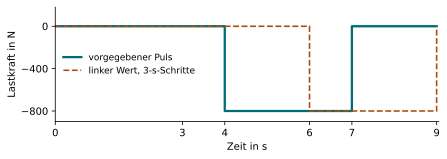

**Aufgabe.** Ein Programm übernimmt den linken Kraftwert bei 0, 3 und 6 Sekunden und hält ihn jeweils drei Sekunden lang. Welche der Kontrollzeiten 6 und 9 Sekunden macht den Fehler sichtbar?

**Musterlösung.** Bei 6 Sekunden hat das Programm noch keinen zusätzlichen Impuls akkumuliert. Die Abweichung beträgt 1600 Newtonsekunden. Bei 9 Sekunden hat das Programm mit dem falschen Pulsbeginn zufällig den richtigen Endimpuls erreicht. Teilt es die Schritte an den bekannten Grenzen 4 und 7 Sekunden, stimmen beide Kontrollen. Die vier Aussagen werden in `beispiele/benchmarkbilanz.py` mit ganzen Zahlen geprüft.

<!-- Buchseite -->

<a id="atlas-abtastung"></a>

## Lesebeispiel · Was zwei Abtastreihen über ihre Zielgrößen verraten

Die zwölf Tankläufe und die zwölf Kranläufe liefern verschiedenartige Sensorwerte. Links wird derselbe Pegel an sieben festgelegten Zeitpunkten abgelesen. Rechts misst der Regler den Winkel des Seils. Die spätere gesuchte Größe ist beim Kran die Lastposition. Eine gute Winkelmessung zu einem frühen Zeitpunkt kann über diese Position wenig aussagen.

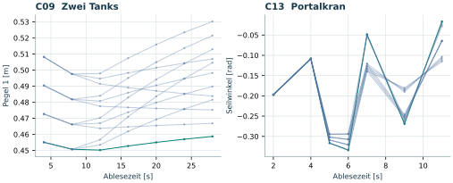

Lesen Sie im rechten Bild zuerst nur bei zwei Sekunden ab. Zwei nahe beieinanderliegende Werte können im selben Quantisierungsintervall liegen. Ob sich die späteren Positionen dann noch unterscheiden lassen, hängt von den weiteren verfügbaren Kanälen ab. Beim Basisplan für C13 bleiben zwei Szenarien unentscheidbar. Mit dem dokumentierten Zusatzkanal lassen sich alle zwölf unterscheiden, soweit es der Auftrag erfordert. [Einzelergebnisse für C09 bis C16](#atlas-reihe2)

<a id="revision-k14-01"></a>

Rechts in Abb. 14.2 lesen wir **den Seilwinkel bei zwei Sekunden** in Radiant. Die Zielgröße dieser Messaufgabe ist die **Lastposition bei 15 Sekunden** in Metern. Der Winkel ist eine Beobachtung, aus der der Katalog die Zielposition eingrenzt. Abb. 14.1 prüft wiederum den programmierten Eingang: Bei sechs Sekunden hat der korrekte Lastpuls bereits $-1600\,\mathrm{N\,s}$ geliefert, der verspätet geschaltete noch null. Bei neun Sekunden liefern beide $-2400\,\mathrm{N\,s}$. Der frühe Impulstest erkennt den Zeitfehler auch dann, wenn der Endimpuls stimmt.


<!-- Buchseite -->

<a id="bild-c09"></a>

## Was hält der Regler zwischen zwei Takten fest?

Beginnen Sie im unteren Diagramm. Zu jeder ganzen Sekunde misst der P-Fuzzy-Regler den Pegel im zweiten Tank. Aus dem aktuellen Pegel berechnet er die nächste Spannung und hält sie eine Sekunde lang. Das Wasser strömt währenddessen weiter. Deshalb verbinden im oberen Diagramm glatte Pegelkurven die Abtastzeitpunkte.

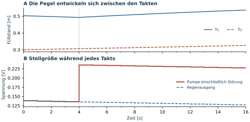

Der Regler startet mit 0,13833 V. Vor dem Störzeitpunkt verdecken sich die beiden Linien in B. Danach entspricht ihr Abstand genau der addierten Störung. Nach 16 s liegen die Pegel bei 0,53684 m und 0,32643 m. Eine unabhängig schrittweise integrierte Projektlösung weicht an den Taktenden um höchstens $1{,}9\cdot10^{-9}$ m ab. Eine stimmige Endhöhe allein würde die korrekte zeitliche Lage des Eingriffs noch offenlassen.

<!-- Buchseite -->

<a id="kap14-schluss"></a>

## Schluss · Getrennte Uhren werden an der richtigen Grenze verbunden

Beim Tank löst der vorgegebene Zeittakt die digitale Rechnung aus. Der Pegel gehört zur kontinuierlichen Phase, die Pumpe hält die vom letzten Takt bestimmte Anregung. Den nächsten Zeitschritt beginnt der Solver erst mit diesem neu vereinbarten Wert. Beim Lastpuls am Kran gilt dasselbe Prinzip für die Kraft. Die Beschleunigung kann an der Flanke springen, die Position und Geschwindigkeit bleiben in dem beschriebenen Modell stetig.

Die Gegenprobe am Kran erklärt, warum ein Endwert allein zu wenig über die Zeitfolge sagt. Verschiebt man einen gleich langen Rechteckpuls, kann die gesamte Kraft über die volle Dauer denselben Impuls liefern. Zu einem Zeitpunkt innerhalb der vorgesehenen Pulsphase fehlt jedoch schon ein Teil der Anregung. Für die Abnahme lesen wir deshalb auch an den Grenzen und dazwischen aus.

Im Grundwasserbeispiel verlagert sich diese Prüfung in den Raum. Entscheidend wird dort, wo Quelle und Beobachter auf einem Gitter liegen. [C19R](#fb-neu15)

Der FNO-Transfer prüft den Tanktakt und den linearen Lastpuls mit ihren ursprünglichen Regeln in zwei ausführbaren Varianten. [Anhang D](#fno-transfer-tanks)

<a id="kap14-forschung"></a>

### Aktueller Stand der Forschung

FMI 3.0 stellt Uhren zur Kopplung zeit- und ereignisgesteuerter Modelle bereit. Vanommeslaeghe und Mitautoren beschreiben eine Abbildung von Parallel DEVS auf Co-Simulation mit synchronen FMI-Uhren. In ihrem Fallbeispiel vergleichen sie die resultierende Abfolge mit einem etablierten Simulator für das Modell. Für einen gekoppelten Tankregler ließe sich daraus eine konkrete Prüfaufgabe ableiten. Stimmen bei einem gemeinsamen Uhrzeitpunkt die Reihenfolge der Eingaben und die Pegelwerte, auch wenn zwei Komponenten gleichzeitig melden? Dazu müsste der Vergleich Taktfolge, ausgetauschte Werte und die numerische Bahn getrennt aufzeichnen. [Vanommeslaeghe u. a., Adapting parallel DEVS semantics to FMI 3.0 co-simulation using synchronous clocks](https://doi.org/10.1177/00375497251393255)

[Zur Einleitung dieses Kapitels](#kap14-einstieg)

<!-- Buchseite -->

<a id="fb-neu15"></a>

# Kapitel 15 · C19R – Schadstofftransport im Grundwasser

<a id="kap15-einstieg"></a>

## Einleitung · Welche Änderung am Gitter darf die Konzentration am Brunnen verändern?

Ein Messbrunnen zeigt eine Konzentration an. Wir rechnen dasselbe Gebiet mit kleineren Zellen und lesen am Brunnen einen anderen Wert ab. Kann der Unterschied an der besseren räumlichen Auflösung liegen? Vor dieser Deutung müssen wir wissen, ob beide Simulationen dieselbe Stoffmenge in das Wasser einbringen und wirklich am selben Ort messen.

Wir beginnen mit der Bilanz von Speicherung, Eintrag und Transport. Die Strömung verschiebt den Stoff, Dispersion verbreitert seine Verteilung. Im Gitter erhält jede Zelle Beiträge ihrer Nachbarn und vorschriftsgemäße Beiträge der Quelle. Wird eine Zelle kleiner, verteilt sich derselbe Eintrag auf ein kleineres Wasservolumen. Damit nimmt ihre Konzentrationsrate zu, obwohl die insgesamt freigesetzte Masse gleich bleibt.

Im dokumentierten Vergleich halten wir die Quellrate von $2\,\mathrm{mg/s}$ und die Messstelle bei $(5,0)\,\mathrm m$ fest. Nach zehn Tagen lesen wir dort die Konzentration ab. Eine unabhängig hergeleitete Integralformel für das homogene Referenzproblem hilft bei der Kontrolle. Danach variieren wir Raumgitter, Zeitschritt und Außenflächen getrennt. Aus einer einzelnen Zahl am Brunnen soll ersichtlich werden, welche Ursache wir tatsächlich geprüft haben und weshalb ein passender Endwert noch keine Aussage über die ganze Ausbreitungsfahne liefert.

[Zum Schluss dieses Kapitels](#kap15-schluss)

<!-- Buchseite -->

<a id="fb-kap11"></a>

## C19R · Wann erreicht ein Stoff den Sensor?

**Lernziel.** Sie können aus einem Wasser- und Stoffvolumen eine Konzentration berechnen, die Transportzeit abschätzen und räumlichen Fehler von Zeit- und Randfehler unterscheiden.

Eine Messstelle liegt fünf Meter stromabwärts. Das Grundwasser bewegt sich im Modell mit $0{,}864\,\mathrm{m/Tag}$. Eine Kollegin hält fest, der Sensor zeige am Tag $5/0{,}864$ erstmals einen Stoffeintrag an. Welcher Teil dieser Aussage lässt sich aus den beiden Zahlen wirklich ableiten?

### Eine Überschlagsrechnung mit geklärter Bedeutung

Ein mit der mittleren Strömung bewegtes Wasserpaket benötigt $5/0{,}864\approx5{,}79$ Tage für diese Strecke. Das Modell C19R beschreibt außerdem eine räumliche Ausbreitung um diesen Transportweg. Für den ersten messbaren Ausschlag braucht man die Konzentration am Sensor und dessen Nachweisgrenze. Die reine Reisezeit liefert keine von beiden.

### Eine zweite Rechnung prüft die Quelle

In einem Rechenfeld von $1\,\mathrm{m^2}$ Fläche und $10\,\mathrm{m}$ Schichtdicke nimmt Wasser ein Viertel des Volumens ein. Es enthält damit $2{,}5\,\mathrm{m^3}$ Wasser. Ein Eintrag von $2\,\mathrm{mg/s}$ bewirkt allein durch die Quelle $0{,}8\,\mathrm{mg/(m^3\,s)}$ Konzentrationszuwachs. Transport in Nachbarzellen kommt gesondert hinzu.

**Jetzt Sie.** Halbieren Sie die Seitenlänge der quadratischen Zelle. Beim erneuten Multiplizieren von lokaler Konzentrationsrate und neuem Wasservolumen müssen wieder $2\,\mathrm{mg/s}$ herauskommen. Diese Probe funktioniert auch, wenn keine exakte Konzentration an der Messstelle bekannt ist.

Der Laborauftrag vergleicht einen festen Zeitpunkt am festen Ort. Zu einer Behauptung über ein ganzes Konzentrationsfeld wären weitere Messgrößen nötig.

**Kernweg**  [Quellbilanz](#fb-c19)  **Vertiefung**  [Integral als Referenz](#fb-c19integral) [Selbst prüfen](#fb-ueb11).

<a id="fb-c19"></a>

## C19R · Wie erreicht ein Schadstoff die Messstelle?

**Erst schätzen.** Beide Zellbreiten halbieren sich, der Massenstrom einer Punktquelle bleibt gleich. Was ändert sich in der Quellzelle?

Ein Sensor liegt fünf Meter stromabwärts einer ortsfesten Quelle. Der Laborauftrag fragt nach der Konzentration am zehnten Tag. Die Grundwasserschicht sei anfangs sauber und im betrachteten Fall homogen. Die Aufbereitungsanlage bleibt ausgeschaltet. Andere Sensoren, Zeitpunkte und Betriebsarten der offiziellen Aufgabenfamilie ergeben eigene Versuche.

### Aus Volumen, Masse und Flüssen wird die Gleichung

Wir mitteln über eine Schicht konstanter Dicke $b$. Ein Bodenstück mit Grundfläche $\Delta A$ enthält bei wassergefüllter Porosität $\eta$ das Wasservolumen $\eta b\,\Delta A$. Seine gespeicherte Stoffmasse ist näherungsweise $\eta b\,c\,\Delta A$, wobei $c$ die Konzentration pro Wasservolumen bezeichnet. Der mittlere Wassertransport nimmt Stoff mit der Geschwindigkeit $\mathbf v=(v,0)$ mit. Die mechanische Dispersion verteilt ihn in Richtung fallender Konzentration. Daher ist der Fluss pro wasserführender Fläche $\mathbf j=\mathbf v c-D\nabla c$.

Die Stoffbilanz lautet Eintrag minus Nettostoffstrom nach außen. Für einen festen Gebietsausschnitt $A$ mit der Quelle in seinem Inneren folgt

$$
\frac{\mathrm{d}}{\mathrm{d} t}\int_A\eta b\,c\,\mathrm dA
   =\dot m-\int_{\partial A}\eta b\,\mathbf j\cdot\mathbf n\,\mathrm ds .
$$

$\partial A$ bezeichnet die Randlinie und $\mathbf n$ die äußere Einheitsnormale. Liegt die Quelle außerhalb dieser Fläche, entfällt $\dot m$. Im Inneren quellenfreier Teilgebiete folgt für die konstanten Koeffizienten $c_t+v c_x=D(c_{xx}+c_{yy})$.

### Zwei Modelle für denselben Prüfpunkt

Die analytische Vergleichsrechnung nimmt eine unendliche Ebene und fern der Quelle abklingende Konzentration an. Die Gitterrechnung nutzt ein begrenztes Rechteck. Ihre äußeren Nachbarwerte werden für den dispersiven Anteil aus der Randzelle fortgesetzt, sodass der Normalgradient verschwindet. Der konvektive Randtransport bleibt in der Bilanz. In der Quellzelle trägt $\dot m/(\eta b\Delta A)$ Konzentration pro Zeit ein. Die Halbierung beider Gitterweiten vervierfacht diese lokale Rate bei gleicher eingetragener Masse.

[ARGESIM C19R, Aufgabendefinition](https://www.argesim.org/benchmarks/c19) · [Kontrollvolumen, Quellzelle und Randflüsse](https://github.com/5H3LL3H5/argesim-hyperposition-benchmarks/blob/1824c9104152674b82de6cd84d53b0b4f68dca37/argesim_benchmarks/models/c19_groundwater.py).

<a id="fb-c19integral"></a>

## Labor C19R · Einen Kontrollwert unabhängig berechnen

Wir verwenden Aufgabe A ohne Aufbereitung. In einer homogenen Schicht von $b=10\,\mathrm{m}$ und Porosität $\eta=0{,}25$ setzt eine ortsfeste Quelle ab $t=0$ konstant $\dot m=2\,\mathrm{mg/s}$ frei. Die Porosität ist der wassergefüllte Volumenanteil. Für diesen Fall sind die Dispersivitäten in beiden Richtungen $\alpha=0{,}05\,\mathrm{m}$. Bei $v=10^{-5}\,\mathrm{m/s}$ ergibt das $D=\alpha v=5\cdot10^{-7}\,\mathrm{m^2/s}$. Es gilt der Geschwindigkeitswert aus Tabelle 1 der Definition, entsprechend $0{,}864\,\mathrm{m/Tag}$.

### Vom einzelnen Stoffimpuls zur Dauerquelle

Ein einzelner Punktimpuls verteilt sich auf der unendlichen Ebene als verschobene zweidimensionale Gaußglocke. Für sein Alter $a>0$ ist die normierte räumliche Dichte

$$
K(x,y,a)=\frac{1}{4\pi D a}
       \exp\!\left(-\frac{(x-va)^2+y^2}{4Da}\right).
$$

Ihr Mittelpunkt liegt bei $va$, ihre Varianz pro Koordinate ist $2Da$. Die über die Fläche integrierte Dichte ist eins. Ein Altersintervall $\mathrm{d} a$ trägt die Stoffmasse $\dot m\mathrm{d} a$ bei. Division durch $\eta b$ rechnet Flächenmasse in Konzentration im Porenwasser um. Addition aller Altersbeiträge liefert

$$
c(x,y,t)=\frac{\dot m}{\eta b}\int_0^t K(x,y,a)\,\mathrm{d} a .
$$

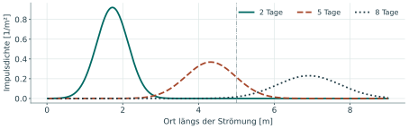

Für die Driftgeschwindigkeit $10^{-5}\,\mathrm{m/s}$ liegen die Maxima nach 2, 5 und 8 Tagen bei $1{,}728$, $4{,}320$ und $6{,}912\,\mathrm m$. Der Gipfel passiert den bei fünf Metern eingezeichneten Brunnen zwischen Tag 5 und Tag 8. Eine erste messbare Ankunft wäre zusätzlich durch eine Nachweisgrenze zu definieren.


Für $t=10$ Tage, $x=5\,\mathrm{m},\ y=0$ ergibt direkte Quadratur $45\,021{,}6231\,\mathrm{mg/m^3}$. Das Skript integriert über den dimensionslosen Altersanteil $a/t$. Verschärfung seiner relativen Quadraturtoleranz von $10^{-8}$ auf $10^{-12}$ verändert die gerundeten Stellen nicht. So entsteht ein Kontrollwert ohne Raumnetz.

`python labor.py c19r` · [Parameterwahl und Vergleich der unabhängigen Punktquellenrechnungen](https://github.com/5H3LL3H5/argesim-hyperposition-benchmarks/blob/1824c9104152674b82de6cd84d53b0b4f68dca37/docs/PUBLISHED_REFERENCE_CHECKS.md\#c19r-spatial-and-time-accuracy).

<a id="fb-c19gitter"></a>

## C19R · Was die Gitterverfeinerung bewirkt

Die archivierte Rechnung misst nach zehn Tagen bei $(5,0)\,\mathrm{m}$ mit RK4 und $7200\,\mathrm{s}$. Die Quelle liegt bei $(0,0)\,\mathrm{m}$ und liefert $2\,\mathrm{mg/s}$. Das grobe, mittlere und feine Gitter enthalten $17\cdot9=153$, $33\cdot17=561$ und $65\cdot33=2145$ Zellzentren. Die gesamte Quelle bleibt jeweils einer Zelle zugeordnet. Verglichen wird mit dem unabhängig berechneten Wert für die unendliche Ebene.

<a id="tab-k15-01"></a>

| Gitterweite $\Delta x$ | $c$ [mg/m³] | absolute Differenz [mg/m³] |
| --- | --- | --- |
| 1,00 m | 48 677,18 | 3 655,56 |
| 0,50 m | 48 251,10 | 3 229,48 |
| 0,25 m | 45 440,70 | 419,08 |

Alle drei archivierten Läufe verwenden RK4 mit $7200\,\mathrm{s}$. Auf dem mittleren Gitter ändert die Halbierung des Zeitschritts allein das Ergebnis um $0{,}00233\,\mathrm{mg/m^3}$. Die Abweichung zur externen Referenz liegt an diesem Punkt um Größenordnungen höher.

### Interpretation für einen neuen Vergleich

Die äußeren Zentren liegen bei $x=-4,12$ und $y=-4,4\,\mathrm{m}$. Aus Zentrum $\pm\Delta x/2$ folgen die Außenflächen $(-4{,}5;12{,}5;-4{,}5;4{,}5)$, $(-4{,}25;12{,}25;-4{,}25;4{,}25)$ und $(-4{,}125;12{,}125;-4{,}125;4{,}125)$, jeweils West, Ost, Süd, Nord in Metern. Die Differenzen enthalten Raum- und Gebietseinfluss. Ein Wiederholungslauf mit festen Außenflächen steht [C19R · Ein Gitterversuch mit festen Außenflächen](#fb-befundgitterfest). Bei $0{,}25\,\mathrm{m}$ und $3600\,\mathrm{s}$ ergibt die getrennte Randvariation zweimal $45\,440{,}69\,\mathrm{mg/m^3}$ am Brunnen ([C19R · Positivität und Fehler an der Messstelle](#fb-befundtransport)). Für einen fairen Vergleich von RK gegen QSS fixiert man den räumlichen Operator, die äußeren Flüsse und die Beobachtungspunkte und misst die Arbeit bei gleicher Konzentrationsabweichung. Eine zweite Gitterweite prüft, ob die Schlussfolgerung trägt. Diese Datenreihe selbst vergleicht Gitterweiten unter RK4.

[Protokoll der Gitterstudie](https://github.com/5H3LL3H5/argesim-hyperposition-benchmarks/blob/1824c9104152674b82de6cd84d53b0b4f68dca37/docs/PUBLISHED_REFERENCE_CHECKS.md\#c19r-spatial-and-time-accuracy) · [Berechnung](https://github.com/5H3LL3H5/argesim-hyperposition-benchmarks/blob/16f0f2528fcf77f16898ecd74ad952be2c09eac2/scripts/c19_profiles.py) · [C19/C19R-Aufgabe](https://www.argesim.org/benchmarks/c19).

<a id="kap15-schrittfolge"></a>

### Warum eine kleinere Quellzelle pro Volumen mehr Stoff erhält

Nehmen wir für eine Handrechnung an, die Quellzelle enthalte $4\,\mathrm{m^3}$ Wasser. Eine Quelle mit $2\,\mathrm{mg/s}$ erhöht ohne Abfluss die Konzentration dort pro Sekunde um $0{,}5\,\mathrm{mg/m^3}$. Wir halbieren nun in beiden horizontalen Richtungen die Zellweite und lassen Schichtdicke sowie wassergefüllten Volumenanteil gleich. Das Wasservolumen der Zelle beträgt dann nur noch $1\,\mathrm{m^3}$. Für dieselbe Quelle muss die Konzentration pro Sekunde um $2\,\mathrm{mg/m^3}$ steigen.

Nach fünf Sekunden liefern beide Rechnungen genau zehn Milligramm eingetragenen Stoff. Im gröberen Gitter erhält man sie aus $4\cdot(5\cdot0{,}5)$, im feineren aus $1\cdot(5\cdot2)$. Wenn wir stattdessen die alte Konzentrationsrate in die neue Zelle kopieren, beträgt der Eintrag dort nur noch ein Viertel. Eine scheinbare Gitterstudie hätte dann in Wahrheit die Quelle variiert.

Bei einer über mehrere Zellen verteilten Quelle gilt die Kontrolle für die Summe aus Konzentrationsquellen mal den jeweiligen Wasservolumina. Der Brunnen selbst bleibt an derselben physikalischen Stelle. Liegt er zwischen Knoten, gehört die Auswertungsmethode zum Versuch. Erst diese Festlegungen machen eine Abweichung gegenüber der Referenz als Raumfehler interpretierbar.

<!-- Buchseite -->

<a id="fb-c19labor"></a>

## C19R · Ist der Zeitintegrator der Engpass?

### Versuchsauftrag

Eine Messstelle liegt fünf Meter stromabwärts. Gewünscht sei nach zehn Tagen eine relative Abweichung von höchstens $1\,\%$ gegenüber der homogenen Referenz auf der unendlichen Ebene. Die finite Rechnung verwendet Zellzentren $x=-4\ldots12\,\mathrm{m},\ y=-4\ldots4\,\mathrm{m}$. Die Quellmasse muss beim Verfeinern gleich bleiben. Wird einfach der gleiche Konzentrationszuwachs pro Zeitschritt in die Quellzelle geschrieben, verschwindet bei kleinerer Zelle künstlich ein Teil der eingetragenen Masse.

### Rechnung und Entscheidung

Der Kontrollwert von [Labor C19R · Einen Kontrollwert unabhängig berechnen](#fb-c19integral) ergibt mit den drei archivierten Gitterwerten von [C19R · Was die Gitterverfeinerung bewirkt](#fb-c19gitter) relative Abweichungen von $8{,}12\,\%$, $7{,}17\,\%$ und $0{,}931\,\%$. Erst die Gitterweite $0{,}25\,\mathrm{m}$ erfüllt das gesetzte Ziel an *dieser* Messstelle. Der Zeitvergleich am mittleren Gitter verschiebt die Konzentration beim Halbieren von $h$ nur um $0{,}00233\,\mathrm{mg/m^3}$. Ein alleiniger Wechsel von RK4 zu einem höher geordneten Zeitverfahren hat auf Basis dieser Daten keine belegte Aussicht, die räumliche Abweichung um Größenordnungen zu beseitigen.

### Drei Kontrollrechnungen vor einer Verallgemeinerung

**Masse.** Nach zehn Tagen wurden $\dot m\,t=1\,728\,000\,\mathrm{mg}$ eingebracht. Im unendlichen Gebiet bleibt diese Masse vollständig im Wasser. Im endlichen Gebiet muss man die zeitlich integrierten äußeren Nettoflüsse mitbilanzieren.

**Weg und Breite.** Der älteste Einzelimpuls ist $vt=8{,}64\,\mathrm{m}$ gewandert. Seine Standardabweichung pro Koordinate ist $\sqrt{2Dt}=0{,}930\,\mathrm{m}$. Die Dauerquelle besteht zusätzlich aus allen jüngeren, schmaleren Anteilen.

**Gebiet.** Wiederholen Sie die Rechnung bei gleicher Gitterweite mit weiter entfernten äußeren Grenzen. Erst dieser Vergleich untersucht, wie die unendliche Referenz und der endliche Versuch am Messpunkt zusammenpassen.

**Grenze der Aussage.** Die 1-Prozent-Entscheidung betrifft Ort, Zeit und homogenes Medium dieses Auftrags. Eine belastbare Konvergenzordnung verlangt eine systematische asymptotische Gitterfolge mit kontrollierter Zeit-, Quellen- und Randabweichung.

<!-- Buchseite -->

<a id="v91-peclet"></a>

### Bei welcher Gitterweite zentrale Advektion ihre Vorzeichen verliert

Für einen stationären, quellenfreien Ausschnitt in einer Raumrichtung sei $v>0$ konstant und $D>0$. Mit zentraler Advektion und Diffusion auf gleichmäßigen Zellen lautet die Differenzengleichung
$$
(1+\mathrm{Pe}_h/2)c_{i-1}-2c_i+(1-\mathrm{Pe}_h/2)c_{i+1}=0,
\qquad \mathrm{Pe}_h=v\,\Delta x/D .
$$
Mit $\mathrm{Pe}_h\le2$ sind beide Nachbargewichte nichtnegativ und summieren sich nach Division durch zwei zu eins. Bei $\mathrm{Pe}_h>2$ wird das stromabwärtige Gewicht negativ. Die zentrale Näherung verliert in diesem Modell ihr diskretes Maximumprinzip. Bei $\mathrm{Pe}_h=4$ und Randwerten $c_0=0,c_2=1$ ergibt die einzige innere Zeile $-2c_1-1=0$, also $c_1=-1/2$. Dieselbe Rechnung mit Upwind-Advektion liefert $c_1=1/6$. Ein begrenzter Fluss kann zusätzlich die numerische Verbreiterung der Front verringern. Seine Positivität hängt auch vom Zeitverfahren ab.

Im C19R-Fenster gilt $\mathrm{Pe}_h=\Delta x/(0{,}05\,\mathrm m)$. Die Gitterweiten $1$, $0{,}5$ und $0{,}25\,\mathrm m$ entsprechen damit $20$, $10$ und $5$. Die Schwelle zwei gilt für den gerade hergeleiteten, zentralen stationären Stencil. Die veröffentlichten C19R-Rechnungen verwenden eine begrenzte Flussrekonstruktion. Deren eigene Positivitäts- und Gitterprüfung erklärt der folgende Abschnitt. [Flussdiskretisierung in Kapitel 7](#t1-k7) · [Versteeg und Malalasekera, Konvektion und Diffusion](https://www.flowthermolab.com/wp-content/uploads/2021/11/Versteeg_Malalasekera_2ed.pdf)

<!-- Buchseite -->

<a id="fb-befundtransport"></a>

## C19R · Positivität und Fehler an der Messstelle

Bei nichtnegativen Zellwerten liegt der im Code rekonstruierte östliche Konzentrationswert zwischen null und dem Doppelten des Zellwerts $c_i$. Das folgt aus der Begrenzung der Steigung durch das Doppelte des jeweiligen Nachbarsprungs. Der von Westen einströmende Wert ist ebenfalls nichtnegativ. Diffusion bringt nichtnegative Nachbarbeiträge, eine positive Quelle fügt Masse hinzu. Für einen Euler-Teilschritt genügt deshalb

$$
h\left(2v/\Delta x+2D_x/\Delta x^2+2D_y/\Delta y^2+
 \lambda_{\max}\right)\le 1.
$$

Hier sind $v,D_x,D_y$ bereits um die Retardation skalierte Größen und $\lambda_{\max}$ begrenzt die lokale Abbaurate. Der verbleibende Koeffizient von $c_i$ ist dann nichtnegativ. Die örtliche Quellrate wird durch das Zellvolumen geteilt; Multiplikation mit Porenanteil, Dicke und Zellfläche ergibt bei $R=1$ auf jedem getesteten Gitter $2\,\mathrm{mg/s}$.

### Wie verhält sich das tatsächlich verwendete RK4?

In acht Varianten des Zehntageversuchs wurden alle Zwischenstufen und Endwerte auf ihr Minimum geprüft; es lag jeweils bei null. Eine unbedingte RK4-Positivitätsgarantie ist falsch. Auf $9\times9$ Zellen mit $0{,}25\,\mathrm{m}$ Abstand, schachbrettartigem Null-Eins-Start, Quelle außerhalb und $h=200\,000\,\mathrm{s}$ erzeugt ein einziger Schritt einen Wert unter $-12\,535$. Die Euler-Bedingung oben ist eine bewiesene Aussage für Euler.

### Was lässt sich am Brunnen garantieren?

Bei $x=5\,\mathrm{m},\ y=0$ nach zehn Tagen liegt die unendliche Punktquellenreferenz zwischen $45\,014{,}84$ und $45\,028{,}41\,\mathrm{mg/m^3}$. Der Alterskern steigt bis zu einem Maximum und fällt dann; seine totale Variation ist höchstens zweimal die Gipfelhöhe. Damit ist der Fehler der Trapezsumme durch Schrittweite mal totale Variation eingeschlossen. Die Rechnung nutzt 65 536 Intervalle.
Das $0{,}25\,\mathrm{m}$-Gitter liefert $45\,440{,}70$, das $0{,}125\,\mathrm{m}$-Gitter im erweiterten Gebiet $45\,085{,}52\,\mathrm{mg/m^3}$. Die gespeicherten Brunnenwerte liegen damit garantiert innerhalb von $0{,}95\,\%$ bzw. $0{,}16\,\%$ der kontinuierlichen Referenz. Auf dem Viertelmetergitter bewirkt Halbierung des Zeitschritts rund $0{,}006\,\mathrm{mg/m^3}$ Unterschied. Eine breiter verteilte Quelle gleicher Masse verschiebt den Wert auf $44\,212{,}64$. Am Quellpunkt selbst ist das zweidimensionale Altersintegral wegen $1/a$ singulär; eine globale punktweise Fehlerschranke über alle Orte wäre schon deshalb ungeeignet.

[Kern und Einheiten](#fb-c19integral) · `transport.json` · `gegenproben.json`.

<a id="fb-befundgitterfest"></a>

## C19R · Ein Gitterversuch mit festen Außenflächen

Wir fixieren die physischen Grenzen bei $x\in[-4{,}5;12{,}5]\,\mathrm{m}$ und $y\in[-4{,}5;4{,}5]\,\mathrm{m}$. Das erste bzw. letzte Zentrum liegt um eine halbe Zellweite innerhalb dieser Grenzen. Die vier Flächen ergeben sich für jede Auflösung wieder als äußeres Zentrum plus oder minus halbe Zellweite.

### Quelle und Brunnen behalten ihre Position

Die Quelle bei $(0,0)\,\mathrm{m}$ liefert konstant $2\,\mathrm{mg/s}$. Auf feinen Gittern liegt dieser Punkt zwischen Zellzentren. Wir verteilen die Rate bilinear: Alle Gewichte sind nichtnegativ, summieren sich zu eins und ihr Ortsmittel ist der Quellpunkt. Am Brunnen $(5,0)\,\mathrm{m}$ interpolieren wir am Tag 10 mit derselben Regel. Der RK4-Schritt beträgt stets $7200\,\mathrm{s}$.

<a id="tab-k15-02"></a>

| Zellweite [m] | Zellzahl $x\times y$ | Brunnenwert [mg/m³] |
| --- | --- | --- |
| 1,00 | $17\times9$ | 48 677,18 |
| 0,50 | $34\times18$ | 41 471,80 |
| 0,25 | $68\times36$ | 44 134,39 |


<a id="revision-k15-01"></a>

Welche Geometrie gehört zur Zahl? Bei festgehaltenen äußersten **Zentren** liefert das Viertelmetergitter $45\,440{,}70\,\mathrm{mg/m^3}$, im erweiterten Gebiet mit Achtelmetergitter sind es $45\,085{,}52$. Die gesicherten Punktfehler betragen höchstens 0,95 % und 0,16 %. Bei festen **Außenflächen** ergibt die Viertelmeterreihe $44\,134{,}39$. Der Abstand zum Punktwert $45\,021{,}62$ verbraucht das 1-%-Budget rund 1,97-mal. Schreiben Sie vor jedem Vergleich neben die Zellweite auch Randlage, Quelle und Sensor.

Die Referenz für die unendliche Ebene beträgt etwa $45\,021{,}62\,\mathrm{mg/m^3}$. Das feine Gitter liegt wieder näher an dieser Referenz als das mittlere. Die Reihe verändert die Auflösung der Quellprojektion und der Beobachtung. Sie liefert für sich allein keine Konvergenzordnung. Zusätzlich lässt sich die Zeitintegration bei festem Operator, festem Gitter und gleicher Auswertung vergleichen.

[Rechnung mit `--fixed-faces`](https://github.com/5H3LL3H5/argesim-hyperposition-benchmarks/blob/16f0f2528fcf77f16898ecd74ad952be2c09eac2/scripts/cp2_accuracy/transport_check.py) · `transport_feste_raender.json` · [Archivierte Gitterreihe](#fb-c19gitter).

<!-- Buchseite -->

<a id="quelle-kontrolle"></a>

### Was ändert allein die Quellverteilung?

Wir halten Außenflächen, RK4-Schritt von 7 200 Sekunden, Quelle von 2 mg/s und bilinearen Brunnensensor fest. In der zweiten Rechnung glätten wir allein die Quellgewichte je Richtung mit $(1/4,1/2,1/4)$. Masse und Schwerpunkt bleiben gleich. Die letzte Spalte integriert den Green-Kern der Punktquelle auf der unendlichen Ebene über dieselben Sensorzellen und benutzt dieselben Beobachtungsgewichte. Alle Konzentrationen gelten am zehnten Tag in $\mathrm{mg/m^3}$.

<a id="tab-k15-03"></a>

| Quelltest · $h$ [m] | Bilinear | Breiter | Green am Zellsensor |
| --- | --- | --- | --- |
| 1,00 | 48677,18 | 31548,87 | 41541,96 |
| 0,50 | 41471,80 | 37592,20 | 41541,96 |
| 0,25 | 44134,39 | 42943,91 | 44104,47 |

Am Viertelmetergitter liegt der bilineare FV-Wert um $29{,}91\,\mathrm{mg/m^3}$ über der Green-Referenz mit denselben Sensorzellen. Gegen den physischen Punktwert von $45\,021{,}62\,\mathrm{mg/m^3}$ beträgt die Differenz $-887{,}24\,\mathrm{mg/m^3}$. Drei Gitter mit unterschiedlichen Quell- und Beobachtungsfehlern bestimmen noch keine asymptotische Ordnung des Flussverfahrens.

<a id="auflage-k15-02"></a>

**Was ändert die Breite genau?** In jeder Richtung verschiebt der zusätzliche Filter die Quelle mit Gewichten $(1/4,1/2,1/4)$ um $-h,0,+h$. Die Summe ist eins, die mittlere Verschiebung null. Das zweite zentrale Ortsmoment steigt je Richtung um $h^2/2$. Am Viertelmetergitter messen wir beim Wechsel von bilinear zu verbreitert $42\,943{,}91-44\,134{,}39=-1\,190{,}48\,\mathrm{mg/m^3}$. Das ist die Antwort des festen FV-Verfahrens am Messort $(5,0)\,\mathrm m$ nach zehn Tagen auf genau diese Änderung.

**Wann hilft Peacemans Brunnenradius?** Betrachten wir eine stationär fördernde, vertikale Bohrung in einer homogenen isotropen Schicht der Dicke $b$, ohne zusätzlichen Bohrlochwiderstand. Mit Permeabilität $k$, dynamischer Viskosität $\mu$ und positiver Volumenförderrate $Q$ folgt aus dem radialen Darcy-Gesetz $dp/dr=\mu Q/(2\pi k b r)$. Integration vom Bohrlochradius $r_w$ zum effektiven Zellblockradius $r_e$ ergibt
$$p_{\rm Block}-p_{\rm Brunnen}=\frac{\mu Q}{2\pi k b}\log\!\frac{r_e}{r_w}.$$
Beim klassischen quadratischen Gitter im Inneren des Gebiets entspricht der Zelldruck ungefähr dem Druck bei $r_e\simeq0{,}2h$. Die linke Seite hat die Einheit Pascal. Im C19R-Versuch sind die Eingabe eine Stoffrate und die Ausgabe eine Konzentration stromabwärts. Dort trennt der kontrollierte Quellenwechsel den Einfluss der Quellgewichte vom übrigen diskreten Rechenweg. [Peaceman, 1978, SPE Journal](https://doi.org/10.2118/6893-PA)


<a id="fb-pruefung15"></a>

## C19R · Ein Brunnenwert bekommt ein Fehlerbudget

Wir wollen am zehnten Tag an genau einem Ort eine Entscheidung treffen. Quelle und Messstelle bleiben auf denselben physischen Koordinaten. Die Außenflächen des endlichen Gebiets stehen fest. Für diesen Lehrversuch wählen wir am Brunnen eine Abweichung von höchstens einem Prozent zur Referenz der unendlichen Ebene. Wie fällt das Urteil aus, wenn das Gitter verfeinert wird?

Mit $Q^*=45\,021{,}62\,\mathrm{mg/m^3}$ ist das absolute Budget $b=450{,}2162\,\mathrm{mg/m^3}$. Die Reihe mit festen Außenflächen [C19R · Ein Gitterversuch mit festen Außenflächen](#fb-befundgitterfest) liefert folgende Nachrechnung aus den gerundeten Werten.

<a id="tab-k15-04"></a>

| Zellweite | Brunnenwert | $\vert Q-Q^*\vert /b$ | Lage zur Referenz |
| --- | --- | --- | --- |
| $1\,\mathrm{m}$ | 48 677,18 | 8,12 | zu hoch |
| $0{,}5\,\mathrm{m}$ | 41 471,80 | 7,88 | zu niedrig |
| $0{,}25\,\mathrm{m}$ | 44 134,39 | 1,97 | zu niedrig |

Alle drei Werte verfehlen dieses Ziel. In der früheren Reihe [C19R · Was die Gitterverfeinerung bewirkt](#fb-c19gitter) erreicht das feinste Gitter hingegen einen relativen Fehler von $0{,}931\,\%$. Dort liegen die äußersten Zellzentren fest, sodass sich die Außenflächen beim Verfeinern verschieben. Die Messung ist jeweils aussagekräftig, sobald Gittergeometrie, Quellprojektion, Interpolation und Referenz zugleich angegeben sind.

Eine zweite Probe führt die $2\,\mathrm{mg/s}$ eingespeiste Masse über zehn Tage auf $1\,728\,000\,\mathrm{mg}$ zurück. Bei anfangs leerem Gebiet ohne Abbau oder Entnahme müssen gespeicherte Masse und integrierter Nettoausfluss zusammen diese Menge ergeben. Der Probe liegt eine andere Messgröße zugrunde als dem Einzelwert am Brunnen.

**Diagnose.** Bleibt die Bilanz beim Verfeinern richtig, während der Sensorwert wandert, untersuchen Sie zuerst Quellverteilung, Auswertestelle, Randnähe und numerische Dispersion. Eine richtige Gesamtmasse ist auch mit einem zu breiten oder verschobenen Konzentrationspuls vereinbar.

[Profile und Behandlungsaufgaben](#fb-refC19R) · [Unabhängige Referenz auf der Ebene](#fb-c19integral).

<a id="fb-ueb11"></a>

## Selbst prüfen · Quelle, Messort und Vergleich

**Merksatz.** Eine Referenz gehört zu einer bestimmten Messgröße, einem Ort, einer Zeit und Randbedingungen. Zeit-, Gitter- und Gebietsfehler lassen sich mit verschiedenen Gegenversuchen untersuchen.

### A · Den Stoffeintrag bilanzieren

Eine Quellzelle hat $0{,}5\,\mathrm{m}$ Seitenlänge, $10\,\mathrm{m}$ Schichtdicke und $0{,}25$ wassergefüllten Volumenanteil. Die Quelle gibt $2\,\mathrm{mg/s}$ ab. Welche Konzentrationszunahme in fünf Sekunden folgt aus dem Quellterm allein? Prüfen Sie über die Stoffmasse, ob die Konzentration im richtigen Volumen angegeben ist.

### B · Einen Datenbefund deuten

An derselben C19R-Messstelle wurden für grobes, mittleres und feines Gitter relative Abweichungen von $8{,}12\,\%$, $7{,}17\,\%$ und $0{,}931\,\%$ zur Referenz der unendlichen Ebene ermittelt. Welche der drei Rechnungen erfüllt hier das Ziel von einem Prozent? Erlauben diese drei Zahlen bereits eine Aussage über die Konzentration an allen anderen Punkten?

### C · Ein Gegenexperiment entwerfen

Ein Team will den verbleibenden Fehler durch einen neuen Zeitintegrator halbieren. Sie können drei paarweise Vergleiche durchführen. Beschreiben Sie, wie Sie nacheinander den Zeitschritt, die Zellbreite und den Abstand zum Außenrand verändern. Nennen Sie jeweils die Messgröße und eine Bedingung, unter der das Ergebnis mehrdeutig bliebe.

**Hinweis.** A zählt Masse pro Wasservolumen. Bei C sind gleicher Messort und gleiche Quellenstärke erst der Anfang. Auch Parameter, Anfangsdaten und Definition der Konzentration müssen zusammenpassen.

[Lösungswege A, B und C](#fb-loesweg11) · [Zum Kapitelauftakt](#fb-kap11).

<a id="fb-loesweg11"></a>

## Lösungswege · Quelle, Messort und Vergleich

### A · Eine lokale und eine globale Einheit verbinden

Die Grundfläche beträgt $0{,}25\,\mathrm{m^2}$, das gesamte Zellvolumen $2{,}5\,\mathrm{m^3}$, das Wasservolumen $0{,}625\,\mathrm{m^3}$. Zehn Milligramm werden in fünf Sekunden freigesetzt. Der Quellterm allein liefert darum $10/0{,}625=16\,\mathrm{mg/m^3}$. Multiplizieren mit $0{,}625\,\mathrm{m^3}$ ergibt wieder $10\,\mathrm{mg}$.

### B · Die Reichweite des Befunds benennen

Nur das feine Gitter erfüllt mit $0{,}931\,\%$ die inklusive Ein-Prozent-Grenze. Diese Aussage betrifft den untersuchten Sensor zum untersuchten Zeitpunkt. Nahe der schmalen Quelle kann die Gitterempfindlichkeit anders ausfallen. Für eine Aussage über das ganze Feld wären Daten an mehreren Orten oder eine definierte räumliche Fehlernorm erforderlich.

### C · Drei Vergleiche mit je einer Stellgröße

**Zeit.** Lassen Sie Raumgitter, Gebiet und Quellenabbildung gleich und halbieren Sie $h$. Vergleichen Sie beide Sensorwerte zum selben physikalischen Zeitpunkt. Unterschiede beim Auslesen oder Interpolieren könnten den Zeitvergleich verfälschen.

**Raum.** Halbieren Sie die Zellweite bei festem Gebiet und kontrolliert kleinem Zeitfehler. Halten Sie die gesamte Quellmasse pro Zeit fest. Eine von der Zellfläche abhängige Gesamtmasse würde ein anderes Modell erzeugen.

**Gebiet.** Verlegen Sie bei unveränderter Zellweite den Rand weiter nach außen. Quelle und Sensor bleiben an ihrem physischen Ort. Eine Verschiebung des Sensors um eine halbe Zelle könnte wie ein Randeffekt aussehen. Vergleichen Sie in jedem Paar dieselbe Konzentration in $\mathrm{mg/m^3}$.

**Entscheidung.** Erst die Größe und Richtung dieser Änderungen helfen zu beurteilen, ob eine Änderung am Zeitintegrator das gewünschte Ziel erreichen kann.

[Noch einmal selbst rechnen](#fb-ueb11) · [Forschungsstand und Beweisfragen](#fb-schluss11).

<!-- Buchseite -->

<a id="fb-schluss11"></a>

## Welche Referenz passt zur Transportaufgabe?

### Bezug zu einer weiteren Modellrechnung

Die überarbeitete C19-Definition und die veröffentlichte COMSOL-Lösung bieten für den Grundwasserfall einen weiteren Modellierungsweg mit finiten Elementen. Aktuelle Arbeiten zu konservativen, maximumprinziperhaltenden Verfahren untersuchen die Kombination von Genauigkeit und physikalisch zulässigen Schranken bei konvektionsdominierter Diffusion. Solche allgemeinen Ergebnisse übertragen sich auf den konkreten Quellterm, die Randbehandlung und den Integrator nur unter den jeweiligen Voraussetzungen.

### Beweis · Die Referenz erhält die eingebrachte Masse

Für $a>0$ ist $K$ das Produkt zweier normierter Gaußdichten. Translation um $va$ verändert deren Integral nicht, also $\int_{\mathbb R^2}K(x,y,a)\,\mathrm dx\,\mathrm dy=1$. Der Integrand ist nichtnegativ. Daher dürfen wir die Reihenfolge der Orts- und Altersintegration vertauschen und erhalten

$$
\eta b\int_{\mathbb R^2}c(x,y,t)\,\mathrm dx\,\mathrm dy
   =\dot m\int_0^t 1\,\mathrm{d} a=\dot m t .
$$

Derselbe Kontrollwert kann für ein endliches Gebiet erst nach Addition des integrierten Nettoausflusses angewendet werden. Der Beweis für die unendliche Ebene klärt also, welcher Term im praktischen Gitterversuch zusätzlich gemessen werden muss.

### Ergebnis der Nachuntersuchung

An der festgelegten Messstelle ist der Fehler der gespeicherten Viertel- und Achtelmetergitter gegen die kontinuierliche Punktquellenlösung eingeschlossen. Änderungen von Zeitauflösung, Quellbreite und Außengrenzen sind einzeln nachgemessen. Eine allgemeine Konvergenzordnung für beliebige Messorte erfordert weitere Orts- und Regularitätsannahmen.

[Nachweis und Ergebnis](#fb-befundtransport) · [Definition und C19R-Lösungen](https://www.argesim.org/benchmarks/c19) · [Publizierter FEM-Vergleich in COMSOL](https://www.sne-journal.org/fileadmin/user_upload_sne/benchmarks/C19/C19R-solution-COMSOL.pdf) · [Konservative Verfahren mit Maximumprinzip](https://doi.org/10.4208/nmtma.OA-2023-0165).

**Gegenprobe im Rechenlabor.** `rechenlabor/kapitelvergleich.py` prüft für jede der drei Auflösungen die eingebrachte Masse und das Brunnenbudget aus dem Datensatz mit festen Außenflächen. Wer das Gitter verfeinert und zugleich die Stärke einer Zellquelle konstant je Volumen lässt, erzeugt einen anderen Versuch. Eine neue Brunnenkonzentration wäre dann zugleich Folge der veränderten Quelle.

<!-- Buchseite -->

<a id="atlas-quelle"></a>

## Lesebeispiel · Einen vorgeschlagenen Brunnenwert über das ganze Quellenintervall prüfen

In zwanzig Zeitabschnitten kann die dimensionslose Quellrate jeweils jeden Wert zwischen null und eins annehmen. Ihre Summe ist vier. Zwei kumulative Ablesungen begrenzen in einem Block $B$ die Summe $m$ der Raten. Für die Gewichte $w_i$ des positiven Green-Kerns hat dessen Beitrag die Form $\sum_{i\in B} w_i x_i$. Wählen wir eine beliebige Zahl $a$, so gilt
$$
a m-\sum_{i\in B}(a-w_i)_+\ \le\ \sum_{i\in B}w_i x_i\ \le\
a m+\sum_{i\in B}(w_i-a)_+ .
$$
Der Beweis steckt in $0\le x_i\le1$: Ein positiver Rest kann höchstens mit eins multipliziert werden. Ein trainiertes Polynom schlägt für jede Seite einen Multiplikator vor. Der Prüfer setzt in die untere und obere Rechnung die jeweils gerichteten Quadraturgewichte ein. Bei $L>0$ erreicht der Wert $2LU/(L+U)$ im ganzen Intervall $[L,U]$ einen relativen Fehler von höchstens $(U-L)/(U+L)$.

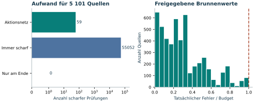

Das Aktionsnetz darf vor dem nächsten Ablesen eine scharfe Intervallrechnung auslösen. Es tat dies 59-mal und benötigte 55 030 Ablesungen für 5 101 Quellen. Wer die scharfe Rechnung immer versucht, spart 22 Ablesungen und benötigt dafür 55 052 scharfe Prüfungen. Ohne frühen Versuch genügten in dieser Stichprobe 55 052 Ablesungen und die gelernten Zeugen allein. Welche Variante günstiger ist, hängt von den Kosten einer zusätzlichen Messung ab.

<!-- Buchseite -->

<a id="bild-c19r"></a>

## Wo liegen Quelle und Brunnen auf dem Gitter?

Legen Sie ein quadratisches Gitter mit Zellweite 1 m über das Gebiet. Die Quelle liegt bei $(0,0)$ m, der Brunnen bei $(5,0)$ m. Beide treffen zunächst genau eine Zellmitte. Beim Halbieren der Zellweite muss feststehen, welche Geometrie erhalten bleiben soll. Das ist eine physikalisch relevante Entscheidung, sobald die Konzentration an einem bestimmten Brunnen gefragt ist.

![Abbildung 15.3. A zeigt die Außenflächen $[-4{,}5;12{,}5]\times[-4{,}5;4{,}5]$ m und das Grundgitter mit 17 mal 9 Zellen. B und C vergrößern die Quelle bei 0,5 m Zellweite. Grün umrandete Punkte tragen Gewicht. Am Brunnen wiederholen sich dieselben Muster um 5 m versetzt.](abbildungen/bild_c19r_gitter.svg)

Hält man die äußeren Zellmitten fest, entstehen 17 × 9, 33 × 17 und 65 × 33 Zellen. Die Gebietsflächen rücken bei der Verfeinerung nach innen. Hält man die Außenflächen fest, entstehen 17 × 9, 34 × 18 und 68 × 36 Zellen. Im zweiten und dritten dieser Gitter liegen die Messorte zwischen vier Zellmitten mit je einem Viertel Gewicht. In beiden Folgen ergeben die Gewichte Summe eins und ihren Schwerpunkt genau am angegebenen Ort. Diese Rechnung erklärt, warum ein Vergleich von Brunnenwerten seine Gitterkonvention angeben muss.

<!-- Buchseite -->

<a id="kap15-schluss"></a>

## Schluss · Die Stoffbilanz und der festgelegte Messort tragen den Gittervergleich

Die Antwort auf die Brunnenfrage beginnt mit dem Eintrag pro Sekunde. Halbiert man beide horizontalen Zellweiten, kann die Konzentrationsrate in der Quellzelle steigen, obwohl die eingetragene Masse gleich bleibt. Das ist ein beabsichtigter Effekt der kleineren Zelle. Die Summe der Einträge über das Gebiet prüft, ob wirklich dieselbe Quelle gerechnet wurde.

Danach lassen sich Unterschiede untersuchen. Auf festem Raumgitter zeigt die Zeitschrittfolge, wie stark die Zeitrechnung den Wert beeinflusst. Bei einer Raumreihe brauchen wir dieselben Außenflächen und denselben Beobachter. Die Referenz im unendlichen Gebiet ist analytisch zugänglich. Eine endliche Rechnung kann sich ihr am Brunnen ausreichend annähern und sich nahe der Quelle oder am Rand dennoch anders verhalten. Masse, kleinster Feldwert und lokaler Messwert prüfen verschiedene Fehler.

Das folgende Kapitel führt diese Unterscheidung an zwei Feldern weiter. Eine Kavität verlangt Profile im Inneren, und eine Saite verlangt die richtige Lage und Form einer Welle. [CP2](#fb-neu16)

Eine achtstufige Quelle erweitert den Kontrollversuch aus Kapitel 15. Ihre Green-Referenz wird im Anhang mit einem trainierten Operator und finiten Volumen verglichen. [FNO-Vergleiche in Anhang C](#fno-c19r-modell)

<a id="kap15-forschung"></a>

### Aktueller Stand der Forschung

Knobloch, Kuzmin und Jha untersuchen für stationäre Konvektions-Diffusions-Reaktions-Gleichungen eine Finite-Elemente-Formulierung, die einen erhaltenden und begrenzten Fluss mit einer Gleichgewichtskontrolle verbindet. Die Frage nach zulässigen Werten wird dort bereits bei der Raumdiskretisierung behandelt. Für unsere zeitabhängige Quellrechnung braucht man ergänzend die Zeitintegration und die Randflüsse. Ein passender Anschlussversuch würde bei gleichem Eintrag und festem Messort verschiedene begrenzte Flüsse vergleichen. Neben der Abweichung am Brunnen müssten die erhaltene Gesamtmasse und die kleinste Konzentration über die gesamte Ausbreitung ausgewertet werden. [Knobloch, Kuzmin und Jha, Well-balanced convex limiting (2024)](https://doi.org/10.1016/j.jcp.2024.113305)

[Zur Einleitung dieses Kapitels](#kap15-einstieg)

<!-- Buchseite -->

<a id="fb-neu16"></a>

# Kapitel 16 · CP2 – Deckel-Kavität, Saite und gelernte Feldoperatoren

<a id="kap16-einstieg"></a>

## Einleitung · Was muss ein berechnetes Feld zeigen, damit wir ihm vertrauen?

Unter einem gleitenden Deckel setzt sich Wasser in Bewegung. Weiter unten kehrt ein Teil der Strömung um. Auf einer gezupften Saite laufen zwei Knicke nach außen und werden an den Enden reflektiert. In beiden Fällen legt ein Programm Zahlen auf ein Gitter. Was wir darin kontrollieren müssen, unterscheidet sich. In der Kavität interessiert uns auch die Strömung unterhalb der vorgegebenen Wand. Auf der Saite fragen wir, ob Form und Lage der Welle zur gleichen Uhrzeit stimmen.

CP2 umfasst offiziell drei Parallelaufgaben. Die erste ist eine Monte-Carlo-Parameterstudie am Feder-Masse-System. Die beiden hier vertieften Aufgaben sind die Kavität und die Saite. Für die Flüssigkeit vergleichen wir Komponenten, Profile und Masse im D2Q9-Modell. Für die ungedämpfte Saite aus der Ruhe lässt sich eine unabhängige d’Alembert-Referenz aus der fortgesetzten Anfangsform gewinnen. Daran messen wir klassische Zeitintegratoren und die zusätzlich im Projekt untersuchten Feldoperatoren.

Uns interessieren die Fehler im Inneren und die Frage, woher eine Verbesserung tatsächlich kommt. Mehr Knoten, weiteres Training und das bekannte Wellengesetz verändern verschiedene Teile des Versuchs. Deshalb halten wir Eingabe, Beobachtungszeit und Fehlermaß innerhalb eines Vergleichs fest. Der Aufwand der offiziellen parallelen Programme ist eine eigene Messaufgabe. Auch bei einer gelernten Vorhersage müssen wir zuerst wissen, welcher Feldfehler zu welchem Gitter und welchem Zeitpunkt gehört. [Kapitel 9 · Gemeinsamer Prüfaufbau](#no-auswertung)

[Zum Schluss dieses Kapitels](#kap16-schluss) · [Kavität mit wechselndem Antrieb](#cp2b-lidverfahren)

<!-- Buchseite -->

<a id="fb-pylbm"></a>

## CP2/2 · Wie bewegt ein Deckel die Flüssigkeit?

Ein quadratischer Behälter ist mit ruhender Flüssigkeit gefüllt. Sein oberer Deckel fährt nach rechts. Die anderen Wände stehen. Gesucht ist die örtliche Geschwindigkeit. Die Lattice-Boltzmann-Methode (LBM) speichert pro Gitterzelle gerichtete Verteilungswerte $f_i$. **D2Q9** bedeutet zwei Raumrichtungen und neun mögliche Gittergeschwindigkeiten $\mathbf c_i$: Ruhe, vier Achsenrichtungen, vier Diagonalen.

### Was ein Schritt wirklich berechnet

Im Inneren liefern $\rho=\sum_i f_i$ und $\rho\mathbf u=\sum_i f_i\mathbf c_i$ die Dichte und den Impuls. Bei der BGK-Kollision nähert sich jede Population mit dem Faktor $\omega$ ihrem lokalen Gleichgewicht an:

$$
f_i^*=f_i+\omega(f_i^{\mathrm{eq}}-f_i).
$$

Danach rückt jeder gerichtete Anteil um seinen Gittervektor weiter. An ruhenden Wänden kehren die Richtungen in der implementierten Vollweg-Reflexion um. An der oberen Zeile gibt die Implementierung das Gleichgewicht des bewegten Deckels vor. Ein eigener Ausgaberand setzt den vorgeschriebenen Deckelwert.

### Was lässt sich im kleinen Versuch messen?

Das Original fordert $257\times257$ Zellen und 350 000 Iterationen. Für einen CPU-Lehrversuch verwenden wir $17\times17$ und 16 Iterationen, $u_\mathrm{Deckel}=0{,}1$ in Gittereinheiten und $\mathrm{Re}=1000$. Die Messung betrifft den frühen Anlauf. Eine stationäre Wirbelstruktur würde eine eigene Rechnung erfordern.


<a id="revision-k16-01"></a>

Das Bild zeigt den Betrag $|u|/U$. Die Vektoren $(0{,}2U,0)$ und $(-0{,}2U,0)$ haben dieselbe Farbe, transportieren aber Flüssigkeit in entgegengesetzte Richtungen. Für die Deckelumkehr lesen wir daher zusätzlich das vorzeichenbehaftete $u_x/U$ und vergleichen im Inneren die vollständigen Geschwindigkeitsvektoren. Eine Wandprüfung braucht ihren eigenen Bezug zur vorgegebenen Randgeschwindigkeit.


Die native Zellauflösung lässt sich mit den [neu gerechneten und archivierten Feingitterfeldern](#bild-kavitaet) vergleichen.

[ARGESIM-Definition CP2, Fall 2](https://www.sne-journal.org/fileadmin/user_upload_sne/benchmarks/CP/CP2-definition.pdf) · [D2Q9-Schritt und Randregeln](https://github.com/5H3LL3H5/argesim-hyperposition-benchmarks/blob/52f8a33e469d36514e7830db544b9fc27243a82c/argesim_benchmarks/models/cp2_parallel_and_distributed.py).

<a id="fb-pysaite"></a>

## CP2/3 · Wohin wandert ein Knick in der Saite?

Eine an beiden Enden befestigte Saite ist $L=0{,}5\,\mathrm{m}$ lang. Ziehen Sie ihre Mitte um $0{,}05\,\mathrm{m}$ aus und lassen Sie sie aus der Ruhe los. Für kleine Auslenkungen bei konstanter Spannung und homogener Massendichte gilt

$$
u_{tt}=c^2u_{xx},\qquad u(0,t)=u(L,t)=0,\qquad u(x,0)=g(x),\quad u_t(x,0)=0 .
$$

Wir verwenden $c=0{,}06\,\mathrm{m/s}$ aus der korrigierten CP2-Studie. Der Buchversuch fragt nach den Profilen bei fünf und acht Sekunden.

### Eine Referenz ohne Zeit- oder Raumgitterfehler

Setzen wir die Anfangsform $g$ ungerade und $2L$-periodisch fort, nennen wir diese Fortsetzung $\tilde g$. Je eine halbe Welle wandert nach links und rechts:

$$
u(x,t)=\tfrac12[\tilde g(x-ct)+\tilde g(x+ct)] .
$$

Bei $t=0$ gibt die Formel $g$ zurück, die beiden Anfangsgeschwindigkeiten heben sich auf. Die ungerade Spiegelung liefert an beiden Enden null. Auf glatten Teilstücken bestätigt zweimaliges Ableiten die Wellengleichung. Die stetige Dreiecksform besitzt am Knick eine schwache Lösung, die dieselbe Verschiebungsformel beschreibt.

### Was wird zum Gleichungssystem?

Die Linienmethode ersetzt $u_{xx}$ durch $(u_{j-1}-2u_j+u_{j+1})/\Delta x^2$. Auf 500 Intervallen bleiben 499 innere Auslenkungen. Der vorhandene implizite Newmark-Solver berechnet sie mit $\Delta t=0{,}01\,\mathrm{s}$. Verglichen wird am selben Ort zur selben Zeit.

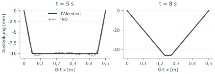

[Jammer, Junglas und Pawletta (2022), korrigierte CP2-Saitendaten](https://www.sne-journal.org/fileadmin/user_upload_sne/SNE_Issues_OA/SNE_32_4/articles/sne.32.4.10625.bncp2.OA.pdf) · [Linienmethode](#t1-k7).

<a id="fb-cpverlet"></a>

## Dieselbe Saite mit Störmer–Verlet

Durch die Linienmethode hat jeder innere Knoten eine Beschleunigung $A_j(U)=c^2(U_{j-1}-2U_j+U_{j+1})/\Delta x^2$. Bei festen Enden bleiben $U_0=U_{N-1}=0$. Wie weit kommt eine explizite Rechnung, wenn wir den gleichen Zeitschritt wie für Newmark verwenden?

### Aus Beschleunigung werden neue Auslenkungen

Für Anfangsruhe lautet der erste Schritt $U^1=U^0+\tfrac12 h^2 A(U^0)$. Danach berechnet die Ortsform von Störmer–Verlet die nächste Auslenkung aus den beiden vorangegangenen und der aktuellen Beschleunigung:

$$
U^{n+1}=2U^n-U^{n-1}+h^2 A(U^n).
$$

Die Formel folgt aus der zentralen zweiten Differenz in der Zeit. Bei glatter Lösung bleibt nach Division durch $h^2$ ein Taylor-Rest der Ordnung $h^2$. Das dreieckige Anfangsprofil hat einen Knick. Dort muss die Fehlerentwicklung gesondert gemessen werden.

### Die Schrittgrenze vor der Rechnung prüfen

Für eine Eigenmode mit Kreisfrequenz $\omega$ lautet die Faktoren-Gleichung $r^2-(2-h^2\omega^2)r+1=0$. Bei $0<h\omega<2$ sind die Wurzeln komplex konjugiert und haben Betrag eins. Bei $h\omega>2$ wächst eine Mode. Die größten Kreisfrequenzen der zentralen Raumdifferenz liegen bei festen Enden unter $2c/\Delta x$. Daher genügt hier $C=ch/\Delta x\le1$. Mit $h=0{,}01\,\mathrm{s}$ ist $C=0{,}0768$ auf 65 Knoten und $0{,}6$ auf 501 Knoten.

<a id="tab-k16-01"></a>

| 501 Knoten, relativer Feldfehler | Verlet | Newmark | FNO |
| --- | --- | --- | --- |
| CP2-Dreieck, $5\,\mathrm{s}$ | 0,231  % | 0,374  % | 3,001  % |
| CP2-Dreieck, $8\,\mathrm{s}$ | 0,095  % | 0,152  % | 0,882  % |

Die Gegenprobe ist wieder die verschobene und gespiegelte Anfangsform. Bei 65 Knoten beträgt der Verlet-Fehler 2,484  % und 0,931  %. Prüfen Sie, was bei Beibehaltung von $h$ und 1001 Knoten geschieht. Dann ist $C=1{,}2$ und die hier verwendete Stabilitätsbedingung verletzt.

[Hairer, Lubich und Wanner (2003), Störmer--Verlet](https://www.cambridge.org/core/journals/acta-numerica/article/abs/geometric-numerical-integration-illustrated-by-the-stormerverlet-method/E55395D5DD7A4E0526D10EA74DA6C46B) · `python methodenlabor.py` · [Referenz und Fehlermaß](#fb-pyvergleich).

<a id="fb-pyvergleich"></a>

## Wie groß ist der Fehler wirklich?

Für eine Feldvorhersage $p$ und eine Referenz $r\ne0$ messen wir den relativen Fehler $\|p-r\|_2/\|r\|_2$. Die Norm ist die Quadratwurzel aus der Summe der quadrierten Gitterwerte. Beim Mittel zählt jedes unabhängige Feld und bei der Saite jeder Ausgabetermin gleich. Bei der Kavität bewerten wir die $15\times15$ inneren Fluidzellen. Als einfache Vergleichsvorhersage dient das ortsweise Mittel der Trainingszielfelder.

<a id="tab-k16-02"></a>

| Versuch und Referenz | FNO | Vergleich |
| --- | --- | --- |
| Saite, 24 glatte Testfelder, exakte Moden | 1,54  % | Trainingsmittel 101,98  % |
| CP2-Dreieck, 501 Knoten, 5 s, d’Alembert | 3,00  % | Newmark 0,37  % |
| CP2-Dreieck, 501 Knoten, 8 s, d’Alembert | 0,88  % | Newmark 0,15  % |
| Kavität, 24 Testfelder, D2Q9 | 11,98  % | Trainingsmittel 14,91  % |
| Kavität, einheitliche Dichte, D2Q9 | 11,59  % | 17 mal 17, 16 Schritte |

### Welche Schlussfolgerung trägt der Gitterversuch?

Beim CP2-Dreieck nach fünf Sekunden ergibt das grobe Gitter mit 65 Knoten für Newmark $2{,}50\,\%$, für das FNO $3{,}00\,\%$. Auf 501 Knoten sinkt der gemessene Newmark-Fehler auf $0{,}37\,\%$. Das auf 65 Knoten trainierte Netz lässt sich mit denselben Gewichten auswerten und bleibt bei ungefähr $3\,\%$. Einen Datensatz auf mehr Punkten auszugeben und eine numerische Näherung systematisch zu verfeinern sind verschiedene Operationen.

### Welche Genauigkeit reicht für den Auftrag?

Bei einem Grenzwert von $1\,\%$ erreicht das Netz die geforderte Saitengenauigkeit auf dem feinen Gitter bei acht Sekunden. Bei fünf Sekunden verfehlt es das Ziel. Obwohl der relative Fehler von $3{,}001\,\%$ auf $0{,}882\,\%$ sinkt, steigt der örtliche Spitzenfehler von $0{,}705$ auf $0{,}762\,\mathrm{mm}$. Bei begrenztem Abstand zu einem Hindernis zählt der Spitzenfehler. An den Knicken bei 5 s (50/450 mm) ist FNO minus Referenz +0,677/+0,705 mm; bei 8 s (230/270 mm) +0,663/+0,720 mm. Dazwischen liegt bei 250 mm der negative Spitzenfehler −0,762 mm. [Beide Fehlerprofile als CSV](https://github.com/5H3LL3H5/argesim-hyperposition-benchmarks/blob/719ebd46850dc882bf05ad9e01ea41c4bb7f0312/docs/lehrbuch/studienbuch/material/cp2_genauigkeit/saite_fehlerprofile.csv), auch in der Anlage `CP2_Genauigkeit.zip`. Für die Kavität ist der Vergleich ein Nachweis der Annäherung an den vorhandenen LBM-Code. Eine unabhängige Strömungsmessung wäre eine zusätzliche Prüfung der physikalischen Güte. Trainingszeit, Erzeugung der Referenzen und Auswertung mit festen Gewichten sind getrennte Kosten.

[Einzelmessungen, Zeiten und Umgebung](https://github.com/5H3LL3H5/argesim-hyperposition-benchmarks/blob/52f8a33e469d36514e7830db544b9fc27243a82c/docs/evidence/cp2-operators.json) · Seed 2027, 80 Epochen, ein CPU-Thread, PyTorch 2.8.0+cpu und NeuralOperator 2.0.0.

<!-- Buchseite -->

<a id="kap16-schrittfolge"></a>

### Warum die reine Vorhersagezeit noch keine Kostenbilanz ergibt

Ein klassischer Solver braucht bei jeder neuen Anfangsform eine Rechnung. Ein trainierter Operator berechnet seine Vorhersage möglicherweise schneller, hat davor aber Trainingsdaten und Rechenzeit verbraucht. Vergleichen wir nur Verfahren, die das vereinbarte Feldbudget erfüllen, können wir diesen Unterschied ausdrücken. Für $N$ neue Anfragen seien $T_\mathrm A$ die einmaligen Zusatzkosten des Operators einschließlich Training und Datenerzeugung, $t_\mathrm S$ die Solverzeit pro Anfrage und $t_\mathrm O$ die Zeit einer Vorhersage. Dann lautet die Bedingung für den Kostenvorteil
$$
T_\mathrm A+Nt_\mathrm O<Nt_\mathrm S.
$$

Zur Handrechnung wählen wir Lehrzahlen von $T_\mathrm A=60\,\mathrm s$, $t_\mathrm S=40\,\mathrm{ms}$ und $t_\mathrm O=10\,\mathrm{ms}$. Bei jeder Anfrage werden dann $30\,\mathrm{ms}$ eingespart. Nach genau 2000 Anfragen decken sich beide Kosten, ab 2001 entsteht in dieser Modellrechnung ein Vorteil. Das Beispiel gilt nur für Anfragen, die zum geprüften Einsatzbereich passen. Benötigt ein anderer Zupfpunkt ein neues Training oder überschreitet das Ergebnis sein Fehlerbudget, muss man diese Änderung vor der Entscheidung einrechnen.

Für CP2 verwenden wir getrennte Nachweise für Genauigkeit, Vorhersage und die ursprünglichen Parallelaufgaben. Wir können denselben Kostenvergleich erst dann mit Messwerten füllen, wenn Zahl der Anfragen, Hardware und Feldanforderungen übereinstimmen.

<!-- Buchseite -->

<a id="fb-fnoprotokoll"></a>

## Wie würde man ein genaueres FNO erkennen?

Sie zupfen eine Saite an, zeichnen ihre Form auf und möchten wissen, wo sie nach fünf Sekunden steht. Ein Netz liefert 501 Zahlen. Wie entscheiden Sie, ob eine zweite Version besser geworden ist? Eine größere Zahl von Gewichten gibt darauf noch keine Antwort. Wir behalten die erste Version samt Gewichten und prüfen beide an identischen Eingaben.

### Vor der Rechnung festlegen

Bei der Saite ist der Eingang die Anfangsauslenkung in Metern bei Anfangsruhe. Die Referenz für ein Dreieck ist die entlang der Charakteristiken fortgesetzte Anfangsform. Bei der Kavität ist der Eingang eine ruhende Dichteverteilung. Hier berechnet der D2Q9-Code die Geschwindigkeit. Für den direkten Vergleich mit dem früheren Netz werten wir deren Betrag in den inneren Zellen aus. Zusätzlich prüfen wir bei den neuen Netzen den Vektor aus beiden Komponenten. So können zwei gleich schnelle, gegensinnige Wirbel unterschieden werden.

$$
E_{\rm RMS}=\sqrt{\tfrac1m\textstyle\sum_{j=1}^m(p_j-y_j)^2},
 \qquad E_{\rm rel}=\frac{\|p-y\|_2}{\|y\|_2}.
$$

$p$ ist die Vorhersage, $y$ das Referenzfeld und $m$ die Anzahl bewerteter Werte. Bei mehreren Fällen bilden wir zuerst je Feld den relativen Fehler und mitteln anschließend. Bei der Saite berichten wir nur den absoluten Fehler, falls der Referenz-RMS höchstens $10^{-10}$ der Zupfhöhe beträgt.

### Was darf das Training sehen?

Die frühere und die verbesserte Kavitätsrechnung nutzen dieselben 96 Trainings-, 16 Validierungs- und 24 Testfelder. Die Validierung bestimmt die Trainingsepoche. Seed 2027 bezeichnet den veröffentlichten Lauf; zwei weitere Initialisierungen prüfen die Streuung. Der Saitenversuch erhält zusätzliche hochfrequente Trainingsbeispiele und Zeitpunkte. Alle sechs Dreieckslagen bleiben bei seiner Anpassung außen vor.

**Selbst prüfen.** Warum darf die exakte Lösung im Training vorkommen? Eine Paardatei kann die Lösung zu einem Trainingsprofil enthalten. Erst wenn die Prognose für das neue Profil vorliegt, wird sie mit dessen eigener Referenz verglichen.

[Rechnung an der Saite](#t1-k9) · [Kavitätsversuch](#fb-fnokav) · `cp2_genauigkeit/auswerten.py` im Rechenlabor.

<a id="fb-fnooriginal"></a>

## Was bringt Nachtraining beim ursprünglichen FNO?

Die lineare Fourier-Schicht nutzt feinere Trainingsmoden und die lineare Wellengleichung. Wie viel gewinnt das ursprüngliche FNO durch zusätzliches Training bei gleicher Architektur?

### Ein Versuch am veröffentlichten Modell

Wir laden dessen Gewichte einschließlich der beiden Ausgabekanäle für 5 und 8 s. Alle Schichten, Modenzahlen und Aktivierungsfunktionen bleiben erhalten. Hinzu kommen 48 glatte Anfangsprofile und 48 Dreiecke mit verschiedenen Lagen, Amplituden und Vorzeichen. Ein Abstand von mindestens $0{,}012L$ zu den sechs später bewerteten Zupfpositionen hält diese Lagen aus dem Zusatztraining und der Validierung heraus. Die Trainingsschritte wechseln zwischen 65 und 129 Knoten. Kleine Auslenkungen erhalten eine Untergrenze bei der Normierung des Trainingsfehlers.
Nach höchstens 160 Epochen verwenden wir die Epoche mit dem kleinsten Fehler auf 16 separaten Validierungsprofilen. Die drei Wiederholungen starten bei denselben veröffentlichten Gewichten und verändern die Mischfolge der Trainingsbeispiele. Der ausgewiesene Lauf verwendet wie zuvor den vorab festgelegten Seed 2027.

<a id="tab-k16-03"></a>

| Operator | Dreieck, 5 s | Dreieck, 8 s | glatte Testfelder |
| --- | --- | --- | --- |
| Früheres FNO | $3{,}0009\,\%$ | $0{,}8816\,\%$ | $1{,}5376\,\%$ |
| Dasselbe FNO, nachtrainiert | $2{,}1815\,\%$ | $0{,}6218\,\%$ | $0{,}9538\,\%$ |
| Lineare Fourier-Schicht | $0{,}04303\,\%$ | $0{,}01416\,\%$ | $<0{,}00001\,\%$ |

Die Dreiecke in der Tabelle sind mittig gezupft und werden auf 501 Knoten geprüft. Die letzte Spalte mittelt dieselben 24 glatten Testfelder auf 65 Knoten über beide Zeiten. Alle drei Mischfolgen verbessern beide Dreieckswerte. Beim nachtrainierten Netz bleibt dort der größere Fehler gegenüber Newmark und Verlet bestehen. Die lineare Fourier-Schicht erreicht auf dem glatten Test auf das Ausgabeformat bezogen nahezu Rundungsgenauigkeit, da dort ausschließlich acht aufgelöste Sinusmoden vorkommen.

**Was können wir daraus schließen?** Für denselben nichtlinearen Netzaufbau hilft das zusätzliche Trainingspaket. Sein Ergebnis allein verrät noch nicht, welcher Anteil auf Dreiecke, Gitterwechsel oder geänderte Fehlergewichtung entfällt. Der stärkste Gewinn im geprüften linearen Modell entsteht durch die modale Darstellung mit breiterer Trainingsabdeckung.

[Spiegeltest](#fb-fnospiegel) · `saite_nachtraining.json`.

<a id="fb-fnospiegel"></a>

## Spiegeltest · Reagiert die Saite symmetrisch?

Wir zupfen zwei Dreiecke mit je $50\,\mathrm{mm}$ Höhe bei $0{,}125\,\mathrm{m}$ und $0{,}375\,\mathrm{m}$ auf $L=0{,}5\,\mathrm{m}$. Beide beginnen aus Ruhe. Die d’Alembert-Referenzen aus der jeweiligen ungeraden Fortsetzung sind Spiegelbilder. Alle drei Operatoren verwenden ihre veröffentlichten Gewichte und dasselbe Gitter mit 501 Knoten.

<a id="tab-k16-04"></a>

| Operator | Zeit [s] | Links [ %] | Rechts [ %] | Spiegelabweichung [mm] |
| --- | --- | --- | --- | --- |
| Ursprüngliches FNO | 5 | 3,415 | 3,125 | 0,342 |
|  | 8 | 0,887 | 1,183 | 0,431 |
| Nachtrainiertes FNO | 5 | 2,030 | 1,951 | 0,103 |
|  | 8 | 0,705 | 0,698 | 0,113 |
| Lineare Fourier-Schicht | 5 | 0,04512 | 0,04512 | $<3\cdot10^{-14}$ |
|  | 8 | 0,01894 | 0,01894 | $<3\cdot10^{-14}$ |

Links und rechts geben $100\|p-r\|_2/\|r\|_2$ je Zupfposition an. Die letzte Spalte ist $\max_i|p_{\mathrm{links},i}-p_{\mathrm{rechts},500-i}|$ in Millimetern. Nach acht Sekunden liegt das ursprüngliche FNO nur links unter einem Prozent. Das nachtrainierte FNO besteht dort bei beiden Lagen, überschreitet die Grenze aber jeweils nach fünf Sekunden. Die lineare Schicht besteht alle vier Vergleiche.

**Warum spiegelt der lineare Operator korrekt?** Spiegelung multipliziert jede Sinusmode mit $(-1)^{k+1}$. Der zeitabhängige modale Faktor ist ein Skalar und vertauscht mit dieser Multiplikation.

`saite_spiegelung.json` · [Auswertung ohne Training](https://github.com/5H3LL3H5/argesim-hyperposition-benchmarks/blob/16f0f2528fcf77f16898ecd74ad952be2c09eac2/scripts/cp2_accuracy/rope_symmetry.py) · [Mittig gezupfter Vergleich](#fb-fnooriginal).

<a id="fb-fnoabl"></a>

## Wo verliert die Saite an Genauigkeit?

Zupfen Sie bei $x=0{,}13L$. Auf der kurzen Seite steigt das Dreieck steiler an als beim mittigen Zupfen. Eine grobe Abtastung verfehlt den Knick leichter. Deshalb untersuchen wir sechs Zupfstellen zwischen $0{,}13L$ und $0{,}81L$, vier Gitter mit 65, 129, 251 und 501 Knoten sowie 99 Zeiten, darunter Zwischenzeiten. Das ergibt 2 376 einzelne Feldvergleiche.


Auf 501 Knoten bleibt der relative Fehler der neuen Schicht an den sechs Positionen nach 5 und 8 s unter $0{,}065\,\%$; auf 65 Knoten reicht er bis $0{,}492\,\%$. Der größte absolute RMS über alle 2 376 Vergleiche beträgt $68{,}21\,\mu\mathrm m$ (65 Knoten, Zupfpunkt $0{,}13L$, $t=2{,}693\,\mathrm s$). Das ist ein Maximum auf dem ausgewerteten Raster, kein gemessenes Kontinuumsmaximum. Die Werte im Diagramm rechts gelten für das feinste Gitter.

### Was geschieht beim Durchgang durch die Ruhelage?

Beim mittigen Dreieck sind alle geraden Sinusmoden null. Zum Zeitpunkt $t=L/(2c)=4{,}1667\,\mathrm{s}$ haben alle ungeraden Moden den Faktor $\cos(k\pi/2)=0$. Die exakte Saite ist dann überall gerade, obwohl sie sich bewegt. Auf 501 Knoten beträgt der absolute RMS der Vorhersage rund $0{,}327\,\mu\mathrm m$. Ein relativer Prozentwert hätte hier keinen definierten physikalischen Nenner.

**Versuch am Schreibtisch.** Speisen Sie auf 501 Knoten allein Mode 193 ein. Bei $t=0$ liefert die auf 192 Moden begrenzte Schicht bis auf Rundung das Nullfeld. Der relative Fehler beträgt eins. Die Genauigkeit hängt also von der Klasse der Eingaben ab.

[Modale Fehlerschranke und Eingabeklasse](#druck-saite-modenschranke) · `saite_zeitreihen.npz` enthält absolute und relative Fehler jeder Rechnung.

<a id="fb-fnokav"></a>

## Kavität · Was trägt das Netz zusätzlich bei?

Ein bewegter Deckel zieht die Flüssigkeit im Quadrat mit. Wir kennen die Anfangsdichte, suchen aber die beiden Geschwindigkeitskomponenten nach 16 Gitterschritten. Die Trainingsdichten sind kleine Überlagerungen von sechs räumlichen Mustern. Das legt ein erstes Modell nahe. Für jede Zelle lernt eine lineare Regression einen Grundwert $b$ und sechs Empfindlichkeiten $B_j$. Das erste Modell liefert $b+\sum B_j a_j$ für die aus der Eingabedichte bestimmten Amplituden $a_j$.

### Warum den Rest lernen?

Wenn zwei Dichtemuster zusammenwirken, kann ihre Antwort von der Summe ihrer Einzelwirkungen abweichen. Wir teilen die verbleibende Differenz durch ihren Trainings-RMS und lassen ein zweischichtiges FNO aus `neuraloperator` diese Korrektur für beide Geschwindigkeitskomponenten vorhersagen. Die Rückskalierung und Addition ergeben das Feld. Am Deckel gilt der vorgeschriebene Vektor. Das Grundfeld stammt allein aus den Trainingsdaten.


Die native Zellauflösung lässt sich mit den [neu gerechneten und archivierten Feingitterfeldern](#bild-kavitaet) vergleichen.

<a id="revision-k16-05"></a>

Wir werten die relativen Fehler des Geschwindigkeitsbetrags im $15\times15$-Innenfeld der 24 zurückgehaltenen Anfangsdichten aus, nach 16 Schritten auf dem $17\times17$-Gitter. Zähler und Nenner sind die euklidischen Feldnormen der Betragsdifferenz und des D2Q9-Betragsfelds. Die rechte Spalte enthält das Maximum der 24 Einzelfehler, die mittlere deren Mittelwert. Für die lernende Korrektur gilt Seed 2027. Die getrennte Vektorauswertung berücksichtigt später auch die Richtung.

<a id="tab-k16-05"></a>

| Modell auf $17\times17$, Schritt 16 | Mittel, Betrag | Maximum, Betrag |
| --- | --- | --- |
| Früheres FNO | $11{,}976\,\%$ | $18{,}013\,\%$ |
| Affines Modell allein | $0{,}1299\,\%$ | $0{,}2935\,\%$ |
| Affines Modell mit FNO, Seed 2027 | $0{,}05074\,\%$ | $0{,}1277\,\%$ |

<a id="fb-kavitaet-korrektur916"></a>

Jede Spalte umfasst dieselben 24 Testfelder. Alle drei Netzinitialisierungen ergeben mittlere Betragsfehler zwischen $0{,}0507$ und $0{,}0527\,\%$. Der Vektorfehler des veröffentlichten Laufs beträgt im Mittel $0{,}0700\,\%$. Der größte Genauigkeitssprung stammt vom affinen Modell; die trainierte Fourier-Korrektur verringert dessen verbleibenden mittleren Betragsfehler nochmals um rund 61  %.

`kavitaet.json` · [Übertragung auf andere Gitter und Zeiten](#fb-fnotransfer).

<a id="fb-fnotransfer"></a>

## Kann das Netz ein neues Gitter vorhersagen?

Ein weiteres FNO erhält neben der Dichte drei Eingaben für Knotenzahl, Deckelgeschwindigkeit und Ausgabeschritt. Trainiert wird auf den 27 Kombinationen von $N=17,25,33$, $U=0{,}075,0{,}100,0{,}125$ und Schritt $8,16,24$. Je Kombination dienen 32 Dichten zum Lernen und acht zur Validierung. Zwölf weitere bleiben für die Prüfung reserviert. Ein affines Grundfeld wird für jede Trainingskombination bestimmt.

### Zwei verschiedene Prüfungen

Bei bekannten Einstellungen und neuen Dichten beträgt der Vektorfehler im Mittel über die 27 Fallmittel $0{,}186\,\%$. Liegt die Einstellung dazwischen, werden die affinen Gewichte räumlich und zwischen benachbarten Einstellungen interpoliert. Bei $21^2$, $U=0{,}1$ und Schritt 16 liegt der mittlere Vektorfehler so bei $40{,}48\,\%$. Eine neue räumliche Dichtemode außerhalb der sechs Trainingsmuster führt auf dem bekannten $17^2$-Gitter ebenfalls zu rund $24{,}94\,\%$.

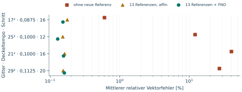

### Was ändern 13 zusätzliche Referenzläufe?

Wir rechnen am neuen Betriebspunkt die ruhende Einheitsdichte und je eine positive und negative Anregung pro Mode. Ihre zentralen Differenzen ergeben sechs neue Empfindlichkeiten. Hinzu kommt die bereits gelernte FNO-Korrektur, auf das neue Grundfeld zentriert. Auf allen vier Testpunkten liegen die mittleren Vektorfehler dann zwischen $0{,}128$ und $0{,}160\,\%$. Beim vierten Punkt ist die affine Kalibrierung allein leicht genauer. Die 13 D2Q9-Läufe können weitere Prognosen derselben Einstellung stützen.

`kavitaet_familie.json` · `zielkalibrierung.json` · Rohdaten und trainierte Gewichte im Rechenlabor.

<a id="fb-fnolang"></a>

## Re = 1000 · Der vollständige CP2-Kavitätslauf

<a id="auflage-k16-01"></a>

Nach 16 Schritten wird die Strömung gerade erst angeregt. Wie sieht sie am Ende der offiziellen CP2-Aufgabe aus? Für $Re=1000$, $U=0{,}1$ und anfangs ruhende Flüssigkeit wurden auf $257^2$ Zellen 350 000 D2Q9-Schritte berechnet. Zwei gröbere Vergleichsgitter enden bei derselben dimensionslosen Zeit $t^*=\mathrm{Schritte}\,U/(N-1)=136{,}71875$. Der schnelle C++-Kern setzt dieselben Kollisions-, Rand- und Transportregeln wie der skalare Python-Code um. Auf $17^2$ stimmen Dichte und beide Geschwindigkeitskomponenten bei den Schritten 1, 7 und 16 bis auf $2{,}45\cdot10^{-15}$ überein.


<a id="tab-k16-06"></a>

| Gitter und Schritte | RMS horizontal | RMS vertikal | Endmasse / Start |
| --- | --- | --- | --- |
| $65^2$, 87 500 | 0,04440 | 0,00614 | 0,90772 |
| $129^2$, 175 000 | 0,01986 | 0,00242 | 0,95756 |
| $257^2$, 350 000 | 0,00961 | 0,00244 | 0,98099 |

Die horizontale Komponente nähert sich an diesen Messpunkten mit der Verfeinerung der Literaturkurve. Die vertikale RMS-Abweichung steigt vom mittleren zum feinsten Gitter geringfügig. Über die letzten 10 000 Schritte des feinen Gitters beträgt die relative Änderung des inneren Geschwindigkeitsvektors $1{,}35\cdot10^{-6}$. Das erfüllt ein nachprüfbares Quasistationaritätskriterium von $10^{-5}$ über dieses Fenster. Die Gesamtmasse hat sich um $-1{,}90\,\%$ geändert. Dieser Lauf prüft die LBM-Referenz. Die zuvor vorgestellten Netze sind für den frühen Zeitraum trainiert. Die [Vollgitterstudie](#cp2-voll-vertrag) lernt und prüft eigene Modelle bis zum letzten CP2-Takt.

[ARGESIM CP2, Aufgabendefinition](https://www.sne-journal.org/fileadmin/user_upload_sne/benchmarks/CP/CP2-definition.pdf) · [Ghia, Ghia und Shin (1982), Tabellen I und II](https://doi.org/10.1016/0021-9991(82)90058-4) · `kavitaet_stationaer.json`.

<!-- Buchseite -->

<a id="v91-cp2-vergleich"></a>

### Was man bei Kavität und Saite jeweils vergleichen kann

Unter dem gleitenden Deckel interessiert ein zweidimensionales Strömungsfeld. Der lange CP2-Lauf verwendet $\mathrm{Re}=1000$, 350 000 Schritte und $257^2$ Gitterorte. Seine Geschwindigkeitsprofile und Dichteabweichungen gehören zu einem D2Q9-Gitter und einem bestimmten Randmodell. Aus $U_L=0{,}1$ folgt für das Deckeltempo $\mathrm{Ma}\approx0{,}173$. Eine Aussage über die Güte der inkompressiblen Näherung braucht zusätzlich eine Auflösungs-, Rand- und Mach-Zahl-Prüfung. Die Gitterumrechnung liefert [Kapitel 8](#v91-lbmeinheiten).

Bei der gezupften Saite transportiert die lineare Wellengleichung den Knick des Anfangsprofils. Die Vergleichsgröße ist das Auslenkungsfeld an denselben Orten zur selben Zeit gegen die d’Alembert-Referenz. Auf 501 Knoten und bei fünf Sekunden liefert das ursprüngliche FNO einen relativen Feldfehler von $3{,}001\,\%$. Newmark erreicht $0{,}374\,\%$, Störmer–Verlet $0{,}231\,\%$. Bei einem Prozent Budget sind damit die beiden klassischen Läufe bei diesem Ausgabetermin zulässig.

Das Archiv des ursprünglichen Saitennetzes nennt $3{,}354\,\mathrm s$ Trainingszeit und $4{,}339\,\mathrm{ms}$ für das protokollierte Feld `cpu_inference_test_batch` bei einem CPU-Thread. Für eine Latenzaussage zu einer einzelnen Anfrage auf 501 Knoten muss genau diese Anfrage gemessen werden. Für einen Zeitvergleich innerhalb der Saitenaufgabe gehören das gleiche Gitter, das gleiche Fehlerbudget, dieselbe Zahl vorhergesagter Felder und getrennte Trainings- und Auswertungskosten ins Protokoll. Für ein Strömungssurrogat gelten analog die Referenzfelder und Zielgrößen der Kavität.

<!-- Buchseite -->

<a id="fb-pruefung16"></a>

## CP2 · Was von der Verbesserung an der Saite dem Netz gehört

Am Knick einer gezupften Saite fehlen einer glatten Näherung gerade die kleinen räumlichen Skalen. Kann ein gelerntes Modell diese Information aus der Anfangsform transportieren? Wir prüfen auf 501 Knoten gegen die d’Alembert-Lösung und verwenden in diesem Rechenbeispiel ein selbst gewähltes Feldbudget von $1\,\%$. Die relative Feldnorm ist $\|u-u^*\|_2/\|u^*\|_2$ mit $\|u^*\|_2>0$. Ihr Verhältnis zum Budget ist hier der jeweilige Beitrag zum Score.

Nach fünf Sekunden betragen die relativen Fehler des ursprünglichen FNO $3{,}0009\,\%$, von Newmark rund $0{,}374\,\%$ und der modalen Erweiterung $0{,}04303\,\%$. Ihre Beiträge lauten also $3{,}0009$, $0{,}374$ und $0{,}04303$. Nach acht Sekunden ergeben sich ungefähr $0{,}8816$, $0{,}152$ und $0{,}01416$. Fordern wir beide Zeiten gemeinsam, entscheidet jeweils das größere Verhältnis. Die analytische Kontrollschicht erreicht auf diesem Fall dieselben gerundeten Fehler wie die modale Erweiterung. Der Vorteil gegenüber dem ursprünglichen FNO lässt sich deshalb auf diesem Feld nicht allein den gelernten Gewichten zuschreiben.

Was wäre ein fairer Anschlussversuch? Man verschiebt die Zupfstelle, friert Modell und Gewichtung ein und bestimmt den Fehler am vollständigen Feld einschließlich der Ränder. Für eine Kavität verlangt dieselbe Frage zwei Geschwindigkeitsebenen sowie beide Mittellinien. Eine Wirbelposition oder ein kleines Residuum allein lässt dabei unterschiedliche Felder zu. Ein Vergleich von Rechenzeiten muss außerdem Aufbau der Referenz, Training, Aufwärmläufe und Inferenz einzeln ausweisen.

**Umfang der offiziellen Aufgabe.** CP2 umfasst Monte Carlo, Kavität und Saite sowie Fragen zur parallelen Ausführung. Der Maximalscore oben gehört zu zwei Beobachtungszeiten der Saitenstudie. Über die parallele Beschleunigung oder den stationären Strömungsfehler sagt er nichts aus.

[Die drei Teilaufgaben](#fb-refCP2) · [Analytische Kontrollrechnung mit gleichem Filter](#druck-saite-analytische-kontrolle).

<a id="fb-ueb13"></a>

## Selbst prüfen · Den Versuch auf dem eigenen Rechner prüfen

### Mit gespeicherten Feldern beginnen

Die archivierten Feldfehler sind im Begleitpaket als Metriken enthalten. Im ursprünglichen CP2-Feldlabor lassen sich zusätzlich die Rohfelder mit den gespeicherten Netzgewichten auswerten. Die historische Auswertung nutzt NumPy. [Gewichte, Referenzfelder und Vergleichsskript](https://github.com/5H3LL3H5/argesim-hyperposition-benchmarks/tree/16f0f2528fcf77f16898ecd74ad952be2c09eac2/docs/lehrbuch/studienbuch/material/cp2_feldlabor)

```text
python -m pip install -e '.[operators]'
lab=argesim_benchmarks.experiments.cp2_operators
python -m "$lab" train rope --out saite
python -m "$lab" train cavity --out kavitaet
python -m "$lab" predict saite/rope-weights.npz \
    saite/rope-501-input.npy neues_profil.npy
```

Die Befehle verwenden eine POSIX-Shell. Die Gewichte im verlinkten CP2-Feldlabor können Sie direkt an `predict` übergeben. Die Saite erwartet ausgelenkte Höhen in Metern einschließlich zweier fester Enden, die Kavität ein positives $17\times17$-Dichtefeld bei Anfangsruhe.

### A · Einen Callback kontrollieren

Welche Rückgabe erwarten Sie für `heizstab(0.0, (0.0,))` und für `heizstab(60.0, (40.0,))`? Warum wäre das Fortschalten einer globalen Modelluhr bei jedem Aufruf mit der Tabelle [Kapitel 2](#t1-k2) unvereinbar?

### B · Eine unwirksame Gegenprobe erkennen

Ein Student misst nur die Deckelzeile und erhält dort exakt denselben Wert wie D2Q9. Erklären Sie das Ergebnis. Wählen Sie einen Vergleich, der das Feld im Inneren wirklich prüft.

### C · Den technischen Auftrag entscheiden

Die relative räumliche Abweichung darf an beiden Ausgabeterminen der Saite höchstens $1\,\%$ betragen. Welche der drei Rechnungen mit Newmark, Störmer–Verlet und dem ursprünglichen FNO auf 501 Knoten erfüllen diesen Auftrag? Prüfen Sie danach die drei Operatorvarianten [Was bringt Nachtraining beim ursprünglichen FNO?](#fb-fnooriginal). Was müsste für einen Auftrag über alle Zeiten zusätzlich geprüft werden?

[Kapitelanfang](#fb-neu16) · [Lösungswege](#fb-loesweg13) · [Python-Praktikum mit startfähigen Befehlen](https://github.com/5H3LL3H5/argesim-hyperposition-benchmarks/blob/52f8a33e469d36514e7830db544b9fc27243a82c/docs/CP2_NEURAL_OPERATORS.md).

<a id="fb-loesweg13"></a>

## Lösungswege · Von einem Messwert zur Aussage

### A · Eine Funktion beschreibt die Änderung

Zu Beginn ist der Verlust null. $10/120=1/12$ ergibt das Tupel $(0{,}083333\ldots,)$ in K/s. Bei $40\,\mathrm{K}$ gleichen sich die $10\,\mathrm{W}$ Heizleistung und $40/4=10\,\mathrm{W}$ Verlust aus. Die Rückgabe ist $(0,)$. RK45 benötigt für die eine betrachtete Minute 31 Aufrufe, speichert aber nur drei angenommene Schritte. Die Zeit im Callback stammt daher aus seinem Argument. Eine Zählung der Aufrufe ist eine Rechendiagnose.

### B · Einen vorgeschriebenen Rand erkennen

Für die Deckelzeile setzt die Python-Implementierung $|\mathbf u|/u_\mathrm{Deckel}=1$ bei Referenz und Netzausgabe. Eine Nullabweichung kann dort ein falsch vorhergesagtes Wirbelzentrum verdecken. Der relative Feldfehler von $11{,}59\,\%$ bezieht sich auf das Innere. Die Karten [CP2/2 · Wie bewegt ein Deckel die Flüssigkeit?](#fb-pylbm) zeigen, wo die größten absoluten Unterschiede liegen. Aus einem Geschwindigkeitsbetrag allein lassen sich weder die Richtung des Vektors noch die neun Populationen rekonstruieren.

### C · Jede vereinbarte Bedingung einzeln prüfen

Newmark und Störmer–Verlet erfüllen auf 501 Knoten das Ziel beim CP2-Dreieck für fünf und acht Sekunden ([Dieselbe Saite mit Störmer–Verlet](#fb-cpverlet)). Das ursprüngliche FNO besteht nur bei acht Sekunden. Beim Operatorvergleich besteht von den drei Varianten allein die lineare Fourier-Schicht zu beiden Zeiten ([Was bringt Nachtraining beim ursprünglichen FNO?](#fb-fnooriginal)). Beide Punktprüfungen lassen andere Zeiten frei. Für eine empirische Erweiterung würden wir viele zusätzliche Zeitpunkte ausgeben und getrennt testen. Der hier trainierte FNO gibt genau zwei Zeiten aus. Für eine garantierte Schranke über das ganze Intervall wäre außerdem eine mathematische Abschätzung zwischen den Prüfzeitpunkten nötig.

**Eine kleine Programmierprobe.** Rufen Sie `python kapitelproben.py 13` im Rechenlabor auf. Die Standardbibliothek genügt für die Heizrate, die Summe der neun Ruhegewichte und das Vorzeichen einer reflektierten Welle.

[Zurück zum Aufgabenblatt](#fb-ueb13) · [Vergleichstabelle](#fb-pyvergleich) · [Forschung und Beweisfragen](#fb-schluss13).

<a id="fb-schluss13"></a>

## Welche Aussage kann ein Beweis liefern?

### Eine exakte Invariante beim lokalen Kollisionsschritt

Sind die Gleichgewichtspopulationen so normiert, dass $\sum_i f_i^{\mathrm{eq}}=\sum_i f_i=\rho$, bleibt die Dichte bei der lokalen BGK-Kollision erhalten.

**Beweis.** Summation der Kollisionsformel ergibt $\sum_i f_i^*=\sum_i f_i+\omega(\sum_i f_i^{\mathrm{eq}}-\sum_i f_i)=\rho$.

Der Schritt beweist eine lokale Eigenschaft im Inneren. Für eine globale Massenbilanz müssen auch Transport und Ränder erfasst werden. Beim reduzierten Kavitätslauf meldete das Programm eine Änderung von $-0{,}00746$ bei anfänglicher Gittermasse 289. Das FNO gibt hier nur den Geschwindigkeitsbetrag aus und hat keinen entsprechenden Massenmesswert.

### Weshalb ist jede Trainingsmode der Saite überprüfbar?

Setzen Sie $u(x,t)=a(t)\sin(k\pi x/L)$ in die Wellengleichung ein. Dann folgt $a''=-(ck\pi/L)^2a$. Bei Anfangsruhe ist $a(t)=a(0)\cos(ck\pi t/L)$. Linearität erlaubt die Summe der acht Moden und liefert die Referenzen für den Glatttest. Der Knick des CP2-Dreiecks enthält weitere Frequenzen.

### Was sich für den Lehrfall beweisen lässt

Li und Mitautoren untersuchten FNOs an parametrisierten PDE-Familien. Kovachki und Mitautoren analysierten die Approximation kontinuierlicher Operatoren unter mathematischen Voraussetzungen. Der [Satz zur Saite](#druck-saite-modenschranke) spezialisiert die Fragestellung auf die hier gespeicherten Gewichte und eine festgelegte Eingabeklasse. Der Fall Mode 193 zeigt, welche Genauigkeit ohne Glattheitsannahme verloren geht.

[Kovachki u. a. (2023), Neural Operator](https://www.jmlr.org/papers/v24/21-1524.html) · [Ausführbare Gegenproben](https://github.com/5H3LL3H5/argesim-hyperposition-benchmarks/blob/52f8a33e469d36514e7830db544b9fc27243a82c/tests/test_cp2_operators.py) · [Forschungsfragen](#t1-k9) · [Abschluss des Praktikums](#fb-finalII).

## Vom CP2-Vergleich zurück zur Physik-Schicht

Beim mittigen Zupfen auf 501 Knoten zeigt der Feldfehler nach fünf Sekunden drei verschiedene Wirkungen. Der ursprüngliche FNO erreicht 3,0009 Prozent. Nachtraining derselben Architektur senkt den Fehler auf 2,1815 Prozent. Für eine modale Variante, die das Verhalten der linearen Saite ausnutzt, ergeben sich 0,04303 Prozent. Der letzte Wert hängt von den Annahmen über Saite, Startgeschwindigkeit und Messzeit ab.

Kapitel 9.7 stellt eine andere Frage. Dort transportiert ein eingebauter Wellenschritt die aufgelösten Moden, und ein ergänzendes Netz kann eine Korrektur lernen. Bei 113 Knoten und 3,5 Zellen Ausbreitungsweg betragen die Feldfehler des dortigen FNO 0,9935 Prozent, des Physik-Layers 0,05947 Prozent und des Layers mit Netzkorrektur 0,1205 Prozent. Die ergänzende Korrektur vergrößert in diesem Versuch den Fehler gegenüber der Physik allein. Gerade deshalb braucht ein Hybridmodell drei Messungen unter identischen Bedingungen. Die Prozentwerte dieses Tests und des CP2-Versuchs haben unterschiedliche Bezugslösungen und Anfangsdaten.

**Rechenweg.** `rechenlabor/kapitelvergleich.py` liest die archivierten CP2-Werte. `beispiele/fno_physiklayer.py` trainiert und prüft den separaten Lehrversuch. Die Definition der Feldnorm, die Anfangsdaten und die Kontrollen zur Phasenlage stehen in [Kapitel 9](#t1-k9).

<!-- Buchseite -->

<a id="druck-saite-modenschranke"></a>

## Saitenoperator · Eine Schranke zwischen den Messzeiten

Wir betrachten die lineare Wellengleichung mit festen Enden, Anfangsgeschwindigkeit null, Länge $L=0{,}5\,\mathrm m$ und Wellengeschwindigkeit $c=0{,}06\,\mathrm{m/s}$. Aus den 501 Knoten bilden wir den Sinusinterpolanten $g=\sum_{k=1}^{499}a_k e_k$, mit orthonormalen Funktionen $e_k(x)=\sqrt{2/L}\sin(k\pi x/L)$. Die diskrete Sinustransformation liefert $a_k=\Delta x\sum_{j=1}^{499}g_j e_k(j\Delta x)$ mit $\Delta x=L/500$. Als Eingabeklasse verlangen wir $\sum_{k=1}^{499} k^{2s}|a_k|^2\le R^2$ mit $s>0$. Für $s=1$ ist das die Ableitungsenergie des Interpolanten, skaliert mit $(L/\pi)^2$.

**Abgeschnittene Moden.** Die exakte Entwicklung des Interpolanten multipliziert $a_k$ mit $f_k(t)=\cos(\omega_k t)$, $\omega_k=ck\pi/L$. Für $k\ge193$ gilt $|f_k|\le1$ und $k^{2s}\ge193^{2s}$. Orthogonalität liefert für den Rest
$$
\sqrt{\sum_{k\ge193}|a_k f_k(t)|^2}
\le 193^{-s}\sqrt{\sum_{k\ge193}k^{2s}|a_k|^2}
\le R/193^s .
$$
Für $s=1$ sind das höchstens $R/193\approx0{,}0051814R$.

**Beibehaltene Moden.** Im Ausgabefenster $0\le t\le8\,\mathrm s$ werden die gespeicherten Faktoren zwischen benachbarten Zeiten linear interpoliert. Ist $h$ der größte Abstand, so liefert der Rest der linearen Interpolation wegen $|f_k''|\le\omega_k^2$ höchstens $\omega_k^2 h^2/8$ pro Faktor: Das Produkt der beiden Abstände zu den Intervallenden ist höchstens $h^2/4$, der Rest enthält zusätzlich den Faktor $1/2$. Den maximalen Fehler der gespeicherten Werte an den Stützzeiten nennen wir $\epsilon_*$. Die linearen Gewichte sind nichtnegativ und summieren sich zu eins, daher addiert die Speicherung zwischen den Knoten höchstens $\epsilon_*$. Für $k\le192$ und $s=1$ ergibt sich
$$
\left(\sum_{k\le192}|a_k|^2\,|\hat f_k(t)-f_k(t)|^2\right)^{1/2}
\le \left[\epsilon_* + \tfrac{192}{8}(c\pi/L)^2 h^2\right]R .
$$
Mit $h\le0{,}025000000000001\,\mathrm s$ und $\epsilon_*<1{,}36\cdot10^{-13}$ ist dieser Beitrag kleiner als $0{,}002132R$. Beide Fehler liegen in orthogonalen Modenräumen, ihre Quadrate addieren sich. Das ist eine absolute Schranke in exakter Arithmetik gegen die Entwicklung des Sinusinterpolanten, keine Schranke für Abtast- oder Rundungsfehler und kein relatives Budget nahe der Ruhelage.

<a id="druck-saite-analytische-kontrolle"></a>

### Analytische Kontrollrechnung mit gleichem Filter

Im Rechenlabor ersetzt `python cp2_genauigkeit/auswerten.py` die gespeicherten Faktoren durch $f_k$ an denselben Stützzeiten. 192 Moden und lineare Zeitinterpolation bleiben unverändert. Gegen d’Alembert am ursprünglichen mittigen Dreieck liefern beide Varianten auf 501 Knoten $0{,}04303\,\%$ (5 s) und $0{,}01416\,\%$ (8 s). Die beiden Zeiten liegen auf Stützstellen; die Interpolationsschranke gilt auch dazwischen. [Intervallprüfung der Stützwerte](https://github.com/5H3LL3H5/argesim-hyperposition-benchmarks/blob/3a8f97f861ac77903289316947adb1e7ddf62433/scripts/cp2_accuracy/operator_bounds.py).

<!-- Buchseite -->

<a id="cp2-operator-saite"></a>

## Saite · Der Nullversuch und sein Spiegel

Die CP2-Saite wird in der Mitte um $0{,}05\,\mathrm m$ ausgelenkt. Auf 501 Knoten lesen wir das Feld nach 5 und nach 8 Sekunden aus. Jede Variante verwendet dasselbe Punktbudget von 1 % für die relative Feldnorm an jedem der beiden Zeitpunkte. Den Originalfall ergänzen vier asymmetrische Profile. Wir wählen zwei Zupfpositionen und jeweils ihr Gegenstück an der anderen Seite der Mitte.

Für identische festgehaltene Enden kommutiert der Evolutionsoperator $P_t$ mit der Spiegelung $R g(x)=g(L-x)$. Die Formel ergibt sich bereits aus der Eindeutigkeit der Wellengleichung. Der Spiegeltest liest

$$
E_R(t)=\frac{\|\widehat P_t(Rg)-R\widehat P_t(g)\|_2}
                   {\|R\widehat P_t(g)\|_2}.
$$

Mit dem exakten Grundfeld sind die Referenzausgaben und die Zielwerte für den Hybrid identisch. Die Zielfunktion erhält daher in allen sieben Fällen einen Nullvektor für die Korrektur. Prüfeingaben, Spiegelfelder und verschobene Wellen werden danach unabhängig neu berechnet. Alle sieben Modelle liefern in allen fünf Fällen die d’Alembert-Werte bis auf Rundung. Der maximale relative Spiegeldefekt beträgt 5.53e-16. Beim Newmark-Schritt bleibt das maximale algebraische Residuum unter $3\cdot10^{-17}$.

### Welche Fehler Newmark und Verlet beitragen

Ein Sinus-Eigenvektor des Raumgitters hat die Frequenz $\omega_h=2c\sin(k\pi/(2(N-1)))/\Delta x$. Seine zeitkontinuierliche Auslenkung ist proportional zu $\cos(t\omega_h)$. Das ist die exakt integrierte Linienmethode. Newmark und Verlet ersetzen den Phasenwinkel pro Schritt durch $2\arctan(\Delta t\omega_h/2)$ beziehungsweise $2\arcsin(\Delta t\omega_h/2)$. So erhalten wir drei unterschiedliche Vergleiche auf denselben Knoten. Die Raumdiskretisierung wird gegen d’Alembert gemessen, der Zeitfehler gegen die zeitkontinuierlichen Gittermoden und der Implementierungsfehler gegen die voll diskrete modale Formel.

<a id="druck-verlet"></a>

Mit $\xi=\omega_h\Delta t>0$ lautet die Verlet-Gleichung $q_{n+1}-(2-\xi^2)q_n+q_{n-1}=0$. Ihre Wurzeln haben Produkt eins. Für $0<\xi<2$ liegen sie getrennt auf dem Einheitskreis, für $\xi>2$ wächst eine. Bei $\xi=2$ liefert die doppelte Wurzel $-1$ die Folge $(a+bn)(-1)^n$. Beliebige Startstörungen bleiben also nur für $\xi<2$ beschränkt. Beim Newmark-Verfahren mit mittlerer Beschleunigung hat $(1+i\xi/2)/(1-i\xi/2)$ stets Betrag eins.

<a id="tab-k16-07"></a>

| Fehlerzerlegung | 5 Sekunden | 8 Sekunden | 
| :--- | ---: | ---: | 
| Nur Raumdiskretisierung | 0,285 % | 0,117 % | 
| Newmark, nur Zeitanteil | 0,243 % | 0,099 % | 
| Verlet, nur Zeitanteil | 0,172 % | 0,071 % | 
| Newmark, Gesamtfehler | 0,374 % | 0,152 % | 
| Verlet, Gesamtfehler | 0,231 % | 0,095 % | 

Die Dreiecksungleichung begrenzt den Gesamtfehler durch die Summe der Teilfehler. Phasenabweichungen können sich teilweise aufheben.

<!-- Buchseite -->

## Saite mit Biegesteifigkeit · Eine Korrektur mit messbarem Ziel

Für die Gegenprobe setzen wir an zwei einfach gestützten Enden $u=u_{xx}=0$ und erweitern das Gesetz um den Term $-\gamma u_{xxxx}$. Auf der Sinusmode mit Wellenzahl $k$ folgt unmittelbar

$$
\omega_\gamma(k)=\sqrt{c^2k^2+\gamma k^4}.
$$

Der Parameter beträgt $\gamma=1{,}2\cdot10^{-8}\,\mathrm{m^4/s^2}$. Die d’Alembert-Auslenkung bleibt das Grundfeld des Hybrids. Die beiden zusätzlichen Eingangskanäle enthalten je eine erste Näherung der Frequenzverschiebung, für Sinusmoden 1 bis 12 und 13 bis 40. Dazu entwickeln wir die Wurzel um $\gamma=0$ und setzen den neuen Phasenwinkel in den Kosinus ein. Wenn die Krümmung stärker wird, weicht diese Näherung von der Referenz ab. Aus 22 anderen Anfangsformen lernt das Netz die Differenz gegen eine Reihe mit 4096 Moden.

Der größte Fehler allein mit dem idealen Grundfeld beträgt 1,769 %. Nach der Anpassung liegen die sieben maximalen Fehler zwischen 0,549 % (HNO) und 0,862 % (FMNO). Alle erreichen in den fünf Prüffällen das 1-%-Budget an beiden Zeitpunkten. Der größte relative Spiegeldefekt der dispersiven Hybride ist 2.12e-03. Der Abgleich von 4096 und 8192 Reihenmoden verändert das Referenzfeld um höchstens 0,0003 %.

Die größte relative Abweichung der diskret ausgewerteten Energie von der Referenz im glatten Kontrollfall beträgt 0,0609 %.

### Die Kontrolle der Energie

Für glatte Formen bleibt die Summe der kinetischen, der Spannungs- und der Biegeenergie konstant. Das folgt, wenn man die Gleichung mit $u_t$ multipliziert und in $x$ integriert. Die Randterme fallen wegen der einfach gestützten Enden weg. Das Labor prüft einen zurückgehaltenen glatten Fall mit zentrierter Zeitdifferenz. Beim idealisierten Dreieck ist die Krümmung am Knick singulär. Die Biegeenergie wird deshalb im glatten Kontrollfall gemessen und der Knick separat an der Auslenkung beurteilt.

[Herleitung der Lernregel](#cp2-operator-lernregel) · [Messordnung und Trainingsdaten](#cp2-operator-code)

<!-- Buchseite -->

## Knicktest · Wo ein Filter die Form verändert

Beim Knicktest bekommt jede Transformation bereits das zu rekonstruierende Profil. Wir kontrollieren dadurch gezielt die räumliche Darstellung. Für die Saite verwenden wir das Dreieck und die fortgelaufenen Knicke. Die zweite Probe nimmt eine ebene Entropiefront der skalaren Burgers-Gleichung in mehreren Winkeln. Bei $u_-=1$ und $u_+=0{,}2$ wandert sie mit Geschwindigkeit $(u_-+u_+)/2=0{,}6$ in Normalenrichtung. Auf der Kavität vergleichen wir später die steilen Schergradienten am Deckel. Das Modell der inkompressiblen Kavität besitzt keine Stoßfront dieser Art.

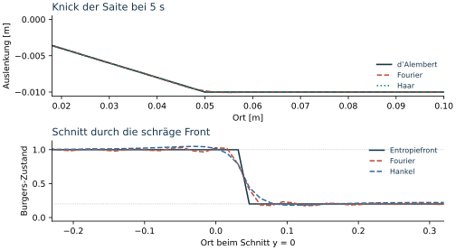

<!-- Buchseite -->

## Knicktest · Was ein Überschwinger verrät

Unterhalb des kleineren und oberhalb des größeren Plateaus messen wir den größten Überschwinger relativ zur Sprunghöhe. Der Frontfehler enthält zusätzlich den Fehler innerhalb der Plateaus. Eine geglättete Front kann also ohne Überschwingen ungenau sein. Beim FNO fehlen alle Moden oberhalb des festgelegten Spektrums. Die Haar-Variante behält alle Details und kann die Eingabe dadurch rekonstruieren. Die Laplace-Variante besitzt für diesen Versuch einen Pfad für den aktuellen Ortszustand. Das Ergebnis hängt folglich auch davon ab, welche Information die jeweilige Architektur durchlässt.

<a id="tab-k16-08"></a>

| Knickvariante | Saite, Feld | Saite, Spitze | Burgers, Feld | Burgers, Überschwinger | 
| :--- | ---: | ---: | ---: | ---: | 
| FNO | 0,32 % | 0,59 % | 6,55 % | 13,96 % | 
| LNO | 0,00 % | 0,00 % | 0,00 % | 0,00 % | 
| WNO | 0,00 % | 0,00 % | 0,00 % | 0,00 % | 
| HNO | 0,32 % | 0,62 % | 19,18 % | 6,30 % | 
| RNO | 0,01 % | 0,02 % | 59,87 % | 314,17 % | 
| WLNO | 0,00 % | 0,00 % | 0,00 % | 0,00 % | 
| FMNO | 6,68 % | 4,80 % | 12,33 % | 14,38 % | 

Die Zahlen gelten für die abgespeckte Schicht und ihre festgelegten Bänder. Vor allem ein guter Wert mit direktem Eingabepfad ist ein Nachweis der Informationsweitergabe. Eine Vorhersage aus einem noch unbekannten zukünftigen Zustand ist eine andere Aufgabe. In zwei Dimensionen wird sich der Frontfehler zudem mit Winkelzahl und Rampenfilter ändern.

<!-- Buchseite -->

<a id="cp2-operator-kavitaet"></a>

## Kavität · Welche Korrektur dem Grundfeld fehlt

Der Deckel bewegt sich mit $U[1+a\sin^2(\pi x)]$ über einer quadratischen Kavität. $x$ ist hier durch die Kantenlänge geteilt. Die anderen Wände ruhen. Auf dem regulären Gitter berechnet ein C++20-Programm die D2Q9-Kollision und den halbweg reflektierten Transport. Wir verwenden $U=0{,}055$ in Gittereinheiten. Bei $a=0$ entspricht die Wandvorgabe der quadratischen Kavität bei Ghia, Ghia und Shin. Der neue Versuch setzt $\mathrm{Re}=100$ und ergänzt die vorangegangene CP2-Rechnung bei $\mathrm{Re}=1000$.

Die zwölf Trainingsläufe umfassen drei Reynolds-Zahlen und vier Deckelprofile pro Reynolds-Zahl. Zu jedem Lauf liegen Anlaufzustände und das ausgewertete Endfeld vor. Für jeden Zeitpunkt und jede Zelle bestimmen kleinste Quadrate das affine Modell $b+B_1(\mathrm{Re}-90)/30+B_2a/0{,}3$. Seine vorberechneten Zustände bilden die Eingabe der Laplace-Zweige. Der Korrekturzweig lernt beide Geschwindigkeitskomponenten. Die Auswertung verwendet ein Innenfeld mit ausgesparter Randzone, eine Divergenzprobe und bei $\mathrm{Re}=100,a=0$ die beiden Mittellinienprofile.

$$
S=\max\left(\frac{E_{\mathrm{Feld}}}{0{,}03},
             \frac{\mathrm{RMS}(D_hv)}{0{,}045},
             \frac{\mathrm{RMS}_{\mathrm{Profil}}}{0{,}025}\right).
$$

Die Geschwindigkeiten sind durch $U$ und die Koordinaten durch die Kantenlänge geteilt. Der Profilanteil gilt für die beiden Ghia-Linien und entfällt bei geändertem Deckelprofil. Die Scherzone direkt am Deckel wird zusätzlich ausgewiesen. Die analytisch vorgeschriebene Wandgeschwindigkeit und der Zellmittelpunkt an der Wand sind unterschiedliche Orte.

### Wie die Referenz aufgelöst wird

Die Relaxationszeit folgt aus $\tau=1/2+3UN/\mathrm{Re}$ auf $N^2$ Zellen. Wir messen die relative Feldänderung über ein ganzes dimensionsloses Intervall von 0,5. Ein Lauf endet beim Erreichen von $10^{-4}$ oder an der Zeitgrenze. Feinere Gitter starten mit einem interpolierten, bis dahin klassisch berechneten 65er-Feld und laufen danach mit einem eigenen D2Q9-Zustand weiter. Ghia-Werte werden nur in der Auswertung verwendet. Die Gitterabhängigkeit der LBM-Felder und die Korrekturabweichung vom jeweils gleichen Gitter werden getrennt gemessen.

[Ghia, Ghia und Shin (1982)](https://doi.org/10.1016/0021-9991(82)90058-4) · [Innere Profilwerte, Sandia-Verifikation](https://www.osti.gov/servlets/purl/2547076)

<!-- Buchseite -->

## Kavität · Was sich über die Gitter überträgt

<a id="tab-k16-09"></a>

| Kavitätsvariante | $65^2$, Re=100 | $65^2$, Re=140 | $129^2$ | $257^2$ | $421^2$ | 
| :--- | ---: | ---: | ---: | ---: | ---: | 
| Affin | 0,757 | 1,591 | 0,606 | 0,762 | 0,993 | 
| FNO | 0,745 | 1,587 | 0,637 | 0,798 | 0,995 | 
| LNO | 0,762 | 1,628 | 0,569 | 0,760 | 0,996 | 
| WNO | 0,757 | 1,580 | 0,635 | 0,797 | 0,996 | 
| HNO | 0,754 | 1,389 | 0,648 | 0,816 | 0,997 | 
| RNO | 0,761 | 1,526 | 0,643 | 0,811 | 1,006 | 
| WLNO | 0,760 | 1,563 | 0,633 | 0,795 | 0,997 | 
| FMNO | 0,759 | 1,538 | 0,631 | 0,794 | 0,997 | 

Der Vergleich prüft zwei Änderungen. Bei $\mathrm{Re}=140$ bleibt das Gitter $65^2$. Bei $\mathrm{Re}=100$ verfeinern wir das Gitter bis $421^2$. Die beiden Fälle bei $421^2$ haben jeweils ein eigenes D2Q9-Feld. Neuauflösung von Gewichten allein würde nur einen Interpolationsversuch liefern.

Die Tabelle zeigt die größten Scores $S$ pro Einstellung. $S\leq1$ erfüllt alle jeweils geltenden Budgets. Bei $\mathrm{Re}=100$ ändert sich das interpolierte 65er-Referenzfeld gegen die unabhängige Zielrechnung um 1,78 % auf $129^2$, 2,68 % auf $257^2$ und 3,45 % auf $421^2$. Diese Zahlen sind gemessene Gitterempfindlichkeiten, einschließlich der geänderten Wandauflösung und des verbliebenen Anlaufs.

Der nominelle Lauf auf $421^2$ umfasst 61 232 feine Schritte. Seine letzte relative Feldänderung über das Messfenster beträgt 1.04e-04. Der D2Q9-Vergleich auf $9^2$ bestätigt unabhängig die Implementierung der kurzen Schritte. Bei der langen Rechnung dienen Massenbilanz und Feldänderung als zusätzliche Kontrollen.

<!-- Buchseite -->

## Re = 100 · Mittellinien und Wandfluss im Lehrversuch

Hier gelten die Ghia-Profilwerte für $\mathrm{Re}=100$. Der vollständige CP2-Lauf in Abb. 16.6 verwendet $\mathrm{Re}=1000$. Beide Vergleiche verwenden eigene D2Q9-Felder und die Literaturwerte ihrer jeweiligen Reynolds-Zahl.


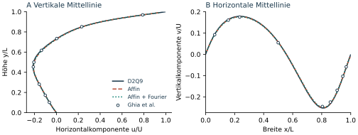

Auf $421^2$ beträgt die RMS-Abweichung der beiden D2Q9-Mittellinien von Ghia 0,00238 und 0,00516 in Einheiten des Deckeltempos. Mit affinem Grundfeld und Fourier-Korrektur ergibt die gleiche Probe 0,00381 und 0,00383. Das schmale Band direkt am Deckel hat in dieser Fourier-Probe 3,63 % relativen Vektorfehler.

Ein einzelnes neues Referenzfeld am Zielparameter ergibt einen Ortsversatz der Vorhersage. Zwei Felder erlauben zusätzlich eine lineare Änderung dieses Versatzes mit der Deckelamplitude. Wir prüfen die Kalibrierung auf anderen Profilen. Danach kann man die Korrektur als diskrete Flussprojektion rechnen. Hierzu mitteln wir die Geschwindigkeiten an benachbarten Zellen auf die gemeinsamen Flächen. Die äußeren Normalflüsse sind null. Im nächsten Schritt ziehen wir den kleinsten Korrekturvektor ab, der den resultierenden diskreten Flussdefekt entfernt.

Die vektorielle Abweichung von D2Q9 und die Divergenzprobe haben dadurch getrennte Aufgaben. Ein D2Q9-Feld mit endlicher Mach-Zahl kann den Divergenzschwellwert des Lehrversuchs auf seinem Raster überschreiten. Die Auswertung verwendet das Referenzfeld für die Geschwindigkeitsdifferenz und misst die physikalische Bedingung zusätzlich am Prädiktor. [Anhang C · Welche Kalibrierung das Budget erfüllt](#cp2-operator-amort)

<!-- Buchseite -->

<a id="atlas-reflexion"></a>

## Bildversuch · Eine Reflexion im Raum-Zeit-Bild verfolgen

Beim Loslassen enthält die dreieckige Zupfung einen Knick. Je eine Kopie des Anfangsprofils läuft nach links und rechts. Ein festes Ende kehrt das Vorzeichen der reflektierten Welle um. Wo müsste die nach links laufende Spitze erstmals an der Wand eintreffen, wenn sie 0,15 m vom Rand entfernt ist und die Wellengeschwindigkeit 0,06 m/s beträgt?

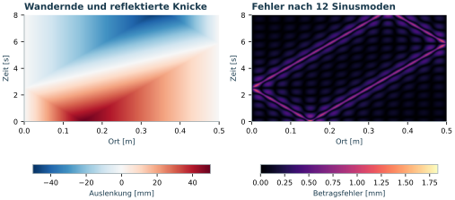

Auf der Zeitachse liegt der erste Treffer bei 2,5 Sekunden. Die nach rechts laufende Spitze benötigt für 0,35 m rund 5,83 Sekunden. Der ideale Wellenoperator mit ungerader Fortsetzung beschreibt beide Reflexionen. Rechts wird dieselbe Anfangsform auf die ersten zwölf Sinusmoden projiziert. Obwohl auch diese die festen Enden genau einhalten, fehlen kurze Wellenlängen an den wandernden Knicken. Die hellen Spuren folgen den Knicken über das Gitter.

Diese kontrollierte Rechnung isoliert einen Mechanismus, der auch bei der Auslegung eines Fourier Neural Operators wichtig ist. Das rechte Feld stammt aus der analytischen Modentrunkierung. Die Ergebnisse der tatsächlich trainierten Operatoren stehen im [Vergleich der sieben Kerne](#atlas-kerne). Eine genauere Wandbedingung und eine höhere Modenzahl lösen zwei verschiedene Teile des Auftrags.

<!-- Buchseite -->

<a id="bild-kavitaet"></a>

## Welche Struktur ist tatsächlich aufgelöst?

Die 17 × 17 Werte in Abbildung 16.1 stammen aus dem gerechneten Anlauf. Jede der 15 × 15 Farben in Abbildung 16.4 steht für eine tatsächlich bewertete Innenzelle. Wie sieht die Grenzschicht aus, wenn wir das Strömungsproblem bei gleichem dimensionslosen Zeitpunkt auf einem feineren Gitter neu lösen? Die obere Reihe zeigt dieses Experiment.

**Unabhängig neu integrierte Referenzen.** Für die beiden nicht zur Kalibrierung benutzten $421^2$-Deckelprofile bei $\mathrm{Re}=100$ (Profilparameter 0 und 0,23) wurden das $65^2$-Startfeld und anschließend jeweils 61 232 Feinschritte neu berechnet. Das im Archiv gespeicherte letzte Vektorfeld stimmt bei beiden Profilen in jeder Komponente mit der Wiederholung überein. Von vier neu erzeugten Zeitständen ist nur der letzte im historischen Paket erhalten. Die relativen Änderungen am Ende betragen $1{,}0401\cdot10^{-4}$ und $1{,}0967\cdot10^{-4}$. Beide liegen knapp über der vereinbarten Stationaritätsgrenze $10^{-4}$. Die Übereinstimmung bestätigt hier die diskrete Rechnung bis zum Endzeitpunkt.


Im oberen Paar ist die aufgeprägte Deckelbewegung bereits sichtbar. Eine Aussage zum stationären Wirbel wäre zu diesem frühen Zeitpunkt verfrüht. Im unteren Paar liegen die größten lokalen Fehler bei 0,00611 bzw. 0,42340 Deckelgeschwindigkeiten. Die 65er-Referenz reicht bis $t^*=26{,}004$. Die 421er-Referenz läuft nach einer Warmstart-Übertragung weitere $t^*\approx8$ und hat das Stationaritätskriterium verfehlt. Jede Karte vergleicht die Vorhersage mit ihrem eigenen D2Q9-Feld. Aus dem Unterschied der Maxima lässt sich daher keine räumliche Konvergenzordnung bestimmen.

<!-- Buchseite -->

<a id="cp2b-lidverfahren"></a>

## Kann ein Operator die Deckelbewegung direkt in ein Strömungsfeld übersetzen?

Stellen Sie sich den Deckel einer zunächst ruhenden Kavität vor. Vier Intervalle lang zieht er die Flüssigkeit nach rechts, dann läuft er nach links. Direkt an der oberen Wand ändert sich die Bewegungsrichtung zuerst. Tiefer im Inneren trägt die Strömung noch die Geschichte der früheren Bewegung. Deshalb muss ein Operator auch bei identischer augenblicklicher Deckelgeschwindigkeit unterschiedliche Geschwindigkeitsfelder liefern können.

Im ursprünglichen CP2/2 läuft der Deckel gleichförmig. Die veröffentlichte Darstellung bei $\mathrm{Re}=1000$ verwendet $257\times257$ Gitterpunkte und 350 000 Schritte. Unser ergänzender Versuch variiert den Antrieb bei fester Viskosität, festen Wänden und ruhendem Anfangszustand. Die acht Deckelfaktoren $a_k$ geben die Geschwindigkeit in Einheiten von $U=0{,}055$ an. Auf $33\times33$ Zellen liegen 66 D2Q9-Schritte zwischen zwei Ausgaben. Wir beobachten beide Geschwindigkeitskomponenten bis zur dimensionslosen Zeit $t^*=0{,}88$. Die auf $U$ bezogene Reynolds-Zahl ist 100. [ARGESIM, CP2, zweiter Teilversuch](https://www.sne-journal.org/fileadmin/user_upload_sne/benchmarks/CP/CP2-definition.pdf)

Aus 64 Trainingsantrieben gewinnen wir 40 räumliche POD-Moden. Für das Feld nach Intervall $k$ sieht die Rechnung nur die Faktoren bis einschließlich $a_k$. Frühere Faktoren stehen in absteigender zeitlicher Folge im Vektor $h_k$. Eine lineare Antwort beschreibt die Überlagerung einzelner Antriebe. Paarprodukte $h_i h_j$ ergänzen ihre Wechselwirkung. Das Netz mit 24 verborgenen Einheiten lernt den verbleibenden Fehler in den Modengewichten. Die Antwort bei Ruhe wird im Netz exakt abgezogen. Der vollständige Geschwindigkeitsverlauf entsteht damit bei der Abfrage ohne Kollisions- oder Streaming-Schritte.

Das zeitliche Vorzeichen liefert eine einfache Gegenprobe. Zwei Antriebe, die erst nach dem vierten Intervall auseinanderlaufen, müssen bis dahin identische Felder liefern. Diese Prüfung besteht das Netz. Die [Messung nach einer Umkehr](#cp2b-lidvergleich) zeigt, wie groß der verbleibende Fehler im Inneren ist.

<!-- Buchseite -->

<a id="cp2b-lidvergleich"></a>

## Vor und nach der Umkehr des Deckels

![Abbildung 16.11. Der Deckel wechselt von $+0{,}8U$ zu $-0{,}8U$. In der ersten Feldzeile ist das Feld am Ende des vierten Intervalls bei $t^*=0{,}44$ zu sehen, in der zweiten ein Intervall nach der Umkehr bei $t^*=0{,}55$. Die ersten zwei Spalten teilen eine vorzeichenbehaftete Farbskala. Rechts steht der lokale Vektorfehler in Einheiten von $U$. Darunter vergleicht das Punktdiagramm für drei Methoden die medianen relativen Feldfehler gegen zwei D2Q9-Gitter. Die senkrechte Marke bezeichnet das 2-%-Feldbudget.](abbildungen/dynamik_kavitaet.svg)

Das Band direkt unter dem Deckel wechselt die Farbe. Die Flüssigkeit darunter bewegt sich noch nach rechts. Dieses dünne Band verlangt eine lokale Prüfung. Unser Budget lässt 2 % relativen Fehler über beide Geschwindigkeitskomponenten, alle Zellen und alle acht Felder zu. Zusätzlich darf der Vektorfehler an keiner ausgewerteten Zelle $0{,}05U$ überschreiten.

Im unteren Diagramm bleibt die Quadratik auf dem groben Gitter ebenso wie das Netz links der Budgetmarke. Verwenden wir die feinere Referenz, wandern beide rechts davon. Die anschließende Tabelle prüft zusätzlich den maximalen lokalen Vektorfehler.


Das Netz besteht alle 16 unbekannten Antriebe im Trainingsbereich, vier besondere Profile und acht Antriebe mit Spitzen bis $1{,}6U$. Die besonderen Profile sind Gleichlauf, Umkehr, Stopp und wiederholter Wechsel. Im Trainingsbereich beträgt der mediane relative Feldfehler 0,102 % mit Netz und 0,194 % mit dem quadratischen Vergleichsmodell. Beide bestehen alle 28 Prüfungen. Das lineare Modell besteht zwei. Die Anpassung des Netzes erreichte das festgelegte Limit von 220 Optimierungsschritten.

Die Zeitmessung umfasst die acht Felder einer vollständigen Anfrage auf einem CPU-Thread. Die folgende Gegenprobe hält zusätzlich den Referenzvertrag fest.

<!-- Buchseite -->

<a id="revision-k16-02"></a>

### Was gewinnt der gelernte Anteil bei gleicher Referenz?

Acht aufeinanderfolgende Deckelfaktoren führen zu acht Vektorfeldern. Jedes Modell wird zuerst gegen D2Q9 auf $33^2$, dann gegen die auf dieselben Zentren interpolierte $65^2$-Rechnung getestet. In jeder Spalte gilt die Norm ihrer eigenen Referenz. Die Mediane betreffen 16 Innenantriebe, die Freigaben zusätzlich vier Sonderprofile und acht Außenantriebe. Ein relativer Feldfehler von höchstens 2 % und ein maximaler Vektorfehler von höchstens $0{,}05U$ sind gemeinsam gefordert.

<a id="tab-k16-10"></a>

| Kandidat auf 33² | Median 33² [%] | Bestanden 33² | Median 65² [%] | Bestanden 65² |
| --- | --- | --- | --- | --- |
| D2Q9 grob | 0,000 | 28/28 | 10,961 | 0/28 |
| Linear | 3,385 | 2/28 | 11,687 | 0/28 |
| Quadratik | 0,194 | 28/28 | 10,953 | 0/28 |
| Quadratik + Netz | 0,102 | 28/28 | 10,959 | 0/28 |

Das Netz spart gegenüber der Quadratik im inneren Median $0{,}0913$ Prozentpunkte. Beim selben Umkehrprofil sind es $0{,}415671-0{,}293646=0{,}122025$ Prozentpunkte. Die Gitterabweichung beträgt dort $9{,}953415\,\%$, zahlenmäßig etwa das 82-Fache dieser Verbesserung. Der Gittervergleich bezieht auf die rückübertragene Feinlösung. der Modellgewinn bezieht auf die Groblösung. Auf einem CPU-Thread brauchen Quadratik und Netz je Anfrage 0,08573 und 0,10502 ms, D2Q9 grob 20,53 ms. Mit 2,97 s Voraufwand entsteht die Schwelle von 146 Anfragen gegenüber D2Q9 **für den groben Fehlervertrag**. Gegen die ebenfalls in 28 von 28 Fällen akzeptierte Quadratik gibt es bei diesen Abfragezeiten keinen Kostenvorteil. Die 112 Einzelvergleiche sind mit ihrem Nenner im Messregister hinterlegt.


<!-- Buchseite -->

<a id="cp-dynamik-kerne"></a>

## Was leisten Laplace, Hankel und die fünf anderen Kerne?


Für einen fairen Vergleich erhält jeder Kern im selben Versuch denselben Eingang, dieselbe Grundrechnung und 96 feste nichtlineare Merkmale. Trainiert werden deren Ausgabegewichte. Bei CP1/B sieht der Kern die ersten 64 Zeitproben einer aus dem Startwert berechneten affinen Bahn. Bei der Kavität sieht er nur die bisherige Deckelgeschichte. Die sieben eindimensionalen Transformationen stammen aus dem Rechenlabor. Hier bedeutet »Radon« die dort beschriebene eindimensionale Variante. Das Strömungsfeld selbst wird in räumlichen POD-Moden ausgegeben.

Bei CP1/B bestehen alle sieben Kerne die 16 Innenfälle und den nominellen Start. Keiner besteht einen der acht Außenfälle. Für die Kavität lohnt ein Blick auf den Unterschied zwischen einzelnen Fällen und ganzen Gruppen. Der Hankel-Kern besteht 16 von 16 im Trainingsbereich sowie alle vier besonderen Antriebe. Laplace besteht 15 von 16 und einen der vier besonderen Antriebe. Bei den acht Außenfällen besteht Wavelet einen Fall. Die übrigen sechs Kerne bestehen dort keinen.

Das gemeinsame Grundmodell der sieben Kavitätskerne ist linear. Der Vergleich mit dem quadratischen Ansatz auf der vorigen Seite zeigt, wie viel die Wahl der Grundrechnung ausmacht. Der Rangplatz eines Kerns hängt auch von seiner endlichen Darstellung und dem Lernverfahren ab. Die 371 Einzelmessungen des Kernvergleichs und die trainierten Gewichte stehen im Rechenlabor `cp_dynamik`.

<!-- Buchseite -->

<a id="revision-k16-03"></a>

### Welche Geschichte gelangt bis zur Korrektur?

Die lineare Abbildung $B$ führt 64 Zeitwerte auf 24 Merkmale. Sie liest je Band acht Positionen mit den Indizes 0, 17, 31, 42, 51, 58, 62 und 63 ab. Acht konstante Deckelintervalle erzeugen die Zeitwerte durch achtfache Wiederholung je Faktor. Damit ist für die Korrektur der Rang dieser Zusammensetzung entscheidend. Die drei rechten Spalten zählen tatsächlich angenommene Kavitätsantriebe relativ zum Grobgitter. Abb. 16.12 zeichnet dagegen je Gruppe nur den **größten** Score.

<a id="tab-k16-11"></a>

| Zeitkern | Rang 64 auf 24 | Rang 8 auf 24 | Innen /16 | Profile /4 | Außen /8 |
| --- | --- | --- | --- | --- | --- |
| Fourier | 24 | 8 | 12 | 2 | 0 |
| Laplace | 8 | 6 | 15 | 1 | 0 |
| Wavelet | 20 | 6 | 15 | 3 | 1 |
| Hankel | 18 | 8 | 16 | 4 | 0 |
| Radon (1D) | 23 | 8 | 16 | 3 | 0 |
| Wavelet–Laplace | 21 | 6 | 15 | 2 | 0 |
| Fourier–Mellin | 24 | 8 | 13 | 0 | 0 |

Bei Laplace, Haar und Wavelet–Laplace existieren zwei unabhängige Änderungen der acht Blockwerte, auf die der Merkmalszweig nicht reagiert. Als Gegenprobe nehmen wir einen normierten linken Nullvektor der $8\times24$-Matrix, addieren ihn zu einem Antrieb und vergleichen die Merkmale. Im Labor bleibt ihre Änderung im Rundungsbereich. Der lineare Grundzweig erhält weiterhin alle acht Blockwerte. Der Feldfehler des Gesamtmodells lässt sich daher nicht allein aus diesem Rang vorhersagen. Der einzige bestandene äußere Einzelfall gehört zum Wavelet-Kern. Die acht Außenfälle testen gewählte Amplituden bis $1{,}6U$. Die vier Profile prüfen Gleichlauf, Umkehr, Stopp und wiederholten Wechsel.


<!-- Buchseite -->

### Bleibt die Entscheidung bei anderen Trainingsfällen bestehen?

Wir erzeugen zwei weitere Aufteilungen mit unabhängig verwürfelten Sobol-Punkten. Jeder Durchgang erhält 64 neue Trainingsfälle, 16 Validierungsfälle und 16 eigene Innenprüfungen. Die Klassen der Modelle, die Parameterauswahl und die Auswertung bleiben gleich. Jede Familie wird neu angepasst. DOP853 bzw. D2Q9 auf $33^2$ liefern für alle neuen Eingaben eigene Referenzen.

<a id="tab-k16-12"></a>

| Neue Innenstarts | Durchgang 91510 | Durchgang 91520 |
| --- | --- | --- |
| Populationen, affin | 5/16 | 4/16 |
| Populationen, RBF-POD | 16/16 | 16/16 |
| Kavität, linear | 1/16 | 1/16 |
| Kavität, quadratisch | 16/16 | 16/16 |
| Kavität, Quadratik + Netz | 16/16 | 16/16 |

Das RBF-POD-Modell und beide nichtlinearen Kavitätsmodelle bestehen auch diese beiden inneren Testgruppen. Für die einfachen linearen Modelle hängt die Bestehenszahl sichtbar von der Stichprobe ab. Beide Durchgänge betreffen denselben Parameterbereich. Neue Wandgesetze, Außenamplituden und andere Muskelmessungen erfordern eigene Referenzen.


Die Fourier-Auslese trennt die Moden 0–4, 5–12 und 13–32. Laplace verwendet das feste Polpaar $-2\pm5i$ und feste zeitliche Gewichte. Haar liest grobe Mittel und Details, Hankel drei gespiegelte diskrete Green-Antworten. Radon mittelt in drei symmetrischen Zeitfenstern. Wavelet–Laplace kombiniert Haar-Bänder mit Polgewichten, Fourier–Mellin filtert getrennte Achsenhälften auf einem logarithmischen Radius. Die Lage der acht Ablesestellen ist bei allen sieben fest vorgegeben.


<!-- Buchseite -->

<a id="cp2-voll-vertrag"></a>

## Das offizielle Gitter als gemeinsamer Messauftrag

Wir betrachten die zweite von drei CP2-Aufgaben. Die quadratische Kavität besitzt 257 Knoten je Richtung, folglich 256 Intervalle und 65 025 innere Orte. Anfangs ruht die Flüssigkeit bei Dichte eins. Der Deckel fährt mit $U_L=0{,}1$, die Reynolds-Zahl beträgt 1000. Nach 350 000 Gittertakten verlangt ARGESIM den relativen Geschwindigkeitsbetrag und einen Vergleich serieller und paralleler Laufzeiten. Wir erweitern diesen Auftrag um die Entwicklung des Vektorfeldes bei den Takten 256, 4096, 16 384, 65 536, 131 072, 262 144 und 350 000.

Für die Abweichung zum Referenzfeld $v$ zählen beide Komponenten an sämtlichen inneren Orten. Über alle sieben Zeiten verwenden wir
$$ E_2=\max_k \frac{\|u_k-v_k\|_2}{\|v_k\|_2},\qquad E_\infty=\max_{k,i}\frac{|u_{k,i}-v_{k,i}|_2}{U}. $$
Die Lehrbudgets sind $E_2\leq 0{,}01$ und $E_\infty\leq0{,}01$. Für D2Q9-Treue ist $v$ die feine Gitterbahn. Für den QSS-Zeitfehler ist $v$ die eng integrierte Bahn desselben Wirbelmodells. Randwerte, Dichte und Mittellinien haben eigene Messreihen. Ein abgebrochener Lauf liefert einen belegten Präfix. Nur ein Lauf bis zum letzten Zeitpunkt kann das Gesamtbudget erfüllen.


[Breitenecker u. a., CP2-Definition, S. 55](https://www.sne-journal.org/fileadmin/user_upload_sne/benchmarks/CP/CP2-definition.pdf) · [Ghia, Ghia und Shin, Tabellen I und II](https://doi.org/10.1016/0021-9991(82)90058-4).

<!-- Buchseite -->

<a id="cp2-voll-zeiten"></a>

## Wie viel Zeit kostet eine vollständige Strömungsrechnung?

| Vollgitterverfahren | CPU s | Wand s | Feld % | Lokal / $U$ |
| --- | --- | --- | --- | --- |
| D2Q9, 1 Thread | 281,78 | 296,33 | 0,000 | 0,0000 |
| D2Q9, 4 Threads | 1266,11 | 748,52 | 0,000 | 0,0000 |
| NS, AB2 | 375,74 | 413,11 | 15,774 | 0,2938 |
| Gruppe 1, 0,0010 | 144,56 | 324,90 | 15,726 | 0,2938 |
| Gruppe 1, 0,0002 | 84,92 | 95,90 | 15,764 | 0,2938 |
| Gruppe 2, 0,0010 | 259,49 | 479,21 | 15,791 | 0,2938 |
| Gruppe 2, 0,0002 | 295,04 | 403,30 | 15,777 | 0,2938 |

Die Fehler in dieser Tabelle beziehen sich auf D2Q9. An allen 37 gespeicherten Takten stimmen die Rohfelder des seriellen und des OpenMP-Laufs in Dichte und beiden Geschwindigkeitskomponenten bis auf 0 überein. Aus den gemessenen Wandzeiten folgt ein Faktor 0,40 für diese Ausführung. Die CPU-Zeit summiert die Prozessorthreads. Zwei spätere Messpaare über je 350 000 Takte ergaben auf einem anderen Rechner mit gebundenen Threads die Faktoren 2,74 und 2,85. In einer Lastgegenprobe über 4 096 Takte sank der Faktor von 2,54 auf 0,63, als Zusatzarbeit genau einen der vier Threads verzögerte. Die übrigen Threads warten nach jedem Gittertakt an der Barriere. Im historischen Lauf wurde diese Wartezeit je Thread nicht aufgezeichnet. Die Kernzeiten schließen Dateiausgabe aus.

Die Quanten in der Tabelle betreffen $z=h\omega$. Für $\Delta=0{,}001$ beträgt das Maximum des relativen QSS-Zeitfehlers bei Gruppen-QSS1 0,215 %, bei Gruppen-QSS2 0,032 %. Zwischen AB2 mit zwei und vier Takten messen wir höchstens 0,0037 %. Der viel größere Abstand zu D2Q9 ist am ersten Prüfzeitpunkt am stärksten. Am Ende betragen die Profil-RMS-Fehler an sechs Kontrollpunkten je Richtung für D2Q9 0,01011 und 0,00360 in Einheiten des Deckeltempos. Die mittlere Dichte erreicht 0,980986. Die Geschwindigkeitsänderung während der letzten 10 000 Takte beträgt relativ 1,35e-06. Für diese unabhängige Profilprobe sind die sechs Koordinaten je Komponente in der Messdatei aufgeführt. Die ältere Profilstichprobe weiter vorn im Kapitel hat eine andere Punktauswahl. Im Gruppenlauf erster Ordnung fallen bei feinerem Quantum 42 127 statt 36 675 Gruppentermine an. Die dafür gemessene kürzere Laufzeit tritt unter wechselnder Rechnerlast auf.

Am ruhenden Rand misst die makroskopische Ausgabe nach dem Streaming zum Endzeitpunkt maximal 0,0383 $U$. Bei der Wirbelrechnung setzt die Rekonstruktion dort beide Komponenten auf null. Für die Hankel-Korrektur liegt das lokale Fehlmaximum am Takt 4096 bei $x/L=0{,}930$, $y/L=0{,}758$. Die größte Abweichung kann beim Anfahren also auch im Innenraum auftreten. Eine separate Wiederholung mit sieben Dateiausgaben misst vom Prozessstart bis zum Ende 170,5 s auf einem Thread und 365,5 s auf vier Threads. Der beobachtete Beschleunigungsfaktor beträgt 0,47.

<!-- Buchseite -->

<a id="cp2-voll-direktvergleich"></a>

## Welcher Solver erreicht das letzte Feld zuerst?

Zwei Stoppuhren können verschiedene Fragen beantworten. Beim Speedup führen ein und acht Prozesse **denselben** Algorithmus bis zum selben Zustand aus. Bei der Methodenwahl interessiert, wie lange verschiedene Modelle und Integratoren bis zum verlangten Geschwindigkeitsfeld brauchen und wie gut dieses Feld übereinstimmt.

Wir starten sieben Rechnungen auf dem vollen Gitter bei Ruhe, $\mathrm{Re}=1000$ und gleichem Deckeltempo. Alle erreichen $t^*=136{,}71875$, entsprechend 350 000 LBM-Takten. Geschrieben werden 37 Felder. Die Fehler sind Maxima über die sieben vereinbarten Prüfzeiten und alle inneren Orte. Die Wandzeit umfasst den Integrationskern einschließlich der für die DOP853-Ausgabe benötigten Interpolation. Das Schreiben der Felddateien ist ausgeklammert. Die Hardware ist ein AMD EPYC 9V45. Jeder serielle Lauf war an eine logische CPU gebunden, der OpenMP-Lauf an vier. DOP853 lief zeitweise auf einer separaten CPU parallel zur nativen Messreihe. Jeder Tabellenwert stammt aus einem Volllauf. DOP853 läuft in SciPy mit $\mathrm{rtol}=10^{-7}$ und $\mathrm{atol}=10^{-10}$, die übrigen Kerne in kompiliertem C++.

| Integrator im Vollgitter | Wand s | Feldabstand zu D2Q9, % | Feldabstand zu DOP853, % |
| --- | ---: | ---: | ---: |
| D2Q9, 1 Thread | 58,71 | 0 | 18,05739 |
| D2Q9, 4 Threads | 23,35 | 0 | 18,05739 |
| AB2, 2 Takte | 180,26 | 15,77358 | 0,00123 |
| AB2, 4 Takte | 91,44 | 15,77461 | 0,00497 |
| DOP853, adaptiv | 205,46 | 15,77325 | 0 |
| Gruppen-QSS1 | 42,77 | 15,72579 | 0,21521 |
| Gruppen-QSS2 | 89,64 | 15,79072 | 0,03337 |

D2Q9 entwickelt neun Populationen pro Gitterknoten. AB2 (Adams–Bashforth zweiter Ordnung), DOP853 und die beiden Gruppen-QSS-Verfahren integrieren dieselbe räumlich diskretisierte inkompressible Wirbelgleichung mit 65 025 Zuständen. AB2 verwendet feste Schritte von zwei bzw. vier LBM-Takten. Die Gruppe setzt beim ersten Bandtreffer einen gemeinsamen Termin für den gesamten Wirbelvektor, mit $\Delta=0{,}001$ für $z=h\omega$. Ihre Zeiten sind vollständige QSS-Rechnungen. Die [komponentenweisen QSS3/4-Läufe](#pdes-kavitaet) besitzen eigene Termine und haben bisher nur den Anlauf durchlaufen.

Die beiden D2Q9-Läufe liefern 37 bytegleiche Felder. Vier Threads gewinnen hier den Faktor $58{,}71/23{,}35=2{,}51$. Bei Gruppen-QSS1 kostet die ganze Rechnung 42,77 s. Der größte Feldabstand zu DOP853 beträgt 0,2152 %, zur D2Q9-Bahn 15,73 %. Der Normierungsnenner ist jeweils das Feld des genannten Referenzverfahrens. DOP853 selbst weicht von D2Q9 anfangs um 15,77 %, am Endtermin noch um 3,29 % ab. Eine kleinere Zeitschrittweite allein beseitigt diesen Modellabstand nicht.

**Lesetest.** Welches Verfahren würden Sie als Gegenprobe des QSS-Zeitfehlers wählen? DOP853 oder schrittverfeinertes AB2 auf derselben Wirbelgleichung. Für die Frage, wie gut die verlangte kinetische LBM-Bahn reproduziert wird, vergleichen Sie dagegen mit D2Q9. Die PDF-Anlage `CP2_Vollgitter_v9_20.json` enthält die Einzelzeiten und Feldprüfsummen.

<!-- Buchseite -->

<a id="cp2-mpi-skalierung"></a>

### Eine Aufgabe, vier Prozesszahlen

Im seriellen D2Q9-Programm lebt die gesamte Kavität in einem Adressraum. Für die MPI-Fassung teilen wir sie in Rechtecke. Nach der Kollision wandert jede Population genau um einen Gittervektor. Überschreitet sie eine Partitionsgrenze, übergibt der Eigentümer sie an den Nachbarn. Ein horizontaler Schnitt muss daher auch die schräg gestreamten Populationen berücksichtigen. Die Form der Kopplung bestimmt, welche Zahlen unterwegs sind. Die vollständige Strömung verlangt in allen vier Rechnungen 350 000 Kollisionen und Streaming-Schritte pro Knoten.

| MPI-Prozesse | Karte | Kern (s) | Gesamt (s) | $S_p$ | $E_p$ (%) |
| --- | ---: | ---: | ---: | ---: | ---: |
| 1 | 1 × 1 | 49,39 | 49,66 | 1,00 | 100,0 |
| 2 | 1 × 2 | 28,46 | 28,73 | 1,74 | 86,8 |
| 4 | 2 × 2 | 22,00 | 22,28 | 2,25 | 56,1 |
| 8 | 2 × 4 | 19,35 | 19,67 | 2,55 | 31,9 |

Die beiden Längen der Karte zählen Gebiete in horizontaler und vertikaler Richtung. Der MPI-Kern beginnt nach der Anfangsbarriere und endet nach der letzten gemeinsamen Barriere. Die Gesamtzeit umfasst zusätzlich den Programmstart, das Einsammeln des Endfelds und dessen Dateiausgabe. Jede Zeile steht für einen gemessenen Lauf. Bei allen vier Aufteilungen sind die gespeicherten Endwerte für Dichte und beide Geschwindigkeitskomponenten an allen 257 × 257 Knoten bytegleich mit der seriellen D2Q9-Referenz.

Mit acht Prozessen wandern 6 140 Gleitkommazahlen pro Takt über die Grenzen. Bei acht Byte pro Zahl summiert sich das auf 17,19 GB über den gesamten Versuch. Von vier auf acht Prozesse sinkt die Kernzeit um 2,65 s. Die doppelte Prozesszahl verdoppelt zugleich fast das Volumen der Grenzdaten. Abbildung 16.13 zeigt das zugehörige Endfeld. In der vorherigen OpenMP-Reihe führten vier Threads den Lauf in 23,35 s aus. Sowohl der MPI-Speedup als auch der OpenMP-Speedup beziehen sich jeweils auf die eigene Ein-Prozess- bzw. Ein-Thread-Messung. [CP2-Definition, Fallstudie 2](https://www.sne-journal.org/fileadmin/user_upload_sne/benchmarks/CP/CP2-definition.pdf) · [MPI-Referenzstudie von Jammer und Kollegen](https://www.sne-journal.org/fileadmin/user_upload_sne/SNE_Issues_OA/SNE_33_2/articles/sne.33.2.10646.bncp2.OA.pdf)

<!-- Buchseite -->

<a id="cp2-sequenzielle-laufzeit"></a>

### Von der Modelluhr zur seriellen Laufzeit

Nach 350 000 D2Q9-Takten ist die dimensionslose Zeit $t^*=350\,000\cdot0{,}1/256=136{,}71875$ erreicht. In dieser Zeit legt der bewegte Deckel rechnerisch gut 136 Kavitätsbreiten zurück. Um daraus physikalische Sekunden zu erhalten, braucht man die Kantenlänge $L$ und die Deckelgeschwindigkeit $U$ in physikalischen Einheiten. Zur Messung der Rechenzeit dient dagegen die Wanduhr des Rechners.

| Serieller Aufruf | Kern (s) | Gesamt (s) | Arbeit bis zum gemeinsamen Endfeld |
| --- | ---: | ---: | --- |
| D2Q9, 1 Thread | 58,71 | 58,92 | 350 000 Gittertakte |
| MoL, AB2 mit vier Takten | 91,44 | 91,53 | 87 500 feste Schritte |
| MoL, AB2 mit zwei Takten | 180,26 | 180,34 | 175 000 feste Schritte |
| MoL, DOP853 | 205,46 | 205,54 | 11 218 adaptive Schritte |
| MoL, Gruppen-QSS1 | 42,77 | 42,85 | Schwellenkontakte der Vektorgruppe |
| MoL, Gruppen-QSS2 | 89,64 | 89,70 | Schwellenkontakte der Vektorgruppe |
| MoL, Gruppen-QSS3 | 113,46 | 113,58 | 28 529 Gruppenintervalle |
| MoL, Gruppen-QSS4 | 140,06 | 140,12 | 25 734 Gruppenintervalle |

Die Gesamtspalte erfasst bei den nativen Programmen Start, Initialisierung und Feldausgabe. Beim SciPy-Lauf reicht die Messung von der Solverinitialisierung bis zur letzten Ausgabe. Insgesamt speichert jeder Aufruf 37 Felder. Bei der MoL-Formulierung berechnet jede Auswertung der rechten Seite die Geschwindigkeit aus der diskreten Poisson-Gleichung. Dies erklärt, weshalb 11 218 Runge-Kutta-Schritte trotz geringerer Schrittzahl länger dauern können als 87 500 AB2-Schritte. DOP853 benötigte einschließlich dichter Ausgabe 135 074 Auswertungen der rechten Seite.

Die **Zeitersparnis gegenüber einem seriellen Verfahren** lässt sich direkt ablesen. Gegenüber feinem AB2 spart Gruppen-QSS1 in dieser Reihe 137,49 s Kernzeit. An den sieben Prüfterminen steigt dabei der maximale relative Abstand zu DOP853 von 0,0012 % auf 0,2152 %. Wer ein Verfahren für einen neuen Lastfall auswählt, muss zusammen mit der Zeitersparnis festlegen, welchen Feldfehler die Anwendung zulässt.

<!-- Buchseite -->

<a id="cp2-gruppen-hoehere-ordnung"></a>

### Wie genau ist ein gemeinsamer Termin höherer Ordnung?

Für die Linienmethode (Method of Lines, MoL) bleibt nach der räumlichen Diskretisierung ein Anfangswertproblem für $z=h\omega$ mit 65 025 inneren Wirbelwerten. Die diskrete Poisson-Gleichung liefert die Geschwindigkeit aus dem gesamten Feld. Für den neuen Versuch bilden alle Wirbelwerte eine Quantisierungsgruppe. Jedes Mal, wenn eine Komponente das Band erreicht, erneuert die Gruppe ihre Polynome gemeinsam.

Am bestätigten Zeitpunkt sei $s$ die seitdem verstrichene Modellzeit. Bei Ordnung $r$ setzt die Gruppe $q(s)=\sum_{j=0}^{r-1}a_js^j$ und $x(s)=q(s)+a_rs^r$. Die Diffusion ist linear, die Advektion ist ein Produkt aus Geschwindigkeit und Wirbelgradient. Durch Koeffizientenvergleich in $x'=F(q)$ erhält man $(j+1)a_{j+1}=[s^j]F(q(s))$. Der Poisson-Löser wird auf jede benötigte Koeffizientenschicht angewandt. Die bewegte Wand geht allein in den konstanten Term ein. Das nächste Ereignis liegt bei $s=(\Delta/\|a_r\|_\infty)^{1/r}$, sofern vorher die Endzeit nicht erreicht wird. Verschwindet der letzte Koeffizient, bleibt der Defekt in diesem lokalen Polynom null.

| Verfahren | Kern (s) | Gesamt (s) | zu DOP853 (%) | zu D2Q9 (%) |
| --- | ---: | ---: | ---: | ---: |
| Gruppen-QSS3 | 113,46 | 113,58 | 0,005267 | 15,771 |
| Gruppen-QSS4 | 140,06 | 140,12 | 0,000391 | 15,773 |

Angegeben sind Sekunden Wandzeit und der größte relative Geschwindigkeitsfeldabstand in Prozent über sieben Prüfzeiten. Beide Gruppenläufe verwenden $\Delta=0{,}001$, speichern 37 Felder und erreichen $t^*=136{,}71875$. Die Maximalwerte des modellinternen Fehlers liegen bei 0,00527 % und 0,000391 %. Die feinere AB2-Rechnung braucht 180,26 s für einen entsprechenden Abstand von 0,0012 %. Für die kinetische D2Q9-Bahn liegen beide Gruppenmethoden rund 15,77 % auseinander. Eine höhere zeitliche Ordnung kann die Differenz der Raum- und Wandmodelle nur in dem Umfang beeinflussen, in dem auch ein Zeitfehler beteiligt ist.

**Rechenfrage.** Warum reicht eine kleine Quantisierungsschwelle allein als Genauigkeitsbeleg nicht aus? Sie begrenzt hier den lokalen Unterschied der beiden Polynome. Den Geschwindigkeitsfehler über die ganze Bahn prüfen wir deshalb an unabhängigen DOP853-Feldern. Die 28 529 bzw. 25 734 gemeinsamen Intervalle bezeichnen Termine der ganzen Gruppe. Die Einzelkalender der nächsten Rechnung können zwischen zwei solchen Terminen zahlreiche Ereignisse haben.

<!-- Buchseite -->

<a id="cp2-voll-komponenten"></a>

## Was leisten die 19 vorhandenen QSS-Verfahren?

| QSS-Lauf | Ende $t^*$¹ | CPU s¹ | Felder² | CPU s² | Zeitfehler %² |
| --- | --- | --- | --- | --- | --- |
| QSS1 | 0,000187 | 238,6 | 7/7 | 14,2 | 0,21 |
| QSS2 | 0,00129 | 239,3 | 7/7 | 50,0 | 0,21 |
| QSS3 | 0,000895 | 239,3 | 3/7 | 179,4 | – |
| QSS4 | 0,00185 | 238,6 | 3/7 | 179,9 | – |
| CQSS1 | 0,000144 | 239,4 | 0/7 | 0,5 | – |
| BQSS1 | 7,06e-6 | 4,6 | 7/7 | 1,3 | 86,11 |
| LIQSS1 | 1,53e-5 | 239,9 | 7/7 | 118,0 | 0,46 |
| LIQSS2 | 0,000248 | 243,3 | 3/7 | 179,5 | – |
| LIQSS3 | 0,000981 | 248,9 | 4/7 | 183,0 | – |
| mLIQSS1 | 0 | 249,4 | 7/7 | 148,3 | 0,66 |
| mLIQSS2 | 0 | 239,1 | 3/7 | 185,6 | – |
| mLIQSS3 | 0 | 238,8 | 4/7 | 179,1 | – |
| eLIQSS1 | 4,61e-5 | 237,8 | 7/7 | 49,3 | 0,21 |
| eLIQSS2 | 0,0005 | 239,0 | 7/7 | 170,2 | 0,17 |
| eLIQSS3 | 0,0019 | 237,0 | 5/7 | 179,3 | – |
| CheQSS1 | 4,61e-5 | 238,9 | 7/7 | 45,3 | 0,21 |
| CheQSS2 | 0,000639 | 239,4 | 7/7 | 170,4 | 0,14 |
| CheQSS3 | 0,00287 | 240,4 | 5/7 | 179,9 | – |
| LIQSS–BDF | 0,000255 | 254,7 | 4/7 | 179,6 | – |

¹ Einzelkalender auf allen 65 025 Zuständen, Quantum 0,001, Zielzeit 136,71875. Die CPU-Spalte enthält den tatsächlichen Verbrauch bis zum Abbruch. Das Signal war nach 240 CPU-Sekunden programmiert. Eine laufende Bibliotheksoperation kann den Abschluss verzögern. BQSS1 erreichte zuerst seine Ereignisgrenze. ² Dieselben Verfahren auf 24 skalierten Galerkin-Koordinaten, Quantum 0,003, einschließlich Feldrekonstruktion zu den erreichten Ausgabezeiten. Der Zeitfehler ist der größte relative Abstand zum eng integrierten **reduzierten** Modell. Ein Strich kennzeichnet einen fehlenden Gesamtwert. Status, Teilfehler, Wandzeiten und Arbeit bis zum Abbruch stehen je Versuch in der Methodenmatrix.

<!-- Buchseite -->

<a id="qss-feldpruefung"></a>

## Wie weit trägt der korrigierte Kalender im Vollgitter?

Die offizielle CP2-Kavität umfasst 257 mal 257 Knoten und 350 000 D2Q9-Takte. In der Wirbelformulierung bleiben 65 025 innere Unbekannte. Schon die Änderung einer einzigen gemeldeten Wirbelstärke verändert über die Poisson-Gleichung das rekonstruierte Geschwindigkeitsfeld. Die dichte Rückkopplung und die globale Suche nach dem frühesten Termin kosten Rechenzeit. Das erste vereinbarte Vergleichsfeld liegt bei $t^*=0{,}1$, das letzte bei $136{,}71875$. [Offizielle Aufgabendefinition](https://www.sne-journal.org/fileadmin/user_upload_sne/benchmarks/CP/CP2-definition.pdf).

Mit derselben nominellen Schranke von 240 CPU-Sekunden erreicht QSS3 $t^*=0,000895183$ und QSS4 $t^*=0,00185089$. Bis dahin meldet der Lauf 141 beziehungsweise 114 akzeptierte Zeitabschnitte. An vier Kontrollzeiten je Segment bleibt der relative Feldfehler gegenüber der unabhängigen Wirbelreferenz unter 0,01776 % (QSS3) und 0,01323 % (QSS4). Die Bernstein-Obergrenzen für den Segmentdefekt überschreiten ein Quantum relativ um höchstens $9{,}3\cdot10^{-10}$. Wie viel Prozesszeit bis zum Ende nötig wäre, lässt sich aus diesem Anlauf allein nicht ableiten. Die ersten vier D2Q9-Takte werden zusätzlich mit dichter Ausgabe, unabhängig integrierter Wirbelgleichung und D2Q9 verglichen. Diese vier frühen Takte bilden eine andere Prüfreihe als die sieben veröffentlichten Lastzeitpunkte.

Die Klein- und Kurzzeitserie enthält 221 Konfigurationen, darunter 28 mit QSS3 oder QSS4. In diesen 28 Rechnungen erreichen 25 sämtliche verlangten Ausgaben. Das begleitende Kavitätenlabor enthält die Rohfelder, Zeit- und Raumfehler sowie die Versuchsgrenzen.

**Den Befund selbst nachrechnen.** Lesen Sie das erste Wurzelpolynom in Kapitel 6, vergleichen Sie den ersten ausgegebenen Zeitpunkt und verfolgen Sie für dieselbe Zelle $|x-q|/\Delta$. Eine zutreffende erste Meldung und ein vollständiges Strömungsfeld am letzten Takt beantworten zwei verschiedene Fragen. Die Methodenmatrix bewahrt für jede der 19 nativen Methoden sowohl die erreichte Zeit als auch den Abbruchstatus.

<!-- Buchseite -->

<a id="pdes-kavitaet"></a>

### Warum beschleunigt sich schon der Anlauf?

Beim Anfahren des Deckels quantisieren zuerst Zellen nahe der oberen Wand. Eine Zeilenpartition hält viele dieser Zellen im selben Teilgebiet. Spalten verteilen sie auf mehrere Prozesse. Dazu kommt eine zweite, räumlich globale Aufgabe. Für die Geschwindigkeit braucht der Poisson-Löser das vollständige Wirbelfeld. Im Versuchsprogramm liegen die lokalen Taylor-Polynome auf acht Prozessen. Ein Prozess sammelt die Felder, berechnet die rechte Seite und gibt die Ergebnisse an die Eigentümer zurück.

| Aufteilung der Kavität | QSS3-Faktor | QSS4-Faktor | Rücksetzungen QSS3 | Rücksetzungen QSS4 |
| --- | ---: | ---: | ---: | ---: |
| Zeilen am Deckel | 5,03 | 4,98 | 31 | 0 |
| Zwei mal vier Kacheln | 4,93 | 5,32 | 96 | 96 |
| Spalten | 4,38 | 4,92 | 224 | 224 |

Die Zeitspalten betreffen acht akzeptierte Ereignisabschnitte im konservativen Modus. Der Faktor ist $S_8=T_1/T_8$ aus den Medianen von je drei Wandzeiten einschließlich Prozessstart und Rückgabe der Prüffelder. QSS3 benötigt in der Zeilenaufteilung 8,90 s mit einem und 1,77 s mit acht Prozessen. Bei QSS4 sind es für die Kacheln 11,84 s und 2,23 s. Die Rücksetzungen stammen aus einem eigenen Lauf über **32** Abschnitte je Aufteilung mit begrenzter Spekulation über $0{,}003$ Einheiten $t^*$. Vorläufige Ausgaben blieben bis zur Bestätigung lokal. Jede Rücksetzung macht tatsächlich ausgeführte lokale Arbeit rückgängig.

Alle geprüften Zeitstempel und vollständigen Wirbelfelder stimmen bytegenau mit der seriellen Referenz überein. Nach 32 Abschnitten erreicht QSS3 $t^*=0{,}000894246$, QSS4 $t^*=0{,}001849961$. Bis zum ersten regulären Vergleichsfeld bei $0{,}1$ fehlt bei beiden noch der größte Teil der Simulationszeit. Die medianen Abstände aufeinanderfolgender globaler Termine betragen bei allen drei Aufteilungen $1{,}03\cdot10^{-9}$ bzw. $1{,}61\cdot10^{-9}$ in $t^*$. Aus der Partitionsbreite folgt hier kein garantierter positiver Lookahead. Eine Änderung der Wirbelstärke wirkt über die Poisson-Lösung sofort im gesamten Feld. Für eine Hochrechnung bis Takt 350 000 müsste man zudem die spätere Ereignisdichte kennen.

Beim D2Q9-Streaming benötigt eine Zelle nur Populationen ihrer direkten und diagonalen Nachbarn. Im MPI-Versuch über 1 024 Gittertakte übertrugen acht Kacheln nur 6 140 Populationen pro Takt, acht Zeilenstreifen dagegen 10 766. Die Kacheln bedienten 32 gerichtete Prozesspaare, die Streifen nur 14. Die Streifen erreichten Faktor 1,34, die beiden Kachelanordnungen 1,06 und 1,13. Wer nur Bytes zählt, übersieht die Kosten der einzelnen Nachrichten.

**Was kostet der Kalender?** Im seriellen Profil beansprucht die Auswahl des Minimums aus den bereits berechneten Kandidaten 0,03–0,04 Prozent der CPU-Zeit. Die Kandidaten selbst kosten 25–27 Prozent, das Verschieben der Polynome 25–28 Prozent und die Taylor-Koeffizienten 37–43 Prozent. Ein schnelleres Minimum lässt die Kosten dieser Arbeiten bestehen. Für QSS3 über 32 Abschnitte transportierte der zentrale Poisson-Pfad in Zeilen 159,22 MB und in Kacheln 159,13 MB. Bei gleich vielen Zellen auf dem koordinierenden Prozess ist dieses Volumen für alle Aufteilungen identisch. Die [lokale Kopplung in Kapitel 6](#pdes-schnitt) erklärt, wann günstig gelegte Schnitte deutlich mehr bewirken.

<!-- Buchseite -->

<a id="cp2-komponenten-langlauf"></a>

### Was der Langlauf mit einem Quantisierer je Zelle misst

Beim komponentenweisen QSS behält jede der 65 025 Zellen ihr eigenes gemeldetes Polynom. Beim ersten Bandkontakt übernehmen die fälligen Zellen ihre neuen Koeffizienten. Alle übrigen behalten ihre Meldung. Dadurch können sich zwei Zellen an derselben Wand zu sehr dicht aufeinanderfolgenden Zeiten melden. Die gemeinsame Poisson-Lösung koppelt ihre Vorhersagen über das ganze Gebiet. Welchen Teil dieser Arbeit können mehrere LPs gleichzeitig ausführen?

| LPs | QSS3 (s) | $S_p$ | QSS4 (s) | $S_p$ |
| --- | ---: | ---: | ---: | ---: |
| 1 | 8,76 | 1,00 | 12,79 | 1,00 |
| 2 | 4,31 | 2,03 | 6,08 | 2,10 |
| 4 | 2,67 | 3,28 | 3,41 | 3,75 |
| 8 | 2,40 | 3,65 | 3,36 | 3,81 |

Für einen kontrollierten Vergleich verarbeiten alle Varianten genau die ersten acht Ereignisintervalle. Angegeben sind die Mediane dreier Wandzeiten einschließlich Prozessstart und Rückgabe der Prüffelder. QSS3 verwendet Zeilen. Bei QSS4 werden die Gebiete in zwei Reihen von Kacheln zerlegt, sobald mindestens zwei LPs beteiligt sind. Für jeden der 24 Läufe stimmen alle neun Zeitstempel und die zugehörigen vollständigen Zustandsvektoren bytegenau mit dem jeweiligen seriellen Referenzsolver überein. Die Spalte mit einem LP ist die Bezugszeit dieses Versuchs.

**Der Auftrag bis zum Endfeld.** Für den langen seriellen Lauf werden nur die benötigten Felder und die aktuellen Polynomkoeffizienten aufbewahrt. Vor der Wurzelsuche schließt eine Dreiecksabschätzung Zellen aus, die das Band im betrachteten Zeitfenster sicher einhalten. Die verbleibenden Zellen benutzen denselben berührungssensitiven Wurzelisolator wie der Referenzsolver. Auch ein Aufsetzen auf die Schwelle ohne Vorzeichenwechsel löst ein Ereignis aus. Über die ersten 32 Intervalle beträgt die größte absolute Abweichung in $z$ gegenüber der unabhängigen Referenzausführung $3{,}9\cdot10^{-15}$ bei QSS3 und $1{,}74\cdot10^{-13}$ bei QSS4.

Der Zwischenstand in den Skalierungsprotokollen umfasst bei QSS3 47 807 Intervalle bis zum Äquivalent von 111,29 Takten. Bei QSS4 sind es 13 197 Intervalle bis 42,88 Takte. Beide Rechnungen starteten mit ruhendem Fluid und dem Ziel 350 000. Die erste vereinbarte Referenzausgabe liegt bei Takt 256. QSS3 hat sie im anschließenden Langlauf erreicht. Über das gesamte innere Geschwindigkeitsfeld beträgt der relative Abstand zu DOP853 dort 0,10323 %, zu D2Q9 dagegen 15,755 %. Der maximale lokale Abstand zu DOP853 beträgt 0,000537 Deckelgeschwindigkeiten. Dieses erste Feld ist im neueren Fortsetzungspunkt enthalten.

Die Taktäquivalente sind $k=t^*\,256/0{,}1$. Die Originalbytes des Messintegrators fehlen; sein Hash `422c69fa…` steht in [Messmanifest und Zuständen](https://github.com/5H3LL3H5/argesim-hyperposition-benchmarks/blob/3a8f97f861ac77903289316947adb1e7ddf62433/docs/lehrbuch/gesamtausgabe/rechenlabor/pdes_partitionierung/Skalierung_Messdaten.zip). Das Labor trennt die Fortsetzung mit [`b9f58ba`](https://github.com/5H3LL3H5/argesim-hyperposition-benchmarks/blob/b9f58ba26978818e6c0cba8149f47221d2b68e51/docs/lehrbuch/gesamtausgabe/rechenlabor/pdes_partitionierung/qss_langlauf.py) und Modellstand [`eb1e551`](https://github.com/5H3LL3H5/argesim-hyperposition-benchmarks/tree/eb1e5519c446d4b226006e30cadda6fda9d3dd76) von der historischen Messung. Die Fortsetzungsprobe prüft genau ein Segment je Zustand. Gesamtzeit und Speedup bleiben ohne Einzelkalender-Endfeld bei Takt 350 000 offen.

<!-- Buchseite -->

<a id="cp2-voll-reduktion"></a>

## Was bleibt nach einer Modellreduktion vom Wirbel erhalten?

Für ein zweites Experiment bilden wir aus zwei vollständigen Wirbelbahnen bei Re = 850 und 1150 eine räumliche POD-Basis. Bei Re = 950 erfüllt keiner der fünf geprüften Ränge beide Budgets. Rang 24 liefert den kleinsten Budgetquotienten und wird vor dem Test fixiert. Auf dem zurückgestellten Zielparameter Re = 1000 beträgt allein der Unterschied der engen reduzierten Radau-Lösung zur vollen AB2-Bahn über sieben Zeiten maximal 18,26 %. Ein QSS-Zeitfehler innerhalb des reduzierten Modells kommt hinzu. Die linke und die rechte Hälfte der vorherigen Tabelle vergleichen deshalb verschiedene Zustandsräume. Auf Rang 24 erreichen 9 von 19 Originalverfahren alle sieben Ausgaben.

Wie viel hilft ein bereits bekanntes Grundfeld? In einer weiteren Rechnung interpolieren wir zwei gespeicherte Wirbelfelder bei Re = 850 und 1150 zeitgleich. Eine glatte räumliche Korrekturmode erfüllt homogene Haftbedingungen. Ihre Amplitude folgt aus der Projektion der Wirbelgleichung. Eine zweite Koordinate beschreibt den Fortschritt im aktuellen Zeitabschnitt. Die Ausgabe enthält weiterhin beide Geschwindigkeitskomponenten auf allen $257^2$ Knoten.

Auf der einzelnen räumlichen Korrekturmode mit Phasenzustand erreichen 18 von 19 Verfahren alle Ausgaben. QSS2 benötigt 0,0103 CPU-Sekunden. Sein größter relativer Abstand zur vollen Wirbelreferenz beträgt 26,64 %. Das Grundfeld allein weicht um 0,70 % ab. Für CQSS1 ergeben vier Verschiebungen des Quantenrasters -0,25 Δ (5/7), 0 Δ (7/7), 0,25 Δ (4/7), 0,75 Δ (5/7). Im getrennten Rang-24-Lauf für QSS4 sind 3/7 Felder protokolliert. Sein maximaler relativer Zeitfehler auf diesen gespeicherten Feldern beträgt 0,005369 %. Für den Zielzeitpunkt braucht es alle sieben Ausgaben.

<!-- Buchseite -->

<a id="cp2-voll-netze"></a>

## Sieben Zeitkerne und zwei einfache Interpolationen

| Eingangskern | Direkt · s / % / $U$ | Mit Grobgitter · s / % / $U$ |
| --- | --- | --- |
| Fourier | 0,0061 / 33,89 / 0,269 | 6,2603 / 5,34 / 0,050 |
| Laplace | 0,0056 / 23,35 / 0,221 | 6,2619 / 5,48 / 0,135 |
| Wavelet | 0,0058 / 44,62 / 0,272 | 6,2602 / 5,52 / 0,108 |
| Hankel | 0,0059 / 26,99 / 0,234 | 6,2599 / 3,63 / 0,046 |
| Radon (1D) | 0,0056 / 40,65 / 0,329 | 6,2610 / 4,72 / 0,063 |
| Wavelet–Laplace | 0,0056 / 41,74 / 0,227 | 6,2599 / 4,38 / 0,049 |
| Fourier–Mellin | 0,0057 / 32,22 / 0,252 | 6,2601 / 6,91 / 0,129 |

Jede Zelle enthält CPU-Sekunden für alle sieben Felder, den größten relativen Feldfehler in Prozent und den größten lokalen Vektorfehler in Einheiten von $U$. Der Netzanteil wird nach einem Warmlauf fünfmal gemessen. Bei der Korrektur enthält jede Anfrage zusätzlich den eigenen $65^2$-D2Q9-Lauf. Alle Vorhersagen werden gegen die zurückgehaltene $257^2$-Bahn bei Re = 1000 geprüft.

Die lineare Interpolation erreicht 0,0117 / 13,34 / 0,175, die quadratische 0,0174 / 13,35 / 0,175. Das alleinige Grobgitter erreicht 6,2529 / 51,50 / 0,683 in denselben Einheiten. Beide Budgets gemeinsam erfüllen 0 von 14 gelernten Varianten. Der gemeinsame Aufbau der Trainings- und Validierungsfelder auf zehn Reynolds-Zahlen kostet bereits 0,75 CPU-Stunden einschließlich POD und einer Ausgabeschicht. Eine einzelne Anfrage mit gespeicherten Gewichten darf diesen Voraufwand getrennt ausweisen. Beim Vergleich vom leeren Datenbestand an gehört er in die Gesamtrechnung.

Wenn nur die Reynolds-Zahl neu ist und beide Referenzläufe bei 950 und 1050 auch die drei sonst verdeckten Zeiten speichern, genügt ihr zeitgleiches Mittel. Es erzielt über alle sieben Zeiten 0,063 % und 0,00059 $U$. Unter genau diesem Datenangebot erreicht es den Kostenschnitt nach 3 gleichartigen Anfragen auf Basis der gemessenen CPU-Zeiten. Die Trainings- und Vergleichsfelder bleiben auf anderen Reynolds-Zahlen. Die zusätzliche Zeitinformation ist genau der Unterschied zum vorherigen Versuch. Als räumliche Gegenprobe benötigt die 2D-Fourierschicht direkt 0,238 CPU-s, mit dem Grobgitter 6,511 CPU-s. Ihre lokalen Maximalfehler betragen 0,669 und 0,517 $U$. In der Hauptreihe waren alle sieben Zeitpunkte bei den beiden Validierungs-Re für die Wahl der Regularisierung verfügbar. In einer zweiten Reihe blieben die drei im Training ausgesparten Zeiten auch bei dieser Wahl verborgen. Jetzt erzielt die Laplace-Korrektur den kleinsten maximalen Feldfehler (5,28 %), die Fourier-Korrektur den kleinsten maximalen Budgetquotienten (5,85 % Feldfehler und 0,0566 $U$ lokal). Die Hankel-Korrektur erreicht 10,48 % Feldfehler. Keine der 14 Varianten erfüllt in dieser strengeren Prüfung beide Budgets.

<!-- Buchseite -->

<a id="cp2-voll-interpretation"></a>

## Wann trägt der Fehlervergleich eine Methodenwahl?


**Übung.** Ein Auftrag verlangt den amtlichen CP2-Endzustand, ein anderer verlangt eine QSS-Bahn der inkompressiblen Wirbelgleichung. Weshalb kann dieselbe Rechnung nur den zweiten Auftrag erfüllen, obwohl beide eine kreisende Strömung zeigen?

**Lösung.** Die Prüfung des ersten Auftrags bindet Randregel, Gitterzeit und Ausgabe an D2Q9. Beim zweiten bestimmt die Wirbelgleichung die Referenz. Die QSS-Schwelle steuert die Differenz zwischen gemeldetem und fortgeschriebenem Zustand. Eine kleinere Schwelle kann den Zeitfehler senken. Die räumliche Behandlung des Deckels und der Unterschied zwischen inkompressiblem und kinetischem Modell bleiben Teil des beobachteten Abstands. Ein Geschwindigkeitsvergleich braucht deshalb vorab dieselbe Zielgröße und dasselbe Fehlerbudget.

<!-- Buchseite -->

<a id="kap16-schluss"></a>

## Schluss · Im Innenfeld und an der Phase wird der Auftrag geprüft

Die Strömung an der Deckelwand kann schon durch die Randvorschrift feststehen. Eine Prüfung im Inneren liest daher Geschwindigkeitskomponenten und Profile aus und kontrolliert die Massenbilanz. Bei der Saite gehen wir vom anderen Ende aus. Die fortgesetzte Anfangsform liefert eine unabhängige Referenz für das ganze Feld. Bei einer fast verschwindenden Referenz ist eine absolute Größe hilfreich. Beim sichtbaren Knick entscheidet auch, wie gut die räumliche Darstellung die feinen Anteile erfasst.

Der modale Ansatz verringert den gemessenen Fehler beim mittigen Zupfen deutlich. Im betrachteten Versuch erzielt eine analytische Kontrollschicht mit derselben Auflösung den gleichen gerundeten Wert. Das bekannte Wellengesetz reicht in diesem Versuch damit für den beobachteten Gewinn aus. Für einen Nachweis des zusätzlichen Werts gelernter Korrekturen müssten diese gegen die Kontrollschicht gemessen werden, auch bei bisher ungesehenen Formen.


Die ideale Saite liefert die Nullprobe. Für einen lokalen Sensor lässt sich der [duale Fehlernachweis](#op-zeuge) aus einem Newmark-Schritt ableiten. Die Biegesteifigkeit macht den Zusatzbeitrag messbar. In der Kavität muss eine Projektion auch am Innenfeld bestehen. Die [gemeinsame Fluss- und Wandprüfung](#pr-kavitaet) führt diesen Vergleich auf dem 65er-Gitter aus. Beim [wechselnden Deckel](#cp2b-lidvergleich) bestehen ein quadratisches Modell und ein neuronaler Operator dieselben 28 Feldprüfungen. [Rechenlabor](#cp2-operator-code)

<a id="revision-k16-04"></a>

Zwei Quellen können dieselbe Stoffmenge freisetzen. Gibt die erste Quelle ihre Fracht früh ab und die zweite spät, erreicht am zehnten Tag unterschiedlich viel den Brunnen. Selbst ein exakt gerechnetes Strömungsfeld beseitigt diese Ungewissheit nicht. Bevor wir einen schnelleren Solver auswählen, müssen wir also wissen, ob unsere Messungen den gesuchten Wert überhaupt festlegen. Im nächsten Kapitel wählen wir den Zeitpunkt einer zusätzlichen Ablesung so, dass die verbleibende Spanne am Brunnen kleiner wird. Die [Messplanung in Kapitel 17](#mp-kapitel) setzt diese Frage in einen Messauftrag um.


<a id="kap16-forschung"></a>

### Aktueller Stand der Forschung

Bartolucci und Mitautoren untersuchen, unter welchen Bedingungen ein Operator und seine diskrete Darstellung dieselbe Abbildung beschreiben. Das liefert einen theoretischen Bezug für den Gitterwechsel. Unsere zwei D2Q9-Vergleiche messen die Abweichung für genau den gewählten Deckelantrieb und die angegebenen Gitter. [Originalarbeit zur Darstellungsäquivalenz](https://arxiv.org/abs/2305.19913)


Die Sammlung The Well stellt Simulationen aus mehreren Gebieten mit einer gemeinsamen Schnittstelle zur Auswertung lernender Modelle bereit. Sie erlaubt Untersuchungen über viele numerisch erzeugte Felder. Was ein Netz in einem Gebiet gelernt hat, muss aber an den Messgrößen einer neuen Aufgabe geprüft werden. Bei CP2 könnte man zum Beispiel die Zupfpositionen beim Training und beim Prüfen bewusst trennen und bei der Kavität zusätzlich die Veränderung eines Profils unter einer anderen Wandregel messen. Die unabhängigen Referenzen der beiden Lehrversuche helfen dabei, eine Abweichung des gelernten Felds von einem Fehler in den Eingabedaten zu unterscheiden. [The Well, NeurIPS Datasets and Benchmarks (2024)](https://proceedings.nips.cc/paper_files/paper/2024/hash/4f9a5acd91ac76569f2fe291b1f4772b-Abstract-Datasets_and_Benchmarks_Track.html)

Xue und Mitautoren lernen große Zeitsprünge für kinetische Verteilungsfunktionen. Momentenbedingungen und Symmetrien sind Teil des Modells. Damit bleibt ein kinetischer Zustand für die Fortsetzung verfügbar. Unser [Deckelversuch](#cp2b-lidverfahren) gibt makroskopische Geschwindigkeiten aus. Diese Unterscheidung entscheidet, ob ein klassischer LBM-Lauf unmittelbar an die Vorhersage anschließen kann. [Xue u. a., Nature Communications (2026)](https://doi.org/10.1038/s41467-026-75730-1)

[Zur Einleitung dieses Kapitels](#kap16-einstieg)

<!-- Buchseite -->

<a id="mp-kapitel"></a>

# Kapitel 17 · Zielgerichtete Messplanung und Fehlergarantien

<a id="mp-einstieg"></a>

## Einleitung · Welche Messung kann die Entscheidung ändern?

Am zehnten Tag soll ein Brunnenwert mit höchstens einem Prozent Fehler vorhergesagt werden. Bekannt ist die insgesamt eingetragene Stoffmenge. Ein früher Puls hat mehr Zeit, zum Brunnen zu gelangen, als ein später Puls. Beide können den gleichen Summenzählerstand erzeugen. Wie viele weitere Ablesungen braucht die Rechnung, bis der vorhergesagte Brunnenwert belastbar ist?

Die Frage tritt auch bei einem Schalter, einer Warteschlange oder einer Saite auf. In [Kapitel 10](#fb-neu10) hatten wir Zielgröße, Referenz und Budget festgelegt. Jetzt untersuchen wir, welche der zulässigen Beobachtungen die Zielgröße genügend einschränkt. Dafür betrachten wir zuerst alle Verläufe, die zu den bisherigen Angaben passen. Erst danach wählen wir die nächste Ablesung.

Wir rechnen je eine abgegrenzte Messaufgabe zu allen 22 C-Familien des [Referenzkatalogs](#fb-refteil) und zu allen sechs CP-Teilaufgaben. Beim C19R-Brunnen können die Raten ein ganzes kontinuierliches Intervall ausfüllen. Die übrigen Versuche verwenden ausdrücklich festgelegte Referenzverläufe. Die Wahl des Messauftrags und der zugelassenen Verläufe ist Teil jeder Aussage.

[Zum Schluss dieses Kapitels](#mp-schluss) · [Vergleich der gelernten Auswahlregeln](#atlas-kosten) · [Zur Messmatrix](#mp-matrix-c01)

<!-- Buchseite -->

<a id="mp-fehler"></a>

## 17.1 · Was die bekannten Werte bereits bestimmen

<a id="revision-k17-01"></a>

Für jeden Katalogversuch legen wir die zulässigen Szenarien, die beobachtbaren Kanäle, ihre Quantisierung, Zielwerte und Budgets **vor der Auswahl** fest. Der Prüfer muss alle zu den bisherigen Beobachtungen passenden Einträge berücksichtigen. Beim C05-Beispiel gibt es zwölf zugelassene Geschichten mit übereinstimmenden Labels und genügend nahen ersten Schaltzeiten. Daher kann schon die leere Ableseliste ausreichen. Was geschieht mit einem dreizehnten, außerhalb gewählten Start? Seine Schaltfolge und Zielzeit müssen erst ermittelt werden. Die Garantie für die zwölf bekannten Antworten deckt diese Erweiterung nicht ab.


Ein Szenario $\theta$ legt die gewählte Anfangsform, den Eingang und gegebenenfalls die festgeschriebene Zufallsspur fest. Es liefert einen Zielwert $Q_j(\theta)$ und für jede verfügbare Ablesung $i$ einen Geräteeintrag $H_i(\theta)$. Die Ablesung kann ein Pegel zu festgelegter Zeit, ein gerundeter Wert aus dem Protokoll oder ein Zählerstand sein. Das Rechenlabor verwendet die angegebene Rundungsstufe je Kanal.

Nach den bereits gelesenen Einträgen bleibt eine Menge $A$ kompatibler Szenarien. Für eine skalare Zielgröße bestimmen wir

$$
L_j=\min_{\theta\in A} Q_j(\theta),\qquad
U_j=\max_{\theta\in A} Q_j(\theta).
$$

Die Mitte $\widehat Q_j=(L_j+U_j)/2$ erreicht im ungünstigsten Fall den absoluten Fehler $(U_j-L_j)/2$. Jeder andere Schätzwert liegt von mindestens einem der beiden Enden weiter entfernt. Das lässt sich direkt prüfen. Sind an einer Saite noch $1$ und $5\,\mathrm{mm}$ möglich, hat die Mitte $3\,\mathrm{mm}$ einen maximalen Fehler von $2\,\mathrm{mm}$. Mit $1\,\mathrm{mm}$ Budget muss der Versuch weiter messen.

In einem Mehrgrößenauftrag vergleichen wir jede halbe Spannweite mit ihrem eigenen Budget $b_j$. Wir dürfen stoppen, wenn

$$
S(A)=\max_j\frac{U_j-L_j}{2b_j}\leq1
$$

und alle Szenarien in $A$ dieselbe verlangte Ereigniskategorie haben. Bei C10 gehört der Gewinner des gleichzeitigen Zugriffs zum Auftrag. Ein numerisch passender Mittelwert entscheidet diesen Zugriff allein nicht.

### Was ein unentscheidbares Paar beweist

Liefern zwei Szenarien auf sämtlichen erlaubten Kanälen gleiche Geräteeinträge, bilden sie auch nach der letzten möglichen Ablesung dieselbe Beobachtungsklasse. Haben ihre Zielwerte Abstand größer als $2b_j$ oder verschiedene Ereigniskategorien, existiert keine zulässige gemeinsame Antwort. Das Rechenlabor nennt dann das Paar, seine Geräteeinträge und die widersprechenden Zielwerte. So lässt sich die fehlende Information im Modellversuch auf eine konkrete Messfrage zurückführen.

<!-- Buchseite -->

<a id="mp-plan"></a>

## 17.2 · Den nächsten zulässigen Zeitpunkt wählen

### Vor der Rechnung

In einer kleinen Lehrprobe sind zwei Betriebsarten A und B möglich. In jeder gibt es zwei Fälle, und alle vier verlangen verschiedene Zielwerte. Kanal 1 meldet die Betriebsart. Kanal 2 unterscheidet die beiden Fälle von A, Kanal 3 die beiden von B. Bei der jeweils anderen Betriebsart melden diese beiden Kanäle denselben Grundwert. In jedem Fall ist eine Ablesung nur vor dem Übergang zu einem späteren Kanal möglich.

Ein im Voraus festgelegter Plan braucht alle drei Kanäle. Fehlt Kanal 1, bleiben die beiden Grundwerte ununterscheidbar. Fehlt Kanal 2 oder 3, bleibt die entsprechende Betriebsart unentschieden. Eine adaptive Regel liest zuerst Kanal 1 und dann genau den Kanal der erkannten Betriebsart. In jedem Fall genügen zwei Ablesungen. Das Rechenlabor prüft diese Handprobe und zusätzlich eine unauflösbare Verwechslung zweier Ereigniskategorien.

<a id="auflage-k17-01"></a>

**Wann stimmen Bayes-Schätzwert und Minimax-Mitte überein?** Nehmen wir für das Saitenbeispiel aus Abschnitt 17.1 an, dass der unbekannte Wert gleichverteilt in $[1,5]\,\mathrm{mm}$ liegt. Bei quadratischem Verlust ist der Bayes-Schätzwert der Mittelwert, hier ebenfalls $3\,\mathrm{mm}$. Bei diesem Schätzwert beträgt der mittlere absolute Fehler $1\,\mathrm{mm}$ und der größte mögliche $2\,\mathrm{mm}$. Schon dasselbe Beispiel liefert also zwei verschiedene Qualitätszahlen. Liegen die Wahrscheinlichkeiten $3/4$ und $1/4$ auf den Endpunkten, wandert der Bayes-Mittelwert auf $2\,\mathrm{mm}$. Die Minimax-Mitte bleibt bei $3\,\mathrm{mm}$. Für unseren Messplan entscheidet die größte noch mögliche Abweichung.


### Der Algorithmus für endliche Referenzkataloge

Nach Ablesung $i$ mit Ergebnis $v$ bleiben die Szenarien $A_{i,v}=\{\theta\in A:H_i(\theta)=v\}$. An diesem Knoten darf der Plan nur spätere Kanäle wählen. Bei schon erfülltem Vertrag kostet der Rest null. Ansonsten gilt für die kleinste sichere Restzahl

$$
C(A,k)=\min_{i\geq k}\left(1+\max_{v:\;A_{i,v}\ne\varnothing}
 C(A_{i,v},i+1)\right).
$$

Ohne weitere Ablesung und bei verletztem Vertrag ist die Restzahl unendlich. Da der Index $i$ in jedem Ast wächst, lässt sich diese Rechnung von hinten aufbauen. In Python speichert ein Cache die bereits ausgewerteten Restprobleme. Bei mehreren Regeln mit derselben maximalen Anzahl wählen wir die kleinste Summe der Ablesungen über die angegebenen Fälle. Die erlaubte Restzahl bleibt in diesem zweiten Suchschritt Teil des Zustands.

### Drei Pläne unter demselben Vertrag

Der gleichmäßige Plan verwendet eine im Voraus festgelegte Folge aus den erlaubten Positionen. Der längste Abstand ist höchstens um eine Position größer als der kürzeste. Beide Ränder zählen mit. Der feste zielgerichtete Plan darf alle Positionskombinationen durchsuchen. Beide suchen die kürzeste ausreichende Folge. Der adaptive Plan legt die nächste Position erst nach der vorherigen Ablesung fest. Jede Ablesung zählt gleich viel und derselbe Test erlaubt vorzeitiges Stoppen. Für bereits vorliegende Protokolle ist die Position eine Reihenfolge der erlaubten Kanalabfragen.

<!-- Buchseite -->

<a id="mp-c19"></a>

## 17.3 · C19R mit kontinuierlich variierender Quellrate

Am Brunnen bei $5\,\mathrm m$ wird die Konzentration am zehnten Tag verlangt. Bekannt sind $21{,}6\,\mathrm g$ Gesamtmasse, eine Quellrate von höchstens $1\,\mathrm{mg/s}$ und zwanzig Abschnitte von je 90 Minuten zwischen Tag 3,75 und Tag 5. Die Rate darf in jedem Abschnitt jeden Wert zwischen null und der Obergrenze annehmen. Eine Ablesung liefert die bis dahin freigesetzte Masse.

Der positive Green-Kern aus [Kapitel 15](#fb-neu15) ordnet der Rate in jedem Abschnitt ein Gewicht zu. Zwischen zwei Zählerständen verlagern wir die bekannte Masse für die größtmögliche Konzentration auf die größten Gewichte und für die kleinstmögliche auf die kleinsten. Die Mengen bleiben durch die Ratenobergrenze beschränkt. Bei $0<L\le U$ gleichen sich die relativen Fehler an den beiden Enden mit $\widehat Q=2LU/(L+U)$ aus. Der relative Fehler beträgt höchstens $(U-L)/(U+L)$.

Ohne weitere Ablesung liegt der maximale relative Fehler bei rund 13,26 Prozent. Die beste Einzelablesung findet an Tag 4,75 statt und senkt ihn auf 8,51 Prozent. Für $1\,\%$ braucht der gleichmäßige Plan 14 und der feste zielgerichtete Plan 13 Ablesungen. Die Quadratur wird durch gerichtete Schranken eingeschlossen. Eine unabhängige Aufzählung schließt alle 50 388 festen Pläne mit zwölf Ablesungen aus.

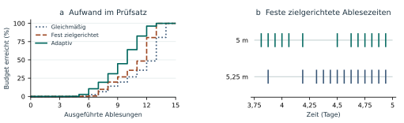

Die festen Pläne garantieren das Budget bei exakten Zählerständen für die ganze Ratenmenge. In den 5 101 Prüfraten braucht die adaptive Regel höchstens 13 Ablesungen. Im Mittel sind es 9,48 gegenüber 11,65 beim gleichmäßigen Plan. Beim frühen Puls genügen ihr drei. Für den zweiten Brunnen bleiben im festen Plan 13 Ablesungen nötig. Die gewählten Zeiten verschieben sich mit der Lage der Zielgröße.

<!-- Buchseite -->

<a id="mp-matrix-c01"></a>

## 17.4 · Messaufgaben C01 bis C08

Jede Zeile hat ein eigenes physikalisches Budget. **G/F/A** gibt die größte ausgeführte Ablesezahl des gleichmäßigen, festen zielgerichteten und adaptiven Plans an. **Offen** bedeutet, dass auch alle verfügbaren Ablesungen mindestens zwei widersprechende Fälle in derselben Klasse lassen. Das vollständige Protokoll nennt dort die Anzahl der betroffenen Fälle und ein konkretes Paar.

<a id="tab-k17-01"></a>

| Messaufgabe | Zielgröße und Budget | Zugelassene Ablesungen | Fälle | G/F/A |
|---|---|---|---:|---:|
| [C01](#fb-refC01) · Lithium-Cluster | Größe $m$ bei 10 s, 0,08 | Clustergröße $f$ | 15 | offen |
| [C02](#fb-refC02) · Fertigung | Ausgebrachte Menge, 12 Teile | Belegung, Zulassungszeit, Transit | 12 | offen |
| [C03](#fb-refC03) · Klasse-E-Schalter | Spannung $u_4$ bei 20 µs, 0,10 V | Spannung $u_2$ | 12 | offen |
| [C04](#fb-refC04) · Philosophen | Mahlzeiten, 2. Verklemmungskategorie | Zustandsanteile und Mahlzeiten | 12 | 2 / 2 / 2 |
| [C05](#fb-refC05) · Hysterese | Erste Schaltzeit, 15 ms. Modusfolge | Zustandsdifferenz | 12 | 0 / 0 / 0 |
| [C06](#fb-refC06) · Notaufnahme | Mittlere Aufenthaltszeit, 3 min | Klassenmittel, Schließzeit, Streuung | 16 | 1 / 1 / 1 |
| [C07](#fb-refC07) · Stiftpendel | Winkel bei 1,3 s, 0,018 rad. Stiftkontakt | Frühere Winkel | 12 | 1 / 1 / 1 |
| [C08](#fb-refC08) · Schleuse | Mittlere Transitzeit, 25 s | Verkehrszahlen und Transitmittel | 12 | 2 / 2 / 2 |

**C01 und C05 zeigen, wann Ablesungen etwas ändern.** Bei C01 zeigen alle sieben erlaubten $f$-Ablesungen für zwei Szenarien denselben Gerätecode. Die möglichen Endgrößen sind 3,370 und 3,579. Ihre Differenz übersteigt das doppelte Budget von 0,16. Eine Ablesung von $m$ bei 3 s löst den Vertrag in allen 15 Fällen. Bei C05 reichen die vorab gegebenen Startbereiche und der identische Moduswechsel bereits für das verlangte Budget.

Bei C04 muss der gleiche Plan eine Mahlzeitenzahl und die Verklemmungskategorie treffen. Alle zwölf untersuchten Spuren bleiben hier lebendig. Bei C06 und C08 werten wir festgeschriebene Ereignisspuren aus. Sie zeigen, welche Programmeingänge zu einem gegebenen Protokoll passen. [Rechenweg und Stichproben](#mp-labor)

<!-- Buchseite -->

<a id="mp-matrix-c09"></a>

## 17.5 · Messaufgaben C09 bis C16

Beim Tank messen wir einen Pegel und prüfen beide Endpegel. Im SCARA-Kurzfenster wird die vertikale Position aus dem Ankerstrom eingegrenzt. In der Stoßreihe ist neben der Endgeschwindigkeit auch die Kontaktzahl angegeben. Die Fallbeschreibung im Rechenlabor legt jeweils den Horizont fest.

<a id="tab-k17-02"></a>

| Messaufgabe | Zielgröße und Budget | Zugelassene Ablesungen | Fälle | G/F/A |
|---|---|---|---:|---:|
| [C09](#fb-refC09) · Tanks | Zwei Pegel bei 36 s, je 4 mm | Frühere Pegel von Tank 1 | 12 | 2 / 2 / 2 |
| [C10](#fb-refC10) · Stäbchen | Neue Mahlzeiten, 0,25. Zugriffsfolge | Freie Stäbchen und Anforderungen | 20 | 5 / 5 / 4 |
| [C11](#fb-refC11) · SCARA | $z$ bei 0,9 ms, 0,45 mm | Ankerstrom der $z$-Achse | 12 | 1 / 1 / 1 |
| [C12](#fb-refC12) · Kugelreihe | Endgeschwindigkeit von Kugel 4, 0,025 m/s. Kontaktzahl | Geschwindigkeit von Kugel 2 | 12 | 2 / 2 / 2 |
| [C13](#fb-refC13) · Lastkran | Lastposition bei 15 s, 0,25 m | Seilwinkel | 12 | offen |
| [C14](#fb-refC14) · Lieferkette | D1 an Tag 30, 6 Produkte | Bestandsstände von D1 | 16 | 4 / 1 / 1 |
| [C15](#fb-refC15) · Zweikammermodell | $A$ bei 160 ZE, 0,30 auf Modellskala | Frühere Konzentration $A$ | 12 | 2 / 2 / 2 |
| [C16](#fb-refC16) · Restaurantmarkt | Nach fünf Jahren, 1 Restaurant | Frühere Restaurantzahl | 9 | 2 / 1 / 1 |

**C10 gewinnt durch die Reihenfolge der Fragen.** Die ersten Angaben schränken ein, welche Plätze noch als Gewinner des Zugriffs infrage kommen. Der feste Plan braucht höchstens 5 Ablesungen, der adaptive 4. Im Mittel sinkt die Zahl von 3,80 auf 2,75.

**C14 gewinnt durch den Zeitpunkt.** Der D1-Bestand an Tag 27 genügt allein, um den Bestand an Tag 30 auf sechs Produkte genau einzugrenzen. Der gleichmäßige Plan braucht bis zu vier Ablesungen. Der gezielte feste Plan benötigt eine.

<!-- Buchseite -->

<a id="mp-matrix-c17"></a>

## 17.6 · Messaufgaben C17R bis C22

Die Endgröße kann aus einer simulierten Bahn, einer rekonstruierten Messkurve oder einem Integral stammen. In C17R bleiben die Raten des abstrakten SIR-Lehrmodells fest. In C18 stammt jedes Prüffenster aus der separat rekonstruierten Kurve. Für C19R gilt die relative Schranke aus [Abschnitt 17.3](#mp-c19). Die Zahl der Prüfraten bezeichnet dort die zusätzliche Stichprobe zur Aufwandsermittlung.

<a id="tab-k17-03"></a>

| Messaufgabe | Zielgröße und Budget | Zugelassene Ablesungen | Fälle | G/F/A |
|---|---|---|---:|---:|
| [C17R](#fb-refC17R) · SIR | $R$ bei 60 ZE, 8 Modellpersonen | Frühere Werte für $I$ | 12 | 1 / 1 / 1 |
| [C18](#fb-refC18) · Identifikation | Kraft bei 450 ms, 0,04 auf Datenskala | Verdickung im früheren Fenster | 20 | 2 / 2 / 2 |
| [C19R](#fb-refC19R) · Grundwasser | Brunnen an Tag 10, 1 % relativ | Kumulierte Quellmasse | 5 101 | 14 / 13 / 13 |
| [C20](#fb-refC20) · Produktion | Median der Durchlaufzeit, 65 s | Durchlaufzeiten einzelner Aufträge | 12 | 2 / 1 / 1 |
| [C21](#fb-refC21) · Ball | Dritter Kontakt, 60 ms. Zahl bis 4 s | Ballhöhe | 12 | 4 / 2 / 2 |
| [C22](#fb-refC22) · Warteschlange | Mittlere Wartezeit, 0,40 ZE. Abbruch | Warteschlangen- und Ereignislog | 16 | 1 / 1 / 1 |

Die Ereignisbedingungen der Ballprobe beziehen sich auf Anzahl und Zeitpunkt von Bodenkontakten. Bei C22 wird der Abbruch als eigene Kategorie geführt. Beide Aufgaben machen sichtbar, welche numerische Genauigkeit und welches Ereigniswissen dieselbe Auswahl der Ablesungen erfüllen muss.

<!-- Buchseite -->

<a id="mp-matrix-cp"></a>

## 17.7 · Die sechs Teilaufgaben aus CP1 und CP2

Bei der Parallelserie ist die abgelesene physikalische Größe von der CPU-Zeit getrennt. Wir wählen beispielsweise einen Punkt der Saite oder einen Block des festgelegten Monte-Carlo-Ensembles. Der hier gezählte Aufwand ist die Anzahl dieser Ablesungen. Die Laufzeitkosten der eigentlichen Simulation lassen sich zusätzlich separat messen.

<a id="tab-k17-04"></a>

| Messaufgabe | Zielgröße und Budget | Zugelassene Ablesungen | Fälle | G/F/A |
|---|---|---|---:|---:|
| [CP1/A](#fb-refCP1) · Federwagen | Position bei 1,6 s, 0,8 mm | Frühere Positionen | 12 | 3 / 3 / 2 |
| [CP1/B](#fb-refCP1) · Populationen | $z_2$ bei 10 ZE, 0,06 auf Modellskala | Frühere Werte für $v_1$ | 12 | 1 / 1 / 1 |
| [CP1/C](#fb-refCP1) · Erregte Saite | Auslenkung bei 7,5 m und 20 s, 12 mm | Auslenkung bei 5 m | 12 | 1 / 1 / 1 |
| [CP2/1](#fb-refCP2) · Ensemble | Positionsmittel bei 1,6 s, 0,12 mm | Mittel jedes Viererblocks | 12 | 1 / 1 / 1 |
| [CP2/2](#fb-refCP2) · Kavität | Tempo bei $(13,9)$, 0,0012 Gittereinheiten | Tempo in Spalte 9 | 12 | 2 / 1 / 1 |
| [CP2/3](#fb-refCP2) · Gezupfte Saite | Auslenkung bei 0,375 m und 8 s, 1,5 mm | Auslenkung bei 0,25 m | 12 | 2 / 1 / 1 |

Beim CP2-Ensemble liest ein Zugriff den Mittelwert von vier Einzelläufen. Die Prüfgröße ist das Mittel über 28 Läufe des festgelegten Ensembles. Die Kavitätsprobe verwendet ein Gitter mit 19 × 19 Knoten und 215 LBM-Schritte. Die Zielgeschwindigkeit kommt aus den D2Q9-Impulsmomenten an einem Innenknoten. Die Sensoren folgen einer Spalte desselben Gitters. Kapitel 16 verwendet feinere Vergleichsrechnungen.

**CP1/A gewinnt durch die adaptive Wahl.** Der beste feste Plan hat maximal 3 Ablesungen. Adaptiv genügen 2. Beim Federwagen hängt der Informationswert einer weiteren Position davon ab, welche Kombinationen von Masse und Dämpfung nach der ersten Ablesung noch infrage kommen.

<!-- Buchseite -->

<a id="mp-labor"></a>

## 17.8 · Rechenlabor und Geltungsbereich

Mit der ursprünglichen Kanalliste ist der Vertrag in 24 der 28 Aufgaben für alle Referenzfälle erfüllbar. In 9 davon ist die maximale Zahl der adaptiven Ablesungen kleiner als beim gleichmäßigen Plan. Bei C10 und CP1/A unterschreitet sie auch die des besten festen Plans.

Die vier offenen Aufgaben zeigen, welche Information zusätzlich nötig ist. Bei C01 und C03 reicht die jeweilige Zielgröße zu einem früheren Zeitpunkt aus, bei C13 die Katzposition bei 12 s. Bei C02 liefert das Steuerprotokoll die Zuordnung von An- und Ausfahrt. Dort braucht der adaptive Plan bis zu zwei Abfragen. In den drei anderen Aufgaben genügt je eine. Damit sind alle 28 Aufträge mit den entsprechend erweiterten Kanallisten für ihre Referenzfälle erfüllbar.

Das Rechenlabor hält den zugrunde liegenden [Projektstand](https://github.com/5H3LL3H5/argesim-hyperposition-benchmarks/tree/16f0f2528fcf77f16898ecd74ad952be2c09eac2) lokal fest. Die Fallmodule erzeugen daraus Zielwerte und die erlaubten Beobachtungen. Der Planer rechnet mit diesen gespeicherten Referenzwerten. Die formale Unterteilung bezieht sich auf den festgelegten Katalog. Änderungen an Randbedingungen, Gitter, Auflösung, Quellen und Horizont bilden einen neuen Versuch.

~~~sh
python3 rechenlabor/messplanung/vergleich.py --out messausgabe
python3 rechenlabor/messplanung/vergleich.py --case C10 --out c10_messung
~~~

`messplanung.csv` enthält die kompakte Ergebnismatrix. `messplanung.json` weist Zielwerte, Budgets, Beobachtungen, Auflösungen und Gerätecodes je Fall aus. Für die adaptive Wahl sind dort die Ablesepfade hinterlegt. Ein Fall mit offenem Vertrag verweist auf das konkrete unentscheidbare Paar. Im Grundwasserversuch enthält dieselbe Datei zusätzlich die kontinuierliche Schranke und die unabhängige Prüfauszählung.

### Wenn die gesuchte Größe eine Wahrscheinlichkeit ist

Ein festgelegter Zufallsstart definiert eine Modellspur. Wird stattdessen etwa die Verklemmungswahrscheinlichkeit gesucht, ist jede unabhängige Wiederholung eine Beobachtung mit Wert 0 oder 1. Mit $n$ unabhängigen Wiederholungen liefert Hoeffdings Schranke $\Pr(|\widehat p-p|\ge b)\le2e^{-2nb^2}$. Für $b=0{,}05$ und eine vorab festgelegte Irrtumswahrscheinlichkeit von fünf Prozent genügen nach dieser Schranke 738 Wiederholungen. Ein Zwischentest mit vorzeitigem Stopp braucht ein zusätzlich festgelegtes statistisches Prüfverfahren. Die endliche Szenariengarantie und die Stichprobenaussage haben damit eigene Voraussetzungen.

<!-- Buchseite -->

<a id="atlas-vertrag"></a>

## 17.9 · Was ein Fehlernachweis bei einem Ereignismodell bedeutet

Betrachten Sie zwei Verläufe, die alle bisher abgefragten Sensorcodes teilen. Im ersten gewinnt Person P1 einen Zugriff, im zweiten P2. Jede Regel, die nur diese Codes kennt, muss beiden dieselbe Antwort geben. Für mindestens einen Verlauf wäre das Ereignislabel falsch. Für eine Zahl $q$ mit Budget $b$ gilt ebenso: Liegen zwei mögliche Werte weiter als $2b$ auseinander, kann kein gemeinsamer Schätzwert beide Budgets einhalten.

Für die endlichen Aufgaben sei $H$ die Matrix der quantisierten Beobachtungen. Jede Spalte gehört zu einem festgelegten Referenzszenario, jede Zeile zu einem Messkanal. Der Zielwert pro Szenario, geteilt durch sein Budget, bildet den Vektor $q$. Aus den bereits gelesenen Zeilen $S$ lernt der duale Operator für diesen Zielwert einen affinen Schätzer $c+z^T y$. Der Fehler ist für jede Katalogspalte durch
$$
r=\max_i\left|q_i-c-(H_S^Tz)_i\right|
$$
beschränkt. Eine Freigabe mit diesem Zeugen verlangt $r\le1$ für jede Zielgröße und ein eindeutiges Ereignislabel. Die Implementierung prüft die gerundeten Koeffizienten mit rationaler Arithmetik. Reicht die globale Schranke nicht, bildet der Prüfer für jede Zielgröße das Intervall aller noch möglichen Katalogwerte. Dessen Mittelpunkt minimiert den maximalen absoluten Fehler.

**Was war vorher bekannt?** Die Gewichte $c,z$ werden nur an den Trainingsszenarien des jeweiligen Durchgangs angepasst. Für die Schranke stehen die Referenzwerte *aller* Katalogspalten bereits beim Aufbau des Prüfers zur Verfügung. Ein neuer, unmodellierter Verlauf kann dieselben Codes liefern. Die geschlossene Liste ist deshalb Teil der Aussage. Für neue Quellen bei C19R trägt die [Ungleichung für beliebige Raten](#atlas-quelle), bei der Saite die [diskrete Newmark-Gleichung](#op-nachweis). Diese Nachweise haben einen anderen Geltungsbereich.

<!-- Buchseite -->

<a id="atlas-kosten"></a>

## 17.10 · Wie der Planer den nächsten Sensor auswählt

Ein Messkanal kann früh gut trennen und gerade dadurch den entscheidenden späteren Kanal entbehrlich machen. Der kurze Lehrversuch verwendet deshalb als Trainingsziel die Zahl der verbleibenden Ablesungen. Für eine Gruppe noch möglicher Fälle minimiert eine Rückwärtsrechnung den heutigen Aufwand von eins plus die mittlere optimale Restarbeit der entstehenden Gruppen. Alle Katalogszenarien werden für diese Rechnung gleich gewichtet.

Das Aktionsnetz lernt diese Fortsetzungskosten aus anderen Benchmarkfamilien. Drei getrennte Durchgänge halten ganze Familien zurück. So bleiben die drei CP1-Teilaufgaben beim Training der zugehörigen Auswahlregel gemeinsam außen vor, ebenso die drei CP2-Teilaufgaben. Am Zielort sind Sensorkanäle, Codes und zulässige Referenzfälle für die Planung bekannt. Die Regel erhält beim Einsatz nur angeforderte Codes in steigender Kanalreihenfolge. Sie darf eine letzte verbleibende Trennmöglichkeit für verschiedene Sensorsignaturen nicht überspringen.

**Gezählte Ablesungen für 352 Szenarien.** Der gelernte Planer benötigt zusammen 538, die gierige Aufteilung nach Gruppengröße 535, das Optimum unter denselben Zulässigkeitsregeln 528 und das chronologische Ablesen 1 014. Der Vergleich bezieht sich auf die vollständige Ausstattung mit den vier dokumentierten Zusatzkanälen. Die Zahlen messen Sensorzugriffe. Inferenzzeit, Aufbau der Referenzbank und Laufzeit des klassischen Solvers sind eigene Kosten. Allein bei CP1/A benötigt das Netz 31 Ablesungen, die gierige Regel kommt mit 22 aus.

Von den 352 akzeptierten Aufgaben erhalten 60 direkt einen global geprüften affinen Zeugen. Ein konstanter Zeuge schafft zwölf. In den verbleibenden 292 Fällen liefert das Intervall der kompatiblen Szenarien die Freigabe. C05 trägt alle zwölf konstanten Freigaben bei: Schon vor der ersten Ablesung liegen die modellierten Schaltzeiten im Budget und das Label steht fest. Eine genauere Zeitvorgabe wäre ein anderer Versuch.

<!-- Buchseite -->

<a id="atlas-reihe1"></a>

## 17.11 · C01 bis C08 im direkten Vergleich

Die ersten drei Zahlen zählen Prüffälle und ihre Art der Freigabe. Die letzten drei zählen alle Ablesungen je Auswahlregel, summiert über die Fälle einer Zeile. Ein kleinerer Wert bedeutet bei demselben Auftrag weniger Sensorzugriffe.

<a id="tab-k17-05"></a>

| Atlasauftrag | Fälle | Dual | Hülle | Netz | Gierig | Opt. |
| --- | ---: | ---: | ---: | ---: | ---: | ---: |
| C01 | 15 | 0 | 15 | 18 | 18 | 18 |
| C02 | 12 | 0 | 12 | 18 | 18 | 18 |
| C03 | 12 | 8 | 4 | 12 | 12 | 12 |
| C04 | 12 | 0 | 12 | 24 | 24 | 24 |
| C05 | 12 | 12 | 0 | 0 | 0 | 0 |
| C06 | 16 | 0 | 16 | 16 | 16 | 16 |
| C07 | 12 | 12 | 0 | 12 | 12 | 12 |
| C08 | 12 | 0 | 12 | 20 | 20 | 20 |

Im Basissatz bleiben bei C01 drei, bei C02 vier und bei C03 zwei Fälle offen. Die Zusatzkanäle sind in den Tabellenwerten enthalten. Bei C04 trägt stets das Intervall der noch möglichen Mahlzeiten. Der Scheduler kann über den Status eines Wartekreises mehr aussagen als über die künftige Anzahl der Mahlzeiten.

Die zugehörigen Messpaare stehen im [bebilderten Referenzkatalog](#atlas-mess-c01). In den Einzelprotokollen sind die tatsächlich gelesenen Kanäle, die Freigabe und der nachträglich geprüfte Fehler je Fall ausgewiesen.

<!-- Buchseite -->

<a id="atlas-reihe2"></a>

## 17.12 · C09 bis C16 im direkten Vergleich

Die ersten drei Zahlen zählen Prüffälle und ihre Art der Freigabe. Die letzten drei zählen alle Ablesungen je Auswahlregel, summiert über die Fälle einer Zeile. Ein kleinerer Wert bedeutet bei demselben Auftrag weniger Sensorzugriffe.

<a id="tab-k17-06"></a>

| Atlasauftrag | Fälle | Dual | Hülle | Netz | Gierig | Opt. |
| --- | ---: | ---: | ---: | ---: | ---: | ---: |
| C09 | 12 | 0 | 12 | 18 | 18 | 18 |
| C10 | 20 | 0 | 20 | 60 | 60 | 60 |
| C11 | 12 | 12 | 0 | 12 | 12 | 12 |
| C12 | 12 | 0 | 12 | 21 | 21 | 20 |
| C13 | 12 | 0 | 12 | 12 | 12 | 12 |
| C14 | 16 | 0 | 16 | 44 | 45 | 44 |
| C15 | 12 | 0 | 12 | 18 | 18 | 18 |
| C16 | 9 | 0 | 9 | 14 | 18 | 14 |

C09 hat zwei Zielpegel. Beide müssen gleichzeitig im Budget liegen. C10 verlangt zusätzlich den richtigen Gewinner einer Konkurrenz: Die Zahl neuer Mahlzeiten allein kann sogar null sein und der Zustandswechsel dennoch entscheidend. Für C13 ist der Zusatzkanal einbezogen; ohne ihn bleiben zwei Fälle offen.

Die zugehörigen Messpaare stehen im [bebilderten Referenzkatalog](#atlas-mess-c09). In den Einzelprotokollen sind die tatsächlich gelesenen Kanäle, die Freigabe und der nachträglich geprüfte Fehler je Fall ausgewiesen.

<!-- Buchseite -->

<a id="atlas-reihe3"></a>

## 17.13 · C17R bis C22 im direkten Vergleich

Die ersten drei Zahlen zählen Prüffälle und ihre Art der Freigabe. Die letzten drei zählen alle Ablesungen je Auswahlregel, summiert über die Fälle einer Zeile. Ein kleinerer Wert bedeutet bei demselben Auftrag weniger Sensorzugriffe.

<a id="tab-k17-07"></a>

| Atlasauftrag | Fälle | Dual | Hülle | Netz | Gierig | Opt. |
| --- | ---: | ---: | ---: | ---: | ---: | ---: |
| C17R | 12 | 8 | 4 | 12 | 12 | 12 |
| C18 | 20 | 0 | 20 | 30 | 30 | 30 |
| C20 | 12 | 0 | 12 | 20 | 21 | 20 |
| C21 | 12 | 0 | 12 | 22 | 22 | 22 |
| C22 | 16 | 0 | 16 | 20 | 20 | 20 |

C19R verwendet eine kontinuierliche Quellenmenge. In 5 101 Testfällen werden mit Aktionsnetz 5 079 Werte direkt über den gelernten Multiplikator und 22 über die scharfe Intervallrechnung freigegeben. Maximal waren 13 Ablesungen nötig. Die separate Auswertung in [Kapitel 15](#atlas-quelle) erhält diesen größeren Geltungsbereich. Bei C18 stammen die Kraftwerte aus der dokumentierten Kurvenrekonstruktion.

Die zugehörigen Messpaare stehen im [bebilderten Referenzkatalog](#atlas-mess-c17). In den Einzelprotokollen sind die tatsächlich gelesenen Kanäle, die Freigabe und der nachträglich geprüfte Fehler je Fall ausgewiesen.

<!-- Buchseite -->

<a id="atlas-reihe4"></a>

## 17.14 · CP1 und CP2 im direkten Vergleich

Die ersten drei Zahlen zählen Prüffälle und ihre Art der Freigabe. Die letzten drei zählen alle Ablesungen je Auswahlregel, summiert über die Fälle einer Zeile. Ein kleinerer Wert bedeutet bei demselben Auftrag weniger Sensorzugriffe.

<a id="tab-k17-08"></a>

| Atlasauftrag | Fälle | Dual | Hülle | Netz | Gierig | Opt. |
| --- | ---: | ---: | ---: | ---: | ---: | ---: |
| CP1/A | 12 | 0 | 12 | 31 | 22 | 22 |
| CP1/B | 12 | 0 | 12 | 12 | 12 | 12 |
| CP1/C | 12 | 0 | 12 | 12 | 12 | 12 |
| CP2/1 | 12 | 0 | 12 | 19 | 19 | 19 |
| CP2/2 | 12 | 0 | 12 | 29 | 29 | 29 |
| CP2/3 | 12 | 8 | 4 | 12 | 12 | 12 |

CP2/1 betrifft das Mittel des festgelegten Ensembles. Eine Aussage über den Erwartungswert weiterer Zufallsläufe erfordert eine eigene statistische Prüfung. CP2/2 schätzt einen Knoten der kleinen Kavitätsrechnung. Bei CP2/3 ist ein Wegsensor nach acht Sekunden das Ziel. Für das Feld und das duale Problem eines einzelnen Newmark-Schritts gelten die gesonderten Versuche in Kapitel 9 und 16.

Die zugehörigen Messpaare stehen im [bebilderten Referenzkatalog](#atlas-mess-cp1). In den Einzelprotokollen sind die tatsächlich gelesenen Kanäle, die Freigabe und der nachträglich geprüfte Fehler je Fall ausgewiesen.

<!-- Buchseite -->

<a id="atlas-lesekosten"></a>

## 17.15 · Wo eine andere Messreihenfolge tatsächlich Arbeit spart

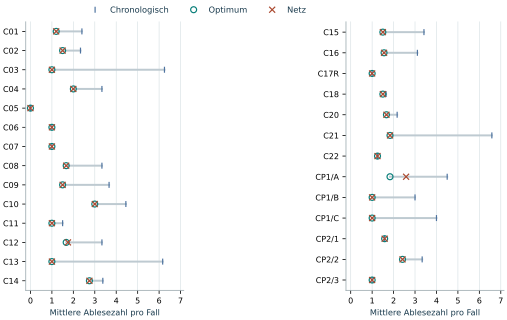

Der graue Abschnitt zeigt, wie viele Ablesungen sich zwischen chronologischem Vorgehen und optimaler Wahl einsparen lassen. Wo Kreuz und Kreis übereinanderliegen, erreicht das gelernte Netz dieselbe mittlere Zahl von Zugriffen wie die Rückwärtsrechnung. Bei CP1/A lässt das Kreuz einen sichtbaren Abstand. Das Netz liest im Mittel 2,58-mal, das Optimum und die gierige Regel 1,83-mal.

C05 steht bei null, weil die Schaltzeit und das Ereignislabel im vereinbarten Katalog schon vor dem Ablesen ausreichend bestimmt sind. Der kontinuierliche Brunnen ist in [Abbildung 15.2](#atlas-quelle) separat dargestellt. Dort besitzt die scharfe physikalische Intervallrechnung eigene Kosten. Wer beide Modelle nach Ablesungen vergleicht, muss daher auch festhalten, welche Rechnung zwischen zwei Messungen erlaubt war.

<!-- Buchseite -->

<a id="mp-schluss"></a>

## Schluss · Ein Fehlerbudget bestimmt den nächsten Messschritt

Der Brunnenversuch beantwortet die Eingangsfrage im angegebenen Lehrmodell. Die bekannte Masse bestimmt eine Spanne für die Konzentration. Die Ablesungen beschränken die Verteilung dieser Masse in der Zeit. Mit gezielter Wahl sind für einen festen Plan im ungünstigsten Fall 13 Ablesungen erforderlich. Die adaptive Regel nutzt neu bekannt gewordene Zählerstände und braucht im Prüfsatz im Mittel 9,48.

Bei den übrigen Aufgaben führen dieselben Schritte von der Zielgröße und dem Budget zur Menge der kompatiblen Verläufe. Die halbe Spannweite erklärt, wann eine numerische Ausgabe genügt. Für begrenzt genaue Zähler zeigt der [Brunnenversuch mit zwei Messgeräten](#pr-messversuch) die Wirkung einer weiteren Ablesung. Die Ereigniskategorie stellt eine eigene Entscheidung dar. Ist ein unentscheidbares Paar vorhanden, sehen wir direkt, welche Szenarien einen weiteren Kanal oder eine andere Auflösung erfordern.

Damit kann eine Solverwahl aus zwei Rechnungen bestehen. Zuerst prüfen wir die Information, die dem Algorithmus zur Verfügung steht. Danach vergleichen wir geeignete Integratoren oder Vorhersagemodelle unter demselben Zielvertrag. [Synthese in Kapitel 18](#fb-neu17)

<a id="mp-forschung"></a>

### Aktueller Stand der Forschung

Zielgerichtete Versuchsplanung richtet die Auswahl von Beobachtungen an einer Zielgröße aus. Attia, Alexanderian und Saibaba reduzieren in linearen Bayes-Inversionen die Unsicherheit der gesuchten Ausgabe. Unser Lehrversuch untersucht für die angegebenen Szenarien die maximale Abweichung. Im Vorabdruck von Hsiang, George und Anandkumar gehen die Garantien für neuronale Operatoren über einzelne Gitterpunkte hinaus. Der [gelernte Brunnenplaner](#op-brunnen) verbindet die Auswahl mit einer überprüfbaren Schranke. Der Versuch mit ungenauerem Sensor zeigt, welche Anfragen offenbleiben. Unvorhergesehene Randsignale sind eine weitere Forschungsfrage. [Zielgerichtete Versuchsplanung](https://arxiv.org/abs/1802.06517) · [Zertifizierung im Funktionenraum, 2026](https://arxiv.org/abs/2611.09038)

Die [vollständige Rechnung](#atlas-kosten) zeigt, wie nah die gierige und die gelernte Auswahl unter denselben Prüfregeln an das Optimum kommen.

[Zur Einleitung dieses Kapitels](#mp-einstieg)

<!-- Buchseite -->

<a id="fb-neu17"></a>

# Kapitel 18 · Synthese und Entscheidungsmatrix der 456 Konfigurationen

<a id="kap17-einstieg"></a>

## Einleitung · Wie wählen wir nach einem überprüften Versuch das nächste Verfahren?

Am Anfang des Buchs schwang ein Federwagen auf dem Bildschirm immer weiter aus. Wir haben in Kapitel 1 erklärt, warum die Integration diesem Wagen Energie zuführt. Jetzt nehmen wir die drei Fragen aus der [Einleitung](#buch-einleitung) wieder auf. Was wollen wir wissen? Wo entsteht die Abweichung? Woran erkennen wir eine belastbare Entscheidung? Beim [Messplan](#mp-einstieg) haben wir zuvor geprüft, welche Beobachtungen die Entscheidung überhaupt tragen. Die Leitbenchmarks zeigen, wie dieselben Fragen bei vielen Zuständen, Ereignissen und Feldern praktisch beantwortet werden.

Bei der Kugelreihe kann eine glatte Strecke zwischen zwei Stößen mit wenig Arbeit berechnet werden. Beim steifen Zweizustandsmodell begrenzt ein kurzer Vorgang die explizite Schrittweite, und die Uhrzeit der nächsten Schaltung bleibt dennoch das eigentliche Ziel. Für ein gebundenes Pendel zählt auch die Zulässigkeit des Zustands. Welches Verfahren wir für das nächste Modell untersuchen, hängt darum von seinem Auftrag und seiner Gleichungsstruktur ab.

Wir lesen das Raster der acht Modelle mit insgesamt 456 Konfigurationen zuerst auf Erfolg und Fehlerursachen. Danach vergleichen wir die Arbeit unter den Einstellungen, die den gleichen Test bestehen. So wird aus einer Tabelle die Begründung für eine Auswahl. Am Ende steht ein Vorgehen, das man auf ein neues Modell anwenden und mit einer unabhängigen Gegenprobe überprüfen kann.

<a id="revision-k18-01"></a>

**Vier verschiedene Nenner.** Die Reihe mit 399 historischen Einstellungen hat eine andere Modellauswahl. Im Archiv mit 456 Einstellungen prüfen wir acht definierte Fenster zu je 57 Konfigurationen, einschließlich aller Abbrüche. Die Auswahlstudie mit 520 Einstellungen und die Steifigkeitsstudie mit 138 Einstellungen besitzen eigene Kandidaten und Budgets. Die 17 gemeinsam verfügbaren Kandidaten des Leistungsprofils sind die Schnittmenge über acht Fälle der Auswahlstudie. Bevor wir Zeiten vergleichen, müssen Modellfenster, Referenz, Fehlerbudget und erwünschtes Ereignis übereinstimmen.


[Zum Schluss dieses Kapitels](#kap17-schluss) · [Ergebnisse aller 28 Messaufgaben](#atlas-kosten)

<!-- Buchseite -->

<a id="fb-kap12"></a>

## Welcher Solver erfüllt den Auftrag?

**Lernziel.** Sie können einen Vergleich vor dem Start festlegen, fehlerhafte Läufe einordnen und eine Methodenwahl mit einem nachrechenbaren Genauigkeits- und Aufwandsergebnis begründen.

Zwei Programme liefern dieselbe Endtemperatur. Das erste braucht nur die Hälfte der Rechenzeit. Sie sollen den schnelleren Solver für einen Regler auswählen, der zusätzlich drei Schaltvorgänge protokollieren muss. Welche Daten fehlen Ihnen vor einer Entscheidung?

### Machen Sie den Auftrag messbar

Wir verlangen in einem kleinen Lehrversuch drei Ereignisse in der richtigen Reihenfolge, höchstens $2\,\mathrm{ms}$ Zeitabweichung je Ereignis und höchstens $0{,}10\,\mathrm{K}$ Endfehler. Die Laufzeiten stammen in dieser Übung aus demselben angenommenen Versuchsaufbau.

**Versuchsbezug.** Lehrbeispiel zur Abnahme. Zwei Kandidaten, drei bezeichnete Ereignisse und derselbe vorgegebene Referenz-Endzustand.

<a id="tab-k18-01"></a>

| Lauf | Ereignisse | größter Zeitfehler | Endfehler | Laufzeit |
| --- | --- | --- | --- | --- |
| A | 2 von 3 | offen | $0{,}01\,\mathrm{K}$ | $4\,\mathrm{ms}$ |
| B | 3 von 3 | $1{,}6\,\mathrm{ms}$ | $0{,}04\,\mathrm{K}$ | $8\,\mathrm{ms}$ |

Nur B erfüllt hier den Auftrag. Ein fehlendes Ereignis kann bei A auch durch eine noch so gute Endtemperatur nicht rekonstruiert werden. Die Daten sind konstruierte Lehrwerte. Die archivierten ARGESIM-Messungen folgen später mit ihren eigenen Grenzwerten.

**Ändern Sie den Auftrag.** Fordert eine andere Anwendung ausschließlich die Endtemperatur mit derselben Toleranz, dann erfüllen A und B diese Anforderung. Für diesen Versuch benötigt A die kürzere gemessene Zeit. Eine Änderung der Messaufgabe kann eine vernünftige Wahl umkehren.

Übertragen Sie dieses Vorgehen auf die Acht-Fälle-Auswertung. Ein Methodenname allein legt weder die Schrittweite noch die Behandlung von Ereignissen oder das Fehlerziel fest.

**Kernweg**  [Erster Reglertakt](#fb-c09takt)  **Vertiefung**  [Acht-Fälle-Matrix](#fb-matrix) [Selbst prüfen](#fb-ueb12).

<a id="fb-prakt"></a>

## Eine Solverwahl begründen

**Erst schätzen.** Der schnellste Lauf trifft den Endwert, überspringt aber eine geforderte Schaltung. Wie ordnen Sie ihn im Vergleich ein?

Eine Modellgruppe fragt nach dem „besten Solver“. Formulieren Sie zuerst den Prüfauftrag. Welche Größe, zu welcher Zeit, in welcher Einheit und mit welchem Fehlerbudget soll stimmen? Die Tabelle verbindet eine solche Frage mit einem ersten Verfahren und einer Gegenprobe. Ihr Versuch entscheidet, ob die Wahl trägt.

**Versuchsbezug.** Lesetabelle zur Methodenwahl. Die Zeilen benennen Modellklassen und die Zielgröße der anschließenden Gegenprobe.

<a id="tab-k18-02"></a>

| Modellmerkmal | Erster sinnvoller Versuch | Was entscheidet? |
| --- | --- | --- |
| Glatte ODE ohne schnelle Abklingmode | RK45 für adaptive Schritte, RK4 als transparente Kontrolle auf festem Gitter. | Zustandsfehler und beobachtete Ordnung beim Verfeinern. |
| Schnelle stabile Mode, langsames Ziel | Radau IIA, BDF oder ESDIRK. Explizites RK als Kostenvergleich. | Fehler in der Anfangsschicht und am verlangten Ausgang, $f$-Aufrufe und LU. |
| Konservativer Oszillator | Störmer–Verlet bei separierbarer Mechanik. RK4 bei begrenztem Horizont mitmessen. | Phasenfehler und maximale Energiedrift über den relevanten Zeitraum. |
| Ortsabhängiges Feld | FDM, FVM oder FEM nach Geometrie, Fluss und Glattheit. Danach passende Zeitintegration. | Raum und Zeit getrennt verfeinern. Flüsse und Randbedingungen prüfen. |
| Algebraische Bindung | Bei regulärem Index 1 Elimination gegen IDA/IDAS vergleichen. Bei höherem Index Formulierung prüfen. | Konsistente Starts, skalierte Residuen, unabhängige Zustandsgrößen. |
| Lokale oder schaltende Dynamik | QSS2 sowie einen klassischen Integrator unter identischem Wächter- und Resetvertrag erproben. | Ereignisfolge, Zeiten, Zahl betroffener Komponenten und Arbeit bei zulässigem Fehler. |

### Wie ein Vergleich fair wird

Bei einem Solverpaar sind dieselben ODE-Toleranzen nur eine Eingabe. Ein Quantum misst sogar eine andere Größe. Für jeden Kandidaten sucht man eine Einstellung, die das gleiche physikalische Ziel erreicht. Erst die qualifizierten Läufe werden nach Aufwand verglichen. Zeitüberschreitung, Solverfehler, falsche Ereignisfolge und reguläre Zielverfehlung bleiben als unterschiedliche Ergebnisse sichtbar.

[Steifes Folgesystem](#k3-stabilitaet) · [C05 und C12](#fb-vergleich) · [getrennte Fehlerbilanz](#t1-k7).

<a id="fb-vergleich"></a>

## C05 und C12 am gleichen Fehlerziel vergleichen

Ein Lauf qualifiziert sich, wenn Ereigniszahl und Reihenfolge stimmen und jede Messgröße ihre eigene physikalische Schranke $b_j>0$ einhält. Der dimensionslose Score ist $S=\max_j|Q_j-Q_j^\star|/b_j$. Bei $S\le1$ besteht der Lauf. Auf C05 sind die Schranken $1\,\mathrm{ms}$ je Schaltzeit und $0{,}006$ je Endzustand. Auf C12 werden Kontaktzeiten und Endgeschwindigkeiten mit $0{,}001\,\mathrm{s}$ bzw. $0{,}001\,\mathrm{m/s}$ geprüft.

**Versuchsbezug.** Steifigkeitsstudie (138 Konfigurationen insgesamt). C05 bis 3,5 s gegen analytische Phasen, drei Toleranzen je Kandidat.

<a id="tab-k18-03"></a>

| C05 · Score | rtol $10^{-3}$ | rtol $10^{-5}$ | rtol $10^{-7}$ |
| --- | --- | --- | --- |
| ESDIRK32 | 6,262 | 0,0889 | 0,0009469 |
| Radau IIA | 0,4168 | 0,006296 | 5,068e-05 |
| BDF | 16,93 | 0,1755 | 0,006925 |
| RK23 | T | T | T |

Wiederholung der Steifigkeitsstudie mit 138 Einstellungen. T bezeichnet das Zeitlimit, F das dokumentierte Solver- oder Arbeitslimit. Die Diagnosen und die jeweils abgeschlossenen Aufrufe stehen in `daten/rk23-devs.csv`.

Für den Schalter entscheidet der Fehler der Übergangszeiten gegenüber den analytischen Phasen. Steife Stabilität allein garantiert die geforderte zeitliche Auflösung nicht. Bei einem abgebrochenen Lauf bleibt die globale Fehlerbewertung offen.

**Versuchsbezug.** Steifigkeitsstudie. C12, vier Kugeln bis nach dem dritten Kontakt, gegen die analytische Kontaktkette. Die erste Stufe zählt Funktionsaufrufe, die zweite Zeile bestandene Einstellungen von jeweils drei.

<a id="tab-k18-04"></a>

| C12 · erste Stufe | QSS2 | RK23 | RK45 | ESDIRK32 |
| --- | --- | --- | --- | --- |
| Auswertungen der rechten Seite | 36 | 139 | 148 | 414 |
| Einstellungen im Ziel (von 3) | 3 | 3 | 3 | 3 |

Für die freie Kugelreihe reichen QSS2 wenige Auswertungen. Die nativen Zähler umfassen hier auch Ereignisarbeit und gegebenenfalls numerische Jacobi-Matrizen. Das Zählverfahren des jeweiligen Backends sowie die Kosten einer Faktorisierung sind bei einem Vergleich mit anderen Bibliotheken mitzulesen. Aus einem Zähler allein folgt keine allgemeine Laufzeitrangfolge.

**Aufgabe.** Ein C05-Lauf trifft die drei Schaltungen in Reihenfolge. Sein größter Zeitfehler beträgt $0{,}4\,\mathrm{ms}$, die Endfehler sind 0,0024 und 0,0072. Bestimmen Sie den Score. Was passiert bei einer zusätzlichen Schaltung?

Einzelversuche und Zählkonventionen stehen in `daten/rk23-devs.csv` und im Rechenlabor. Die Zahl der Funktionsaufrufe umfasst die jeweils protokollierte Ereignisarbeit.

<a id="fb-faelle"></a>

## Was die acht Anwendungsfälle tatsächlich prüfen

Lesen Sie die Kurzbezeichnung zusammen mit dem tatsächlich geprüften Ausschnitt. Ein Pendelversuch über zwei Sekunden und einer über zehn Sekunden können verschiedene Ereignisse enthalten. Jede Zeile nennt deshalb Modell, Zeitfenster oder Messgröße und Referenz.

**Versuchsbezug.** Acht-Fälle-Archiv. Jede Zeile bezeichnet das physische Modellfenster und die dafür benutzte unabhängige Referenz.

<a id="tab-k18-05"></a>

| Fall | Modellbildung, Vergleich und Reichweite |
| --- | --- |
| C03 · Verstärker | Idealer Schalter im Class-E-Verstärker. Vier Zustände bei 5 und 10 $\mu\mathrm s$ gegen separat aufgestellte affine Phasenmatrizen. Endliche Schaltflanken liegen außerhalb dieser Reihe. |
| C05 · Schaltung | Zwei stabile Relaxationen, umgeschaltet an Zustandsgrenzen. Drei Schaltzeiten und zwei Endwerte bis 3,5 s gegen analytische Phasen. |
| C07 · Pendel | Anschlagstift verändert die wirksame Pendelgeometrie. Stiftübergänge und Endwinkel/-geschwindigkeit in den ersten 2 s gegen separate Bewegungsgleichungen und DOP853. |
| C09 · Tanks | Volumenbilanzen mit abgetastetem Fuzzy-Regler. 16 Reglertakte à 1 s. Beide Wasserstände gegen DOP853 bei gleicher Regelung, Grenze 0,5 mm. |
| C11 · Roboter | Neun Zustände des SCARA-Antriebs nach 0,1 ms, noch vor der Strombegrenzung. Referenz ist Radau bei derselben rechten Seite. |
| C12 · Kugeln | Vier gleiche Massen mit drei elastischen Kontakten. Analytische Impulsübertragung liefert Zeiten, Reihenfolge und Endgeschwindigkeiten. |
| C13 · Kran | Lineares Zustandsmodell mit Lastpuls von $-800\,\mathrm{N}$. Fünf Zustände bei 4, 7 und 15 s gegen unabhängig übertragene affine Phasenmatrizen. |
| C21 · Ball | Freier Fall, starrer Boden und Rückprall. Zwei analytische Aufprallzeiten innerhalb der ersten 5 s mit einer Schranke von je 1 ms. |

Die acht Fälle ergeben 456 Konfigurationen. Die ältere 399er-Reihe umfasste unter anderem C01, C15, C17R, CP1 und ein auf drei innere Knoten reduziertes CP2-Seil. Die spätere 520er-Auswahlstudie verbindet analytische Prüfmodelle mit gezielten Wiederholungen. Die 138er-Reihe ergänzt insbesondere RK23 und ESDIRK32. Solche Reihen haben verschiedene Versuchsraster und Nenner.

Im vollständigen Labor liegen `baseline.csv`, `extension.csv`, `selection.csv` und `rk23.csv` unter `rechenlabor/qss_pruefung/messung/kontakt_v919/`. Der übergeordnete Ordner `messung/` dokumentiert den v9.18-Vergleich.

<a id="fb-matrix"></a>

## Die vollständige Acht-Fälle-Matrix

Jede Zahl zählt bestandene Einstellungen. Für jeden QSS-Namen wurden drei Quantenfaktoren $0{,}005,\ 0{,}001,\ 0{,}0002$ mal Komponentenskala geprüft. Euler, RK4 und RK45 haben hier je eine Einstellung pro Fall. Fettdruck kennzeichnet Zellen, in denen alle geprüften Einstellungen bestehen.

**Versuchsbezug.** [Primärdatei der Acht-Fälle-Matrix (456 Zeilen, 224 bestanden)](https://github.com/5H3LL3H5/argesim-hyperposition-benchmarks/blob/b065fe61f10faef9c9781473a89315abdd467c75/docs/lehrbuch/gesamtausgabe/rechenlabor/qss_pruefung/messung/kontakt_v919/extension.csv). Je Modell 18 QSS-Verfahren zu drei Quanten und drei klassische Kontrollen. Bezugsfenster und Referenzen stehen in der vorangehenden Falltabelle.

<a id="tab-k18-06"></a>

| Verfahren | C03 | C05 | C07 | C09 | C11 | C12 | C13 | C21 |
| --- | --- | --- | --- | --- | --- | --- | --- | --- |
| `qss1` | 0 | 0 | 1 | **3** | **3** | **3** | 0 | 1 |
| `qss2` | 0 | 0 | 1 | **3** | **3** | **3** | 0 | **3** |
| `qss3` | 0 | 0 | 1 | **3** | **3** | **3** | 0 | **3** |
| `qss4` | 0 | 0 | 2 | **3** | **3** | **3** | 0 | **3** |
| `cqss1` | 0 | 0 | **3** | **3** | **3** | 2 | 0 | **3** |
| `liqss1` | 0 | 0 | 0 | **3** | 2 | 1 | 0 | 0 |
| `liqss2` | 0 | 0 | 1 | 2 | **3** | **3** | 0 | **3** |
| `liqss3` | 0 | 0 | 1 | 2 | 2 | **3** | 0 | **3** |
| `mliqss1` | 0 | 0 | 0 | **3** | 2 | 2 | 0 | 0 |
| `mliqss2` | 0 | 0 | 1 | 2 | **3** | **3** | 0 | **3** |
| `mliqss3` | 0 | 0 | 1 | 2 | 2 | **3** | 0 | **3** |
| `eliqss1` | 1 | 0 | 2 | 2 | 2 | 2 | 0 | 2 |
| `eliqss2` | 0 | 0 | 1 | 2 | **3** | **3** | 0 | **3** |
| `eliqss3` | 1 | 0 | 2 | 2 | 2 | **3** | 0 | **3** |
| `cheqss1` | 0 | 0 | 2 | 2 | 2 | 2 | 0 | 2 |
| `cheqss2` | 0 | 0 | 1 | 2 | **3** | **3** | 0 | **3** |
| `cheqss3` | 0 | 0 | 1 | 2 | 2 | **3** | 0 | **3** |
| `liqss-bdf` | 0 | 0 | **3** | 2 | **3** | **3** | 0 | **3** |
| `euler` | 0 | 0 | 0 | **1** | **1** | **1** | 0 | 0 |
| `rk4` | **1** | 0 | **1** | **1** | **1** | **1** | **1** | **1** |
| `rk45` | **1** | 0 | **1** | **1** | **1** | **1** | **1** | **1** |

<a id="auflage-k18-01"></a>

**Methodenkürzel der Matrix.** Bei `qss1` bis `qss4` gibt die Ziffer die Ordnung des lokalen QSS-Modells an. Der quantisierte Zustand ist stückweise konstant, linear, quadratisch oder kubisch. Eine Meldung wird fällig, wenn der vorhergesagte Zustandsabstand das Quantum erreicht. `cqss1` gibt die Mitte der aktuellen Zelle aus und wechselt beim Überschreiten ihrer Kante.

`liqss1–3` beziehen die lokale lineare Selbstkopplung ein. `mliqss1–3` (Modified LIQSS) behandeln bei Bedarf zwei gekoppelte Zustände gemeinsam. `eliqss1–3` (Extended LIQSS) nutzen das zulässige Fehlerband für die Prognose. `cheqss1–3` formen den Fehler mit verschobenen Tschebyscheff-Polynomen. In erster Ordnung stimmen die letzten beiden Regeln im Projekt überein. `liqss-bdf` koppelt einen LIQSS2-Teil an einen impliziten Block mit Euler-Start und BDF2-Fortsetzung. `euler`, `rk4` und `rk45` sind die drei zeitgesteuerten Kontrollen. In jeder Zelle zählt die Zahl die bestandenen Einstellungen. Die [Einzelwerte in B.1](#fb-runs) unterscheiden zusätzlich Fehlsituationen. [Implementierungsstand der Matrix](https://github.com/5H3LL3H5/argesim-hyperposition-benchmarks/blob/1824c9104152674b82de6cd84d53b0b4f68dca37/QSS_SOLVERS.md).

Von 456 Läufen bestehen 224. Weitere 126 verfehlen das Fehlerbudget, 13 liefern eine andere Beobachtungszahl, 81 erreichen das Zeitlimit und 12 enden mit Solverfehler oder ausgeschöpftem Arbeitsbudget. Eine Null in der Tabelle zählt alle Einstellungen ohne Freigabe. Anhang B weist die Ursache je Eintrag aus.

Bei C13 beträgt der kleinste abgeschlossene QSS-Score 2,22 (QSS3, Quantenfaktor 0,0002). Die fünf Kranvariablen werden an drei Lastzeitpunkten verglichen. C09, C11 und C12 verlangen andere Beobachtungen, etwa das Verhalten am Reglertakt oder den Zeitpunkt eines Kontakts.

Die Wiederholungsdaten stehen in `daten/qss-extension.csv`. Der paarweise Vergleich mit dem Solverstand `c635504` steht in der PDF-Beilage `QSS_Kontaktvergleich_v9_19.csv`.

<!-- Buchseite -->

<a id="kap17-schrittfolge"></a>

### Wie ein anderes Fehlerbudget die Reihenfolge ändert

Drei Läufe eines gedachten Versuchs seien vollständig und hätten dieselbe Ereignisfolge geliefert. Ihre Scores betragen $0{,}4$, $0{,}2$ und $0{,}9$. Die beobachteten Rechenzeiten lägen bei 10, 13 und 4 Millisekunden. Alle erfüllen den ursprünglichen Auftrag. Unter diesem Auftrag hat der dritte Lauf die kürzeste Zeit. Der zweite hat dagegen den größten Abstand zum Grenzwert.

Jetzt halbieren wir im Gedankenversuch sämtliche numerischen Budgets und beurteilen dieselben gespeicherten Werte erneut. Jeder Quotient aus Fehler und Budget verdoppelt sich, also werden die Scores zu $0{,}8$, $0{,}4$ und $1{,}8$. Der dritte Lauf scheidet aus. Von den verbleibenden Läufen ist der erste schneller. Die gemessenen Zeiten haben sich nicht geändert. Nur die Entscheidung über geeignete Ergebnisse ist anders.

Im wirklichen Vergleich können wir einen Solver für den strengeren Auftrag neu einstellen und vermessen. Dann dürfen auch Zeit und Fehler neu ausfallen. Das Beispiel erklärt, weshalb eine durchgehende Rangliste ohne die Budgets keine Aussage für eine neue Aufgabe liefert. Für die 456 Konfigurationen prüfen wir daher zuerst, welches Fenster und welches Budget zu jeder gespeicherten Messung gehören.

<!-- Buchseite -->

<a id="fb-befundwahl"></a>

## Wann eignet sich der schnellste Solver für das nächste Modell?

Ein Solver ist für eine neue Modellfamilie auszuwählen, bevor wir deren Zeiten kennen. Als einfache Regel betrachten wir die 17 Einstellungen, die für alle acht archivierten C-Modelle vorliegen. Wir lassen jeweils ein Modell vollständig außen vor. Auf den sieben übrigen Modellen minimieren wir zuerst die Zahl der Fehlschläge und anschließend die mittlere Laufzeit relativ zur schnellsten erfolgreichen Einstellung je Modell. Ein Gleichstand wird nach dem Methoden- und Einstellungsnamen entschieden.

### Was passiert am zurückgehaltenen Modell?

Je Durchgang bleiben sämtliche Zeilen eines Modells außen vor. Unter 17 gemeinsamen Einstellungen ergibt die Auswahl auf den jeweils sieben Trainingsmodellen 8 Mal RK45. Auf den acht zurückgehaltenen Fenstern erfüllt die gewählte Einstellung 7 Mal den Auftrag. C05 ist der einzige außen beobachtete Fehllauf: RK45 erreicht dort das Integrationszeitlimit. Unter den 17 gemeinsamen Einstellungen für C05 besteht keine: 3 verfehlen das Genauigkeitsziel, 10 erreichen das Zeitlimit und 4 enden mit einem Solverfehler. C05 zählt bei den übrigen sieben Faltungen daher für jede Einstellung als ein Trainingsfehlschlag. Der Zeitfaktor bezieht sich hier auf die schnellste bestandene Einstellung aus der Schnittmenge des jeweiligen Modells. Laufzeit und Zeitüberschreitungen sind Eigenschaften dieser Messumgebung.

### Zwei zusätzliche Systeme mit bekannten Lösungen

Als separate Gegenprobe fixieren wir dieselbe Wahl und rechnen ein erzwungenes Duffing-System mit exakter Schwingung und ein steifes gekoppeltes System mit exaktem Verlauf $(\cos t,e^{-t})$. Für alle drei Solver gelten $\mathrm{rtol}=10^{-6}$, $\mathrm{atol}=10^{-8}$, maximal $10^{-4}$ gemessener Fehler auf 1 001 Ausgabezeiten und höchstens 8 000 Aufrufe der rechten Seite im Laufprotokoll.

**Versuchsbezug.** Zusätzliche analytische Gegenprobe. Zwei konstruierte Systeme, drei Solver, je 1 001 Ausgabezeiten pro Lauf. Gemeinsame Arbeitsschranke und Referenzfunktionen stehen unmittelbar vor der Tabelle.

<a id="tab-k18-07"></a>

| Modell | RK45 | Radau | BDF |
| --- | --- | --- | --- |
| Erzwungene Schwingung | 98 | 208 | 90 |
| Schnelle gekoppelte Mode | 50 300 | 148 | 89 |

Zellen nennen `nfev`; Faktorisierungen stehen separat in der Datei. RK45 überschreitet beim gekoppelten System das Aufrufbudget. Radau und BDF erfüllen hier beide Ziele. Die beiden Gegenproben sind eigenständige Läufe mit fester Toleranz und eigenem Budget. Sie gehen in die 7-von-8-Quote nicht ein. Eine nutzbare Regel muss ihre Modellfamilie, die Fehlergröße und das Budget mit angeben.

**Welche Frage verlangt Außendaten?** Genauigkeit und Sensorort (Kapitel 1) verlangen Messdaten vom Bauteil und eine kalibrierte Messkette.

Die Faltauswahl und der vollständige Satz von 520 Einstellungen stehen in `rechenlabor/qss_pruefung/messung/kontakt_v919/bilanz.json` und `daten/qss-selection.csv`.

<a id="fb-pruefung17"></a>

## Aus 456 Zeilen eine Entscheidung nachrechnen

Angenommen, Sie wählen einen Solver für eine neue Koppelstange mit Kontakt. Ein Kollege schlägt QSS2 vor, weil der elastische C12-Fall mit 36 Funktionsaufrufen und $S=0$ auskommt. Das ist ein konkreter Startpunkt. Wie belastbar ist seine Übertragung auf eine andere Kontaktgeometrie und auf schnelle Rückkopplung?

Wir halten den Quantenfaktor 0,001 fest. Beim Stiftpendel meldet QSS2 den Score 1,583, beim Zweitankmodell 0,01169. Dieselbe Schwelle führt bei den beiden unterschiedlichen Messaufträgen zu verschiedenen Entscheidungen.

Von den 456 begonnenen Einstellungen liefern 350 eine abgeschlossene numerische Bewertung. Davon halten 224 das Budget ein und 126 überschreiten es. Die übrigen 106 Läufe behalten ihren Abbruch- oder Ereignisstatus. Wer nur abgeschlossene Läufe zählt, verändert den Nenner der Erfolgsquote.

**Entscheidung am neuen Problem.** Legen Sie die Kontaktkennungen und die zulässigen Zeitfehler vorab fest. Rechnen Sie eine vereinfachte Bewegung exakt, prüfen Sie im vollen Modell eine unabhängige Referenz, zählen Sie verworfene Schritte und physikalische Kontakte einzeln. Vergleichen Sie anschließend ausschließlich innerhalb der erreichten Genauigkeitsklasse den Aufwand auf demselben Rechner.

[Ergebnisse nach Methoden](#fb-matrix) · [Alle 456 Einträge mit Status und Aufwand](#fb-runs).

<a id="fb-ueb12"></a>

## Selbst prüfen · Aus Messwerten entscheiden

**Merksatz.** Die Genauigkeitsanforderung legt fest, welche Läufe für die Aufgabe brauchbar sind. Erst innerhalb dieser Menge lässt sich eine definierte Aufwandsgröße vergleichen.

### A · Eine Auswahl schriftlich begründen

Alle drei Lehrläufe melden die richtige Ereignisfolge. Gefordert sind höchstens $0{,}5\,\mathrm{ms}$ Zeitfehler und $0{,}020$ absoluter Endfehler. Die Messungen sind als Tripel aus Zeitfehler in ms, Endfehler und Laufzeit in ms angegeben. Für die drei Läufe gelten $A=(0{,}3;\,0{,}018;\,90)$, $B=(0{,}6;\,0{,}002;\,40)$, $C=(0{,}4;\,0{,}010;\,110)$. Welchen Lauf wählen Sie für die kürzeste Zeit? Entscheiden Sie erneut bei $0{,}75\,\mathrm{ms}$ Zeitfehlergrenze.

### B · Aufwand lesen, ohne die Messgröße zu wechseln

Ein expliziter Lauf benötigt 300 Auswertungen der rechten Seite. Ein impliziter Lauf benötigt 90 und zusätzlich 15 Matrixfaktorisierungen. Beide treffen das Ziel. Genügt das für eine Entscheidung über die Laufzeit? Geben Sie zwei mögliche Kostenmodelle an, bei denen sich die Reihenfolge umkehrt.

### C · Eine kleine Studie selbst zusammenfassen

Vier Aufgaben haben dasselbe Abnahmeschema. Die Laufzeiten von A sind $1,\ 2,\ \text{Ausfall},\ 3$ und die von B $2,\ 2,\ 4,\ 6$ in einer gemeinsamen Zeiteinheit. Ein Lauf zählt, wenn er erfolgreich ist und höchstens das 1,5-Fache der besten erfolgreichen Zeit *derselben Aufgabe* kostet. Welchen Anteil aller vier Aufgaben erreicht jede Methode? Wie groß ist ihr jeweiliger Anteil für einen sehr großen Zeitfaktor?

**Hinweis.** Der Ausfall zählt bei der Mindestzeit des einzelnen Falls nicht mit. Für den Gesamtanteil bleiben alle vier Aufgaben im Nenner.

[Lösungswege A, B und C](#fb-loesweg12) · [Zum Kapitelauftakt](#fb-kap12).

<a id="fb-loesweg12"></a>

## Lösungswege · Aus Messwerten entscheiden

### A · Ein Lauf mit kleinem Endfehler kann ausscheiden

A und C erfüllen die beiden ursprünglichen Fehlergrenzen. B verfehlt mit $0{,}6\,\mathrm{ms}$ die Zeitgrenze. Für minimale gemessene Laufzeit unter den zulässigen Kandidaten gewinnt A mit $90\,\mathrm{ms}$. Bei $0{,}75\,\mathrm{ms}$ Zeitfehlergrenze qualifiziert sich auch B und übernimmt mit $40\,\mathrm{ms}$ den ersten Platz.

### B · Die fehlende Messung durch Gegenmodelle sichtbar machen

Setzen wir die Kosten einer Auswertung auf eine Einheit. Kostet eine Faktorisierung fünf Einheiten, ergeben sich für den impliziten Lauf $90+15\cdot5=165$ gegenüber 300. Kostet sie zwanzig Einheiten, sind es $90+15\cdot20=390$. Dieselben Zähler führen zu beiden Rangfolgen. Ein Laufzeitvergleich braucht deshalb Messungen auf einer vergleichbaren Umgebung oder ein begründetes Kostenmodell.

### C · Erst pro Fall normieren, dann zählen

Die besten erfolgreichen Zeiten in den vier Spalten sind $1,2,4,3$. Für A ergeben sich die Faktoren $1,1,\infty,1$, für B die Faktoren $2,1,1,2$. Der unendliche Eintrag kennzeichnet den Ausfall. Bei Faktor $1{,}5$ zählen für A drei der vier Aufgaben und für B zwei der vier. Für jeden endlichen Faktor ab 2 erreicht B alle vier, während A bei drei bleibt.

**Ihr eigener Methodensatz.** Ein präziser Schlusssatz nennt die Aufgabenmenge, die geforderte Genauigkeit, die Erfolgsquote und die gemessene Aufwandsgröße. In diesem Beispiel kann A auf drei Fällen am schnellsten sein, während B alle Fälle löst.

[Noch einmal selbst rechnen](#fb-ueb12) · [Forschungsstand und Beweisfragen](#fb-schluss12).

<a id="fb-schluss12"></a>

## Was eine Ergebnismatrix belegen kann

### Zwei Darstellungen von Vergleichsdaten

Dolan und Moré führen Leistungsprofile für Algorithmenvergleiche ein. Ein Profil beschreibt, auf welchem Anteil einer festgelegten Fallmenge ein Verfahren innerhalb eines vorgegebenen Faktors zum besten Ergebnis liegt. In der ODE-Praxis stellen Aufwand-Genauigkeits-Diagramme für jede Solverkonfiguration gemessenen Fehler und Rechenarbeit gegenüber. Beide Darstellungen brauchen klar definierte Referenzen und eine festgelegte Behandlung fehlerhafter Läufe.

### Beweis · Warum Trefferzahlen allein keine Rangfolge ergeben

Ein Solver liege in zwei gleich gewichteten Aufgaben um Faktoren $1$ und $3$ über den minimalen Kosten, ein anderer um $2$ und $1$. Beide erfüllen beide Genauigkeitsziele. Werden die Aufgaben mit Gewichten $p$ und $1-p$ versehen, sind die gemittelten Faktoren $3-2p$ und $1+p$. Der erste ist günstiger genau für $p>2/3$, der zweite für $p<2/3$. Bei identischer Erfolgszahl kann also schon das Gewicht der Anwendungsfälle die Entscheidung umkehren.

### Ergebnis der Nachuntersuchung

Die Nachrechnung hält nacheinander jedes der acht Modelle von der Auswahl zurück und prüft die gewählte Methode anschließend an zwei zusätzlich definierten Gleichungssystemen. Die Auswahlregel, ihre Fehlwahl und die Rechenbudgets sind dokumentiert.

[Nachweis und Ergebnis](#fb-befundwahl) · [Dolan und Moré (2002), Benchmarking optimization software with performance profiles](https://doi.org/10.1007/s101070100263) · [SciMLBenchmarks, reproduzierbare Aufwand-Genauigkeits-Vergleiche](https://docs.sciml.ai/SciMLBenchmarksOutput/stable/) · [ARGESIM-Matrix](#fb-matrix).

<a id="fb-finalII"></a>

## Was wir aus den Benchmarks gelernt haben

### Was die Referenzen für die einzelnen Fälle sichern

Die ARGESIM-Definitionen und publizierten Lösungen machen unterschiedliche Implementierungen vergleichbar. Welcher Solver einen technischen Auftrag erfüllt, hängt weiterhin von Modellfenster, Formulierung und Messgröße ab. C05 besitzt im festen Modus eine analytische Referenz. Bei C07 ergänzt eine Fachpublikation die selbst berechneten Ereigniszeiten. Bei C19R ist sogar die Wahl des räumlichen Referenzgebiets Teil der Fragestellung.

**Versuchsbezug.** Einzelnachweise. Jede Zeile ist eine eigene Studie. Beobachtungsort, Referenz und Reichweite der Messung sind Teil der Aussage.

<a id="tab-k18-08"></a>

| Fall | Gesichert im beschriebenen Versuch | Was darüber hinaus offen ist |
| --- | --- | --- |
| C05 | Genau drei Übergänge bis $3{,}5\,\mathrm{s}$ für die Schwellen $5{,}8\pm0{,}005$, $2{,}5\pm0{,}005$ ([Ereignisse · Vier Fragen mit verschiedenen Antworten](#fb-befundereignis)). | Wie groß darf das Schwellenintervall werden? |
| C12 / C21 | Geschwindigkeitstausch bei zwei Kugeln. Für den idealen Ball mit $0\le e<1$ sind ausgelassene Flugzeit und Höhe begrenzt ([Ereignisse · Vier Fragen mit verschiedenen Antworten](#fb-befundereignis)). | Simultane Mehrfachkontakte, Reibung und geschwindigkeitsabhängiger Rückprall. |
| C07 | Acht Wechsel in 10 s, unabhängige kartesische Rechnung und RATTLE ([Ereignisse · Vier Fragen mit verschiedenen Antworten](#fb-befundereignis) und [C07 · Zwei Bindungen in jedem Rechenschritt](#fb-befundrattle)). | Wie robust sind Kontaktzahl und Zeitgenauigkeit bei variiertem Stiftwinkel? |
| C21-Diode | Bei Nullstart und Einvolt-Sinusquelle gilt $z<0{,}1\,\mathrm{V}<z_*$ ([C21 · Bleibt die Diodenspannung vor der Falte?](#fb-befunddiode)). | Welche höheren Quellamplituden bleiben sicher vor der Falte? |
| C19R | Brunnen $(5,0)\,\mathrm m$, Tag 10, Referenz der unendlichen Ebene. Feste äußere Zentren bei 0,25 m: höchstens 0,95 % Punktfehler. Erweitertes Gebiet bei 0,125 m: höchstens 0,16 %. Feste Außenflächen bei 0,25 m: $44\,134{,}39$ gegen $45\,021{,}62\,\mathrm{mg/m^3}$, Score 1,97. | Weitere Orte und veränderte Quellen benötigen eigene Messungen. [Gitter und Sensor](#quelle-kontrolle). |
| CP2 | Fehlerschranke für die lineare Saite aus Ruhelage mit $\sum k^{2s}\vert a_k\vert ^2\le R^2$, $s>0$, und linearem Fourier-Operator ([Satz und Beweis](#druck-saite-modenschranke)). | Andere Wellengeschwindigkeiten, Anfangsgeschwindigkeiten und nichtlineare Netze gesondert prüfen. |

### Eine weiterführende Abschlussarbeit

Wählen Sie eine Zeile. Formulieren Sie eine Behauptung mit Quantoren, Parameterbereich und den benötigten Daten. Verdoppeln oder halbieren Sie zunächst eine numerische Auflösung und suchen Sie gezielt ein Gegenbeispiel. Ist die Behauptung weiterhin plausibel, benennen Sie, welche Abschätzung aus den Theoriekapiteln noch fehlt. Ein wiederholbarer Versuch und ein Beweis können auf diese Weise dieselbe, vorher präzise festgelegte Frage beantworten.

[ARGESIM, offizieller Benchmarkkatalog](https://www.argesim.org/benchmarks) · [Aussagekraft des Solververgleichs](#fb-schluss12).

## Wie ein Zeitlimit den Nenner verändert

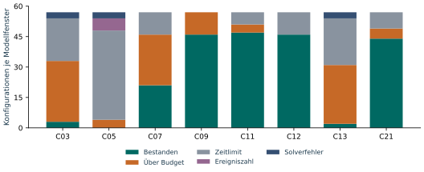

Die Ergebnisdatei enthält 354 befüllte Scorefelder. Für den Vergleich von Laufzeit und Fehler sind die 350 Zeilen mit abgeschlossener Bewertung zugelassen. Ein im Vorlauf gespeicherter Zahlenwert verliert bei einem späteren Abbruch seine Eignung für den Kostenvergleich.

Bezogen auf alle begonnenen Läufe beträgt die Erfolgsquote 224/456 = 49,1 %. Unter den numerisch vollständig bewerteten Läufen beträgt sie 224/350 = 64,0 %. Der erste Nenner beantwortet die Frage nach der Zuverlässigkeit der gesamten Auswahl.


<!-- Buchseite -->

<a id="v91-solverwahl"></a>

## Checkliste · Einen Solver auswählen

1. **Auftrag festlegen.** Bestimmen Sie Beobachtungen, Einheiten, Referenz, Budget und zulässige Ereignisfolge. Wählen Sie den zu messenden Aufwand und protokollieren Sie Solver-, Modell- und Gitterstand.
2. **Gleichungsform klären.** Bei Bindungen prüfen Sie die Konsistenz der Anfangsdaten und den Index. Für ein reguläres Index-1-Residualmodell kommt etwa IDA infrage. Bei höherem Index wählen Sie eine geeignete Formulierung, Indexreduktion oder für mechanische Bindungen ein passendes Projektionsverfahren.
3. **Glattheit und Zeitskalen prüfen.** Für eine glatte nichtsteife ODE ist ein eingebettetes explizites Runge–Kutta-Verfahren ein Referenzkandidat. Beschränkt eine schnell abklingende Mode den expliziten Schritt wesentlich, vergleichen Sie Radau IIA und BDF bei gleicher äußerer Genauigkeit. Für langzeitige konservative Rechnungen messen Sie Energie und Phase und nehmen bei passender Problemform ein strukturerhaltendes Verfahren hinzu.
4. **Wechsel und Kopplung erfassen.** Geben Sie bekannte Takte als Schrittgrenzen vor, lokalisieren Sie gerichtete Zustandsereignisse und initialisieren Sie nach dem Modellwechsel passend neu. Bei spärlicher Kopplung kann QSS ein Vergleichskandidat sein. Messen Sie dafür auch interne Meldungen und die Kosten des Kalenders.
5. **Gitter und Zeit getrennt variieren.** Bei Feldmodellen prüfen Sie Raumgitter, Randdarstellung und Zeitintegrator mit getrennten Versuchen. Eine gelernte Vorhersage braucht unabhängige Testfelder, Referenzen und eine Aufwandsmessung für den vorgesehenen Einsatz.
6. **Treffer vor Kosten werten.** Prüfen Sie Vollständigkeit, Zuordnung und den Status. Vergleichen Sie Aufwand und Robustheit unter den Läufen, die den Auftrag erfüllen. Wiederholen Sie die Auswahl an einem zweiten Modellfenster.

Die 456 archivierten Einstellungen liefern Beispiele für diese Entscheidungen. Auf ein neues Modell übertragen sich die Prüfschritte. Welche Verfahren dort bestehen, entscheidet dessen eigener Versuch.

<!-- Buchseite -->

<a id="bild-pareto"></a>

## Welchen Aufwand kostet ein kleinerer Fehler?

Jeder Punkt gehört zu einer bestimmten Konfiguration in genau einem Modellfenster. Links bedeuten kleinere Medianlaufzeiten, unten kleinere Budgetanteile. Eine Konfiguration liegt auf der grün markierten Pareto-Front, wenn keine andere mindestens ebenso schnell und mindestens ebenso genau ist und in einer der beiden Größen besser abschneidet.


C05 liefert 7 abgeschlossene Zahlenpaare. Ein Punkt auf einer Pareto-Front kann oberhalb des Fehlerbudgets liegen. Für die 106 unvollständigen Bewertungen über alle acht Fenster zeigt Abb. 18.1 die Ursachen.

<!-- Buchseite -->

<a id="bild-profile"></a>

## Wie viele Aufgaben löst eine feste Konfiguration?

Ein Ingenieur möchte eine Einstellung für mehrere Modelle verwenden. Für jede bestandene Aufgabe teilen wir ihre Medianlaufzeit durch die schnellste bestandene Zeit derselben Aufgabe. Bei einem Faktor zwei zählt die Einstellung also alle Aufgaben, auf denen sie das Budget einhält und höchstens doppelt so lange braucht wie die dort schnellste. Der Nenner bleibt acht, auch wenn auf einer Aufgabe niemand besteht.


<a id="druck-profilformel"></a>

Sei $m_p$ die kleinste Medianzeit eines bestandenen Laufs in Fenster $p$. Ein bestandener Lauf der festen Einstellung $s$ erhält $r_{p,s}=t_{p,s}/m_p$, jeder Fehllauf $r_{p,s}=+\infty$. Hat ein Fenster keinen Gewinner, setzen wir alle seine Quotienten auf $+\infty$. Für endliches $\tau\ge1$ zeigt die rechtsstetige Treppe
$$\rho_s(\tau)=\tfrac18\sum_{p=1}^{8}\mathbf{1}\{r_{p,s}\le\tau\}.$$
Bei Zeitfaktor eins werden auch geteilte Bestzeiten gezählt. Für RK45 ergeben sich bei den Faktoren 1, 10 und 5 000 die Werte 2/8, 6/8, 7/8. Für QSS2 mit Quantenfaktor 0,0002 ergeben sich 0/8, 3/8, 5/8. Die Medianzeiten gehören zur angegebenen Messumgebung. [Dolan und Moré](https://doi.org/10.1007/s101070100263).

<a id="auflage-k18-02"></a>

Im Fenster C05 bestehen 0 von 57 Konfigurationen. Dieses Fenster bleibt im Nenner acht. Die gesonderte Quantenreihe für LIQSS–BDF dokumentiert die Laufzeitgrenze ausdrücklich. Mit 45 Sekunden je Integration anstelle von zwei ergeben sich bei Faktoren 0,0002, 0,00004, 0,000008 und 0,0000016 die Scores 7,572, 1,486, 0,2627, 0,1651. Die längere Ausführung gehört zur Zusatzreihe. Die Kurven in Abbildung 18.3 verwenden ausschließlich das reguläre Zeitlimit.


<!-- Buchseite -->

<a id="qss-revisionsbilanz"></a>

## Was ändert die Kalenderkorrektur in den vier Studien?

Für jede Konfiguration verbinden wir Fall, Methodenname und Einstellung mit der gleich bezeichneten Zeile der Vorfassung. Bei der 399er-Reihe wurde der historische Modellvertrag mit dem aktuellen Solver wiederholt. Die archivierten und die neuen Laufzeiten stammen aus verschiedenen Ausführungen. Ein Wechsel zum Zeitlimit erlaubt daher für sich allein keine Aussage über den mathematischen Fehler.

**Basisreihe.** 399 Einstellungen, 167 bestanden. Zwei Statuswechsel gegenüber `c635504`.

**Acht Modellfenster.** Je 456 Einstellungen: 222 bestanden in der Vorauflage (`vorher/qss-extension.csv`), 209 im v9.18-Vergleich (`messung/extension.csv`) und 224 in der aktuellen Tabelle (`messung/kontakt_v919/extension.csv`); alle Pfade ab `rechenlabor/qss_pruefung/`. Die 15 Statuswechsel zählen den direkten Vergleich mit der Zwischenprobe `c635504` (227 bestanden).

**Auswahlstudie.** 520 Einstellungen, 285 bestanden. 13 Statuswechsel.

**Steifigkeitsstudie.** 138 Einstellungen, 108 bestanden. Vier Statuswechsel.

**Welche Unterschiede folgen aus der Rechnung?** Von 1 272 beidseitig gespeicherten Fehlerwerten unterscheiden sich 121. Betroffen sind vor allem erweiterte und Tschebyscheff-basierte Quantisierer. Alle 34 Statuswechsel berühren ein Zeitlimit. Laufzeit, Ereigniszahl, Rohfehler und Grenzüberschreitung sind im Messprotokoll getrennt. Bei QSS3/4 stimmen alle 96 beidseitig verfügbaren Fehlerwerte der 120 Einstellungen überein. In C12 treffen beide Verfahren mit Faktor 0,001 die Kontaktfolge mit Score null. Im gezielten 45-Sekunden-Gegenlauf verfehlt C03/QSS4 mit Faktor 0,005 das Budget weiterhin.

Die PDF-Anlage `QSS_Kontaktvergleich_v9_19.csv` verbindet jede Einstellung mit ihrem Vorgänger. Zwei weitere Anlagen bewahren die früheren Vergleiche der Ausgabe v9.18. Alle vier Primärdateien und die Arbeitszähler liegen im Rechenlabor.

<!-- Buchseite -->

<a id="cp2-voll-entscheidung"></a>

## Eine Rechenanfrage oder eine ganze Serie?

Die Vollgitterkavität gibt dem Methodenentscheid zwei verschiedene Ziele. Die vollständige D2Q9-Rechnung kostet 281,8 CPU-Sekunden. Für eine Wirbelrechnung gelten eigene Referenzfelder. Gruppen-QSS1 benötigt bei Quantum 0,001 144,6 CPU-Sekunden. Der Versuch mit 19 Einzelkalendern misst unter denselben räumlichen Bedingungen die jeweils erreichte Zeit. Ein abgebrochener Lauf besitzt noch keine Kosten für eine vollständige Bahn. Die [Gegenüberstellung](#cp2-voll-komponenten) enthält deshalb auch den Stand der Integration.

Für wiederkehrende D2Q9-Anfragen schreiben wir den einmaligen Aufwand als $C_0$ und die Kosten je Anfrage als $C_A$. Bei passendem Fehlerbudget lohnt sich die Vorbereitung nach $m>C_0/(C_{\rm D2Q9}-C_A)$ Anfragen, falls der Nenner positiv ist. Eine Interpolation zwischen vorhandenen Referenzfeldern ist hier eine eigene Vergleichsmethode. Die Auswertung prüft den offiziellen Reynolds-Wert bei konstantem Deckel. Für einen anderen Antriebsverlauf muss die Einhaltung beider Budgets erneut belegt werden.

<!-- Buchseite -->

<a id="kap17-schluss"></a>

## Schluss · Was eine belastbare Simulation ausmacht


Die Frage aus der Einleitung lässt sich jetzt mit einer Zahl beantworten. Nach dem ersten Schritt hat der Federwagen rechnerisch $0{,}0208\,\mathrm J$. Das vereinbarte Ein-Prozent-Budget von $0{,}0002\,\mathrm J$ wird vierfach verbraucht. Wer diesen Entwurf weiterverwenden möchte, muss Schrittweite oder Integrationsregel ändern und den gleichen Test erneut ausführen.

**Was wollten wir wissen?** Beim Federwagen war es zunächst die Frage, ob die wachsenden Ausschläge mit der Energiebilanz vereinbar sind. Beim Schalter war es die Uhrzeit des Durchgangs, beim Brunnen die Konzentration am gewählten Ort und bei der Saite das Feld mit seiner Phase. Ein Auftrag entsteht, wenn wir diese Größe mit Referenz, zulässiger Abweichung und Ereignisfolge festlegen.

**Wo entstand die Abweichung?** Beim Wagen zeigt die diskrete Energiebilanz auf den Schritt. Bei C05 unterscheidet die analytische Phase eine steife Mode von einer verschobenen Schaltung. In der Stoßkette prüft die Kontaktliste die Reihenfolge, in der Diode die Astprüfung die zulässige Fortsetzung. Bei einem Feld können Rand, Gitter, Zeit und Darstellung getrennt variiert werden. Die Gegenprobe erklärt, welche Änderung eine beobachtete Abweichung beeinflusst.

**Woran erkennen wir eine belastbare Entscheidung?** Von 456 erneut gerechneten Einstellungen erfüllen 224 den jeweiligen Auftrag. Eine abweichende Ereigniszahl und ein Zeitlimit haben andere Ursachen als eine gemessene Abweichung über dem Budget. Für die geeigneten Läufe können wir dann Aufwand und Verlässlichkeit vergleichen. Für das nächste Modell beginnt die Auswahl wieder mit der beobachtbaren Aufgabe, einer unabhängigen Referenz und einem Versuch, der auch scheitern kann. [Zur Einleitung des Buchs](#buch-einleitung)

Dieselben Entscheidungskriterien leiten den Vergleich gelernter Operatoren. Kapitel 9 zeigt an zehn Teilaufgaben den Beitrag des lernenden Teils. Der [Physik-Residual-Operator](#pr-verfahren) prüft jede Ausgabe. Beim [gelernten Fehlernachweis](#op-bilanz) entscheidet der Vergleich mit dem analytischen Filter darüber, wie viel der lernende Teil beiträgt. [Auswertung in Kapitel 9](#no-auswertung) · [Messmatrix](#no-vergleichsmatrix)

<a id="kap17-forschung"></a>

### Aktueller Stand der Forschung

Dravins und Mitautoren untersuchen Runge–Kutta-Verfahren mit gemischter Rechengenauigkeit für partielle Differentialgleichungen. Sie messen, wie sich Fehler und Laufzeit mit Ausführung und Rechner ändern. Die Implementierungen und Messdaten sind öffentlich zugänglich. Für die Auswertung in diesem Buch ist der Zusammenhang direkt relevant. Ein Verfahren kann auf einer Plattform weniger Zeit brauchen und auf einer anderen einen anderen Anteil seiner Arbeit in linearen Lösungen oder Speicherzugriffen verbringen. Eine fortgeführte ARGESIM-Studie würde daher abgeleitete Methodenempfehlungen an zurückgehaltenen Modellen sowie unter identischen Fehlerbudgets auf mehreren Rechnern prüfen. [Dravins u. a., Performance evaluation of mixed-precision Runge–Kutta methods (2026)](https://doi.org/10.1177/10943420251392963)

Die [28 Messaufgaben](#atlas-vertrag) führen zur [Eingangsfrage dieses Kapitels](#kap17-einstieg) zurück. Ein Solver kann eine Mahlzeit, einen Wegsensor oder einen Brunnenwert bestätigen, wenn der Messauftrag und sein Geltungsbereich feststehen. Beim [Wartekreis](#atlas-kreis) lässt sich der Grund sogar Pfeil für Pfeil nachgehen.

<!-- Buchseite -->

<a id="fb-refteil"></a>

# Anhang A · ARGESIM-Referenzkatalog

Anhang A beginnt mit den vierzehn Referenzblättern zu den im Studiengang ausgewählten Familien. Zehn weitere Blätter schließen die übrigen Einträge des Projektkatalogs ein. Offizielle Aufgabe, lokal implementierter Teil und beobachtete Zielerfüllung sind je Modell benannt.

<a id="auflage-anh-01"></a>

**Welchen Rechner braucht der Versuch?** Die Standardprüfungen starten ab Paketwurzel mit `python3 pruefen.py`. Sie laufen mit der Python-Standardbibliothek. Für den Vergleich der Populationsbahnen mit DOP853 verwendet `rechenlabor/cp_dynamik/populationen.py` NumPy und `scipy.integrate`. Die Feldprojektion verwendet SciPys dünn besetzte Matrizen. Die IDAS-Wiederholung benötigt CasADi mit dem IDAS-Plugin, die Feingitterrechnung einen C++20-Compiler. Wer die archivierten Messungen nachliest, kann die CSV- und JSON-Dateien unmittelbar öffnen. Die Abhängigkeiten für eine neue Rechnung stehen beim jeweiligen Versuch.


### Welcher Nachweis zur Aufgabe passt

Bei einer numerischen Zielgröße bilden wir für jedes festgelegte Budget $b_j>0$ den Quotienten $|Q_j-Q_j^*|/b_j$. Das Maximum $S$ darf höchstens eins sein. Ein fehlender Messwert oder eine falsche Ereigniskennung verhindert den Vergleich. Eine Besitz- oder Bestandsregel wird unmittelbar als erfüllt oder verletzt geprüft. Für zufällige Größen gehören Anzahl unabhängiger Replikationen, geschätzte Streuung und eine erklärte statistische Vergleichsregel zum Ergebnis. Wo veröffentlichte Rohdaten oder ein Budget fehlen, bleibt ein entsprechender numerischer Score offen.

[Projektkatalog und Aufgabenregister](https://github.com/5H3LL3H5/argesim-hyperposition-benchmarks/blob/16f0f2528fcf77f16898ecd74ad952be2c09eac2/ARGESIM_COVERAGE.md) · [ARGESIM-Übersicht](https://www.argesim.org/benchmarks).


<!-- Buchseite -->

<a id="fb-refCP1"></a>

## A.1 · CP1 · Parallele Simulationstechniken

### 1 · Phänomen und Leitfrage

Ein Team verteilt tausend Feder-Masse-Versuche auf mehrere Kerne. Kommt dieselbe Lösung heraus und welche Arbeit bleibt seriell?

### 2 · Modellbildung

A variiert die Dämpfung eines Federwagens. B koppelt fünf Räuber-Beute-Paare. Kapitel 9 verfolgt [alle zehn Populationsverläufe](#cp1b-bahn). C diskretisiert die angeregte Saite in Ortsrichtung.

### 3 · Numerischer Härtefall

Bei A sind Läufe unabhängig. Bei C benötigen benachbarte Teilgebiete Randwerte. Eine andere Summationsreihenfolge kann kleine Gleitkommaabweichungen erzeugen.

### 4 · Methodenvergleich

Vergleichen Sie serielles RK4 und die zerlegte Rechnung bei gleicher Schrittweite. Der Speed-up ist die serielle Zeit geteilt durch die parallele Zeit.

### 5 · Aufgaben und Validierung

A, B, C und die Projektprüfung B-validate sind registriert. Die zehn Endwerte von B werden bei t=100 mit der Definition verglichen. Eine Laufzeitaussage braucht eine eigene Messung.

### 6 · Diagnoseprotokoll

Reihenfolge der Parameter, Zahl der Prozesse, Kommunikationszeit und Komponentenfehler speichern. Ein schnellerer Lauf mit fehlenden Fällen ist unvollständig.

**Gegenprobe zum Versuch.** Die zehn Endwerte von B gehören zu einem gemeinsamen Zeitstand. Prüfen Sie jede Population in derselben Reihenfolge und erst danach den Speed-up $T_1/T_p$ mit $p$ Prozessen. Erfasst der Timer bei der parallelen Rechnung auch den Aufbau und Datenaustausch? Für eine Verhältniszahl brauchen beide Zeiten dieselben Messgrenzen.

[ARGESIM, Definition und Referenzen](https://www.argesim.org/benchmarks/cp) · [Aufgaben und Prüfstand im Projekt](https://github.com/5H3LL3H5/argesim-hyperposition-benchmarks/blob/16f0f2528fcf77f16898ecd74ad952be2c09eac2/ARGESIM_COVERAGE.md). [Messbild](#atlas-mess-cp1).


<!-- Buchseite -->

<a id="atlas-mess-cp1"></a>

## Bildversuch · Warteschlange und drei parallele Modellaufträge

Bei C22 wird aus der maximalen Schlange eine mittlere Wartezeit geschätzt. Bei CP1/A bis C geht es um Auslenkung, Population oder die Antwort auf einen Randantrieb. Die gemeinsame Achsenlogik verbindet diese unterschiedlichen Größen. Die Zeit- und Ortsangaben in den vier Feldern zeigen, was jeweils tatsächlich gemessen wurde.

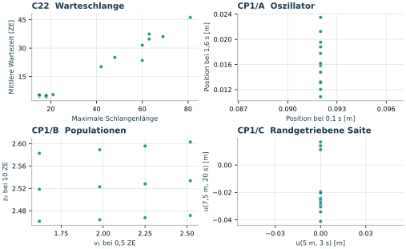

<a id="revision-aa-01"></a>

Je Punkt sehen wir **einen** Eingabekanal und **einen** Zielwert. Für CP1/B steht horizontal $v_1(0{,}5)$ und vertikal $z_2(10)$ in Modellzeiteinheiten. Die [vollständige Bahn](#revision-k09-01) benötigt zwei Anfangswerte und liefert 4 010 Komponentenwerte. CP1/C koppelt hier den Saitensensor bei $(5\,\mathrm m,3\,\mathrm s)$ an eine zweite Ablesung bei $(7{,}5\,\mathrm m,20\,\mathrm s)$. Für das Raumzeitfeld und die fünf Sensorverläufe gilt der eigene Auftrag in [D.8](#sensor-frequenz).


Lesen Sie das Diagramm von links nach rechts. Auf der waagerechten Achse steht der erste auf seine Geräteauflösung gerundete Messwert, auf der senkrechten Achse die erste Zielgröße der Referenz. Die Punktfläche wächst mit der Zahl gleicher Paare. Weder eine Verbindung der Punkte in der Zeit noch ein Mittelwert über mehrere Einheiten ist vorausgesetzt. Die weiteren Sensoren und Ereignislabels gehen in die [Auswahlregel](#atlas-kosten) ein.

<!-- Buchseite -->

<a id="fb-refC01"></a>

## A.2 · C01 · Lithiumcluster unter Elektronenbeschuss

### 1 · Phänomen und Leitfrage

Nach Änderung der Anregung reagieren gekoppelte Clustergrößen unterschiedlich schnell. Welcher Integrator erhält die frühe Übergangsschicht?

### 2 · Modellbildung

Das Benchmarkmodell verwendet drei gekoppelte Zustände und einen Verlustparameter. Startzustand der Abschaltstudie ist (84,99 / 1,674 / 9,975) in der Skalierung der Definition.

### 3 · Numerischer Härtefall

Bei hoher Verlustrate kann eine kurze Übergangsschicht trotz langsamer Endphase die Schrittweite beschränken.

### 4 · Methodenvergleich

Nehmen Sie die analytischen Gleichgewichtsbedingungen und die unabhängig transkribierte Radau-Rechnung als zwei getrennte Kontrollen. Ein RK45-Selbstvergleich prüft zusätzlich das Timingexperiment.

### 5 · Aufgaben und Validierung

A untersucht die Trajektorie und Laufzeit, B fünf Verlustparameter, C zwei stationäre Zustände. Die fünf Referenzverläufe und stationären Dymola-Werte stehen im Projektbericht.

### 6 · Diagnoseprotokoll

Protokollieren Sie alle drei Komponenten, Anregung, Verlustparameter und Beobachtungszeit. Ein Fehler im stationären Zustand kann durch Überprüfen jeder einzelnen Bilanz eingegrenzt werden.

**Gegenprobe zum Versuch.** Setzen Sie einen als stationär gemeldeten Dreiervektor nochmals in jede Bilanz ein. Ein kleiner Defekt prüft die Stationarität, ein Vergleich mit den beiden veröffentlichten Zuständen die Wahl des Gleichgewichts. Für fünf Abschalttrajektorien werden zusätzlich dieselbe Verlustkonstante, Abschaltzeit und Komponentenskalierung benötigt.

[ARGESIM, Definition und Referenzen](https://www.argesim.org/benchmarks/c01) · [Aufgaben und Prüfstand im Projekt](https://github.com/5H3LL3H5/argesim-hyperposition-benchmarks/blob/16f0f2528fcf77f16898ecd74ad952be2c09eac2/ARGESIM_COVERAGE.md). [Messbild](#atlas-mess-c01).


<!-- Buchseite -->

<a id="atlas-mess-c01"></a>

## Bildversuch · Vom ersten Messwert zum späteren Ergebnis

In C01 ist der erste Sensor eine andere Clustergröße als das Ziel. In C02 werden Anfangsplätze und ausgelieferte Teile verglichen. In C03 liegen sogar zwei verschiedene Kondensatorspannungen vor. Bei C04 ist die erste Messung ein Anteil der Denkzeit aus dem Laufprotokoll. Sie steht erst nach der zugehörigen Beobachtungsperiode zur Verfügung.

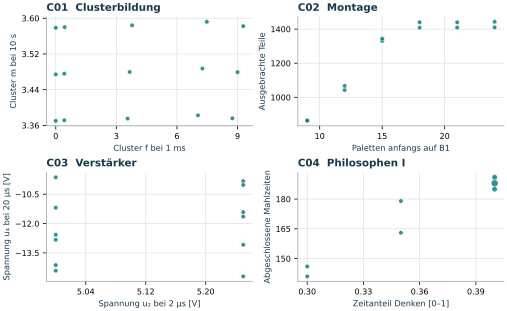

C01 liest einen Clusterwert bei 1 ms und prüft einen Clusterwert bei 10 s. C02 zählt ausgebrachte Teile, C03 prüft eine spätere Spannung und C04 abgeschlossene Mahlzeiten. Jeder Punkt hat ein skalares Ziel.


Lesen Sie das Diagramm von links nach rechts. Auf der waagerechten Achse steht der erste auf seine Geräteauflösung gerundete Messwert, auf der senkrechten Achse die erste Zielgröße der Referenz. Die Punktfläche wächst mit der Zahl gleicher Paare. Weder eine Verbindung der Punkte in der Zeit noch ein Mittelwert über mehrere Einheiten ist vorausgesetzt. Die weiteren Sensoren und Ereignislabels gehen in die [Auswahlregel](#atlas-kosten) ein.

<!-- Buchseite -->

<a id="fb-refC03"></a>

## A.3 · C03 · Geschalteter Klasse-E-Verstärker

### 1 · Phänomen und Leitfrage

Ein elektronischer Schalter ändert die Verbindung eines schwingenden Netzwerks. Stimmen Phase und Amplitude nach einer halben Periode?

### 2 · Modellbildung

Vier Zustände beschreiben die Strom- und Spannungsspeicher. Im ideal geschalteten Fall ist das System in jeder Phase affin. Endliche Schaltflanken stellen eine eigene Variante dar.

### 3 · Numerischer Härtefall

Mikrosekunden und Sekunden zu verwechseln verändert das ganze Experiment. Ein Schritt über eine Schaltgrenze mischt zwei verschiedene Gleichungen.

### 4 · Methodenvergleich

Die separate Matrixexponentialrechnung propagiert den idealen Schaltzustand. Klassische Integratoren und Quantisierer vergleichen ihre vier Komponenten mit dieser Referenz.

### 5 · Aufgaben und Validierung

Die 456er-Studie beobachtet vier Zustände nach 5 und 10 Mikrosekunden, mit Budget 0,001 mal Komponentenskala. Fünf von 57 Einstellungen bestehen.

### 6 · Diagnoseprotokoll

Prüfen Sie Schalterlogik und Halbperioden vor dem Solververgleich. Eine endliche Rampe braucht eine Referenz mit derselben Rampe.

**Gegenprobe zum Versuch.** A prüft Eigenwerte für beide Schalterstellungen. B verfolgt den Idealschalter über 20 Halbperioden. C übernimmt den Endzustand von B als Start für endliche Flanken. Ein Start mit vier Nullen in C erzeugt eine andere Referenz. Im kurzen Zwei-Halbperioden-Raster erhält QSS2 bei Faktor $10^{-3}$ den Score $7{,}738$, RK45 rund $1{,}06\cdot10^{-6}$.

[ARGESIM, Definition und Referenzen](https://www.argesim.org/benchmarks/c03) · [Aufgaben und Prüfstand im Projekt](https://github.com/5H3LL3H5/argesim-hyperposition-benchmarks/blob/16f0f2528fcf77f16898ecd74ad952be2c09eac2/ARGESIM_COVERAGE.md). [Messbild](#atlas-mess-c01).


<!-- Buchseite -->

<a id="fb-refC05"></a>

## A.4 · C05 · Steifes Zweizustandsmodell mit Hysterese

[Phasenbahn und Schaltschwellen im Benchmarkkapitel](#bild-c05)

### 1 · Phänomen und Leitfrage

Ein schneller Zustand folgt einem langsamen. Wann überschreitet der gekoppelte Zustand die nächste Schwelle?

### 2 · Modellbildung

Zwei lineare Gleichungen pro Modus und zwei gerichtete Rückschaltschwellen definieren die Bahn. Die Anfangswerte sind 4,2 und 0,3.

### 3 · Numerischer Härtefall

Die schnelle Zeitkonstante beträgt etwa 0,370 Mikrosekunden. Nach dem Umschalten kann die neue schnelle Komponente die alte Historie entwerten.

### 4 · Methodenvergleich

Vergleichen Sie den exakten Phasenfluss und die eingeklammerte Schaltzeit mit Radau, BDF und den Quantisierern. Kapitel 11 zeigt die verschiedenen Versuchsraster.

### 5 · Aufgaben und Validierung

Die Standardreferenz hat fünf Schaltungen im vollen Versuch, Aufgabe D hat 62. Das kurze 3,5-s-Fenster enthält drei. Im ursprünglichen Raster bestehen null von 57 Einstellungen.

### 6 · Diagnoseprotokoll

Speichern Sie Schwelle, Richtung, beide Moduskennungen und Zustand unmittelbar am Übergang. Zu jedem Endfehler gehört die vorher überprüfte Ereignisfolge.

**Gegenprobe zum Versuch.** Die Standardfolge, die Genauigkeitsvariation und D mit häufigen Ereignissen prüfen verschiedene Eigenschaften. Ein Kontrolllauf mit vertauschter Schaltreihenfolge scheitert vor dem Zahlenvergleich. Bei richtiger Reihenfolge lautet der Projektwert $\max(\max_k|\delta t_k|/0{,}001,\max_i|\delta y_i|/0{,}006)$, Zeiten in Sekunden, im 3,5-s-Fenster.

[ARGESIM, Definition und Referenzen](https://www.argesim.org/benchmarks/c05) · [Aufgaben und Prüfstand im Projekt](https://github.com/5H3LL3H5/argesim-hyperposition-benchmarks/blob/16f0f2528fcf77f16898ecd74ad952be2c09eac2/ARGESIM_COVERAGE.md). [Messbild](#atlas-mess-c05).


<!-- Buchseite -->

<a id="atlas-mess-c05"></a>

## Bildversuch · Schaltzeit, Aufenthaltszeit, Winkel und Transit

Beim Pendel sind Eingang und Ziel Winkel desselben Systems zu verschiedenen Zeiten. Für die Schleuse ist der Zusammenhang weniger direkt: Eine frühe Ankunftszahl liefert keine vollständige Information über die spätere Transitzeit. In C05 ist das Zeitbudget so weit, dass das Referenzintervall bereits ohne Ablesung hineinpasst.

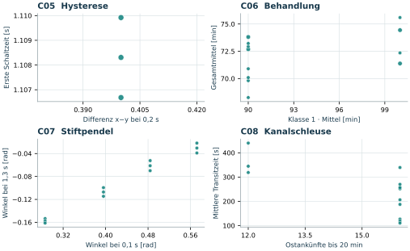

Im C05-Teilbild bildet eine Zustandsdifferenz bei 0,2 s die waagerechte Koordinate. Senkrecht steht die erste Schaltzeit. Das Kapitel-11-Labor verlangt mehrere Ereignisse und den Endzustand.


Lesen Sie das Diagramm von links nach rechts. Auf der waagerechten Achse steht der erste auf seine Geräteauflösung gerundete Messwert, auf der senkrechten Achse die erste Zielgröße der Referenz. Die Punktfläche wächst mit der Zahl gleicher Paare. Weder eine Verbindung der Punkte in der Zeit noch ein Mittelwert über mehrere Einheiten ist vorausgesetzt. Die weiteren Sensoren und Ereignislabels gehen in die [Auswahlregel](#atlas-kosten) ein.

<!-- Buchseite -->

<a id="fb-refC07"></a>

## A.5 · C07 · Stiftpendel

### 1 · Phänomen und Leitfrage

Ein Faden wickelt sich an einem Stift um. Warum kann die Winkelgeschwindigkeit springen, während die Bahngeschwindigkeit stetig bleibt?

### 2 · Modellbildung

Für jeden Drehpunkt gilt eine Winkel-ODE. Die kartesische Form ergänzt die Fadenlänge als Zwang und die Zugkraft als Multiplikator.

### 3 · Numerischer Härtefall

Ein falscher Längenfaktor am Reset verändert kinetische Energie. Kleine Phasenfehler verlagern spätere Stiftkontakte.

### 4 · Methodenvergleich

Hohe Genauigkeit der Winkelintegration, eine unabhängige DOP853-Rechnung sowie die kartesische Bindungsprüfung und RATTLE liefern unterschiedliche Kontrollen.

### 5 · Aufgaben und Validierung

Der Matrixfall A(i) bis 2 s verwendet 1 ms Zeitbudget und Komponentenbudgets für Winkel und Winkelgeschwindigkeit. 28 von 57 Einstellungen bestehen.

### 6 · Diagnoseprotokoll

Nach jedem Kontakt Drehpunkt, Radius, Tangentialgeschwindigkeit und Bindungsfehler prüfen. Die Übung in Kapitel 13 unterscheidet Modellvereinfachung und Integrationsfehler.

**Gegenprobe zum Versuch.** A vergleicht zwei vorgegebene Startfälle, B die lineare und die nichtlineare Pendelgleichung, C sucht eine Anfangswinkelgeschwindigkeit für die maximale Auslenkung $-\pi/2$ am kurzen Faden. Ein passender Endwinkel nach zwei Sekunden löst dieses inverse Problem noch nicht. Prüfen Sie in C zusätzlich die Umkehrbedingung $\omega=0$.

[ARGESIM, Definition und Referenzen](https://www.argesim.org/benchmarks/c07) · [Aufgaben und Prüfstand im Projekt](https://github.com/5H3LL3H5/argesim-hyperposition-benchmarks/blob/16f0f2528fcf77f16898ecd74ad952be2c09eac2/ARGESIM_COVERAGE.md). [Messbild](#atlas-mess-c05).


<!-- Buchseite -->

<a id="fb-refC09"></a>

## A.6 · C09 · Fuzzy-Regelung zweier Tanks

[Pegel und gehaltene Pumpenspannung im Benchmarkkapitel](#bild-c09)

### 1 · Phänomen und Leitfrage

Der Regler stellt ein Ventil zu festen Takten. Was sieht er, wenn sich zwischen zwei Abtastungen der Pegel ändert?

### 2 · Modellbildung

Massenbilanzen mit höhenabhängigen Flüssen koppeln zwei Speicher. Die Fuzzy-Regel liefert aus den gemessenen Signalen den gehaltenen Stellwert.

### 3 · Numerischer Härtefall

Abtastverzögerung, Vorzeichen des Fehlers und die Einheit cm statt m verändern die Regeloberfläche. Ein scheinbar kleiner Signaturfehler kann einen Langzeitversuch verschieben.

### 4 · Methodenvergleich

Bei gleicher Reglerfunktion trennt ein DOP853-Vergleich den Integrationsfehler ab. Eine publizierte Simulink-Kurve prüft zusätzlich die Modell- und Reglerübertragung.

### 5 · Aufgaben und Validierung

Die Projektbefehle run und validate decken Reglervarianten und Figurenprüfungen ab. Im kurzen 16-Takt-Fenster bestehen 46 von 57 Einstellungen. Eines von drei Langzeit-Figurenfenstern trifft das vereinbarte Band.

### 6 · Diagnoseprotokoll

Pegel und Stellwert an beiden Seiten jedes Takts sichern. Bei Abweichung zuerst den ersten unterschiedlichen Ventilwert finden.

**Gegenprobe zum Versuch.** Ein Kontrollversuch löst beide Tankbilanzen mit genau demselben abgetasteten Regler. Eine zweite Kontrolle liest das zweite Niveau in veröffentlichten Kurven für P-FC und I-FC2 ab. Bei jeweils einem Zentimeter Ablesebudget ergeben die drei veröffentlichten Differenzen aus Kapitel 14 Beiträge von etwa $2{,}986$, $0{,}137$ und $11{,}669$.

[ARGESIM, Definition und Referenzen](https://www.argesim.org/benchmarks/c09) · [Aufgaben und Prüfstand im Projekt](https://github.com/5H3LL3H5/argesim-hyperposition-benchmarks/blob/16f0f2528fcf77f16898ecd74ad952be2c09eac2/ARGESIM_COVERAGE.md). [Messbild](#atlas-mess-c09).


<!-- Buchseite -->

<a id="atlas-mess-c09"></a>

## Bildversuch · Gleicher Messkanal, verschiedene Zielgrößen

Ein Pegel heute kann einen späteren Pegel eingrenzen. Eine freie Ressource am Tisch sagt dagegen für sich allein wenig über gleichzeitig beginnende Mahlzeiten. In C11 stehen Strom und mechanische Position auf den beiden Achsen. Beim Stoßzug misst man unterschiedliche Kugeln. Für C09 ist hier nur der erste von zwei geforderten Pegeln gezeichnet.

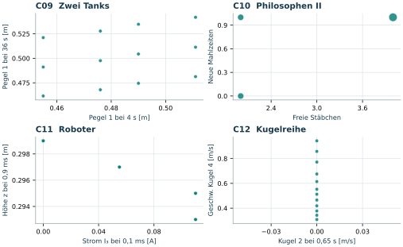

Bei C09 stehen einzelne Pegel an zwei Zeiten auf den Achsen. Bei C12 verknüpfen die Achsen die Geschwindigkeit der zweiten Kugel bei 0,65 s mit der späteren Geschwindigkeit der vierten. Zur Kontaktfolge gehören zusätzliche Ereigniszeiten.


Lesen Sie das Diagramm von links nach rechts. Auf der waagerechten Achse steht der erste auf seine Geräteauflösung gerundete Messwert, auf der senkrechten Achse die erste Zielgröße der Referenz. Die Punktfläche wächst mit der Zahl gleicher Paare. Weder eine Verbindung der Punkte in der Zeit noch ein Mittelwert über mehrere Einheiten ist vorausgesetzt. Die weiteren Sensoren und Ereignislabels gehen in die [Auswahlregel](#atlas-kosten) ein.

<!-- Buchseite -->

<a id="fb-refC11"></a>

## A.7 · C11 · SCARA-Roboter mit strombegrenzten Antrieben

### 1 · Phänomen und Leitfrage

Ein Roboterarm beschleunigt. Wann verändert die Strombegrenzung die tatsächliche Bewegung?

### 2 · Modellbildung

Mechanik und elektrische Zustände gehören in denselben Zustand. Der Regler fordert ein Antriebssignal an, die Stromgrenze beschränkt die erlaubte Realisierung.

### 3 · Numerischer Härtefall

Ein zulässiger Strom am ausgegebenen Zeitpunkt belegt noch keine korrekte begrenzte Bewegung im ganzen Intervall.

### 4 · Methodenvergleich

Der kurze Neun-Zustände-Vergleich verwendet SciPy Radau mit identischer rechter Seite. Er isoliert den Integrationsfehler vor der Strombegrenzung.

### 5 · Aufgaben und Validierung

A, B, C und main sind registriert. In der 0,1-ms-Matrixprüfung bestehen 52 von 57 Einstellungen. Eine unabhängige Vergleichstrajektorie für den ganzen begrenzten Betrieb bleibt offen.

### 6 · Diagnoseprotokoll

Kommandierte und wirksame Antriebssignale, Stromgrenzen, Gelenkzustände und Zeitpunkt der Begrenzung protokollieren.

**Gegenprobe zum Versuch.** A dokumentiert die Modellform und die Trägheitsterme, B die geregelte Punkt-zu-Punkt-Bewegung, C die Kollisionsvermeidung. Die neun Endgrößen bei $0{,}1$ ms liegen vor der Strombegrenzung. Im kurzen Raster erreicht QSS2 bei Faktor $10^{-3}$ einen Score von $0{,}08517$. Ob der Arm später das Hindernis freihält, verlangt die eigene Bahnprüfung von C.

[ARGESIM, Definition und Referenzen](https://www.argesim.org/benchmarks/c11) · [Aufgaben und Prüfstand im Projekt](https://github.com/5H3LL3H5/argesim-hyperposition-benchmarks/blob/16f0f2528fcf77f16898ecd74ad952be2c09eac2/ARGESIM_COVERAGE.md). [Messbild](#atlas-mess-c09).


<!-- Buchseite -->

<a id="fb-refC12"></a>

## A.8 · C12 · Stoßprozesse in einer Kugelreihe

[Mittelpunkte und Geschwindigkeiten im Benchmarkkapitel](#bild-c12)

### 1 · Phänomen und Leitfrage

Ein Impuls wandert von links nach rechts. Wie erkennt man, ob er durch die richtige Folge von Kontakten übertragen wurde?

### 2 · Modellbildung

Freier Flug beschreibt die glatten Abschnitte. Beim zentralen Stoß verbinden Impulsbilanz und Stoßzahl die Geschwindigkeiten vor und nach dem Ereignis.

### 3 · Numerischer Härtefall

Zeitgleiche Mehrfachkontakte können eine eigene Kontaktauflösung erfordern. Die einfache Zweikugelregel setzt einen isolierten Stoß voraus.

### 4 · Methodenvergleich

Ein elastischer Test mit vier gleichen Massen besitzt eine analytische Folge. QSS2 und RK45 lassen sich dort nach RHS-Zahl bei gleichem Zeitbudget vergleichen.

### 5 · Aufgaben und Validierung

A, B und C enthalten auch die Bestimmung einer Stoßzahl und eine Verteilungsaufgabe. Im reduzierten Matrixfall bestehen 53 von 57 Einstellungen.

### 6 · Diagnoseprotokoll

Zeit, beteiligte Kugeln, Abstand, Impuls und Energie vor und nach jedem Kontakt festhalten. Ein verfrühter zweiter Reset verändert die Reihenfolge.

**Gegenprobe zum Versuch.** A liefert Weg-Zeit-Kurven und Endgeschwindigkeiten. B variiert die Stoßzahl und zählt Kollisionen. C sucht eine Stoßzahl aus einer Zielbedingung und untersucht die zufällige Streuung der Endgeschwindigkeit. Nur für den isolierten elastischen Matrixfall sind die sieben Zielgrößen unmittelbar $1,2,3$ Sekunden und $0,0,0,1$ Meter pro Sekunde.

[ARGESIM, Definition und Referenzen](https://www.argesim.org/benchmarks/c12) · [Aufgaben und Prüfstand im Projekt](https://github.com/5H3LL3H5/argesim-hyperposition-benchmarks/blob/16f0f2528fcf77f16898ecd74ad952be2c09eac2/ARGESIM_COVERAGE.md). [Messbild](#atlas-mess-c09).


<!-- Buchseite -->

<a id="fb-refC13"></a>

## A.9 · C13 · Portalkran mit eingebetteter Regelung

### 1 · Phänomen und Leitfrage

Ein Lastpuls setzt den Kran in Bewegung. Welche Zustände tragen seine Wirkung noch nach Pulsende?

### 2 · Modellbildung

Eine lineare Phase lässt sich als affine Zustandsdynamik schreiben. Durch Ergänzen einer konstanten Eins lässt sich ihr Übergang mit einer Matrixexponentialfunktion berechnen.

### 3 · Numerischer Härtefall

Eine falsche Pulsgrenze beeinflusst alle nachfolgenden Zustände. Die Bremslogik der weiteren Aufgaben führt zusätzliche Modi ein.

### 4 · Methodenvergleich

Die unabhängige affine Phasenrechnung kontrolliert klassische und quantisierte Integratoren für die lineare Aufgabe A. B und C stellen eigene Anforderungen.

### 5 · Aufgaben und Validierung

Im Raster für den Lastpuls -800 N werden fünf Zustände bei 4, 7 und 15 s beobachtet, zwei Einstellungen bestehen. Die veröffentlichte lineare Referenz umfasst drei Lasten.

### 6 · Diagnoseprotokoll

Pulsrichtung, Kraft in Newton, Zustandsreihenfolge und beide Grenzzeiten prüfen. Ein passender Positionsendwert genügt für die Winkelgeschwindigkeit nicht.

**Gegenprobe zum Versuch.** A prüft die offene lineare Fahrt mit Lastpuls. B betrachtet die geregelte Fahrt mit Haltebremse. C ergänzt die Diagnose und die verriegelnde Notbremsung. Ein Fehler im letzten Pulszustand wird beim Start der nächsten Phase übernommen. Prüfen Sie in A deshalb alle fünf Zustände an beiden Pulsgrenzen, in C zusätzlich Auslösezeit und Verriegelung.

[ARGESIM, Definition und Referenzen](https://www.argesim.org/benchmarks/c13) · [Aufgaben und Prüfstand im Projekt](https://github.com/5H3LL3H5/argesim-hyperposition-benchmarks/blob/16f0f2528fcf77f16898ecd74ad952be2c09eac2/ARGESIM_COVERAGE.md). [Messbild](#atlas-mess-c13).


<!-- Buchseite -->

<a id="atlas-mess-c13"></a>

## Bildversuch · Bewegung und Bestände aus einem frühen Kanal

Beim Portalkran zielt die Messung auf eine Position, obwohl der frühe Sensor einen Winkel meldet. C14, C15 und C16 zeigen dieselbe Menge zu zwei Zeitpunkten. Selbst dann kann die Zwischenentwicklung von Lieferereignissen, Parametern oder Entscheidungen abhängen. Mehrere Zielwerte über demselben Messcode sind im Diagramm unmittelbar erkennbar.

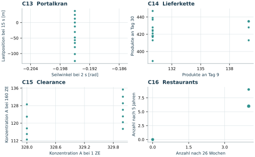

Bei C13 ist der Eingang ein Winkel in Radiant, das Ziel die Lastposition in Metern. Die Messzeitpunkte sind 2 und 15 s. Eine Kurve der Winkel allein liefert keine Ortskurve.


Lesen Sie das Diagramm von links nach rechts. Auf der waagerechten Achse steht der erste auf seine Geräteauflösung gerundete Messwert, auf der senkrechten Achse die erste Zielgröße der Referenz. Die Punktfläche wächst mit der Zahl gleicher Paare. Weder eine Verbindung der Punkte in der Zeit noch ein Mittelwert über mehrere Einheiten ist vorausgesetzt. Die weiteren Sensoren und Ereignislabels gehen in die [Auswahlregel](#atlas-kosten) ein.

<!-- Buchseite -->

<a id="fb-refC15"></a>

## A.10 · C15 · Clearance-Identifikation

### 1 · Phänomen und Leitfrage

Zwei Konzentrationskurven können ähnlich aussehen, obwohl ihre geschätzten Parameter voneinander abweichen. Welche Messungen trennen die Parameter?

### 2 · Modellbildung

Ein Zweikompartimentmodell erhält einen zeitlich begrenzten Eingang. Austausch und Abfluss bestimmen die Konzentrationskurve und die Sensitivität der Anpassung.

### 3 · Numerischer Härtefall

Ein kleiner Ausgabefehler führt bei schlecht konditionierter Anpassung zu großen Parameteränderungen. Einheit und Dauer des Eingangs müssen zur analytischen Lösung passen.

### 4 · Methodenvergleich

Die stückweise analytische Modelllösung kontrolliert die Integration. Die Parameterschätzung minimiert darüber hinaus Residuen der Messkurve. Eine Monte-Carlo-Auswertung untersucht die Streuung.

### 5 · Aufgaben und Validierung

A verwendet dieselbe Eingangsmenge bei drei Dauern, B passt Parameter an die Messwerte an, C wiederholt die Schätzung an künstlichen Datensätzen. Die Matrix der 456 Einstellungen enthält C15 nicht.

### 6 · Diagnoseprotokoll

Speichern Sie Eingangsmenge, Dauern, Messzeitpunkte, Anpassungsresiduen und Zufallsstartwert. Wiederholte Modellläufe ohne neue Messfehler prüfen eine andere Größe.

**Gegenprobe zum Versuch.** In A ist die Eingangsmenge $D=2500$ für die drei Dauern $0{,}5,\ 3,\ 240$ gleich. Das Rechtecksignal hat Höhe $D/\tau$ und Fläche $D$. Wer die Höhe konstant lässt, ändert die Menge. Verfolgen Sie bei B das Residuum an den Messzeiten und bei C die Verteilung der Parameterschätzungen über die 1000 künstlichen Datensätze.

[ARGESIM, Definition und Referenzen](https://www.argesim.org/benchmarks/c15) · [Aufgaben und Prüfstand im Projekt](https://github.com/5H3LL3H5/argesim-hyperposition-benchmarks/blob/16f0f2528fcf77f16898ecd74ad952be2c09eac2/ARGESIM_COVERAGE.md). [Messbild](#atlas-mess-c13).


<!-- Buchseite -->

<a id="fb-refC17R"></a>

## A.11 · C17R · SIR-Dynamik mit ODE und zellulärem Automaten

### 1 · Phänomen und Leitfrage

Ein räumliches und ein homogen gemischtes Modell können eine ähnlich hohe Kurvenspitze zeigen. Wie unterscheiden sich ihre zeitlichen Verläufe?

### 2 · Modellbildung

Die ODE bilanziert drei Bevölkerungsgruppen. Der räumliche Automat beschreibt lokale Zustände und Nachbarschaftswechsel. Beide liefern aggregierte Zeitreihen.

### 3 · Numerischer Härtefall

Eine einzelne Realisierung des Automaten streut. Gleiche Gesamtzahlen verdecken unterschiedliche räumliche Muster.

### 4 · Methodenvergleich

Die deterministische Standardtrajektorie und die Streuung mehrerer reproduzierbarer Automatenläufe werden gegen die jeweils passenden Referenzen verglichen.

### 5 · Aufgaben und Validierung

Die Einträge task1, compare, ca und ode bilden die Projektzugänge. Die ODE-Referenz gilt für den Standardfall. Für den räumlichen Vergleich liegt ein veröffentlichter Einzelwert vor.

### 6 · Diagnoseprotokoll

Prüfen Sie die Bilanz der Gesamtpopulation, die Anfangsbelegung, den Zufallsstartwert und die Zahl der Wiederholungen. Geben Sie bei stochastischen Resultaten die Streuung an.

**Gegenprobe zum Versuch.** Für das betrachtete geschlossene, ohne Demografie formulierte Gruppenmodell muss sich die Summe der drei Zustände erhalten. Ein einzelner räumlicher Zufallslauf hat einen anderen Streubereich als eine deterministische ODE. Vergleichen Sie Wiederholungen nur bei derselben statistischen Zielgröße und geben Sie die Zahl der unabhängigen Läufe an.

[ARGESIM, Definition und Referenzen](https://www.argesim.org/benchmarks/c17r) · [Aufgaben und Prüfstand im Projekt](https://github.com/5H3LL3H5/argesim-hyperposition-benchmarks/blob/16f0f2528fcf77f16898ecd74ad952be2c09eac2/ARGESIM_COVERAGE.md). [Messbild](#atlas-mess-c17).


<!-- Buchseite -->

<a id="atlas-mess-c17"></a>

## Bildversuch · Modellbestand, Kraft, Durchlaufzeit und Kontakt

Bei C18 stehen Verdickung und Kraft in der Datenskala der rekonstruierten Kurven. In C20 ist die Laufzeit des ersten Auftrags ein anderer statistischer Gegenstand als der Median aller fertiggestellten Aufträge. In C21 dient eine frühe Höhe als Hinweis auf den dritten Kontakt. Sein Zeitpunkt wird am Ereignis der Referenzbahn bestimmt.

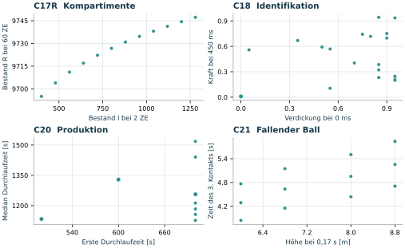

Das C18-Teilbild zeigt eine einzelne Verdickungsablesung und eine Kraft bei 450 ms. Die kausale Schätzung in Anhang C verwendet jeweils eine Vorgeschichte von 64 Werten.


Lesen Sie das Diagramm von links nach rechts. Auf der waagerechten Achse steht der erste auf seine Geräteauflösung gerundete Messwert, auf der senkrechten Achse die erste Zielgröße der Referenz. Die Punktfläche wächst mit der Zahl gleicher Paare. Weder eine Verbindung der Punkte in der Zeit noch ein Mittelwert über mehrere Einheiten ist vorausgesetzt. Die weiteren Sensoren und Ereignislabels gehen in die [Auswahlregel](#atlas-kosten) ein.

<!-- Buchseite -->

<a id="fb-refC19R"></a>

## A.12 · C19R · Transport im Grundwasser

[Lage der Quelle und des Brunnens im Benchmarkkapitel](#bild-c19r)

### 1 · Phänomen und Leitfrage

Wann erreicht eine Stofffahne einen festgelegten Brunnen? Eine farbige Karte kann einen Fehler genau an dieser Stelle verbergen.

### 2 · Modellbildung

Zweidimensionale Advektion und Dispersion verteilen den Stoff. Quellen und Behandlung ändern die Bilanz. Festgelegte Außenflächen bestimmen das Rechengebiet.

### 3 · Numerischer Härtefall

Beim Verfeinern verändern sich Quell- und Messgewichte. Eine physikalisch konstante Massenrate muss im diskreten Modell dieselbe Gesamtrate ergeben.

### 4 · Methodenvergleich

Die Kontrollrechnung vergleicht die Brunnenkonzentration mit einer unabhängigen Integralreferenz sowie mit Orts- und Zeitverfeinerung.

### 5 · Aufgaben und Validierung

A, B und C untersuchen Profile und Behandlungsvarianten. Kapitel 15 nennt die Geometrie und die drei Messwerte der Reihe mit festen Rändern. Der Fall liegt außerhalb der 456er-Matrix.

### 6 · Diagnoseprotokoll

Protokollieren Sie Masse pro Zeit, Positionen und Einheiten, Auswertezeit, kleinste Konzentration und Randflächen. Prüfen Sie, ob zwei Rechnungen tatsächlich dieselben Koordinaten beobachten.

**Gegenprobe zum Versuch.** A bestimmt räumliche Konzentrationsprofile, B untersucht die kontinuierliche, C die zeitlich geschaltete Behandlung. Für das feste Quellgitter mit $0{,}25$ m Zellweite beträgt der Brunnenbeitrag für das im Buch gewählte Ein-Prozent-Ziel rund $1{,}97$. Eine Aussage über die Behandlungsaufgaben benötigt deren eigene Schaltzeiten und Messorte.

[ARGESIM, Definition und Referenzen](https://www.argesim.org/benchmarks/c19) · [Aufgaben und Prüfstand im Projekt](https://github.com/5H3LL3H5/argesim-hyperposition-benchmarks/blob/16f0f2528fcf77f16898ecd74ad952be2c09eac2/ARGESIM_COVERAGE.md). [Messbild](#atlas-quelle).


<!-- Buchseite -->

<a id="fb-refC21"></a>

## A.13 · C21 · Zustandsereignisse und strukturvariable Systeme

[Algebraische Falte und Betriebsbahn im Benchmarkkapitel](#bild-c21)

### 1 · Phänomen und Leitfrage

Ein Ball kehrt nach dem Rückprall zur Bodenfläche zurück. Eine Diodengleichung kann auf einem Ast gut und nahe einer Falte schlecht lösbar sein. Welche Ereignisse sehen wir zuverlässig?

### 2 · Modellbildung

Ballistik und Übergangsregel geben eine mechanische Referenz. Das elektrische Modell koppelt dynamische Speicher und eine algebraische Kennlinie. Die Definition enthält außerdem Pendel- und Kontaktvarianten.

### 3 · Numerischer Härtefall

Beim Ball kann der zweite gerichtete Durchgang übersehen werden. Bei der Diode kann eine ungeeignete Inversion unnötige numerische Schwierigkeiten erzeugen.

### 4 · Methodenvergleich

Die Ballzeiten sind analytisch kontrollierbar. Bei der Schaltung vergleichen wir zwei explizite Reduktionen mit unabhängiger IDAS-Residualform.

### 5 · Aufgaben und Validierung

Projektaufgaben sind event-contact, dynamic-contact, pendulum-basic, pendulum-kick und rlc-diode. Die 456er-Matrix enthält nur das Ballfenster. Dort bestehen 36 von 57 Einstellungen.

### 6 · Diagnoseprotokoll

Zeit, Modus, Richtung und Zustand beidseits des Kontakts sichern. Für die Schaltung kommen Astinformation, algebraisches Residuum und die 149 einzeln zugeordneten Wechsel hinzu.

**Gegenprobe zum Versuch.** Beim freifliegenden Ball erhält im Raster jeder der ersten zwei Stöße ein Budget von $1$ ms. Beim Diodenkreis haben Astzuordnung, Ereigniszeiten und algebraischer Defekt jeweils eine eigene Bedeutung. Die 149 im Protokoll übereinstimmenden Übergänge gehören zum 500-Mikrosekunden-Fenster der Schaltung.

[ARGESIM, Definition und Referenzen](https://www.argesim.org/benchmarks/c21) · [Aufgaben und Prüfstand im Projekt](https://github.com/5H3LL3H5/argesim-hyperposition-benchmarks/blob/16f0f2528fcf77f16898ecd74ad952be2c09eac2/ARGESIM_COVERAGE.md). [Messbild](#atlas-mess-c17).


<!-- Buchseite -->

<a id="fb-refCP2"></a>

## A.14 · CP2 · Parallele und verteilte Simulation

### 1 · Phänomen und Leitfrage

Ein schnelleres Programm hilft erst, wenn die richtige Strömung, Saite oder Stichprobe gerechnet wurde. Wie lassen sich Ergebnis und Rechenzeit unabhängig prüfen?

### 2 · Modellbildung

Fall 1 variiert Feder-Masse-Parameter, Fall 2 transportiert neun D2Q9-Populationen je Gitterpunkt, Fall 3 berechnet das Feld einer eingespannten Saite.

### 3 · Numerischer Härtefall

Grobe Gitter glätten Knicke, ein bewegter Deckel verändert die Impulsbilanz. Eine symmetrische Testform kann Richtungsfehler eines Feldoperators verdecken.

### 4 · Methodenvergleich

Vergleichen Sie serielle und parallele Algorithmen für dieselbe Aufgabe. Im erweiterten Feldlabor stehen LBM und seine Strömungssurrogate sowie Newmark, Verlet und FNO für die Saite einander gegenüber.

### 5 · Aufgaben und Validierung

Die drei offiziellen Fallnummern 1, 2 und 3 sind registriert. Trainings- und Testfelder, Lösungszeiten und Normen des Zusatzexperiments stehen in Kapitel 16. Ein FNO ist dort ein Projektvergleich.

### 6 · Diagnoseprotokoll

Für die Kavität beide Komponenten und die Mittellinien, für die Saite exaktes Referenzfeld, Fehlerprofil und Symmetrie prüfen. Bei einer Beschleunigung die Kosten der Referenz und des Trainings separat angeben.

**Gegenprobe zum Versuch.** 1 untersucht Monte Carlo, 2 die Kavität, 3 die Saite. Vergleichen Sie für eine Beschleunigungsangabe serielle und parallele Rechnung derselben Aufgabe. Für den Feldvergleich der Saite braucht es dieselben festen Enden und Auswertezeiten. Bei der Kavität gehören Wandvorschrift, Reynolds-Zahl und Komponenten in den Vergleich.

[ARGESIM, Definition und Referenzen](https://www.argesim.org/benchmarks/cp) · [Aufgaben und Prüfstand im Projekt](https://github.com/5H3LL3H5/argesim-hyperposition-benchmarks/blob/16f0f2528fcf77f16898ecd74ad952be2c09eac2/ARGESIM_COVERAGE.md). [Messbild](#atlas-mess-cp2).


<!-- Buchseite -->

<a id="atlas-mess-cp2"></a>

## Bildversuch · Drei verschiedene Bedeutungen eines Sensors

Bei CP2/1 ist ein Datenpunkt der Mittelwert von vier Läufen eines Blocks. Bei CP2/2 sind die beiden Achsen Geschwindigkeitsbeträge in Gittereinheiten an verschiedenen Knoten. Bei CP2/3 wechseln sowohl Ort als auch Zeit. Wer beim Vergleich nur den Namen CP2 festhält, verliert diese Unterschiede des Messauftrags.

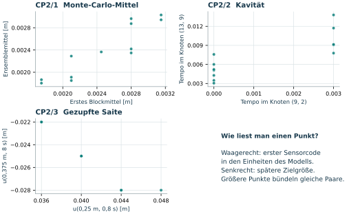

Im mittleren Teilbild steht links der Betrag der Geschwindigkeit an Knoten $(9,2)$, als Ziel der Betrag an $(13,9)$. Beide sind Skalare. Die [dynamische Kavität](#revision-k16-02) liefert hingegen zwei gerichtete Komponenten je Ort für acht aufeinanderfolgende Felder. Bei CP2/3 vergleicht der Katalog zwei Saitensensoren. Der Feldversuch in Kapitel 16 prüft die Auslenkung an 501 Orten.


Lesen Sie das Diagramm von links nach rechts. Auf der waagerechten Achse steht der erste auf seine Geräteauflösung gerundete Messwert, auf der senkrechten Achse die erste Zielgröße der Referenz. Die Punktfläche wächst mit der Zahl gleicher Paare. Weder eine Verbindung der Punkte in der Zeit noch ein Mittelwert über mehrere Einheiten ist vorausgesetzt. Die weiteren Sensoren und Ereignislabels gehen in die [Auswahlregel](#atlas-kosten) ein.

<!-- Buchseite -->

<a id="fb-refC02"></a>

## A.15 · C02 · Flexible Montageanlage

### 1 · Phänomen und Leitfrage

Werkstücke warten vor belegten Förderern. Wie stark begrenzt die Zahl der Paletten den Durchsatz?

### 2 · Modellbildung

Ein diskretes Ereignismodell verbindet Arbeitsplätze, Paletten und endliche Fördersegmente.

### 3 · Numerischer Härtefall

Blockierung und eine geänderte Reihenfolge gleichzeitiger Freigaben können das gesamte Fließbild ändern.

### 4 · Methodenvergleich

Serien identischer Auftragslast mit der gewählten Transportregel vergleichen, dazu den veröffentlichten CSIM- und SimEvents-Fall ausweisen.

### 5 · Aufgaben und Validierung

main und study liefern Versuche zur Anlage. Elf CSIM-Lasten passen unter einer benannten Konvention. Drei Abweichungen zur Standard-SimEvents-Reihe sind dokumentiert.

### 6 · Diagnoseprotokoll

Belegung, Reservierungen, Palettenbestand und jede Übergabe prüfen.

**Gegenprobe zum Versuch.** Eine Palette kann sich im Transport, im Puffer oder in einer Station befinden. Ihre eindeutige Kennung darf zwischen zwei Journalzeiten weder verschwinden noch doppelt belegt sein. Für die drei abweichenden Lastfälle 13, 14 und 25 empfiehlt sich der erste unterschiedliche Übergabezeitpunkt als Ausgangspunkt.

[ARGESIM, Definition und Referenzen](https://www.argesim.org/benchmarks/c02) · [Aufgaben und Prüfstand im Projekt](https://github.com/5H3LL3H5/argesim-hyperposition-benchmarks/blob/16f0f2528fcf77f16898ecd74ad952be2c09eac2/ARGESIM_COVERAGE.md). [Messbild](#atlas-mess-c01).


<!-- Buchseite -->

<a id="fb-refC04"></a>

## A.16 · C04 · Speisende Philosophen

### 1 · Phänomen und Leitfrage

Mehrere Prozesse warten auf dieselben Gabeln. Ob jeder lange genug erhält, hängt von der Konfliktregel ab.

### 2 · Modellbildung

Ein diskretes Modell verwaltet Ressourcenzustand, Anforderung und Freigabe.

### 3 · Numerischer Härtefall

Eine gleichzeitige Anforderung kann Verklemmung oder unfaire Bedienung auslösen.

### 4 · Methodenvergleich

Vergleichen Sie Ereignisspuren unter gleicher Ordnung und anschließend unterschiedliche zugelassene Strategien.

### 5 · Aufgaben und Validierung

run, compare und refinements prüfen Gabelerhaltung, Reinigung und Wiederholung. Eine Übereinstimmung publizierter Fairness-Verteilungen bleibt offen.

### 6 · Diagnoseprotokoll

Zu jedem Ereignis Eigentümer und freie Gabeln ausgeben.

**Gegenprobe zum Versuch.** Eine Gabel hat zu einer Ereigniszeit genau einen zulässigen Zustand. Der Bestand über alle Zustände ist konstant. Diese ganzzahlige Prüfung entdeckt Doppelvergabe. Ob einzelne Teilnehmer selten essen, erfordert daneben die Wartezeit je Teilnehmer und eine Verteilung über mehrere Läufe.

[ARGESIM, Definition und Referenzen](https://www.argesim.org/benchmarks/c04) · [Aufgaben und Prüfstand im Projekt](https://github.com/5H3LL3H5/argesim-hyperposition-benchmarks/blob/16f0f2528fcf77f16898ecd74ad952be2c09eac2/ARGESIM_COVERAGE.md). [Messbild](#atlas-mess-c01).


<!-- Buchseite -->

<a id="atlas-kreis"></a>

## Bildversuch · Den Wartekreis von C04 lesen

Beginnen Sie bei P0 und folgen Sie den Pfeilen. P0 verlangt S1. Dieses Stäbchen ist P1 zugeteilt. P1 fordert S2. Nach zehn Kanten kehrt der Weg zu seinem Ausgangspunkt zurück. Keine Person kann den Zustand Essen erreichen und dadurch später ein Stäbchen freigeben.

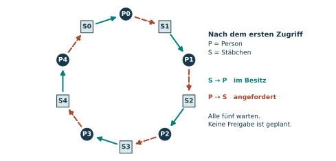

Der Graph stammt aus dem Endzustand des ungeschützten Laufs der [Zeitspur in Kapitel 5](#atlas-essverlauf). Das Protokoll bestätigt beide Voraussetzungen für den Stillstand: Alle fünf Personen warten, und im Kalender steht kein Ereignis mehr, das die Belegung ändern kann. Genau hier hilft der Ressourcenblick. Ein Foto von fünf Wartenden könnte auch eine vorübergehende Verzögerung zeigen.

Die offizielle C04-Definition stellt die fünf Philosophen und fünf Stäbchen als eigene diskrete Fallstudie vor. [ARGESIM C04](https://www.argesim.org/benchmarks/c04)

<!-- Buchseite -->

<a id="fb-refC06"></a>

## A.17 · C06 · Notaufnahme und Folgebehandlung

### 1 · Phänomen und Leitfrage

Patienten kehren zur Folgebehandlung zurück. Wie verändern diese Wege Wartezeit und Auslastung?

### 2 · Modellbildung

Stochastische Ankünfte, Behandlungsstationen und Rückkehrereignisse bilden ein Ressourcenmodell.

### 3 · Numerischer Härtefall

Ein einzelner Tag kann stark vom Mittel abweichen. Anfangsleerstand und Priorität beeinflussen Wartezeiten.

### 4 · Methodenvergleich

Gleiche Personalpolitik, Zeitfenster und Wiederholungszahl sind Voraussetzung für den Vergleich.

### 5 · Aufgaben und Validierung

A, B und C vergleichen drei Bedienpolitiken. Der Bericht stellt 21 Tagesgrößen einer publizierten STROBOSCOPE-Studie mit 100 Replikationen gegenüber.

### 6 · Diagnoseprotokoll

Personenzahl zwischen Ankunft, Station und Abgang bilanzieren und Unsicherheit je Kennzahl nennen.

**Gegenprobe zum Versuch.** Für jedes Tagesfenster gilt bei eindeutigen Personengrenzen Anfangsbestand plus Zugänge gleich Endbestand plus Abgänge. Zum externen Vergleich der 21 Größen gehören das gleiche Tagesfenster, die gleiche Bedienpolitik und die Stichprobenstreuung. Ein Einzelwert aus einer Replikation darf nicht als Mittelwert von 100 ausgegeben werden.

[ARGESIM, Definition und Referenzen](https://www.argesim.org/benchmarks/c06) · [Aufgaben und Prüfstand im Projekt](https://github.com/5H3LL3H5/argesim-hyperposition-benchmarks/blob/16f0f2528fcf77f16898ecd74ad952be2c09eac2/ARGESIM_COVERAGE.md). [Messbild](#atlas-mess-c05).


<!-- Buchseite -->

<a id="fb-refC08"></a>

## A.18 · C08 · Kanal und Schleuse

### 1 · Phänomen und Leitfrage

Schiffe kommen von beiden Seiten. Eine Fahrt in die falsche Richtung verschwendet Schleusenzeit.

### 2 · Modellbildung

Diskrete Ankünfte und Schleusenbetrieb erzeugen zwei Warteschlangen mit wechselnder Fahrtrichtung.

### 3 · Numerischer Härtefall

Gleiche Zeitpunkte benötigen eine festgelegte Bearbeitungsreihenfolge.

### 4 · Methodenvergleich

Deterministische Referenzfolgen prüfen den Betrieb. Stochastische Ankünfte prüfen dessen Verteilung.

### 5 · Aufgaben und Validierung

replication und C führen die Versuche aus. Fünf veröffentlichte deterministische Datensätze sind hinterlegt.

### 6 · Diagnoseprotokoll

Uhrzeit, Richtung, Warteschlangen und belegte Kapazität im Ereignisjournal prüfen.

**Gegenprobe zum Versuch.** Ein Schiff belegt bei der Übergabe nur einen der zulässigen Orte. Führen Sie Einfahrt, Kammerbelegung und Ausfahrt mit derselben Schiffskennung zusammen. Prüfen Sie deterministische Fahrpläne zuerst mit ihren vorgegebenen Ereignissen. Bei Zufallsankünften gehört die Streuung zur mittleren Wartezeit.

[ARGESIM, Definition und Referenzen](https://www.argesim.org/benchmarks/c08) · [Aufgaben und Prüfstand im Projekt](https://github.com/5H3LL3H5/argesim-hyperposition-benchmarks/blob/16f0f2528fcf77f16898ecd74ad952be2c09eac2/ARGESIM_COVERAGE.md). [Messbild](#atlas-mess-c05).


<!-- Buchseite -->

<a id="fb-refC10"></a>

## A.19 · C10 · Speisende Philosophen II

### 1 · Phänomen und Leitfrage

Wie ändert eine bevorzugte Reihenfolge die Wartezeiten konkurrierender Prozesse?

### 2 · Modellbildung

Das Ereignissystem koppelt Anforderung, Zuteilung und Freigabe begrenzter Ressourcen.

### 3 · Numerischer Härtefall

Verklemmung verlangt eine erkennbare Beendigung. Hunger einzelner Teilnehmer kann trotz weiterlaufendem Gesamtsystem auftreten.

### 4 · Methodenvergleich

Vergleichen Sie gleiche Zugangsregeln und kontrollieren Sie zusätzlich die Wartezeit jedes Teilnehmers.

### 5 · Aufgaben und Validierung

A und B umfassen Priorität bei simultanem Zugang und eine Studie mit 50 Läufen. Vergleichbare veröffentlichte Wartezeitverteilungen bleiben offen.

### 6 · Diagnoseprotokoll

Ereignisfolge und Eigentumsinvarianten sowie den Endgrund jedes Laufs sichern.

**Gegenprobe zum Versuch.** Wer bei simultanem Zugriff die erste Gabel erhält, kann die gesamte Fortsetzung beeinflussen. Spielen Sie die gleiche Anfragefolge mit denselben Prioritäten erneut ab. Eine Verklemmung ist ein kategorischer Ausgang. Einen solchen Lauf als Wartezeit null zu zählen, würde den Durchschnitt verkleinern.

[ARGESIM, Definition und Referenzen](https://www.argesim.org/benchmarks/c10) · [Aufgaben und Prüfstand im Projekt](https://github.com/5H3LL3H5/argesim-hyperposition-benchmarks/blob/16f0f2528fcf77f16898ecd74ad952be2c09eac2/ARGESIM_COVERAGE.md). [Messbild](#atlas-mess-c09).


<!-- Buchseite -->

<a id="atlas-konflikt"></a>

## Bildversuch · Wer beim gleichzeitigen Zugriff gewinnt

Im C10-Lauf mit Startwert 21 tritt der erste protokollierte Konkurrenzfall zur Modellzeit 7 auf. Person P1 wartet auf ihr rechtes, P2 auf ihr linkes Stäbchen. Beide meinen S2. Nach der vorgeschriebenen Prioritätsregel bekommt P2 das Stäbchen. Modellzeit und Zahl neu begonnener Mahlzeiten können bei diesem Teilschritt unverändert bleiben.

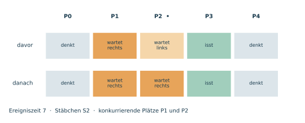

Lesen Sie die beiden Zeilen spaltenweise. Nur bei P2 wechselt „wartet links“ zu „wartet rechts“. P1 muss weiter auf S2 warten. Die Tabelle erfasst den Zustand unmittelbar vor und nach **dieser Vergabe** innerhalb derselben Ereigniszeit. Der vollständige Lauf protokolliert weitere Vergaben getrennt. Im [Messauftrag C10](#atlas-reihe2) werden 20 kontrollierte Konkurrenzkonstellationen mit den tatsächlichen Gewinnern geprüft.

C10 legt für die gleichzeitigen Zugriffe eine Priorität fest. Damit beantwortet dieser Versuch eine andere Frage als der [Wartekreis bei C04](#atlas-kreis). [ARGESIM C10](https://www.argesim.org/benchmarks/c10)

<!-- Buchseite -->

<a id="fb-refC14"></a>

## A.20 · C14 · Lieferkette

### 1 · Phänomen und Leitfrage

Bestellungen werden heute ausgelöst, treffen aber erst später ein. Welche Kosten entstehen an welcher Stelle?

### 2 · Modellbildung

Fabriken, Verteiler, Bestände, Aufträge und zeitverzögerte Transporte bilden ein diskretes System.

### 3 · Numerischer Härtefall

Ein Bestand ohne unterwegs befindliche Ware führt zu falschen Nachbestellungen.

### 4 · Methodenvergleich

Vergleichen Sie Bestellpolitiken mit gleicher Nachfrage und derselben Definition von Lager- und Transportkosten.

### 5 · Aufgaben und Validierung

A1 bis C2 untersuchen Tagesbestände sowie 30-Tage-Kosten und Lieferungen. Referenzvarianten sind im Projektbericht benannt.

### 6 · Diagnoseprotokoll

Bestand, offene Aufträge und Transitmengen getrennt buchen.

**Gegenprobe zum Versuch.** Buchen Sie für jedes Lager den Tagesendbestand als Anfangsbestand plus erhaltene Lieferungen minus tatsächlich versandte Menge. Eine offene Bestellung ist noch kein Wareneingang. Identische Gesamtkosten können Verspätungen einzelner Lieferungen verdecken. Die Tagesprotokolle aus D1 erlauben, die erste Abweichung zu finden.

[ARGESIM, Definition und Referenzen](https://www.argesim.org/benchmarks/c14) · [Aufgaben und Prüfstand im Projekt](https://github.com/5H3LL3H5/argesim-hyperposition-benchmarks/blob/16f0f2528fcf77f16898ecd74ad952be2c09eac2/ARGESIM_COVERAGE.md). [Messbild](#atlas-mess-c13).


<!-- Buchseite -->

<a id="fb-refC16"></a>

## A.21 · C16 · Restaurantdynamik

### 1 · Phänomen und Leitfrage

Ein neues Restaurant zieht Gäste an. Wie entsteht aus Entscheidungen einzelner Akteure die Restaurantzahl nach fünf Jahren?

### 2 · Modellbildung

Agenten, Ressourcen und stochastische Übergänge bilden ein diskretes Langzeitmodell.

### 3 · Numerischer Härtefall

Zufallsreihung und Zeitkonvention können sich über Jahre verstärken.

### 4 · Methodenvergleich

Mehrere Replikationen und veröffentlichte Vergleichsstudien liefern unterschiedliche Kontrollen der Endgröße.

### 5 · Aufgaben und Validierung

Die Restaurantzahl im fünften Jahr wird mit zwei publizierten Studien verglichen.

### 6 · Diagnoseprotokoll

Anfangsbestand, Ein- und Austritte, Stichprobenumfang und Streuung festhalten.

**Gegenprobe zum Versuch.** A verlangt Zeitverläufe über ein, fünf und zehn Jahre und den Mittelwert nach fünf Jahren aus 50 Läufen. B variiert den Steuersatz und betrachtet das Steueraufkommen. C variiert den Dichteparameter für die Standortwahl und betrachtet den Erlös neuer Restaurants. Vergleichen Sie diese drei Zielgrößen getrennt.

[ARGESIM, Definition und Referenzen](https://www.argesim.org/benchmarks/c16) · [Aufgaben und Prüfstand im Projekt](https://github.com/5H3LL3H5/argesim-hyperposition-benchmarks/blob/16f0f2528fcf77f16898ecd74ad952be2c09eac2/ARGESIM_COVERAGE.md). [Messbild](#atlas-mess-c13).


<!-- Buchseite -->

<a id="fb-refC18"></a>

## A.22 · C18 · Identifikation nichtlinearer Dynamik

### 1 · Phänomen und Leitfrage

Ein zeitlicher Datensatz kann durch ein lineares Modell mit Gedächtnis oder ein neuronales Netz beschrieben werden. Wie gut sagt jedes Modell freie Folgeschritte voraus?

### 2 · Modellbildung

ARX sowie statische und rekurrente Netze werden auf getrennten Trainings- und Validierungsfolgen untersucht.

### 3 · Numerischer Härtefall

Bei einer Ein-Schritt-Prognose können gemessene frühere Ausgaben einfließen. Das ist eine andere Aufgabe als ein freier Rollout.

### 4 · Methodenvergleich

Die synthetische Rechenprobe und rekonstruierte Abbildung prüfen Implementierung und Größenordnung.

### 5 · Aufgaben und Validierung

Der Eintrag all führt die Algorithmen aus. Die ursprünglichen beiden 100-Hz-Messreihen stehen für die offizielle Datenvalidierung weiterhin aus.

### 6 · Diagnoseprotokoll

Herkunft jeder Eingabe, Trennstelle, Skalierung und Initialisierung der freien Prognose dokumentieren.

**Gegenprobe zum Versuch.** Bei einer Einschrittprognose darf der vorige Messwert Eingang sein. In der freien Simulation muss an derselben Stelle die eigene frühere Vorhersage stehen. Berichten Sie daher beide Fehler mit Zeitfenster und Datensatz. Für die fehlenden Originalmessreihen ist ein numerischer Zielscore zur offiziellen Datenreihe nicht bestimmbar.

[ARGESIM, Definition und Referenzen](https://www.argesim.org/benchmarks/c18) · [Aufgaben und Prüfstand im Projekt](https://github.com/5H3LL3H5/argesim-hyperposition-benchmarks/blob/16f0f2528fcf77f16898ecd74ad952be2c09eac2/ARGESIM_COVERAGE.md). [Messbild](#atlas-mess-c17).


Die Fourier-Variante mit demselben Prüfaufbau steht im [Anhang C](#fno-c18-modell).

<!-- Buchseite -->

<a id="fb-refC20"></a>

## A.23 · C20 · Komplexe Produktionsanlage

### 1 · Phänomen und Leitfrage

Ein Werkstück belegt eine Strecke, während das nächste bereits angefordert wird. Welcher Auftrag kommt wann an?

### 2 · Modellbildung

Maschinen, begrenzte Puffer, Transport und Nacharbeit bilden eine ereignisgesteuerte Anlage.

### 3 · Numerischer Härtefall

Blockierte Strecken und konkurrierende Reservierungen beeinflussen den gesamten Ablauf.

### 4 · Methodenvergleich

Ein unabhängiges Nachspielen der Transportspur kontrolliert Reihenfolge, Kapazität und Besitz der Teile.

### 5 · Aufgaben und Validierung

replication und experiment umfassen die Produktionsstudie. Der veröffentlichte Projektversuch nutzt drei erzeugte Auftragsbücher, 360 Läufe und 36 ausführliche Replay-Prüfungen.

### 6 · Diagnoseprotokoll

Eingangsbuch, Fehlerrealisierung, Replikationsindex, Teilenummer, Ein- und Ausgang abgleichen.

**Gegenprobe zum Versuch.** Ein Teil, das nachgearbeitet wird, bleibt im System. Es als neues Teil zu zählen erzeugt scheinbar höheren Durchsatz. Vergleichen Sie zwei Anlagenvarianten bei identischem Auftragsbuch und passenden Störungsrealisierungen paarweise. Die hier verwendeten drei erzeugten Auftragsbücher begrenzen die Reichweite des Vergleichs.

[ARGESIM, Definition und Referenzen](https://www.argesim.org/benchmarks/c20) · [Aufgaben und Prüfstand im Projekt](https://github.com/5H3LL3H5/argesim-hyperposition-benchmarks/blob/16f0f2528fcf77f16898ecd74ad952be2c09eac2/ARGESIM_COVERAGE.md). [Messbild](#atlas-mess-c17).


<!-- Buchseite -->

<a id="fb-refC22"></a>

## A.24 · C22 · Warteschlangen mit Sonderregeln

### 1 · Phänomen und Leitfrage

Eine wartende Person wechselt die Schlange oder verlässt sie. Wie verändern diese Entscheidungen die Wartezeit der verbleibenden Personen?

### 2 · Modellbildung

Bediener, Warteschlangen und Ereignisse für Abbruch, Wechsel und Klassen regeln den Ablauf.

### 3 · Numerischer Härtefall

Ein bereits abgegangener Auftrag darf später nicht noch bedient werden. Wechsel zur selben Uhrzeit brauchen eine Reihenfolge.

### 4 · Methodenvergleich

Gleiche Ankunftsfolgen und Regeln erlauben deterministische Gegenproben zu den publizierten Kennzahlen.

### 5 · Aufgaben und Validierung

basic, jockeying, reneging und classing sind registriert. Wartezeiten für Wechsel, Abbruch und Klassen besitzen publizierte Referenzen.

### 6 · Diagnoseprotokoll

Ankünfte gleich bediente, abgebrochene und verbliebene Kunden setzen und die bisherige Wartezeit beim Wechsel konsistent fortführen.

**Gegenprobe zum Versuch.** Beim Schlangenwechsel endet der bisherige Warteabschnitt, die Kundenidentität bleibt erhalten. Für die Zeit bis zum Bedienbeginn müssen alle Abschnitte addiert werden. Kunden mit Abbruch erhalten einen eigenen Ausgang. Eine mittlere Wartezeit benötigt die ausdrücklich bezeichnete Grundgesamtheit und das gleiche Beobachtungsfenster.

[ARGESIM, Definition und Referenzen](https://www.argesim.org/benchmarks/c22) · [Aufgaben und Prüfstand im Projekt](https://github.com/5H3LL3H5/argesim-hyperposition-benchmarks/blob/16f0f2528fcf77f16898ecd74ad952be2c09eac2/ARGESIM_COVERAGE.md). [Messbild](#atlas-mess-cp1).


<!-- Buchseite -->

<a id="fb-beweise"></a>

# Anhang B · Beweise, Einzelmessungen und Schnittstellen

<a id="fb-runs"></a>

## B.1 · Die 456 Einzelkonfigurationen

Jedes der acht Modellfenster hat 57 Konfigurationen. Die Tabellen führen jedes Verfahren und jede Einstellung auf. Zur Zeile gehören in der CSV-Datei auch Arbeitszähler, neu gemessene Laufzeiten in Millisekunden und gegebenenfalls die Diagnose.

Je Zelle stehen die Statuskennung und, sofern vorhanden, der auf drei signifikante Stellen gerundete gespeicherte Score. **B** bedeutet bestanden, **G** numerisches Budget überschritten, **T** Zeitlimit, **E** abweichende Zahl von Beobachtungen und **F** Solverfehler. Für abgeschlossene Bewertungen gilt der ungerundete CSV-Wert. Vier unvollständige Zeilen enthalten bereits einen Score aus dem Vorlauf. Die Statuskennung entscheidet über die Verwertbarkeit. Die Schreibweise 2,6e-5 entspricht 0,000026. Die Reihenfolge der Quanten ist grob, mittel, fein. Die drei klassischen Kontrollen besitzen jeweils eine feste Konfiguration. Messzeiten, Kosten und Fehlerdetails stehen in der [Primärdatei der Acht-Fälle-Matrix][matrix].

Die [Methodenlegende direkt unter der Hauptmatrix](#auflage-k18-01) erklärt die Ordnungsziffer, die Schwellenwahl und den steifen Block.


<!-- Buchseite -->

<a id="fb-runC03a"></a>

### C03 · 54 Quantisierungen und drei Kontrollen

<a id="tab-ab-01"></a>

| Verfahren | 0,005 | 0,001 | 0,0002 |
|---|---|---|---|
| CHEQSS1 | G 9,4 | G 1,22 | T |
| CHEQSS2 | G 41,5 | G 8,37 | G 1,68 |
| CHEQSS3 | G 19,9 | G 10,2 | G 2,16 |
| CQSS1 | F | F | F |
| ELIQSS1 | G 9,4 | G 1,22 | B 0,199 |
| ELIQSS2 | G 28,6 | G 4,39 | G 1,11 |
| ELIQSS3 | G 45 | G 5,15 | B 0,692 |
| LIQSS-BDF | T | T | T |
| LIQSS1 | G 77,2 | G 19,1 | T |
| LIQSS2 | T | T | T |
| LIQSS3 | G 72,9 | G 24,7 | G 4,59 |
| MLIQSS1 | G 77,2 | G 19,1 | T |
| MLIQSS2 | T | T | T |
| MLIQSS3 | G 72,9 | G 24,7 | G 4,59 |
| QSS1 | G 96 | G 20,4 | G 4,19 |
| QSS2 | G 40,7 | G 7,74 | G 1,9 |
| QSS3 | T | T | T |
| QSS4 | T | T | T |

**Klassische Kontrollen.** EULER G 1,07, RK4 B 4,58e-11, RK45 B 1,06e-6.

**Statusbilanz.** 4 bestanden, 32 über Budget, 18 mit Zeitlimit, 0 mit abweichender Beobachtungszahl, 3 mit Solverfehler.

Am geschalteten Verstärker entscheidet das gewählte kurze Zeitfenster. Vergleichen Sie Spannungen und Ströme komponentenweise, bevor Sie die Zähler eines erfolgreichen Laufs interpretieren.


<!-- Buchseite -->

<a id="fb-runC05a"></a>

### C05 · 54 Quantisierungen und drei Kontrollen

<a id="tab-ab-02"></a>

| Verfahren | 0,005 | 0,001 | 0,0002 |
|---|---|---|---|
| CHEQSS1 | G 135 | G 16,2 | T |
| CHEQSS2 | E | T | E |
| CHEQSS3 | T | T | T |
| CQSS1 | F | F | F |
| ELIQSS1 | G 135 | G 16,2 | T |
| ELIQSS2 | E | T | T |
| ELIQSS3 | T | T | T |
| LIQSS-BDF | G 191 | G 39,5 | G 7,57 |
| LIQSS1 | E | E | T |
| LIQSS2 | T | T | T |
| LIQSS3 | E | E | E |
| MLIQSS1 | E | E | T |
| MLIQSS2 | T | T | T |
| MLIQSS3 | E | E | E |
| QSS1 | T | T | T |
| QSS2 | T | T | T |
| QSS3 | T | T | T |
| QSS4 | T | T | T |

**Klassische Kontrollen.** EULER F, RK4 T, RK45 F.

**Statusbilanz.** 0 bestanden, 7 über Budget, 32 mit Zeitlimit, 13 mit abweichender Beobachtungszahl, 5 mit Solverfehler.

Keine Einstellung der historischen Matrix erfüllt hier den Auftrag. Kapitel 11 beschreibt ein getrenntes Radau/BDF-Experiment mit korrekt lokalisierten Schaltungen. Es hat eigene Budgets.


<!-- Buchseite -->

<a id="fb-runC07a"></a>

### C07 · 54 Quantisierungen und drei Kontrollen

<a id="tab-ab-03"></a>

| Verfahren | 0,005 | 0,001 | 0,0002 |
|---|---|---|---|
| CHEQSS1 | B 0,872 | B 0,0805 | T |
| CHEQSS2 | G 7,71 | G 1,39 | B 0,238 |
| CHEQSS3 | G 6,41 | G 1,28 | B 0,351 |
| CQSS1 | B 0,249 | B 0,0123 | B 0,000444 |
| ELIQSS1 | B 0,872 | B 0,0805 | T |
| ELIQSS2 | G 7,19 | G 1,65 | B 0,319 |
| ELIQSS3 | G 3,81 | B 0,822 | B 0,166 |
| LIQSS-BDF | B 0,0121 | B 0,0121 | B 0,0121 |
| LIQSS1 | G 16,2 | G 3 | T |
| LIQSS2 | G 17,9 | G 3,35 | B 0,626 |
| LIQSS3 | G 27,2 | G 5,18 | B 0,947 |
| MLIQSS1 | G 16,2 | G 3 | T |
| MLIQSS2 | G 15,7 | G 3,35 | B 0,626 |
| MLIQSS3 | G 26,7 | G 5,18 | B 0,947 |
| QSS1 | G 14,4 | G 2,88 | B 0,566 |
| QSS2 | G 8,36 | G 1,58 | B 0,295 |
| QSS3 | G 7,13 | G 1,49 | B 0,269 |
| QSS4 | G 3,29 | B 0,765 | B 0,217 |

**Klassische Kontrollen.** EULER G 4,19, RK4 B 3,78e-9, RK45 B 3,25e-6.

**Statusbilanz.** 26 bestanden, 27 über Budget, 4 mit Zeitlimit, 0 mit abweichender Beobachtungszahl, 0 mit Solverfehler.

Beim Stiftpendel ist eine kleine Zeitabweichung von einer falschen Kontaktfolge zu unterscheiden. Die kartesische Bindungsprüfung in Kapitel 13 ist ein zusätzlicher Versuchsaufbau.


<!-- Buchseite -->

<a id="fb-runC09a"></a>

### C09 · 54 Quantisierungen und drei Kontrollen

<a id="tab-ab-04"></a>

| Verfahren | 0,005 | 0,001 | 0,0002 |
|---|---|---|---|
| CHEQSS1 | G 1,26 | B 0,0517 | B 0,00158 |
| CHEQSS2 | G 2,37 | B 0,416 | B 0,0582 |
| CHEQSS3 | G 2,3 | B 0,409 | B 0,0652 |
| CQSS1 | B 0,038 | B 0,00194 | B 7,8e-5 |
| ELIQSS1 | G 1,26 | B 0,0517 | B 0,00158 |
| ELIQSS2 | G 2,4 | B 0,44 | B 0,0714 |
| ELIQSS3 | G 2,38 | B 0,451 | B 0,0816 |
| LIQSS-BDF | G 1,12 | B 0,221 | B 0,042 |
| LIQSS1 | B 0,923 | B 0,138 | B 0,0269 |
| LIQSS2 | G 2,6 | B 0,514 | B 0,0994 |
| LIQSS3 | G 2,58 | B 0,517 | B 0,103 |
| MLIQSS1 | B 0,923 | B 0,138 | B 0,0269 |
| MLIQSS2 | G 2,6 | B 0,514 | B 0,0994 |
| MLIQSS3 | G 2,58 | B 0,517 | B 0,103 |
| QSS1 | B 0,539 | B 0,129 | B 0,0265 |
| QSS2 | B 0,0117 | B 0,0117 | B 0,0117 |
| QSS3 | B 0,00015 | B 0,00015 | B 0,00015 |
| QSS4 | B 4,42e-6 | B 4,42e-6 | B 4,42e-6 |

**Klassische Kontrollen.** EULER B 0,0265, RK4 B 2,19e-11, RK45 B 4,02e-9.

**Statusbilanz.** 46 bestanden, 11 über Budget, 0 mit Zeitlimit, 0 mit abweichender Beobachtungszahl, 0 mit Solverfehler.

Das Raster bewertet 16 Abtastzeiten. Für die langen Plateaus der veröffentlichten Reglerkurve führt Kapitel 14 eine gesonderte Prüfung in Zentimetern durch.


<!-- Buchseite -->

<a id="fb-runC11a"></a>

### C11 · 54 Quantisierungen und drei Kontrollen

<a id="tab-ab-05"></a>

| Verfahren | 0,005 | 0,001 | 0,0002 |
|---|---|---|---|
| CHEQSS1 | B 0,494 | B 0,0255 | T 0,00258 |
| CHEQSS2 | B 0,302 | B 0,089 | B 0,0161 |
| CHEQSS3 | G 1,32 | B 0,213 | B 0,0284 |
| CQSS1 | B 0,287 | B 0,0309 | B 0,00262 |
| ELIQSS1 | B 0,494 | B 0,0255 | T 0,00258 |
| ELIQSS2 | B 0,483 | B 0,116 | B 0,0186 |
| ELIQSS3 | G 1,42 | B 0,266 | B 0,0468 |
| LIQSS-BDF | B 0,000374 | B 0,000181 | B 0,000181 |
| LIQSS1 | B 0,45 | B 0,084 | T |
| LIQSS2 | B 0,999 | B 0,21 | B 0,04 |
| LIQSS3 | G 1,52 | B 0,307 | B 0,0619 |
| MLIQSS1 | B 0,45 | B 0,084 | T |
| MLIQSS2 | B 0,999 | B 0,21 | B 0,04 |
| MLIQSS3 | G 1,52 | B 0,307 | B 0,0619 |
| QSS1 | B 0,693 | B 0,167 | B 0,0371 |
| QSS2 | B 0,482 | B 0,0852 | B 0,019 |
| QSS3 | B 0,0576 | B 0,0437 | B 0,00488 |
| QSS4 | B 0,00201 | B 0,00201 | B 0,00201 |

**Klassische Kontrollen.** EULER B 0,192, RK4 B 1,73e-11, RK45 B 1,71e-8.

**Statusbilanz.** 49 bestanden, 4 über Budget, 4 mit Zeitlimit, 0 mit abweichender Beobachtungszahl, 0 mit Solverfehler.

Bei LIQSS1 und dem kleinsten Quantum steht ein Zwischenwert von 0,0294 im Archiv. Das Zeitlimit beendet die Messung. Der Status T bleibt erhalten.


<!-- Buchseite -->

<a id="fb-runC12a"></a>

### C12 · 54 Quantisierungen und drei Kontrollen

<a id="tab-ab-06"></a>

| Verfahren | 0,005 | 0,001 | 0,0002 |
|---|---|---|---|
| CHEQSS1 | B 1,78e-12 | B 1,78e-12 | T |
| CHEQSS2 | B 0 | B 0 | B 0 |
| CHEQSS3 | B 0 | B 0 | B 0 |
| CQSS1 | B 0 | B 0 | T 2,59e-10 |
| ELIQSS1 | B 1,78e-12 | B 1,78e-12 | T |
| ELIQSS2 | B 0 | B 0 | B 0 |
| ELIQSS3 | B 0 | B 0 | B 0 |
| LIQSS-BDF | B 8,88e-13 | B 4,44e-13 | B 2,22e-13 |
| LIQSS1 | B 1,78e-12 | T | T |
| LIQSS2 | B 0 | B 0 | B 0 |
| LIQSS3 | B 0 | B 0 | B 0 |
| MLIQSS1 | B 1,78e-12 | B 1,78e-12 | T |
| MLIQSS2 | B 0 | B 0 | B 0 |
| MLIQSS3 | B 0 | B 0 | B 0 |
| QSS1 | B 2,66e-12 | B 2,66e-12 | B 3,27e-10 |
| QSS2 | B 0 | B 0 | B 0 |
| QSS3 | B 0 | B 0 | B 0 |
| QSS4 | B 0 | B 0 | B 0 |

**Klassische Kontrollen.** EULER B 2e-11, RK4 B 2e-11, RK45 B 0.

**Statusbilanz.** 51 bestanden, 0 über Budget, 6 mit Zeitlimit, 0 mit abweichender Beobachtungszahl, 0 mit Solverfehler.

Eine nahezu verschwindende Fehlerzahl passt zu den geradlinigen Flugbahnen im elastischen Fenster. Für unelastische oder zufallsabhängige Stöße ändern sich die Zielgrößen.


<!-- Buchseite -->

<a id="fb-runC13a"></a>

### C13 · 54 Quantisierungen und drei Kontrollen

<a id="tab-ab-07"></a>

| Verfahren | 0,005 | 0,001 | 0,0002 |
|---|---|---|---|
| CHEQSS1 | G 20,1 | T | T |
| CHEQSS2 | G 93,2 | G 27,3 | G 6,2 |
| CHEQSS3 | G 51,3 | G 11,1 | G 2,52 |
| CQSS1 | F | F | F |
| ELIQSS1 | G 20,1 | T | T |
| ELIQSS2 | G 67,2 | G 28,9 | T 5,52 |
| ELIQSS3 | G 92,4 | G 19,6 | G 2,74 |
| LIQSS-BDF | G 179 | T | T |
| LIQSS1 | G 134 | T | T |
| LIQSS2 | G 181 | G 77,1 | T |
| LIQSS3 | G 474 | G 49,4 | G 7,45 |
| MLIQSS1 | G 134 | T | T |
| MLIQSS2 | G 139 | G 72,7 | T |
| MLIQSS3 | G 366 | G 35,8 | G 7,21 |
| QSS1 | G 130 | G 23,5 | F |
| QSS2 | G 148 | G 33,7 | G 7,02 |
| QSS3 | G 53,4 | G 10,1 | G 2,22 |
| QSS4 | G 49,1 | G 19,5 | G 3,26 |

**Klassische Kontrollen.** EULER G 85,7, RK4 B 2,61e-5, RK45 B 2,06e-5.

**Statusbilanz.** 2 bestanden, 38 über Budget, 13 mit Zeitlimit, 0 mit abweichender Beobachtungszahl, 4 mit Solverfehler.

Hier bestehen zwei der drei klassischen Einstellungen. Das mittlere Quantum von CHEQSS1 enthält trotz Zeitlimit einen gespeicherten Zwischenwert. Die Abnahme erfordert das vollständige Pulsfenster.


<!-- Buchseite -->

<a id="fb-runC21a"></a>

### C21 · 54 Quantisierungen und drei Kontrollen

<a id="tab-ab-08"></a>

| Verfahren | 0,005 | 0,001 | 0,0002 |
|---|---|---|---|
| CHEQSS1 | B 0,00885 | B 0,00171 | T |
| CHEQSS2 | B 9,77e-10 | B 7,27e-10 | B 6,09e-10 |
| CHEQSS3 | B 2,29e-10 | B 2,29e-10 | B 2,29e-10 |
| CQSS1 | B 0,00456 | B 0,000499 | B 1,98e-5 |
| ELIQSS1 | B 0,00885 | B 0,00171 | T |
| ELIQSS2 | B 1,2e-9 | B 1,86e-10 | B 9,5e-10 |
| ELIQSS3 | B 2,29e-10 | B 2,29e-10 | B 2,29e-10 |
| LIQSS-BDF | B 2,02e-9 | B 5,85e-10 | B 2,27e-9 |
| LIQSS1 | G 17,1 | G 3,42 | T |
| LIQSS2 | B 9,99e-11 | B 1,71e-9 | B 7,37e-11 |
| LIQSS3 | B 2,29e-10 | B 2,29e-10 | B 2,29e-10 |
| MLIQSS1 | G 17,1 | G 3,42 | T |
| MLIQSS2 | B 9,99e-11 | B 1,71e-9 | B 7,37e-11 |
| MLIQSS3 | B 2,29e-10 | B 2,29e-10 | B 2,29e-10 |
| QSS1 | G 17,1 | G 3,43 | B 0,685 |
| QSS2 | B 4,05e-7 | B 1,68e-7 | B 7,06e-8 |
| QSS3 | B 2,29e-10 | B 2,29e-10 | B 2,29e-10 |
| QSS4 | B 6,15e-6 | B 6,15e-6 | B 6,15e-6 |

**Klassische Kontrollen.** EULER G 12, RK4 B 2,44e-11, RK45 B 1,17e-10.

**Statusbilanz.** 46 bestanden, 7 über Budget, 4 mit Zeitlimit, 0 mit abweichender Beobachtungszahl, 0 mit Solverfehler.

Dieser Tabellenausschnitt behandelt den springenden Ball. Der eigenständige Diodenvergleich und der Nachweis des algebraischen Lösungszweigs sind in Kapitel 13 zu finden.

<a id="fb-absB-2"></a>

## B.2 · Ereignisschranken, Stabilität und DAE-Astfortsetzung

### B.2.1  Eine Wurzel nachweisen und ihre Lage einschließen

Ein Positionssensor begrenzt den Wert eines Wächters nur auf ein Intervall. Wie sicher muss das Vorzeichen an beiden Enden sein? Sei $G(t)=g(t,x(t))$ stetig auf $[a,b]$ und seien seine beiden Endwerte durch Intervalle vollständig eingeschlossen. Liegt die obere Schranke von $G(a)$ unter null und die untere von $G(b)$ über null, garantiert der Zwischenwertsatz mindestens einen Durchgang. Gilt außerdem $G'\ge m>0$ im ganzen Intervall, ist er eindeutig.
Für eine berechnete Nullstelle $\hat t$ mit $|G(\hat t)|\le\varepsilon$ liefert der Mittelwertsatz $|\hat t-t_*|\le\varepsilon/m$. Bei $m=0{,}2\,\mathrm{m/s}$ und $\varepsilon=0{,}1\,\mathrm{mm}$ sind das 0,5 ms. Sind die Werte an beiden Enden positiv, kann es innen zwei Durchgänge geben. Dann helfen mehrere isolierte Intervalle oder eine Einschließung der Extrema.

### B.2.2  Stationärer Ast und Verlust der Regularität

Sei $g(t,x,z)=0$ stetig differenzierbar und $g_z$ am Start invertierbar. Der Satz über implizite Funktionen liefert lokal einen eindeutigen Ast $z=\zeta(t,x)$. Entlang einer glatten Lösung folgt $z'=-g_z^{-1}(g_t+g_x\,x')$, wobei $g_x\,x'$ das Produkt der Jacobi-Matrix $g_x$ mit $x'$ bezeichnet. Eine uniforme Schranke der Inversen, eine kompakte Einschließung in der regulären Umgebung und kontrollierte Startdaten erlauben die schrittweise Fortsetzung. Für $g=z^2-x$ verschmelzen die beiden Äste bei $x=z=0$. Dort scheitert diese Begründung. Die Diodenrechnung grenzt den tatsächlich durchlaufenen Ast [C21 · Bleibt die Diodenspannung vor der Falte?](#fb-befunddiode) ein.

### B.2.3 · Eine schnelle Störung über viele Schritte

Im Reaktionsversuch aus Kapitel 1 genügt es, die Differenzmode zu betrachten. Sie erfüllt $d'=-a d$ mit $a=1000\,\mathrm{s^{-1}}$. Zwei Bahnen mit verschiedenen Anfangsdaten haben nach einem exakten Schritt den Abstand $e^{-ah}|\delta_0|$. Bei einem linearen Einschrittverfahren beträgt der Abstand nach $n$ Schritten $|R(-ah)|^n|\delta_0|$. Dies folgt durch Subtraktion der beiden Schrittgleichungen und Induktion. Für eine feste Schrittweite wachsen Anfangsstörungen genau dann nicht an, wenn $|R(-ah)|\le1$. Für das Abklingen jeder Anfangsstörung muss der Betrag echt kleiner als eins sein.

Bei $h=3\,\mathrm{ms}$ gilt für den expliziten Euler-Schritt $R=1-ah=-2$. Die Vorzeichen wechseln, und jeder Schritt verdoppelt den Betrag. Impliziter Euler hat $R=1/(1+ah)=1/4$. Die schnelle Störung klingt ab, jedoch langsamer als mit dem exakten Faktor $e^{-3}$. Diese drei Zahlen erklären, weshalb ein bestandener Stabilitätstest noch eine Prüfung des zeitlichen Fehlers braucht. Das Labor `beispiele/reaktionen.py` vergleicht die gerechneten Einzelkonzentrationen, die daraus gebildete Differenz und beide Verstärkungsfaktoren.

**Warum der Astparameter zählt.** Beim Beispiel $z^2-x=0$ wächst $|\mathrm dz/\mathrm dx|=1/(2|z|)$ auf jedem der beiden offenen Äste ohne Grenze, wenn $z$ gegen null geht. Die Kurve selbst lässt sich glatt durch $z=s,\ x=s^2$ parametrisieren. Das ist eine Fortsetzung der geometrischen Lösungskurve. Ob eine physikalische, in der Zeit orientierte DAE-Lösung die Falte erreicht oder passiert, entscheidet zusätzlich ihre Differentialgleichung. Kapitel 13 liefert für die konkrete Anregung der Diode eine eigene Astschranke.

<a id="fb-absB-3"></a>

## B.3 · Intervallarithmetik für dichte Polynomausgaben

### B.3.1  Vom Näherungspolynom zur garantierten Schranke

Bei Radau entsteht das Stufenpolynom aus der Kollokation. RK45 besitzt in SciPy eine quartische dichte Ausgabe. Bei BDF entsteht das Interpolationspolynom aus der verfügbaren Differenzenhistorie in der aktuellen Ordnung. Übersetzen Sie die Koeffizienten mitsamt ihrer Rundungsunsicherheit in eine gemeinsame Variable $s=(t-t_n)/h$. Für $p(s)=\sum a_ks^k$ liefert das Horner-Schema mit nach außen gerundeten Intervalloperationen eine Einschließung aller Werte von $p$ auf einem Teilintervall $I$. Intervallkoeffizienten benötigen dieselbe Rundung.
Betrachten wir $p(s)=s^2-s+3/16$, das die Nullen 1/4 und 3/4 besitzt. Auf $[0,1]$ ergibt Horner zunächst die grobe Hülle $[-13/16,3/16]$. Auf $[1/8,3/8]$ haben die Funktionswerte an den Grenzen verschiedene Vorzeichen und $2I-1$ liegt strikt unter null. Damit ist die erste Wurzel isoliert. Die Unterteilung schärft sowohl die Werte- als auch die Ableitungsaussage.

### B.3.2  Die zusätzliche Schranke für die wirkliche Bahn

Der tatsächliche Zustand $x$ hat einen zweiten Fehlerweg. Kennt man einen Defekt $\|p'-f(t,p)\|\le d$ in physikalischer Zeit, eine Anfangsschranke $e_0$ und eine Lipschitz-Konstante $L>0$ in einem umschließenden Gebiet, folgt $\|x(t)-p(t)\|\le e^{Lt}e_0+d(e^{Lt}-1)/L$ für die seit Schrittbeginn verstrichene Zeit. Für $L=0$ gilt $e_0+dt$. Erst mit dieser zusätzlichen Hülle darf man aus dem eingeschlossenen numerischen Polynom auf die modellierte Bahn schließen. Bei DAEs kommt die Kontrolle der algebraischen Bindungen hinzu.

[FLINT, Einschließung einfacher Wurzeln](https://flintlib.org/doc/tutorials/numerics/interval-newton.html) · [Fehlerschranken im Lehrversuch](#t1-k2).

<a id="fb-absB-4"></a>

## B.4 · Python- und C++-Schnittstellenverträge

### B.4.1  Ein identischer ODE-Vertrag für zwei Implementierungen

Der Versuch $y'=-2y,\,y(0)=1$ hat einen unabhängigen Endwert $e^{-2}$. Die ausführbare Python-Schnittstelle übergibt eine Funktion und den vollständigen Anfangszustand. Die vom Integrator ausgewählten Zwischenzeiten dürfen sich wiederholen, etwa bei einem verworfenen Schritt.

```python
from math import exp
from argesim_benchmarks.ivp import InitialValueProblem
from argesim_benchmarks.runtime import solve_ivp

problem = InitialValueProblem(lambda t, y: (-2*y[0],),
                              0.0, (1.0,), 1.0)
run = solve_ivp(problem, "rk4", options={"step": 0.01})
assert abs(run.final_state[0] - exp(-2.0)) < 1e-8
```

Als C++20-Gegenstück eignet sich eine Modellsignatur mit festen Ausgabespeichern. Der folgende ausführbare Lehrtest prüft das Modell an einem Zwischenzustand. Der vollständige Integrator ist hier die Python-Referenz.

<a id="revision-ab-01"></a>

Der folgende Block ist die kompilierbare Quelldatei `rechenlabor/rhs_vertrag.cpp`. Die Gegenprobe extrahiert beim Buchtest den abgedruckten Block, vergleicht ihn bytegenau mit der Datei, übersetzt ihn mit C++20 und führt ihn aus. Der Test prüft die Rate am Zwischenzustand und den unveränderten Eingabewert.


```cpp
#include <array>
#include <cassert>
#include <span>

void rhs(double, std::span<const double, 1> y,
         std::span<double, 1> rate) { rate[0] = -2.0 * y[0]; }

int main() {
    std::array<double, 1> y{0.5}, rate{};
    rhs(0.25, y, rate);
    assert(rate[0] == -1.0 && y[0] == 0.5);
}
```

### Ein Endwertbudget für die Rechnung ohne Zusatzpakete

Der skalare Laboraufruf in `rechenlabor/rk4_vertrag.py` realisiert dieselbe Anfangswertaufgabe mit klassischem RK4. Für einen Schritt mit $h=0{,}01$ gilt $y_{n+1}=R(-2h)y_n$, wobei $R$ das Taylorpolynom vierten Grades der Exponentialfunktion ist. Da $0<R(-2h),e^{-2h}<1$, beträgt die Differenz der Potenzen nach $N$ Schritten höchstens $N|R(-2h)-e^{-2h}|$. Der Taylorrest auf der negativen reellen Achse liefert somit $N(2h)^5/120$. Für $N=100$ sind das rund $2{,}67$ mal $10^{-9}$. Der Test addiert eine Rundungsreserve von 32 Einheiten am letzten Binärplatz von eins pro Schritt. Auf diese Weise lässt sich ein zu großer Endfehler bis zum Fehler eines einzelnen Schrittes zurückverfolgen.

### B.4.2  Was der Aufrufer beobachten kann


<a id="revision-ab-02"></a>

Die Python-API `InitialValueProblem` verlangt einen endlichen, nichtleeren Anfangszustand und überprüft beim Auswerten die Länge und Endlichkeit der Ableitung. Als Negativprobe erhält sie einen NaN-Startwert und anschließend eine Modellfunktion mit zwei Ableitungen für einen einzigen Zustand. Beide Aufrufe müssen zurückgewiesen werden. Das skalare RK4-Lehrskript prüft den integrierten Endwert und sein Fehlerbudget. Der C++20-Block verwendet Speicher mit fester Länge eins und prüft einen gültigen Einzelaufruf. Eine API mit dynamischen Puffern müsste deren Größe an ihrer eigenen Aufrufgrenze prüfen.


## B.5 · Eine Einschließung mit exakter Arithmetik nachrechnen

Für das Polynom $q(s)=s^2-s+3/16$ haben die Randwerte auf dem ganzen Schritt dasselbe Vorzeichen. Auf $[1/8,3/8]$ ist die Ableitung $2s-1$ hingegen durchgehend negativ, auf $[5/8,7/8]$ durchgehend positiv. In jeder der beiden Klammern wechseln die Funktionswerte das Vorzeichen. Stetigkeit liefert jeweils Existenz, strenge Monotonie liefert Eindeutigkeit. An den Mittelpunkten $1/4$ und $3/4$ verschwindet das Polynom exakt.

`beispiele/benchmarkbilanz.py` berechnet die benötigten Vorzeichen und Mittelpunkte als rationale Zahlen. Wer denselben Beweis mit Gleitkommaintervallen führt, muss jede Intervalloperation nach außen runden. Eine enge Nullstellenklammer des Ausgabepolynoms sagt etwas über die physikalische Kontaktzeit, sobald zusätzlich der in B.3 hergeleitete Bahnfehler und eine untere Schranke für die Durchgangsgeschwindigkeit vorliegen.

**Übertragung in C++.** `rechenlabor/rhs_vertrag.cpp` enthält das vollständige Beispiel aus B.4. Es lässt sich aus dem entpackten Paket mit `c++ -std=c++20 rechenlabor/rhs_vertrag.cpp -o rhs_vertrag` übersetzen. `./rhs_vertrag` prüft, dass die Ausgabe den erwarteten Wert trägt und die übergebene Eingabe ihren Wert behält. Der Python-Test zum Endwert prüft zusätzlich die Integration bis zur vereinbarten Endzeit.


<!-- Buchseite -->

<a id="fb-fno-anhang"></a>

# Anhang C · Neuronale Operatoren in ARGESIM

## Einleitung · Wann hilft ein gelernter Operator?

Drehen Sie den Hahn einer Schadstoffquelle für zwei Tage weiter auf. Der Brunnen reagiert erst später und der Konzentrationsgipfel kann sich verschieben. In einem anderen Versuch möchten wir aus der Verdickung eines Muskels auf seine Kraft schließen. Derselbe Dickenwert kann während des Anstiegs und beim Abklingen zu verschiedener Kraft gehören. In beiden Fällen zählt die Vorgeschichte. Wir fragen, ob ein Fourier Neural Operator diese Vorgeschichte so verarbeitet, dass er an einer neuen Eingabe dieselben Prüfungen wie ein klassisches Verfahren besteht.

Bei [C19R](#fno-c19r-modell) rechnen wir dasselbe Konzentrationsfeld mit finiten Volumen und RK4, mit einem Greenschen Operator und mit einer gelernten Fourier-Schicht. Bei [C18](#fno-c18-modell) vergleichen wir die Übertragungsfunktion, bestehende neuronale Modelle und eine kausale Fourier-Schicht. Der [Schluss zu diesem Anhang](#fno-anhang-schluss) greift beide Eingangsfragen wieder auf. Für CP2 vergleichen wir in [C.8](#cp2-operator-code) zusätzlich alternative Transformationen und ihre Kosten.

Das FNO aus [Kapitel 9](#kap09-einstieg) wird hier für zwei neue Rechenaufträge angepasst. Für den Boden leiten wir zuerst die lineare Abbildung her. Für die Muskelkurven muss sich die Trainingsentscheidung auf eine einzige veröffentlichte Kurve stützen. Im Ergebnisprotokoll stehen deshalb das Gitter, die Quellenfolge oder Messreihe und das genaue Fehlermaß neben jeder Zahl.

<!-- Buchseite -->

<a id="fno-c19r-modell"></a>

## C.1 · C19R und die Quelle im Zeitverlauf

Im Referenzfall von [Kapitel 15](#fb-c19integral) gibt die Quelle ab dem Start ständig $2\,\mathrm{mg/s}$ ab. Für den neuen Versuch teilen wir zehn Tage in acht Abschnitte zu je $1{,}25$ Tagen. Die Quelle bleibt am Ursprung. In Abschnitt $j$ wird eine konstante Rate $q_j$ gehalten. Die übrigen Größen übernehmen wir aus dem Lehrfall. Je Quadratmeter Grundfläche enthält die Schicht $\eta b=2{,}5\,\mathrm{m^3/m^2}$ Wasser. Die Fließgeschwindigkeit beträgt $10^{-5}\,\mathrm{m/s}$ und der isotrope Dispersionskoeffizient $5\cdot10^{-7}\,\mathrm{m^2/s}$. Die Aufbereitung bleibt ausgeschaltet.

Wir messen das Feld nach zehn Tagen auf $65\times33$ quadratischen Zellen mit $0{,}25\,\mathrm m$ Kantenlänge. Jede Ausgabe ist ein Zellmittel. Der Brunnen bei $(5,0)\,\mathrm m$ liegt im Zentrum einer Zelle. Der tatsächliche Punktwert kommt aus einer eigenen Quadratur der in Kapitel 15 hergeleiteten Formel. So sehen wir auch den Fehler, der entsteht, wenn man den Zellwert für die Punktmessung verwendet.

### Weshalb acht Rechnungen genügen

Der Stoff eines kurzen Quellstoßes verteilt sich als driftende Gaußglocke. Integrieren wir diese Glocke über eine Zelle und alle Freisetzungszeiten des Abschnitts $j$, erhalten wir ein Antwortfeld $G_j$. Es gibt die Konzentrationsänderung pro Einheit der Freisetzungsrate in diesem Abschnitt an. Bei konstanten Transportkoeffizienten lässt sich der Stoffeintrag addieren. Deshalb lautet das berechnete Feld für den ganzen Verlauf

$$
c_{\mathrm{Zelle}}(T)=\sum_{j=1}^{8}q_j G_j.
$$

Die ersten $G_j$ gehören zu altem Stoff und ihr Schwerpunkt liegt weiter stromabwärts. In den letzten $G_j$ steckt die frischere, steile Konzentrationsfahne nahe der Quelle. Die klassische Green-Rechnung speichert diese acht Felder und summiert sie pro neuer Anfrage gewichtet. Die Referenz verwendet dieselbe physikalische Lösung und eine feinere Quadratur. Die Quadraturen unterscheiden sich in der Norm der acht Felder relativ um $3{,}60\cdot10^{-12}$.

### Was die Fourier-Schicht lernt

Jede Rate $q_j$ bildet einen Eingangskanal mit einem Wert in der Quellzelle und null in allen anderen Zellen. Für jede behaltene Raumfrequenz lernt eine lineare Fourier-Schicht acht komplexe Gewichte. Die gewichtete Summe der acht Eingangskoeffizienten liefert den Ausgabekoeffizienten. Die inverse FFT ergibt daraus die Konzentrationen. Wir bestimmen die Gewichte aus 80 Quellverläufen per kleinsten Quadraten. Die Raten liegen beim Training gleichverteilt zwischen $0{,}3$ und $3{,}7\,\mathrm{mg/s}$. Die acht Testverläufe enthalten unter anderem die konstante Quelle, zwei getrennte Pulse und späte Änderungen. Diese Verläufe bleiben bis zur Auswertung zurückgehalten.

[Aufgabenfamilie C19R](https://www.argesim.org/benchmarks/c19) · [Green-Referenz im Lehrbuch](#fb-c19integral) · [FNO-Schicht](#t1-k9)

<!-- Buchseite -->

<a id="fno-c19r-messung"></a>

## C.2 · C19R und die Verteilung des Stoffs

Für die acht neuen Verläufe gelten je $1\,\%$ Budget für den relativen Feldfehler und für den Punktwert am Brunnen. Die Differenz der Stoffmasse im Rechteck darf höchstens $0{,}1\,\%$ der eingetragenen Masse betragen. Wir prüfen zudem die Nichtnegativität der Konzentration bis auf eine Rundungsschranke. Der Score $S$ ist das Maximum der drei Anteile am Budget. Das Fehlerziel gilt jeweils für einen ganzen Verlauf.

<a id="tab-ac-01"></a>

| Methode C19R | Feldfehler max. | Brunnenfehler max. | Max. $S$ | Bestanden |
|:--|--:|--:|--:|--:|
| Green-Summe | $<10^{-8}\,\%$ | 0,729 % | 0,729 | 8 von 8 |
| Finite Volumen und RK4 | 33,85 % | 104,903 % | 104,903 | 0 von 8 |
| FNO mit begrenzten Moden | 25,97 % | 17,641 % | 25,971 | 0 von 8 |
| FNO mit allen Moden | $<10^{-8}\,\%$ | 0,729 % | 0,729 | 8 von 8 |

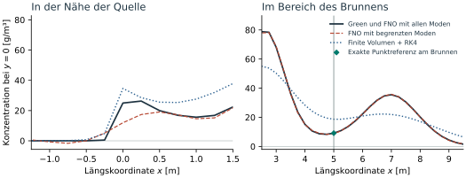

**Warum das Abschneiden der Moden auffällt.** Mit $|k_x|\le12$ und $|k_y|\le8$ bleibt die Nullmode erhalten. Sie repräsentiert die Summe der Zellwerte und damit die Masse im Rechteck. Dennoch können einzelne Zellwerte negativ werden und die Spitze kann zu flach sein. Mit allen darstellbaren Moden reproduziert die gelernte Schicht die lineare Green-Abbildung bis auf Rechen- und Quadraturfehler. Die verbleibende Abweichung am Brunnen entsteht, weil wir einen Zellmittelwert am Mittelpunkt auswerten.

**Was der klassische Vergleich erklärt.** Beim Lauf mit finiten Volumen erhält das RK4-Modell die Bilanz aus Innenmasse plus ausgetragener Masse bis auf Rundung. Halbieren wir auf demselben Gitter seinen Zeitschritt von 7 200 s, ändert sich das Feld relativ zur Referenznorm um höchstens $2{,}55\cdot10^{-6}$. Die deutlich größere verbleibende Abweichung liegt überwiegend in der räumlichen Näherung. Ein Upwind-Fluss verschmiert die Konzentrationsfront, obwohl er die Bilanz erfüllt.

<!-- Buchseite -->

## C.3 · Warum wir den klassischen Operator mitmessen

Für die konstante Quelle von $2\,\mathrm{mg/s}$ liefert die punktweise Quadratur am Brunnen $45\,021{,}62\,\mathrm{mg/m^3}$. Die Green-Zellrechnung und die Fourier-Schicht mit allen Moden liefern dort beide $44\,789{,}24\,\mathrm{mg/m^3}$. Bei einem stark zeitveränderlichen Eintrag zählen beide Größen, die Masse und die Konzentration an der Messstelle. Verschiebt man einen Puls zeitlich, kann er dieselbe Masse eintragen und den Gipfel am Brunnen früher oder später erzeugen.

In der Zeitmessung erhalten alle Verfahren dieselben acht Anfragen. Die Green-Felder sind für den Einsatz vorberechnet, die Fourier-Gewichte trainiert. Pro Variante wird einmal aufgewärmt, dann werden sieben vollständige Auswertungen gemessen. `vergleich.json` gibt den Median und die einmaligen Kosten getrennt an. Auf diesem Rechner war die Green-Summe schneller als die Fourier-Auswertung. Sie benötigt für die acht Eingänge nur gewichtete Additionen. Das RK4-Ergebnis liegt auf dem betrachteten Gitter oberhalb des gemeinsamen Fehlerbudgets. [Messung nachrechnen](#fno-reproduktion)

**Selbst prüfen.** Multiplizieren Sie für einen der acht Testverläufe jede Rate mit zwei. Welche der Vorhersagen verdoppelt sich? Die Gleichung für $c_{\mathrm{Zelle}}$ beweist die Antwort für das Green-Feld. Dieselbe Prüfung am gelernten Modell zeigt, was seine hier gewählte lineare Bauform bereits festlegt. Für eine veränderte Strömungsrichtung, andere Dispersivität oder eine laufende Pumpe brauchen wir eigene Referenzen. Die acht gelernten Gewichtssätze kodieren genau die festgelegte Kombination aus Physik, Quellort und Ausgabezeit.

Der Versuch erweitert das Modell der Aufgabe A ohne Gegenmaßnahmen um zeitabhängige Raten. In den übrigen C19R-Aufgaben greifen Pumpe, Infiltration und zeitliche Steuerung in das Transportproblem ein. Wie die Originalaufgaben abgegrenzt sind, beschreibt das [Referenzblatt C19R](#fb-refC19R).

<!-- Buchseite -->

<a id="fno-c18-modell"></a>

## C.4 · C18 und die Kraft aus der Vorgeschichte

Bei C18 ist die beobachtete Verdickung $u_n$ der Eingang und die zu schätzende Kraft $y_n$ der Ausgang. Die zwei veröffentlichten normierten Kurvenpaare stammen von zwei Muskeln. Je Folge stehen 2 000 Abtastwerte von 0 bis 19,99 Sekunden auf einem 100-Hz-Raster. Wir verwenden die aus den Vektorgrafiken rekonstruierten Werte und prüfen ihren Hash gegen den Projektstand. Die Originalmessdateien werden im Rechenlabor durch zwei separat angegebene CSVs unterstützt. Die folgenden Zahlen gelten für die rekonstruierten Kurven.

### Dieselben Messzeiten und Anfangswerte

Wir identifizieren alle lernenden Parameter auf dem ersten Muskel. Der zweite dient der Auswertung. Ein klassisches ARX-Modell zweiter Ordnung verwendet die zwei letzten Kräfte und die aktuelle sowie vorherige Verdickung,

$$
\widehat y_n
 = a_1\widehat y_{n-1}+a_2\widehat y_{n-2}+b_0u_n+b_1u_{n-1}.
$$

Die ersten zwei gemessenen Kräfte setzen die Anfangswerte des ARX. Danach benutzt die Rechnung ihre eigenen Ausgaben. Für alle Methoden beginnt der Fehlervergleich bei Index 2. Das direkte FNO benutzt für seine gesamte Vorhersage nur die Verdickung. Ein zweites FNO lernt die Abweichung des ARX von der Kraft auf dem ersten Muskel und addiert seine Schätzung bei der Anwendung zum frei gerechneten ARX.

### Wie aus einem FFT-Fenster eine kausale Schätzung wird

Für die Probe $n$ erhält die Schicht die letzten 64 Verdickungswerte einschließlich $u_n$. Vor dem Anfang wiederholen wir den ersten Wert. Die reelle FFT zerlegt das Fenster in die Nullmode und positive Frequenzen. Von ihnen behalten wir zwölf. Je verdeckter Einheit gewichten wir die komplexen Koeffizienten und lesen den letzten Wert der inversen FFT ab. Dazu kommen ein direkter Anteil aus $u_n$ und eine Konstante. Acht solche Größen gehen durch den Tangens hyperbolicus. Eine gelernte Linearkombination liefert Kraft oder Residuum.

Im Labor ändern wir die zweite Hälfte des Eingangssignals und kontrollieren, dass alle Vorhersagen für die erste Hälfte bis auf Rundung gleich bleiben. Die Fourier-Auswertung wird zusätzlich gegen eine direkte inverse FFT und die Trainingsableitung gegen Differenzen geprüft. Für jede der beiden FNO-Varianten gibt es drei Initialisierungen. Die Auswahl erfolgt anhand des regularisierten Verlusts am ersten Muskel. Alle sechs Trainingsläufe erreichen das festgelegte Limit von 450 Optimierungsschritten. Die gemeldeten Ergebnisse verwenden die dort erhaltenen Gewichte.

[Belič, Originaldefinition und Abbildungen](https://www.sne-journal.org/fileadmin/user_upload_sne/benchmarks/C18/C18-definition.pdf) · [Rekonstruktion der Kurven](https://github.com/5H3LL3H5/argesim-hyperposition-benchmarks/blob/3a8f97f861ac77903289316947adb1e7ddf62433/docs/C18_FIGURE_RECONSTRUCTION.md)

<!-- Buchseite -->

<a id="fno-c18-messung"></a>

## C.5 · C18 auf der zweiten Kurve

Die Vorhersage bleibt auf der Abtastfolge des zweiten Muskels. Wir berechnen den RMSE in der normierten Kraftskala und die Korrelation. RMSE misst die Größe der Abweichung. Korrelation gibt an, wie ähnlich beide Signale gemeinsam steigen und fallen. Ein systematischer Versatz kann daher im RMSE sichtbar sein, auch wenn die Korrelation hoch ist.

<a id="revision-ac-01"></a>

Die unabhängige Beobachtungseinheit ist hier eine vollständige publizierte Muskelkurve. Jede der beiden digitalisierten Reihen enthält 2 000 Abtastwerte bei 100 Hz. Die erste Reihe dient der Anpassung, die zweite dem Transfer auf einen anderen Muskel. Zwanzig Fenster aus der zweiten Reihe ergeben zwanzig Startzeiten mit derselben Kalibrierung. Für eine Aussage über die Streuung zwischen Muskeln wären weitere vollständige Reihen nötig. In dieser Auswertung erreicht das direkte kausale FNO beim zweiten Muskel RMSE 0,04491, die erste ARX-plus-FNO-Fassung 0,04833. Die getrennte Bandstudie in D.17 erreicht mit ARX plus Fourier 0,04266.


<a id="tab-ac-02"></a>

| Methode C18 | RMSE erster Muskel | RMSE zweiter Muskel | Korrelation zweiter Muskel |
|:--|--:|--:|--:|
| Publizierte ARX-Koeffizienten | 0,11739 | 0,11340 | 0,94221 |
| ARX neu identifiziert | 0,12558 | 0,11732 | 0,93299 |
| ARX und statisches Netz | 0,09034 | 0,10514 | 0,94371 |
| Rekurrentes Netz | 0,03492 | 0,11937 | 0,92642 |
| Kausales FNO | 0,02465 | 0,04491 | 0,99178 |
| ARX und Residual-FNO | 0,02128 | 0,04833 | 0,99043 |


Auf dem zweiten Muskel erreicht das direkte FNO 0,04491 RMSE, das neu identifizierte ARX 0,11732. Eine Übertragung auf die offizielle Rohdatenaufgabe erfordert die ursprünglichen Messdateien.

<!-- Buchseite -->

<a id="fno-reproduktion"></a>

## C.6 · Beide Versuche nachrechnen

Im Quellenpaket führt `rechenlabor/fno_benchmarks/vergleich.py` zu beiden Versuchen. NumPy und SciPy genügen. Die zwei Studien können über `--case c19r` oder `--case c18` einzeln ausgeführt werden. Der gemeinsame Lauf wird im entpackten Stammordner so gestartet.

~~~sh
OPENBLAS_NUM_THREADS=1 OMP_NUM_THREADS=1 python3 \
  rechenlabor/fno_benchmarks/vergleich.py --out fno_ergebnisse
~~~

Der Lauf schreibt `vergleich.json` mit Ergebnissen je Test, Softwarestand, Zeitmessung und Datennachweis. Die zwei `.npz`-Dateien enthalten trainierte Gewichte, Eingaben, Referenzen und Vorhersagen. Die gespeicherte Buchmessung steht unter `rechenlabor/fno_benchmarks/messung/`. Dort liegt auch der getrennt neu gerechnete Vergleich mit der bestehenden C18-Implementierung. Ihre Git-Blob-Kennungen sind protokolliert.

Wenn beide C18-Messdateien vorliegen, werden sie mit `--training train.csv --validation test.csv` übergeben. Beide müssen die Spalten `time_s`, `thickening` und `force` und einen Zeitschritt von $0{,}01\,\mathrm s$ haben. Die Ergebnisse kennzeichnen die Herkunft und die Prüfsummen. Die Wahl der Normalisierung und der Gewichte bleibt auch dann auf die erste Messreihe beschränkt.

<!-- Buchseite -->

## C.7 · Wie der Vergleich auf weitere Fälle übertragen wird

Wir beginnen jeden nächsten Fall mit der Frage, was überhaupt vorherzusagen ist. Für ein neues Feld müssen Ort, Raster und gemessene Komponenten übereinstimmen. Für einen Übergang werden Zeitpunkt und Folgezustand geprüft. Die folgenden Aufgaben ergänzen die Klassifikation im [Referenzkatalog](#fb-refteil).

<a id="tab-ac-03"></a>

| Aufgabe oder Familie | Rolle und Prüfgröße im nächsten Versuch |
|:--|:--|
| **C19R, CP1/3, CP2/2–3** | Ein Feld lernen und mit Feldnorm sowie festen Messorten prüfen. C19R und frühe CP2-Felder haben hier eigene Messungen. Für neue Gitter und den langen Strömungslauf sind weitere Vergleiche erforderlich. |
| **C18, C09, C11, C13** | Ein Signal oder eine Regelstrecke lernen. Testen mit neuen Zeitfolgen, vorgegebenen Takten und den beobachteten Größen der Originalaufgabe. C18 ist oben an zwei rekonstruierten Folgen geprüft. |
| **C03, C05, C07, C12, C21** | Eine Phase oder einen Startwert schätzen. Vektorfeld, Nullstellen, Stoßgesetz, DAE-Residuum und Regeln für die Fortsetzung mit dem jeweiligen klassischen Modell prüfen. |
| **C01, C15, CP1/1–2, CP2/1** | Wiederholte Parameterstudien oder Identifikation. Pro Anfrage dieselbe Zielgröße und dasselbe Genauigkeitsziel vergleichen. Bei CP1 und CP2 zusätzlich den Auftrag zur Parallelisierung auswerten. |
| **C17R** | Aggregierte Zeitreihen oder räumlich gemittelte Werte prüfen. Der diskrete Automat liefert die Referenz für die gewählte Aggregation. |
| **C02, C04, C06, C08, C10, C14, C16, C20, C22** | Kennzahlen aus Szenarien schätzen, etwa den Durchsatz oder die Wartezeit. Die Referenz erzeugt die Ressourcen- und Ereignisfolge nach den jeweiligen Regeln. |

Wo eine Ausgabe aus Ereignissen besteht, werden Ereigniskennungen, Reihenfolge, Uhrzeiten und Zustandsresets vor dem Feld- oder Zeitvergleich geprüft. Bei einem FNO als Startschätzung für Newton entscheidet der bestehende Solver anhand seines Residuums und der Fehlerkontrolle über die Annahme. So lässt sich die zusätzliche Arbeit der Netzvorhersage gegen gesparte Iterationen messen.

Die sechs neuen Übertragungsrechnungen und die Einzelprüfung aller Familien stehen in [Anhang D](#fno-transfer-anhang).

<!-- Buchseite -->

<a id="cp2-operator-code"></a>

## C.8 · Ausführbare Vergleiche für Saite und Kavität

Die ergänzenden Programme stehen unter `rechenlabor/cp2_operatoren`. Dieselbe PyTorch-Klasse `HybridNeuralOperator` nimmt eine bekannte Folge von Eingangsfeldern, die Konditionierung und optional ein Grundfeld entgegen. Sie baut drei Transformationsgruppen auf und lernt deren Mischung. In der Saite begrenzt die Maske die Korrektur an beiden Endpunkten auf null. In der Kavität erhalten beide Geschwindigkeitskomponenten eine Ausgabe. Die Skripte verwenden PyTorch, NumPy, SciPy und psutil. Ein C++20-Compiler erzeugt die zwei unabhängigen numerischen Referenzrechnungen im Ergebnisordner.

~~~sh
python3 rechenlabor/cp2_operatoren/test_operatoren.py
python3 rechenlabor/cp2_operatoren/cp2_saite_benchmark.py --out saite
python3 rechenlabor/cp2_operatoren/cp2_lbm_cavity_surrogate.py --out kavitaet
~~~

Das erste Programm prüft alle sieben Transformationspfade in beiden Raumdimensionen, die Identität bei Nullgewichten, die Übernahme des Zustands und die Gradienten. D2Q9 wird nach 1, 7 und 16 Schritten gegen den einfachen Python-Solver geprüft. Die diskrete Flussprojektion wird zweimal hintereinander angewendet. Ihr zweiter Schritt muss bis auf Rundung denselben Vektor liefern. Die Saitenrechnung vergleicht Newmark und Verlet mit voll diskreten Eigenmoden.

Bei der Saite bleiben die versetzten Testformen und die glatte Energiekontrolle vom Training getrennt. Bei der Kavität sind die zwölf Trainingsparameter, die Kalibrierfälle und die Testparameter im JSON aufgeführt. Die Rechenzeitmessung erfolgt nach einer Aufwärmauswertung. Der Code speichert Einzelfehler, Feldvergleiche und die Zahl der tatsächlich ausgeführten D2Q9-Schritte. Ein vorhandener Referenzordner kann per `--reference` für getrennte Neuauswertungen weiterverwendet werden.

[Schicht und Verlustfunktion in Kapitel 9](#cp2-operator-lernregel) · [CP2-Nachweise](#cp2-operator-saite)

<!-- Buchseite -->

## C.9 · Laufzeit, Parameter und Speicher messen

Die folgende Tabelle misst eine vollständige Vorhersage mit Grundfeld und Korrektur auf der CPU. In der Saite umfasst eine Abfrage beide Zeitpunkte. In der Kavität steht jeweils ein Feld pro Aufruf. Die Fit-Zeit misst den jeweiligen Korrekturfit. Gemeinsame Kosten für die Referenzen und das affine Grundfeld kommen einmal hinzu. Die CPU-Speicherspalte umfasst den beobachteten Prozess-RSS während der Kavitätsabfrage auf $421^2$. Bereits geladene Felder und Laufzeitbibliotheken tragen dazu bei.

<a id="tab-ac-04"></a>

| Zeitvariante | Saite Fit [ms] | Saite Abfrage [ms] | Kavität Fit [ms] | $65^2$ [ms] | $421^2$ [ms] | RSS [MiB] | 
| :--- | ---: | ---: | ---: | ---: | ---: | ---: | 
| FNO | 24,80 | 0,426 | 197,68 | 0,418 | 53,623 | 608 | 
| LNO | 15,34 | 0,214 | 34,13 | 0,270 | 31,754 | 723 | 
| WNO | 14,74 | 0,226 | 27,90 | 0,256 | 27,537 | 743 | 
| HNO | 18,52 | 0,345 | 42,77 | 0,817 | 80,265 | 770 | 
| RNO | 20,94 | 0,300 | 45,71 | 1,558 | 88,855 | 738 | 
| WLNO | 17,87 | 0,342 | 40,75 | 0,485 | 37,200 | 768 | 
| FMNO | 18,86 | 0,483 | 31,81 | 0,746 | 25,446 | 710 | 

An der Saite kosten d’Alembert 0,031 ms, Verlet 0,183 ms und Newmark 2,977 ms. Die Referenzdaten für den Saitenfit benötigen einmalig 0,495 s. Für die Kavität stammen die Trainingsdaten aus 35,47 s D2Q9-Rechenzeit. Der nominale 65er-Lauf kostet 3,00 s, der 421er-Lauf mit grobem Startfeld 248,9 s. Die C++-Puffer enthalten an der Saite 27,4 KiB und in der feinsten Kavität 37,9 MiB Nutzdaten.

Die Saitenschicht hat 9 gelernte Koeffizienten. In der Kavität sind es 72 zusätzliche Koeffizienten zum gemeinsamen affinen Feld mit 101 400 gespeicherten Zahlen. Der gespeicherte Parameterumfang und der vorübergehende Arbeitsbereich sind verschiedene Größen. Die Referenzen verwenden C++20 mit Double-Präzision. PyTorch verwendet ebenfalls Double-Präzision. Die Option `--device cuda` misst bei einer verfügbaren CUDA-GPU synchronisiert und protokolliert den vom PyTorch-Allocator belegten Spitzenspeicher. Für die hier dokumentierte Messung stand eine CPU zur Verfügung.

<!-- Buchseite -->

<a id="cp2-operator-amort"></a>

## C.10 · Amortisation und neue Betriebspunkte

Aus $T_A+N t_O<N t_S$ folgt für $t_O<t_S$ eine erste ganze Aufrufzahl von

$$
N_{\min}=\left\lfloor \frac{T_A}{t_S-t_O}\right\rfloor+1.
$$

Diese Rechnung setzt gleichwertige Ausgaben für den Auftrag voraus. An der idealen Saite ist das analytische Grundfeld allein maßgeblich. Bei der Kavität zählen zwölf D2Q9-Trainingsläufe, der affine Fit und der jeweilige Korrekturfit zu $T_A$. Für $421^2$ zählt die Erzeugung des groben Startfelds zur einzelnen klassischen Rechnung. Die folgende Kalibrierung vergleicht auch, was auf dem neuen Betriebspunkt mit zusätzlichen Referenzfeldern geschieht.

<a id="tab-ac-05"></a>

| Kalibriervariante | $N_{\min}$, $65^2$ | $N_{\min}$, $421^2$ | Anker Re=140 | Anker $421^2$ | 
| :--- | ---: | ---: | ---: | ---: | 
| FNO | 12 | 1 | 2 | 0 | 
| LNO | 12 | 1 | 2 | 0 | 
| WNO | 12 | 1 | 2 | 0 | 
| HNO | 12 | 1 | 2 | 0 | 
| RNO | 12 | Budget offen | 2 | 1 | 
| WLNO | 12 | 1 | 2 | 0 | 
| FMNO | 12 | 1 | 2 | 0 | 

Mit den angegebenen Ankern und der anschließenden Flussprojektion beziehen sich die beiden rechten Spalten auf alle Prüffelder des jeweiligen Zielpunkts. Die beiden linken Spalten vergleichen die ungeänderten Hybride mit der klassischen Referenz. Für das affine Modell sind es bei Re=140 2 und auf $421^2$ 0 zusätzliche Referenzfelder. Eine null in der Kalibrierspalte bedeutet, dass das Ausgangsmodell dort bereits besteht. Das Labor erfasst die Rechenzeit einschließlich der Flussprojektion gesondert. Die Auswertung im JSON enthält außerdem das reine Nachpassen der kleinen Mischmatrix.

Ein *Few-Shot*-Wert gilt für die gewählten Anker und zurückgehaltenen Testprofile. Der Feldeffekt einer Reynolds-Zahl und die Änderung eines Ortsgitters liefern verschiedene Aufgaben. Eine Korrektur am Rand der Trainingsverteilung muss sich am Zielpunkt erneut am Feld, an der Kontinuität und gegebenenfalls an den beiden Mittellinien messen lassen.

[Kapitel 16 · Kavitätsreferenz und Profile](#cp2-operator-kavitaet)

<!-- Buchseite -->

<a id="fno-anhang-schluss"></a>

## Schluss · Was der Operator gelernt hat

Beim Brunnen ist die Abbildung der acht Freisetzungsraten bereits linear in der Physik enthalten. Das volle FNO erreicht hier die Genauigkeit dieser Abbildung. Das begrenzte FNO behält die Masse, verteilt den Stoff aber ungenauer. Deshalb wird ein gelerntes Feld sowohl an einer lokalen Messstelle als auch an der Bilanz geprüft. Für dieses Modell liefert die vorberechnete Green-Summe eine schnelle Vergleichslösung.

Bei der Kraft enthält das aktuelle Verdickungssignal für sich genommen zu wenig Information über den Verlauf. Die vergangenen Werte im Fourier-Fenster ermöglichen auf der rekonstruierten zweiten Kurve eine genauere Vorhersage als die geprüften ARX- und ANN-Varianten. Der Wert des Ergebnisses hängt davon ab, woher die Vergleichsdaten stammen und ob die nächste Anwendung dieselbe Information rechtzeitig bereitstellt.

### Aktueller Stand der Forschung

Li und Mitautoren zeigen, wie sich eine Abbildung zwischen räumlichen Funktionen über gelernte Fourier-Multiplikatoren parametrisieren lässt. Berner und Mitautoren untersuchen, welche Eigenschaften eines auf einem Funktionenraum definierten Operators bei verschiedenen diskreten Auswertungen erhalten bleiben. Für den nächsten C19R-Versuch lässt sich daraus eine konkrete Frage formulieren. Wie groß wird der Fehler, wenn wir Dispersivität oder Quellort ändern und auf einem zweiten Gitter dieselben physikalischen Messstellen prüfen? Bei C18 ist die entsprechende Frage, ob die Kausalität und der Fehlergewinn auch auf weiteren Messreihen mit anderem Anregungsverlauf erhalten bleiben. Die Radon- und Hankel-Arbeiten untersuchen geometrische beziehungsweise randbedingte Strukturen. [Vergleich auf CP2](#cp2-operator-saite)

[Li u. a., Fourier Neural Operator (2021)](https://arxiv.org/abs/2010.08895) · [Berner u. a., Operator Learning auf Funktionenräumen (2026)](https://www.nature.com/articles/s42256-026-01267-z) · [Zur Einleitung des Anhangs](#fb-fno-anhang)

<!-- Buchseite -->

<a id="fno-transfer-anhang"></a>

# Anhang D · FNO-Transfer und Vergleich neuronaler Operatoren

## Einleitung · Welche Teile lassen sich übertragen?

In [Anhang C](#fb-fno-anhang) lernt ein Operator die Ausbreitung aus einer Quellgeschichte oder die Kraft aus einer Folge beobachteter Verdickungen. Nun verändern wir die Frage. An einer Saite bewegt sich der Rand nach einem vorgegebenen Signal. Im Tank wird die Pumpe erst am nächsten Takt neu gesetzt. Beim Stiftpendel bestimmt die Bahn selbst, wann die Länge wechselt. Welche Ausgabe können wir in diesen Fällen lernen, und welche Prüfung entscheidet über ihre Verwendung?

Wir wählen sechs konkrete Teilaufgaben mit prüfbarer Referenz. Ein Modell aus der linearen Gruppe erhält eine Folge von Eingängen oder eine vorbereitete Randzeitreihe. Bei den gekoppelten Schaltaufgaben arbeitet der trainierte Operator mit einer klassischen Rechnung zusammen. Zu jedem Versuch gehören dieselbe Anregung für beide Verfahren, getrennte Trainings- und Prüffälle, definierte Ausgaben und mindestens eine Gegenprobe. Der [Schluss dieses Anhangs](#fno-transfer-schluss) beantwortet die Eingangsfrage anhand der Messungen. Die [Messmatrix](#no-vergleichsmatrix) führt später für zehn Teilaufgaben sieben Operatoren zusammen. [Kapitel 9](#no-auswertung) erklärt die Prüfschritte und die Befunde dazu.

Der folgende Katalog umfasst die 24 Familien des [ARGESIM-Referenzkatalogs](#fb-refteil). Für die Parallelfamilien CP1 und CP2 sind die je drei Aufgaben einzeln aufgeführt. Das ergibt 28 Einträge. Der geprüfte Umfang je Zeile bestimmt, wie weit sich ein Ergebnis übertragen lässt.

<a id="fno-transfer-karte"></a>

## Wegweiser

[Räumliches Feld CP1/C](#fno-transfer-saite) · [Zeitverläufe C13 und C15](#fno-transfer-zeit) · [Tankregelung C09](#fno-transfer-tanks) · [Hysterese C05](#fno-transfer-c05) · [Stiftpendel C07](#fno-transfer-c07) · [Ergebnisse und Rechenlabor](#fno-transfer-ergebnisse)

<!-- Buchseite -->

<a id="fno-transfer-katalog"></a>

## D.1 · Prüfkatalog für C01 bis C08

**Woran eine Übertragung gemessen wird.** Wir beginnen beim geforderten Ergebnis. Eine Feldnorm misst die Abweichung vieler Werte. Bei einem diskreten Übergang muss außerdem feststehen, dass beide Rechnungen denselben Kontakt, dieselbe Freigabe oder dieselbe Schaltung ausführen. Ein trainierter Phasenfluss wird in dem Umfang geprüft, in dem sich seine Ausgabe mit einer Referenz am Modell vergleichen lässt.

<a id="tab-ad-01"></a>

| Aufgabe | Geforderte Ausgabe | Entscheidung für den geprüften Umfang |
|:---|:---|:---|
| [C01](https://www.argesim.org/benchmarks/c01) | Drei steife Zustände, Wechsel der Dynamik und stationäre Lösungen. | **Klassisch**. Steife Integration und stationäre Gleichungen liefern die geforderten Kurven und Fixpunkte direkt. |
| [C02](https://www.argesim.org/benchmarks/c02) | Montageanlage, Palettenbelegung und Durchsatz bei gegebenen Ressourcen. | **Klassisch**. Die geprüfte Belegung entsteht aus den Regeln für Reihenfolge, Konflikte und Zeitfortschritt. |
| [C03](https://www.argesim.org/benchmarks/c03) | Class-E-Schaltung, Halbzyklen, Eigenwerte und endliche Schaltflanken. | **Klassisch**. Affiner Phasenfluss oder Integration mit aufgelöster Flanke führen die exakte Schaltlogik mit. |
| [C04](https://www.argesim.org/benchmarks/c04) | Philosophen mit konkurrierender Ressourcenzuteilung. | **Klassisch**. Deadlock und Freigabereihenfolge gehören zur Lösung und werden am diskreten Modell geprüft. |
| [C05](https://www.argesim.org/benchmarks/c05) | Zweizustandsmodell mit sehr schneller Relaxation und Hysterese. | **[Versuch](#fno-transfer-c05)**. Fourier-Schätzung der langsamen Verzögerung. Geprüft am normalen Lauf, an Aufgabe D und an weiteren Startwerten. |
| [C06](https://www.argesim.org/benchmarks/c06) | Notaufnahme, Wiederbehandlung und Verteilung der täglichen Kennzahlen. | **Klassisch**. Das Ereignismodell verfolgt einzelne Vorgänge und liefert die Wiederholungen für die statistische Prüfung. |
| [C07](https://www.argesim.org/benchmarks/c07) | Pendel am Stift, Bewegung zwischen den Kontakten und Winkelgeschwindigkeit am Übergang. | **[Versuch](#fno-transfer-c07)**. Fourier-Korrektur in zwei glatten Moden. Nullstelle und physikalischer Reset werden im Hybridmodell berechnet. |
| [C08](https://www.argesim.org/benchmarks/c08) | Kanalschleuse, Ankünfte und Steuerungsregeln. | **Klassisch**. Betrieb und Abfertigungsfolge folgen aus dem Ereigniszustand. Kennzahlen werden pro Strategie aus Wiederholungen bestimmt. |

**Leseschlüssel.** „Versuch“ führt zu einer eigens gerechneten Teilaufgabe. „Im Buch“ verweist auf eine bereits vorhandene Untersuchung. „Klassisch“ bezeichnet die Methode, mit der die hier geprüfte Aufgabenstellung erfüllt wird.

<!-- Buchseite -->

## D.2 · Prüfkatalog für C09 bis C16

<a id="tab-ad-02"></a>

| Aufgabe | Geforderte Ausgabe | Entscheidung für den geprüften Umfang |
|:---|:---|:---|
| [C09](https://www.argesim.org/benchmarks/c09) | Fuzzy-Regelung zweier Tanks mit gemessenen Pegeln an jedem Takt. | **[Versuch](#fno-transfer-tanks)**. Fourier-Korrektur der Strecke bei klassischem PFC und Sample-and-Hold. Geprüft für 16 Takte. |
| [C10](https://www.argesim.org/benchmarks/c10) | Philosophen II mit alternativen Zugriffspolitiken. | **Klassisch**. Blockierungen und Wartezeiten hängen von der diskreten Konfliktauflösung ab. |
| [C11](https://www.argesim.org/benchmarks/c11) | SCARA mit Antriebsdynamik, Stromgrenzen und Regelung. | **Klassisch**. Der Vergleich verlangt konsistente Zwangszustände, absolute Bahnfehler und die korrekten aktiven Grenzen des Reglers. |
| [C12](https://www.argesim.org/benchmarks/c12) | Stoßprozesse in Kugelreihen unter mehreren Kontaktmodellen. | **Klassisch**. Teilchenkennungen, Reihenfolge, Stoßzeit und Impulsreset sind die Zielgrößen. Für freie Teilbewegungen genügt der Phasenfluss. |
| [C13](https://www.argesim.org/benchmarks/c13) | Linearer Lastpuls und weitere Aufgaben mit Steuerungslogik. | **[Versuch](#fno-transfer-zeit)**. Kausales FNO für die lineare Phase aus Aufgabe A. Der stationäre Wert wird aus dem Endzustand klassisch fortgesetzt. |
| [C14](https://www.argesim.org/benchmarks/c14) | Bestandsdynamik und explizite Bestellstrategien. | **Klassisch**. Die Bestandsrekursion ist bereits diskret und erhält Bilanz, Lieferverzug und Bestellregeln gemäß Aufgabenstellung. |
| [C15](https://www.argesim.org/benchmarks/c15) | Zweikompartimentmodell für Vergleich und Identifikation. | **[Versuch](#fno-transfer-zeit)**. Kausales FNO für die Vorwärtsrechnung aus Aufgabe A bei festen Raten. Die Parameterschätzung aus B bleibt klassisch. |
| [C16](https://www.argesim.org/benchmarks/c16) | Standortentscheidungen und stochastische Filialdynamik. | **Klassisch**. Aufbau, Schließung und Wettbewerb hängen von einzelnen diskreten Entscheidungen ab. |

Beim Kran und beim Clearance-Modell kann ein bekannter Eingang als Zeitfunktion an die Rechnung übergeben werden. Beim Tank ist der nächste Stellwert erst aus dem gemessenen Pegel bekannt. Das Zeitfenster bestimmt deshalb, welche Information der gelernte Operator beim jeweiligen Aufruf tatsächlich erhält.

<!-- Buchseite -->

## D.3 · Prüfkatalog für C17R bis C22

<a id="tab-ad-03"></a>

| Aufgabe | Geforderte Ausgabe | Entscheidung für den geprüften Umfang |
|:---|:---|:---|
| [C17R](https://www.argesim.org/benchmarks/c17r) | Aggregierte Populationskurven und räumliche Entwicklung des zellulären Automaten. | **Klassisch**. ODE und Automat sind getrennte Vergleichsmodelle. Die geforderten räumlichen Muster und lokalen Übergänge bleiben im Automaten. |
| [C18](https://www.argesim.org/benchmarks/c18) | Kraft aus Verdickungsverlauf auf einem anderen Muskel schätzen. | **[Im Buch](#fno-c18-modell)**. Anhang C verwendet die rekonstruierten Publikationskurven. Der Prüfstand unterstützt Originaldateien. |
| [C19R](https://www.argesim.org/benchmarks/c19) | Räumliche Stoffverteilung und Brunnenwert bei zeitlich veränderter Quelle. | **[Im Buch](#fno-c19r-modell)**. Anhang C prüft die Erweiterung von A mit acht Quellverläufen. Regelung und Pumpen bleiben separate Aufgaben. |
| [C20](https://www.argesim.org/benchmarks/c20) | Komplexe Produktion, Transport, Puffer und Nacharbeit. | **Klassisch**. Die Durchsatzverteilung wird über die diskreten Kapazitäts- und Sperrregeln bestimmt. |
| [C21](https://www.argesim.org/benchmarks/c21) | Zustandsereignisse und strukturwechselnde Systeme in mehreren Teilbeispielen. | **Klassisch**. Kontakte, Schaltfolgen und Algebraik werden mit Ereignis- und DAE-Solvern geprüft. C05 und C07 erproben die passenden Hybridbausteine separat. |
| [C22](https://www.sne-journal.org/benchmarks/c22) | Sonderregeln für Wechsel, Abbruch und Sortierung von Warteschlangen. | **Klassisch**. Reihenfolge und einzelne Abbrüche benötigen die Originalregeln für Warteschlange und Priorität. |

Kennzahlen einer Warteschlange lassen sich als Erwartungswerte schätzen. Ein solcher Schätzer beantwortet die Frage nach einem bestimmten Wechsel der Reihenfolge nicht direkt. Die hier genannten klassischen Verfahren bilden die zu prüfenden Regeln ab und liefern auch die dafür nötigen Stichproben.

<!-- Buchseite -->

## D.4 · Prüfkatalog für CP1 und CP2

<a id="tab-ad-04"></a>

| Aufgabe | Geforderte Ausgabe | Entscheidung für den geprüften Umfang |
|:---|:---|:---|
| [CP1/A](https://www.argesim.org/benchmarks/cp) | Paralleler Dämpfungs-Sweep eines Oszillators. | **Klassisch**. Die lineare Lösung liefert die einzelnen Bahnen direkt. Der Originalvergleich bewertet die parallele Ausführung. |
| [CP1/B](https://www.argesim.org/benchmarks/cp) | Stark gekoppeltes Zehn-Zustands-System. | **Klassisch**. Die Kopplungsstruktur und ihre Auswirkung auf die Parallelausführung sind hier die Vergleichsgrößen. |
| [CP1/C](https://www.argesim.org/benchmarks/cp) | Einseitig angeregte Saite, schwach gekoppelte Ortsdiskretisierung. | **[Versuch](#fno-transfer-saite)**. Räumliches FNO auf dem 800er-Gitter. Beobachter- und Feldfehler sowie eine ungesehene Frequenz sind gemessen. |
| [CP2/1](https://www.argesim.org/benchmarks/cp) | Monte-Carlo-Parameterstudie für ein mechanisches System. | **Klassisch**. Die Stichproben und die Ausführungskosten werden im Originalverfahren bewertet. Die kleine Vorwärtsrechnung ist direkt. |
| [CP2/2](https://www.argesim.org/benchmarks/cp) | Deckelgetriebene Kavität, D2Q9-Strömungsfeld. | **[Im Buch](#fb-fnokav)**. Kapitel 16 prüft FNO-Varianten für das Frühfenster und einen Gittertransfer. Der lange Lauf ist mit LBM berechnet. |
| [CP2/3](https://www.argesim.org/benchmarks/cp) | Gezupfte Saite und Wellenfortschritt. | **[Im Buch](#fb-neu16)**. Kapitel 9 und 16 vergleichen FNO, modale Physik und klassische Integratoren. |

Die Parallelaufgaben fragen zusätzlich nach Zerlegung und Rechenzeit auf der vorgesehenen Architektur. Unsere CP1-Messung verwendet dasselbe Ortsmodell der angeregten Saite und prüft sein Feld nacheinander auf einem Rechner. Zur Frage nach Beschleunigung durch parallele Zerlegung gehört ein eigener Vergleich.

<!-- Buchseite -->

<a id="fno-transfer-zeit"></a>

## D.5 · C13 und C15 lernen eine kausale Antwortfolge

Während des Lastpulses beim Kran wirkt die zusätzliche Kraft einige Sekunden lang. Jede frühere Teilwirkung trägt zur Schwingung nach dem Puls bei. Auch im linearen Clearance-Modell bleibt nach Ende des Bolus ein Teil der Masse in beiden Kompartimenten. Wenn das System linear ist, können wir diese einzelnen Wirkungen zusammenzählen.

Sei der Eingang $u_n$ während des Intervalls $[nh,(n+1)h)$ konstant. Eine exakte Matrixrechnung für dieses Intervall ergibt

$$
y_{n+1}=\Phi y_n+\Gamma u_n,\qquad
y_{n+1}=\sum_{k=0}^{n}\Phi^k\Gamma u_{n-k}\quad\text{für }y_0=0.
$$

Damit sind $\Phi^k\Gamma$ die Antworten auf eine einzelne, ein Intervall lange Anregung. Die physikalische Vergleichsrechnung bildet sie aus $\Phi$ und $\Gamma$. Das FNO schätzt denselben kausalen Kern aus Paaren von Eingangs- und Ausgangsfolgen. Wir bestimmen seine Gewichte per kleinsten Quadraten. Die Fourier-Schicht berechnet anschließend die Faltung über komplexe Multiplikationen. Ihr Zeitraster wird vor der FFT mit Nullen auf die doppelte Länge erweitert. So wickelt sich die Antwort am Ende des Fensters nicht an dessen Anfang zurück.

### Wie die Kausalität geprüft wird

Die Frequenzvariante mit wenigen Moden glättet den geschätzten Kern und setzt dessen Werte außerhalb der kausalen Stütze anschließend wieder auf null. Ihr endgültiges Spektrum kann dadurch erneut hohe Anteile enthalten. Bei jedem Verfahren ändern wir ab einem Prüfzeitpunkt den Eingang und vergleichen alle Ausgaben davor. Jede dieser Ausgaben muss gleich bleiben. Der Eingang einer Vorwärtsrechnung ist somit für den Prüffall zwar vollständig bekannt, eine Belastungsflanke hat aber erst ab ihrem tatsächlichen Zeitpunkt Wirkung.

**C13.** Wir trainieren mit 24 Kraftfolgen und prüfen acht andere Pulse auf einem Raster von $0{,}25\,\mathrm s$ bis 15 Sekunden. Die originale Lastphase von 4 bis 7 Sekunden mit $-800\,\mathrm N$ ist einer der Prüffälle. Der Antrieb erhält in diesem Zeitraum den Aufgabe-A-Sollwert $160\,\mathrm N$. Für die anschließende Phase bis $t=2000\,\mathrm s$ verwenden wir den klassischen linearen Phasenfluss mit Sollwert null. Der nominale Endwert der Last beträgt rund $-0{,}0057068685\,\mathrm m$.

**C15.** Wir verwenden die Aufgabe A mit festen Raten. Der Ausgang folgt aus den beiden gespeicherten Mengen und der Konzentration im ersten Kompartiment. Das Raster hat eine halbe Zeiteinheit und reicht bis 240. Zwölf Eingangsfolgen liefern die Daten. Sechs Prüffälle enthalten die drei veröffentlichten Boluslängen $0{,}5$, $3$ und $240$. Die inverse Aufgabe, aus Messdaten die Raten zu identifizieren, würde einen eigenen Versuch erfordern.

[ARGESIM C13](https://www.argesim.org/benchmarks/c13) · [ARGESIM C15](https://www.argesim.org/benchmarks/c15)

<!-- Buchseite -->

## D.6 · Was beim Glätten der Antwort verloren geht

Zu den Lastpulsen in C13 berechnen wir eine unabhängige DOP853-Referenz. Deren Integrator hält die Kräfte während jeder Phase fest. Für C15 ergibt sich die Referenz aus der Matrixexponentialfunktion vor und nach dem Bolusende. Die Prüfung benutzt alle Zeitmarken der Ausgabegitter.


In C13 bestehen acht und in C15 sechs Prüffälle mit der ganzen gelernten Antwort. Die Version mit begrenzter Frequenzzahl überschreitet in beiden Gruppen das gesetzte Fehlerbudget. Ein kurzer Puls hat neben langsamen Anteilen auch schnelle Anteile. Entfernen wir sie aus der Antwort, ändern wir die Form der Reaktion gerade in der Nähe der Flanke und je nach Fall auch noch im späteren Verlauf.

Die FFT-Auswertung lässt sich auch mit dem physikalisch bestimmten Kern ausführen. Für beide Ansätze sind die FFT und die Zahl der verarbeiteten Werte gleich. Die Laufzeit der schrittweisen Matrixrechnung ist eine weitere Vergleichsgröße. Ein Gewinn gegenüber dieser Schleife kann aus der Faltung selbst stammen. Der Vergleich der beiden vorbereiteten FFT-Auswertungen zeigt, ob das Lernen innerhalb dieser Bauform zusätzliche Rechenarbeit spart.

**Selbst prüfen.** Halbieren Sie eine Lastfolge und vergleichen Sie nur den Anteil der Bewegung, der durch diese Last entsteht. Er muss sich in beiden linearen Rechnungen halbieren. In C13 ziehen wir dazu den Verlauf mit dem fest vorgegebenen Antrieb und ohne Störung ab. Beim Clearance-Versuch ist der Startzustand null und der Bolus die einzige Anregung. [Zeitbasierte FNO-Schicht](#fno-transfer-rechenlabor)

<!-- Buchseite -->

<a id="fno-transfer-saite"></a>

## D.7 · CP1/C und die angeregte Saite

In CP1/C bleibt die Saite bei $x=0$ fest. Am rechten Ende ist der Verlauf im Nennfall $e^{-0{,}2t}\sin(t)$ vorgegeben. Wir verwenden 800 Raumintervalle und ein Vergleichsfenster von 30 Sekunden. An jeder Viertelsekunde lesen wir das gesamte Innenfeld und die fünf festgelegten Beobachter zwischen $0{,}1L$ und $0{,}9L$ aus.

Die räumlichen Differenzen koppeln jeweils Nachbarn. Eine diskrete Sinustransformation diagonalisiert den Innenraumoperator. Die Modenfrequenz $\Omega_j$ hängt vom Ortsgitter ab. Ein Randanteil der Form $e^{\lambda t}$ mit $\lambda=-0{,}2+i\omega$ liefert bei Anfangsruhe pro Mode die Antwort proportional zu

$$
\frac{e^{\lambda t}-\cos(\Omega_j t)-(\lambda/\Omega_j)\sin(\Omega_j t)}
     {\lambda^2+\Omega_j^2}.
$$

Der Imaginärteil ergibt die Antwort auf die gedämpfte Sinusfunktion. Die vorbereitete Modalrechnung summiert solche Antwortfelder für sechs feste Anregungsfrequenzen. Für die FNO-Schicht codieren deren Amplituden sechs Eingangskanäle an der rechten Randzelle. Sie lernt die räumlichen Fourier-Multiplikatoren für die Abtastzeiten aus 32 gemischten Anregungen. Die acht Prüfeingänge enthalten die nominelle Anregung und sieben neue Mischungen. Die Nennkurve prüfen wir zusätzlich mit RK4 bei zwei Schrittweiten.

<!-- Buchseite -->

<a id="sensor-frequenz"></a>

## D.8 · CP1/C bei einer neuen Frequenz


Die volle gelernte Schicht trifft die Prüfmischungen aus dem vorgegebenen Frequenzraum bis auf Rundung. Bei $\omega=2{,}6\,\mathrm{rad/s}$ ergibt die Darstellung mit denselben sechs Eingangskanälen bereits am Rand einen relativen Fehler von rund $97\,\%$. Der relative Fehler des Innenfelds beträgt etwa $96\,\%$. Mehr räumliche Ausgabemoden können den Fehler in der Anregung nicht korrigieren.

Am Sensor $x=5\,\mathrm m$ beträgt der größte zeitgleiche Abstand zur modalen Referenz rund $0{,}683\,\mathrm m$. Über alle fünf Sensoren steigt das Maximum auf $703{,}826\,\mathrm{mm}$ beim neuen Eingang mit $\omega=2{,}6\,\mathrm{rad/s}$. Der Wert $134{,}3\,\mathrm{mm}$ in [D.18](#baender-abnahme) stammt aus acht bekannten Frequenzmischungen mit kompakter Radon-Korrektur.


Die Modalrechnung kann für dieses bekannte Modell eine weitere Frequenz direkt behandeln. Für einen Einsatz mit unbekannten Randverläufen wäre der Darstellungsfehler am Rand eine Prüfung vor der Vorhersage. Der Vergleich macht sichtbar, welche Eigenschaft in der ersten Versuchsreihe günstig ist. Aus der Linearität folgt die Superposition innerhalb des gewählten Frequenzraums. Sie garantiert keine brauchbare Darstellung eines anderen Signals durch genau diese sechs Funktionen.

[ARGESIM CP1 und CP2](https://www.argesim.org/benchmarks/cp) · [Angeregte Saite im Referenzkatalog](#fb-refCP1)

<!-- Buchseite -->

<a id="fno-transfer-tanks"></a>

## D.9 · C09 und der Pegel am nächsten Takt

Beim Tank berechnet der ursprüngliche Fuzzy-Regler einmal pro Sekunde eine Spannung. Sie bleibt bis zum nächsten Takt konstant. Die geplante Störung wird ab Sekunde vier zusätzlich zur Spannung aufgeschaltet. Wir rechnen 16 Takte und verwenden beim Prüffall mit dem ursprünglichen Startzustand den veröffentlichten Sollwert von $0{,}30\,\mathrm m$ aus [Kapitel 14](#fb-neu14).

Für ein Taktintervall erzeugen vier Euler-Teilschritte fünf beobachtbare Zustände. Ein Fenster enthält diese Pegel sowie die gehaltene Spannung. Die spektrale Schicht kombiniert Nullmode, eine positive Mode und den aktuellen Wert. Zehn verdeckte Einheiten bilden eine nichtlineare Korrektur des Euler-Endwerts. Die Trainingsdaten stammen aus lokalen Lösungen mit DOP853 für variierte Startpegel und Spannungen. Bei der Anwendung wird der nächste Stellwert mit dem **korrigierten** Pegel berechnet. Auf diese Weise beeinflusst jede Abweichung die weitere Regelung.

### Wie der klassische Solver wieder übernimmt

Wir lernen im Bereich getrennter Pegel und oberhalb der Umschaltschwelle des Abflusses. Deshalb prüft das Rechenlabor die Zustände und die Spannung des ganzen Euler-Fensters. Verlässt es den vorgesehenen Bereich oder ist die Vorhersage unzulässig, wird das Intervall klassisch integriert. Zwei der zehn Prüfstarts liegen absichtlich außerhalb des Trainingsbereichs. Einer davon löst in allen 16 Takten die klassische Fortsetzung aus. Insgesamt verwendet der Hybrid in 134 der 160 Takte die gelernte Korrektur.

Der größte Pegelfehler sinkt gegenüber dem Eulerfenster von etwa $0{,}201\,\mathrm{mm}$ auf $0{,}00261\,\mathrm{mm}$. Ein klassischer RK4-Schritt pro Takt bleibt genauer und läuft hier schneller. Das FNO zeigt damit, wie sich eine grobe Strecke mit festem Regler korrigieren lässt. Der Vergleich umfasst $0{,}5\,\mathrm{mm}$ Budget je Pegel und $5\,\mathrm{mV}$ je gehaltene Spannung.

<a id="revision-ad-01"></a>

Vier Größen erklären die hybride Rechnung. Zehn vorab festgelegte Tankstarts liefern je 16 Takte. Der Prüfer beobachtet den groben Euler-Verlauf, die Spannung, den Abstand der beiden Pegel und die Zulässigkeit der vorgeschlagenen Endpegel. Diese Informationen sind auch während einer Anfrage verfügbar. Die hochgenaue DOP853-Bahn dient anschließend der Auswertung.

<a id="tab-ad-05"></a>

| Tankanfrage | Klassischer Rückfall | Prüfkosten | Quelle der Entscheidung |
| --- | --- | --- | --- |
| 134/160 direkt (83,75 %) | 26/160, klassisch integriert | 6,656 ms für den gesamten Hybridstapel. Einzelzeit des Prüfers ungemessen. | Grobe Bahn und Spannungsgrenzen, danach Endzustand des Vorschlags. |

Der gemessene RK4-Stapel benötigt 0,891 ms für dieselben zehn Starts. Die gezählte direkte Übernahme ist noch kein Beweis einer allgemeinen Fehlergarantie. Beim separat geprüften Messkatalog kann ein engeres Budget dazu führen, dass eine vertrauenswürdige Referenzausgabe zur Ersatzrechnung benötigt wird. Deren Beschaffung zählt dann zum Aufwand.


[ARGESIM C09](https://www.argesim.org/benchmarks/c09) · [Klassischer Versuchsaufbau](#fb-neu14)

<!-- Buchseite -->

<a id="fno-transfer-c05"></a>

## D.10 · C05 und die Prüfung einer Schaltzeit

Bei C05 relaxiert $y_1$ sehr schnell in Richtung $y_2+c_2$. Trotzdem liegt $y_1$ auch nach dem anfänglichen Einschwingen noch ein wenig hinter diesem wandernden Ziel. Bei einem langen Verlauf mit vielen Schaltungen beeinflussen kleine Fehler in den Übergangszeiten die folgende Phase. Besonders gut sieht man das in Aufgabe D mit 62 Schaltungen.

Innerhalb einer Phase gilt für die langsame Größe $y_2(s)=c_4+d e^{-bs}$ mit $d=y_2(0)-c_4$. Nach dem Abklingen der schnellen Exponentialfunktion nähert sich die Abweichung von $y_2+c_2$ der Formel
$$
y_1-(y_2+c_2)\simeq \frac{b}{a-b}\,[y_2(s)-c_4].
$$
Die lineare Fourier-Schicht lernt diesen Versatz aus 96 Fenstern, die aus der vollen Phase berechnet werden. Fünf frühere oder aktuelle Werte der langsamen Abweichung bilden einen Eingang. Bei festem $b$ sind diese Werte Vielfache des aktuellen Zustands. Wir können die gelernte Schicht dann als einen einzigen Faktor auswerten. Im Versuch beträgt er $1{,}32042\cdot10^{-6}$ und entspricht der analytischen Formel.

### Was der Prüfschritt zum Kandidaten beiträgt

In den ersten $40/a$ Sekunden kann der schnelle Anteil noch einen Übergang auslösen. Wir schließen ihn mit einer Schranke für $y_1$ zwischen Startwert und bewegtem Ziel aus oder lokalisieren die Nullstelle klassisch. Später schlägt die gelernte Gleichung eine Zeit vor. An den Enden eines kleinen Zeitintervalls um den Kandidaten prüfen wir mit der vollständigen analytischen Phase den gerichteten Vorzeichenwechsel. Wenn er dort nicht bestätigt ist, kommt die volle Nullstellensuche zum Einsatz. Der Zustand aus der analytischen Phase bildet den Eingang der nächsten Phase.

In der Nennrechnung treffen sowohl der klassische als auch der FNO-gestützte Lauf fünf Schaltzeiten. Aufgabe D ergibt 62. Die gelernte Variante besteht alle acht Prüffälle mit einem Zeitbudget von $0{,}05\,\mu\mathrm{s}$ und einem Endwertbudget von $10^{-6}$ je Komponente. Die direkt aus den Modellkoeffizienten bestimmte Verzögerung besteht dieselben Fälle. Sie bietet dieselbe Verkürzung der Suche ohne Training.

[ARGESIM C05](https://www.argesim.org/benchmarks/c05) · [Geschlossene Phasen aus Kapitel 11](#fb-neu11)

<!-- Buchseite -->

<a id="fno-transfer-c07"></a>

## D.11 · C07 und der Abstand zum Stift

Das Pendel bewegt sich mit einer von zwei Fadenlängen. Nahe am Stift kann die freie Bahn den Kontakt erreichen. Die Fourier-Korrektur ist für ein ganzes freies Fenster trainiert. Um zu entscheiden, wann dieses Fenster verwendbar ist, betrachten wir die größte mögliche Winkeländerung.

Der Winkel $\phi$ erfüllt bei fester Länge die nichtlineare Pendelgleichung mit $\omega=\dot\phi$. Die Beschleunigung durch die Gravitation hat den Betrag höchstens $g/L$. Die Dämpfung begrenzt zusätzlich den Betrag der Winkelgeschwindigkeit. Daraus folgt
$$
|\omega(t)|\le|\omega(0)|+gt/L,\qquad
|\phi(h)-\phi(0)|\le h|\omega(0)|+\frac{g h^2}{2L}.
$$

Wir verwenden $h=0{,}04\,\mathrm s$. Wenn der Abstand des aktuellen Winkels von der Stiftschwelle größer ist als diese Schranke, kann die ODE von diesem Startwert den Stift innerhalb des Fensters nicht erreichen. Ist der Kontakt möglich, übernimmt DOP853 die Phase mit einer gerichteten Nullstelle. Dort wechseln wir die Länge. Die tangentiale Geschwindigkeit bleibt erhalten. Aus $L^-\omega^-=L^+\omega^+$ folgt der neue Winkelzustand. Die restliche Zeit des Fensters wird in der neuen Phase berechnet.

### Wo die Vorhersage trainiert wird

Für jede der beiden Längen lernen wir aus 1 250 Fenstern die Differenz zwischen einem groben freien Schritt und seiner DOP853-Referenz. Die FNO-Architektur entspricht dem Tankversuch. Wir vergleichen eine Euler-Basis und eine Basis mit expliziten Mittelpunktschritten. Für beide gelten dieselben Zustandsbereiche und dieselbe klassische Ereignisbehandlung. Der Dämpfungskoeffizient ist ein zusätzlicher Eingang.

Bei den ausgegebenen kartesischen Werten prüfen wir Länge und Tangentialität zum jeweils aktiven Drehpunkt. Diese Bedingungen folgen aus der Winkelparametrisierung. Der wesentliche empirische Test ist die Folge der Winkel und Ereignisse über zehn Sekunden. Eine genaue lokale Korrektur kann sich über viele Schritte verändern. Deshalb enthält die Bewertung auch die zurückgehaltenen vollständigen Bahnen.

[ARGESIM C07](https://www.argesim.org/benchmarks/c07) · [Kontaktzeiten aus Kapitel 13](#fb-neu13)

<!-- Buchseite -->

## D.12 · C07 und der aufsummierte Phasenfehler


Die Mittelpunktsmethode mit vier Teilschritten je Fenster liegt in vier Prüffällen innerhalb aller Grenzen. Mit der gelernten Korrektur liegen zwölf Fälle innerhalb der Grenzen. Der FNO-Versuch auf der Euler-Bahn überschreitet in jedem ganzen Prüflauf das gemeinsame Fehlerbudget. Ein kleiner Fehler bei der Anpassung eines einzelnen Fensters sagt noch wenig über den durch viele Schritte aufgelaufenen Phasenfehler aus.

Am festen Ausgaberaster kann ein leicht verschobener Kontakt eine besonders große Abweichung der Winkelgeschwindigkeit erzeugen. Liegt der Abtastzeitpunkt zwischen den beiden Kontaktzeiten, liegt auf einer der Kurven der Sprung schon zurück, auf der anderen steht er noch aus. Deshalb gehen die Schaltzeit, die Richtung und beide Winkelzustände getrennt in die Prüfung ein. Das gemeinsame $S$ nimmt ihren größten normierten Beitrag.

RK4 besteht dieselben zwölf Fälle. Es hat in diesem Versuch den kleineren maximalen Ereigniszeitfehler. Der Mittelpunkt-FNO-Hybrid erzielt den kleineren größten Gesamtwert $S$, braucht hier aber mehr Auswertungszeit. Die Länge und die Tangentialbedingung sind bei der kartesischen Ausgabe beider Verfahren bis auf Rundung erfüllt.

<!-- Buchseite -->

<a id="fno-transfer-ergebnisse"></a>

## D.13 · Die sechs Vergleiche auf einen Blick

Die FNO-Zeile bezeichnet die jeweils vollständigere Variante auf den festgelegten Prüfeingaben. Der größte Score berücksichtigt die im Labor eingestellten Budgets. Bei C07 und C05 wird eine fehlerhafte Ereignisfolge gesondert als Misserfolg gezählt. Die rechte Spalte nennt die passende klassische Rechnung sowie einen Versuch, der die Reichweite des FNO-Ergebnisses bestimmt.

<a id="tab-ad-06"></a>

| Familie | FNO bestanden | Max. $S$ | Maßgeblicher Vergleich und Gegenprobe |
|:---|---:|---:|:---|
| C05 | 8 von 8 | 0,003229 | Analytischer Verzögerungsfaktor besteht ebenfalls. Der schnelle Grenzfall nutzt die klassische Nullstellensuche. |
| C07 | 12 von 12 | 0,0696 | RK4 besteht 12 von 12. Das Euler-FNO besteht keinen Fall. Beide Hybridvarianten haben dieselbe Kontaktlogik. |
| C09 | 10 von 10 | 0,005211 | RK4 besteht 10 von 10 und ist genauer. Der FNO-Hybrid verwendet 134 gelernte und 26 klassische Takte. |
| C13 | 8 von 8 | $1{,}04\cdot10^{-7}$ | Analytisches FFT-Faltungsglied besteht 8 von 8. Der geglättete gelernte Kern besteht keinen Puls. |
| C15 | 6 von 6 | $5{,}06\cdot10^{-11}$ | Analytische Faltung besteht 6 von 6. Das Begrenzen der Moden verändert besonders die kurzen Bolusantworten. |
| CP1/C | 8 von 8 | $6{,}66\cdot10^{-13}$ | Modalsumme besteht 8 von 8. Außerhalb der Anregungsbasis verfehlt $\omega=2{,}6$ das Feld- und Beobachterbudget. |

Die Zeitmessung im Quellenpaket enthält Medianwerte wiederholter, aufgewärmter Auswertungen. Einmalige Datenerzeugung und Anpassung gehören zusätzlich zum Aufwand. Bei C13 und C15 ist die kausale Faltung mit analytischem Kern die passende Kontrolle für die FFT-Auswertung. Bei C07 und C09 wird die Ereignisbehandlung oder der erneute Takt im Hybrid mitgemessen. Unter diesen Vergleichen zeigt keine der sechs Anwendungen einen reproduzierbar belegten Rechenzeitgewinn gegenüber der jeweils passenden vorbereiteten klassischen Lösung.

<!-- Buchseite -->

<a id="fno-transfer-rechenlabor"></a>

## D.14 · Rechenlabor und Nachweise

Der Einstieg `rechenlabor/fno_transfer/labor.py` rechnet alle sechs Teilaufgaben. Wählen Sie für einen Einzelversuch `--case c05`, `c07`, `c09`, `c13`, `c15` oder `cp1`. NumPy und SciPy genügen. Der folgende Aufruf beginnt im entpackten Stammordner.

~~~sh
OPENBLAS_NUM_THREADS=1 OMP_NUM_THREADS=1 python3 \
  rechenlabor/fno_transfer/labor.py --out transfer_ergebnisse
~~~

Das Ergebnisprotokoll `transfer.json` enthält die Budgets, die Ergebnisse der einzelnen Läufe, Ereignisfolgen und Zeitmessungen. Für jede Aufgabe liegt daneben eine NumPy-Datei mit Ausgaben oder Gewichten. Der vollständige Prüfkatalog steht in `katalog.json`. Die Ausgangsdateien der sechs Modelle sind mit ihren Git-Blobs dokumentiert.

Bei C07 und C09 endete die Anpassung am festgelegten Limit von 600 Iterationen. Das Protokoll hält den Abbruchstatus und die verbliebene Abweichung auf den Trainingsfenstern fest. Für die Bewertung zählen die davon getrennten vollständigen Bahnen.

Der Laborlauf prüft die FFT-Auslese des Fensters gegen die direkte inverse Transformation. Für das Training vergleicht er die Ableitung mit zentralen Differenzen. Die linearen Verfahren bestehen eine Prüfung auf unveränderte Vorhersagen vor einem geänderten zukünftigen Eingang. C05 wird gegen fünf bekannte Schaltzeiten und gegen Aufgabe D geprüft. Bei C07 und C09 kontrollieren je ein publizierter Kontrolllauf und die unabhängige Phasen- oder Streckenrechnung die verwendeten Modelle. Die gespeicherten Buchmessungen stehen unter `rechenlabor/fno_transfer/messung/`.

**Selbst prüfen.** Ändern Sie zunächst nur einen späteren Kraftwert einer Eingabefolge für C13. Welche Werte dürfen sich bereits vor der Änderung bewegen? Vergleichen Sie beim Pendel stattdessen die Kontaktrichtung, die Kontaktzeit und den Winkelgeschwindigkeitssprung. Diese drei Eingriffe trennen die Frage nach verfügbarer Information von der Frage nach der physikalisch festgelegten Fortsetzung.

<!-- Buchseite -->

<a id="no-gesamtvergleich"></a>

<a id="raumkerne-vergleich"></a>

## D.15 · Zehn Aufgaben, sieben Operatoren


In Kapitel 16 werden die Eingaben der dynamischen Aufgaben entlang der Zeitachse transformiert. Beim räumlichen Feldvergleich operiert derselbe Familienname auf anderen Daten, mit anderen Parametern. Die vollständige Matrix in `daten/operatorvergleiche.csv` führt pro Versuch Eingang, Ausgabe, gelernte Komponente, klassische und einfache Referenz, Trenneinheit, Budget und Ergebnis zusammen.

Die beiden CP2-Aufgaben führen in Kapitel 16 vom Feldvergleich zu einer kalibrierten Vorhersage. Nun kommt dieselbe Frage für die übrigen acht Aufgaben hinzu, für die im Buch bereits ein FNO gemessen wurde. In jeder Aufgabe laufen Fourier, Laplace, Wavelet, Hankel, Radon, Wavelet–Laplace und Fourier–Mellin auf denselben Trainings- und Prüfdaten. Das ergibt siebzig Kombinationen aus Aufgabe und Operatorfamilie.

### Zeitfenster als gemeinsamer Eingang

C05, C07 und C09 geben dem Operator nur die bereits verfügbaren Beobachtungen eines Fensters. Bei C18 enthält jedes Fenster 64 Verdickungswerte bis zum aktuellen Abtastzeitpunkt. Mehrere Ablesepunkte je Band bilden den Eingang des kleinen gelernten Modells. Für die Laplace-Familien tritt jeder Wert erst an seiner Abtastzeit in das Historienfeld ein. Die Kopplung der Bandmerkmale mit diesem Zeitverlauf lässt sich vorab als Matrix berechnen. Die Fenstermatrix wird gegen die PyTorch-Schicht aus Kapitel 9 geprüft.

Bei C13 und C15 ist auch die Ausgabe eine Zeitfolge. Der gelernte Filter mit Impulsantwort $k_j$ berechnet aus den bisherigen Eingängen $a_ell$

$$
\widehat y_n=y_{\mathrm{phys},n}+\sum_{j=0}^{n} k_j a_{n-j}.
$$

Die zugehörigen linearen Fits lesen zunächst bis zu 32 Positionen je Band aus. Danach lesen sie jede Position des vorgegebenen Bandes aus. Diese zweite Rechnung prüft, ob der beobachtete Fehler von der Abtastung der Bandmerkmale abhängt. Beide Rechnungen verwenden dieselben Trainingsdaten. Die Fourier-Grenze aus Kapitel 9 und die gewählten Hankel-Randwerte bleiben Teil der jeweiligen Versuchsanordnung.

### Felder als gemeinsamer Ausgang

Bei C19R korrigieren alle Varianten das Feld der Finite-Volumen-Rechnung. Bei CP1/C liefern 200 räumliche Intervalle eine grobe Referenz mit bekannter Randbewegung. Die Korrektur wird für das feinere Prüfgitter bestimmt. Das Labor verwendet in beiden Fällen die kompakte Bandmischung aus Kapitel 9. Auf einer Linie besteht die Radon-Variante aus gerichteten Abtastungen und Filtern. Eine ebene Sinogramm-Rechnung findet bei C19R und der Kavität statt.

[Kapitel 9 · Transformationen](#cp2-operator-grundlagen) · [CP2 · Saiten- und Kavitätsversuche](#cp2-operator-saite)


<!-- Buchseite -->

<a id="vergleich-auftrag-operator"></a>

### Welche Methode führt vom Eingang zur Ausgabe?

Eine einzige Bezeichnung wie „Kavität“ kann drei verschiedene Experimente meinen. Folgen Sie derselben Zeile bis zur nächsten Seite. Dort stehen die zugehörigen Testbedingungen und Ergebnisse.

<a id="tab-ad-07"></a>

| Operatorversuch | Eingang und Ausgabe | Kandidat im Versuch | Klassische und einfache Referenz |
| --- | --- | --- | --- |
| CP1/B · Bahn | Zwei freie Anfangswerte, zehn Populationen an 401 Zeiten bis 100. | Direktes RBF-POD. Separat sieben Korrekturen zur affinen POD-Bahn. | DOP853. Einfache Referenz ist die affine POD-Regression. |
| CP2/2 · Anlauf | Anfangsdichte auf 17², fester Deckel, Geschwindigkeit nach 16 Schritten. | Direktes FNO, affine Abbildung und affine Abbildung plus FNO-Rest. | D2Q9 auf 17² und affine Vorhersage. |
| CP2/2 · Wechsel | Acht Deckelfaktoren, acht gerichtete Vektorfelder. | Quadratik in POD-Koordinaten mit und ohne Restnetz. Separat sieben Korrekturen zu einer linearen Basis. | D2Q9 auf 33² und 65², lineares und quadratisches Modell. |
| CP2/3 · Saite | Gezupfte Anfangsform, Anfangsgeschwindigkeit null. Auslenkung bei 5 und 8 s. | Direktes oder nachtrainiertes FNO, modale Physikvariante. | Analytische Wellenlösung, Newmark, reine Physikschicht. |
| CP1/C · Saite | Randzeitreihe, Raumzeitfeld und fünf Sensoren über 30 s. | Volle Fourier-Schicht im trainierten Eingaberaum, separat kompakte Korrekturen. | Analytische modale Antwort, klassischer Raumgitterlauf. |
| C18 · Muskel | 64 bis jetzt bekannte Verdickungswerte, momentane Kraft. | Kausales FNO direkt oder als Korrektur zu ARX. | Digitalisierte zweite Kraftmessung und ARX. |
| C19R · Quelle | Acht Quellraten, Zellmittel am Tag 10, Brunnen und Massenbilanz. | Volle Fourier-Antwort oder sieben kompakte Korrekturen zur FV-Basis. | Zellintegriertes Green-Feld, Punktreferenz und klassische FV-RK4-Rechnung. |

Ein klassischer Rückfall kann die **ausgegebene** Antwort retten. Die hier angegebenen Fehler der Kandidaten sind vor einer solchen Ersatzrechnung gemessen. Für eine gemischte Endausgabe zählt D.9 direkte Übernahmen und Rückfälle getrennt.


<!-- Buchseite -->

### Bei welchem Fehlerbudget gilt die Entscheidung?

<a id="tab-ad-08"></a>

| Vergleichsfall | Zurückgehaltene Prüfung | Maßstab | Beobachtetes Ergebnis |
| --- | --- | --- | --- |
| CP1/B · Bahn | 16 innen, ein nomineller Start, acht außen nach 64/16 Training und Validierung. | Bahn 1 %, Maximum 0,10, Endwert 0,02, Sensor 0,06. | RBF und sieben Kerne je 16/16 innen, 1/1 nominell, 0/8 außen. Affin 2/16 innen. |
| CP2/2 · Anlauf | 96/16/24 Dichtefelder für Training, Validierung und Test. | Relativer Fehler des Geschwindigkeitsbetrags, Mittel der 24 Testfälle. | Direkt 11,976 %, affin 0,1299 %, affin plus FNO 0,05074 %. |
| CP2/2 · Wechsel | 64/16/16, dazu vier Sonderprofile und acht Außenantriebe. | 2 % Feld, lokales Maximum 0,05 U. | Am 33er-Gitter Quadratik und Netz je 28/28, am 65er-Gitter je 0/28. |
| CP2/3 · Saite | Mittiges Dreieck, 501 Knoten, hier bei 5 s. | Relativer Feldfehler. In der separaten Siebenerreihe Budget 1 %. | Direkt 3,0009 %, nachtrainiert 2,1815 %, modal 0,04303 %, Newmark etwa 0,37 %. |
| CP1/C · Saite | 32 Trainingsmischungen, acht neue bekannte Mischungen, eine neue Frequenz. | 1 % Feld und 1 mm maximal an fünf Sensoren. | Volle Schicht 8/8 innerhalb des Frequenzraums. Bei 2,6 rad/s bis 703,826 mm Sensorfehler. |
| C18 · Muskel | Zwei Messreihen. Anpassung an Muskel 1, Transfer auf Muskel 2. | RMSE auf normierter Kraftskala ohne vorab vereinbarte Bestehensgrenze. | Direkt 0,04491, ARX 0,11732, erste Kombination 0,04833. Separate Bandstudie 0,04266. |
| C19R · Quelle | 80 Trainingsraten, acht neue Testgeschichten. | Feld und Brunnen je 1 %, Bilanz 0,1 %, Nichtnegativität. | Volle Antwort 8/8. Sieben kompakte Korrekturen je 0/8, kleinstes Gruppenmaximum 15,12. |

Für die räumliche CP2/2-Variante werden zusätzlich die diskrete Divergenz und gegebenenfalls die Geschwindigkeiten auf den Mittellinien geprüft. Die beiden unkalibrierten 421er-Rechnungen, die beiden neuen Trainingsaufteilungen und ihre Grenzen stehen in Kapitel 16.

<!-- Buchseite -->

<a id="no-vergleichsmatrix"></a>

## D.16 · Die Messmatrix

Die Brüche geben bestandene Prüffälle an. Jede Aufgabe behält ihr eigenes Fehlerbudget. Bei C18 steht anstelle eines Bestanden-Quotienten der RMSE auf der rekonstruierten zweiten Kraftkurve. Die direkte Schätzung und der Korrekturterm zum ARX-Modell erhalten getrennte Zeilen.

<a id="tab-ad-09"></a>

| Prüfvariante | FNO | LNO | WNO | HNO | RNO | WLNO | FMNO |
| :--- | ---: | ---: | ---: | ---: | ---: | ---: | ---: |
| C05 | 8/8 | 8/8 | 8/8 | 8/8 | 8/8 | 8/8 | 8/8 |
| C07 | 12/12 | 12/12 | 12/12 | 12/12 | 12/12 | 12/12 | 12/12 |
| C09 | 10/10 | 10/10 | 10/10 | 10/10 | 10/10 | 10/10 | 10/10 |
| C13 kompakt | 7/8 | 0/8 | 0/8 | 0/8 | 0/8 | 0/8 | 0/8 |
| C13 volle Auslese | 8/8 | 8/8 | 8/8 | 0/8 | 8/8 | 8/8 | 0/8 |
| C15 kompakt | 0/6 | 0/6 | 0/6 | 0/6 | 0/6 | 0/6 | 0/6 |
| C15 volle Auslese | 0/6 | 6/6 | 6/6 | 0/6 | 6/6 | 6/6 | 0/6 |
| C18 direkt | 0,04730 | 0,04654 | 0,04980 | 0,04957 | 0,04576 | 0,04716 | 0,04567 |
| C18 mit ARX | 0,04266 | 0,05717 | 0,05083 | 0,05016 | 0,05550 | 0,04997 | 0,06299 |
| C19R | 0/8 | 0/8 | 0/8 | 0/8 | 0/8 | 0/8 | 0/8 |
| CP1/C | 0/8 | 0/8 | 0/8 | 0/8 | 0/8 | 0/8 | 0/8 |
| CP2/2 | 2/2 | 2/2 | 2/2 | 2/2 | 1/2 | 2/2 | 2/2 |
| CP2/3 | 5/5 | 5/5 | 5/5 | 5/5 | 5/5 | 5/5 | 5/5 |

Bei C07 steht in dieser Tabelle die Mittelpunktsvariante mit klassischer Behandlung der Stiftkontakte. Bei CP1/C zählen das Feld und die fünf Abnahmepunkte für acht bekannte Randanregungen. CP2/2 bezeichnet die beiden unkalibrierten Läufe auf $421^2$ bei $\mathrm{Re}=100$. CP2/3 prüft fünf Anfangsprofile bei 5 und 8 Sekunden. Die Detailprotokolle enthalten die weiteren Gitter, die Kalibrierung, die Euler-Gegenprobe und das dispersive Saitenmodell.

Die frühere volle Fourier-Schicht lernt in C13 und C15 einen ungekürzten Faltungskern. Sie erfüllt die bestehenden acht beziehungsweise sechs Prüffälle. Die FNO-Spalte in dieser Tabelle verwendet dieselbe Bandarchitektur wie die übrigen Zeilen des neuen Versuchs. So wird der Einfluss der Band- und Fensterauslese sichtbar.

<!-- Buchseite -->

## D.17 · Was ein bestandener Lauf belegt

Bei C05 hat die Trainingsmatrix Rang eins. Jede Variante identifiziert denselben Verzögerungsfaktor und erreicht $S_{\max}=0{,}003229$ nach Prüfung der gerichteten Schaltzeiten. Mindestens 201 Übergänge je Variante sind durch die analytische Prüfung der vorhergesagten Zeit bestätigt. In frühen oder unklaren Phasen bleibt die klassische Nullstellensuche aktiv.

Beim Stiftpendel besteht die Mittelpunktsbasis mit jedem Operator in zwölf Fällen. Mit Euler als Grundschritt sind es je nach Operator null bis 3 Fälle. Bei den Tanks übernimmt der Operator 134 der 160 Takte. In den restlichen 26 Takten rechnet der klassische Solver.

### Kausale Kraftschätzung

Die kleinste Abweichung bei direkter Schätzung liefert FMNO mit RMSE 0,04567. Bei der ARX-Korrektur erzielt FNO 0,04266. Die Vergleichsrechnung mit neu identifiziertem ARX allein liegt bei 0,11732. Ändern wir den Eingang ab der Mitte des Signals, bleiben die vorhergesagten Werte davor gleich. Der Vergleich verwendet zwei getrennte rekonstruierte Veröffentlichungskurven.

### Von der Auslese zum mathematischen Rang

Bei C13 bestehen mit voller Auslese FNO, LNO, WNO, RNO und WLNO. Bei C15 sind es LNO, WNO, RNO und WLNO. In C15 reichen die Fourier-Bänder bis zur Mode 32 und spannen mit Gleichanteil und positiven und negativen Moden 65 von 480 Dimensionen auf. Die volle Faltung aus dem früheren Versuch verwendet sämtliche zeitlichen Gewichte.

Wenn die Bandmerkmale den Raum der zeitlichen Gewichtungen aufspannen, kann der lineare Fit jeden diskreten, kausalen Kern aus diesem Fenster darstellen. Der Rang beurteilt diese Möglichkeit anhand der Trainingsrechnung. Die Testpulse prüfen getrennt, was davon tatsächlich in der vorhergesagten Zeitfolge ankommt. Die analytische Faltung bleibt als Kontrolle pro Methode sichtbar.

<!-- Buchseite -->

<a id="no-gesamt-labor"></a>

<a id="baender-abnahme"></a>

## D.18 · Abnahmepunkte und Wiederholung

C19R hält nach der Feldprojektion die Stoffbilanz im Modellgebiet ein, da die acht Massengewichte aus den Trainingsläufen bestimmt sind. LNO erzielt mit 15,12 den niedrigsten Maximalscore. In keinem der acht Fälle erfüllen die Korrekturen alle Budgets für Feld, Brunnen und Bilanz.

Bei CP1/C erzielt RNO mit 134,3 den niedrigsten Maximalscore. Der größte Fehler an einem Abnahmepunkt beträgt dabei 134,3 mm bei 1 mm Budget. Hier entscheidet die Amplitude am Beobachter. Das volle Modalmodell und die frühere Fourier-Schicht auf dem feinen Gitter bestehen die acht Fälle.

<!-- Buchseite -->

<a id="bandbreite-kontrolle"></a>

### C19R im kontrollierten Breitentest

Die acht Quellsegmente, 80 Trainingsraten und acht Testverläufe bleiben fest. Aus den Trainingsfeldern lernen wir die acht Antworten. Wir ziehen die unveränderte FV-Basis ab, projizieren allein diese Differenz auf ein rechteckiges Fourier-Band und addieren sie zurück. Alle sechs Läufe verwenden dieselbe Positivitäts- und Massenprojektion, dieselbe Punktreferenz am Brunnen und dieselben drei Budgets. Die Breiten nennen die maximalen Modenindizes je Richtung.

<a id="tab-ad-10"></a>

| Breitentest · $k_x,k_y$ | Rang der Korrektur | Größter Score | Bestanden /8 |
| --- | --- | --- | --- |
| 0, 0 | 1 | 104,907 | 0/8 |
| 4, 2 | 8 | 32,231 | 0/8 |
| 8, 4 | 8 | 17,018 | 0/8 |
| 12, 8 | 8 | 11,222 | 0/8 |
| 24, 12 | 8 | 7,422 | 1/8 |
| 32, 16 | 8 | 0,729 | 8/8 |

Schon beim Band $(4,2)$ haben die acht Korrekturfelder Rang acht. Trotzdem verfehlen alle acht Fälle ihr Budget. Erst die volle Auflösung besteht alle acht. Damit trennt der Versuch den algebraischen Rang der acht Antworten von der räumlichen Auflösung ihrer Form. Er erklärt die Wirkung der Bandwahl in dieser Fourier-Familie. Welche Einschränkung bei jedem der sieben kompakten Kerne dominiert, ist weiterhin eigens zu prüfen. Singulärwerte und Fehler pro Fall stehen im [Messregister](#revision-q-01).


Für CP1/C erhält jede Variante dieselbe Projektion der zusätzlichen Anregung mit 2,6 rad/s auf die bekannten Randprofile. Der Fehler dieser Darstellung ist bereits am Eingang messbar. Eine erfolgreiche Rekonstruktion aus anderen Frequenzmischungen beantwortet diese Extrapolationsfrage deshalb nicht.

### Rechenweg aus dem Quellenpaket

Die Abhängigkeiten sind dieselben wie beim CP2-Versuch. Der erste Aufruf prüft sämtliche Fenstermatrizen und die Kausalität des Faltungskerns. Der zweite startet alle zehn Aufgaben.

~~~sh
python3 rechenlabor/operator_vergleich/test_operator_vergleich.py
python3 rechenlabor/operator_vergleich/vergleich.py --out operator_messung
~~~

Bei der CP2-Kavität verwendet der Lauf die gespeicherten D2Q9-Referenzfelder. Die Saitenreferenz, die Lernschichten und die Prüfwerte werden erneut berechnet. Die Datei `operator_vergleich.json` hält die Einzelfehler, Ereignisse, Ränge, Laufzeiten und Rückfälle auf den klassischen Solver fest. Die Matrix in `operator_matrix.csv` öffnet dieselben Werte als Tabelle. Felder und Gewichte dienen als zusätzliche Vergleichsdaten. [CP2 · ursprüngliches Labor](#cp2-operator-code)

<!-- Buchseite -->

<a id="cp2-voll-reproduktion"></a>

## Die Vollgitterstudie anhand der Rohfelder nachprüfen

Das Rechenlabor enthält für die sieben Prüfzeiten die D2Q9-Felder, die Referenzwirbel und die vollständigen Gruppen-QSS-Zustände. Die Datei mit der Methodenmatrix nennt Richtung der Fehlernormierung, CPU- und Wandzeit, bei Teilresultaten die erreichte Modellzeit. Die Einzelprotokolle enthalten die Abbruchursache. Die trainierten Gewichte und die räumlichen POD-Basen ermöglichen weitere Vorhersagen mit denselben Modellparametern. Die Dateigruppe `qss_pruefung/messung` enthält darüber hinaus für QSS3 und QSS4 die Defekte der einzelnen akzeptierten Vollgittersegmente sowie die Vergleiche an den ersten vier Lattice-Takten.

Zum Nachrechnen des Feldfehlers werden die vier Randlinien beim Normieren entfernt. Der Nenner ist die gemeinsame euklidische Norm der beiden Referenzkomponenten auf den 255 mal 255 inneren Knoten. Für den lokalen Fehler wird zuerst an jedem Ort die Länge des Differenzvektors berechnet, dann das Maximum über Raum und Prüfzeiten genommen. Eine zusätzliche Auswertung liest die Wandgeschwindigkeit separat. Das vollständige Wiederholungsskript und die Dateibeschreibungen liegen in `rechenlabor/kavitaet_vollgitter/`. Der [Messauftrag](#cp2-voll-vertrag) begründet die Wahl der beiden Referenzen. Fourier liest drei FFT-Bänder, Laplace einen festen komplexen Polfilter und Haar die Blockmittel und Details zweier Breiten. Hankel verwendet drei gespiegelte Dirichlet-Green-Antworten, Radon Richtungsmittel dreier Zeitfenster. Wavelet–Laplace verbindet Haar- und Polfilter. Fourier–Mellin verarbeitet die beiden Vorzeichenhälften auf einem logarithmischen Radiusgitter. Die letzte Frequenz- oder Richtungsabbildung ist bei allen Verfahren ein gespeichertes endliches Wörterbuch.

<!-- Buchseite -->

<a id="fno-transfer-schluss"></a>

## Schluss · Erforderliche Messgrößen bleiben am Modell

Bei bekannten Eingangsverläufen lernen die linearen Fourier-Schichten die Abbildung auf das beobachtete Feld oder die Zeitfolge. Der Vergleich mit dem analytischen Kern zeigt, ob diese Abbildung bereits in geschlossener Form vorliegt. Bei der angeregten Saite bestimmt zusätzlich der gewählte Eingangsraum, welche Frequenzen das trainierte Modell überhaupt beschreiben kann.

Im Tank wird die Korrektur erst mit dem nächsten Takt wirksam. Beim Pendel und beim steifen Schaltmodell prüft die klassische Rechnung den aktiven Übergang und setzt die vorgeschriebene Dynamik fort. Der Nahbereich einer Schwelle braucht dabei eine eigene Messung. So erklärt der Vergleich, weshalb ein passendes Feld und eine passende Folge von Übergängen getrennte Eigenschaften derselben Lösung sind.

Die vollständige Matrix hält beide Seiten des Vergleichs fest. Beim Stiftpendel bestehen alle Korrekturen auf der Mittelpunktsbahn. Bei Feldproblemen und gekürzten Impulsantworten entscheiden die Abnahmepunkte und der Rang der Darstellung. [Messmatrix](#no-vergleichsmatrix)

### Aktueller Stand der Forschung

Approximationssätze zu FNOs beziehen sich auf festgelegte Eingabeklassen und Fehlernormen. Shikhman (2026) untersucht zusätzlich, wie sich Änderungen von Randdaten, Auflösung oder Vorhersagedauer bei fünf PDE-Familien auswirken. Die Genauigkeit innerhalb der Trainingsverteilung erwies sich dabei als schwacher Hinweis auf die Genauigkeit bei solchen Änderungen. Der neue Randverlauf der CP1-Saite und die vollständigen Pendelbahnen zeigen im Kleinen, was solche Gegenproben sichtbar machen.

Offen bleibt, wie man bei veränderten Randdaten oder nahe einem Übergang früh erkennt, ob die gelernte Ausgabe das Budget einhalten wird. Beim Wechsel des Gitters käme eine weitere Prüfung hinzu. Dann wäre zu untersuchen, welche Fehler aus der Auflösung der Fourier-Moden und welche aus dem gewählten Eingangsraum stammen.

[Li u. a., Fourier Neural Operator (2021)](https://arxiv.org/abs/2010.08895) · [Kovachki, Lanthaler und Mishra, Approximationssätze für FNO](https://arxiv.org/abs/2107.07562) · [Shikhman, TMLR (2026)](https://openreview.net/pdf/5f9a8276e0927f1e355598c2f3fbb0f21e74f0e5.pdf) · [Zur Einleitung des Anhangs](#fno-transfer-anhang)

<!-- Buchseite -->

# Quellen und Rechenstand

<a id="revision-q-01"></a>

### Von der gedruckten Zahl zum Lauf

Das Register `daten/messregister.csv` verwendet einen Schlüssel aus Studie, Versuchsfenster, Verfahren und Ausgabedatei. Es nennt Buchrevision, Herkunft des Codes, SHA-256 der konkreten Datei, Messgröße und Wiederholungsbefehl beziehungsweise Archivzugang. Für eine Populationsspitze wählen Sie zunächst den Innenstart und die Methode. Erst dann lesen Sie den Wert zur angegebenen Zeit in der betreffenden Komponente. Für einen Gittervergleich gehören beide Gitter und der Nenner der Norm in dieselbe Zeile.

Die Vollgitterstudie aus v9.17 stellt D2Q9, das klassische Wirbelmodell, Gruppen-QSS und gelernte Operatoren bereit. Diese Ausgabe erneuert die von den geänderten Routinen abhängigen Kalenderläufe. Die Ausweitung der QSS-Prüfung und die neuen Methodenbilder stehen in [Kapitel 6](#qss-kalenderordnung).


<a id="rechenweg"></a>

**Wie weit reichen die Wiederholungen?** In Revision v9.19 wurden alle 1 513 Einstellungen der vier QSS-Vergleichsreihen neu ausgeführt, ebenso die nativen Kavitätenreihen. Laufprotokolle enthalten auch Zeitlimits und Solverabbruch. Die unabhängige D2Q9-Vollgitterrechnung und die gespeicherten Gewichte der neuronalen Operatoren stammen aus v9.17. Ihre Felder und Fehler dienen als Vergleichsdaten. Die Gegenproben und der Laufvergleich sind im Abschnitt zur [Revisionsbilanz](#qss-revisionsbilanz) erläutert.


## Rechenlabor zur Gesamtausgabe

Aus dem entpackten Quellenpaket führt `python3 pruefen.py` die Lehrversuche für Teil I, die kapitelweisen Gegenproben und die Archivprüfung aus. Die Datei `daten/qss-extension.csv` enthält die 456 veröffentlichten Vergleichskonfigurationen. Das Quellenpaket enthält außerdem die C++20-Beispielschnittstelle, die Fachdaten der Feldstudien und das Protokoll dieser Ausgabe. Historische Befehle mit `labor.py`, `nachrechnen.py`, `auswerten.py` und `argesim_benchmarks` beziehen sich auf die separate ursprüngliche Projektumgebung. [Autorenmaterial zur Studie](https://github.com/5H3LL3H5/argesim-hyperposition-benchmarks/tree/16f0f2528fcf77f16898ecd74ad952be2c09eac2/docs/lehrbuch/studienbuch/material)

Die 24 bisherigen Versuchsprogramme, vier ergänzende Gegenproben in einem gemeinsamen Skript und die Prüfung der Benchmarktabelle stellen einzelne Aussagen aus dem Text auf die Probe. Die erneut ausgewerteten Daten aus Teil II behalten die Hardware- und Laufzeitbedingungen der ursprünglichen Messung. Ihre Prüfung lässt sich auch auf einem Rechner durchführen, der selbst eine andere Ausführungszeit erzielt.


**Projektquellen.** Gliederung, Autorenangabe und Benchmark-Umfang stammen aus `5H3LL3H5/argesim-hyperposition-benchmarks`, Commit `16f0f2528fcf77f16898ecd74ad952be2c09eac2`. Die Projektlinks sind auf diesen Stand festgelegt. [Buchgliederung][projekt] · [Kapitel 1 im Studienbuch][kapquelle]

Die Aufteilung der Referenzblätter und der 456er-Matrix lässt sich bis zu jeder Familie und Tabellenzeile verfolgen. Die Zählung umfasst die archivierten Konfigurationen einschließlich aller Fehler- und Zeitüberschreitungsstatus. [Referenzblätter][katalog] · [Synthesekapitel][synthese] · [CSV der Konfigurationen][matrix]

**Definitionen der Vergleichsaufgaben.** ARGESIM veröffentlicht Aufgabenbeschreibungen und Varianten. Die dortige Übersicht und der Projektkatalog haben unterschiedliche Umfänge. [ARGESIM Benchmarks][argesim]

**Existenz und Eindeutigkeit.** Tobias Holck Colding, MIT OpenCourseWare, *Real Analysis*, Vorlesung 23, Frühjahr 2025. Die Picard-Abbildung und der Kontraktionsbeweis in Abschnitt 1.2 verwenden die Supremumsnorm auf stetigen Kurven. [Existence & Uniqueness for ODEs][picard] · [Picard-Iterierte und Restglied][mcgill]

**Stabilität und Steifigkeit.** Tobin A. Driscoll und Richard J. Braun, *Fundamentals of Numerical Computation*, Abschnitte 11.3 und 11.4. Die Stabilitätsfunktion und die Wirkung kleiner Störungen liefern den Bezug zu Abschnitt 1.3. [Absolute Stability][absstab] · [Stiffness][stiff]

**Solver-Schnittstellen.** Die SciPy-Dokumentation spezifiziert die ODE-Schnittstelle und die Eigenschaften von RK23, RK45, DOP853, Radau und BDF. SUNDIALS beschreibt das allgemeine Residualsystem und konsistente Anfangsdaten für IDA. [SciPy `solve_ivp`][scipy] · [IDA Mathematical Considerations][ida]

**Operator Learning.** Zongyi Li und weitere, *Fourier Neural Operator for Parametric Partial Differential Equations*, ICLR 2021. Für die CP2-Übertragung im Projekt gelten dessen eigene Testfelder und Referenzen. [Originalarbeit][fno] · [CP2-Kapitel][cp2]

<!-- Buchseite -->

**Rechenstand von Kapitel 1.** Sechs eigenständige Python-3-Programme behandeln den Federwagen, die Picard-Iteration, die Ordnungsreduktion, den RC-Kreis, die Reaktionsmoden und den ersten Kontakt. Sie verwenden ausschließlich die Standardbibliothek. Physikalische Fehlerbudgets, analytische Schranken und Rundung auf die angegebene Stellenzahl sind bei den jeweiligen Experimenten ausgewiesen. Im Quellenpaket stehen die sechs Skripte, drei SVG-Dateien und das Matplotlib-Programm für den Bildsatz. Die zusätzlichen Einzelversuche verwenden Lehrparameter.

### Quellen zu Kapitel 3

Die ursprüngliche Kapitelgliederung, die adaptive Vergleichstabelle und die C05-Vorgaben folgen dem Projektstand `16f0f252`. Die Tabellen mit festen Schritten, Newton-Zählern und Resetfehlern sowie die drei Auswertungsgrafiken stammen aus den sechs Python-Lehrversuchen. Die zusätzliche Sektorskizze veranschaulicht die Lage zweier Arten von Prüfmoden. [Kapitelquelle][k3projekt] · [C05][c05] · [C12 und C21][kontakte]

Die klassische Theorie der steifen Verfahren ist bei Hairer und Wanner dargestellt. Für Radau-Kollokation, BDF-Koeffizienten und Stabilitätssektoren sind ergänzende Vorlesungsunterlagen angegeben. [Hairer und Wanner][k3hw] · [Radau-Kollokation][k3koll] · [BDF-Koeffizienten][k3mit] · [Stabilitätssektoren][k3rwth]

Die Implementierungsangaben zur adaptiven Radau-Methode (Ordnung fünf, eingebettete Fehlerschätzung dritter Ordnung und kubische dichte Ausgabe) und zum variablen BDF-Verfahren beziehen sich auf die dokumentierte SciPy-Schnittstelle. Die sechs mitgelieferten Rechenprogramme benötigen Python 3 und dessen Standardbibliothek. [SciPy Radau][k3scir] · [SciPy BDF][k3scib]

<!-- Buchseite -->

### Quellen zu Kapitel 5

**Ereignisse und Verfahren.** R. P. Brent, *An algorithm with guaranteed convergence for finding a zero of a function* (1971), begründet die Kombination aus eingeklammerter Interpolation und Bisektion. Die SciPy-Dokumentation erläutert gerichtete Ereignisse, dichte Ausgaben und das Übersehen mehrerer Durchgänge innerhalb eines Schritts. Der Python-Laborkern implementiert das Verfahren mit der Standardbibliothek. [Brents Originalarbeit][k5brent] · [Dokumentation zur Ereignisdetektion][k5events]

**Sensitivität und Gleiten.** N. J. Kong, J. J. Payne, J. Zhu und A. M. Johnson, *Saltation Matrices: The Essential Tool for Linearizing Hybrid Dynamical Systems* (2024), leiten die allgemeine Formel mit zeitabhängigem Reset her. L. Dieci und L. Lopez, *Sliding Motion in Filippov Differential Systems: Theoretical Results and a Computational Approach* (2009), behandeln die Gleitbedingung und das tangentiale Feld. [Saltationsmatrix][k5salt] · [Filippov-Gleiten][k5fil]

**Benchmarkbezug.** Der Lehrbuchstand `16f0f252` belegt die Modelle des Thermostats, der Kugelkollision, die C21-Falldaten und die beiden Grenzen des C13-Lastpulses. Die SNE-Beschreibungen dokumentieren den Umfang der offiziellen Benchmarks. [Projektkapitel 5][k5projekt] · [Projektkapitel 12][k5kontakte] · [Projektkapitel 14][k5kran] · [SNE C12][k5c12] · [SNE C21][k5c21] · [SNE C13][k5c13]

**Rechenstand.** Vier ausführbare Versuchsdateien mit einem gemeinsamen RK4/Hermite/Brent-Kern, vier Aufgaben mit Musterlösungen und drei neu gezeichnete SVG-Abbildungen begleiten dieses Kapitel. Das numerische Labor läuft mit Python ab 3.10 ohne zusätzliche Pakete. Für den gesonderten Bildsatz kommt Matplotlib hinzu. Die Vergleichstabelle, die Höhengrenze des frühen Ruhemodus und die Zeitschranken stammen aus den hier beschriebenen Rechnungen.

<!-- Buchseite -->

### Quellen zu den Kapiteln 2, 4, 6 und 7

**Zeitintegration.** Die Kapitelvorlage beschreibt eingebettete Paare, Fehlerkontrolle und dichte Ausgabe. Die Verfahrensdokumentation unterscheidet RK23, RK45 und DOP853. Die PI-Koeffizienten, die feste Startweite und die Hermite-Gegenprobe gehören zum ausgewiesenen Lehrversuch. [Projektkapitel 2][t1proj2] · [RK-Methoden][scipy] · [DOP853][t1dop]

**DAEs und Mechanik.** Brenan, Campbell und Petzold behandeln Anfangswertprobleme mit algebraischen Bindungen. SUNDIALS dokumentiert den Residualvertrag und die Newton-Matrix in IDA. Andersen gibt den geschwindigkeitsbasierten RATTLE-Algorithmus an. [Projektkapitel 4][t1proj4] · [DAE-Grundlagen][t1dae] · [IDA][ida] · [Andersen][t1rattle]

**Zustandsquantisierung.** Kofmans QSS2-Arbeit und die Übersicht von Castro und Mitautoren erläutern die quantisierte Meldung, höhere Ordnungen und lokale implizite Varianten. Die projektbezogenen Aussagen zu eLIQSS und LIQSS–BDF folgen dem festgehaltenen Projektstand. [Projektkapitel 6][t1proj6] · [QSS2][qss2] · [Übersicht][t1qreview]

**Räumliche Diskretisierung.** Die Darstellung zur absoluten Stabilität erklärt die Diffusionsgrenze. Die Advektionsgleichung und ihre Charakteristiken werden im Clawpack-Lehrtext behandelt. Dokkens Wärmebeispiel beschreibt die schwache Form und ihre Zeitintegration. [Projektkapitel 7][t1proj7] · [Diffusion][t1diff] · [Advektion][t1adv] · [Finite Elemente][t1fem]

**Brücken zum zweiten Buchteil.** Zu den Vergleichsaufgaben gehören C05 für steife Schalter, C07 für Bindungswechsel, C09/C13 für Abtastung und Pulse sowie C19R für Transport. Parameter und Messgrößen sind im jeweils referenzierten Projektkapitel nachzulesen. [C05][c05] · [C07/C21][t1proj13] · [C09/C13][t1proj14] · [C19R][t1proj15]

<!-- Buchseite -->

### Quellen zu den Kapiteln 8 und 9

**Kinetik und Gitterverfahren.** Bhatnagar, Gross und Krook führten 1954 den Relaxationsansatz ein. Qian, d’Humières und Lallemand untersuchten Gitter-BGK-Modelle für die Navier–Stokes-Gleichungen. Krüger und Mitautoren erläutern Momente, Skalen und Randmodelle. Die Geschwindigkeitsrekonstruktion am oberen Rand folgt Zou und He. [BGK][t1bgk] · [D2Q9][t1d2q9] · [LBM-Lehrbuch][t1lbm] · [Zou und He][t1zou] · [Projektkapitel 8][t1proj8]

**Wissenschaftliches maschinelles Lernen.** Raissi, Perdikaris und Karniadakis beschreiben PINNs für Vorwärts- und inverse Aufgaben. Li und Mitautoren führten Fourier Neural Operators für parametrische PDEs ein. Kovachki und Mitautoren behandeln das Lernen von Abbildungen zwischen Funktionenräumen und ihre Diskretisierung. [PINNs][t1pinn] · [FNO-Originalarbeit][t1fourier] · [Neural Operator][t1neural] · [Projektkapitel 9][t1proj9]

**Buch- und Rechenstand.** Grundlage sind das bisherige Manuskript, die eingereichten Kapitelentwürfe und der Projektstand `16f0f252`. Die Versuche mit dem kleinen D2Q9-Gitter, dem Scherwellenabklingen, dem gelernten Saitenpropagator und dem hergestellten nichtlinearen Operator wurden für diese Fassung gerechnet. Für Abschnitt 9.6 wurden drei Modengesetze an getrennten Wellenzahlen verglichen, die Wellengeschwindigkeit kalibriert und der Physikterm eines nichtlinearen FNO über fünf Rauschfolgen geprüft. Abschnitt 9.7 vergleicht auf denselben Daten einen fest eingebauten Wellenschritt mit und ohne Netzkorrektur. Weitere Kontrollläufe untersuchen halbzellige Ausbreitungswege und eine gedämpfte Saite. Zum Vergleich zitierte Zahlen der größeren CP2-Studie sind als Archivwerte gekennzeichnet. [Physikinformierte neuronale Operatoren][p9pino] · [D’Alembert-Lösung][p9dalembert] [Projektkapitel CP2 mit Daten und Kontrollen][t1proj16]

Das Quellenpaket enthält den mathematischen Grundlagenteil, 18 Kapitel, vier Anhänge, 92 Abbildungen und ihre Druckfassungen. Zu den Kapiteln gehören Python- und C++-Versuche, Messdateien sowie die Zeichenvorgaben. Das Verzeichnis im Rechenlabor Bildprüfung nennt zu jeder Abbildung die Druckseite und die zugehörigen Dateien. Das frühere Zweimoden-Temperaturfeld ist ausschließlich im [Archiv, Abb. 4 auf S. 11](https://github.com/5H3LL3H5/argesim-hyperposition-benchmarks/blob/d2db4732cf20a491d9a2f13b105ff0392ebf0641/docs/ARGESIM_SOLVER_STUDY.pdf?raw=true#page=11) zu sehen. Die Grundlagenbeispiele laufen mit der Python-Standardbibliothek. Jedes erweiterte Labor beschreibt seine wissenschaftlichen Pakete und seinen eigenen Rechenstand.

[lbm]: https://github.com/5H3LL3H5/argesim-hyperposition-benchmarks/blob/16f0f2528fcf77f16898ecd74ad952be2c09eac2/docs/lehrbuch/studienbuch/kapitel/08.tex
[projekt]: https://github.com/5H3LL3H5/argesim-hyperposition-benchmarks/blob/16f0f2528fcf77f16898ecd74ad952be2c09eac2/docs/lehrbuch/README.md
[kapquelle]: https://github.com/5H3LL3H5/argesim-hyperposition-benchmarks/blob/16f0f2528fcf77f16898ecd74ad952be2c09eac2/docs/lehrbuch/studienbuch/kapitel/01.tex
[kontakte]: https://github.com/5H3LL3H5/argesim-hyperposition-benchmarks/blob/16f0f2528fcf77f16898ecd74ad952be2c09eac2/docs/lehrbuch/studienbuch/kapitel/12.tex
[c05]: https://github.com/5H3LL3H5/argesim-hyperposition-benchmarks/blob/16f0f2528fcf77f16898ecd74ad952be2c09eac2/docs/lehrbuch/studienbuch/kapitel/11.tex
[cp2]: https://github.com/5H3LL3H5/argesim-hyperposition-benchmarks/blob/16f0f2528fcf77f16898ecd74ad952be2c09eac2/docs/lehrbuch/studienbuch/kapitel/16.tex
[synthese]: https://github.com/5H3LL3H5/argesim-hyperposition-benchmarks/blob/16f0f2528fcf77f16898ecd74ad952be2c09eac2/docs/lehrbuch/studienbuch/kapitel/17.tex
[katalog]: https://github.com/5H3LL3H5/argesim-hyperposition-benchmarks/blob/16f0f2528fcf77f16898ecd74ad952be2c09eac2/docs/lehrbuch/studienbuch/kapitel/referenzen.tex
[anhangb]: https://github.com/5H3LL3H5/argesim-hyperposition-benchmarks/blob/16f0f2528fcf77f16898ecd74ad952be2c09eac2/docs/lehrbuch/studienbuch/kapitel/beweise.tex
[matrix]: https://github.com/5H3LL3H5/argesim-hyperposition-benchmarks/blob/b065fe61f10faef9c9781473a89315abdd467c75/docs/lehrbuch/gesamtausgabe/rechenlabor/qss_pruefung/messung/kontakt_v919/extension.csv
[argesim]: https://www.argesim.org/benchmarks
[picard]: https://ocw.mit.edu/courses/18-100b-real-analysis-spring-2025/resources/ocw_18100b-lec23-2025may08_mp4/
[mcgill]: https://www.math.mcgill.ca/labute/courses/325b.02/lecture11.pdf
[absstab]: https://fncbook.com/python/absstab-diffusion/
[stiff]: https://fncbook.com/python/stiffness/
[scipy]: https://docs.scipy.org/doc/scipy/reference/generated/scipy.integrate.solve_ivp.html
[ida]: https://sundials.readthedocs.io/en/latest/ida/Mathematics_link.html
[fno]: https://arxiv.org/abs/2010.08895
[qss2]: https://doi.org/10.1177/0037549702078002206
[k3projekt]: https://github.com/5H3LL3H5/argesim-hyperposition-benchmarks/blob/16f0f2528fcf77f16898ecd74ad952be2c09eac2/docs/lehrbuch/studienbuch/kapitel/03.tex
[k3hw]: https://doi.org/10.1007/978-3-642-05221-7
[k3koll]: https://acm.uni-wuppertal.de/fileadmin/mathe/www-num/teaching/ode_1415/script_ode.pdf
[k3mit]: https://ocw.mit.edu/courses/18-335j-introduction-to-numerical-methods-spring-2019/469d460f74800c8a1135946a64dee01f_MIT18_335JS19_lec6.pdf
[k3rwth]: https://www.igpm.rwth-aachen.de/Download/DahmenReusken/Folien/Kapitel11.pdf
[k3fnc]: https://fncbook.com/python/absstab-diffusion/
[k3scir]: https://docs.scipy.org/doc/scipy/reference/generated/scipy.integrate.Radau.html
[k3scib]: https://docs.scipy.org/doc/scipy/reference/generated/scipy.integrate.BDF.html
[k5projekt]: https://github.com/5H3LL3H5/argesim-hyperposition-benchmarks/blob/16f0f2528fcf77f16898ecd74ad952be2c09eac2/docs/lehrbuch/studienbuch/kapitel/05.tex
[k5kontakte]: https://github.com/5H3LL3H5/argesim-hyperposition-benchmarks/blob/16f0f2528fcf77f16898ecd74ad952be2c09eac2/docs/lehrbuch/studienbuch/kapitel/12.tex
[k5kran]: https://github.com/5H3LL3H5/argesim-hyperposition-benchmarks/blob/16f0f2528fcf77f16898ecd74ad952be2c09eac2/docs/lehrbuch/studienbuch/kapitel/14.tex
[k5c12]: https://www.sne-journal.org/benchmarks/c12
[k5c21]: https://www.sne-journal.org/benchmarks/c21
[k5c13]: https://www.sne-journal.org/benchmarks/c13
[k5brent]: https://maths-people.anu.edu.au/brent/pub/pub005.html
[k5events]: https://docs.scipy.org/doc/scipy/reference/generated/scipy.integrate.solve_ivp.html
[k5salt]: https://doi.org/10.1109/JPROC.2024.3440211
[k5fil]: https://doi.org/10.1137/080724599
[t1proj2]: https://github.com/5H3LL3H5/argesim-hyperposition-benchmarks/blob/16f0f2528fcf77f16898ecd74ad952be2c09eac2/docs/lehrbuch/studienbuch/kapitel/02.tex
[t1proj4]: https://github.com/5H3LL3H5/argesim-hyperposition-benchmarks/blob/16f0f2528fcf77f16898ecd74ad952be2c09eac2/docs/lehrbuch/studienbuch/kapitel/04.tex
[t1proj6]: https://github.com/5H3LL3H5/argesim-hyperposition-benchmarks/blob/16f0f2528fcf77f16898ecd74ad952be2c09eac2/docs/lehrbuch/studienbuch/kapitel/06.tex
[t1proj7]: https://github.com/5H3LL3H5/argesim-hyperposition-benchmarks/blob/16f0f2528fcf77f16898ecd74ad952be2c09eac2/docs/lehrbuch/studienbuch/kapitel/07.tex
[t1proj8]: https://github.com/5H3LL3H5/argesim-hyperposition-benchmarks/blob/16f0f2528fcf77f16898ecd74ad952be2c09eac2/docs/lehrbuch/studienbuch/kapitel/08.tex
[t1proj9]: https://github.com/5H3LL3H5/argesim-hyperposition-benchmarks/blob/16f0f2528fcf77f16898ecd74ad952be2c09eac2/docs/lehrbuch/studienbuch/kapitel/09.tex
[t1proj13]: https://github.com/5H3LL3H5/argesim-hyperposition-benchmarks/blob/16f0f2528fcf77f16898ecd74ad952be2c09eac2/docs/lehrbuch/studienbuch/kapitel/13.tex
[t1proj14]: https://github.com/5H3LL3H5/argesim-hyperposition-benchmarks/blob/16f0f2528fcf77f16898ecd74ad952be2c09eac2/docs/lehrbuch/studienbuch/kapitel/14.tex
[t1proj15]: https://github.com/5H3LL3H5/argesim-hyperposition-benchmarks/blob/16f0f2528fcf77f16898ecd74ad952be2c09eac2/docs/lehrbuch/studienbuch/kapitel/15.tex
[t1proj16]: https://github.com/5H3LL3H5/argesim-hyperposition-benchmarks/blob/16f0f2528fcf77f16898ecd74ad952be2c09eac2/docs/lehrbuch/studienbuch/kapitel/16.tex
[t1dop]: https://docs.scipy.org/doc/scipy/reference/generated/scipy.integrate.DOP853.html
[t1rattle]: https://doi.org/10.1016/0021-9991(83)90014-1
[t1dae]: https://doi.org/10.1137/1.9781611971392
[t1qreview]: https://doi.org/10.1177/00375497241230985
[t1diff]: https://fncbook.com/python/absstab-diffusion/
[t1adv]: https://www.clawpack.org/riemann_book/html/Advection.html
[t1fem]: https://jsdokken.com/dolfinx-tutorial/main/chapter2/heat_equation.html
[t1bgk]: https://doi.org/10.1103/PhysRev.94.511
[t1lbm]: https://doi.org/10.1007/978-3-319-44649-3
[t1d2q9]: https://doi.org/10.1209/0295-5075/17/6/001
[t1zou]: https://arxiv.org/abs/comp-gas/9611001
[t1pinn]: https://doi.org/10.1016/j.jcp.2018.10.045
[t1fourier]: https://arxiv.org/abs/2010.08895
[t1neural]: https://www.jmlr.org/papers/v24/21-1524.html
[p9welle]: https://ocw.mit.edu/courses/8-03sc-physics-iii-vibrations-and-waves-fall-2016/e4278fad9bdd90bc05f163fd7f670f65_MIT8_03SCF16_Lec9.pdf
[p9dalembert]: https://math.libretexts.org/Courses/Lake_Tahoe_Community_College/MAT-204%3A_Differential_Equations_for_Science_%28Lebl_and_Trench%29/06%3A_Fourier_series_and_PDEs/6.08%3A_DAlembert_Solution_of_The_Wave_Equation
[p9pino]: https://arxiv.org/abs/2111.03794
[plyhybrid]: https://arxiv.org/abs/2010.04456
[plydamp]: https://live.ocw.mit.edu/courses/res-8-009-introduction-to-oscillations-and-waves-summer-2017/mitres_8_009su17_lec4.pdf
