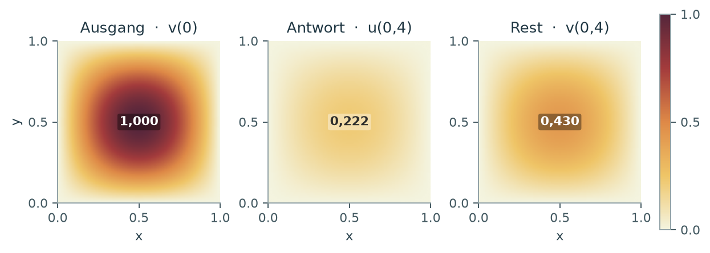
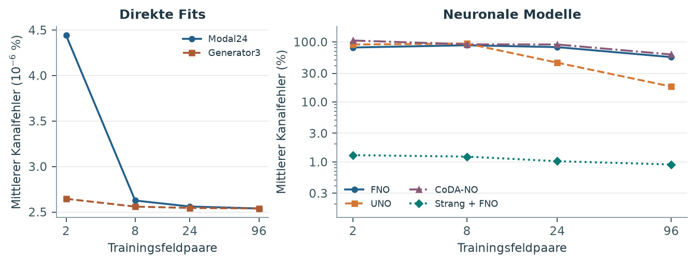

# Wie viel Physik muss ein neuronaler Operator lernen?

**Ergänzung zu Kapitel 9.43 · Numerische Simulation dynamischer Systeme**

Zwei dünne, übereinanderliegende Platten können Wärme über ihre gemeinsame Fläche austauschen. Die Ränder halten wir auf der Referenztemperatur null. Zu Beginn erwärmen wir nur die untere Platte in der Mitte. Wie viel von diesem Muster finden wir wenig später in der oberen Platte wieder? Diese Frage ist anspruchsvoller, als zwei plausible Temperaturbilder zu zeichnen. Sie verlangt, dass das Modell den Einfluss eines Feldes auf das andere richtig wiedergibt.

{width=98%}

Im Versuch aus Abschnitt 9.43 variiert die anfängliche Temperaturverteilung. Ihre räumlichen Bausteine, die Materialeigenschaften und der Beobachtungszeitpunkt sind fest. Eine überraschende Gegenprobe besteht darin, dem Modell nur die sechs räumlichen Bausteine zu verraten. Wie viel Wärme zwischen den Platten fließt, muss es weiterhin aus Beispielen bestimmen.

**Gemessener Ausgangspunkt.** Auf 32 ungesehenen Feldpaaren reproduziert diese Konstruktion mit 24 gelernten Zahlen relative Feldfehler von $2{,}55\cdot10^{-8}$ und $2{,}53\cdot10^{-8}$. Beträgt der Fehler auch dann so wenig, wenn wir ein anderes Muster aufprägen? Ein Versuch mit drei neuen Moden, ein Versuch mit anderem Material und ein Versuch mit längerer Beobachtungszeit geben drei verschiedene Antworten.

{{RUNTIME_LEAD}}

<!-- page -->

## Von der Wärmebilanz zur exakten Gegenprobe

Auf dem Einheitsquadrat $\Omega=(0,1)^2$ seien $u$ und $v$ die Temperaturabweichungen. Höhere Temperatur im Nachbarfeld führt lokal zu einem positiven Wärmestrom. Mit Diffusivitäten $d_u,d_v>0$ und Austauschrate $\kappa\geq0$ folgt

$$
\partial_t u=d_u\Delta u+\kappa(v-u),\qquad
\partial_t v=d_v\Delta v+\kappa(u-v),\qquad u=v=0\quad\text{auf }\partial\Omega .
$$

Multiplikation mit $u$ bzw. $v$, Integration und partielle Integration liefern eine Kontrolle für das Vorzeichen der Kopplung. Der Randterm verschwindet und $u(v-u)+v(u-v)=-(u-v)^2$. Damit gilt

$$
\tfrac12\,\tfrac{d}{dt}(\|u\|_2^2+\|v\|_2^2)
=-d_u\|\nabla u\|_2^2-d_v\|\nabla v\|_2^2-\kappa\|u-v\|_2^2 .
$$

Der Ansatz $\phi_{mn}=\sin(m\pi x)\sin(n\pi y)$ erfüllt die Randwerte. Zweimaliges Ableiten ergibt $\Delta\phi_{mn}=-\lambda\phi_{mn}$ mit $\lambda=\pi^2(m^2+n^2)$. Schreiben wir $(u,v)=\sum_k\phi_k z_k$ mit $z_k=(a_k,b_k)^\top$, ergibt der Koeffizientenvergleich für jede Mode eine eigene Zweifeldgleichung

$$
\dot z_k=A_\lambda z_k,\qquad
 A_\lambda=\begin{pmatrix}-\lambda d_u-\kappa&\kappa\\ \kappa&-\lambda d_v-\kappa\end{pmatrix},
\qquad z_k(T)=E_\lambda(T)z_k(0).
$$

Für die Gegenrechnung setzen wir $s=\kappa+\lambda(d_u+d_v)/2$, $\delta=\lambda(d_v-d_u)/2$ und $\omega=(\delta^2+\kappa^2)^{1/2}$. Bei $B=A_\lambda+sI$ sind die Diagonaleinträge $\delta,-\delta$ und die Nebendiagonalen $\kappa$. Die Kreuzterme heben sich beim Quadrieren auf, also $B^2=\omega^2I$. Die geraden und ungeraden Glieder der Exponentialreihe liefern

$$
E_\lambda(T)=e^{-sT}\left[\cosh(\omega T)I+
      \tfrac{\sinh(\omega T)}{\omega} B\right].
$$

Bei $\omega=0$ hat der Quotient den Grenzwert $T$. Für $(m,n)=(1,1)$ und $(d_u,d_v,\kappa,T)=(0{,}03,0{,}06,1{,}25,0{,}4)$ ergibt sich $E_{11}=0{,}5351233$, $E_{22}=0{,}4299266$ und $E_{12}=E_{21}=0{,}2220552$. Eine zusätzliche Einheit im unteren Feld erhöht das obere Feld im Mittelpunkt folglich um $0{,}2220552$. Das ist die Antwort, die der Kopplungstest abfragt.

<!-- page -->

## Vier Zahlen pro Mode aus Bildern bestimmen

Das Training kennt die Moden $(1,1),(2,1),(1,2),(2,2),(3,1),(1,3)$. Jede kann in beiden Feldern unabhängig angeregt sein. Sechs räumliche Basisfunktionen liefern also zwölf freie Anfangskoeffizienten pro Feldpaar. Der Modaloperator kennt die Basis, die Linearität und die Unabhängigkeit verschiedener Moden. Die vier Einträge jedes Übertragungsblocks sind frei.

Ein Quadratgitter mit $n$ Knoten je Achse hat Innenindizes $i=1,\ldots,n-2$. Für auflösbare Frequenzen gilt $\sum_i\sin(m\pi i/(n-1))\sin(p\pi i/(n-1))=(n-1)\delta_{mp}/2$. Die Identität folgt aus $2\sin a\sin b=\cos(a-b)-\cos(a+b)$ und der endlichen geometrischen Summe der komplexen Exponentialfunktionen. Das zweidimensionale Skalarprodukt zerfällt in ein Produkt dieser Summen. Daraus folgt für ein abgetastetes Bild $f$

$$
\hat f_{mn}=\frac{4}{(n-1)^2}\sum_{i,j=1}^{n-2}f_{ij}\phi_{mn}(x_i,y_j).
$$

Für Mode $k$ schreiben wir die beiden Anfangsamplituden von Beispiel $j$ als Zeile $X_{j:}$ und die beiden Zielamplituden als $Y_{j:}$. Eine Matrix $M_k$ wirkt auf Spalten, also gilt in dieser Zeilenschreibweise $Y=XM_k^\top$. Minimieren wir $\|XM_k^\top-Y\|_F^2$, ergibt das Nullsetzen der Ableitung $X^\top X M_k^\top=X^\top Y$. Bei Rang zwei ist der Minimierer eindeutig. Das Labor löst das Ausgleichsproblem mit `lstsq`, ohne $X^\top X$ zu bilden.

$$
\widehat M_k^\top=X^\dagger Y,\qquad
\widehat{\boldsymbol u}(T)=\sum_{k=1}^{6}\phi_k\,\widehat M_k
              \begin{pmatrix}\hat u_k(0)\\\hat v_k(0)\end{pmatrix}.
$$

**Warum können zwei Beispiele genügen?** Zwei Feldpaare liefern pro Mode zwei Zeilen mit je zwei Ausgangswerten. Sind ihre Anfangsamplituden linear unabhängig, identifizieren sie alle vier Einträge. Heizen beide Beispiele die Platten stets im gleichen Verhältnis, bleibt eine Eingangsrichtung unbeobachtet. Die Rangprüfung im Labor weist diesen Fall zurück. Beinahe parallele Zeilen verstärken Messfehler, selbst bei formal vollem Rang.

**Wo endet diese Folgerung?** Ein reines Muster außerhalb der sechs Funktionen hat Projektion null. Der trainierte Operator gibt für dieses Muster auf einem auflösenden Gitter näherungsweise null zurück. Ein feineres Gitter liefert mehr Abtastpunkte für dieselben sechs Projektionen. Erst ein Zusammenhang zwischen *verschiedenen* Moden gibt dem Modell eine Fortsetzungsvorschrift.

<!-- page -->

## Zwei Möglichkeiten, Physik zwischen den Moden zu teilen

**Ein gelernter Generator.** In $A_\lambda$ tauchen über alle Moden dieselben drei Materialparameter auf. Bei bekanntem $T>0$ und exakt beobachtetem Block gibt es eine direkte Herleitung. Da $E$ symmetrisch positiv definit ist, gilt $A=T^{-1}\log E$. Die Eigenzerlegung $E=Q\,\mathrm{diag}(\eta_i)\,Q^\top$ liefert $\log E=Q\,\mathrm{diag}(\log\eta_i)\,Q^\top$. Damit lesen wir $\kappa=A_{12}$, $d_u=(-A_{11}-\kappa)/\lambda$ und $d_v=(-A_{22}-\kappa)/\lambda$ ab.

Im Experiment schätzen wir die drei Größen gemeinsam aus allen sechs Moden. Die Zielfunktion summiert $\|E_\lambda(T;\theta)z_j(0)-z_j(T)\|_2^2$ über Beispiele und Moden. Eine nichtnegative Ausgleichsrechnung startet bei $(0{,}05,0{,}05,0{,}75)$. Der Ansatz nutzt die PDE-Form und die bekannte Trainingszeit. Bei der Vorhersage bekommt er nur den gewünschten Zeitpunkt. Die geschätzten Materialwerte bleiben fest. Auf den 96 Nominalfeldern ergibt der Fit $(0{,}02999999997,\,0{,}06000000005,\,1{,}25000000053)$. Die Modellklasse enthält hier das Gesetz des synthetischen Datengenerators. Der Transfer auf neue Frequenzen prüft diese Annahme innerhalb derselben PDE-Familie.

**Ein Physik-Layer mit absichtlichem Näherungsfehler.** Für einen echten Residualversuch soll die Grundrechnung einen messbaren Fehler haben. Schreibe $D=-\lambda\,\mathrm{diag}(d_u,d_v)$ und $K=\kappa\left(\begin{smallmatrix}-1&1\\1&-1\end{smallmatrix}\right)$. Ein Strang-Schritt führt nacheinander halbe Diffusion, vollen Austausch und halbe Diffusion aus. Mit $H=\mathrm{diag}(e^{-\lambda d_uT/2},e^{-\lambda d_vT/2})$ und $b=(1-e^{-2\kappa T})/2$ folgt

$$
S_\lambda(T)=e^{TD/2}e^{TK}e^{TD/2}
=H\begin{pmatrix}1-b&b\\b&1-b\end{pmatrix}H.
$$

Die Austauschmatrix folgt aus den Eigenrichtungen $(1,1)$ und $(1,-1)$ mit Eigenwerten $0$ und $-2\kappa$ für $K$. Eine diskrete Sinustransformation vom Typ I wendet $S$ auf **alle** aufgelösten Moden an. Für $[D,K]=DK-KD$ ist der obere Nebendiagonaleintrag $\lambda\kappa(d_v-d_u)$. Kommutieren beide Matrizen, ist die Aufspaltung exakt. Ausmultiplizieren der drei Reihen ergibt die Terme $I+T(D+K)+T^2(D+K)^2/2$. In Ordnung drei hat etwa $D^2K$ den Koeffizienten $1/8$ statt $1/6$ und $DKD$ den Koeffizienten $1/4$ statt $1/6$. Das Zusammenfassen aller Terme ergibt den Splittingfehler. Der kubische Term von $S-E$ lautet

$$
T^3\left(-[D,[D,K]]/24+[K,[K,D]]/12\right).
$$

Diese Aussage gilt pro fester Mode für kleine $T$. Hohe Frequenzen vergrößern $\lambda$. Ein großer Einzelschritt kann dort entsprechend ungenau werden. [Strang (1968)](https://doi.org/10.1137/0705041)

<!-- page -->

## Was die Modelle während des Trainings sehen

| Modell | Eingebaute Information und gelernter Anteil |
|:---|:---|
| FNO / UNO / CoDA-NO | FNO lernt Faltungen im Fourierraum. UNO wechselt hier zwischen zwei Auflösungen. CoDA-NO wendet Attention auf Feldvariablen an. Der PR verwendet für alle eine ungerade Fortsetzung und Rückprojektion am Rand. |
| Modal24 / Generator3 | Sechs freie $2\times2$-Blöcke bzw. drei gemeinsame Materialparameter. Beide Schätzungen sehen nur die Trainingsfeldpaare. Generator3 kennt zusätzlich die PDE-Form und $T$. |
| Strang | Bekannte $d_u,d_v,\kappa,T$. Der Einzelschritt liefert die Vergleichsbasis für beide Residualmodelle. |
| Strang + R24 | Addiert sechs gelernte Matrizen für den Rest $y-Sx$. Die Korrektur ist außerhalb des bekannten Modenraums null. |
| Strang + FNO | Addiert das FNO derselben Breite wie im PR. Es lernt $(y-Sx)/s_R$, mit $s_R$ als RMS des Trainingsrests. Bei Inferenz wird mit $s_R$ zurückskaliert. Der Ausgabekopf startet bei null. |

**Getrennte Daten.** Die drei PR-Seeds 42201, 42202 und 42203 erzeugen 96 Trainings-, 24 Validierungs- und 32 Testfeldpaare. Für die $j$-te Mode in der vorgegebenen Reihenfolge hat jeder Kanal unabhängige Standardnormalamplitude geteilt durch $j^{1{,}2}$. Training und Validierung laufen auf $13\times13$. Dieselben Testkoeffizienten werden auf $13\times13$ und $25\times25$ ausgewertet. Alle Nominalfelder stimmen im Test elementweise mit dem PR-Generator überein. Die Feldpaare werden in Float32 gespeichert. Projektion, Matrixfit und spektrale Physik rechnen in Float64.

**Optimierung.** Adam, Lernrate $0{,}003$, Batchgröße 16, 40 Epochen, Auswahl nach Validierungs-MSE. Das FNO-Residual darf bei Epoche null bleiben. Alle Vergleichsnetze werden von Grund auf trainiert. Sie nutzen die Originalimplementierungen aus NeuralOperator 2.0.0. Deren Modellklassen sind in den Primärarbeiten beschrieben. [FNO](https://arxiv.org/abs/2010.08895) · [U-NO](https://arxiv.org/abs/2204.11127) · [CoDA-NO](https://arxiv.org/abs/2403.12553)

**Drei Messgrößen.** $e_u$ und $e_v$ sind pro Kanal die Mittelwerte von $\|\hat y_j-y_j\|_2/\|y_j\|_2$ über 32 Feldpaare. Für $e_\Delta$ setzen wir $u_0=\phi_{11}$ fest, wechseln $v_0$ von null auf $\phi_{11}$ und vergleichen die Änderungen im gesamten $u$-Feld. Der skalare Fehler $|\widehat M_{12}/E_{12}-1|$ misst nur einen Matrixeintrag. Schreiben wir $\Delta u_f=f_u(\phi_{11},\phi_{11})-f_u(\phi_{11},0)$ und $\Delta u$ für die Referenz, so ist $e_\Delta=\|\Delta u_f-\Delta u\|_2/\|\Delta u\|_2$. Bei verschwindender Referenzantwort protokolliert das Labor die absolute diskrete Norm.

<!-- page -->

## Feldfehler, Kopplung und Rechenzeit

{{ID_TABLE}}

Alle Fehler sind Prozentwerte auf $25\times25$. Bei den Netzen stehen arithmetische Mittel über die drei Initialisierungen 2027, 73 und 3917, bei den linearen und physikalischen Fits die Originaltrainingsfelder mit Seed 42201. Die Spalte für die Anpassung enthält bei Netzen den Median der drei Laufzeiten einschließlich Validierung und Wiederherstellung des gewählten Zustands. Bei direkten Fits ist sie der Median von 21 Anpassungen. Die Einzelfeldzeit umfasst ein komplettes Zweifeldpaar, drei Aufwärmaufrufe und 21 gemessene Aufrufe je Modell. Gitterabhängige Faktoren sind warm. Die CPU war ein Intel Xeon Platinum 8573C mit einem Rechenthread je Lauf. Die 42 Netztrainings benötigten zusammen {{TOTAL_COST}} s Anpassungszeit. Datenerzeugung und Dateizugriffe liegen außerhalb der Messung.

**Nachrechnung am ersten Kopplungsblock.** Bei Modal24 beträgt der relative Fehler des skalaren Eintrags $2{,}2700\cdot10^{-9}$. Für die PR-Feldgegenprobe beträgt er $1{,}1107\cdot10^{-7}$ als dimensionsloses Verhältnis. Zwei einzeln auf Float32 gerundete Zielbilder werden hier voneinander abgezogen. Dazu kommt die Projektion der gerundeten Eingangsbilder. Beide Fehler sind mit ihrem jeweiligen Nenner zu lesen.

{{ARCHIVE_TEXT}}

**Was trägt der Physikanteil?** Strang allein macht bei $u$ rund $1{,}50\,\%$ Fehler. Das FNO lernt den verbleibenden Rest bei unveränderter Zahl seiner trainierbaren Gewichte. Sein Trainings-RMS ist ein zusätzlicher gespeicherter Skalar. Der Kopplungsfehler steigt jedoch von 0,23 % auf 0,44 %. Strang + R24 erreicht auf den bekannten Moden den Genauigkeitsbereich des direkten Modaloperators. Algebraisch kann ein freier Residualblock dort den gesamten Fehler von $S_\lambda$ aufnehmen.

<!-- page -->

{{RUNTIME_SECTION}}

<!-- page -->

## Wie viele Trainingsfelder werden gebraucht?

{width=100%}

Die Teilmengen $N=2,8,24,96$ sind geschachtelte Präfixe derselben Trainingsfolge. Bei den Netzen bleibt die Initialisierung 2027 fest. Die 24 zusätzlichen sauberen Validierungsfelder werden für die Netzauswahl verwendet. Der direkte Modalfit und der Generator benötigen diese Auswahl nicht. Schon bei $N=2$ misst Modal24 $4{,}24\cdot10^{-8}$ für $u$ und $4{,}65\cdot10^{-8}$ für $v$. Das ist ein Ergebnis genau dieser zwei unabhängigen Anregungen.

**Ist jede Verbesserung ein Dateneffekt?** Bei Batchgröße 16 bedeuten 40 Epochen mit acht Feldern 40 Adam-Schritte, mit 96 Feldern dagegen 240. Deshalb wiederholen wir den Acht-Felder-Versuch mit 240 Schritten. Der Eintrag ist $100(e_u+e_v)/2$, jeweils mit derselben Initialisierung und denselben 32 Tests.

{{STEPS_TABLE}}

Bei gleichem Schrittbudget verarbeitet der Lauf mit acht Feldern 1 920 Beispielpräsentationen, der mit 96 Feldern 3 840. Die kleinen Teilmengen wurden mit einer Netzinitialisierung geprüft. Über die Streuung dieser Lernkurven bei anderen Initialisierungen geben die Punkte keine Auskunft.

<!-- page -->

## Was geschieht mit einer räumlich neuen Anregung?

Wir erzeugen weitere unabhängige Anfangskoeffizienten für $(3,2),(2,3),(4,1)$ mit Seed 62203. Ihre Laplace-Eigenwerte $13\pi^2$ und $17\pi^2$ kamen im Training nicht vor. Alle Moden sind bereits auf dem groben Gitter auflösbar. Der reine Test enthält nur die drei neuen Muster. Der Mischtest addiert bekannte und neue Anfangsfelder, jeweils mit dem Faktor $1/\sqrt{2}$. Die tatsächlich verbleibende Energie hängt danach von der Diffusion und vom Kanal ab.

{{MODES_TABLE}}

Die Tabelle zeigt den mittleren relativen Fehler in Prozent. Die Spalte „rein“ prüft eine Vorhersage ohne jeden bekannten Modenanteil. FNO, UNO, CoDA-NO und der FNO-Hybrid sind wieder Mittelwerte der drei nominal trainierten Netze. Große Prozentwerte sind bei stark gedämpften Zielmoden möglich. Im Rohdatensatz ist jeder Feldfehler einzeln verfügbar.

**Erklärung aus der Projektion.** Zerlegen wir das Ziel orthogonal als $y=y_\parallel+y_\perp$, so beträgt der relative Fehler eines auf den bekannten Moden exakten Projektors $\|y_\perp\|/\sqrt{\|y_\parallel\|^2+\|y_\perp\|^2}$. Beim reinen Test ergibt dies eins. Die hier gelernte Materialgleichung berechnet für eine neue Frequenz dagegen einen neuen Block aus $\lambda$. Sie lässt sich auf genau dieselbe lineare PDE fortsetzen.

**Erklärung aus dem Residual.** Strang + R24 fällt bei einem reinen unbekannten Muster auf die Physikrechnung zurück. Der FNO-Rest verändert auf den neuen Moden den Fehler in $u$ von 5,95 % auf 2,53 % und in $v$ von 9,06 % auf 11,14 %. Aus der guten Korrektur eines bekannten Musters folgt deshalb keine garantierte Verbesserung für beide neuen Felder.

<!-- page -->

## Gleiche Anfangsfelder, anderes Material

Wir halten die Anfangsbilder fest und wechseln jeweils nur eine physikalische Einstellung. Bei „Diffusion“ tauschen $d_u$ und $d_v$ die Werte. In der Tabelle steht $100(e_u+e_v)/2$. Der Datensatz enthält außerdem $\kappa=0$, $T=0$ und alle Einzelkanäle.

{{SHIFT_TABLE}}

Ein deterministisches Modell $f(x)$ erhält bei gleichen Bildern $x$ unter zwei Materialgesetzen dieselbe Eingabe. Aus der Dreiecksungleichung folgt $\max_i\|f(x)-G_i(x)\|\geq\|G_1(x)-G_2(x)\|/2$. Geänderte Parameter sind also eine Informationsfrage. Modal24 sowie die originalen Netze bekommen keine Materialangabe. Generator3 bekommt den neuen Zeitpunkt. Strang und seine Hybride erhalten auch die neuen Materialwerte. „Strang fest“ verwendet als Kontrolle überall die Nominalwerte.

**Gleiche Information für beide Netze.** Ein zweiter Versuch trainiert FNO und Strang + FNO auf denselben 96 variablen Parametersätzen. Die vier unabhängigen Gleichverteilungen haben die Intervalle $[0{,}018;0{,}045]$, $[0{,}04;0{,}09]$, $[0{,}6;1{,}8]$ und $[0{,}25;0{,}55]$ für $d_u,d_v,\kappa,T$. Vier zusätzliche Eingabekanäle tragen $(p_i/p_{i,0}-1)\phi_{11}$. Der Faktor erhält die Randbedingung. Beide Netze sehen identische Informationen, der Hybrid setzt sie zusätzlich in der Rechnung ein. 24 Validierungs- und 32 Testparameter werden mit unabhängigen Seeds gezogen.

{{COND_TEXT}}

{{PAIR_CI}}

<!-- page -->

## Wie verändert Rauschen die Rangrechnung?

Im ersten Rauschversuch stören wir ausschließlich die Trainingsziele. Eingaben, Validierung und Tests bleiben sauber. Das Rauschniveau $\rho$ bezeichnet den erwarteten RMS des additiven Fehlers, relativ zum RMS des jeweiligen Zielkanals auf den inneren Gitterpunkten. Der Rand bleibt exakt null. Bei räumlich weißem Rauschen ziehen wir für jeden inneren Knoten eine unabhängige Normalvariable. Als Gegenprobe verteilen wir die gleiche erwartete Störleistung ausschließlich auf die sechs bekannten Sinusmoden.

{{NOISE_TABLE}}

Jeder Eintrag ist der mittlere Kanalfehler in Prozent. Bei den strukturierten Fits ist dies der Mittelwert über drei unabhängige Trainingsziehungen mit Seeds 42201, 42211 und 42221. Alle sehen dieselben sauberen Tests. Die Werte in den neuronalen Störversuchen stammen aus einem Start. Ein Datensatz pro Rauschrealisierung liefert hier deskriptive Vergleiche.

**Warum hilft die Projektion gegen Pixelrauschen?** Für einen Modenvektor $\phi$ und unabhängige Knotenfehler mit Varianz $\sigma^2$ hat der Projektionsfehler Varianz $\sigma^2/\|\phi\|_2^2=4\sigma^2/(n-1)^2$. Bei bereits modaler Störung fehlt diese räumliche Mittelung. Für eine Zielspalte mit homoskedastischen modalen Störungen der Varianz $\tau^2$ gilt $\mathrm{Cov}(\hat\beta\mid X)=\tau^2(X^\top X)^{-1}$. Bei den verwendeten feldabhängigen Skalen tritt an ihre Stelle $X^\dagger\mathrm{diag}(\tau_j^2)(X^\dagger)^\top$. Schlecht angeregte Richtungen verstärken das Rauschen.

{{NOISE_NN_TEXT}}

**Reichweite der Messung.** Untersucht wurden ein Quadrat, homogene Dirichlet-Ränder, räumlich konstante Koeffizienten, synthetische Anfangsfelder sowie Rauschen in getrennten Ein- und Ausgangsversuchen. Bei ortsabhängiger Diffusivität koppelt bereits der Diffusionsterm verschiedene Sinusmoden. Die unabhängige $2\times2$-Regression verliert dann ihre exakte Grundlage. Das ist eine Folgerung aus der Modellgleichung. Ein räumlich veränderliches Materialgesetz wurde in dieser Messreihe nicht erprobt.

<!-- page -->

## Wenn bereits die Eingangsfelder rauschen

Eine Kamera kann eine verrauschte Anfangstemperatur liefern, selbst wenn die spätere Referenzmessung präzise ist. Wir wiederholen die nominalen Fits mit einer Störung von 5 % ausschließlich am Eingang des Trainings. Validierung und Test erhalten wieder saubere Bilder. Der Vergleich mit dem Zielrauschen verwendet dieselben Zufallsziehungen für die Störung und skaliert diese jeweils auf den RMS des betroffenen Kanals.

{{SENSOR_TABLE}}

Die Zahlen sind mittlere Kanalfehler in Prozent bei 96 Trainingspaaren. Die drei direkten Fits mitteln über drei Trainingsziehungen. Bei den vier Netzen ist der Start 2027 mit seinem sauberen Kontrolllauf gepaart. Die letzte Spalte wurde für die direkten Fits ausgeführt. Sie beschränkt das Eingangsrauschen vollständig auf die sechs Trainingsmoden.

**Warum macht die Seite des Fehlers einen Unterschied?** Betrachten wir eine Mode mit wahren zentrierten Eingangsamplituden $x$, Ziel $Mx$ und beobachtetem Eingang $x+\eta$. Für zentrierten Fehler mit $\mathbb E[\eta\mid x]=0$ verschwindet der Kreuzterm $\mathbb E[x\eta^\top]$. Der Minimierer $L$ des erwarteten quadratischen Vorhersagefehlers erfüllt die Normalgleichung

$$
L\,\mathbb E[(x+\eta)(x+\eta)^\top]=M\,\mathbb E[x(x+\eta)^\top], \qquad
L=M\Sigma_x(\Sigma_x+\Sigma_\eta)^{-1}.
$$

In einer skalaren Richtung mit Varianzen $s_x^2,s_\eta^2$ verkleinert sich die Steigung um den Faktor $s_x^2/(s_x^2+s_\eta^2)$. Das ist eine Aussage über den Populationsfit. Beim Zielrauschen mit verschwindendem bedingtem Mittelwert liegt die wahre Steigung dagegen weiterhin im Zentrum des Fits. Der Trainingsfehler allein zeigt diesen Unterschied nicht. Ein separater Versuch mit verrauschten Eingaben *auch während der Vorhersage* wäre eine andere Messfrage.

<!-- page -->

## Rechenlabor und Aufgaben mit Lösungen

**1 · Welches Experiment identifiziert den Transfer?** Zwei Messungen regen eine Mode mit $(1,0)$ und $(2,0)$ an. Kann man bestimmen, wie stark das zweite Feld das erste heizt?

*Lösung.* Beide Zeilen von $X$ sind parallel zur ersten Koordinatenachse. Auch bei perfekten Zielen bleibt die zweite Spalte von $M$ frei. Eine zusätzliche Anregung $(0,1)$ liefert unmittelbar diese Spalte. Mit $(1,0)$ und $(1,1)$ ergibt ihre Differenz dieselbe Antwort. Genau das nutzt die Feldgegenprobe.

**2 · Welche Aussage prüft der Kopplungstest beim Materialtausch?** Erklären Sie, wie Modal24 beim Tausch der beiden Diffusivitäten den Kopplungstest bestehen und gleichzeitig große Feldfehler haben kann.

*Lösung.* Der Tausch ändert $\delta$ in $-\delta$. Die Größe $\omega$ und die Nebendiagonale $e^{-sT}\kappa\sinh(\omega T)/\omega$ bleiben gleich. Die Diagonaleinträge wechseln ihre Plätze. Die Kopplungsantwort kann korrekt sein, während die Beiträge des eigenen Anfangsfeldes erheblich abweichen. Deshalb protokolliert die Studie Feldfehler *und* Kopplung.

**3 · Wann beschädigt eine Residualkorrektur eine exakte Basis?** Setzen Sie $\kappa=0$, behalten Sie die bei $\kappa=1{,}25$ gelernten Gewichte und interpretieren Sie den Rückgabewert der relativen Kopplungsmetrik.

*Lösung.* Bei $\kappa=0$ gilt $K=0$ und $S=e^{TD}$. Die exakte Antwort auf eine zusätzliche Anregung im anderen Feld ist null. Der Quotient für den relativen Kopplungsfehler ist undefiniert. Ein bei der Nominalkopplung gelernter additiver Rest kann eine scheinbare Antwort erzeugen. Das Labor gibt dafür eine absolute diskrete Norm und ein leeres relatives Feld aus. Im Nullkopplungstest wurden für Strang genau 0 und für Strang + R24 rund 0,00612 absolute L2-Abweichung auf dem 25er-Gitter gemessen.

**Den Befund nachrechnen.** Der Paket-Einstieg ist `README.md`. Die Datei `results/structured.csv` enthält die direkten Fits und die Physikkontrollen, `results/neural.csv` alle Netzmessungen. Jede Zeile identifiziert Trainingsfall, Seed, Testszenario und Metrik. `results/weights/` enthält die gewählten Netzzustände. Das Labor prüft den Referenzgenerator unter anderem mit einem separaten DOP853-Lauf und einer Padé-Matrixexponentialfunktion.

**Quellstand.** Grundlage ist der am 27. November 2026 gemergte Vergleich in Kapitel 9.43, Commit `72d670b5`. Originalgenerator und archivierte Messdatei liegen mit SHA-256-Prüfung im Rechenlabor. [PR 91](https://github.com/5H3LL3H5/argesim-hyperposition-benchmarks/pull/91) · [Originalgenerator](https://github.com/5H3LL3H5/argesim-hyperposition-benchmarks/blob/72d670b51c94c8366ca5f1e070fc4730c78d0d52/docs/lehrbuch/gesamtausgabe/rechenlabor/codano/austausch.py) · [Originalmessungen](https://github.com/5H3LL3H5/argesim-hyperposition-benchmarks/blob/72d670b51c94c8366ca5f1e070fc4730c78d0d52/docs/lehrbuch/gesamtausgabe/rechenlabor/codano/messung_kapazitaet.json)
